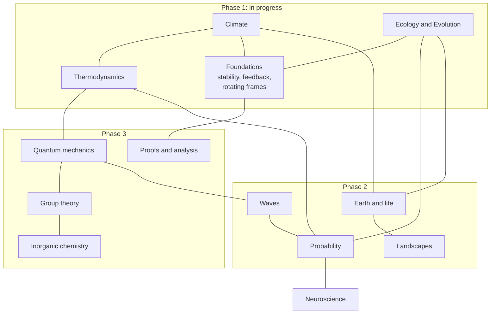

# Second Brain · Home

A connected, text-and-figure heavy knowledge base built on top of the course material in this repository. Every subject has a **course map**, sequential **chapters** (redundancy between lecturers removed), atomic **concept notes** that act as graph hubs, generated **figures**, **canvases**, **Excalidraw** sketches and LaTeX **PDF handouts**. Everything is classified by **tags, not folders**: what was *taught* (and is therefore in the syllabus) is kept visibly apart from *extra* material.

> [!key] Start here
> - Where things stand: [[PROGRESS]] · what comes next: [[Roadmap]] · live lists: [[Dashboard]] · all concepts: [[Glossary]]
> - How notes are written and labelled: [[Conventions]] · tools and scripts: [[Toolkit]] · sources: [[Sources]]
> - How the subjects relate: [[Subject Map]] ([[Subject Map.canvas|canvas]])
> - **First subject, mapped:** [[Climate - Course Map]] · **quiz material:** [[Climate Quiz Prep]]

## Scope labels (everywhere)
<span class="scope-taught">taught · in syllabus</span> shown or said in class · <span class="scope-extra-book">extra · book</span> in an assigned book but not shown in class · <span class="scope-extra-beyond">extra · beyond</span> added from outside the course. Tags: `#taught`, `#extra/book`, `#extra/beyond`; instructors `#src/argha`, `#src/suhas-pre`, `#src/suhas-post`.

## Subjects
| Subject | Map | Status | Phase |
|---|---|---|---|
| Climate (EC2113) | [[Climate - Course Map]] · [[Climate Quiz Prep]] | **all 15 chapters drafted** (≈95,000 words), 84 concept notes, 66 figures, quiz hub | 1 |
| Thermodynamics and Statistical Mechanics (parallel track) | [[Thermodynamics - Course Map]] | 5 supporting notes for climate | 1 |
| Ecology and Evolution (BI2113) | [[Ecology and Evolution - Course Map]] | next | 1 |
| Foundations (shared tools) | [[Bistability and Tipping Points]] · [[Fixed Points and Linear Stability]] · [[Rotating Reference Frames]] | grows with every subject | 1 |
| Evolution of Earth and Life · Landscapes · Waves · Probability | [[Evolution of Earth and Life - Course Map]] · [[Landscapes and Geomorphology - Course Map]] · [[Waves - Course Map]] · [[Probability - Course Map]] | planned | 2 |
| Quantum Mechanics · Group Theory · Inorganic Chemistry · Proofs and Analysis | [[Quantum Mechanics - Course Map]] · [[Group Theory - Course Map]] · [[Inorganic Chemistry - Course Map]] · [[Proofs, Analysis and Topology - Course Map]] | planned | 3 |
| Neuroscience | [[Neuroscience - Course Map]] | planned last | 4 |

## The big picture


## Quick views
```dataview
TABLE WITHOUT ID status AS "Status", length(rows) AS "Chapters"
FROM #type/chapter
GROUP BY status
```

**Recently modified**
```dataview
TABLE WITHOUT ID file.link AS "Note", file.mtime AS "Modified"
FROM #type/chapter OR #type/concept OR #type/moc
SORT file.mtime DESC
LIMIT 10
```

## Using the graph
Open the graph view: nodes are coloured by subject (blue climate, green eco-evo, red thermodynamics, purple foundations), maps in yellow, extras in amber. Filter by tag, e.g. `tag:#extra/book` to see only the extra book material, or `tag:#taught` for the syllabus core.
