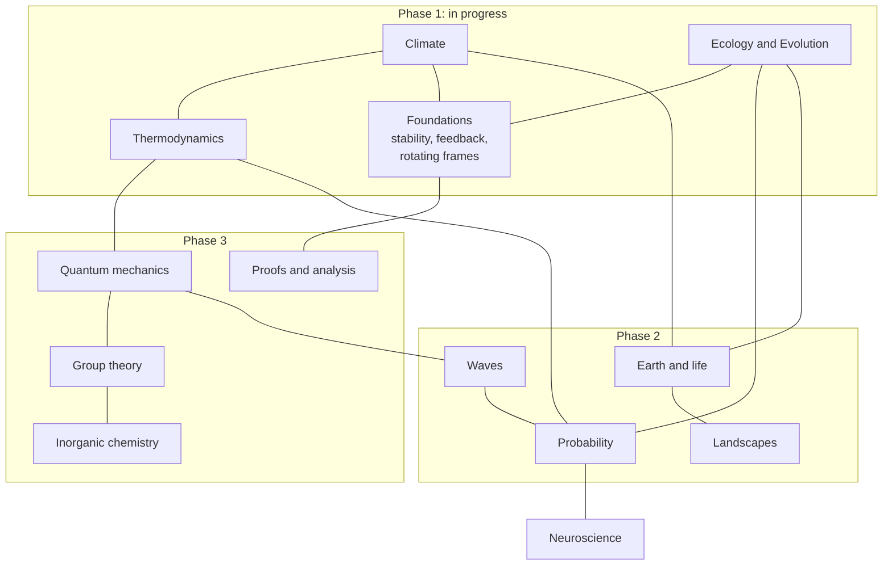

# Second Brain · Home

A connected, text-and-figure heavy knowledge base built on top of the course material in this repository. Every subject has a **course map**, sequential **chapters** (redundancy between lecturers removed), atomic **concept notes** that act as graph hubs, generated **figures**, **canvases**, **Excalidraw** sketches and LaTeX **PDF handouts**. Everything is classified by **tags, not folders**: what was *taught* (and is therefore in the syllabus) is kept visibly apart from *extra* material.

> [!key] Start here
> - Where things stand: [[PROGRESS]] · what comes next: [[Roadmap]] · live lists: [[Dashboard]] · all concepts: [[Glossary]]
> - How notes are written and labelled: [[Conventions]] · tools and scripts: [[Toolkit]] · sources: [[Sources]]
> - How the subjects relate: [[Subject Map]] ([[Subject Map.canvas|canvas]])
> - **See it, don't just read it:** [[Interactive Tools]], interactive visualisations (sliders, simulations, step-through explorers) for most chapters, one HTML file each, embedded as previews in the chapters
> - **First subject, mapped:** [[Climate - Course Map]] · **quiz material:** [[Climate Quiz Prep]]

## Scope labels (everywhere)
<span class="scope-taught">taught · in syllabus</span> shown or said in class · <span class="scope-extra-book">extra · book</span> in an assigned book but not shown in class · <span class="scope-extra-beyond">extra · beyond</span> added from outside the course. Tags: `#taught`, `#extra/book`, `#extra/beyond`; instructors `#src/argha`, `#src/suhas-pre`, `#src/suhas-post`.

## Subjects
| Subject | Map | Status | Phase |
|---|---|---|---|
| Climate (EC2113) | [[Climate - Course Map]] · [[Climate Quiz Prep]] | **all 15 chapters drafted** (≈95,000 words), 84 concept notes, 66 figures, quiz hub | 1 |
| Thermodynamics and Statistical Mechanics (parallel track) | [[Thermodynamics and Statistical Mechanics - Course Map]] | 5 supporting notes for climate | 1 |
| Ecology and Evolution (BI2113) | [[Ecology and Evolution - Course Map]] | next | 1 |
| Foundations (shared tools) | [[09-Foundations|Foundations - Course Map]] (stability and tipping points, fixed points, rotating frames, Fourier and Laplace transforms, Dirac algebra) | grows with every subject | 1 |
| Evolution of Earth and Life · Landscapes · Waves · Probability | [[Evolution of Earth and Life - Course Map]] · [[Landscapes and Geomorphology - Course Map]] · [[Waves - Course Map]] · [[Probability - Course Map]] | planned | 2 |
| Quantum Mechanics · Group Theory · Inorganic Chemistry · Proofs and Analysis | [[Quantum Mechanics - Course Map]] · [[Group Theory - Course Map]] · [[Inorganic Chemistry - Course Map]] · [[Proofs, Analysis and Topology - Course Map]] | planned | 3 |
| Differential Geometry (MT3184) | [[Differential Geometry - Course Map]] | **all 15 chapters drafted** (DM01–DM15 on Lee's *Introduction to Smooth Manifolds*; 98 concept notes, 43 zettel notes, 15 figures) with the prerequisites PA11–PA15 in the analysis vault | 3 |
| Classical Mechanics (PH2213) | [[Classical Mechanics - Course Map]] | **course map + CM01–CM11 written** (CM01–CM06 on 2026-11-04, CM07–CM11 on 2026-11-07); CMX1–CMX2 planned | 3 |
| Electrodynamics (PH3114) | [[Electrodynamics - Course Map]] | **course map + ED03–ED09 written** (ED03–ED08 on 2026-11-04, ED09 on 2026-11-07); Griffiths and Jackson equal priority; ED01–ED02, ED10–ED11, EDX1–EDX2 planned | 3 |
| Neuroscience | [[Neuroscience - Course Map]] | planned last | 4 |

## The big picture


## Quick views
```dataview
TABLE WITHOUT ID status AS "Status", length(rows) AS "Chapters"
FROM #type/chapter
GROUP BY status
```

**Recently modified**
```dataview
TABLE WITHOUT ID file.link AS "Note", file.mtime AS "Modified"
FROM #type/chapter OR #type/concept OR #type/moc
SORT file.mtime DESC
LIMIT 10
```

## Using the graph
**Home is the centre.** Its spokes are the 14 subject maps and every chapter (index below); each map's *Atlas* block links all of its notes, so every subject is a lobe around Home. The thin web between the lobes is the real cross-subject links (chapters, concept notes and their *Across subjects* sections). Colours are one per subject ([[Conventions]] §8). The graph shows the vault proper (the numbered folders): the other tool's source notes are hidden by default and come back with `.venv/bin/python scripts/graph_colors.py --apply --with-sources` (or delete the `-path:` terms for the source folders from the graph's filter box). The other `00-Home` notes (Glossary, PROGRESS, Roadmap and so on) are filtered out because they link to everything: open them through the **local graph**. Filter by tag, e.g. `tag:#extra/book` or `tag:#type/moc`.

<!-- graph-spine:start (generated by scripts/graph_spine.py; do not edit between the markers) -->
## Atlas: the other tool's loose notes
Source notes that belong to no single subject (the other tool's `maps/`, `inbox/` and uncategorised zettel).

> [!abstract]- Atlas (generated): 26 notes from the other tool (source layer)
> **Notes from the other tool (source layer) (26):** [[Classical Mechanics - Course Map]] · [[CM01 Variational Calculus and Hamilton's Principle]] · [[CM02 Lagrange's Equations, Constraints and Generalised Coordinates]] · [[CM03 Symmetries, Noether's Theorem and Conservation Laws]] · [[CM04 Central Forces and Effective One-Dimensional Motion]] · [[CM05 Scattering]] · [[CM06 Small Oscillations and Normal Modes]] · [[CM07 Rigid Bodies]] · [[CM08 Non-Inertial Frames]] · [[CM09 Hamilton's Equations and Poisson Brackets]] · [[CM10 Liouville's Theorem and Canonical Transformations]] · [[CM11 Hamilton-Jacobi Theory and Action-Angle Variables]] · [[ED03 Maxwell's Equations and Boundary Conditions]] · [[ED04 Conservation Laws - Energy, Momentum, Angular Momentum]] · [[ED05 Electromagnetic Waves in Vacuum]] · [[ED06 Waves in Matter, Reflection and Dispersion]] · [[ED07 Guided Waves]] · [[ED08 Potentials and Gauge Transformations]] · [[Electrodynamics - Course Map]] · [[HANDOFF_mt2113_week1]] · [[index]] · [[Interactive Tools]] · [[probability]] · [[PROGRESS_NOTES]] · [[research]] · [[zettel]]
<!-- graph-spine:end -->

<!-- graph-spine-chapters:start (generated by scripts/graph_spine.py; do not edit between the markers) -->
## All chapters (generated index: Home links every chapter)
The centre of the vault graph: **Home** links every subject map (the hubs) and every chapter below, so the graph radiates from here. Regenerate with `scripts/graph_spine.py --apply` after adding a chapter.

- **[[01-Climate/Climate - Course Map|Climate]]** (21): [[CL01 Earth as a System]] · [[CL02 Observing Global Temperature]] · [[CL03 Radiation and Planetary Energy Balance]] · [[CL04 Feedback and Multiple Steady States]] · [[CL05 Thermodynamic State of the Atmosphere]] · [[CL06 Hydrostatic Balance and Vertical Structure]] · [[CL07 Optical Properties of the Atmosphere]] · [[CL08 Greenhouse Models]] · [[CL09 Radiative-Convective Equilibrium]] · [[CL10 Global Energy Balance and Meridional Structure]] · [[CL11 Mean Meridional Circulation and Angular Momentum]] · [[CL12 Rotating Frames and the Coriolis Force]] · [[CL13 Horizontal Motion - Geostrophic Balance and Friction]] · [[CL14 Observed Winds - Jets, Trades and the ITCZ]] · [[CL15 Monsoons]] · [[CL16 Atmospheric Evolution Greenhouse Gases and the Carbon Cycle]] · [[CL17 Orbital Forcing and Glacial Cycles]] · [[CL18 The Ocean as the Climate System's Heat Reservoir]] · [[CL19 Wind-Driven Ocean Circulation]] · [[CL20 ENSO and the Walker Circulation]] · [[CL21 Thermohaline Circulation Water Masses and Sea Ice]]
- **[[02-Eco-Evo/Ecology and Evolution - Course Map|Ecology and Evolution]]** (7): [[EE01 Introduction to Biology and Ecological Thinking]] · [[EE02 Structured Population Models]] · [[EE03 Population Dynamics and Chaos]] · [[EE04 Competition and Invasions]] · [[EE05 Predation]] · [[EE06 Eutrophication and Alternative Stable States]] · [[EE07 Conservation Biology]]
- **[[03-Thermodynamics-and-Statistical-Mechanics/Thermodynamics and Statistical Mechanics - Course Map|Thermodynamics]]** (18): [[SM01 Probability Large Numbers and Information]] · [[SM02 Phase Space Liouville and the Microcanonical Ensemble]] · [[SM03 The Canonical Ensemble]] · [[SM04 Kinetic Theory and the Boltzmann Equation]] · [[SM05 The Grand Canonical Ensemble and Chemical Equilibrium]] · [[SM06 Entropy Information and the Arrow of Time]] · [[SM07 Equipartition the Virial Theorem and Magnetic Systems]] · [[SM08 Quantum Ensembles and Identical Particles]] · [[TH01 Temperature and the Zeroth Law]] · [[TH02 Work Heat and the First Law]] · [[TH03 The Ideal Gas and Adiabatic Processes]] · [[TH04 The Second Law Carnot Engines and Entropy]] · [[TH05 Potentials Maxwell Relations Stability and the Third Law]] · [[TH06 From Kinetic Theory to Statistical Mechanics]] · [[TH07 Enthalpy Thermochemistry and Calorimetry]] · [[TH08 Gibbs Energy Equilibrium Constants and Phase Boundaries]] · [[TH09 Microstates Macrostates and Multiplicity]] · [[THX1 Diffusion Random Walks and the Heat Equation]]
- **[[04-Evolution-of-Earth-and-Life/Evolution of Earth and Life - Course Map|Evolution of Earth and Life]]**: no chapters yet
- **[[05-Landscapes-Geomorphology/Landscapes and Geomorphology - Course Map|Landscapes]]** (35): [[FR01 Braided Rivers in 3D (Olsen 2021)]] · [[FR02 Secondary Currents and River Channel Patterns (Njenga 2013)]] · [[FR03 Flow at a River Bend with CCHE2D (Das and Biswal 2023)]] · [[FR04 Building the Himalaya (Dal Zilio et al 2021)]] · [[FR05 Did Erosion Accelerate in the Late Cenozoic (Schildgen et al 2018)]] · [[LS01 Landscapes as Physical Systems]] · [[LS02 Mechanics and Mathematics Toolkit]] · [[LS03 Digital Elevation Models and Terrain Analysis]] · [[LS04 Map Projections and Reference Surfaces]] · [[LS05 Shape of Planets]] · [[LS06 Maximum Topography]] · [[LS07 Isostasy]] · [[LS08 Plate Tectonics Strain Stress and Convection]] · [[LS09 Faults and Earthquakes]] · [[LS10 Folds Flexure and Mountain Building]] · [[LS11 Weathering and Regolith]] · [[LS12 Hillslope Transport and the Diffusion Equation]] · [[LS13 Landslides]] · [[LS14 Glaciers Mass Balance and Ice Flow]] · [[LS15 Glacial Deposits Rebound and Sea Level]] · [[LS16 Fluvial Landscapes]] · [[LS17 Aeolian Landscapes]] · [[LS18 Deccan Traps Terrain]] · [[LS19 Glacial and Aeolian Landforms]] · [[LS20 GIS and TopoToolbox Practicals]] · [[LS21 River Hydraulics and Hydraulic Geometry]] · [[LS22 Floods Planform and River Profiles]] · [[LS23 Bedrock Channels and River Incision]] · [[LS24 Sediment Transport Mechanics]] · [[LS25 Water in the Landscape]] · [[LS26 Sea Level and Ocean Waves]] · [[LS27 Coasts Beaches Deltas and Rocky Shores]] · [[LS28 Deccan Field Guide Lava Architecture and Sahyadri Stratigraphy]] · [[LS99 Landscapes Practice Problems]] · [[LSX1 Clocks in Rocks]]
- **[[06-Quantum-Mechanics/Quantum Mechanics - Course Map|Quantum Mechanics]]** (10): [[QM01 From Waves to Probabilities]] · [[QM02 The Schrodinger Equation and Stationary States]] · [[QM03 States Operators and Measurement]] · [[QM04 The Particle in a Box]] · [[QM05 The Harmonic Oscillator]] · [[QM06 The Oscillator Toolbox]] · [[QM07 The Finite Square Well]] · [[QM08 Quantum Tunnelling]] · [[QM09 The Stern-Gerlach Experiment and Spin]] · [[QM10 The Finite Barrier and Tutorial V]]
- **[[07-Waves/Waves - Course Map|Waves]]**: no chapters yet
- **[[08-Probability/Probability - Course Map|Probability]]** (8): [[PR01 Counting and the Axioms of Probability]] · [[PR02 Conditional Probability Bayes Rule and Independence]] · [[PR03 Discrete Random Variables and Distributions]] · [[PR04 Joint Distributions Expectation and Variance]] · [[PR05 Continuous Random Variables]] · [[PR06 Moments Generating Functions and Limit Theorems]] · [[PR07 Sums of Independent Variables Covariance and Correlation]] · [[PR08 Order Statistics and the Multinomial Distribution]]
- **[[09-Foundations/09-Foundations|Foundations]]** (2): [[Dirac Algebra]] · [[Fourier and Laplace Transforms]]
- **[[10-Group-Theory/Group Theory - Course Map|Group Theory]]** (13): [[GT-A1 Radical Residue and Hall Subgroups]] · [[GT-A2 Components and the Generalised Fitting Subgroup]] · [[GT-A3 Primitive Maximal Subgroups]] · [[GT01 Groups Subgroups and Cosets]] · [[GT02 Homomorphisms Normal Subgroups and Quotients]] · [[GT03 Cyclic and Abelian Groups and Direct Products]] · [[GT04 Commutators Simple Groups and Composition Series]] · [[GT05 Actions Conjugation and Sylow Theorems]] · [[GT06 Permutation Groups]] · [[GT07 p-Groups and Nilpotent Groups]] · [[GT08 Solvable Groups and Complements]] · [[GT09 Transfer and Normal p-Complements]] · [[GT10 Symmetry Representations and Characters]]
- **[[11-Proofs-Analysis-Topology/Proofs, Analysis and Topology - Course Map|Proofs, Analysis and Topology]]** (15): [[PA01 Logic and Methods of Proof]] · [[PA02 Sets Families and the ZFC Foundations]] · [[PA03 Relations Equivalence and Order]] · [[PA04 Functions and Cardinality]] · [[PA05 Induction and the Number Systems]] · [[PA06 The Real Numbers and Sequences]] · [[PA07 Metric and Topological Spaces]] · [[PA08 Mathematical Induction]] · [[PA09 Strong Induction and Recursion]] · [[PA10 Well-Ordering and Well-Ordered Pairs]] · [[PA11 Subspaces, Products and Quotients]] · [[PA12 Separation, Countability and Local Compactness]] · [[PA13 The Derivative and the Inverse Function Theorem]] · [[PA14 ODE Existence Uniqueness and Smooth Dependence]] · [[PA15 Covering Spaces and the Fundamental Group]]
- **[[12-Inorganic-Chemistry/Inorganic Chemistry - Course Map|Inorganic Chemistry]]** (10): [[CH01 VSEPR and Valence Bond Theory]] · [[CH02 Molecular Orbital Theory Diatomics]] · [[CH03 Molecular Orbital Theory Polyatomics]] · [[CH04 Acid-Base Concepts]] · [[CH05 Acid Strength Lewis Acidity and Reactions]] · [[CH06 Hard and Soft Acids and Bases]] · [[CH07 Main Group Cages and Clusters]] · [[CH08 Main Group Rings and Polymers]] · [[CH09 Redox]] · [[CH10 Crystal Field Theory]]
- **[[13-Neuroscience/Neuroscience - Course Map|Neuroscience]]**: no chapters yet
- **[[14-Differential-Geometry/Differential Geometry - Course Map|Differential Geometry]]** (17): [[DM01 Smooth Manifolds]] · [[DM02 Smooth Maps and Partitions of Unity]] · [[DM03 Tangent Vectors and the Differential]] · [[DM04 The Tangent Bundle and the Rank Theorem]] · [[DM05 Immersions, Embeddings, Submersions and Coverings]] · [[DM06 Submanifolds]] · [[DM07 Sard Whitney and Transversality]] · [[DM08 Lie Groups]] · [[DM09 Group Actions and Semidirect Products]] · [[DM10 Vector Fields and Lie Brackets]] · [[DM11 The Lie Algebra of a Lie Group]] · [[DM12 Integral Curves, Flows and Flowouts]] · [[DM13 Lie Derivatives and Commuting Vector Fields]] · [[DM14 One-Parameter Subgroups and the Exponential Map]] · [[DM15 Closed Subgroups and the Lie Correspondence]] · [[DM16 Distributions, Involutivity and the Frobenius Theorem]] · [[DM17 Foliations, Weakly Embedded Submanifolds and Lie Subgroups]]

<!-- graph-spine-chapters:end -->
