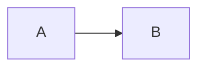

# Course Map

## Storyline


## Chapters
| # | Chapter | Taught by | Status |
|---|---|---|---|

```dataview
TABLE chapter AS "#", by AS "Taught by", scope AS "Scope", status AS "Status"
FROM #subject/ AND #type/chapter
SORT chapter ASC
```

## Concept index

## Sources and scope

## Cross-subject links
