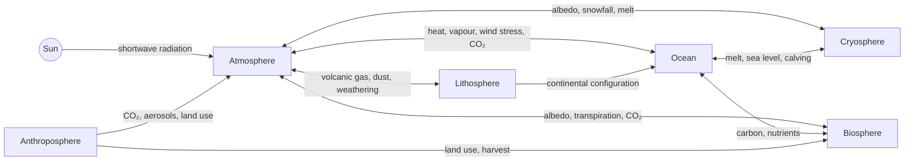

# CL01 · Earth as a System

[[Climate - Course Map|Course Map]] · [[CL02 Observing Global Temperature]] ▶

taught · in syllabus extra · book extra · beyond

> [!syllabus] Syllabus map: what is in the syllabus and what is extra in this chapter
> 🟢 **In syllabus (taught)**
> - §1 why bother: Anthropocene, hazards, planetary boundaries (Argha L1 sl. 2–4)
> - §2 the Earth system: interacting spheres, tipping points, course layout (sl. 5–8)
> - §3 Newtonian prediction and why the atmosphere is harder (sl. 10–11)
> - §4 first signs of climate: temperature, precipitation, long-term variability, ocean currents (sl. 12–15)
> - §5 physical preliminaries: formation, shape, rotation, orbit, flux, parallel rays, tilt and seasons (Suhas pre-midsem document *Basics of atmosphere*)
>
> 🟡 **Extra · book**
> - systems thinking and feedback loops: *The Earth System* Ch. 2 (§2)
> - Earth-as-system overview, *The Earth System* Ch. 1 (§2)
>
> 🔵 **Extra · beyond**
> - the Anthropocene debate and the nine boundaries (§1)
> - reservoirs, fluxes and residence times (§2)
> - the Stommel diagram of scales (§2)
> - Lorenz chaos and why weather differs from climate (§3)
> - scale model, sidereal day, grid-size estimate (worked examples)
> - glacial cycles and the Huronian glaciation (§4)

> [!key] After this chapter you can
> - say why climate science is a *systems* problem, name the spheres of the Earth system and the kinds of exchange between them,
> - explain the Newtonian recipe for prediction (observations + conservation laws), and *why* it works for a cricket ball but only statistically for the atmosphere,
> - distinguish **weather** from **climate** and say what a 30-year average does,
> - read off the basic geometry that sets the climate: a round, rotating, tilted planet in parallel sunlight, and use the idea of **flux**.

## 1. Why bother?
taught *Argha L1, slides 2–4*

The opening slides give three reasons [[climate_intro_L1_L6.pdf#page=2|(slides 2–4)]]:

1. **Survival of humanity and ecosystems in the Anthropocene.** We need *forecasts* for people, economy and policy at every scale from hours to a century.
2. **Hazards**: extreme rain, storms and cyclones, floods, landslides, heatwaves, glacier loss, water security, sea-level rise.
3. **Keep within planetary boundaries**: Earth is already beyond six of nine of them (Richardson et al. 2023, slide 3).

Plus a fourth, more personal: *feel it and be curious* (slide 4). The deck's own illustration of the stakes is the **fluctuation of Indian food-grain production with monsoon deficit** (Gadgil & Gadgil 2006, slide 2): a year of weak monsoon rain is visible in the national harvest. Climate is not abstract.

> [!intuition] Climate as the weather you can budget for
> Weather is whether you need an umbrella *today*. Climate is whether you should *build a drain, plant rice, or buy a heater* in the place where you live: the pattern that repeats and that you design your life around. We study it because small shifts in the pattern (a warmer average, a more erratic monsoon) change what is a sensible way to live.

> [!extra-beyond]+ 🔵 Extra (beyond): "Anthropocene" and the nine planetary boundaries
> **Anthropocene** is the proposed name for a period in which human activity is a dominant influence on Earth's state (Crutzen & Stoermer 2000; Crutzen 2002). It is a widely used scientific term, but in March 2024 the International Union of Geological Sciences declined to formalise it as an epoch of the geological time scale (the vote by the Subcommission on Quaternary Stratigraphy was rejected; objectors cited the long history of human impact and the very short span) `[verify]` details of the vote.
> **Planetary boundaries** (Rockström et al. 2009; updated by Richardson et al. 2023): nine Earth-system processes with proposed safe limits: climate change, biosphere integrity, land-system change, freshwater change, biogeochemical flows (N, P), ocean acidification, atmospheric aerosol loading, stratospheric ozone depletion, novel entities. The 2023 assessment finds **six of nine transgressed** (climate change, biosphere integrity, land-system change, freshwater change, biogeochemical flows, novel entities), ocean acidification near its limit, ozone slightly recovered, aerosol loading exceeded regionally. Only the first, climate change, is the subject of this course, but all nine interact: the idea of a *safe operating space* is a systems idea.

## 2. The Earth system
taught *Argha L1, slides 5–8* · extra · book *Kump et al. Ch. 1–2* · extra · beyond *reservoirs, residence times, Stommel diagram*

The slide's one-line definition [[climate_intro_L1_L6.pdf#page=5|(slide 5)]]: the Earth system is a set of **interacting "spheres" exchanging matter and energy**. The working agenda is to understand **processes and their scales**, to use **observation and Newtonian physics** to understand and predict, and always to remember **interaction and feedback**. The worked example in the deck is the **Indian summer monsoon**, a coupling of ocean, land, atmosphere, topography and snow cover (see [[CL15 Monsoons]]).

| sphere | what it contains | typical exchanges with the others |
|---|---|---|
| **atmosphere** | the gas envelope | heat, water vapour, momentum, CO₂, aerosols |
| **hydrosphere (ocean)** | liquid water, ocean currents | heat storage, evaporation, carbon uptake |
| **cryosphere** | ice sheets, glaciers, sea ice, snow | albedo, freshwater, sea level |
| **biosphere** | life on land and sea | albedo, transpiration, carbon cycle |
| **lithosphere** | rocks, crust, mantle | continents, volcanism, weathering |
| **anthroposphere** | people and what they do (slide 14: "what are we up to?") | emissions, land use |

*Figure CL1.1. The Earth system as a network. See: every sphere touches the atmosphere, which is why the atmosphere is where the coupled response shows up first; closed loops (e.g. atmosphere–cryosphere via albedo) are feedbacks.*

> [!intuition] A body with organs
> A human body is a system of organs (heart, lungs, brain) that exchange blood, oxygen and signals. You can study the heart alone, but you cannot understand a fever, or why a heart attack stops the lungs, without the coupling. Likewise you can study ice, ocean or forest alone, but "why did the monsoon fail this year?" involves all of them. A system is more than the sum of its parts because the **links** carry the interesting behaviour: delays, amplifications and thresholds.

**Two framing documents.** Slide 6 names two: the **Amsterdam Declaration (2001)** on global change, whose core statement is that the Earth system behaves as a single, self-regulating system comprising physical, chemical, biological *and human* components; and the **planetary boundaries** framework. It also cites **tipping points** (Lenton et al. 2019, "Climate tipping points — too risky to bet against"), a thread picked up in [[CL04 Feedback and Multiple Steady States]] and [[Bistability and Tipping Points]].

**Course layout** [[climate_intro_L1_L6.pdf#page=8|(slide 8)]]: *Part 1 (Argha)*: the atmosphere's **mean state** (this chapter through [[CL08 Greenhouse Models]]); *Part 2 (Suhas)*: **forces and circulation** (the energy balance on the sphere, circulation, winds, monsoons: CL09–CL15); *Part 3 (Joy)*: **ocean processes**. The slide suggests reading about the **Stommel diagram** (below). **Course objectives** [[climate_intro_L1_L6.pdf#page=7|(slide 7)]]: a *feeling* for numbers and processes; climate variables and their variability in space and time; the Newtonian view of the processes; how to measure, access, visualise, analyse, compute and predict; and to *think about problems around us*. The slide recommends **earth.nullschool.net** to watch atmospheric processes live.

> [!extra-book]+ 🟡 Extra (book): systems, feedback loops and Daisyworld
> *The Earth System* (Kump, Kasting & Crane) Chapter 2, "Daisyworld: an introduction to systems" ([[vdoc.pub_the-earth-system.pdf#page=29|PDF p.29 ff.]]) builds the vocabulary used here: a **system** is a set of interacting components; its **state** is the set of important attributes at a given time; **feedback loops** are *positive* (amplifying) or *negative* (stabilising); equilibrium states may be stable or unstable. The chapter's electric-blanket example is worth remembering: a dual-control blanket with two independent *negative* loops keeps each sleeper comfortable, but if the couple **swap controllers** the two loops merge into one *positive* loop and the bed runs away to hot and cold extremes ([[vdoc.pub_the-earth-system.pdf#page=31|p.23, Fig. 2-2]]). Daisyworld (black and white daisies regulating a planet's temperature through albedo) is developed from p.26 on; we meet it again in [[CL04 Feedback and Multiple Steady States]]. Chapter 1 ([[vdoc.pub_the-earth-system.pdf#page=10|PDF p.10 ff.]]) surveys global change on short and long time scales.

> [!extra-beyond]- 🔵 Extra (beyond): reservoirs, fluxes and residence times
> A useful way to think about any sphere is as a **reservoir** (amount $M$) with **inflow** and **outflow** (fluxes $F$). In a steady state the **residence time** is
> $$\tau=\frac{M}{F}.$$
> *Example (water).* The atmosphere holds ≈ $1.3\times10^{4}$ km³ of water; evaporation (≈ $5\times10^{5}$ km³ yr⁻¹, ocean plus land) refills and rain empties it, so $\tau\approx0.026$ yr ≈ **9 days** (the table value). The ocean holds $1.34\times10^{9}$ km³ and receives about $4.3\times10^{5}$ km³ yr⁻¹ from evaporation-balanced rain: $\tau\approx3{,}100$ yr (table: 3,200 yr). `[verify]` the flux values against Oki & Kanae (2006).
> ![[fig_cl01_reservoirs.png|600]]
> *Figure CL1.2. Residence times of water (Wikipedia "Water cycle", accessed 2026-10-23). See: nine orders of magnitude of memory: the air forgets in days, the ocean in millennia.* This is why a stratospheric dust cloud affects the weather for months but a change in the ocean's heat content affects climate for centuries: **fast components respond, slow components remember**.

> [!extra-beyond]- 🔵 Extra (beyond): the Stommel diagram
> Slide 8 points to Stommel's diagram: plot each process by its **time scale** and **length scale**. Processes fall along a diagonal band: small things are fast, big things are slow.
> ![[fig_cl01_stommel.png|640]]
> *Figure CL1.3. A schematic Stommel diagram (order-of-magnitude placements, not data). See: from turbulent eddies (centimetres, seconds) to continental drift (thousands of kilometres, hundreds of millions of years); the atmosphere (blue) occupies the fast part, the ocean (orange) is slower, ice sheets and the solid Earth slowest.*
> Two lessons. (i) A model must pick a band: a weather model resolves 1 → 10⁶ s, a climate model integrates over 10⁹ s; the smaller scales appear only as *averages* ("parametrised"). (ii) Fast components can be treated as in *equilibrium* with the slow ones, and slow components as *constant* relative to the fast ones: this is the logic of the zero-dimensional model in [[CL03 Radiation and Planetary Energy Balance]].

## 3. The Newtonian recipe for prediction
taught *Argha L1, slides 10–11* · extra · beyond *Lorenz chaos, grid counting*

[[climate_intro_L1_L6.pdf#page=10|Slide 10]] states the central idea: **Newtonian physics is an algorithm to predict the future** from *observations + a model*, where the **model is a mathematical representation of conservation principles** (mass, momentum, energy, …). The example is a **cricket ball** launched at time $t_0$.

**Attempt 1: Taylor series.** The future position is determined by all derivatives at $t_0$:
$$\bar x(t)=\bar x(t_0)+\frac{\mathrm d\bar x}{\mathrm dt}\Big|_{t_0}(t-t_0)+\frac{\mathrm d^2\bar x}{\mathrm dt^2}\Big|_{t_0}\frac{(t-t_0)^2}{2}+\frac{\mathrm d^3\bar x}{\mathrm dt^3}\Big|_{t_0}\frac{(t-t_0)^3}{6}+\cdots$$
Taken literally this needs an *infinite* list of numbers: "prediction impossible 🤔".

**Attempt 2: Newton's second law** [[climate_intro_L1_L6.pdf#page=11|(slide 11)]]:
$$m\frac{\partial^2\bar x}{\partial t^2}=\bar F(\bar x,t).$$
The second derivative is *known* from the force, so all the higher derivatives follow from the force law, and the whole infinite series collapses to **two initial conditions** (position and velocity) **plus a force law**. The solution is built by integrating twice,
$$\bar x(t)=\bar x(t_0)+\bar v(t_0)(t-t_0)+\frac1m\int_{t_0}^{t}\!\!\int_{t_0}^{t'}\bar F\big(\bar x(t''),t''\big)\,\mathrm dt''\,\mathrm dt'.$$

> [!intuition] The law is a compression algorithm
> The ball's future is a list of infinitely many Taylor coefficients, yet two numbers and one rule regenerate all of them. That is what a *physical law* is: a short rule that decompresses into the entire future. A model of the atmosphere is the same idea with more numbers: instead of one ball, billions of tiny air parcels, each obeying the same laws.

> [!example] Worked example: the ball, exactly
> Launch at $v_0=30$ m s⁻¹ at 45° above the horizontal, no air drag. The force is constant ($-mg$ vertically), so the third and higher derivatives vanish and the *second-order* Taylor polynomial is **exact**: $z(t)=v_0\sin45^\circ\,t-\tfrac12gt^2$. Flight time $T=2v_0\sin45^\circ/g=4.33$ s; range $=v_0^2\sin90^\circ/g=91.7$ m. With air drag $F$ depends on the velocity and the problem needs a numerical integration, but the recipe is unchanged.

**Do the same for the atmosphere, ocean or Earth system? "Yes, but not quite!"** The slide lists why:
- **the number of variables is too large**: even one equation per parcel means astronomically many numbers;
- **observations are incomplete and noisy**: we never know the initial state exactly;
- **multiscale, nonlinear interaction; collective and emergent behaviour**: processes at all scales (Fig. CL1.3) feed on each other;
- **inhomogeneity and noise**: land, sea, mountains and clouds are not uniform.

The state variables and conservation laws are the ones listed on slide 30 of the deck (see [[CL03 Radiation and Planetary Energy Balance]]): wind $(u,v,w)$ from momentum, density from mass, humidity from water, pressure from the [[Ideal Gas Law]], temperature from energy.

> [!example] Worked example: how many numbers is "too large"?
> A modern reanalysis such as ERA5 ([[Reanalysis Data]]) uses horizontal spacing ≈ 31 km and 137 vertical levels. The Earth's surface is $5.1\times10^{8}$ km², so there are $5.1\times10^{8}/31^{2}\approx5.3\times10^{5}$ columns, hence $5.3\times10^{5}\times137\approx7\times10^{7}$ grid cells. With seven variables per cell $(u,v,w,\rho,p,T,q)$ that is about $5\times10^{8}$ numbers, to be updated every few minutes. Every number is a "cricket ball". *(🔵 my arithmetic; ERA5 resolution from Hersbach et al. 2020.)*

> [!extra-beyond]+ 🔵 Extra (beyond): weather is chaotic, climate is statistical
> Edward Lorenz (1963) found that a three-variable caricature of convection,
> $$\dot x=\sigma(y-x),\quad\dot y=x(r-z)-y,\quad\dot z=xy-\beta z\qquad(\sigma=10,\ r=28,\ \beta=8/3),$$
> already has *sensitive dependence on initial conditions*: two runs that start $10^{-8}$ apart separate exponentially, at rate (the Lyapunov exponent) ≈ 0.9 per time unit in the standard textbook value (≈ 0.7 in my fit of the two runs below), until they are as different as two random states.
> ![[fig_cl01_lorenz.png|760]]
> *Figure CL1.4. See: left, the two runs agree and then part ways (after about 15 time units); middle, the error grows over eight orders of magnitude, a straight line on a log axis; right, the **long-term averages** (running mean of $z$) of the two runs agree to 24.0 vs 24.0.*
> The atmosphere has the same property (small errors roughly double in a day or two), so detailed *weather* forecasts lose skill after about two weeks no matter how good the models. But the **statistics** (the average, the spread, the storm tracks) are properties of the attractor and are *not* lost. That is the dividing line between weather prediction (an **initial-value** problem) and climate prediction (a **boundary-value / forced response** problem): see [[Climate vs Weather]].

> [!intuition] Dice
> You cannot predict the next roll of a die, but you can predict, with great confidence, that 1000 rolls average 3.5. Weather is the roll; climate is the average and the shape of the distribution. Adding a loaded die (a change in greenhouse gases) shifts the average even though every single roll remains unpredictable.

## 4. First signs of climate in the spheres
taught *Argha L1, slides 12–15* · extra · beyond *glacial cycles, Huronian glaciation*

The last four slides are a **tour of observable signs**, each tagged with the processes to look for. They are also a map of the chapters to come.

| slide | what is shown | processes to look for | where we develop it |
|---|---|---|---|
| 12 · **atmosphere: temperature** | an animation of global surface temperature | **solar forcing** (latitude, season); **winds**; **interaction and feedback**: topography, snow and ice | [[CL03 Radiation and Planetary Energy Balance]], [[CL04 Feedback and Multiple Steady States]], [[CL10 Global Energy Balance and Meridional Structure]] |
| 13 · **atmosphere: precipitation** | monthly-average rainfall (GPCP) animation | solar forcing; **role of winds**; **ocean vs land**; **rain vs snow**; **monsoon** | [[CL14 Observed Winds - Jets, Trades and the ITCZ]], [[CL15 Monsoons]], [[Intertropical Convergence Zone]] |
| 14 · **long-term variability of the background** | list of spheres | **cryosphere** (albedo; ~100 kyr cycle); **biosphere** (albedo, transpiration, carbon cycle); **lithosphere** (continental configuration, volcanism, orogeny); **anthroposphere** | [[Ice-Albedo Feedback]], [[Snowball Earth]], [[Faint Young Sun Paradox]] |
| 15 · **ocean: surface currents** | animation of surface currents | **currents, eddies, gyres**; **wind forcing**; **effect of coastlines** | ocean processes (Part 3); wind forcing in CL13–CL14 |

> [!intuition] Read the map before the course
> Look at the animations and ask three questions of every pattern: *where does the energy come from* (the Sun, hence latitude and season), *what moves it* (winds and currents), and *what changes the answer* (ice, land, clouds, life)? Those three questions organise the whole course: energy balance (CL03–CL04), circulation (CL10–CL15), feedbacks (CL04).

Two points of detail:
- **The ~100 kyr cycle** (slide 14) is the dominant period of glacial–interglacial cycles in the late Pleistocene, paced by variations in Earth's orbit and amplified by ice–albedo and carbon-cycle feedbacks ([[Seasons and Earth's Orbit]], [[CL10 Global Energy Balance and Meridional Structure]]). The record is read from isotopes in ice and sediments ([[CL02 Observing Global Temperature]], [[Isotopic Thermometers]]).
- Slide 14 suggests reading about the **Huronian glaciation, ~2 Gyr ago**: an early glaciation (about 2.4–2.1 Ga) that followed the rise of atmospheric oxygen, which oxidised methane and so weakened the greenhouse effect. It is a first example of the **biosphere changing the climate** (and so of the Earth-system view).

> [!extra-beyond]- 🔵 Extra (beyond): three things the time-scale ordering tells you
> (i) The **ocean** sets the pace of climate change because of its heat capacity ([[Relaxation Time]]). (ii) The **ice sheets** respond over millennia and add the slow, large feedbacks. (iii) The **lithosphere** is effectively a *boundary condition* on human time scales (continents are fixed) but the carbon cycle that runs through it sets the planet's thermostat over millions of years ([[Evolution of Earth and Life - Course Map]]).

## 5. Physical preliminaries: a round, rotating, tilted planet
taught *Suhas pre-midsem, "Basics of atmosphere"* · extra · beyond *worked numbers*

These are the basics from the shared Suhas pre-midsem document. (The document also contains a student-edited question-and-answer section; items taken from it are marked and checked below.)

### 5.1 How the Earth got its shape
**Formation.** Millions of years ago a star exploded; its gas and dust clumped under gravity. The original cloud had a small random rotation. As it contracted, it was *easy to collapse parallel to the rotation axis* but *hard perpendicular to it* (one must work against the centrifugal force), so the material flattened into a **disc**. Random collisions in the disc then built larger clumps: planets.

> [!intuition] Pizza dough
> Spin a ball of pizza dough: it flattens into a disc. Contracting rotating material does the same, for the same reason: spinning resists squeezing sideways but not along the axis. And the mechanism is exactly angular-momentum conservation, which returns in [[CL11 Mean Meridional Circulation and Angular Momentum]].

> [!derivation]- Why a rotating cloud ends up flat (a two-line argument)
> A mass element at distance $R$ from the rotation axis has angular momentum $L=mR^{2}\omega$, conserved. In the plane perpendicular to the axis gravity ($GM/R^{2}$) competes with the centrifugal acceleration $\omega^{2}R=L^{2}/(m^{2}R^{3})$, which grows steeply as $R$ shrinks, so contraction stops at the radius where the two balance. **Along the axis there is no centrifugal term**, so gravity keeps pulling and the cloud collapses without limit in that direction. The end state: a thin disc in which orbits are circular, $\omega^{2}=GM/R^{3}$ (Kepler's third law).

**Round.** The collisions delivered a lot of energy: planets were hot molten blobs. A liquid blob in space takes the **lowest potential-energy shape**, a sphere. A spinning planet ends up slightly **ellipsoidal** (oblate): the centrifugal force makes the equator bulge, see [[Centrifugal Force and Effective Gravity]] and [[CL12 Rotating Frames and the Coriolis Force]]. (Rocky bodies larger than a few hundred kilometres are round because their gravity exceeds the strength of rock `[verify]`.)

> [!example] Worked example: a scale model
> Textbook pictures of the solar system are not to scale. Make the Sun a **1 m ball**. The Earth is then $12{,}742/1{,}392{,}700=0.0092$ m: a **9 mm bead**, at a distance $1.496\times10^{8}\ \text{km}/1.3927\times10^{6}\ \text{km}=107$ m: roughly the length of a football pitch. Almost all of the space is empty. *(🔵 my arithmetic from standard values.)*

### 5.2 Rotation and orbit
- **Rotation:** once every 24 hours about its axis, anticlockwise seen from above the North Pole. The speed of a point on the equator is $\Omega a=7.29\times10^{-5}\ \text{s}^{-1}\times6.371\times10^{6}\ \text{m}=465$ m s⁻¹; at Pune ($18.5^\circ$N) it is $465\cos18.5^\circ=441$ m s⁻¹. (This number matters in [[CL11 Mean Meridional Circulation and Angular Momentum]].)
- **Revolution:** once around the Sun in ≈ 365 days, at $2\pi\times1.496\times10^{11}\text{ m}/3.156\times10^{7}\text{ s}=29.8$ km s⁻¹.

> [!extra-beyond]- 🔵 Extra (beyond): the day is not quite 24 hours
> The document's "24 hours" is the **solar day** (noon to noon). In 24 h the Earth also moves 1/365.25 of the way round its orbit, so it must rotate through an extra $360^\circ/365.25=0.986^\circ$ for the Sun to return to the same place. The **sidereal** rotation period (relative to the fixed stars) is therefore $86400/(1+1/365.25)=86{,}164$ s $=23$ h 56 min 4 s. The rotation rate $\Omega=2\pi/86164=7.292\times10^{-5}$ s⁻¹ used throughout the course is the sidereal one.

### 5.3 Flux, and why latitude matters
The document defines **flux**: *the amount of a quantity passing through a given surface in unit time per unit area*. Example: the mass flux of water from a garden hose is the mass leaving the nozzle per second divided by the cross-sectional area. Units: **W m⁻²** for energy flux.

> [!example] Worked examples with flux
> (a) **Hose.** 0.5 kg of water per second through a nozzle of area 2 cm² $=2\times10^{-4}$ m²: mass flux $=0.5/2\times10^{-4}=2{,}500$ kg m⁻² s⁻¹.
> (b) **Light bulb.** A 100 W lamp radiates equally in all directions. At 2 m the same power spreads over $4\pi(2)^{2}=50.3$ m²: flux $=2.0$ W m⁻². At 4 m it is a quarter ($1/r^{2}$), exactly the dilution that makes $S=\sigma T_\odot^{4}(R_\odot/d)^{2}$ in [[CL03 Radiation and Planetary Energy Balance]].
> (c) **Tilted panel.** Sunlight of flux $S=1361$ W m⁻² hits a flat surface at angle $\theta$ from the normal. The *flux through the surface* is $S\cos\theta$ because the same beam is spread over a larger area. At $\theta=60^\circ$: $680$ W m⁻².

**Parallel rays.** The Sun is a point source to a good approximation, and the Earth is so far away that the rays are parallel: the Sun's disc subtends $2R_\odot/d=2\times6.957\times10^{8}/1.496\times10^{11}=0.0093$ rad $=0.53^\circ$, and rays from its two edges differ by that angle across the Earth. Near the equator the rays strike the surface almost perpendicularly (maximum flux per unit area); near the poles they strike at a glancing angle and are spread over a larger area. A one-dimensional energy balance by latitude therefore makes the equator hottest and the poles coldest: the origin of everything in [[CL10 Global Energy Balance and Meridional Structure]] and the circulation chapters. See [[Insolation]].

### 5.4 Tilt and seasons
The rotation axis is **tilted 23.5°** to the orbital axis. As the Earth goes round the Sun, the latitude where the Sun is overhead oscillates between 23.5° N and 23.5° S, and this north–south oscillation is the **seasons**. Two effects of the tilt work together:
- the hemisphere tilted toward the Sun receives its rays **more directly**, so the $\cos\theta$ factor of §5.3 is larger;
- its days are **longer**, so it collects that flux for more hours.

Distance from the Sun is *not* the cause. The Earth is closest to the Sun in early January, during the northern winter, and the orbit's eccentricity changes the flux by only about ±3 %. Seasons on a planet with no tilt would be almost absent. In the Northern Hemisphere December–January–February (**DJF**) is the coldest (**boreal winter**) and June–July–August (**JJA**) the hottest (**boreal summer**); in the Southern Hemisphere it is the reverse (**austral** summer in DJF). The document's glossary: **insolation** = incoming solar radiation (W m⁻²); **zonal** = along latitude circles; **meridional** = along meridians (north–south); **boreal/austral** = northern/southern; **subtropics** = about 23.4° to 35–40°; **ITCZ** = the equatorial belt where the trade winds meet. See [[Seasons and Earth's Orbit]].

> [!verify] Two slips in the student-edited part of the document
> The document's Q&A section says that "an air at the equator travels $2\pi R$ in 24 hours, an air at 30° latitude just $\pi R$". The circumference at latitude $\varphi$ is $2\pi R\cos\varphi$, so at 30° it is $2\pi R\times0.866=0.87\times2\pi R$; the value $\pi R$ (half) is for 60°. The reasoning (the equator moves fastest, so air moving poleward outruns the ground) is right and is derived properly in [[CL12 Rotating Frames and the Coriolis Force]]. Also "Trade winds ... between 300 latitude and equator" is a typo for 30°. The same section's counts of circulation cells on other planets are the author's own statements and are not verified here (the document itself says "believe at your own risk"); the Earth's three-cell structure is in [[CL11 Mean Meridional Circulation and Angular Momentum]].

## Map of this chapter
> [!connection] How CL01 connects
> **Builds on:** nothing (the starting point). Helpful background: school physics, calculus.
> **Leads to:** [[CL02 Observing Global Temperature]] (how we measure the thing we are studying) → [[CL03 Radiation and Planetary Energy Balance]] (the first quantitative model) → [[CL04 Feedback and Multiple Steady States]] (feedbacks and tipping, the "interaction and feedback" of §2) → circulation in CL10–CL15.
> **Concepts:** [[Earth System]] · [[Climate vs Weather]] · [[Albedo]] · [[Solar Constant]] · [[Insolation]] · [[Seasons and Earth's Orbit]] · [[Ice-Albedo Feedback]] · [[Bistability and Tipping Points]] · [[Reanalysis Data]] · [[Scales of Atmospheric Motion]]
> **Other subjects:** [[Ecology and Evolution - Course Map]] (biosphere, feedbacks) · [[Evolution of Earth and Life - Course Map]] (Huronian glaciation, carbon cycle) · [[Probability - Course Map]] (climate as statistics) · [[Landscapes and Geomorphology - Course Map]] (lithosphere, glaciers) · [[Thermodynamics and Statistical Mechanics - Course Map]]

> [!connection] Chaos and dynamical systems
> Sensitive dependence on initial conditions is the central idea of nonlinear dynamics, met again in population models (May 1976, in [[Ecology and Evolution - Course Map]]). The mathematics of stability and sensitivity is [[Fixed Points and Linear Stability]] and [[Linearisation and Sensitivity]].

> [!connection] Statistics
> "Climate is the statistics of weather" turns climate science into a branch of probability: means, variances, extremes and trends ([[Probability - Course Map]]). CL02 develops the data side.

## Summary
> [!summary] Cheat-sheet
> - **Earth system** = interacting spheres (atmosphere, ocean, cryosphere, biosphere, lithosphere, anthroposphere) exchanging **matter and energy**; behaviour lives in the *links* (feedbacks, delays, thresholds).
> - Why bother: forecasts, hazards, **planetary boundaries** (6 of 9 exceeded, Richardson 2023); Anthropocene.
> - Course: Part 1 Argha (mean state), Part 2 Suhas (forces and circulation), Part 3 Joy (ocean).
> - **Newtonian recipe:** observations + conservation laws; $m\ddot x=F$ replaces the infinite Taylor series by two initial conditions + a force law. Atmosphere: too many variables, noisy observations, multiscale nonlinearity, inhomogeneity.
> - **Weather = initial-value problem (chaotic, ~2 weeks); climate = statistics / boundary-value problem.** 30-year averages define climate.
> - Reservoir time $\tau=M/F$: atmosphere 9 d, ocean 3,200 yr. Stommel diagram: small = fast, big = slow.
> - Signs: temperature (solar forcing, winds, topography, ice), precipitation (monsoon, ocean–land), long-term (ice ~100 kyr, biosphere, lithosphere), ocean currents (gyres).
> - Planet: formed from a rotating disc; sphere (min. potential energy), slightly oblate; rotates (24 h solar, 23 h 56 min sidereal; 465 m s⁻¹ at the equator); orbits (365 d, 29.8 km s⁻¹); **flux** (W m⁻²); parallel rays ⇒ latitude dependence; **tilt 23.5° ⇒ seasons** (DJF/JJA, boreal/austral).

## Practice
1. **Reservoirs.** The atmosphere holds $1.3\times10^{4}$ km³ of water and the global precipitation is $5\times10^{5}$ km³ yr⁻¹. Compute the residence time in days.
2. **Taylor and Newton.** A ball is thrown vertically upward at 20 m s⁻¹ ($g=9.8$). Write its Taylor series about $t_0=0$ and show it terminates after the quadratic term. When is it back at the start?
3. **Parallel rays.** Calculate the angle subtended by the Sun at the Earth and by the Earth at the Sun. Why does the second matter for a "parallel beam" on the Earth?
4. **Flux.** A solar panel of area 1.6 m² faces the Sun at normal incidence ($S=1361$ W m⁻²). (a) Power intercepted? (b) At 45° incidence?
5. **Scale model.** Repeat the scale model with the Sun as a 10 cm ball. Where is Neptune ($30$ AU)?
6. **Speed.** Compute the eastward speed of the ground at 60° N, and the time for an aircraft to fly once round the 60° N circle at 250 m s⁻¹.
7. **Weather vs climate.** In the Lorenz example the two runs differ by $10^{-8}$ initially and by $1$ after 29 time units. By what factor does the error grow? With a growth rate of 0.72 per unit time, how long for a $10^{-3}$ error to reach 1? What does it say about the benefit of 10× better initial data?
8. **Conceptual.** Give one example each of a *fast*, *slow* and *very slow* component of the Earth system, with a time scale, and say which of them can be treated as constant during a thunderstorm.

> [!example]- Solutions
> 1. $\tau=1.3\times10^{4}/5\times10^{5}=0.026$ yr $=9.5$ days.
> 2. $z(t)=20t-4.9t^{2}$; all derivatives beyond the second vanish (constant acceleration). $z=0$ at $t=2v_0/g=4.08$ s.
> 3. Sun from Earth: $2R_\odot/d=9.3\times10^{-3}$ rad $=0.53^{\circ}$. Earth from Sun: $2a/d=2\times6.371\times10^{6}/1.496\times10^{11}=8.5\times10^{-5}$ rad $=17.6''$. Rays from the Sun's two edges differ by 0.53° across the whole Earth: effectively parallel; the second number says the Earth is a tiny target, which is why only a fraction $\pi a^{2}$ of the Sun's output is intercepted.
> 4. (a) $1361\times1.6=2{,}178$ W. (b) $2{,}178\cos45^\circ=1{,}540$ W.
> 5. Sun diameter 10 cm; 1 AU $=107.4\times10$ cm $=10.7$ m (Earth a 0.9 mm bead); Neptune at $30$ AU $=322$ m.
> 6. $465\cos60^\circ=232$ m s⁻¹ (the ground moves almost as fast as a jet!). Circumference $2\pi a\cos60^\circ=2.0\times10^{7}$ m; the aircraft needs $2.0\times10^{7}/250=8.0\times10^{4}$ s $=22$ h.
> 7. Factor $10^{8}$. For $10^{-3}\to1$: factor $10^{3}$, $t=\ln(10^{3})/0.72=9.6$ time units. Improving the initial data 10× (from $10^{-3}$ to $10^{-4}$) buys only $\ln10/0.72=3.2$ extra time units: predictability grows only *logarithmically* with the quality of the observations.
> 8. Fast: turbulence or a thunderstorm (minutes to an hour); slow: the ocean overturning (centuries) or an ice sheet (millennia); very slow: continental configuration (10⁸ years). In a thunderstorm the ocean, ice and continents are constants.

<!-- zettel:start (generated by scripts/sort_zettel.py; do not edit between the markers) -->
## Zettel notes

> [!abstract]- Zettel notes filed under this chapter (10): the other tool's concept notes from the lectures, unreviewed
> [[zettel/atlantic-meridional-overturning-circulation|Atlantic Meridional Overturning Circulation]] · [[zettel/deterministic-chaos-in-the-lorenz-system|Deterministic Chaos in the Lorenz System]] · [[zettel/earth-system|Earth System]] · [[zettel/earth-system-science|Earth System Science]] · [[zettel/lorenz-system|Lorenz System]] · [[zettel/newtonian-deterministic-climate-prediction|Newtonian Deterministic Climate Prediction]] · [[zettel/planetary-boundaries|Planetary Boundaries]] · [[zettel/simple-pendulum-differential-equation|Simple Pendulum Differential Equation]] · [[zettel/state-space-reduction-for-pendulum-simulation|State-Space Reduction for Pendulum Simulation]] · [[zettel/stommel-diagram|Stommel Diagram]]
<!-- zettel:end -->

## Provenance
> [!provenance]- Source map for this chapter
> | Topic | Source | Scope |
> |---|---|---|
> | why bother; Anthropocene; hazards; planetary boundaries; Gadgil & Gadgil | [[climate_intro_L1_L6.pdf#page=2\|Argha L1 sl. 2–4]] | taught |
> | Earth system, Amsterdam declaration, tipping points, course content and objectives | [[climate_intro_L1_L6.pdf#page=5\|Argha L1 sl. 5–8]] | taught |
> | Newtonian physics, cricket ball, why the atmosphere is harder | [[climate_intro_L1_L6.pdf#page=10\|Argha L1 sl. 10–11]] | taught |
> | signs of climate: temperature, precipitation, long-term variability, currents | [[climate_intro_L1_L6.pdf#page=12\|Argha L1 sl. 12–15]] | taught |
> | formation, shape, rotation, orbit, flux, parallel rays, tilt, seasons, glossary | Suhas pre-midsem, *Basics of atmosphere* (docx, "common knowledge" part) | taught |
> | systems, feedback loops, Daisyworld, Earth overview | [[vdoc.pub_the-earth-system.pdf#page=29\|Kump et al. Ch. 2]], [[vdoc.pub_the-earth-system.pdf#page=10\|Ch. 1]] | extra/book |
> | Anthropocene debate; the nine boundaries and the 2023 status | Crutzen & Stoermer 2000; IUGS 2024; Rockström et al. 2009; Richardson et al. 2023 | extra/beyond |
> | reservoir/residence-time framework and figure; Stommel diagram | Wikipedia "Water cycle"; Stommel (1963); schematic here | extra/beyond |
> | Lorenz run, grid-size estimate, scale model, sidereal day, worked numbers | computed here (`fig_cl01_*.py`) | extra/beyond |
> | Huronian glaciation, ~100 kyr cycle | standard results (Wikipedia, Hays et al. 1976) | extra/beyond |
>
> **Cross-checks and corrections:** the student-edited Q&A part of the Suhas document contains the "$\pi R$ at 30°" slip (see §5). The AI-written notes on L1–L2 (`argha-climate.pdf`, `climate_intro_notes_L1_L6.pdf`) agree with the slides on this material.
> **Dropped as redundant:** slides 3 and 4 repeat slide 2's bullets with an added item each (merged in §1); slide 14 repeats slide 12's video link.

**References.** Crutzen, P. J. & Stoermer, E. F. (2000) *IGBP Newsletter* 41 · Gadgil, S. & Gadgil, S. (2006) *Econ. Polit. Weekly* 41, 4887 · Lenton, T. M. et al. (2019) *Nature* 575, 592 · Lorenz, E. N. (1963) *J. Atmos. Sci.* 20, 130 · Richardson, K. et al. (2023) *Sci. Adv.* 9, eadh2458 · Rockström, J. et al. (2009) *Nature* 461, 472 · Hersbach, H. et al. (2020) *Q. J. R. Meteorol. Soc.* 146, 1999 · Stommel, H. (1963) *Science* 139, 572 · Kump, L. R., Kasting, J. F. & Crane, R. G., *The Earth System*, Ch. 1–2 · Wikipedia, *Water cycle*.
