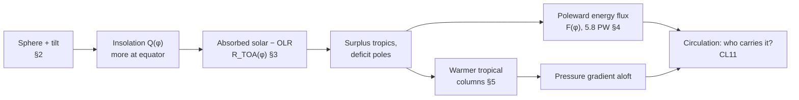

# CL10 · Global Energy Balance and Meridional Structure

◀ [[CL09 Radiative-Convective Equilibrium]] · [[Climate - Course Map|Course Map]] · [[CL11 Mean Meridional Circulation and Angular Momentum]] ▶

taught · in syllabus extra · book extra · beyond

> [!syllabus] Syllabus map: what is in the syllabus and what is extra in this chapter
> 🟢 **In syllabus (taught)**
> - §1 why energy imbalance forces a circulation
> - §2.1–2.3 insolation geometry: sphericity ($\cos\varphi$, $S_0/\pi$), tilt, orbit, polar-day maximum, Milankovitch cycles (named)
> - §3 TOA budget: $R_{TOA}=Q_{abs}-\mathrm{OLR}$, albedo/OLR/net-radiation geography, desert puzzle, ≈ 6× absorbed-solar contrast, sign change near 35–40°
> - §4.1–4.4 column energy equation, poleward-flux integral, 5.8 PW, atmosphere/ocean split, global integral = 0
> - §5.1–5.3 meridional temperature structure: $T$, $\theta$, isentropes, tropopause
> - §5.5 temperature gradient → pressure gradient → winds
>
> 🟡 **Extra · book** (assigned excerpts, not shown or noted in class)
> - Fig. 5.1 "rings of air" caption (preview of CL11)
> - explanation of the dip at the edge of polar day (Fig. 5.2 caption)
> - OLR dip from deep-convective cloud tops (Fig. 5.5 caption)
> - "tropopause higher in the tropics"
> - the global maps (Hartmann Figs. 2.9–2.11) and the equal-area projection footnote
> - M&P Problem 5.1
>
> 🔵 **Extra · beyond** (added from outside the course)
> - §2.3 Milankovitch numbers
> - §2.4 daily-mean insolation formula, Kepler weighting, derivation of $-0.477$
> - §3.5 radiative equilibrium *without* transport (93 K vs 20 K)
> - §4.4 moist static energy, comparison with human energy use
> - §5.2 derivation of $\theta$
> - §5.5 hypsometric/geostrophic numbers
> - latitudinal diversity gradient

> [!key] After this chapter you can
> - explain **why** a planet with a global energy balance still needs winds and ocean currents,
> - derive the daily-mean insolation $S_0/\pi$ for an untilted Earth, explain the polar-day maximum at the solstice and the shape of the annual-mean curve,
> - read the **TOA budget** $R_{TOA}=Q_{abs}-\mathrm{OLR}$ by latitude and explain *why* each term has the geography it has (albedo, cold cloud tops, deserts),
> - derive the poleward energy flux $F(\varphi)=2\pi a^2\!\int_{-\pi/2}^{\varphi}R_{TOA}\cos\varphi'\,\mathrm d\varphi'$ from a belt budget, locate its maximum (≈ 5.8 PW) and say who carries it,
> - describe the meridional structure of $T$ and $\theta$ and see how a horizontal temperature gradient becomes a pressure gradient.

## 1. Why the atmosphere has to move
taught *Suhas 7 Oct p1–2, p7; 8 Oct p1; handwritten notes p.1 (M&P Ch. 5 intro)*

In [[CL03 Radiation and Planetary Energy Balance]] the whole planet was one number: absorbed sunlight in, emitted infrared out, $T_e=255$ K. That is true **globally and over a year**, but it hides a geographical imbalance. Suhas puts it in one sentence ([[7th Oct.pdf#page=1|7 Oct, p1]]): *atmospheric columns cannot exist in a thermodynamic balance without communicating with their surroundings; such a communication occurs through circulation.* There are regions where the atmosphere has a surplus of energy and regions where it has a deficit ([[7th Oct.pdf#page=2|p2]]).

> [!intuition] A city's budget
> Think of each latitude belt as a neighbourhood. Some neighbourhoods earn more than they spend, others the reverse; the *city* is balanced because money moves between them (wages, taxes, welfare). A neighbourhood that could not trade would go bankrupt or pile up cash without limit. The atmosphere–ocean system is the same: the tropics earn a net radiative surplus, the poles run a deficit, and **winds and ocean currents are the transfer payments**. Without them the tropics would keep warming and the poles keep cooling until the *local* books balanced by temperature alone (§3.5 puts a number on that).

To keep the problem tractable Suhas drops all longitude dependence: *the Earth's surface is very inhomogeneous (mountain ranges, land–ocean contrasts, vegetation…); we neglect such variations and assume that energy distribution is largely in the latitudinal direction* ([[7th Oct.pdf#page=7|p7]]). Everything below is therefore **zonal mean**: an average around a latitude circle,
$$\overline X(\varphi,z)=\frac1{2\pi}\int_0^{2\pi}X(\lambda,\varphi,z)\,\mathrm d\lambda$$
([[climate-suhas merged.pdf#page=6|M&P p.64, footnote 3]]).

The chain of logic of the chapter, and how it hands over to the next one:

> [!connection] Same idea, other subjects
> "Balanced overall, unbalanced locally, so something must flow" is a **conservation law with a source term**. The same logic gives heat conduction in a rod ([[Thermodynamics and Statistical Mechanics - Course Map]]), current flow when charge piles up, and the movement of nutrients between habitats ([[Ecology and Evolution - Course Map]]).

## 2. Incoming sunlight and the geometry of insolation
taught *Suhas 7 Oct p3–9; handwritten notes p.1; M&P §5.1.1 (pp.62–63)*

Incoming solar radiation at the top of the atmosphere varies geographically for **three reasons** ([[7th Oct.pdf#page=4|7 Oct, p3–4]]): the **sphericity** of the Earth, the **tilt** of its rotation axis, and the **shape of its orbit** around the Sun. We take them one at a time. The resulting field is called [[Insolation]].

### 2.1 Sphericity and the factor $\cos\varphi$
taught *7 Oct p5; handwritten notes p.1; M&P p.62*

The Earth is so far from the Sun that it intercepts an essentially **parallel beam** ([[7th Oct.pdf#page=5|p5]]). A beam of cross-section $\mathrm dA_\perp$ that strikes a surface whose normal is tilted by the angle $\varphi$ from the beam covers the larger area $\mathrm dA=\mathrm dA_\perp/\cos\varphi$, so the flux per unit surface area is the "normal component" $S\cos\varphi$ ([[Suhas post midsem.pdf#page=1|notes p.1]]). At the **sub-solar point** the rays are perpendicular, there is no shadow, and the flux is $S$.

> [!intuition] The tilted torch
> Shine a torch straight at a wall: a bright small circle. Tilt the wall: the *same* light smears over a long ellipse and each square centimetre gets less. The poles are the part of the planet that the Sun-beam meets at a grazing angle. That alone makes the equator warmer and, as the chapter shows, ultimately drives winds and ocean currents.

> [!derivation] The daily mean for an untilted Earth: $S_0/\pi$
> Take the Sun over the equator (equinox geometry, no tilt) and follow the equator through one rotation. With hour angle $h$ measured from local noon the flux on the equator is $S_0\cos h$ for $|h|<\pi/2$ (day) and $0$ at night. The daily mean is
> $$\overline Q_{eq}=\frac1{2\pi}\int_{-\pi/2}^{\pi/2}S_0\cos h\,\mathrm dh=\frac{S_0}{2\pi}\,[\sin h]_{-\pi/2}^{\pi/2}=\frac{S_0}{\pi}.$$
> At latitude $\varphi$ the noon Sun is lower by $\varphi$, and the same calculation gives
> $$\boxed{\overline Q(\varphi)=\frac{S_0}{\pi}\cos\varphi}\tag{CL10.1}$$
> falling monotonically to zero at the poles (M&P p.62; notes p.1). With $S_0=1361$ W m⁻² this maximum is $\mathbf{433}$ W m⁻²; the book writes 435 because it uses $S_0=1367$.

> [!example] Worked example 1: does the factor of 4 reappear?
> Average (CL10.1) over the sphere. The area element is $\cos\varphi\,\mathrm d\varphi\,\mathrm d\lambda$, so the global mean is
> $$\frac{1}{4\pi}\int_{-\pi/2}^{\pi/2}\!\!\frac{S_0}{\pi}\cos\varphi\;2\pi\cos\varphi\,\mathrm d\varphi=\frac{S_0}{2\pi}\int_{-\pi/2}^{\pi/2}\!\cos^2\varphi\,\mathrm d\varphi=\frac{S_0}{2\pi}\cdot\frac\pi2=\frac{S_0}{4}.$$
> The same $S_0/4=340$ W m⁻² that [[CL03 Radiation and Planetary Energy Balance]] obtained from the disc-to-sphere area ratio. Two routes, one answer.

> [!verify] 1361 or 1367, 433 or 435?
> M&P and Hartmann (and the AI notes on them) use $S_0=1367$ W m⁻², giving $S_0/\pi=435$ W m⁻². Lecture material and this vault use 1361 W m⁻² ([[Solar Constant]]), giving 433. Both are fine; do not mix them in one calculation.

### 2.2 Tilt, the polar-day maximum and the annual mean
taught *7 Oct p6, p8–9; notes p.1; M&P p.62* · extra · book *dip at the edge of polar day (Fig. 5.2 caption)*

The spin axis is tilted by $\varepsilon=23.4^\circ$ from the normal to the orbital plane and, at present, points towards the North Star ([[climate-suhas merged.pdf#page=4|M&P p.62, Fig. 5.3]]). Consequences:

- at the **northern summer solstice** the north pole is tipped towards the Sun: the northern hemisphere has its longest day; at the **winter** solstice the opposite; at the **equinoxes** day and night are equal;
- at solstice there is **no sunlight at the winter pole** (polar night) but **24 h of sunlight at the summer pole**;
- therefore the poles *do* receive sunlight in their summer half-year and the **annual-mean equator-to-pole difference is reduced** compared with the untilted case.

![[fig_cl10_insolation.png|860]]
*Figure CL10.1. Left: daily-mean TOA insolation by latitude on the solstices and as an annual mean (exact orbital calculation, $S=1361$ W m⁻², script `fig_cl10_insolation.py`), with the untilted curve (CL10.1). Right: the same quantity as a function of latitude and day of year; the dashed line is the edge of polar night. Compare 7 Oct slide 8.*

The slide ([[7th Oct.pdf#page=8|p8]]) states the two take-aways: *annually, the tropical region receives more insolation than any other region; during the solstice, maximum insolation is observed at the summer pole.* The second looks paradoxical until you compute it:

> [!intuition] Midnight sun beats noon sun, on average
> At the solstice the pole sits in sunlight for the **whole 24 h**, with the Sun circling at a fixed, low elevation of 23.4°; its flux on a horizontal surface is $S\sin23.4^\circ\approx0.40\,S$, all day long. An equatorial point gets strong overhead light but only for part of the day: its *daily mean* is only $\tfrac{S}{\pi}\cos23.4^\circ\approx0.32\,S$. "Always, but slanted" outweighs "brief, but vertical".
> The numbers (no distance correction): pole $541$ W m⁻², equator $397$ W m⁻² at the solstice. Including the Earth–Sun distance (§2.3) the summer-pole values are **559** W m⁻² (21 Dec, 90° S) and **524** W m⁻² (21 Jun, 90° N), matching the ≈ 560 and ≈ 520 read from the slide.

Yet "the pole receives the most" does **not** make the pole warm, because ice and snow reflect most of it ([[Albedo]], [[Ice-Albedo Feedback]]): "the absorbed radiation at the summer pole is low because of the high albedo of snow and ice" (M&P p.63; notes p.1). That is the first hint that *absorbed* radiation (§3), not insolation, is what matters.

Annual mean (computed): **416 W m⁻²** at the equator, **172** at each pole, ratio **2.4**; global mean $S/4=340$. With no tilt the pole would get zero. The curve is very well described by a single Legendre term (§2.4),
$$\overline Q(\varphi)\simeq\frac{S}{4}\Big[1-0.477\,P_2(\sin\varphi)\Big],\qquad P_2(x)=\tfrac12(3x^2-1),\tag{CL10.2}$$
the dotted green line in Fig. CL10.1. (Careful: the maximum of the annual mean is **416**, *not* $S/\pi=433$: $S/\pi$ is the *no-tilt* maximum.)

> [!verify] The slide's annual curve at the poles
> The annual-mean curve printed on slide 8 reads about 150 W m⁻² at 90° S and about 125 W m⁻² at 90° N, i.e. lower than and asymmetric about the equator. My exact calculation gives **172 W m⁻² at both poles**; the annual mean is hemispherically symmetric because Kepler's second law makes it independent of the date of perihelion (§2.4). I take the slide value as a read-off or plotting artefact; the asymmetric solstice maxima (559 vs 524) *are* real.

> [!extra-book]+ 🟡 Extra (book): the dip at the edge of polar day
> M&P's Fig. 5.2 caption explains the small dip in the solstice curves near ±66°: "the slight dip … corresponds to the edge of the polar day" ([[climate-suhas merged.pdf#page=4|p.62]]). It is visible in the left panel above: poleward of 66.6° the Sun never sets, but the extra hours are low-Sun hours, so the daily mean rises only slowly. The figure was shown in class; the explanation was not.

### 2.3 The orbit
taught *7 Oct p6; notes p.1; M&P p.62–63* · extra · beyond *numbers for Milankovitch variations*

The orbit is not a circle ([[7th Oct.pdf#page=6|p6]], M&P Fig. 5.4): the Earth is **closest** to the Sun (*perihelion*) about **3 January**, shortly after the northern winter solstice, and **farthest** (*aphelion*) about **4 July**. The Earth–Sun distance varies by **less than ±2 %**. Because flux goes as $r^{-2}$ the corresponding flux variation is about ±3.4 % ($1407$ W m⁻² at perihelion, $1317$ at aphelion): *not negligible*, but its contribution to the annual cycle of the local flux at any latitude is **much smaller than that of the tilt** (notes p.1).

> [!intuition] Why northern summer is *not* when we are closest
> If distance made the seasons, the whole planet would be warm in January and cool in July. Instead January is winter in the north and summer in the south. Seasons follow **which pole leans towards the Sun**, a statement about direction, not distance. The orbit's only effect is to make southern summers ~7 % more intense at the pole (559 vs 524 W m⁻²) and shorter.

Tilt and orbit are **not constant**: they change slowly, on $10^4$–$10^5$ yr scales (**Milankovitch cycles**), and are thought to pace glacial–interglacial cycles (M&P p.63; notes p.1; M&P §12.3.5 is out of the excerpt).

> [!extra-beyond]- 🔵 Extra (beyond): how big is the Milankovitch effect?
> Three quasi-periodic changes: obliquity $22.1^\circ$–$24.5^\circ$ (≈ 41 kyr), precession of the equinoxes, i.e. which season is at perihelion (≈ 19–23 kyr), and eccentricity $0$–$0.058$ (≈ 100 and 400 kyr) (Hays, Imbrie & Shackleton 1976). Using the exact formula of §2.4, the daily-mean insolation at **65° N on 21 June**, the quantity classically linked to ice-sheet growth, is:
>
> ![[fig_cl10_milankovitch.png|560]]
> *Figure CL10.2. Present 478 W m⁻²; a circular orbit 494; a cool configuration (low tilt, eccentric, aphelion at solstice) 428; a warm configuration (high tilt, eccentric, perihelion at solstice) 567. The spread of ≈ 140 W m⁻² is 29 % of today's value.*
>
> Obliquity mainly changes the *annual mean at high latitudes* (pole: 163 W m⁻² at 22.1°, 172 at 23.4°, 180 at 24.5°) and precession mainly the *seasonal contrast*. A tiny change in forcing is then amplified by the ice-albedo and CO₂ feedbacks ([[CL04 Feedback and Multiple Steady States]], [[Snowball Earth]]); see [[Seasons and Earth's Orbit]] and [[Evolution of Earth and Life - Course Map]].

### 2.4 Daily-mean insolation derived
extra · beyond *derived here; verified numerically with `scripts/cl10lib.py`*

> [!extra-beyond]- 🔵 Extra (beyond): the exact formula, Kepler weighting and the number $-0.477$
> **Instantaneous flux.** For a Sun at distance $r$ (with $\rho=a/r$, $a$ the mean distance), declination $\delta$ and zenith angle $\zeta$, the flux on a horizontal surface is $S\rho^2\cos\zeta$ with
> $$\cos\zeta=\sin\varphi\sin\delta+\cos\varphi\cos\delta\cos h$$
> (dot product of the local vertical and the Sun direction; $h$ = hour angle).
>
> **Sunrise.** The Sun is up where $\cos\zeta>0$, i.e. $\cos h>-\tan\varphi\tan\delta\equiv\cos h_0$. If $-\tan\varphi\tan\delta\ge1$ there is polar night ($h_0=0$); if $\le-1$, polar day ($h_0=\pi$).
>
> **Daily mean.**
> $$\overline Q=\frac{S\rho^2}{2\pi}\int_{-h_0}^{h_0}\cos\zeta\,\mathrm dh=\boxed{\frac{S\rho^2}{\pi}\Big[h_0\sin\varphi\sin\delta+\cos\varphi\cos\delta\,\sin h_0\Big]}\tag{CL10.3}$$
> *Checks:* $\delta=0\Rightarrow h_0=\pi/2$ and $\overline Q=(S\rho^2/\pi)\cos\varphi$, i.e. (CL10.1); polar day at $\varphi=90^\circ$: $\overline Q=S\rho^2\sin\delta$ ✓ (the 541 W m⁻² above); equator at solstice: $(S\rho^2/\pi)\cos\delta$ ✓.
>
> **Declination and distance.** With solar longitude $\lambda$: $\sin\delta=\sin\varepsilon\sin\lambda$ and $\rho=(1+e\cos(\lambda-\varpi))/(1-e^2)$, $\varpi$ = longitude of perihelion ($\approx283^\circ$, 3 Jan).
>
> **Annual mean.** Kepler's second law, $r^2\,\mathrm d\nu/\mathrm dt=\text{const}$, gives $\mathrm dt=\dfrac{T_y}{2\pi}(1-e^2)^{-1/2}\rho^{-2}\,\mathrm d\lambda$. Because $\overline Q\propto\rho^2$ the distance factor **cancels** in the time average:
> $$\langle\overline Q\rangle=\frac{S}{\pi}\frac{1}{\sqrt{1-e^2}}\;\frac1{2\pi}\int_0^{2\pi}\!\Big[h_0\sin\varphi\sin\delta+\cos\varphi\cos\delta\sin h_0\Big]\mathrm d\lambda.$$
> Hence the annual mean depends on the orbit only through $(1-e^2)^{-1/2}=1.00014$ and is **independent of the date of perihelion and hemispherically symmetric** (this is why the slide's asymmetric annual curve cannot be exact).
>
> **Why $-0.477$.** Expand the daily mean in Legendre polynomials of $x=\sin\varphi$: $\overline Q=\tfrac S4[1+a_2(\delta)P_2(x)+\dots]$. For $\delta=0$, $\overline Q=(S/\pi)\sqrt{1-x^2}$ and $c_2=\tfrac52\!\int_{-1}^{1}\!\sqrt{1-x^2}\,P_2\,\mathrm dx=-\tfrac{5\pi}{32}$, so $a_2(0)=\tfrac4\pi c_2=-\tfrac58$. For $\delta=90^\circ$ (Sun over the pole; even part $\tfrac S2|x|$) one finds $a_2=+\tfrac54$. Both limits fit
> $$a_2(\delta)=\tfrac54\,P_2(\sin\delta).$$
> (I confirmed this formula numerically for intermediate $\delta$ instead of proving the rotation step in general; the script's direct fit of the annual mean agrees to four digits.) Averaging over the year, $\langle\sin^2\delta\rangle=\tfrac12\sin^2\varepsilon$, so
> $$S_2=\tfrac54\Big\langle P_2(\sin\delta)\Big\rangle=\tfrac54\cdot\tfrac12\Big(\tfrac32\sin^2\varepsilon-1\Big)=-0.4766\quad(\varepsilon=23.44^\circ),$$
> the number quoted in (CL10.2) (North 1975). With the P₂ truncation the equator-to-pole ratio is $(1+0.477/2)/(1-0.477)=2.37$ (exact 2.41).

> [!example] Worked example 2: 65° N on 21 June
> $\delta=23.44^\circ$, so $\cos h_0=-\tan65^\circ\tan23.44^\circ=-2.1445\times0.4336=-0.9298$, giving $h_0=158.4^\circ$ (day length $2h_0/(15^\circ\,\mathrm h^{-1})=21.1$ h). The bracket in (CL10.3) is $2.7646\times0.9063\times0.3978+0.4226\times0.9175\times0.3681=1.1394$. With $\rho^2=0.968$ (near aphelion): $\overline Q=\frac{1361}{\pi}\times0.968\times1.1394=\mathbf{478}$ W m⁻², matching the exact calculation used for Fig. CL10.2.

## 3. Outgoing and absorbed radiation: the TOA budget
taught *7 Oct p10; notes pp.1–2 (Hartmann §2.8, M&P §5.1.2); Hartmann pp.40–44*

### 3.1 Definitions
taught *notes p.1; Hartmann Eqs. 2.19–2.20*

The energy balance **at the top of the atmosphere** (TOA) is purely radiative and can be measured from satellites. The net radiation is
$$R_{TOA}=Q_{abs}-\mathrm{OLR},\qquad Q_{abs}=S_{TOA}(1-\alpha)\tag{CL10.4}$$
where $S_{TOA}$ is the insolation of §2 and $\alpha$ the albedo ([[Top-of-Atmosphere Radiation Budget]]). Globally: 340 W m⁻² in, ≈ 100 reflected (planetary albedo ≈ 0.29; ≈ 0.30 elsewhere), ≈ 240 absorbed, ≈ 240 = $\sigma T_e^4$ emitted: $\langle R_{TOA}\rangle\approx0$.

> [!intuition] A bank statement
> $S_{TOA}$ is gross income; the albedo takes a tax ($\alpha S$); $Q_{abs}$ is take-home pay; OLR is what you spend; $R_{TOA}$ is the monthly balance. Averaged over the world the balance is zero. Within each latitude it is not.

### 3.2 Albedo: where and why
taught *notes p.1; Hartmann p.40* · extra · book *global albedo maps (Fig. 2.9)*

Albedo is **highest in the polar regions** (plentiful cloud and snow cover, and a large average solar zenith angle), has **secondary maxima** in the tropics and subtropics under thick cloud and over bright surfaces such as the Sahara, and is **smallest over tropical oceans** with few clouds, where the sea surface is intrinsically dark (8–10 %).

> [!intuition] Low Sun, more glare
> Sunlight at a grazing angle bounces off water far better than overhead light (the sun-glint on the sea at sunset), and a low Sun also takes a longer path through cloud and haze. So even the same surface is brighter at high latitude. Add snow, ice and more cloud and the polar albedo climbs to ~0.65 (my calibrated profile: 0.23 at the equator, 0.46 at 60°, 0.65 at the pole).

> [!pitfall] The planetary albedo is *insolation-weighted*, not area-weighted
> The global albedo is $\alpha_p=\langle Q\alpha\rangle/\langle Q\rangle$: reflected power over incident power. Bright polar surfaces receive little sun, so they count less than their area. For the profile used below the area mean of $\alpha(\varphi)$ is **0.313** but the insolation-weighted value is **0.290**. This is a (mild) case of averaging a product, cf. [[Jensen Inequality]].

### 3.3 OLR: the temperature of the emitter
taught *notes p.2; Hartmann p.40* · extra · book *OLR dip from cloud tops (M&P Fig. 5.5 caption); OLR maps (Fig. 2.10)*

[[Outgoing Longwave Radiation]] is **greatest over warm deserts and over tropical oceans where clouds are infrequent**, and **lowest at the poles and in regions of persistent high cloud in the tropics.** The reason is [[Stefan-Boltzmann Law]]: what escapes to space is emitted by the *top of the radiating layer*, and $\mathrm{OLR}\propto T_{emit}^4$. Cold poles and cold cloud tops therefore give low OLR; a warm surface under a dry, cloud-free atmosphere gives high OLR.

> [!intuition] Cloud tops as cold radiators
> A cloud as seen from space replaces the warm ground by its own cold top. A tall tropical thunderhead tops out near 220 K (vs ~300 K at the ground): $\sigma(220)^4=133$ W m⁻² against $\sigma(300)^4=459$ W m⁻². Deep clouds therefore *reduce* OLR, while the reflected sunlight they add *increases* albedo; both lower the net radiation (cf. [[CL07 Optical Properties of the Atmosphere]]).

> [!extra-book]+ 🟡 Extra (book): the equatorial OLR dip
> The caption of M&P Fig. 5.5 attributes the slight dip in zonal-mean OLR at the equator to "radiation from the (cold) tops of deep convecting clouds" (cf. Fig. 4.26; [[climate-suhas merged.pdf#page=5|p.63]]). The figure appears on slide 10; the explanation does not.

### 3.4 Net radiation: surplus, deficit, and the desert puzzle
taught *notes p.2; Hartmann pp.40, 44* · extra · book *the maps (Hartmann Fig. 2.11); equal-area projection footnote*

The net radiation is **negative near the poles and positive in the tropics**. The highest positive values, about **140 W m⁻²**, are over the **subtropical oceans of the summer hemisphere** (large insolation + low albedo = large $Q_{abs}$); the greatest losses are in the **polar darkness of the winter hemisphere**, where OLR is uncompensated by sunshine.

**The desert puzzle.** Dry deserts such as the Sahara are subtropical, yet *lose* energy in the annual mean: a high surface albedo plus a large OLR (a warm surface under a dry, cloudless atmosphere). Land cannot move heat laterally, so the radiative loss is balanced by **horizontal heat transport by the atmosphere into the region**: high-altitude, high-energy air sinks over the desert and warms adiabatically as it is compressed. That air has low relative humidity, which **reinforces the dryness**. (This is the descending branch of the Hadley circulation, [[CL11 Mean Meridional Circulation and Angular Momentum]].)

> [!pitfall] Net radiation is not temperature
> A negative $R_{TOA}$ means the *column* exports more infrared than it absorbs, not that it is freezing. The Sahara has a net TOA deficit and is among the hottest places on Earth; it survives because dynamics supplies the energy.

> [!extra-book]- 🟡 Extra (book): the global maps and the projection
> Hartmann's maps of albedo, OLR and net radiation (Figs. 2.9–2.11, CERES 2000–2013; [[climate-suhas merged.pdf#page=8|pp.41–43]]) are drawn in a **Hammer equal-area projection** (footnote 2, p.40): "the fraction of the area of the projection occupied by a particular feature [is] proportional to the fraction of the area of Earth's surface that the feature occupies", essential when the plotted quantity is a flux in W m⁻², because the eye then reads *area* as *energy*. Cf. the cosine weighting of §4.3.

### 3.5 The zonal-mean picture
taught *7 Oct p10; notes p.2; M&P p.63–64; Hartmann p.44 (Fig. 2.12)* · extra · beyond *the calibrated profile and the 93 K vs 20 K example*

Averaging around latitude circles ([[7th Oct.pdf#page=10|slide 10]], M&P Fig. 5.5, Hartmann Fig. 2.12):

- **Absorbed solar** has a strong maximum in the tropics, about **six times larger than at the poles** (M&P). The poleward decrease is even steeper than that of insolation because the *albedo increases with latitude*.
- **OLR varies far less** with latitude than $Q_{abs}$: the atmosphere and ocean carry heat poleward and sustain a net energy loss to space at the poles.
- Hence $R_{TOA}>0$ equatorward of roughly **35–40°** and $<0$ poleward.

![[fig_cl10_toa_budget.png|640]]
*Figure CL10.3. Annual-mean zonal-mean TOA budget. **This is an idealised profile, not satellite data**: I calibrated simple analytic curves (script `fig_cl10_toa_budget.py`, `cl10lib.py`) to the numbers quoted in the sources: planetary albedo 0.29; absorbed solar ≈ 320 (tropics) and ≈ 60 W m⁻² (poles), ratio 5.2; OLR dip at the equator; net radiation +75 W m⁻² at the equator and −116 at the poles, changing sign at 37°; peak poleward flux 5.6 PW. It reproduces the shape of slide 10, M&P Fig. 5.5 and Hartmann Fig. 2.12.*

> [!verify] Where does the net radiation change sign?
> Slide 10 shows the zero crossing near ±33°, Hartmann's text says "about 40°" (and M&P's notes "≈ 40°"). Reading a curve by eye cannot settle this, and the exact value depends on the data set. My profile uses 37°. For the exam, quote "roughly 35–40°".

> [!example] Worked example 3: what would the temperature gradient be *without* transport?
> M&P: "the actual pole-to-equator temperature difference is smaller than it would be if the atmosphere was in thermodynamic balance at each latitude, column by column". Quantify it with the idealised profile. If each latitude balanced alone, its emission temperature would be set by $\sigma T^4=Q_{abs}$:
> $$T_{eq}=\Big(\tfrac{319}{\sigma}\Big)^{1/4}=274\ \mathrm K,\qquad T_{pole}=\Big(\tfrac{61}{\sigma}\Big)^{1/4}=181\ \mathrm K\quad\Rightarrow\ \Delta T=\mathbf{93\ K}.$$
> With transport the OLR is 245 W m⁻² at the equator and 177 at the pole, i.e. emission temperatures $256$ K and $236$ K: $\Delta T_e=\mathbf{20\ K}$. **Transport shrinks the contrast from ≈ 93 K to ≈ 20 K.** (Surface contrasts are larger than emission-temperature contrasts, ≈ 40–50 K, but the lesson is the same.) This is the local version of the zero-dimensional model of [[Zero-Dimensional Energy Balance Model]], with and without the flux term that the next section adds.

## 4. The energy equation and the poleward flux
taught *7 Oct p11–19; 8 Oct p1–3; notes p.2; Hartmann §2.9 (pp.45–46)*

### 4.1 The column energy budget
taught *7 Oct p11–12; Hartmann Eqs. 2.21–2.22*

For an atmosphere–ocean column in some latitude interval, energy can enter or leave only (i) at the top, by radiation, and (ii) through the **lateral boundaries**, by transport in the atmosphere and ocean; exchange with the solid Earth is neglected ([[7th Oct.pdf#page=11|slide 11]]):
$$\frac{\partial E_{ao}}{\partial t}=R_{TOA}-\Delta F_{ao}\tag{CL10.5}$$
with $E_{ao}$ the energy content of the column, $R_{TOA}$ the net incoming radiation at the top and $\Delta F_{ao}$ the **divergence of the horizontal energy flux** (energy exported per unit area and time). Averaged over a year, storage is small (slide 12: "atmosphere doesn't store energy"), so
$$\boxed{R_{TOA}\simeq\Delta F_{ao}}\tag{CL10.6}$$
and the observed $R_{TOA}$ lets us *infer* the transport.

![[Column Energy Budget.svg|620]]
*Figure CL10.4. One latitude belt: net radiation $R_{TOA}$ enters from above, flux $F$ enters on the equator side and leaves on the pole side. Editable: [[Column Energy Budget.excalidraw]].*

> [!intuition] Bathtub and drain
> The tub (the column) has a tap (the net radiation $R_{TOA}$, which can be negative: a leak) and a drain-and-inflow pair (the lateral flux). The water level (the energy content $E$) stays constant in the long run only if tap = net outflow. A tropical tub has a running tap, so water must leave sideways towards the polar tubs, whose taps are shut and which would otherwise empty. *Divergence* is just "more leaves the box than enters".

> [!pitfall] Seasonal storage is not small
> "$\partial E/\partial t\approx0$" is an **annual-mean** statement. Over a season the ocean stores and releases large amounts of heat (that is why summer is warmest after the solstice); the identity (CL10.6) fails for individual months and for the diurnal cycle.

### 4.2 The poleward flux as a cap integral
taught *7 Oct p13–17; 8 Oct p1–3; notes p.2; Hartmann Eq. 2.23*

**Assumption** (slide 13, 8 Oct p1): the energy lost to space poleward of any latitude must be supplied by transport across that latitude. Equivalently: integrate the net radiation over the polar cap.

> [!derivation] From the belt budget to $F(\varphi)$
> Let $F(\varphi)$ be the total **northward** energy flux (W) across the latitude circle $\varphi$. A thin belt between $\varphi$ and $\varphi+\mathrm d\varphi$ has area $\mathrm dA=2\pi a^2\cos\varphi\,\mathrm d\varphi$ (circumference $2\pi a\cos\varphi$ times width $a\,\mathrm d\varphi$). Its net radiative gain is $R_{TOA}\,\mathrm dA$; in steady state it must leave through the two lateral faces:
> $$F(\varphi+\mathrm d\varphi)-F(\varphi)=R_{TOA}\,2\pi a^2\cos\varphi\,\mathrm d\varphi\quad\Rightarrow\quad\frac{\mathrm dF}{\mathrm d\varphi}=2\pi a^2\,R_{TOA}(\varphi)\cos\varphi.$$
> The flux through the south pole circle is zero (its length is zero), so
> $$\boxed{F(\varphi)=\int_{-\pi/2}^{\varphi}\!\!\int_0^{2\pi}R_{TOA}\,a^2\cos\varphi'\,\mathrm d\lambda\,\mathrm d\varphi'=2\pi a^2\int_{-\pi/2}^{\varphi}R_{TOA}(\varphi')\cos\varphi'\,\mathrm d\varphi'}\tag{CL10.7}$$
> (slide 14 writes this as $E_{tr}(\phi)$; Hartmann Eq. 2.23.) **Sign:** positive $F$ is northward. South of $\varphi$ the belts gain energy, so $F>0$ in the Northern Hemisphere's low latitudes: energy flows north. Equivalent forms: $F(\varphi)=-2\pi a^2\!\int_\varphi^{\pi/2}R_{TOA}\cos\varphi'\,\mathrm d\varphi'$ (minus the net radiation of the **northern cap**, [[8th Oct.pdf#page=2|8 Oct p2]]: "total energy $=\iint R_{TOA}\,\mathrm ds=\int_0^{2\pi}\!\int_\varphi^{\pi/2}R_{TOA}a^2\cos\varphi'\,\mathrm d\varphi'\mathrm d\lambda$"). The two agree because of the global condition below. The slide's discrete version ([[7th Oct.pdf#page=17|p17]]) is $E_\phi=E\,2\pi R\cos\phi$ per belt, summed from the pole.

**Three consequences you can read off (CL10.7):**

1. **Maximum where $R_{TOA}$ changes sign.** $\mathrm dF/\mathrm d\varphi\propto R_{TOA}$, so $F$ rises through the surplus zone and falls through the deficit zone, peaking at the zero crossing (≈ 35–40°).
2. **$F=0$ at both poles.** At the north pole $F(\pi/2)=2\pi a^2\!\int_{-\pi/2}^{\pi/2}R\cos\varphi\,\mathrm d\varphi=0$: **energy cannot be removed from a sphere by horizontal transport** (Hartmann). Hence the **global-mean net radiation must vanish**; any global imbalance *heats or cools* the Earth (cf. forcing in [[CL04 Feedback and Multiple Steady States]]).
3. **The cosine weights matter** (next subsection).

### 4.3 Why the deficit "looks bigger": circumference weighting
taught *7 Oct p15–17; 8 Oct p3*

Slides 15–16 pose a puzzle: *if you look closely at the latitudinal distribution of annual-mean net radiation, it appears that the negative area is much greater than the positive area, indicating net effect is to cool the atmosphere! This anomaly arises because the latitude circle is smaller near poles and larger near the equator.* The cure is to multiply by the circumference: $E_\phi=E\cdot2\pi R\cos\phi$.

![[fig_cl10_flux_integral.png|900]]
*Figure CL10.5. (a) $R_{TOA}$ plotted against latitude: the polar deficit area is 3.0 times the tropical surplus area. (b) Weighted by $\cos\varphi$ the two areas are equal (44.1 vs 44.1 W m⁻² rad): zero global mean. (c) The running total $F(\varphi)$ (CL10.7): zero at both poles, maximum 5.6 PW at 37° (idealised profile; the atmosphere/ocean split is a schematic curve through the quoted values, not data; script `fig_cl10_flux_integral.py`).*

> [!intuition] Mercator maps and running totals
> A Mercator map makes Greenland look as large as Africa, because it stretches high latitudes: area on the page is not area on the globe. Plotting $R_{TOA}$ against latitude does the same to the polar caps. Multiplying by $\cos\varphi$ is switching to an equal-area map (Hartmann's Hammer projection does it for you). And $F(\varphi)$ is a **running balance**: start at the south pole with an empty account, add each belt's surplus as you walk north (the account grows to a maximum where the surplus ends), then subtract each deficit (the account falls back to zero at the north pole). The peak of the account is the largest sum of money anyone has to carry across a single border: the **peak flux**.

> [!example] Worked example 4: the flux by hand (M&P Problem 5.1)
> Suppose $R_{TOA}\approx+50$ W m⁻² on $0$–$20^\circ$ and $\approx+20$ W m⁻² on $20^\circ$–$37^\circ$. By hemispheric symmetry $F(0)=0$. Using (CL10.7) with $\int\cos\varphi\,\mathrm d\varphi=\sin\varphi$:
> $$F(37^\circ)=2\pi a^2\big[50(\sin20^\circ-0)+20(\sin37^\circ-\sin20^\circ)\big]=2.55\times10^{14}\,\mathrm m^2\times(17.1+5.2)\,\mathrm{W\,m^{-2}}=5.7\ \mathrm{PW}.$$
> In general the area of the cap from the equator to $\varphi_0$ is $2\pi a^2\sin\varphi_0$ ($=1.54\times10^{14}$ m² at 37°), so 5.8 PW requires an area-weighted mean surplus of **≈ 36–38 W m⁻²**; with my profile the exact figure is 36.5. A 40° estimate with a constant $+60$ W m⁻² would give $2\pi a^2\sin40^\circ\times60=9.8$ PW: far too much, because the surplus actually *decays* to zero at the crossing.

### 4.4 The observed transport and who carries it
taught *7 Oct p18–19; notes p.2; Hartmann p.46 (Fig. 2.14); M&P p.64 (Fig. 5.6)*

Using satellite measurements of $R_{TOA}$ the northward flux peaks in mid-latitudes at about **5.8 PW** ($5.8\times10^{15}$ W; M&P: ≈ 6 PW in each hemisphere). Both the atmosphere and the ocean contribute ([[7th Oct.pdf#page=19|slides 18–19]]; the same three-curve figure type as Hartmann Fig. 2.14 and M&P Fig. 5.6):

| | how obtained | at 20° N | peaks at |
|---|---|---|---|
| **total** | integral (CL10.7) of satellite $R_{TOA}$ | ≈ 4 PW | 5.8 PW near 35–40° |
| **atmosphere** | estimated from analysed fields of wind, temperature and humidity | ≈ 2.0 PW | broad maximum near **40°** N and S |
| **ocean** | **residual**: total − atmosphere (hard to measure directly) | ≈ 2.0 PW | near **20° N** (subtropics); weaker in the SH but peaks in its subtropics too |

So the **ocean is prominent in the tropics**, the **atmosphere dominates beyond ≈ 30°**. "If the fluid envelope of the Earth did not transport heat poleward the tropics would be warmer and the polar regions much colder; transport … makes the climate of Earth much more equable" (Hartmann).

> [!intuition] How big is 5.8 PW?
> The Earth absorbs $\pi a^2S(1-\alpha)\approx123$ PW of sunlight, so only ≈ **5 %** is redistributed. Human primary energy use is ≈ 19 TW (`[verify]` current figure), so the natural poleward heat flow is ≈ **300 times** all human energy use. Climate is a *global heat engine* of enormous throughput, and a 1 % change in it dwarfs anything we generate directly.

> [!extra-beyond]- 🔵 Extra (beyond): what is actually being carried?
> The atmospheric flux is the transport of **moist static energy** per unit mass, $h=c_pT+gz+Lq$ (sensible heat + potential energy + latent heat). Near the equator the Hadley cell exports it: rising air is hot and moist (large $h$) and its upper poleward branch carries more $h$ than the equatorward return flow. Beyond ≈ 30° transient eddies (highs and lows) dominate, converting the pole-to-equator temperature difference into poleward heat flux ([[CL11 Mean Meridional Circulation and Angular Momentum]], [[CL14 Observed Winds - Jets, Trades and the ITCZ]]). In one-dimensional energy-balance models this is parametrised as a diffusion of temperature, $F\propto-\cos\varphi\,\mathrm dT/\mathrm d\varphi$ (Budyko 1969, Sellers 1969, North 1975; cf. [[CL04 Feedback and Multiple Steady States]]). Ocean transport is by the wind-driven gyres and the overturning (thermohaline) circulation.

> [!verify] Present-day Earth energy imbalance
> "Any global-mean net imbalance will heat or cool the Earth" (Hartmann). The observed present-day global-mean imbalance is of order +0.5–1 W m⁻² (satellites and ocean heat content); I quote it from memory and have not verified the figure against a source here. For scale: it is < 1 % of the 100 W m⁻² reflected and tiny compared with the ±100 W m⁻² of the latitudinal pattern.

## 5. Meridional structure of temperature
taught *notes p.1 (M&P §5.1.4, Troposphere); M&P pp.64–65* · extra · book *"tropopause higher in the tropics"; the excerpt ends mid-§5.1.4 (Figs. 5.7–5.8 are on p.65, not provided)*

### 5.1 The observed pattern
taught *notes p.1; M&P p.64*

In the annual, zonal-mean troposphere ([[Meridional Temperature Structure]]):

- the temperature $\overline T$ **decreases upward and (generally) poleward**;
- the annual-mean **surface** temperature is below 0 °C poleward of about 60° and reaches a maximum of ≈ 27 °C just north of the equator;
- the annual-mean **pole-to-equator** temperature difference over the troposphere is typically **≈ 40 °C**.

### 5.2 Potential temperature and isentropes
taught *notes p.1 (definitions)* · extra · beyond *derivation and intuition*

**Potential temperature** $\theta$ is the temperature a parcel would have if brought **adiabatically to a reference pressure** $p_0=1000$ hPa:
$$\theta=T\Big(\frac{p_0}{p}\Big)^{R/c_p},\qquad\frac Rc_p=0.286.\tag{CL10.8}$$
Constant-$\theta$ surfaces are called **isentropic**: $\mathrm d\theta=0\Rightarrow\mathrm dS=0$ (constant entropy; notes p.1). Two facts from the notes and M&P ([[climate-suhas merged.pdf#page=6|p.64]]):

- surfaces of constant $\theta$ **slope upward toward the pole** in the troposphere;
- $\theta$, **unlike $T$, always increases with height**, reflecting the **stability** of the atmosphere to dry processes (§4.3.2 of M&P, [[CL09 Radiative-Convective Equilibrium]]).

> [!intuition] A fair comparison and a stable stack
> Air at 5 km is colder than air at the ground simply because pressure is lower and the air expanded. $\theta$ removes that trivial effect: "how warm would this parcel be if I carried it down to sea level without letting heat in or out?" With the effect of altitude removed we can compare parcels honestly. $\theta$ increasing upward means the lower air is *denser* than anything that could be pushed there from above, and a parcel nudged upward arrives colder (denser) than its surroundings and **sinks back**: a stably layered atmosphere, like oil floating on water. If $\theta$ decreased with height the stack would overturn: convection ([[CL09 Radiative-Convective Equilibrium]]).

> [!extra-beyond]- 🔵 Extra (beyond): why $\theta=T(p_0/p)^{R/c_p}$
> For a dry parcel moving adiabatically the first law reads $c_p\,\mathrm dT-\alpha\,\mathrm dp=0$ with specific volume $\alpha=RT/p$ ([[Ideal Gas Law]]). Divide by $T$: $c_p\,\mathrm d\ln T=R\,\mathrm d\ln p$, so $T/p^{R/c_p}$ is constant along the motion. Evaluate it at $p_0$ to get (CL10.8).

### 5.3 Troposphere, stratosphere, tropopause
taught *notes p.1* · extra · book *tropopause height*

**Widely spaced** $\theta$ contours mark the **troposphere** (weak stability, $T$ falling with height), **closely spaced** contours aloft the **stratosphere** (strong stability). The transition, the **tropopause**, is **higher in the tropics than over the pole** (M&P p.64; the notes do not mention it).

### 5.4 An idealised cross-section
extra · beyond *a model atmosphere tuned to the quoted statements (the book's Figs. 5.7–5.8 are not in the excerpt)*

![[fig_cl10_temperature_structure.png|900]]
*Figure CL10.6. Idealised annual-mean zonal-mean $T$ and $\theta$ (script `fig_cl10_temperature_structure.py`): $T_s=300-40\sin^2\varphi$, lapse rate 6.5 K km⁻¹ to a tropopause at $8+8\cos^2\varphi$ km, then +1 K km⁻¹; pressure by hydrostatic integration. It reproduces 27 °C at the equator, −3 °C at 60°, a 40 K pole–equator contrast at 5 km, a 16 km tropical vs 8 km polar tropopause and, as stated, isentropes rising poleward with $\theta$ increasing with height everywhere (checked: $\theta=330$ K at 8 km in the tropics vs 291 K over the pole). **Not observational data.***

Why do isentropes rise poleward? Because the tropical column is warm: at a given height $\theta$ is *larger* in the tropics (330 K vs 291 K at 8 km), so to reach a fixed value such as 300 K you have to go **lower** in the tropics. Sloping isentropes are the signature of a horizontal temperature gradient and the source of the *available potential energy* that mid-latitude storms tap ([[CL14 Observed Winds - Jets, Trades and the ITCZ]]).

### 5.5 From a temperature gradient to a pressure gradient
taught *7 Oct p1; notes p.1; M&P p.61–62 intro* · extra · book *Fig. 5.1 caption (rings of air, P vs C)* · extra · beyond *thickness numbers*

"These horizontal temperature gradients induce horizontal pressure gradients, resulting in atmospheric wind patterns (and ocean currents) that transport heat from the warm tropics to the cool high latitudes" (notes p.1; M&P intro). The link is **hydrostatic balance** ([[CL06 Hydrostatic Balance and Vertical Structure]]): the layer between two pressure surfaces is *thicker* where it is warmer, by the hypsometric equation $z_2-z_1=(R_dT/g)\ln(p_1/p_2)$.

> [!example] Worked example 5: how much do pressure surfaces tilt?
> Take the 1000–500 hPa layer with mean temperature $\bar T=285$ K in the tropics and $245$ K near the pole: thickness $\frac{287}{9.81}\bar T\ln2=\mathbf{5.78}$ km vs $\mathbf{4.97}$ km, a difference of **0.8 km**. At the same pressure the 500 hPa surface therefore sits ≈ 800 m higher over the tropics than over the pole. Aloft, pressure at a fixed height is highest in the tropics, so the pressure-gradient force points **poleward**. At 45° ($f=1.03\times10^{-4}$ s⁻¹) a 800 m drop over 5000 km corresponds to a Coriolis-balanced wind $u=\frac gf\frac{\Delta z}{L}=9.5\times10^{4}\times1.6\times10^{-4}=\mathbf{15}$ m s⁻¹: the westerlies ([[CL13 Horizontal Motion - Geostrophic Balance and Friction]]).

> [!extra-book]+ 🟡 Extra (book): Fig. 5.1, "rings of air"
> M&P's Fig. 5.1 sketches the mechanism: the warm equatorial atmosphere is thicker than over the poles; the resulting pressure-gradient force "P" drives rings of air **poleward**; conservation of angular momentum accelerates them **eastward** until the Coriolis force "C" balances "P" ([[climate-suhas merged.pdf#page=4|p.62]]). That is the story of [[CL11 Mean Meridional Circulation and Angular Momentum]] ([[Absolute Angular Momentum of Air]]) and [[CL12 Rotating Frames and the Coriolis Force]]; it was not taken up in class until 8 Oct.

## 6. What this chapter hands over
taught *7 Oct p20; 8 Oct p1*

- **To the circulation (CL11).** We now know *how much* energy must go poleward (≈ 6 PW per hemisphere) and *that* both atmosphere and ocean carry it, but not *how*. Suhas ends the lecture with the mean meridional circulation and its mass stream function $\psi(\varphi,p)=\frac{2\pi a\cos\varphi}{g}\int_0^p[v]\,\mathrm dp$ ([[7th Oct.pdf#page=20|7 Oct p20]]); [[CL11 Mean Meridional Circulation and Angular Momentum]] picks up there.
- **To the zero-D model (CL03/CL04).** The global-mean balance $\tfrac S4(1-\alpha)=\sigma T_e^4$ is the *integral* of the budget of §3 over the sphere; the latitude-dependent version with a flux term is the one-dimensional energy-balance model, with the ice-albedo feedback acting on the **ice line**, the origin of Budyko's and Sellers's 1969 results ([[CL04 Feedback and Multiple Steady States]]).
- **To thermodynamics.** Stefan–Boltzmann emission, potential temperature and entropy ([[Thermodynamics and Statistical Mechanics - Course Map]]); sensitivity of OLR to $T$ via [[Linearisation and Sensitivity]].

## Map of this chapter
> [!connection] How CL10 connects
> **Builds on:** [[CL03 Radiation and Planetary Energy Balance]] (zero-D balance, $S/4$, albedo, $T_e$) · [[CL04 Feedback and Multiple Steady States]] (ice-albedo, sensitivity) · [[CL06 Hydrostatic Balance and Vertical Structure]] (hypsometric) · [[CL09 Radiative-Convective Equilibrium]] (stability, $\theta$, OLR from cloud tops).
> **Leads to:** [[CL11 Mean Meridional Circulation and Angular Momentum]] (who carries 5.8 PW) · [[CL12 Rotating Frames and the Coriolis Force]] · [[CL13 Horizontal Motion - Geostrophic Balance and Friction]] (pressure gradient → geostrophic wind) · [[CL14 Observed Winds - Jets, Trades and the ITCZ]].
> **Concepts:** [[Insolation]] · [[Seasons and Earth's Orbit]] · [[Top-of-Atmosphere Radiation Budget]] · [[Outgoing Longwave Radiation]] · [[Poleward Energy Transport]] · [[Meridional Temperature Structure]] · [[Albedo]] · [[Solar Constant]] · [[Ice-Albedo Feedback]] · [[Effective Emission Temperature]] · [[Stefan-Boltzmann Law]] · [[Absolute Angular Momentum of Air]].
> **Other subjects:** [[Thermodynamics and Statistical Mechanics - Course Map]] · [[Probability - Course Map]] · [[Evolution of Earth and Life - Course Map]] · [[Ecology and Evolution - Course Map]] · [[Landscapes and Geomorphology - Course Map]] · [[Waves - Course Map]].

> [!connection] Probability and geometry
> $x=\sin\varphi$ is **uniformly distributed over the sphere** (Archimedes' hat-box theorem: the area between two latitude circles is $2\pi a^2\Delta\sin\varphi$). Every global mean in this chapter is therefore an *expectation* with respect to the uniform measure on $x\in[-1,1]$, and the Legendre expansion of §2.4 is the expansion of a function of the random variable $x$ in orthogonal polynomials: [[Probability - Course Map]].

> [!connection] Deep time and ice
> Orbital cycles (§2.3) change high-latitude summer insolation by ~140 W m⁻²; the ice-albedo feedback of [[CL04 Feedback and Multiple Steady States]] turns that into glacial cycles ([[Evolution of Earth and Life - Course Map]]). The growth and decay of the ice sheets that carve landscapes follows it ([[Landscapes and Geomorphology - Course Map]]).

> [!connection] Why are there more species in the tropics?
> The tropics receive the most solar energy (§2) and absorb the most (§3). The *energy–species* hypothesis in ecology links this energy input to productivity and to the latitudinal gradient of species richness (a hypothesis, not an established law): [[Ecology and Evolution - Course Map]].

> [!connection] Waves on the gradient
> A meridional temperature gradient is a **baroclinic** zone: it supports mid-latitude eddies and Rossby waves, whose mathematics is that of [[Waves - Course Map]].

## Summary
> [!summary] Cheat-sheet
> - **Why circulate:** local imbalance, global balance ⇒ transport. Zonal-mean problem.
> - **Insolation:** flux ∝ $\cos\varphi$; no-tilt daily mean $\overline Q=(S_0/\pi)\cos\varphi$, $S_0/\pi=433$ (435 with 1367); global mean $S/4$.
> - **Tilt 23.4°:** poles sunlit in summer; solstice daily-mean maximum at the summer pole (559 W m⁻² S, 524 N); annual mean 416 (eq) → 172 (pole), ≈ $\tfrac S4[1-0.477P_2]$. **Orbit:** ±1.7 % distance (±3.4 % flux), perihelion ≈ 3 Jan; effect ≪ tilt. Milankovitch: $10^4$–$10^5$ yr.
> - **TOA budget:** $R_{TOA}=Q_{abs}-\mathrm{OLR}$, $Q_{abs}=S_{TOA}(1-\alpha)$; global $\alpha\approx0.29$; albedo ↑ poleward (cloud, snow, zenith angle); OLR ↑ for warm dry emitters (deserts), ↓ for cold poles/cloud tops; net > 0 equatorward of ≈ 35–40°, max ≈ 140 W m⁻² over summer subtropical oceans; deserts lose energy.
> - **Absorbed solar ≈ 6× larger in the tropics than at the poles**; OLR much flatter.
> - **Energy equation:** $\partial E/\partial t=R_{TOA}-\Delta F$; annual mean $R_{TOA}\approx\Delta F$.
> - **Flux:** $F(\varphi)=2\pi a^2\!\int_{-\pi/2}^{\varphi}R_{TOA}\cos\varphi'\mathrm d\varphi'$; $\mathrm dF/\mathrm d\varphi\propto R_{TOA}$ ⇒ peak at the sign change; $F=0$ at the poles ⇒ $\langle R_{TOA}\rangle=0$; peak **5.8 PW** (≈ 6 per hemisphere); 2.0 PW ocean + 2.0 PW atmosphere at 20° N; ocean peak ≈ 20°, atmosphere ≈ 40°.
> - **Temperature:** $T$ ↓ with height and poleward; surface < 0 °C poleward of ≈ 60°, 27 °C max; ≈ 40 °C pole–equator difference; $\theta=T(p_0/p)^{R/c_p}$ increases with height (stability); isentropes slope up poleward; tropopause higher in the tropics.
> - **Gradient ⇒ pressure gradient ⇒ winds:** warm columns are thicker; pressure surfaces slope down poleward aloft.

> [!summary] Quiz checklist: facts and traps (each checked against the book pages)
> - ✔ $S_0/\pi=435$ W m⁻² **uses $S_0=1367$**; with 1361 it is 433. It is the maximum for **no tilt**; with the real tilt the annual-mean equatorial value is lower (≈ 416).
> - ✔ "Maximum insolation at the **summer pole**" refers to the **daily mean at the solstice**, not the annual mean (where the poles are the minimum).
> - ✔ The distance variation is **< ±2 %** (flux ≈ ±3.4 %), "not negligible" but **≪ the tilt effect**; perihelion is in **early January**.
> - ✔ $R_{TOA}=Q_{abs}-\mathrm{OLR}$ with $Q_{abs}=S_{TOA}(1-\alpha)$; positive = gain. Global albedo ≈ **29 %** (Hartmann), ≈ 30 % elsewhere.
> - ✔ Albedo is highest at the **poles** (and under thick tropical cloud and over the Sahara), lowest (8–10 %) over cloud-free tropical ocean. OLR is **low at the poles and under high tropical cloud**, **high over deserts**.
> - ✔ Net radiation is **positive equatorward of ≈ 40°** (Hartmann; slide ≈ 33–37°), negative poleward; the *greatest loss* is the winter polar darkness; the greatest gain (≈ 140 W m⁻²) is the **summer-hemisphere subtropical ocean**. This is a *local seasonal maximum*, not the annual zonal mean (+60–75 W m⁻²).
> - ✔ Deserts have a **net annual radiative loss**; the deficit is made up by **atmospheric** transport (subsiding air warms adiabatically and dries).
> - ✔ Flux: **peaks where $R_{TOA}$ changes sign** (≈ 40°); equals **zero at the poles**; global integral = 0 ⇒ global-mean $R_{TOA}\approx0$; peak **5.8 PW** (Hartmann) ≈ **6 PW** (M&P); at **20° N** ocean ≈ atmosphere ≈ **2.0 PW**; **ocean peaks ≈ 20°, atmosphere ≈ 40°**; **ocean flux is the residual**.
> - ⚠ Trap: the energy-balance equation uses the **divergence** of the flux; the poleward *transport* $F$ is its **integral**. $R_{TOA}=\Delta F$ holds only in the **annual mean**.
> - ⚠ Trap: "negative area looks bigger" is the effect of plotting against latitude; with the $\cos\varphi$ weight the areas are equal.
> - ✔ Troposphere: $T$ falls upward **and poleward**; the pole–equator difference ≈ **40 °C**; $\theta$ **always increases with height**; isentropes slope **upward toward the pole**; tropopause **higher in the tropics**.
> - ✔ The ≈ 6× ratio (absorbed solar, tropics/poles) is from M&P p.63–64; the albedo, not the insolation alone, is the reason it exceeds the insolation ratio (2.4).

## Practice
1. **Derivation.** Show that the daily mean of $S_0\cos h$ over $|h|<\pi/2$ is $S_0/\pi$, and that the sphere-average of $(S_0/\pi)\cos\varphi$ is $S_0/4$.
2. **Polar day.** Compute the daily-mean insolation at the north pole at the June solstice with and without the distance factor $\rho^2=0.968$.
3. **Day length.** Find the day length at the solstices for a city at 18.5° N (Pune) and at 66.5° N.
4. **Flux by hand.** Using $R_{TOA}\approx+50$ W m⁻² for $0$–$20^\circ$ and $+20$ for $20$–$37^\circ$, estimate the peak poleward flux. Why does assuming a constant $+60$ up to 40° overestimate it?
5. **Peak location.** Show that $F$ is extremal where $R_{TOA}=0$ and that it is a maximum in the Northern Hemisphere.
6. **Without transport.** With $Q_{abs}=319$ and $61$ W m⁻² (equator, pole) and OLR $=245$ and $177$ W m⁻², compute the emission temperatures with and without transport.
7. **Thickness.** Compute the 1000–500 hPa thickness for $\bar T=285$ K and 245 K and the geostrophic wind implied by an 800 m height drop over 5000 km at 45°.
8. **Concept.** (a) Why is the annual-mean insolation at the pole non-zero? (b) Why is the Sahara in net radiative deficit and dry? (c) Why is the planetary albedo not the area-mean of the local albedo?

> [!example]- Solutions
> 1. $\frac1{2\pi}\int_{-\pi/2}^{\pi/2}S_0\cos h\,\mathrm dh=S_0/\pi$; $\frac{1}{2}\int\frac{S_0}\pi\cos^2\varphi\,\mathrm d\varphi=\frac{S_0}{2\pi}\cdot\frac\pi2=S_0/4$.
> 2. $S\sin\varepsilon=1361\times0.3978=541$ W m⁻²; with $\rho^2=0.968$: **524** W m⁻².
> 3. $\cos h_0=-\tan\varphi\tan\varepsilon$. At 18.5° N: $-0.3346\times0.4336=-0.1451$, $h_0=98.3^\circ$, day $=2h_0/15=13.1$ h (June), 10.9 h (December). At 66.5° N: $\cos h_0=-2.30\times0.4336=-0.997$, $h_0=175.7^\circ$: ≈ 23.4 h (June) and ≈ 0.6 h (December); exactly 24 h and 0 h at the Arctic Circle (66.56° N).
> 4. $2.55\times10^{14}\times(17.1+5.2)=5.7$ PW. A constant 60 W m⁻² up to 40° gives $2\pi a^2\sin40^\circ\times60=9.8$ PW; the real surplus decays to zero at the crossing.
> 5. $\mathrm dF/\mathrm d\varphi=2\pi a^2R\cos\varphi=0\Leftrightarrow R=0$ (for $|\varphi|<\pi/2$). $R>0$ equatorward, $<0$ poleward of the crossing, so $F'$ changes from + to −: a maximum.
> 6. Without transport: $(319/\sigma)^{1/4}=274$ K, $(61/\sigma)^{1/4}=181$ K, $\Delta T=93$ K. With: $(245/\sigma)^{1/4}=256$ K, $(177/\sigma)^{1/4}=236$ K, $\Delta T=20$ K.
> 7. $20.3\,\bar T$ m: 5.78 km and 4.97 km (difference 0.81 km); $u=\frac{9.81}{1.03\times10^{-4}}\times\frac{800}{5\times10^6}=15$ m s⁻¹.
> 8. (a) Because of the tilt, the pole is sunlit for half the year (annual mean 172 W m⁻²). (b) High albedo + warm dry cloud-free emission; made up by sinking, adiabatically warmed, dry air. (c) Because the polar surfaces are bright but receive little insolation: $\alpha_p=\langle Q\alpha\rangle/\langle Q\rangle$.

## Provenance
> [!provenance]- Source map for this chapter: what is where, and its scope
> | Topic | Source | Scope |
> |---|---|---|
> | columns cannot balance alone; surplus/deficit; zonal-mean simplification | [[7th Oct.pdf#page=1\|7 Oct p1–2, p7]]; [[8th Oct.pdf#page=1\|8 Oct p1]] | 🟢 taught |
> | spherical Earth, parallel beam, $\cos\varphi$, sub-solar point | [[7th Oct.pdf#page=5\|7 Oct p5]]; [[Suhas post midsem.pdf#page=1\|notes p.1]]; M&P p.61–62 | 🟢 taught |
> | $S_{max}=S_0/\pi$ derivation (hour-angle integral) | [[Suhas post midsem.pdf#page=1\|notes p.1]]; M&P p.62 | 🟢 taught |
> | tilt, solstices, polar day/night, annual-mean reduction; insolation curves | [[7th Oct.pdf#page=8\|7 Oct p8–9]]; notes p.1; M&P p.62–63, Figs. 5.2–5.3 | 🟢 taught |
> | orbit, perihelion/aphelion, ±2 %, Milankovitch named | [[7th Oct.pdf#page=6\|7 Oct p6]]; notes p.1; M&P p.62–63, Fig. 5.4 | 🟢 taught |
> | explanation of the dip at the edge of polar day | M&P Fig. 5.2 caption ([[climate-suhas merged.pdf#page=4\|p.62]]) | 🟡 extra·book |
> | $R_{TOA}$, $Q_{abs}$, albedo, OLR, net radiation geography, 140 W m⁻², desert puzzle | [[7th Oct.pdf#page=10\|7 Oct p10]] (figure only); [[Suhas post midsem.pdf#page=1\|notes p.1–2]]; Hartmann pp.40, 44 | 🟢 taught |
> | zonal means: ≈ 6× absorbed contrast; OLR flatter; sign change ≈ 40° | slide 10; notes p.2; M&P p.63–64; Hartmann p.44 | 🟢 taught |
> | OLR dip at the equator from cloud tops | M&P Fig. 5.5 caption ([[climate-suhas merged.pdf#page=5\|p.63]]) | 🟡 extra·book |
> | global maps of albedo, OLR, net radiation; Hammer projection | Hartmann Figs. 2.9–2.11, footnote 2 ([[climate-suhas merged.pdf#page=8\|pp.41–43]]) | 🟡 extra·book |
> | energy equation (CL10.5–6), "atmosphere doesn't store energy" | [[7th Oct.pdf#page=11\|7 Oct p11–12]]; Hartmann Eqs. 2.21–2.22 | 🟢 taught |
> | cap integral, $E_{tr}$, circumference weighting, discrete sum | [[7th Oct.pdf#page=13\|7 Oct p13–17]]; [[8th Oct.pdf#page=1\|8 Oct p1–3]]; Hartmann Eq. 2.23 | 🟢 taught |
> | observed transport: 5.8 PW; atmosphere/ocean; residual; global integral 0 | [[7th Oct.pdf#page=18\|7 Oct p18–19]]; notes p.2; Hartmann p.46, M&P p.64 | 🟢 taught |
> | $T$, $\theta$, isentropes, stability, strat. vs trop. spacing | notes p.1; M&P p.64 (excerpt ends mid-§5.1.4) | 🟢 taught |
> | tropopause higher in the tropics | M&P p.64 | 🟡 extra·book |
> | T gradient → pressure gradient → winds | 7 Oct p1; notes p.1; M&P intro p.61 | 🟢 taught |
> | Fig. 5.1: rings of air, P vs C balance | M&P Fig. 5.1 ([[climate-suhas merged.pdf#page=4\|p.62]]) | 🟡 extra·book |
> | M&P end-of-chapter Problem 5.1 (flux from Fig. 5.5) | M&P p.64 | 🟡 extra·book (used as worked example 4) |
> | mean meridional circulation stream function | [[7th Oct.pdf#page=20\|7 Oct p20]] | 🟢 taught → CL11 |
> | daily-mean formula, Kepler weighting, $-0.477$, Milankovitch numbers, calibrated profile, 93/20 K, moist static energy, $\theta$ derivation, thickness numbers | derived here (`scripts/cl10lib.py`); North (1975); Hays et al. (1976) | 🔵 extra·beyond |
>
> **Dropped as redundant:** the handwritten notes and the book text both state the zonal-mean results of §3.5 and the flux integral of §4.2 that the slides also show; they are merged once, with the slide's wording kept. The AI summary's separate derivation of $S_0/\pi$ is identical to the handwritten one (merged into §2.1).
>
> **Not in the provided pages:** M&P Figs. 5.7–5.8 and the stratosphere paragraph (p.65), and M&P §12.3.5 on Milankovitch cycles. **Checked against `climate_book_notes.pdf`:** all numerical claims (435, ±2 %, 6 PW, 5.8 PW, 2.0 PW, 140 W m⁻², 29 %, 40 °C, 27 °C, 60°) agree with the book text; the notes' "cos-weighted mean ≈ 35" for Problem 5.1 is consistent with the area-weighted mean (36.5 W m⁻²) found here.

**References.** Marshall, J. & Plumb, R. A. (2008) *Atmosphere, Ocean and Climate Dynamics*, §5.1 · Hartmann, D. L. *Global Physical Climatology*, §§2.8–2.9 · North, G. R. (1975) *J. Atmos. Sci.* 32, 2033 · Hays, J. D., Imbrie, J. & Shackleton, N. J. (1976) *Science* 194, 1121 · Trenberth, K. E. & Caron, J. M. (2001) *J. Climate* 14, 3433 (poleward transport) · Budyko, M. I. (1969) *Tellus* 21, 611; Sellers, W. D. (1969) *J. Appl. Meteorol.* 8, 392.

## Across subjects
- [[Water Balance]] (Landscapes): the latent-heat flux of the surface energy budget is the evapotranspiration term $ET$ of the basin water balance; the two budgets are coupled through evaporation.
