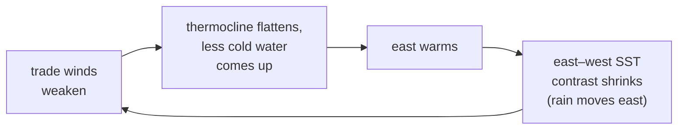

# CL29 · The Ocean's Ledger VI: Slow Swings and the Ocean's Memory for Carbon

◀ [[CL26 The Ocean's Ledger V - Mass, the Overturning and the Switch]] · [[Climate - Course Map|Course Map]] · tutorial: [[CL30 Tutorials III - Three Boxes of Carbon]]

taught · in syllabus (2026 Joy, O7, 18 Nov 2026: the last lecture of the ocean module) extra · beyond

> [!warning] Where this chapter comes from (added 2026-11-21)
> **Primary:** Joy's lecture notes *O7 · Slow swings, and the ocean's memory for carbon* (`lectures/notes/o7/index.md` on the course site, read in full; mirrored by `classroom_sync.py sites` from the site's repository, commit 3d86cd8, 19 Nov 2026). The O7 slide deck (`lectures/ocean-ledger-o7/`) was mirrored but **not** read frame by frame; the notes "follow the lecture as it was taught". **Readings read:** Hartmann (2016) §8.3 pp. 246–249 (core) and Stewart (2008) §14.2 pp. 244–247 (core), from `books/joy_lecture_readings/O7_readings/`. Every other page number is **as Joy cites it**. The model numbers of §8–§9 were recomputed with an independent coding of the model (`scripts/cl_carbon_boxes.py`; see [[CL30 Tutorials III - Three Boxes of Carbon]]).
> **Exam weight (Classroom, 19 Nov):** "the syllabus will be everything. However, the exam will likely test your grasp of the post mid-sem material in greater depth." Joy: understanding the three-box model "is part of the course, and it may come up in the exam".

> [!syllabus] Syllabus map
> 🟢 **Taught (Joy, O7)**: §1 the 2026 El Niño and anomalies; §2 the planet's enthalpy and temperature (Monteiro 2024); §3 two sources of slow swings (low-pass filtering, coupling); §4 why the east Pacific is cold (equatorial Ekman divergence, pressure gradient, tilted thermocline); §5 the **Bjerknes feedback**; §6 why El Niño turns around (Kelvin and Rossby waves) and why it is not a clock; §7 the deep ocean and our carbon (the 1750–2024 budget, carbonate chemistry); §8 the **three-box model**; §9 if we stopped today; §10 after the ocean (Archer); §11 the five ledgers; §12 "read this part" (the 200-year fudge, memory and forecasts, the atmosphere's engine, India, commitment).
> 🔵 **Extra · beyond (mine)**: the energy and noise estimates of the "questions to think about", all solved in §13; the low-pass-filter arithmetic ($1/\sqrt{\text{window}}$).

> [!key] After this chapter you can
> - define an **anomaly** and say why a 5 °C SST anomaly in one place is huge,
> - give the **two ways** the ocean makes slow swings (a passive low-pass filter; an active coupled loop),
> - explain the **cold tongue / warm pool** and the **tilted thermocline** from equatorial Ekman divergence plus an east–west pressure gradient,
> - draw the **Bjerknes feedback** loop and say which ledgers it joins; explain how **Kelvin and Rossby waves** turn El Niño around and why the period is 2–7 years, not fixed,
> - quote the **1750–2024 carbon budget** (752 GtC: 41 % air, 28 % ocean, 25 % land) and explain with carbonate chemistry why the ocean holds 50× the air's carbon yet took only a quarter,
> - describe the **three-box model**, the **200-year fudge**, the **334 ppm** settled level and why it does not depend on the exchange times, and the **Archer timescales**.

> [!intuition] One sentence
> The ocean is slow, and that slowness works both ways: it lets the tropical Pacific build a self-reinforcing swing (El Niño) that we can forecast months ahead, and it means the carbon we add takes centuries to leave the air — and a fifth of it stays until the sea floor and the rocks deal with it.

## 1. Is there an El Niño right now?
taught *O7 notes §1*

Yes, a strong one. Normally the tropical Pacific's **east is cold and the west warm**; in the week of 8–14 November 2026 the eastern Pacific was **3–5 °C warmer than usual** (+3.1 °C in the central Niño-3.4 box, +5.4 °C off Peru; NOAA OISST against 1991–2020). These are **anomalies**: deviations from the mean state (here the 1991–2020 average for the same week). Changes of 5 K normally separate the equator from the pole, driven by sunlight; to have one **at the same place with no change in sunlight** is huge. Peruvians knew El Niño long before scientists: rain on the desert coast in warm years (Stewart p. 241's 1895 account, as Joy cites). The effects reach the Amazon (rainfall, wildfires), the Indian monsoon, North America and Europe: **teleconnections**. NOAA's CPC (12 Nov) expected this El Niño to last into March 2027 — how can anyone forecast that? (§6, §12.)

## 2. The whole planet feels it
taught *O7 notes §2 (Monteiro 2024, Fig. 2)*

Monthly 1980–2023: the **enthalpy** (heat content) of the entire atmosphere and the global-mean near-surface air temperature both **spike with the strong El Niños** (1997–98, 2015–16, 2023; smaller in 2009–10). In late 2023 the monthly global mean was close to **1 °C above the figure's reference**, the highest on record — not from more sunlight, but from the tropical Pacific, **on top of** a warming trend (the running mean climbs through the record; clearer in temperature than in enthalpy). A **running mean** averages over a window that slides along.

## 3. Where slow swings come from: two ways
taught *O7 notes §3* · extra · beyond *the $1/\sqrt w$ arithmetic*

The atmosphere forgets in about a week, yet climate varies over years. "The ocean may be the primary cause of variability over times ranging from years to decades" (Stewart p. 212, as Joy cites). Two mechanisms:

1. **A slow ocean adds up fast weather** ([[CL23 The Ocean's Ledger II - Heat Capacity and Climate Inertia]]). An ocean that just responds to noisy forcing $a(t)$ does roughly $O(t)\approx\frac1\tau\int_{t-\tau}^t a(t')\,dt'$: a **low-pass filter**. It adds no energy; it returns a slower, smaller version of the forcing. *(The Daisyworld-with-ocean tutorial shows the same: [[CL27 Tutorials I - Daisyworld with Land and Ocean]].)*
2. **Ocean and air drive each other** (today's topic). In El Niño the ocean **puts energy into** the atmosphere; the exchange makes the swing **stronger**, and the loop can make a swing of its own.

> [!example] 🔵 Joy's Python experiment, done (Question 1)
> 10 000 white-noise numbers, moving average of window $w$: standard deviation 0.209, 0.153, 0.109, 0.073, 0.051 for $w=25,50,100,200,400$ — close to $1/\sqrt w$ (0.200, 0.141, 0.100, 0.071, 0.050). **Doubling the window shrinks the signal by $\sqrt2$**, because each average contains $w$ independent numbers whose sum grows as $\sqrt w$ while the average divides by $w$ ([[Probability - Course Map|the variance of a mean]], `scripts/cl29_numbers.py`).

## 4. Why the tropics, and why the east is cold
taught *O7 notes §4* · *read: Hartmann pp. 246–247*

**The equator pulls cold water up.** The trades blow from the east. North of the equator the Ekman transport is to the right of the wind (northward), south of it to the left ($f$ changes sign; southward): water is pushed **away from the equator on both sides** and water rises from below ([[CL24 The Ocean's Ledger III - Wind and the Momentum Ledger]]). So the warm surface layer is thin and responds strongly to any change in sunlight or wind (count the joules to warm 100 m by 3–5 K: §13 Q2).

**The equatorial books.** In steady state the equatorial ocean **loses heat** poleward (carried by the diverging water) and gains it from the sun; it **loses mass** poleward and gains it from below, water that sank in the subtropics returning a few hundred metres down: the **subtropical cells** (shallow overturning loops; not covered in detail).

**Why the Pacific tilts.** Upwelling happens all along the equator, so it does not explain the east–west contrast. **On** the equator rotation plays no role ($f=0$), so the wind's westward push cannot be balanced by Coriolis; it must be balanced by a **pressure gradient**: the trades pile water up in the west (sea surface higher there; Stewart pp. 239–240 as Joy cites) and the **thermocline tilts**, deep in the west, shallow in the east. In the east the upwelled water is cold: the **cold tongue**; in the west, the **warm pool** under the ITCZ's rain. Hartmann (p. 246, read) states the same: "The thermocline slopes downward toward the west, with a deep, warm mixed layer in the western Pacific and a shallow mixed layer and shallow thermocline in the east. This sloping thermocline is maintained in large measure by the easterly wind stress." The Pacific trades are strong partly because the basin is **wide**: nothing interrupts them for thousands of kilometres. (Neena's 2025 lecture gave the same mean state with a 0.5 m sea-level difference: [[CL20 ENSO and the Walker Circulation]] §1.)

## 5. How El Niño grows: the Bjerknes feedback
taught *O7 notes §5, Figs. 1–3* · *read: Hartmann p. 247, Stewart p. 244*

Something weakens the trades (a westerly wind burst, a wave, chance). The push that held the water in the west is gone but the **pressure gradient it built remains**, now unbalanced: over weeks to months the tilted warm layer relaxes toward a flatter one. The cold water in the east is no longer near the surface, and **the east warms**. The rain follows the warm water to the central Pacific; rising air there draws air in, disrupting the trades further. El Niño is **coupled**: in the normal state the strong trades keep the rain in the west, and the rising air over the rain reinforces the trades — the pattern is locked; once broken, the winds weaken further and it is hard to get back.

*The Bjerknes feedback, after Joy's Figure 3: "two ledgers in one loop" — the winds are the **momentum** ledger, the temperatures the **energy** ledger.*

A **positive feedback**: a change that produces more of itself, like the salt feedback in Stommel's boxes ([[CL26 The Ocean's Ledger V - Mass, the Overturning and the Switch]]). Hartmann (p. 247, read): "The positive feedback between warm SST in the west and cool in the east that drive easterlies that drive cool SST in the east and warm in the west is called 'Bjerknes feedback.' If these easterlies weaken, then pressure forces would begin to flatten the thermocline and warm surface water would flow toward the eastern Pacific… This is the basic idea behind the warm ENSO, or El Niño event, which employs the Bjerknes feedback in reverse." He adds that the system has "a lot of available potential energy when the thermocline is steeply sloped, as during La Niña conditions, and an instability can occur then". On its own, the feedback would push the Pacific into a permanently different state. But it comes back. Why?

## 6. Why it turns around, and why it isn't a clock
taught *O7 notes §6* · *read: Stewart pp. 244–245*

The wind change sends an equatorial **Kelvin wave** **east** along the equator in the ocean; it deepens the warm layer in the east. It also sends **Rossby waves** **west**, off the equator, thinning the warm layer there. These **reflect off the western boundary** and come back east with the **opposite** effect: they thin the eastern warm layer and cool the east. The reversal arrives about **six months** after the warming began (Zebiak et al. 2015 p. 20, as Joy cites); a full event takes about a year. **A fast loop that feeds itself (Bjerknes) + a slow, delayed loop that undoes it (the waves, the ocean's memory) = a swing of its own** (the *delayed oscillator*).

Stewart (p. 244, read) gives the sequence: strong trades for two years build up water in the west; when they relax (sometimes reversing as **westerly wind bursts**), "the deepening of the thermocline launches an eastward propagating Kelvin wave and a westward propagating Rossby wave", the Kelvin wave carries warm water east and the east warms 2–4 K "a few months after the wave is launched", and "the strong positive feedback between sea-surface temperature and the trade winds causes rapid development of El Niño". He quotes Wyrtki (1985): a complete cycle discharges heat from the tropical Pacific, which "can only be restored by the slow accumulation of warm water in the western Pacific by the normal trade winds", so the time scale is set by that **recharge**. When the Kelvin wave reaches Ecuador, part reflects as a westward Rossby wave and part travels north and south as **coastal Kelvin waves** (in 1957 the warm water reached California and Alaska).

**Not a clock.** Simple harmonic motion would have one frequency; ENSO "comes back at intervals from 2–7 years, with an average near four years" (Stewart p. 246, as Joy cites), and the record is noisier than a sine. But the physics is understood well enough to **forecast** it; the ocean's memory makes that possible.

**Every ocean can do it.** The mechanism (easterlies, a warm layer of variable thickness, moving rain) is not special to the Pacific, only bigger there: the **Indian Ocean Dipole** and the **Atlantic Niño** are the same mechanism in other basins.

## 7. Even slower: the deep ocean and our carbon
taught *O7 notes §7, Fig. 4 (Global Carbon Budget 2025)*

El Niño uses only the upper ocean. The **deep ocean** hears from the surface only over centuries ([[CL26 The Ocean's Ledger V - Mass, the Overturning and the Switch]]), and it matters most for climate change.

| 1750–2024 (GCB 2025) | GtC | share |
|---|---|---|
| emitted: fossil fuels and cement 505 + land-use change 248 | **752** | |
| still in the **air** | 312 | **41 %** |
| taken by the **ocean** | 210 | **28 %** |
| taken by the **land** | 190 | **25 %** |
| cement carbonation + budget imbalance | ~40 | 5 % |

(312 GtC at 2.124 GtC/ppm is 147 ppm above 280: 427 ppm, consistent with Mauna Loa's 425.) The ocean's share is one reason warming is less than emissions alone suggest (the other: it also takes up heat, [[CL23 The Ocean's Ledger II - Heat Capacity and Climate Inertia]]).

**The carbon in the sea** is almost all **bicarbonate and carbonate ions**, not dissolved CO₂ gas:
$$\mathrm{CO_2+H_2O\ \rightleftharpoons\ HCO_3^-+H^+\ \rightleftharpoons\ CO_3^{2-}+2H^+}.$$
That is why the ocean holds about **50 times** as much carbon as the air (Stewart p. 212, as Joy cites). The chemistry is a **buffer** (it resists pH change), but a limited one: the reactions release H⁺, so the more CO₂ the ocean takes, the more acidic it gets, the more the reactions are pushed back, and **the less CO₂ it can take** — the **Revelle factor** ([[CL30 Tutorials III - Three Boxes of Carbon]] §2; [[Inorganic Chemistry - Course Map|acid–base equilibria]]).

## 8. The smallest model: three boxes
taught *O7 notes §8, Figs. 5–6* · model details: [[CL30 Tutorials III - Three Boxes of Carbon]]

**BEAM** (Glotter et al. 2014, after Bolin & Eriksson 1959): the **air** (595 GtC before we started, 280 ppm), the **upper ocean** (top ~75 m, 714 GtC), exchanging with the air on ~5 years, and the **deep ocean** (50× the volume, 35 680 GtC), exchanging only with the upper ocean; its water is replaced about every **1000 years**.

**Where does the deep ocean meet the surface?** The deep water is denser, so surface water must become **cold and salty** to reach it — which happens only in a few places, mainly the North Atlantic and around Antarctica ([[CL25 The Ocean's Ledger IV - Salt, Density and Water Masses]], CL26). That is part of why the second arrow is so slow.

**Test on the past.** Driven by the carbon that actually entered air and sea each year, the model with a **1000-year** turnover takes up **too little** and overshoots: **480 ppm in 2024** against **425** measured. With **200 years** it follows Mauna Loa: **313, 359, 422 ppm** in 1959, 1994, 2024 against **316, 359, 425**. (Both reproduced exactly by `scripts/cl_carbon_boxes.py`.) The lesson: "**understanding the system deeply lets you make the right simplifications**" — but see §12 for the catch in the 200.

## 9. If we stopped today
taught *O7 notes §9, Fig. 7*

Stop all emissions at the start of 2025: CO₂ falls but **does not return to 280 ppm**; it settles at **≈ 334 ppm**: **22 %** of the added carbon stays in the air once the whole ocean has caught up (centuries). **Where it settles depends only on the chemistry and the size of the ocean, not on how fast it gets there**: 334 ppm with 1000-year or 200-year turnover (the exchange rates drop out of the equilibrium conditions; CL30 §2.3). Over those centuries the ocean gives carbon back in some places, so "is the ocean a sink?" — "on certain timescales"; over the past century, yes.

**The more we add, the more stays**: the buffer weakens as the ocean takes carbon, so **24 %** of a 1000 GtC pulse stays once settled, **42 %** of a 5000 GtC pulse. Meanwhile the CO₂ left in the air keeps trapping heat, century after century.

## 10. After the ocean
taught *O7 notes §10 (Archer et al. 2009, as Joy cites)*

| timescale | process | airborne share left |
|---|---|---|
| **2–20 centuries** | the ocean takes most of the carbon | 20–35 % stays |
| **3000–7000 years** | more acidic water dissolves **CaCO₃ on the sea floor**, restoring the buffer | drawn down further |
| **hundreds of thousands of years** | **weathering of rocks** | the rest |

For timescales up to about a thousand years, **the ocean sets the carbon cycle's response time**. (The long weathering thermostat is the one of [[CL16 Atmospheric Evolution Greenhouse Gases and the Carbon Cycle]] §6.)

## 11. The ledgers, closed
taught *O7 notes §11*

Five quantities tracked through the module: **energy, momentum, mass, salt** (which drive the ocean's own circulation) and **carbon** (which matters for climate). None is separate: carbon changes the energy budget, the energy budget changes the circulation, the circulation moves the carbon. ([[CL22 The Ocean's Ledger I - Accounting for Energy]] began with "climate is accounting".)

## 12. Read this part: what wasn't covered in class
taught (assigned reading) *O7 notes, "Read this part"*

- **Why the 200 years is a fudge.** Hartmann's 1000 years is the right deep-ocean turnover. One deep box stands for two different parts: the **thermocline** (upper few hundred metres, exchanging with the surface within **decades**, fed by Ekman pumping in the gyres) and the **abyss** (a thousand years). Recent emissions went mostly into the fast part, so the 1000-year box misses it and the 200-year box treats everything as fast. A good fit to the past **at a price in the future**: after emissions stop, the 200-year ocean draws CO₂ down too quickly (larger models: 2–20 centuries). "**A model that fits the past is not automatically right about the future.**" The settled 334 ppm does not depend on the fudge. (Handout Run 7: split the deep box: CL30 §4.)
- **Memory makes forecasts possible.** $\tau=C/\lambda$ ([[CL23 The Ocean's Ledger II - Heat Capacity and Climate Inertia]]): the air forgets in weeks (weather is unforecastable beyond ~2 weeks); the top 50 m of sea remembers for more than a year — why a November El Niño forecast reaches March.
- **The tropical ocean is the atmosphere's engine.** Latent heat released by rain over the warm sea is "the primary engine driving the atmospheric circulation" (Stewart p. 235, as cited); when El Niño moves the rain it moves the engine, and equatorial processes "dominate the interannual fluctuations in global weather patterns".
- **Close to home.** El Niño years tend to be dry in India, **but not always**: the Indian Ocean Dipole is one reason the link is not fixed (the monsoon–food-grain slide from earlier in the course; [[CL15 Monsoons]]).
- **Commitment.** The ocean's slowness delays warming now (it takes up heat) and keeps our carbon in the air for millennia, so **warming and sea-level rise continue for centuries after emissions stop** (Hartmann §13.14, pp. 412–415, a core reading not covered in class; not read here). "The memory that makes El Niño forecastable is the same memory that commits us to the warming."

## 13. Questions to think about, answered
extra · beyond *Joy's ten questions; numbers `scripts/cl29_numbers.py`, `scripts/cl_carbon_boxes.py`*

> [!example]- Q1–Q5 (ENSO)
> 1. Done in §3: std $\propto1/\sqrt w$; doubling the window divides it by $\sqrt2$ (each average sums $w$ independent numbers: the sum's std grows as $\sqrt w$, the average divides by $w$).
> 2. $\rho c_p=4.09\times10^6$ J m⁻³ K⁻¹. Over $10^{12}$ m², a 5 K rise needs $4.1\times10^{20}$ J for a 20 m layer and $2.0\times10^{21}$ J for 100 m. Sunlight absorbed at the tropical sea surface, taking **~250 W m⁻² (assumed)**, is $6.5\times10^{20}$ J per month: the thin layer needs ~0.6 months of all the sunlight, the thick one ~3 months. A change in sunlight cannot supply that; **redistribution** (moving the warm water and the thermocline) can — and a thin layer makes it much easier.
> 3. On the equator $f=0$: no Coriolis force, so the steady wind stress must be balanced by a **pressure gradient**. The sea surface **rises to the west** (water piled up by the easterlies); the thermocline **deepens to the west** (slopes the opposite way to the surface, much more steeply).
> 4. Stommel: positive = salt feedback (weaker flow → less salt north → weaker flow); negative = the flow wiping out the salt contrast on the rising side of the hump. Bjerknes: positive = winds ↔ SST; negative = the **delayed** wave reflection. A positive feedback plus an **instantaneous** negative feedback gives **two stable states and a switch**; plus a **delayed** negative feedback, an **oscillation**.
> 5. A narrower Pacific: the reflected Rossby/Kelvin waves cross it faster, so the delayed negative feedback arrives sooner: El Niño would come back **more often** (shorter period) — and weaker trades over a shorter fetch would also make the mean tilt smaller.

> [!example]- Q6–Q10 (carbon)
> 6. (i) The ocean can take carbon only as fast as **deep water is replaced** (~1000 years; only the small upper box keeps up). (ii) The **buffer weakens** as it takes carbon (Revelle): its appetite falls as it eats. Also: the emissions are recent.
> 7. **2050**: the 200-year model (it fits 1959–2024; the near future is like the recent past, carbon still going into the thermocline). **2500**: closer to the 1000-year model's behaviour (the slow abyss controls the long tail; 200 years draws CO₂ down too fast). Both settle at the same level.
> 8. At equilibrium every bracket is zero: air in balance with the upper ocean, upper with deep; those conditions contain only the chemistry and the box sizes, not the exchange rates. The rates set how long it takes, not where it ends.
> 9. Each GtC taken releases H⁺, lowering pH and pushing the carbonate reactions back, so $1/B$ (carbon held per unit dissolved CO₂) falls; a bigger pulse acidifies more, so a smaller fraction can be held: 24 % of 1000 GtC stays in the air, 42 % of 5000 GtC.
> 10. E.g. **momentum → energy**: the trade winds (momentum ledger) tilt the thermocline and set where cold water upwells (energy ledger) — the Bjerknes loop. Or **salt → mass**: salinity sets density, density drives the overturning (CL25–CL26).

<!-- interactive:start (generated by scripts/embed_interactive.py; edit the tool in scripts/interactive/tools/, not this block) -->
> [!interactive]+ Interactive: Three boxes of carbon: air, upper ocean, deep ocean (BEAM)
> The Bolin–Eriksson three-box carbon model with Glotter et al.'s (2014) carbonate chemistry, as in Joy's O7 app: the air exchanges with the upper ocean (time 1/k_a) and the upper ocean with a deep ocean 50 times its volume (turnover δ/k_d).
>
> ![[cl_three_boxes.png|720]]
>
> **Try:** History, stop 2025: turnover 1000 yr reaches 480 ppm in 2024 (Mauna Loa 425); set 200 yr: 422 ppm, on the dots, and the settled level stays 334 ppm. Pulse 1000 vs 5000 GtC: 24 % vs 42 % stays in the air once settled; untick the chemistry: 1.6 % for both (measured while building, matching the handout).
>
> [▶ Open the tool in your browser](../Assets/interactive/cl_three_boxes.html) · [absolute link](file:///home/swastik/Documents/notes/Assets/interactive/cl_three_boxes.html) · all tools and coverage: [[Interactive Tools]]

<!-- interactive:end -->

## Map of this chapter
> [!connection] How CL29 connects
> **Builds on:** [[CL20 ENSO and the Walker Circulation]] (Neena's ENSO: mean state, Bjerknes, indices; CL20's open question "what makes it switch" is answered in §6), [[CL24 The Ocean's Ledger III - Wind and the Momentum Ledger]] (Ekman), [[CL23 The Ocean's Ledger II - Heat Capacity and Climate Inertia]] (memory), [[CL26 The Ocean's Ledger V - Mass, the Overturning and the Switch]] (deep turnover, positive feedback), [[CL16 Atmospheric Evolution Greenhouse Gases and the Carbon Cycle]] (carbon cycle, weathering), [[CL28 Tutorials II - Earth's Energy Budget from Space (CERES)]] (El Niño in the energy budget). **Next:** [[CL30 Tutorials III - Three Boxes of Carbon]].
> **Concepts:** [[Bjerknes Feedback]] · [[Delayed Oscillator]] · [[Climate Anomaly]] · [[Low-Pass Filter]] · [[Ocean Carbon Sink and Airborne Fraction]] · [[Revelle Factor]] · [[Carbon Commitment]] · [[Thermocline and Pycnocline]]
> **Other subjects:** [[Inorganic Chemistry - Course Map]] (carbonate equilibria, buffers) · [[Probability - Course Map]] (variance of a mean) · [[EE06 Eutrophication and Alternative Stable States]] (positive feedbacks and switches)

## Provenance
> [!provenance]- Source map
> | Topic | Source | Scope |
> |---|---|---|
> | all of §1–§12, Figures 1–7 described | Joy, O7 lecture notes (course site, `lectures/notes/o7/index.md`, read in full) | taught |
> | thermocline tilt; Bjerknes feedback quote; La Niña instability | Hartmann (2016) §8.3 pp. 246–247 (`O7_readings/02_…`; read) | taught (core reading) |
> | Wyrtki's description, Kelvin/Rossby sequence, recharge, coastal Kelvin waves | Stewart (2008) §14.2 pp. 244–245 (`O7_readings/03_…`; read) | taught (core reading) |
> | Stewart pp. 212, 235, 239–241, 246; Zebiak et al. p. 20; Archer et al. 2009; GCB 2025; Monteiro 2024; Glotter et al. 2014 | as Joy cites them | taught |
> | model numbers in §8–§9 | Joy's notes; reproduced by `scripts/cl_carbon_boxes.py` (independent coding) | taught + check |
> | questions answered, noise and energy estimates | `scripts/cl29_numbers.py` (250 W m⁻² absorbed is my assumption) | extra/beyond |
>
> **Notes.** The O7 deck was not read frame by frame (the notes follow it). Hartmann §13.14 and the optional readings (Archer, Zebiak, Sarachik & Cane, Katz, Zebiak & Cane) are in the folder, not read.
