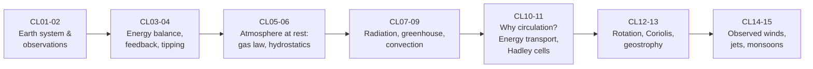

# Climate: Course Map (EC2113 Introduction to Climate)

<span class="scope-taught">taught · in syllabus</span> <span class="scope-extra-book">extra · book</span> <span class="scope-extra-beyond">extra · beyond</span>

Instructors: **Argha** (L1–L6, Keynote deck), **Suhas** (pre-midsem: basics, thermodynamics, hydrostatics, radiation, greenhouse models, convection; post-midsem: global energy balance, general circulation, rotating frames, winds, monsoons). Redundant coverage (hydrostatics, energy balance, greenhouse models appear in both) is **merged into one continuous sequence** below. Rules: [[Conventions]]. Sources: [[Sources]].

> [!note] Update 2026-11-07: last year's course and the ocean part
> `earth-and-climate/climate/lecture-notes-slides/ec2113_neena/` is the **2025 course (Neena, who taught it until last year)**; this year it is Argha, Suhas and **Joy** (ocean readings in `books/joy_lecture_readings/`, tiered Core / Optional / NotCoveredInClass). `instructors info.txt` asks that nothing of either year be missed. Neena's Lectures 2–19 overlap with CL01–CL15 (planetary balance, one-layer models, energy budget, convection, forces, general circulation, monsoon); the parts **specific to 2025 or to the ocean** are now **Part V (CL16–CL21)** and the tutorial problems are added to the Practice of CL03, CL08, CL10 and CL12. Still only partly covered from Lecture 7 and Lectures 12–13: cloud types and the net cloud effect, and the January/July surface-pressure centres of action (Siberian high etc.): see the Gaps.

## The storyline

Central question: **given sunlight, what is the temperature of the planet, how is it distributed, and what winds result?** Parts I–III answer for the planet as a whole (one number, then one column); Part IV answers for the sphere (latitude, winds).

## Chapters
### Part I · The climate system and its energy balance
| # | Chapter | Taught by | Status |
|---|---|---|---|
| 01 | [[CL01 Earth as a System]] | Argha, Suhas | **draft** |
| 02 | [[CL02 Observing Global Temperature]] | Argha | **draft** |
| 03 | [[CL03 Radiation and Planetary Energy Balance]] | Argha, Suhas | **draft** |
| 04 | [[CL04 Feedback and Multiple Steady States]] | Argha | **draft** |

### Part II · The atmosphere at rest
| # | Chapter | Taught by | Status |
|---|---|---|---|
| 05 | [[CL05 Thermodynamic State of the Atmosphere]] | Suhas, Argha | **draft** |
| 06 | [[CL06 Hydrostatic Balance and Vertical Structure]] | Argha, Suhas | **draft** |

### Part III · Radiation, greenhouse and convection
| # | Chapter | Taught by | Status |
|---|---|---|---|
| 07 | [[CL07 Optical Properties of the Atmosphere]] | Argha, Suhas | **draft** |
| 08 | [[CL08 Greenhouse Models]] | Argha, Suhas | **draft** |
| 09 | [[CL09 Radiative-Convective Equilibrium]] | Suhas | **draft** |

### Part IV · The general circulation (post-midsem)
| # | Chapter | Taught by | Status |
|---|---|---|---|
| 10 | [[CL10 Global Energy Balance and Meridional Structure]] | Suhas | **draft** |
| 11 | [[CL11 Mean Meridional Circulation and Angular Momentum]] | Suhas | **draft** |
| 12 | [[CL12 Rotating Frames and the Coriolis Force]] | Suhas | **draft** |
| 13 | [[CL13 Horizontal Motion - Geostrophic Balance and Friction]] | Suhas | **draft** |
| 14 | [[CL14 Observed Winds - Jets, Trades and the ITCZ]] | Suhas | **draft** |
| 15 | [[CL15 Monsoons]] | Suhas | **draft** |

### Part V · Atmosphere's past, orbits and the ocean (Neena 2025 lectures; Joy 2026 readings; added 2026-11-07)
| # | Chapter | Taught by | Status |
|---|---|---|---|
| 16 | [[CL16 Atmospheric Evolution Greenhouse Gases and the Carbon Cycle]] | Neena (L4, L6) | **draft** |
| 17 | [[CL17 Orbital Forcing and Glacial Cycles]] | Neena (L9, L10) | **draft** |
| 18 | [[CL18 The Ocean as the Climate System's Heat Reservoir]] | Neena (L20); Joy (O1–O3 core and optional readings) | **draft** |
| 19 | [[CL19 Wind-Driven Ocean Circulation]] | Neena (L21–22); Joy (not covered in class) | **draft** |
| 20 | [[CL20 ENSO and the Walker Circulation]] | Neena (L23) | **draft** |
| 21 | [[CL21 Thermohaline Circulation Water Masses and Sea Ice]] | Neena (L24); Joy (optional) | **draft** |

### Part VI · The ocean's ledger (Joy Monteiro, 2026; **primary source for Joy's part**; added 2026-11-13)
| # | Chapter | Source | Status |
|---|---|---|---|
| 22 | [[CL22 The Ocean's Ledger I - Accounting for Energy]] | Joy (O1 deck/handout, O2/O3 heat transport, CERES tutorial) | **draft** |
| 23–28 | planned: heat capacity and inertia (O2/O3), momentum ledger (O3/O4), salt ledger (O5), mass ledger and the overturning (O6), Daisyworld tutorials, CERES tutorial worked in full | Joy | **not yet written** (see `00-Home/PROGRESS.md`, addendum 2026-11-13) |

> PDFs of Joy's HTML slide decks (slides only, and slides with speaker notes): `earth-and-climate/climate/lecture-notes-slides/joy_slides_pdf/` (O1, O2-O3, O4, O5, O6); built by `scripts/joy_slides_pdf.py`.

Live status (Dataview):
```dataview
TABLE chapter AS "#", part AS "Part", by AS "Taught by", scope AS "Scope", status AS "Status"
FROM #subject/climate AND #type/chapter
SORT chapter ASC
```

## Concept index
**Earth system and observations:** [[Earth System]] · [[Climate vs Weather]] · [[Global Mean Surface Temperature]] · [[Area-Weighted Averaging]] · [[Isotopic Thermometers]] · [[Radiative Forcing]] · [[Reanalysis Data]]
**Radiation and energy balance:** [[Blackbody Radiation]] · [[Planck Law]] · [[Stefan-Boltzmann Law]] · [[Wien Displacement Law]] · [[Solar Constant]] · [[Albedo]] · [[Effective Emission Temperature]] · [[Zero-Dimensional Energy Balance Model]] · [[Greenhouse Effect]] · [[Beer-Lambert Law and Optical Depth]] · [[Rayleigh Scattering]] · [[Atmospheric Window]] · [[Greenhouse Gases and Absorption Bands]] · [[One-Layer Greenhouse Model]] · [[Multi-Layer Greenhouse Model]] · [[Water-Vapour Feedback]]
**Feedback and stability:** [[Planck Sensitivity]] · [[Climate Feedback Factor]] · [[Ice-Albedo Feedback]] · [[Snowball Earth]] · [[Faint Young Sun Paradox]] · [[Bistability and Tipping Points]] · [[Fixed Points and Linear Stability]] · [[Linearisation and Sensitivity]] · [[Relaxation Time]] · [[Jensen Inequality]]
**Atmosphere at rest, convection:** [[Ideal Gas Law]] · [[Atmospheric Composition]] · [[Mixing Ratio and Humidity]] · [[Virtual Temperature]] · [[Hydrostatic Balance]] · [[Scale Height]] · [[Geopotential]] · [[Hypsometric Equation]] · [[Standard Atmosphere]] · [[First Law of Thermodynamics]] · [[Adiabatic Process and Potential Temperature]] · [[Clausius-Clapeyron Relation]] · [[Lapse Rate]] · [[Dry Adiabatic Lapse Rate]] · [[Atmospheric Stability]] · [[Convection]] · [[Convective Adjustment]]
**Energy balance on the sphere:** [[Insolation]] · [[Seasons and Earth's Orbit]] · [[Top-of-Atmosphere Radiation Budget]] · [[Outgoing Longwave Radiation]] · [[Poleward Energy Transport]] · [[Meridional Temperature Structure]]
**Circulation and rotation:** [[Hadley Cell]] · [[Ferrel Cell and Polar Cell]] · [[Mass Stream Function]] · [[Subtropical Jet]] · [[Trade Winds and Westerlies]] · [[Intertropical Convergence Zone]] · [[Absolute Angular Momentum of Air]] · [[Rotating Reference Frames]] · [[Coriolis Force]] · [[Coriolis Parameter]] · [[Centrifugal Force and Effective Gravity]] · [[Eotvos Effect]] · [[Foucault Pendulum]]
**Horizontal motion:** [[Pressure Gradient Force]] · [[Scales of Atmospheric Motion]] · [[Rossby Number]] · [[Geostrophic Balance]] · [[Planetary Boundary Layer and Friction]] · [[Cyclones and Anticyclones]]
**Observed winds:** [[Zonal-Mean Zonal Wind]] · [[Thermal Wind]] · [[Jet Streams]] · [[Storm Tracks and Eddy Fluxes]] · [[Reanalysis Data]]
**Monsoons:** [[Monsoon]] · [[Land-Sea Thermal Circulation]] · [[Orographic Precipitation]] · [[Cross-Equatorial Flow]] · [[Tibetan Plateau and Monsoon Heating]]

All concept notes, live (and the generated [[Glossary]]):
```dataview
LIST FROM #type/concept AND #subject/climate SORT file.name ASC
```

## Visual map
- [[Climate - Course Map.canvas|Canvas: chapters, concepts and cross-subject links]]
- [[Ice-Albedo Feedback Loop.excalidraw]] (editable diagram; static copy in CL04)
- PDF handouts: [[climate-part1-energy-balance-handout.pdf]] · [[climate-rotating-frames-handout.pdf]]

## Where "taught" comes from
| Source | What it is | Used for |
|---|---|---|
| [[climate_intro_L1_L6.pdf]] | Argha's deck (73 slides, L1–L6) | CL01–CL04, CL06–CL08 |
| `Basics of atmosphere.docx`, [[suhas notes.pdf]] | Suhas pre-midsem (notes consolidated by AI: secondary) | CL01, CL03, CL05–CL09 |
| [[7th Oct.pdf]] … [[22nd Oct.pdf]], [[22nd Oct CliSci slides.pdf]] | phone photos of Suhas's post-midsem projected slides | CL10–CL15 |
| [[Suhas post midsem.pdf]] | your handwritten notes mapping each topic to book chapters | CL10–CL15 |
| [[climate-suhas merged.pdf]], [[Geostrophic_motion_Marshall_and_Plumb.pdf]], [[Large-scale_patterns_Hartmann.pdf]], [[Dynamical_theory_of_Monsoon_Webster.pdf]] | book excerpts assigned by Suhas | compared with the slides to decide *taught* vs *extra* |
| Wallace & Hobbs, *The Earth System* | full textbooks | extras, cross-checks |
| [[Lecture4_Atmospheric_composition_evolution_250828_142428 (1).pdf]] … [[Lecture24_Ocean_Thermohaline circulation_251123_105138 (1).pdf]], the tutorials in `ec2113_neena/` | the **2025 course** (Neena; text-layer PDFs, figures not seen) | CL16–CL21; tutorial problems in CL03, CL08, CL10, CL12 |
| `joy_lecture_readings/O1_readings` … `O3_readings` (14 PDFs: Hartmann 2016, Stewart 2008; Hartmann scans are OCR with garbled equations) | **Joy's ocean readings (2026)**; tier in the file name: Core = taught, Optional / NotCoveredInClass = extra · book | CL18, CL19, CL21 |

**Quiz prep:** [[Climate Quiz Prep]] (formula sheet, 25 verified traps, derivations, self-test).

**Quiz scope** (from [[climate_book_notes.pdf]]): Marshall & Plumb Ch. 4.7, 5, 6.6, 8 and Hartmann 2.8–2.9, i.e. CL09–CL12.

## Gaps added 2026-11-07
- Neena **Lectures 7 and 12–13** (cloud types, albedo vs greenhouse forcing of clouds, the January/July pressure features) are only partly in CL10, CL14: concept notes for the cloud radiative effect are still to be written. Neena's L2, L3, L5, L11, L14–L19 repeat CL03, CL08, CL07, CL09, CL12–CL15 and add nothing beyond the tutorial problems.
- **No Joy slides** exist: the ocean scope of this year is inferred from the reading tiers; ask whether Ekman transport and the wind-driven circulation ("NotCoveredInClass") are examinable.
- The slides' figures (SST maps, carbon-cycle diagrams, ENSO animations) were not seen.

## Cross-subject links
[[Thermodynamics and Statistical Mechanics - Course Map]] (strong: radiation, gas law, adiabatic processes) · [[Evolution of Earth and Life - Course Map]] (strong: paleoclimate, snowballs, carbon cycle) · [[Waves - Course Map]] · [[Landscapes and Geomorphology - Course Map]] · [[Ecology and Evolution - Course Map]] (bistability, Daisyworld) · [[Quantum Mechanics - Course Map]] and [[Group Theory - Course Map]] (molecular absorption) · [[Probability - Course Map]]. Full map: [[Subject Map]].

<!-- graph-spine:start (generated by scripts/graph_spine.py; do not edit between the markers) -->
## Atlas: every note in this subject
The graph view draws only real links, so this block links **every** note of the subject (the map is the hub of its cluster; [[Home]] is the hub of all maps).

> [!abstract]- Atlas (generated): 21 chapters · 109 concept notes · 88 zettel notes (the other tool's, filed in the vault) · 1 other notes in the vault · 45 notes from the other tool (source layer)
> **Chapters (21):** [[CL01 Earth as a System]] · [[CL02 Observing Global Temperature]] · [[CL03 Radiation and Planetary Energy Balance]] · [[CL04 Feedback and Multiple Steady States]] · [[CL05 Thermodynamic State of the Atmosphere]] · [[CL06 Hydrostatic Balance and Vertical Structure]] · [[CL07 Optical Properties of the Atmosphere]] · [[CL08 Greenhouse Models]] · [[CL09 Radiative-Convective Equilibrium]] · [[CL10 Global Energy Balance and Meridional Structure]] · [[CL11 Mean Meridional Circulation and Angular Momentum]] · [[CL12 Rotating Frames and the Coriolis Force]] · [[CL13 Horizontal Motion - Geostrophic Balance and Friction]] · [[CL14 Observed Winds - Jets, Trades and the ITCZ]] · [[CL15 Monsoons]] · [[CL16 Atmospheric Evolution Greenhouse Gases and the Carbon Cycle]] · [[CL17 Orbital Forcing and Glacial Cycles]] · [[CL18 The Ocean as the Climate System's Heat Reservoir]] · [[CL19 Wind-Driven Ocean Circulation]] · [[CL20 ENSO and the Walker Circulation]] · [[CL21 Thermohaline Circulation Water Masses and Sea Ice]]
>
> **Concept notes (109):** [[Absolute Angular Momentum of Air]] · [[Albedo]] · [[Antarctic Circumpolar Current]] · [[Area-Weighted Averaging]] · [[Atmospheric Composition]] · [[Atmospheric Escape]] · [[Atmospheric Evolution]] · [[Atmospheric Stability]] · [[Atmospheric Window]] · [[Beer-Lambert Law and Optical Depth]] · [[Biogeochemical Cycle]] · [[Bjerknes Feedback]] · [[Brine Rejection]] · [[Bulk Aerodynamic Formulas]] · [[Carbon Cycle]] · [[Centrifugal Force and Effective Gravity]] · [[Climate Feedback Factor]] · [[Climate vs Weather]] · [[Convection]] · [[Convective Adjustment]] · [[Coriolis Force]] · [[Coriolis Parameter]] · [[Cross-Equatorial Flow]] · [[Cyclones and Anticyclones]] · [[Deep Water Formation]] · [[Dry Adiabatic Lapse Rate]] · [[Earth System]] · [[Eastern Boundary Current]] · [[Effective Emission Temperature]] · [[Ekman Pumping]] · [[Ekman Spiral]] · [[Ekman Transport]] · [[El Nino and La Nina]] · [[ENSO]] · [[Eotvos Effect]] · [[Faint Young Sun Paradox]] · [[Ferrel Cell and Polar Cell]] · [[Foucault Pendulum]] · [[Geopotential]] · [[Geostrophic Balance]] · [[Glacial-Interglacial Cycles]] · [[Glacier Mass Balance]] · [[Global Mean Surface Temperature]] · [[Greenhouse Effect]] · [[Greenhouse Gas Lifetime and Potency]] · [[Greenhouse Gases and Absorption Bands]] · [[Hadley Cell]] · [[Hydrostatic Balance]] · [[Hypsometric Equation]] · [[Ice-Albedo Feedback]] · [[Inertial Oscillation]] · [[Infrared-Active Molecule]] · [[Insolation]] · [[Intertropical Convergence Zone]] · [[Isotopic Thermometers]] · [[Jet Streams]] · [[Land-Sea Thermal Circulation]] · [[Lapse Rate]] · [[Last Glacial Maximum]] · [[Light Attenuation in the Ocean]] · [[Mass Stream Function]] · [[Meridional Temperature Structure]] · [[Milankovitch Cycles]] · [[Mixed Layer]] · [[Mixing Ratio and Humidity]] · [[Monsoon]] · [[Multi-Layer Greenhouse Model]] · [[Obliquity]] · [[Ocean Heat Capacity and Seasonal Storage]] · [[One-Layer Greenhouse Model]] · [[Orbital Eccentricity]] · [[Orographic Precipitation]] · [[Outgoing Longwave Radiation]] · [[Planck Sensitivity]] · [[Planetary Boundary Layer and Friction]] · [[Poleward Energy Transport]] · [[Precession of the Equinoxes]] · [[Pressure Gradient Force]] · [[Radiative Forcing]] · [[Rayleigh Scattering]] · [[Reanalysis Data]] · [[Rossby Number]] · [[Scale Height]] · [[Scales of Atmospheric Motion]] · [[Sea Ice]] · [[Sea Surface Energy Budget]] · [[Seasons and Earth's Orbit]] · [[Seawater Salinity]] · [[Snowball Earth]] · [[Solar Constant]] · [[Southern Oscillation Index]] · [[Standard Atmosphere]] · [[Storm Tracks and Eddy Fluxes]] · [[Subtropical Gyre]] · [[Subtropical Jet]] · [[Thermal Wind]] · [[Thermocline and Pycnocline]] · [[Thermohaline Circulation]] · [[Tibetan Plateau and Monsoon Heating]] · [[Top-of-Atmosphere Radiation Budget]] · [[Trade Winds and Westerlies]] · [[Upwelling]] · [[Virtual Temperature]] · [[Walker Circulation]] · [[Water Mass and T-S Diagram]] · [[Water-Vapour Feedback]] · [[Western Boundary Current]] · [[Zero-Dimensional Energy Balance Model]] · [[Zonal-Mean Zonal Wind]]
>
> **Zettel notes (the other tool's, filed in the vault) (88):** [[01-Climate/Concepts/zettel/area-weighted-mean-temperature|area-weighted-mean-temperature]] · [[01-Climate/Concepts/zettel/atlantic-meridional-overturning-circulation|atlantic-meridional-overturning-circulation]] · [[atmospheric-angular-momentum-balance]] · [[atmospheric-conservation-of-energy]] · [[atmospheric-convection-cell]] · [[atmospheric-energy-transport]] · [[atmospheric-gas-lifetime]] · [[atmospheric-scale-height]] · [[atmospheric-thermal-stratification]] · [[atmospheric-window]] · [[beer-s-law]] · [[blackbody]] · [[cap-carbonates]] · [[coriolis-deflection-on-planetary-circulation]] · [[cryogenian-geological-glaciation-proxies]] · [[deterministic-chaos-in-the-lorenz-system]] · [[diurnal-thermal-inertia-model]] · [[earth-system-science]] · [[earth-system]] · [[geopotential-height]] · [[glacial-ice-volume-effect-on-seawater-isotopes]] · [[greenhouse-effect-temperature-increment]] · [[greenhouse-gas-absorption-mechanisms]] · [[homosphere-and-heterosphere]] · [[hydrostatic-balance]] · [[hypsometric-equation]] · [[01-Climate/Concepts/zettel/ice-albedo-feedback|ice-albedo-feedback]] · [[ideal-gas-equation]] · [[01-Climate/Concepts/zettel/infrared-flux-temperature-feedback|infrared-flux-temperature-feedback]] · [[infrared-thermometry-shading-discrepancy]] · [[01-Climate/Concepts/zettel/intertropical-convergence-zone|intertropical-convergence-zone]] · [[inverse-square-law-of-radiation]] · [[kirchhoff-s-law-of-radiation]] · [[land-ocean-thermal-contrast]] · [[latent-heat-release-in-convection]] · [[latitudinal-energy-imbalance]] · [[liquid-in-glass-thermometer-calibration]] · [[lorenz-system]] · [[monsoon-circulation]] · [[monsoon-dynamics]] · [[multi-scale-temperature-variability]] · [[multiple-climate-equilibria-in-energy-balance-models]] · [[newtonian-deterministic-climate-prediction]] · [[ocean-surface-currents]] · [[oceanic-gyres-and-surface-currents]] · [[optical-depth]] · [[orographic-uplift]] · [[oxygen-isotope-paleothermometry]] · [[oxygen-isotope-ratio]] · [[parameter-sensitivity-via-logarithmic-differentiation]] · [[piecewise-linear-albedo-model]] · [[01-Climate/Concepts/zettel/planck-function|planck-function]] · [[planetary-albedo-and-distance-scaling]] · [[01-Climate/Concepts/zettel/planetary-boundaries|planetary-boundaries]] · [[planetary-emission-temperature]] · [[planetary-internal-heat-sources]] · [[planetary-radiative-equilibrium]] · [[pressure-gradient-force]] · [[radiative-extinction]] · [[radiative-forcing]] · [[rayleigh-and-mie-scattering]] · [[rayleigh-jeans-law]] · [[runaway-greenhouse-effect]] · [[runaway-ice-albedo-instability]] · [[secular-temperature-trend-estimation]] · [[shortwave-and-longwave-radiative-boundary]] · [[shortwave-radiation-partitioning]] · [[01-Climate/Concepts/zettel/silicate-weathering-feedback|silicate-weathering-feedback]] · [[simple-greenhouse-model]] · [[simple-pendulum-differential-equation]] · [[snowball-earth-deglaciation-via-volcanic-outgassing]] · [[snowball-earth]] · [[solar-constant]] · [[solar-flux-and-insolation]] · [[state-space-reduction-for-pendulum-simulation]] · [[01-Climate/Concepts/zettel/stefan-boltzmann-law|stefan-boltzmann-law]] · [[stevenson-screen-standard-measurement]] · [[01-Climate/Concepts/zettel/stommel-diagram|stommel-diagram]] · [[surface-temperature-field-survey]] · [[temperature-dependent-ice-albedo-feedback]] · [[thermal-volume-expansion]] · [[top-of-atmosphere-radiation-balance]] · [[trade-winds]] · [[vertical-pressure-gradient]] · [[01-Climate/Concepts/zettel/wien-s-displacement-law|wien-s-displacement-law]] · [[zero-dimensional-energy-balance-model]] · [[zero-shadow-day]] · [[zonal-average]]
>
> **Other notes in the vault (1):** [[Climate Quiz Prep]]
>
> **Notes from the other tool (source layer) (45):** [[2026-08-05-lectures-1-2-intro-and-global-mean-temperature]] · [[2026-08-05-problem-set-1]] · [[2026-08-05-tutorial-1-data-analysis-notebook]] · [[2026-08-07-thermometer-experiment]] · [[2026-08-13-tutorial-2-energy-balance-problems]] · [[2026-08-19-lecture-3-planetary-energy-balance]] · [[2026-08-19-lecture-4-sensitivity-and-albedo-feedback]] · [[2026-08-20-lecture-5-atmosphere-and-greenhouse-gases]] · [[2026-08-21-lecture-6-planetary-energy-balance-with-ghgs]] · [[2026-08-27-tutorial-lorenz-model-and-simple-pendulum]] · [[2026-09-02-study-material-2-atmospheric-composition]] · [[2026-09-02-study-material-moist-and-dry-air]] · [[2026-09-03-study-material-3-pressure-and-geopotential]] · [[2026-09-04-tutorial-2-model-experiments-and-molecular-weights]] · [[2026-09-09-study-material-4-pressure-gradient-force]] · [[2026-09-10-reading-manabe-and-strickler-1964]] · [[2026-09-10-solutions-quiz-1]] · [[2026-09-17-study-material-5-radiative-balance]] · [[2026-09-17-study-material-6-radiative-convective-equilibrium]] · [[2026-10-07-study-material-7-meridional-circulation-part-1]] · [[2026-10-08-study-material-8-top-of-the-atmosphere-energy-balance-and-poleward-transport-of-energy]] · [[2026-10-08-study-material-9-mean-meridional-circulation-part-2-observation]] · [[2026-10-14-study-material-10-meridional-circulation-and-angular-momentum-balance]] · [[2026-10-14-study-material-11-transformation-from-a-rotating-to-an-inertial-coordinate]] · [[2026-10-22-advanced-reading-monsoon-dynamical-theory-webster]] · [[2026-10-22-study-material-12-large-scale-circulation-patterns]] · [[2026-10-22-study-material-13-geostrophic-motion]] · [[2026-10-30-tutorial-daisyworld-land-and-ocean]] · [[2026-10-31-tutorial-ceres-earths-energy-budget]] · [[zettel/area-weighted-mean-temperature|area-weighted-mean-temperature]] · [[zettel/atlantic-meridional-overturning-circulation|atlantic-meridional-overturning-circulation]] · [[introduction-to-climate-science/exam-prep|exam-prep]] · [[zettel/ice-albedo-feedback|ice-albedo-feedback]] · [[zettel/infrared-flux-temperature-feedback|infrared-flux-temperature-feedback]] · [[zettel/intertropical-convergence-zone|intertropical-convergence-zone]] · [[intro-clim]] · [[introduction-to-climate-science]] · [[zettel/planck-function|planck-function]] · [[zettel/planetary-boundaries|planetary-boundaries]] · [[zettel/silicate-weathering-feedback|silicate-weathering-feedback]] · [[zettel/stefan-boltzmann-law|stefan-boltzmann-law]] · [[zettel/stommel-diagram|stommel-diagram]] · [[t2m-hourly]] · [[thermometer-experiment]] · [[zettel/wien-s-displacement-law|wien-s-displacement-law]]
<!-- graph-spine:end -->
