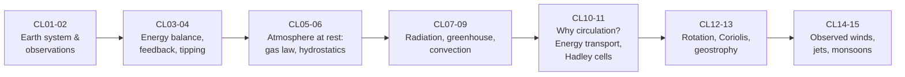

# Climate: Course Map (EC2113 Introduction to Climate)

<span class="scope-taught">taught · in syllabus</span> <span class="scope-extra-book">extra · book</span> <span class="scope-extra-beyond">extra · beyond</span>

Instructors: **Argha** (L1–L6, Keynote deck), **Suhas** (pre-midsem: basics, thermodynamics, hydrostatics, radiation, greenhouse models, convection; post-midsem: global energy balance, general circulation, rotating frames, winds, monsoons). Redundant coverage (hydrostatics, energy balance, greenhouse models appear in both) is **merged into one continuous sequence** below. Rules: [[Conventions]]. Sources: [[Sources]].

## The storyline

Central question: **given sunlight, what is the temperature of the planet, how is it distributed, and what winds result?** Parts I–III answer for the planet as a whole (one number, then one column); Part IV answers for the sphere (latitude, winds).

## Chapters
### Part I · The climate system and its energy balance
| # | Chapter | Taught by | Status |
|---|---|---|---|
| 01 | [[CL01 Earth as a System]] | Argha, Suhas | **draft** |
| 02 | [[CL02 Observing Global Temperature]] | Argha | **draft** |
| 03 | [[CL03 Radiation and Planetary Energy Balance]] | Argha, Suhas | **draft** |
| 04 | [[CL04 Feedback and Multiple Steady States]] | Argha | **draft** |

### Part II · The atmosphere at rest
| # | Chapter | Taught by | Status |
|---|---|---|---|
| 05 | [[CL05 Thermodynamic State of the Atmosphere]] | Suhas, Argha | **draft** |
| 06 | [[CL06 Hydrostatic Balance and Vertical Structure]] | Argha, Suhas | **draft** |

### Part III · Radiation, greenhouse and convection
| # | Chapter | Taught by | Status |
|---|---|---|---|
| 07 | [[CL07 Optical Properties of the Atmosphere]] | Argha, Suhas | **draft** |
| 08 | [[CL08 Greenhouse Models]] | Argha, Suhas | **draft** |
| 09 | [[CL09 Radiative-Convective Equilibrium]] | Suhas | **draft** |

### Part IV · The general circulation (post-midsem)
| # | Chapter | Taught by | Status |
|---|---|---|---|
| 10 | [[CL10 Global Energy Balance and Meridional Structure]] | Suhas | **draft** |
| 11 | [[CL11 Mean Meridional Circulation and Angular Momentum]] | Suhas | **draft** |
| 12 | [[CL12 Rotating Frames and the Coriolis Force]] | Suhas | **draft** |
| 13 | [[CL13 Horizontal Motion - Geostrophic Balance and Friction]] | Suhas | **draft** |
| 14 | [[CL14 Observed Winds - Jets, Trades and the ITCZ]] | Suhas | **draft** |
| 15 | [[CL15 Monsoons]] | Suhas | **draft** |

Live status (Dataview):
```dataview
TABLE chapter AS "#", part AS "Part", by AS "Taught by", scope AS "Scope", status AS "Status"
FROM #subject/climate AND #type/chapter
SORT chapter ASC
```

## Concept index
**Earth system and observations:** [[Earth System]] · [[Climate vs Weather]] · [[Global Mean Surface Temperature]] · [[Area-Weighted Averaging]] · [[Isotopic Thermometers]] · [[Radiative Forcing]] · [[Reanalysis Data]]
**Radiation and energy balance:** [[Blackbody Radiation]] · [[Planck Law]] · [[Stefan-Boltzmann Law]] · [[Wien Displacement Law]] · [[Solar Constant]] · [[Albedo]] · [[Effective Emission Temperature]] · [[Zero-Dimensional Energy Balance Model]] · [[Greenhouse Effect]] · [[Beer-Lambert Law and Optical Depth]] · [[Rayleigh Scattering]] · [[Atmospheric Window]] · [[Greenhouse Gases and Absorption Bands]] · [[One-Layer Greenhouse Model]] · [[Multi-Layer Greenhouse Model]] · [[Water-Vapour Feedback]]
**Feedback and stability:** [[Planck Sensitivity]] · [[Climate Feedback Factor]] · [[Ice-Albedo Feedback]] · [[Snowball Earth]] · [[Faint Young Sun Paradox]] · [[Bistability and Tipping Points]] · [[Fixed Points and Linear Stability]] · [[Linearisation and Sensitivity]] · [[Relaxation Time]] · [[Jensen Inequality]]
**Atmosphere at rest, convection:** [[Ideal Gas Law]] · [[Atmospheric Composition]] · [[Mixing Ratio and Humidity]] · [[Virtual Temperature]] · [[Hydrostatic Balance]] · [[Scale Height]] · [[Geopotential]] · [[Hypsometric Equation]] · [[Standard Atmosphere]] · [[First Law of Thermodynamics]] · [[Adiabatic Process and Potential Temperature]] · [[Clausius-Clapeyron Relation]] · [[Lapse Rate]] · [[Dry Adiabatic Lapse Rate]] · [[Atmospheric Stability]] · [[Convection]] · [[Convective Adjustment]]
**Energy balance on the sphere:** [[Insolation]] · [[Seasons and Earth's Orbit]] · [[Top-of-Atmosphere Radiation Budget]] · [[Outgoing Longwave Radiation]] · [[Poleward Energy Transport]] · [[Meridional Temperature Structure]]
**Circulation and rotation:** [[Hadley Cell]] · [[Ferrel Cell and Polar Cell]] · [[Mass Stream Function]] · [[Subtropical Jet]] · [[Trade Winds and Westerlies]] · [[Intertropical Convergence Zone]] · [[Absolute Angular Momentum of Air]] · [[Rotating Reference Frames]] · [[Coriolis Force]] · [[Coriolis Parameter]] · [[Centrifugal Force and Effective Gravity]] · [[Eotvos Effect]] · [[Foucault Pendulum]]
**Horizontal motion:** [[Pressure Gradient Force]] · [[Scales of Atmospheric Motion]] · [[Rossby Number]] · [[Geostrophic Balance]] · [[Planetary Boundary Layer and Friction]] · [[Cyclones and Anticyclones]]
**Observed winds:** [[Zonal-Mean Zonal Wind]] · [[Thermal Wind]] · [[Jet Streams]] · [[Storm Tracks and Eddy Fluxes]] · [[Reanalysis Data]]
**Monsoons:** [[Monsoon]] · [[Land-Sea Thermal Circulation]] · [[Orographic Precipitation]] · [[Cross-Equatorial Flow]] · [[Tibetan Plateau and Monsoon Heating]]

All concept notes, live (and the generated [[Glossary]]):
```dataview
LIST FROM #type/concept AND #subject/climate SORT file.name ASC
```

## Visual map
- [[Climate - Course Map.canvas|Canvas: chapters, concepts and cross-subject links]]
- [[Ice-Albedo Feedback Loop.excalidraw]] (editable diagram; static copy in CL04)
- PDF handouts: [[climate-part1-energy-balance-handout.pdf]] · [[climate-rotating-frames-handout.pdf]]

## Where "taught" comes from
| Source | What it is | Used for |
|---|---|---|
| [[climate_intro_L1_L6.pdf]] | Argha's deck (73 slides, L1–L6) | CL01–CL04, CL06–CL08 |
| `Basics of atmosphere.docx`, [[suhas notes.pdf]] | Suhas pre-midsem (notes consolidated by AI: secondary) | CL01, CL03, CL05–CL09 |
| [[7th Oct.pdf]] … [[22nd Oct.pdf]], [[22nd Oct CliSci slides.pdf]] | phone photos of Suhas's post-midsem projected slides | CL10–CL15 |
| [[Suhas post midsem.pdf]] | your handwritten notes mapping each topic to book chapters | CL10–CL15 |
| [[climate-suhas merged.pdf]], [[Geostrophic_motion_Marshall_and_Plumb.pdf]], [[Large-scale_patterns_Hartmann.pdf]], [[Dynamical_theory_of_Monsoon_Webster.pdf]] | book excerpts assigned by Suhas | compared with the slides to decide *taught* vs *extra* |
| Wallace & Hobbs, *The Earth System* | full textbooks | extras, cross-checks |

**Quiz prep:** [[Climate Quiz Prep]] (formula sheet, 25 verified traps, derivations, self-test).

**Quiz scope** (from [[climate_book_notes.pdf]]): Marshall & Plumb Ch. 4.7, 5, 6.6, 8 and Hartmann 2.8–2.9, i.e. CL09–CL12.

## Cross-subject links
[[Thermodynamics - Course Map]] (strong: radiation, gas law, adiabatic processes) · [[Evolution of Earth and Life - Course Map]] (strong: paleoclimate, snowballs, carbon cycle) · [[Waves - Course Map]] · [[Landscapes and Geomorphology - Course Map]] · [[Ecology and Evolution - Course Map]] (bistability, Daisyworld) · [[Quantum Mechanics - Course Map]] and [[Group Theory - Course Map]] (molecular absorption) · [[Probability - Course Map]]. Full map: [[Subject Map]].
