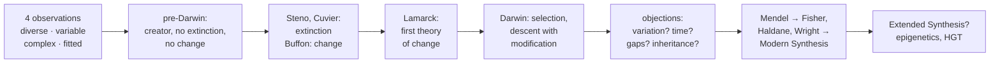

# EE08 · Evolution: An Introduction

◀ [[EE07 Conservation Biology]] · [[Ecology and Evolution - Course Map|Course Map]] · next: [[EE09 Hardy-Weinberg Equilibrium]]

taught · in syllabus extra · book extra · beyond

> [!syllabus] Syllabus map: what is in the syllabus and what is extra in this chapter
> 🟢 **In syllabus (taught)**: the lecture ([[Evolution_06-Oct-2026.pdf|93 slides]], BI2113, part IV: evolution) **and** the *mandatory* reading, Futuyma & Kirkpatrick (2017), *Evolution* 4th ed., Ch. 1, "for the historical overview and statements on MS" ([[Ch1_Evolution_Futuyma and Kirpatrick_4ed_2017.pdf|reading]]).
> - §1 what evolutionary biology explains: the alien's four observations (sl. 2–20)
> - §2 evolution of evolutionary thought: Indian and Greek views, the Great Chain of Being, Linnaeus, anatomy, Paley, Steno, Cuvier, Buffon (sl. 21–34)
> - §3 what Lamarck actually said (sl. 35–42)
> - §4 Darwin's logic and descent with modification; what it explains (sl. 43–48)
> - §5 four objections to Darwin and the reactions (sl. 49–52)
> - §6 Mendel, Fisher–Haldane–Wright, the Modern Synthesis, molecular biology (sl. 53–58)
> - §7 the Extended Evolutionary Synthesis: epigenetics, transgenerational inheritance, horizontal gene transfer (sl. 59–85)
> - §8 proximate versus ultimate; "nothing in biology makes sense…" (sl. 86–92)
>
> 🟡 **Extra · book** (the "detailed reading" tier): Pigliucci (2009), *An Extended Synthesis for Evolutionary Biology* (abstract and introduction read); Weaver et al. (2004), the rat licking-and-grooming paper behind slides 64–66 (abstract read).
>
> 🔵 **Extra · beyond** (my additions, labelled): §5.1 Jenkin's blending argument as arithmetic (variance halves each generation) with a simulation, and why Mendelian inheritance answers it (the bridge to [[EE09 Hardy-Weinberg Equilibrium]]); the interactive tool.

> [!key] After this chapter you can
> - state the **four properties of life** evolutionary biology must explain, and the **three pre-Darwinian positions** (a creator; no extinction; no change),
> - say who knocked each position down (Steno, Cuvier, Buffon) and what **Lamarck actually said** (spontaneous generation, a complexifying force, an adaptive force; use/disuse and inheritance of acquired characters were a small, borrowed part),
> - reproduce **Darwin's logic** as observations → inferences, and list the four **objections** with their modern answers,
> - define the **Modern Synthesis** (Futuyma's 14 principles) and name its makers,
> - give the three **MS concepts** that the **Extended Synthesis** questions, each with its case study (maternal care and GR methylation; vinclozolin and toadflax; *Elysia*, with the retraction),
> - explain **proximate vs ultimate** causation and Dobzhansky's dictum.

> [!intuition] The one-sentence story
> Life is diverse, variable, complex and fitted to its surroundings; for two thousand years the explanation was design and fixity, until fossils showed extinction and change, Darwin supplied a mechanism (selection on heritable variation) that Mendel's particulate inheritance rescued and the Modern Synthesis formalised; today's debate is not *whether* that theory holds but how far epigenetic and horizontal inheritance extend it.

## 1. What is evolutionary biology trying to explain?
taught *[[Evolution_06-Oct-2026.pdf#page=2|slides 2–20]]*

The lecture asks the question from outside: an alien visiting Earth would note four things ([[Evolution_06-Oct-2026.pdf#page=18|slide 18]]):

| observation | the lecture's evidence |
|---|---|
| 1. **Tremendous diversity** of life forms | Western Ghats: ~7402 flowering and ~1814 non-flowering plants, ~139 mammals, ~179 amphibians, ~508 birds, ~6000 insects, ~290 freshwater fishes (Deepu et al. 2023); Andaman and Nicobar coastal waters: ~424 corals, ~38 mangroves, ~227 phytoplankton …; Eaglenest WLS: ~1500 moths and butterflies, ~450 birds (sl. 4–10) |
| 2. **Variation even within groups** | human skin colour, dog breeds (sl. 11–12) |
| 3. All organisms are **complex** | human organ systems; *E. coli*: 4402 proteins predicted, 2586 detected (sl. 13–15) |
| 4. **Environment-specific features** | puffin, fish gills (sl. 16–17) |

Evolutionary biology "tries to understand how this diversity came about, and why the organisms are the way they are" (sl. 18). The four observations are not a random list. They are the facts that any explanation of life must cover, and they come in two pairs. Diversity and variation ask *where new forms come from*. Complexity and fit ask *how functional, well-suited organisms can arise at all*. The second pair was the strongest argument for a designer (§2), so a theory that explained the first pair without the second would not have been enough. Darwin's theory (§4) is judged by whether it explains all four. The obvious reply, "isn't *why organisms are the way they are* molecular biology or genetics?", is answered in §8 with Dobzhansky's dictum, *nothing in biology makes sense except in the light of evolution* (Dobzhansky 1973; sl. 20).

## 2. The evolution of evolutionary thought
taught *[[Evolution_06-Oct-2026.pdf#page=21|slides 21–34]]*

| who / where | idea | effect on the three positions |
|---|---|---|
| **Indian scriptures** (sl. 22) | Rigveda (Hiranyagarbha, Purusha, the *Nasadiya Sukta*: "no one can know"), Shatapatha Brahmana (Prajapati), Upanishads, Puranas (Brahma) | a creator; many forms created at once; cycles of rebirth across forms |
| **Plato, Aristotle** (sl. 23) | *scala naturae*, the **Great Chain of Being**: God → angels → humans → animals → plants → minerals | fixed order, no change, no fine classification |
| **Linnaeus** (1707–1778; sl. 24–25) | taxonomy; "there are as many species as the Infinite Being produced diverse forms in the beginning" | corollaries: **no extinction, no change** |
| **Willis, Hooke** (sl. 26) | comparative anatomy (vertebrate brains), Hooke's dronefly head | similarity across groups (→ Great Chain); intricacy even in simple organisms (→ God) |
| **Paley** (1743–1805; sl. 27) | natural theology; the **watchmaker** analogy | complexity requires a designer |
| **Steno** (1638–86; sl. 29–30) | "tonguestones" are sharks' teeth; seashells on mountains mean mountains were once under the sea | the Earth changes |
| **Cuvier** (1769–1832; sl. 31–32) | mammoth skeletons are species no longer found: **species go extinct** | the Great Chain is imperfect (but Cuvier rejected change of species: species are formed and destroyed) |
| **Taoists; Buffon** (sl. 34) | constant change; all four-legged animals from **38 ancestral forms** | species *can* change |

**How the table adds up.** Linnaeus and Paley codified a world that was created, complete and unchanging, with complexity as the signature of design. The first crack came from rocks, not biology. Steno showed that fossils are the remains of once-living organisms, and that rocks now on mountains were once under the sea, so **the Earth changes**. Cuvier then showed that some fossils belong to species that no longer exist anywhere, so **species go extinct**, and position (b) falls. But if species can disappear and the world is still full of species, either the original creation was vastly larger or **new species appear**, which puts pressure on (c); Buffon's 38 ancestral forms are a guess in that direction. What none of them supplied was a *mechanism* of change that also explained complexity and fit. Without one, design (a) remained the only explanation for the second pair of observations in §1, and that is the gap Lamarck (§3) and Darwin (§4) set out to fill.

> [!key] The recap the lecture repeats (slides 28, 33)
> Three positions explained diversity and complexity: **(a)** a creator made all species, **(b)** no species ever went extinct, **(c)** no species changed since its origin. Palaeontology removed (b); Buffon and the Taoists doubted (c); (a) was challenged only by a theory of change with a mechanism.

## 3. What Lamarck actually said
taught *[[Evolution_06-Oct-2026.pdf#page=35|slides 35–42]]*

The textbook caricature is "effortful striving leading to a heritable change" (the giraffe's neck). The lecture's correction: Jean-Baptiste **Lamarck** (1744–1829) gave the **first coherent theory of change in species**, with four parts (sl. 36–40):

1. Life is **continuously generated from non-living matter**.
2. There is a **master plan** by which organisms change across generations toward greater complexity.
3. Two forces act: a **complexifying force** moving lineages up the plan (explains biodiversity and the similarity across groups), and an **adaptive force** fitting organisms to their environment,
4. the adaptive force working through **use and disuse** of organs and the **inheritance of acquired traits** (explains variation within groups and adaptation).

> [!intuition] Why the caricature is unfair
> Lamarck's theory accounted for all four of the alien's observations (sl. 41). Inheritance of acquired characters "was a small part of his overall theory and was not even his idea". It was not accepted partly because of Cuvier's opposition and because there was **no evidence for inheritance of acquired traits** at the time (sl. 42; the lecture returns to this in §7).

## 4. Darwin's logic
taught *[[Evolution_06-Oct-2026.pdf#page=43|slides 43–48]]* · extra · book *Freeman & Herron's four postulates, [[EE10 Natural Selection]]*

[[Evolution_06-Oct-2026.pdf#page=45|Slide 45]] lays Darwin's argument out as a chain of observations (Obs) and inferences (Inf). The chain matters more than the list. Each inference is forced by the facts before it, and each later objection (§5) attacks one particular link.

**Step 1: there must be a struggle (Obs 1–3 ⇒ Inf 1).**
- *Obs 1, overproduction* (from Malthus): every species produces far more offspring than are needed to replace the parents. A pair of elephants, the slowest breeders Darwin could find, would leave millions of descendants within a few centuries if all survived. Unchecked, numbers grow geometrically.
- *Obs 2 and 3*: resources stay roughly constant from year to year, and so do population sizes.
- Put together, these cannot all hold unless **most offspring die before they reproduce**. Births exceed replacement, yet numbers do not grow, so deaths must remove the excess every generation. And because resources are limited, the survivors are those who got enough of them. That is *Inf 1, competition, the struggle for existence*. The phrase means unequal success in a crowded world, not literal fighting. (From Adam Smith Darwin took the idea that competition among individuals, each acting for itself, can produce an orderly outcome at the level of the whole, without anyone designing it.)

**Step 2: the struggle is not a lottery (Inf 1 + Obs 4–5 ⇒ Inf 2).**
- *Obs 4*: individuals of a species differ (size, speed, beak shape, disease resistance).
- If individuals differ and only some survive, then *who* survives is not random with respect to those differences. On average, variants that help in getting food, escaping predators or attracting mates leave more offspring.
- *Obs 5*: offspring resemble their parents, so some of the variation is heritable. Then the advantage of the survivors is passed on, and **favourable variants become commoner from one generation to the next**, unfavourable ones rarer. That is *Inf 2, natural selection*.
- Both observations are needed. Without variation (Obs 4), deaths would be random with respect to traits and nothing would change. Without heritability (Obs 5), each generation's lucky survivors would take their advantage to the grave.
- Natural selection is labelled both Inf 2 and *Obs 6* on the slide, because it can also be *seen* directly: in breeders' artificial selection, which Darwin used as his model (pigeons), and in wild populations ([[EE10 Natural Selection]], the Grants' finches).

**Step 3: fit without a designer (Inf 2 repeated ⇒ Inf 3).** Selection acts every generation, and the environment does the "choosing". Small advantages accumulate, so populations come to carry traits that suit the conditions they live in: *Inf 3, adaptation*. This is the step that answers Paley (§2). The fit of organism to environment, which the watchmaker argument took as proof of design, is what a blind, repeated filter produces.

**Step 4: divergence into new forms (Inf 3 + deep time ⇒ Inf 4).** Different places pose different conditions, so selection pushes populations of one species in different directions. Each step is tiny. But Lyell's geology (uniformitarianism: small, present-day processes acting over immense time built the landscape) gave Darwin the time scale on which tiny steps add up. Given enough time, descendants become **"very different"** from their ancestors, different enough to count as new species and eventually new groups: *Inf 4*. This step is only as strong as the time available, which is why Kelvin's young Earth (§5) was such a serious objection.

**Step 5: all of biodiversity (Inf 4 run backwards ⇒ Inf 5).** If species split and change, then tracing lineages back makes them converge. Today's species, and the extinct ones in the fossil record, are the branches of one tree grown from **one or a few ancestors**: *Inf 5*. This is **descent with modification** (sl. 46). Darwin avoided the origin of life itself, but implied that all life forms are connected through degrees of ancestry.

The chain now accounts for the alien's four observations of §1:
- **diversity** is Step 4–5 branching;
- **variation within groups** is the raw material of Step 2;
- **complexity** is Step 3 accumulated over many rounds;
- **environment-specific features** are Step 3 itself.

The lecture's warning (sl. 47): this is how Darwin *framed* the argument, "NOT how we understand the process today. Darwin got many things right, a few things wrong, and had no clue about a lot of stuff." Above all, he had no theory of where variation comes from or how it is inherited (§5).

| step | statement | borrowed from | why it follows |
|---|---|---|---|
| Obs 1 | overproduction of offspring | Malthus | (observed; geometric increase) |
| Obs 2, 3 | resources and population sizes stable | | (observed) |
| **Inf 1** | **struggle for existence** | Adam Smith | births exceed replacement but numbers are constant, so most die; limited resources decide who |
| Obs 4, 5 | variation exists; some is heritable | | (observed) |
| **Inf 2 / Obs 6** | **natural selection**: favourable variants increase | | survival depends on traits (Obs 4), and survivors pass them on (Obs 5) |
| **Inf 3** | adaptation | | selection repeated over generations |
| **Inf 4** | new species and groups | Lyell (deep time) | different environments plus enormous time |
| **Inf 5** | all biodiversity, living and extinct | | Inf 4 traced backwards: one tree of life |

**What the theory explains** (sl. 48), each item read off the chain:
- the diversity of life (Steps 4–5);
- adaptations (Step 3);
- **anatomical similarities across species**: the same bones in a human arm, a bat wing and a whale flipper are inherited from a common ancestor and modified, not designed afresh (homology);
- **extinct species resembling living ones**: fossils are relatives or ancestors on the same tree;
- **similar species living close together**: species arise from neighbouring ancestors and disperse only slowly;
- **distribution patterns such as the Wallace line**: deep water that land animals could not cross separates two faunas that diverged independently on either side.

## 5. Objections and reactions
taught *[[Evolution_06-Oct-2026.pdf#page=49|slides 49–52]]*

Each objection attacks one link of the chain in §4: (1) the *source* of the variation in Obs 4; (2) the *time* that Step 4 needs; (3) the *intermediates* that Steps 4–5 predict should be found as fossils; (4) the *inheritance* in Obs 5, without which Step 2 fails.

| objection to the 1859 theory | Darwin's answer | today |
|---|---|---|
| 1. What causes variation within a population? | none | genetics: mutation and recombination |
| 2. Has there been enough time? | Earth is billions of years old; **Kelvin** said a few million | **radioactive dating** proved Darwin right |
| 3. Why the gaps in the fossil record? | many fossils undiscovered; fossilisation needs special conditions | as Darwin said |
| 4. What is the mechanism of inheritance? | **blending inheritance** — but **Fleeming Jenkin** showed blending removes all variation very fast, so selection would stop. "Darwin had no answer." | **Mendel**: particulate inheritance (§6, §5.1) |

Reactions (sl. 52) were diverse: many accepted that species change but not necessarily slowly (**saltationism** as an alternative to gradualism); natural selection as *the* mechanism stayed contested; religious reactions varied, some disturbed above all by an animal origin of humans.

### 5.1 Jenkin's argument as arithmetic
extra · beyond *Templeton (2006) pp. 34–35 for the history (read); simulation mine, `scripts/ee08_10_numbers.py`*

Under **blending**, an offspring's trait is the mid-parent value $z'=\tfrac12(z_m+z_f)$. For random mating with independent parents of variance $V$, $\operatorname{Var}(z')=\tfrac14(V+V)=\tfrac12V$: **half the heritable variation is lost every generation**, $V_t=V_0/2^t$. After 10 generations less than 0.1 % remains, so selection would soon have nothing to act on unless mutation restored half the variation every generation, which Templeton notes seemed implausible and drove Darwin (1868) toward environmentally directed variation. In a simulation of 20 000 individuals the variance fell 1.000 → 0.501 → 0.252 → 0.125 → 0.062 … → 0.004 in 8 generations (theory $0.5^t$). Under **Mendelian** inheritance at 20 additive loci, the same population kept its variance (0.986–1.019 of the start over 8 generations): genes are passed on unblended, and the allele frequencies, hence the variance, do not change. That is the content of the Hardy–Weinberg law, which "finally put to rest" Jenkin's argument (Templeton p. 34): [[EE09 Hardy-Weinberg Equilibrium]].

## 6. Mendel, the founders and the Modern Synthesis
taught *[[Evolution_06-Oct-2026.pdf#page=53|slides 53–58]]* · extra · book (mandatory) *Futuyma & Kirkpatrick Ch. 1, pp. 16–18 (read)*

- **Mendel**: laws of inheritance proposed 1865, published 1866 (16 years before Darwin's death), rediscovered only in **1900**; "factors" do not blend and pass unchanged across generations (sl. 53). This repaired the two weakest links of §5. Particulate inheritance means variation is not diluted (objection 4, §5.1), and **mutation** of the factors is a source of new variation (objection 1). The synthesis that followed is, in effect, Darwin's chain with Obs 4 and Obs 5 given a mechanism.
- **1900–1950, formalisation**: **R. A. Fisher, J. B. S. Haldane, Sewall Wright** gave evolution a mathematical basis (sl. 54); **empirical work** by Stebbins (plants), Simpson (fossils), Dobzhansky (insects) and many others (sl. 55).
- **1940s–50s, the Modern Synthesis** (sl. 56): Darwin's insights synthesised with those of the geneticists, theoreticians, experimentalists, palaeontologists and ecologists; "the embryologists were the only people missing". The name is from Julian Huxley's 1942 popular account.
- **Molecular biology** (sl. 57–58): Sanger's protein and DNA sequencing; Sibley's molecular taxonomy of birds; **Pauling and Zuckerkandl (1962)**, sequence differences as a clock for divergence times. Over 75 years the data (sequences, molecular genetics, developmental biology, molecular taxonomy, palaeontology, evolutionary ecology) modified the synthesis "but no major structural changes… there is no new information that is inconsistent with the existing theory" (sl. 58).

> [!key] The Modern Synthesis in Futuyma's words (Ch. 1, p. 16)
> The consensus forged in the 1930s–40s by geneticists, systematists and palaeontologists, whose chief principle is that **adaptive evolution is caused by natural selection acting on particulate (Mendelian) genetic variation** (often called neo-Darwinism). Fisher, Haldane and Wright showed that **mutation is not an alternative to natural selection but its raw material**; Dobzhansky (*Genetics and the Origin of Species*, 1937), Mayr (1942), Simpson (1944, 1953), Stebbins (1950) and Rensch argued that mutation, gene flow, selection and drift cause evolution within species (**microevolution**) and, over long times, account for speciation and **macroevolution**.

> [!example]- Futuyma's Box 1A: the fundamental principles that emerged from the synthesis (p. 18, as read; * = qualified by later research)
> 1. Phenotype ≠ genotype; phenotypic differences have both genetic and environmental causes.
> 2. **Acquired characteristics are not inherited.\***
> 3. Hereditary variation is particulate (genes), for continuous traits as well as discrete ones.
> 4. Variation arises by **random mutation**, not in response to need; recombination amplifies it.
> 5. **Evolution is a change of a population, not of an individual**: a change across generations in allele or genotype frequencies.
> 6. Changes in allele frequency may be random (**drift**) or nonrandom (**selection**, from differences in survival and reproduction).
> 7. Even weak selection can cause substantial evolution; **adaptations are traits shaped by natural selection**.
> 8. Selection can take populations beyond the original range of variation by creating new gene combinations.
> 9. Populations usually carry considerable genetic variation and can evolve fast when conditions change, without waiting for new mutations.
> 10. Species differences usually evolve in small steps, often at many genes.\*
> 11. Species are groups of (potentially) interbreeding individuals that do not exchange genes with other such groups.\*
> 12. Speciation usually occurs by genetic differentiation of geographically isolated populations.\*
> 13. Higher taxa arise by accumulation of small differences, not by sudden drastic mutants ("hopeful monsters", Goldschmidt).
> 14. All organisms form one **Tree of Life**, descended from a single common ancestor.
>
> *(The OCR of this box is partly jumbled; items 7–10 are reconstructed from the readable fragments.)* Futuyma adds (p. 17) that **Kimura's neutral theory** challenged the synthesis's view that almost all features are adaptive, and that "evolution does not equal Darwinism".

## 7. Is an Extended Evolutionary Synthesis needed?
taught *[[Evolution_06-Oct-2026.pdf#page=59|slides 59–85]]* · extra · book *Pigliucci 2009 (abstract and introduction read), Weaver et al. 2004 (abstract read)*

In the early 2000s some evolutionary biologists asked whether the synthesis needs an overhaul: incremental changes, or a new **Extended Evolutionary Synthesis (EES)** (sl. 59). Pigliucci (2009) argues for an EES "containing among others evo–devo, an expanded theory of heredity, elements of complexity theory, ideas about evolvability, and a reevaluation of levels of selection", but as an **expansion** of the MS, not a paradigm shift (the only paradigm shift, in his view, was from natural theology to empirical science in the mid-19th century). The lecture takes three MS concepts in turn:

| # | Modern Synthesis concept → implication | the challenge (case studies) | EES concept → implication |
|---|---|---|---|
| 1 (sl. 60–74) | an organism's features are **chiefly determined by its genes** → the environment is **merely an agent of selection** | **Rat maternal care** (Francis et al. 1999; Weaver et al. 2004): cross-fostering shows offspring anxiety is not genetically fixed; high licking/grooming and arched-back nursing **demethylates** the promoter of the hippocampal **glucocorticoid-receptor (GR)** gene during the first week of life, raising GR expression → calmer adults; the difference persists into adulthood and is reversed by cross-fostering and by a histone-deacetylase inhibitor (Weaver abstract). **Humans**: Romanian orphans under Ceaușescu's policies — reduced grey matter, impaired amygdala function, chronic anxiety, OCD, lack of empathy as adults even after good foster care (Sheridan et al. 2012); people abused as children show **less GR mRNA and more GR-promoter methylation** (McGowan et al.) | some features come from the **interaction of gene and epigenome** → the environment can **directly alter the epigenome**, hence the features |
| 2 (sl. 75–79) | **acquired traits cannot be inherited** (Weismann) → adaptive evolution by differential survival of competing genes | **Vinclozolin** (a fungicide) given to a pregnant rat: altered testis methylation; male progeny for **at least four generations** show testis, prostate and kidney disease, immune abnormalities, tumours. **Toadflax** *Linaria vulgaris* (Cubas et al. 1999): the "peloric" form, long thought a mutant, has **no genetic difference**; its *Lcyc* gene is heavily **methylated**, stably inherited; partly demethylated plants revert toward wild type | **some acquired traits can be inherited** → adaptive evolution at the level of **genome and epigenome** |
| 3 (sl. 80–83) | all genetic information passes **within a species** → descent with modification forms a **lineage** | **Horizontal gene transfer** claimed in the sea slug *Elysia chlorotica*: juveniles eat the alga *Vaucheria litorea*, keep its plastids and photosynthesise; ~52 algal genes were thought to have entered the slug genome (Pierce et al. 2012). **Update on the slide: "recent evidences suggest that no HGT has happened!"** | genetic information can pass **across species** → descent with modification, but the **lineage is not well defined** |

| feature (sl. 84) | genetic change | extra-chromosomal change (epigenetic, HGT) |
|---|---|---|
| pace | slow | can be fast |
| stability | relatively static | much more dynamic |
| multiplicity | multiple occurrences improbable | can occur in many individuals at once |

Epigenetic change and HGT (sl. 85) **increase the variation** available to evolution, **complicate inheritance**, make evolution **more dynamic** than the MS portrays, and matter in practice (drug-resistant bacteria, invasive species). Organisms potentially have both options.

> [!pitfall] Keep the claims at the right strength
> Slide 58 and Pigliucci agree: no observation contradicts the synthesis; the EES question is *scope*, not *validity*. The *Elysia* case on the slides is a **retracted example**: cite it as "claimed, then not supported". And "Lamarck was right after all" is not what the epigenetic cases show: Lamarck's theory (§3) was a master plan plus a complexifying force, and inheritance of acquired traits was its minor, borrowed part.

## 8. Proximate and ultimate: why evolution makes sense of biology
taught *[[Evolution_06-Oct-2026.pdf#page=86|slides 86–92]]*

**Analogy 1** (sl. 89): a death has a **cause** (bullet? knife? head injury?) and a **motive** (why?). Biology has both: **proximate** reasons (how a trait works: molecular biology, physiology, genetics) and **ultimate** reasons (why it exists: evolution). So to "isn't *why organisms are the way they are* mol bio or genetics?" the answer is "yes and no": evolutionary biology supplies the **ultimate** reasoning for the whole of biology and permeates every sub-discipline (sl. 90; [[Proximate and Ultimate Causation]]).

**Analogy 2** (sl. 91–92): without evolution, biological observations are isolated curiosities, "much like stamps in a philately book"; evolution is the binding thread linking them. "There is no known pattern / observation in modern biology till date that is inconsistent with evolution of life forms."

## 9. Reading tiers
taught *[[Evolution_06-Oct-2026.pdf#page=93|slide 93]]*

| item | tier |
|---|---|
| lecture slides | syllabus |
| Futuyma & Kirkpatrick (2017), *Evolution* 4e, Ch. 1 | **mandatory** ("for the historical overview and statements on MS") |
| Pigliucci (2009), *An Extended Synthesis for Evolutionary Biology*, Ann. N.Y. Acad. Sci. 1168: 218–228 | detailed reading ("do not worry if you fail to get a few terms, try to get the gist") |
| Weaver et al. (2004), *Epigenetic programming by maternal behavior*, Nat. Neurosci. | in the folder; the study behind slides 64–66 |
| videos (HHMI *The Making of a Theory*; epigenome videos, sl. 43, 61–63) | not examinable text; not watched |

<!-- interactive:start (generated by scripts/embed_interactive.py; edit the tool in scripts/interactive/tools/, not this block) -->
> [!interactive]+ Interactive: Blending vs particulate inheritance: Jenkin's objection
> A quantitative trait in a randomly mating population of N individuals.
>
> ![[ee_blending.png|720]]
>
> **Try:** Press 'next generation' a few times: the blending histogram collapses to a spike (variance 1 → 0.5 → 0.25 …, theory 0.5^t; measured while building with N = 2000: 0.50, 0.25, 0.13), while the Mendelian one keeps its width. Lower N to 50 to see drift slowly erode the Mendelian variance too.
>
> [▶ Open the tool in your browser](../Assets/interactive/ee_blending.html) · [absolute link](file:///home/swastik/Documents/notes/Assets/interactive/ee_blending.html) · all tools and coverage: [[Interactive Tools]]

<!-- interactive:end -->

## Map of this chapter
> [!connection] How EE08 connects
> **Builds on:** [[EE01 Introduction to Biology and Ecological Thinking]] (levels of organisation, population thinking), [[EE07 Conservation Biology]] (extinction, drift). **Next:** [[EE09 Hardy-Weinberg Equilibrium]] (the null model that answers Jenkin), [[EE10 Natural Selection]] (Darwin's mechanism, tested on finches).
> **Concepts:** [[Modern Synthesis]] · [[Extended Evolutionary Synthesis]] · [[Epigenetic Inheritance]] · [[Blending Inheritance]] · [[Proximate and Ultimate Causation]] · [[Population Thinking]] · [[Genetic Drift and Inbreeding Depression]]
> **Other subjects:** [[Evolution of Earth and Life - Course Map]] (the fossil record, deep time, radiometric dating that answered Kelvin) · [[Probability - Course Map]] (variance of a mean: the blending arithmetic) · [[13-Neuroscience/Neuroscience - Course Map|Neuroscience]] (GR, HPA axis, stress)

## Summary
> [!summary] Cheat-sheet
> - **Four properties**: diverse, variable within groups, complex, environment-fitted. **Three old positions**: creator; no extinction; no change.
> - **Steno** (fossils, changing Earth) · **Cuvier** (extinction, but no change) · **Buffon** (38 ancestral quadrupeds) · **Paley** (watchmaker) · **Linnaeus** (fixed species).
> - **Lamarck**: spontaneous generation + master plan + complexifying force + adaptive force (use/disuse, inheritance of acquired traits — minor and borrowed).
> - **Darwin**: overproduction (Malthus) + stable resources and populations → struggle (Smith) + heritable variation → **natural selection** → adaptation; + deep time (Lyell) → new species; **descent with modification**.
> - **Objections**: source of variation (genetics), time (radiometric dating vs Kelvin), fossil gaps, inheritance (**Jenkin**: blending halves variance per generation; answered by **Mendel**, 1866, rediscovered 1900).
> - **MS** (1930s–50s; Fisher, Haldane, Wright; Dobzhansky, Mayr, Simpson, Stebbins; Huxley 1942): selection on particulate variation; mutation = raw material; micro → macro.
> - **EES**: gene × epigenome (GR methylation, rats and humans); transgenerational epigenetic inheritance (vinclozolin, toadflax *Lcyc*); HGT (*Elysia*, **retracted**). An extension, not a revolution.
> - **Proximate vs ultimate**; "nothing in biology makes sense except in the light of evolution".

## Practice
1. **The alien.** List the four properties of life the lecture says an alien would note, with one Indian example of the first.
2. **Positions.** Which of the three pre-Darwinian positions did (a) Steno, (b) Cuvier, (c) Buffon undermine? Which did Cuvier keep?
3. **Lamarck.** "Lamarck's theory is the inheritance of acquired characters." Correct this statement in four points, and say why his theory was not accepted.
4. **Darwin's chain.** Write Darwin's argument as observations and inferences, and name what he took from Malthus, Smith and Lyell.
5. **Objections.** Give the four objections to Darwin's theory and the modern answer to each.
6. **Blending.** A trait has variance 16 units² in a population with blending inheritance and random mating. What is the variance after 1, 3 and 10 generations? Why does this threaten natural selection, and why does Mendelian inheritance not have the problem?
7. **Synthesis.** State the chief principle of the Modern Synthesis and name three of its architects with their fields.
8. **EES table.** For each of the three MS concepts the lecture challenges, give the MS implication, the case study and the EES implication. Which case study has since been withdrawn?
9. **Mechanism.** Explain, step by step, how maternal licking and grooming makes adult rats less anxious. What experiment shows the effect is not genetic?
10. **Proximate/ultimate.** Give a proximate and an ultimate explanation of why the Western Ghats frog *Nyctibatrachus* males call at night *(open answer: physiology of calling vs selection for mate attraction under predation)*.
11. **Exam-style.** "Nothing in biology makes sense except in the light of evolution." Discuss, using the lecture's two analogies.

> [!example]- Solutions
> 1. Diversity (Western Ghats: ~7402 flowering plants, ~508 birds, ~6000 insects…), variation within groups, complexity, environment-specific features (sl. 18).
> 2. (a) Steno: fossils of marine shells on mountains — the Earth changes (prepares the way, attacks fixity of the world). (b) Cuvier: **extinction** happens, so (b) "no species ever went extinct" falls; he **kept** (c), no change of species. (c) Buffon: species can change (38 ancestral quadrupeds), against (c).
> 3. (i) Life arises continually from non-living matter; (ii) a master plan drives lineages toward complexity; (iii) a complexifying force plus (iv) an adaptive force acting by use/disuse and inheritance of acquired characters — the last was a small part and not his idea. Not accepted: Cuvier's opposition and no evidence for inheritance of acquired traits (sl. 36–42).
> 4. Table in §4: overproduction (Malthus) + stable resources and population size → struggle (Smith's competition) + heritable variation → selection → adaptation; plus deep time (Lyell) → new species and all biodiversity.
> 5. Variation: genetics (mutation, recombination). Time: radiometric dating (Kelvin's young Earth wrong). Fossil gaps: rarity of fossilisation, undiscovered fossils. Inheritance: Mendel's particulate inheritance (Jenkin's blending objection).
> 6. $16\to8\to2\to16/1024=0.016$ units². Selection needs heritable variation; blending destroys it geometrically, so selection would stall unless mutation replaced half the variation every generation. Mendelian genes are transmitted intact; allele frequencies (and the variance they generate) stay constant under random mating (Hardy–Weinberg).
> 7. Adaptive evolution is caused by natural selection acting on particulate (Mendelian) genetic variation. Fisher, Haldane, Wright (theory); Dobzhansky (genetics of natural populations), Mayr (systematics), Simpson (palaeontology), Stebbins (plants).
> 8. See the §7 table; the *Elysia* HGT example is the one the slide marks as not supported by recent evidence.
> 9. High licking/grooming in the first week reduces methylation of the hippocampal GR promoter → more GR expressed → stronger negative feedback on the stress axis → less anxious adult (Weaver et al. 2004). Cross-fostering: pups of low-care mothers raised by high-care mothers develop the high-care pattern, and vice versa (Francis et al. 1999).
> 10. Proximate: hormone-driven vocal apparatus activity, nocturnal activity cycle. Ultimate: calls that attract females raise reproductive success, while calling at night reduces visual predation; the trait spread by selection. (Illustrative; the species is not from the lecture.)
> 11. Analogy 1 (cause vs motive): biology's mechanistic disciplines answer *how*, evolution answers *why*. Analogy 2 (philately): without evolution, observations are isolated curiosities; evolution links them, and no observation contradicts it (sl. 88–92).

## Provenance
> [!provenance]- Source map for this chapter
> | Topic | Source | Scope |
> |---|---|---|
> | four observations, biodiversity numbers | [[Evolution_06-Oct-2026.pdf#page=2\|sl. 2–20]] | taught |
> | history of ideas to Buffon | [[Evolution_06-Oct-2026.pdf#page=21\|sl. 21–34]] | taught |
> | Lamarck | [[Evolution_06-Oct-2026.pdf#page=35\|sl. 35–42]] | taught |
> | Darwin's logic; descent with modification; what it explains | [[Evolution_06-Oct-2026.pdf#page=43\|sl. 43–48]] | taught |
> | objections and reactions | [[Evolution_06-Oct-2026.pdf#page=49\|sl. 49–52]] | taught |
> | Mendel, founders, MS, molecular biology | [[Evolution_06-Oct-2026.pdf#page=53\|sl. 53–58]] | taught |
> | EES: three concepts, case studies, implications | [[Evolution_06-Oct-2026.pdf#page=59\|sl. 59–85]] | taught |
> | proximate/ultimate; Dobzhansky | [[Evolution_06-Oct-2026.pdf#page=86\|sl. 86–93]] | taught |
> | the synthesis, Box 1A principles, neutral theory | Futuyma & Kirkpatrick 2017 Ch. 1, pp. 16–18 (OCR; read) | taught (mandatory reading) |
> | Jenkin's argument and its resolution | Templeton 2006 pp. 34–35 (OCR; read; the EE09 reading) | extra/book |
> | EES as expansion; no paradigm shift | Pigliucci 2009 (abstract and introduction read) | extra/book |
> | GR methylation details, reversibility | Weaver et al. 2004 (abstract read) | extra/book |
> | blending variance arithmetic and simulation | `scripts/ee08_10_numbers.py` | extra/beyond |
>
> **Read and not read.** The 93 slides were read from the text layer (images not inspected beyond titles; the Darwin's-logic diagram on slide 45 is reproduced from its text boxes, so its arrows are inferred from the box labels). Futuyma Ch. 1 has a garbled text layer and was OCR'd; only pp. 16–18 were read closely. Pigliucci and Weaver: abstract and introduction only. Sheridan et al. 2012, McGowan et al., Francis et al. 1999, Cubas et al. 1999, Pierce et al. 2012 are cited as the slides cite them. Videos not watched. The proximate/ultimate frog example in Practice 10 is mine.
