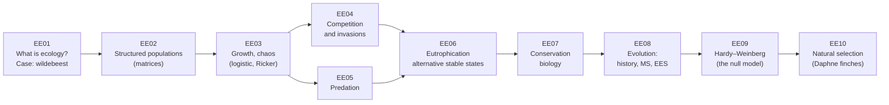

# Ecology and Evolution: Course Map (BI2113)

<span class="scope-taught">taught · in syllabus</span> <span class="scope-extra-book">extra · book</span>

Seven lecture topics, each with a slide deck plus readings (textbook chapters, papers). The instructor's own classification (from each deck's *Reading material* slide): **mandatory reading + the slides = the syllabus**; *detailed/recommended* chapters and *papers* carry no exam weight but build a feel for research. This vault keeps that split visible (🟢 taught / 🟡 extra·book). Rules: [[Conventions]]; sources: `biology/eco-evo/`.

## The storyline

Central thread: **one population → many populations (structure) → how populations change in time (growth, chaos) → interactions (competition, predation) → whole ecosystems and their tipping points (lakes) → what to do when it goes wrong (conservation).**

## Chapters
| # | Chapter | Status |
|---|---|---|
| 01 | [[EE01 Introduction to Biology and Ecological Thinking]] | draft (v2) |
| 02 | [[EE02 Structured Population Models]] | draft (v2) |
| 03 | [[EE03 Population Dynamics and Chaos]] | draft (v2) |
| 04 | [[EE04 Competition and Invasions]] | draft (v2) |
| 05 | [[EE05 Predation]] | draft (v2) |
| 06 | [[EE06 Eutrophication and Alternative Stable States]] | draft (v2) |
| 07 | [[EE07 Conservation Biology]] | draft (v2) |
| 08 | [[EE08 Evolution - An Introduction]] | draft (2026-11-21) |
| 09 | [[EE09 Hardy-Weinberg Equilibrium]] | draft (2026-11-21) |
| 10 | [[EE10 Natural Selection]] | draft (2026-11-21) |

```dataview
TABLE chapter AS "#", scope AS "Scope", status AS "Status"
FROM #subject/eco-evo AND #type/chapter
SORT chapter ASC
```

## Course wrap-up (lecture of 13 Nov 2026)
<span class="scope-taught">taught</span> *[[Putting it all together_13-11-2026.pdf|BI2113 "Putting it all together… and some thoughts", 17 slides]]*. The instructor's warning: the graphics are representative only, and "**this .pptx is not your summary sheet for the exams**". The chief messages, slide by slide, with where each lives in the vault:

| slide | theme | chief message | vault |
|---|---|---|---|
| 2 | biology overview | multiple structural and temporal levels interact and change simultaneously: that causes the complexity | [[EE01 Introduction to Biology and Ecological Thinking]] |
| 3 | modelling | useful but be cautious; never mistake your model for reality; mind its limitations | [[EE01 Introduction to Biology and Ecological Thinking]], [[Modelling Relation]] |
| 4 | population numbers | the modelling strategy depends on the problem, the data and the insight needed: **no universal strategy** | [[EE02 Structured Population Models]], [[EE03 Population Dynamics and Chaos]] |
| 5 | complex systems | complex high-dimensional objects can have simple low-dimensional projections; a model showing the expected behaviour is not thereby appropriate | [[EE03 Population Dynamics and Chaos]] |
| 6 | applications | done properly, models inform policy and save lives; done badly, they harm | [[EE07 Conservation Biology]] |
| 7 | competition | competitors often drive others extinct (invasives: **water hyacinth in the Mula river at Dapodi**); coexisting competitors probably partition the niche, though it is often hard to show how | [[EE04 Competition and Invasions]] |
| 8 | predation | in simple homogeneous systems prey are driven extinct; real systems are heterogeneous and both sides evolve strategies: a dynamic, ever-shifting equilibrium | [[EE05 Predation]] |
| 9 | organism ↔ environment | a two-way interaction, which is why ecosystems are hard to change | [[EE06 Eutrophication and Alternative Stable States]] |
| 10 | conservation | very complex; needs inputs from many sources | [[EE07 Conservation Biology]] |
| 11 | evolution | a complex process; much known, much still to learn; work in progress, but no major paradigm shift yet | [[EE08 Evolution - An Introduction]] |
| 12 | Hardy–Weinberg | "the law is boring, it is the deviations that are interesting"; even simple departures give counter-intuitive results | [[EE09 Hardy-Weinberg Equilibrium]] |
| 13 | selection | NS = differential survival and reproduction due to phenotype; **NS is not evolution**; evolution can be fast; effects of selection are not always easy to predict. "Selection acts on phenotypes; genotypes get selected; genes get differentially transmitted" | [[EE10 Natural Selection]] |
| 14–16 | reading | for fun: Weiner *The Beak of the Finch*, Judson *Dr. Tatiana's Sex Advice to All Creation*, Gleick *Chaos*; textbooks: Ridley *Evolution* (rigorous), Freeman & Herron *Evolutionary Analysis* (recommended), Case *Illustrated Guide to Theoretical Ecology* | — |

## Why this subject is tightly linked to the others
- **Climate:** the same mathematics of stability and tipping: [[Fixed Points and Linear Stability]], [[Bistability and Tipping Points]] (shallow lakes ↔ ice-albedo), [[Relaxation Time]]; chaos ↔ [[CL01 Earth as a System|Lorenz in CL01]]; Daisyworld; biosphere feedbacks.
- **Probability:** stochastic demography, sampling and capture-recapture: [[Probability - Course Map]].
- **Foundations:** [[Jensen Inequality]] (fluctuating environments), [[Linearisation and Sensitivity]] (matrix sensitivities).
- **Earth and life, analysis, chemistry:** [[Evolution of Earth and Life - Course Map]] (extinction), [[Proofs, Analysis and Topology - Course Map]] (bifurcations), [[Inorganic Chemistry - Course Map]] (nutrient cycles).

## Revision
- [[Eco-Evo Exam Prep]]: formula sheet (all seven chapters, scope-marked), 28 traps, derivations, self-test, essay prompts, study plan.
- [[Eco-Evo Problem Bank]]: 25 mixed calculation problems with solutions (`scripts/ee_problem_bank.py`).
- **Past papers (Drive Question Paper Archive, Sem-3; solved 2026-11-22)**, one note per year with mid-sem and end-sem together: [[Eco-Evo Past Papers 2021 - Solved|2021]] (online mid-sem) · [[Eco-Evo Past Papers 2022 - Solved|2022]] · [[Eco-Evo Past Papers 2023 - Solved|2023]] · [[Eco-Evo Past Papers 2024 - Solved|2024]] (+ Assignment 1) · [[Eco-Evo Past Papers 2025 - Solved|2025]] (last year's run; many repeats). Files in `biology/eco-evo/lecture-notes-slides/past-papers/qp-archive/`.
- Printable formula sheet: [[ecoevo-formula-sheet.pdf]] (2 pages, `Assets/latex/ecoevo-formula-sheet.tex`).

## Existing material
**Added 2026-11-21 (evolution part, Part IV):** `biology/eco-evo/08_Evolution_An Introduction/` (lecture `Evolution_06-Oct-2026.pdf`, 93 slides; Futuyma & Kirkpatrick Ch. 1 [mandatory]; Pigliucci 2009; Weaver et al. 2004) → EE08; `09_Hardy_Weinberg/` (lecture, 16 slides; Templeton Ch. 2 and Hartl & Clark pp. 74–80 [mandatory]; practice set) → EE09; `10_Selection/` (lecture, 16 slides; Freeman & Herron Ch. 3 [mandatory]) → EE10; `Putting it all together_13-11-2026.pdf` → the wrap-up section above. The scanned readings were OCR'd (`tesseract`; text not stored in the vault).

`biology/eco-evo/_progress/main.tex` and `BI2113_Consolidated_Notes.pdf` (60-page LaTeX notes from an earlier session) cover all seven topics with the instructor's rules; they are used as a cross-check. Full map: [[Subject Map]].

## Concept index
```dataview
LIST FROM #type/concept AND #subject/eco-evo SORT file.name ASC
```

<!-- graph-spine:start (generated by scripts/graph_spine.py; do not edit between the markers) -->
## Atlas: every note in this subject
The graph view draws only real links, so this block links **every** note of the subject (the map is the hub of its cluster; [[Home]] is the hub of all maps).

> [!abstract]- Atlas (generated): 10 chapters · 88 concept notes · 7 other notes in the vault
> **Chapters (10):** [[EE01 Introduction to Biology and Ecological Thinking]] · [[EE02 Structured Population Models]] · [[EE03 Population Dynamics and Chaos]] · [[EE04 Competition and Invasions]] · [[EE05 Predation]] · [[EE06 Eutrophication and Alternative Stable States]] · [[EE07 Conservation Biology]] · [[EE08 Evolution - An Introduction]] · [[EE09 Hardy-Weinberg Equilibrium]] · [[EE10 Natural Selection]]
>
> **Concept notes (88):** [[Age Pyramid]] · [[Allee Effect]] · [[Allele and Genotype Frequencies]] · [[Alternative Stable States]] · [[Anti-Predator Behaviour and Chemical Defence]] · [[Aposematism]] · [[Biomanipulation]] · [[Blending Inheritance]] · [[Carrying Capacity]] · [[02-Eco-Evo/Concepts/Causal Loop Diagram|Causal Loop Diagram]] · [[Character Displacement]] · [[Chi-Square Goodness-of-Fit Test]] · [[Cobweb Diagram]] · [[Cohort Life Table]] · [[Competition]] · [[Competitive Exclusion Principle]] · [[Conservation Ethics]] · [[Crypsis]] · [[Cultural Eutrophication]] · [[Darwin's Finches on Daphne Major]] · [[Demographic Genetic and Environmental Stochasticity]] · [[Density Dependence]] · [[Deterministic Chaos]] · [[Dominant Eigenvalue and Perron-Frobenius Theorem]] · [[Ecological Niche]] · [[Emergence and Reductionism]] · [[Epigenetic Inheritance]] · [[Exponential Growth]] · [[Extended Evolutionary Synthesis]] · [[Extinction Rates]] · [[Fitness and Relative Fitness]] · [[Fractals]] · [[Functional and Numerical Responses]] · [[Gause Predator-Prey Experiments]] · [[Genetic Drift and Inbreeding Depression]] · [[Hardy-Weinberg Equilibrium]] · [[Hassell Model]] · [[Heritability]] · [[Huffaker Mite Experiment]] · [[Internal Phosphorus Loading]] · [[Invasive Species]] · [[Lake Restoration Methods]] · [[Lake Washington Recovery]] · [[Lattice Effect]] · [[Lefkovitch Stage-Structured Matrix]] · [[Leslie Matrix]] · [[Levels of Biological Organisation]] · [[Loggerhead Turtle and Turtle Excluder Devices]] · [[Logistic Growth]] · [[Lotka-Volterra Competition Model]] · [[Lotka-Volterra Predator-Prey Model]] · [[Mark-Recapture Estimation]] · [[Metapopulation]] · [[Mimicry]] · [[Minimum Viable Population]] · [[Modelling Relation]] · [[Modern Synthesis]] · [[Modes of Selection]] · [[Natural Selection]] · [[Net Reproductive Rate]] · [[Niche Partitioning]] · [[Nomothetic versus Idiographic Science]] · [[Nutrient Limitation]] · [[Passenger Pigeon Extinction]] · [[Period Doubling and Route to Chaos]] · [[Population Biology of Invasions]] · [[Population Ecology]] · [[Population Thinking]] · [[Predation]] · [[Predator Satiation]] · [[Predator-Prey Cycles]] · [[Project Tiger]] · [[Proximate and Ultimate Causation]] · [[Rabinowitz Rarity Classification]] · [[Reserve Design and Management]] · [[Ricker Model]] · [[Sensitivity and Elasticity of Growth Rate]] · [[Serengeti Wildebeest Migration]] · [[Shallow Lake Regime Shift]] · [[Stable Age Distribution]] · [[Strong Inference]] · [[Survivorship Curve]] · [[Thermal Stratification of Lakes]] · [[Tiger Population Surveys]] · [[Tilman R-Star Rule]] · [[Time-Series Reconstruction]] · [[Trophic State of Lakes]] · [[Wright-Fisher Drift as Diffusion]]
>
> **Other notes in the vault (7):** [[Eco-Evo Exam Prep]] · [[Eco-Evo Past Papers 2021 - Solved]] · [[Eco-Evo Past Papers 2022 - Solved]] · [[Eco-Evo Past Papers 2023 - Solved]] · [[Eco-Evo Past Papers 2024 - Solved]] · [[Eco-Evo Past Papers 2025 - Solved]] · [[Eco-Evo Problem Bank]]
<!-- graph-spine:end -->
