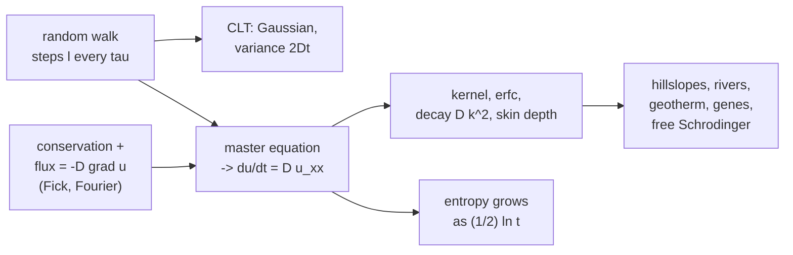

# THX1 · Diffusion Everywhere: From the Random Walk to the Heat Equation

◀ [[TH06 From Kinetic Theory to Statistical Mechanics]] · [[Thermodynamics and Statistical Mechanics - Course Map|Course Map]] · sibling: [[LSX1 Clocks in Rocks]]

extra · beyond

> [!syllabus] Why this chapter is interdisciplinary, and where it lives
> It lives in **Thermodynamics** (`03-Thermodynamics-and-Statistical-Mechanics/Interdisciplinary/`) because the diffusion equation is first a statement about heat and about the statistical mechanics of many random molecular steps ([[TH06 From Kinetic Theory to Statistical Mechanics]]). But the **same equation, $\partial_tu=D\nabla^2u$, with the same solution and the same scaling $x\sim\sqrt{Dt}$,** governs: the spreading of a **random walker** ([[Probability - Course Map]]), the rounding of **hillslopes** ([[LS12 Hillslope Transport and the Diffusion Equation]]) and of **alluvial rivers** after a base-level change ([[LS22 Floods Planform and River Profiles]]), the **geotherm** and the closure of **thermochronometers** ([[LSX1 Clocks in Rocks]]), the penetration of **seasonal and glacial temperature waves** into the ground ([[Climate - Course Map]]), the **drift of gene frequencies** in a finite population ([[Ecology and Evolution - Course Map]]), and, with an imaginary diffusion constant, the spreading of a **free quantum wave packet** ([[Quantum Mechanics - Course Map]]). **No source in the vault covers the whole story**; the chapter is built from first principles, the Landscapes diffusion sections, and my own derivations (all numbers in `scripts/interdisc_numbers.py`, section THX1, checked by Monte Carlo or finite differences).

> [!key] After this chapter you can
> - derive the **diffusion equation from a random walk** (and $D=\ell^2/2\tau$), and see $\langle x^2\rangle=2Dt$ and the Gaussian kernel as the **central limit theorem** in action,
> - write **Fick's** and **Fourier's** laws, get the same equation from conservation plus a flux–gradient law, and state the units and meaning of $D$,
> - solve for a point source (**heat kernel**), a step (erfc), a **sinusoidal** initial profile (decay rate $Dk^2$) and a **periodic** boundary (skin depth),
> - derive the **Einstein relation** $D=\mu k_BT$ and the Stokes–Einstein value of $D$ for a sphere,
> - see **neutral genetic drift** as a diffusion with $D(p)=p(1-p)/4N$ and check it by simulation,
> - use the **Péclet number** to say when advection beats diffusion, and compute **diffusion times** for salt, heat, soil and genes,
> - state that diffusion **raises entropy** and connect the kernel to the free-particle propagator.

> [!intuition] The one-sentence story
> Add up many small, independent, unbiased steps and you get a spreading Gaussian whose width grows as $\sqrt{\text{time}}$; whether the steps are molecular collisions, creeping soil grains, flickers of a river's bed, or births and deaths in a small population, the macroscopic law is one equation with one constant, and the only question is what $D$ is.

## 1. A random walk, and why it spreads like $\sqrt t$
A walker takes a step of length $\ell$, left or right with equal probability, every $\tau$. After $n=t/\tau$ steps its position is a sum of $n$ independent $\pm\ell$ terms. Then

$$\langle x\rangle=0,\qquad\langle x^2\rangle=\sum_i\langle\xi_i^2\rangle+\sum_{i\neq j}\langle\xi_i\xi_j\rangle=n\ell^2+0=\frac{\ell^2}\tau\,t\equiv2Dt,\qquad\boxed{D=\frac{\ell^2}{2\tau}}.$$

(The cross terms vanish because steps are independent with zero mean.) **The spread grows as $\sqrt t$, not as $t$**: that is the signature of unbiased randomness and the reason diffusion is slow over long distances and fast over short ones. By the **central limit theorem** ([[Central Limit Theorem]]) the distribution of $x$ tends to a Gaussian of variance $2Dt$; the cumulant check in the simulation shows it: $2\times10^{5}$ walkers of 400 unit steps have $\langle x^2\rangle=400.8$ (theory 400) and kurtosis $2.989$ (Gaussian: 3), and at 25 steps $\langle x^2\rangle=25.0$ and kurtosis $2.92$. In $d$ dimensions the walkers' displacements add in each coordinate, $\langle r^2\rangle=2dDt$ (checked in $d=1,2,3$).

> [!example] 🧮 Pólya's theorem
> A random walker on a line or a plane returns to its starting point **with probability 1**; in **three dimensions with probability only 0.3405** (Pólya). A simulation of 4000 three-dimensional walks of 3000 steps found that 33.3 % returned (the finite walk length keeps it just below the limit). "A drunk man will find his way home, but a drunk bird may get lost forever." Dimension matters because the volume available to a diffusing walker grows as $t^{d/2}$ while the time it spends near the origin falls.

## 2. The diffusion equation, two ways
### 2.1 From the walk (the master equation)
> [!derivation] 🔵 Extra · beyond: the limit $\ell,\tau\to0$
> Let $P(x,t)$ be the probability of being at $x$ at time $t$. Half of the walkers at $x\mp\ell$ step to $x$:
>
> $$P(x,t+\tau)=\tfrac12P(x-\ell,t)+\tfrac12P(x+\ell,t).$$
>
> Taylor expand both sides, $P(x,t+\tau)=P+\tau\,\partial_tP+\dots$ and $P(x\pm\ell,t)=P\pm\ell\,\partial_xP+\tfrac12\ell^2\partial_x^2P+\dots$; the odd terms cancel, so $\tau\,\partial_tP=\tfrac12\ell^2\partial_x^2P$, i.e.
>
> $$\boxed{\frac{\partial P}{\partial t}=D\,\frac{\partial^2P}{\partial x^2}},\qquad D=\frac{\ell^2}{2\tau}\ \ \text{held fixed as }\ell,\tau\to0.$$
>
> A walker with a **bias** (probabilities $p\ne\frac12$) gains a drift term $-v\,\partial_xP$ with $v=(2p-1)\ell/\tau$: the **advection–diffusion equation** of §6.

### 2.2 From conservation and a flux–gradient law
> [!derivation] 🟡 Extra · book (the Landscapes version is LS12 §"Hillslope diffusion"): conservation + linear flux
> *Conservation* of a quantity of density $u$ (heat, mass, soil, probability) with flux $J$: $\partial_tu=-\nabla\cdot J$. *Constitutive laws*: the flux runs **down the gradient** at a rate proportional to it:
>
> - **Fick's law**: $J=-D\nabla c$ (molecules; $D$ in m²/s, salt in water $1.6\times10^{-9}$, gases in air $\sim2\times10^{-5}$);
> - **Fourier's law**: $\mathbf q=-k\nabla T$ with $\rho c_p\,\partial_tT=-\nabla\!\cdot\mathbf q$, so $\partial_tT=\kappa_T\nabla^2T$ with $\kappa_T=k/\rho c_p\approx10^{-6}$ m²/s for rock;
> - **Hillslope soil flux**: $q=-\kappa_h\nabla z$ (soil creep, bioturbation), so $\partial_tz=\kappa_h\nabla^2z+U$ ([[LS12 Hillslope Transport and the Diffusion Equation]]; $\kappa_h\sim1$–$10$ m²/kyr);
> - **Alluvial river**: $Q_s=-\alpha Q\,\partial_xz$, $\kappa=\alpha Q/\rho_b$ ([[LS22 Floods Planform and River Profiles]] §6).
>
> **Same equation, same units (length²/time), different physics under $D$.** For the random walk the *microscopic* flux is the imbalance of left- and right-steppers, $J=-\frac{\ell^2}{2\tau}\partial_xP$: Fick's law is the random walk's statement about averages.

## 3. Solutions that carry over everywhere
### 3.1 The heat kernel
A unit amount released at $x=0$ at $t=0$ spreads as

$$\boxed{u(x,t)=\frac1{\sqrt{4\pi Dt}}\,e^{-x^2/4Dt}},\qquad\operatorname{Var}=2Dt.$$

This is the **Green's function** of the diffusion equation ([[Impulse Response and Green's Function]]), the Gaussian of the random walk's CLT; any initial profile spreads as the convolution of itself with this kernel ([[Convolution]]). I confirmed it by an explicit finite-difference run ($D=5$, $t=40$): maximum difference $7\times10^{-8}$ from the formula (peak 0.0199), variance 399.99 vs $2Dt=400$.

### 3.2 The error-function step
A step (boundary held at a new value at $t=0$) gives $u=u_0\,\operatorname{erfc}(x/2\sqrt{Dt})$: the base-level fall of LS22, the cooling of a half-space (the age–depth law of the ocean floor, [[LS07 Isostasy]] / [[LS08 Plate Tectonics Strain Stress and Convection]]), the diffusion front of salt into fresh water. **Any such front has a width $\propto\sqrt{Dt}$.**

### 3.3 A sinusoid decays as $e^{-Dk^2t}$
Try $u=e^{ikx}f(t)$: $\dot f=-Dk^2f$. Features of wavenumber $k$ (wavelength $2\pi/k$) decay with rate $Dk^2$ and time constant $\tau_k=1/Dk^2$: **diffusion kills short wavelengths fastest** (it is a low-pass filter, [[Fourier Transform]]). A 40 m wavelength ripple on a hillslope with $\kappa_h=0.005$ m²/yr ($=5$ m²/kyr) has $\tau=1/(0.005\times0.157^2)=8.1$ kyr; one of 400 m, 100 times longer. That is why sharp scarps round off first and broad hills linger.

### 3.4 A periodic boundary: the skin depth
> [!derivation] 🔵 Extra · beyond (finite-difference checked): thermal waves in the ground
> Let the surface temperature oscillate, $T(0,t)=T_0\cos\omega t$. Seek $T=\operatorname{Re}[T_0e^{i\omega t-qz}]$: substituting gives $i\omega=\kappa q^2$, $q=(1+i)/\delta$ with
>
> $$\boxed{\delta=\sqrt{\frac{2\kappa}\omega}},\qquad T(z,t)=T_0\,e^{-z/\delta}\cos\!\Big(\omega t-\frac z\delta\Big):$$
>
> the wave decays exponentially with depth and lags by one radian per $\delta$. For rock with $\kappa=10^{-6}$ m²/s $=31.6$ m²/yr: **diurnal 0.17 m, annual 3.2 m, 41-kyr glacial cycle 640 m, 100-kyr cycle 1.0 km**. At twice $\delta$ the amplitude is $e^{-2}=0.135$ of the surface; at 5 m depth, 20.7 % of the annual amplitude (finite-difference run agrees to four digits). *Consequences:* the temperature at 10 m depth is *constant through the year* (the cellar, the cave); ice-age surface temperature changes reach to $\sim1$–2 km and are measurable in boreholes (the basis of borehole palaeothermometry, [[Climate - Course Map]]); and the *higher the frequency, the shallower the penetration*, $\delta\propto\omega^{-1/2}$.

## 4. How big is diffusion? A table of times
$t=L^2/2D$ for the 1-D walk:

| medium | $D$ | 10 µm | 1 cm | 1 m | 1 km | 100 km |
|---|---|---|---|---|---|---|
| salt in water | $1.6\times10^{-9}$ m²/s | **0.03 s** | 8.7 h | 10 yr | | |
| gas in air | $2\times10^{-5}$ m²/s | | 0.025 s ($L=1$ mm) | 7 h | | |
| heat in rock | $10^{-6}$ m²/s | | | 5.8 d | 16 kyr | **158 Myr** |
| soil on a hillslope | 5 m²/kyr | | | | | 10 m: 10 kyr; 100 m: **1 Myr**; 1 km: 100 Myr |

*Reading it:* diffusion is *excellent over a cell* (10 µm: 30 ms for salt, hence there is no need for transport machinery inside a cell) and *useless over an organism* (1 m of water: a decade; this is why animals have circulatory systems, and why a neuron's axon needs active transport). Heat diffuses through a kilometre of rock in $\sim16$ kyr and through the lithosphere in $\sim10^{8}$ yr, so a continent's thermal state remembers events from hundreds of millions of years ago. A hillslope of 100 m takes a million years to relax: the time scale of a landscape.

## 5. Brownian motion and the Einstein relation
Brown saw pollen grains jitter; Einstein (1905) explained it: a heavy particle is hit by light, thermally moving molecules, so it executes a random walk, and its $D$ is related to its mobility. This is the first *measurement* of a molecular quantity from a macroscopic diffusion.

> [!derivation] 🔵 Extra · beyond: $D=\mu k_BT$ from equilibrium
> A particle in a potential $U(x)$ has drift velocity $\mu F=-\mu U'$ (mobility $\mu$, force $F$) and diffusion; the flux is $J=-Dc'+\mu Fc$. In equilibrium $J=0$ and the Boltzmann distribution holds, $c\propto e^{-U/k_BT}$, so $c'=-(U'/k_BT)c=(F/k_BT)c$. Then $0=-D(F/k_BT)c+\mu Fc$, so
>
> $$\boxed{D=\mu\,k_BT}\qquad(\text{Einstein}),\qquad\text{and for a sphere of radius }a:\ \ D=\frac{k_BT}{6\pi\eta a}\ \ (\text{Stokes–Einstein}).$$
>
> The same friction that **damps** the motion ($\mu^{-1}$) is what **drives** the jitter (the **fluctuation–dissipation** relation): no friction, no thermal kicks, and conversely. *Numbers* (water at 20 °C, $\eta=10^{-3}$ Pa s): a 1 µm sphere has $D=2.1\times10^{-13}$ m²/s and moves by $\sqrt{2Dt}=0.66$ µm in 1 s; a 10 nm particle $D=4.3\times10^{-11}$, 9.3 µm in 1 s. Perrin used $D$ to measure Avogadro's number. For the equipartition and Boltzmann statistics behind the equilibrium step, see [[Equipartition of Energy]] and [[Maxwell-Boltzmann Distribution]].

## 6. Advection and diffusion: the Péclet number
If the medium also moves with velocity $v$ (water carrying salt, rock rising through a geotherm, soil lowered by erosion), $\partial_tu+v\,\partial_xu=D\,\partial_x^2u$. Compare the two terms over a length $L$: $vu/L$ against $Du/L^2$:

$$\boxed{Pe=\frac{vL}D}.$$

$Pe\ll1$: diffusion wins and fields are smooth and nearly independent of the flow; $Pe\gg1$: advection wins, with thin diffusive boundary layers. Examples (script): **geotherm**, $v=1$ mm/yr, $L=10$ km, $\kappa_T=31.6$ m²/yr: $Pe=0.32$ (isotherms barely disturbed; at 5 mm/yr, 1.6: advected upward, the regime of the rapidly exhuming ranges, [[LSX1 Clocks in Rocks]] §5.3); **hillslope** lowering at 20 m/Myr with $\kappa_h=0.005$ m²/yr over $L=100$ m: $Pe=0.4$; a **river** carries salt with $Pe\gg1$ and mixes across the channel by *turbulent* diffusion with $D_t=\kappa u_*H/6=0.019$ m²/s ([[LS21 River Hydraulics and Hydraulic Geometry]] §3), $10^{4}$ times molecular; suspended sediment is held up by turbulent diffusion against settling ([[LS24 Sediment Transport Mechanics]] §5).

> [!example] 🧮 A steady hillslope as a balance of diffusion and lowering
> Soil is lowered uniformly at $E$; steady state $\kappa_hz''=-E$ gives the parabola $z=E(L^2-x^2)/2\kappa_h$. With $E=20$ m/Myr, $\kappa_h=5$ m²/kyr and half-width $L=100$ m: relief 20 m and an edge slope $EL/\kappa_h=0.40$. Faster lowering or smaller $\kappa_h$ steepens the hill until a threshold process (landslides) takes over ([[LS13 Landslides]]).

## 7. Genes drift as diffusion
In a diploid population of $N$ individuals ($2N$ gene copies) with no selection, mutation or migration, the allele frequency $p$ in the next generation is a binomial sample ([[Binomial Distribution]]) of $2N$ draws with success probability $p$ (the **Wright–Fisher model**): $\langle p'\rangle=p$ (no drift of the mean) and $\operatorname{Var}(p'-p)=p(1-p)/2N$. That is a random walk in $p$ with a *position-dependent* step variance. In the diffusion limit,

$$\frac{\partial\phi}{\partial t}=\frac12\frac{\partial^2}{\partial p^2}\Big[\frac{p(1-p)}{2N}\,\phi\Big],\qquad D(p)=\frac{p(1-p)}{4N}\ \text{per generation},$$

**Kimura's diffusion equation** (the forward Kolmogorov, or Fokker–Planck, equation for $p$), with *absorbing* ends $p=0$ (lost) and $p=1$ (fixed). The consequences are exactly what a walker with absorbing walls does: the mean stays at $p_0$; the variance grows as $p_0(1-p_0)[1-(1-\frac1{2N})^t]$, linearly at first and saturating at $p_0(1-p_0)$ when every line has been lost or fixed; and **the probability that the allele is eventually fixed is $p_0$** (the mean is conserved by absorption: a *martingale*). I simulated $4\times10^{4}$ populations with $2N=200$, $p_0=\tfrac12$:

| generation | Var($p$) simulated | theory | alleles lost | fixed |
|---|---|---|---|---|
| 10 | 0.0123 | 0.0122 | 0 | 0 |
| 50 | 0.0551 | 0.0554 | 0.7 % | 0.7 % |
| 100 | 0.0988 | 0.0986 | 7.0 % | 7.0 % |

(The small-$t$ slope is $p(1-p)/2N=1.25\times10^{-3}$ per generation: $0.0125$ at $t=10$, to 2 %.) *The time scale of drift is set by the population size*: the diffusion time is $\sim2N$ to $4N$ generations (a standard result for the mean time to fixation of a neutral allele, `[verify]`), so a population of 100 loses its neutral variation in a few hundred generations while one of $10^{6}$ takes millions. This is why **small populations lose genetic variation** ([[Genetic Drift and Inbreeding Depression]], [[EE07 Conservation Biology]]), and why *drift is stronger the smaller the population*, the exact analogue of $x\sim\sqrt{Dt}$ with $D\propto1/N$.

## 8. Diffusion raises entropy; the quantum cousin
> [!derivation] 🔵 Extra · beyond: entropy of the spreading kernel
> The Shannon (differential) entropy of a Gaussian of variance $\sigma^2$ is $S=\tfrac12\ln(2\pi e\sigma^2)$; with $\sigma^2=2Dt$, $S(t)=\tfrac12\ln(4\pi eDt)$, so $dS/dt=1/2t>0$. **A diffusing distribution always gains entropy, by $\ln2$ nats every time $t$ quadruples** (1.7655, 2.4587, 3.1518 nats at $t=1,4,16$ for $D=1$). The microscopic dynamics are reversible, yet the *coarse* description is not: this is the statistical meaning of the second law ([[Entropy]], [[Statistical Entropy]], [[TH04 The Second Law Carnot Engines and Entropy]]). Diffusion is the standard example of an irreversible process, and its arrow is the spreading of a probability distribution.

> [!connection] The same kernel in quantum mechanics
> The free-particle Schrödinger equation $i\hbar\partial_t\psi=-\frac{\hbar^2}{2m}\partial_x^2\psi$ is the diffusion equation with an **imaginary** diffusion constant, $D\to i\hbar/2m$. The heat kernel therefore becomes the **free propagator** $K(x,t)=\sqrt{m/2\pi i\hbar t}\,e^{imx^2/2\hbar t}$: the same Gaussian, but with a phase instead of a decay, so the wave packet *spreads* ($\sigma(t)=\sigma_0\sqrt{1+(\hbar t/2m\sigma_0^2)^2}$) without losing norm ([[Free Particle]], [[Gaussian Wave Packet]], [[QM01 From Waves to Probabilities]]). Going the other way, Euclidean ("imaginary-time") quantum mechanics *is* a diffusion, and a Wiener path integral over random walks gives the ground state of the Hamiltonian: the bridge between this chapter and the oscillator of [[QM05 The Harmonic Oscillator]].

## 9. Worked examples
> [!example] 🧮 Example 1: a random walker's scale
> A bacterium-sized particle takes steps $\ell=1\ \mu$m every $\tau=1$ ms: $D=\ell^2/2\tau=5\times10^{-10}$ m²/s. To diffuse 100 µm takes $L^2/2D=10$ s; to diffuse 1 mm, 1000 s. After $10^{4}$ steps, $\sigma=100\ \ell$ and 68 % are within ±100 steps of the origin.

> [!example] 🧮 Example 2: a drift calculation
> $N=500$ diploid individuals ($2N=1000$), $p_0=0.2$: after 50 generations $\operatorname{Var}(p)=0.2\times0.8\times[1-(1-1/1000)^{50}]=0.16\times0.0488=0.0078$, standard deviation 0.088: frequencies have wandered by $\sim0.09$ without any selection.

## 10. Check yourself
> [!question] Problems (answers folded)
> 1. Show $\langle x^2\rangle=2Dt$ from the walk with $D=\ell^2/2\tau$, and give $D$ for $\ell=1$ µm, $\tau=1$ ms. How long to diffuse 100 µm?
> 2. Derive the diffusion equation from $P(x,t+\tau)=\frac12P(x-\ell,t)+\frac12P(x+\ell,t)$.
> 3. Heat diffuses through a 1 m wall with $\kappa=10^{-6}$ m²/s: how long?
> 4. Annual skin depth for $\kappa=31.6$ m²/yr, and the amplitude of the annual wave at 6.3 m.
> 5. A 40 m ripple on a hillslope, $\kappa_h=5$ m²/kyr: decay time? A 400 m one?
> 6. Prove $D=\mu k_BT$ from the Boltzmann balance and evaluate Stokes–Einstein for a 1 µm sphere in water at 20 °C.
> 7. Wright–Fisher, $2N=1000$, $p_0=0.2$: variance after 50 generations, and the eventual fixation probability.
> 8. By how much does the entropy of a diffusing Gaussian grow when $t$ is multiplied by 4? By 9?
> 9. $v=2$ mm/yr, $L=5$ km, $\kappa_T=31.6$ m²/yr: $Pe$? Is the geotherm perturbed?
> 10. The free-particle wave packet: what plays the role of $D$, and does the norm decay? Why?

> [!example]- Answers
> 1. $\langle x^2\rangle=\langle(\sum\xi_i)^2\rangle=n\ell^2$ (cross terms vanish), $=(\ell^2/\tau)t=2Dt$. $D=10^{-12}/(2\times10^{-3})=5\times10^{-10}$ m²/s; $t=L^2/2D=10^{-8}/10^{-9}=10$ s.
> 2. §2.1.
> 3. $t=L^2/2\kappa=1/(2\times10^{-6})=5\times10^{5}$ s $=5.8$ days.
> 4. $\delta=\sqrt{2\times31.6/(2\pi)}=3.17$ m; $e^{-2}=0.135$ at 6.3 m.
> 5. $\tau=1/(\kappa k^2)$ with $k=2\pi/\lambda$: 40 m: $k=0.157$, $\kappa=0.005$ m²/yr, $\tau=8.1$ kyr; 400 m: $\times100=810$ kyr.
> 6. §5. For a sphere of radius $a=1$ µm: $D=k_BT/6\pi\eta a=1.38\times10^{-23}\times293.15/(6\pi\times10^{-3}\times10^{-6})=2.1\times10^{-13}$ m²/s (for a particle of 1 µm *diameter*, $a=0.5$ µm, $D=4.3\times10^{-13}$).
> 7. $0.16\times0.0488=0.0078$; fixation probability $=p_0=0.2$ (martingale).
> 8. $\Delta S=\frac12\ln4=0.693$ nats (= ln 2); for ×9: $\frac12\ln9=1.099$ nats (= ln 3).
> 9. $Pe=(2\times10^{-3})(5000)/31.6=0.32<1$: modestly perturbed; $v$ would need to exceed $\sim6$ mm/yr to reach $Pe=1$.
> 10. $D\to i\hbar/2m$ (imaginary); the factor $e^{imx^2/2\hbar t}$ is a phase, so $|K|$ is not Gaussian-decaying and $\int|\psi|^2dx$ is conserved while the width grows.

## 11. Summary
- Random walk: $\langle x^2\rangle=2Dt$, $D=\ell^2/2\tau$, Gaussian by the CLT; $x\sim\sqrt{Dt}$.
- Diffusion equation $\partial_tu=D\nabla^2u$ from a master equation or from conservation plus a flux $J=-D\nabla u$ (Fick, Fourier, soil creep, river transport).
- Kernel $e^{-x^2/4Dt}/\sqrt{4\pi Dt}$; erfc step; sinusoids decay at $Dk^2$; periodic boundary skin depth $\sqrt{2\kappa/\omega}$ (annual 3.2 m, glacial cycles 0.6–1 km).
- Einstein: $D=\mu k_BT$; Stokes–Einstein $D=k_BT/6\pi\eta a$.
- Péclet $vL/D$; times $L^2/2D$ span from 30 ms (salt over a cell) to $10^{8}$ yr (heat over the lithosphere, soil over a mountain).
- Genetic drift: diffusion with $D=p(1-p)/4N$ and absorbing ends; $\operatorname{Var}(p)=p_0(1-p_0)[1-(1-1/2N)^t]$; fixation probability $=p_0$.
- Entropy grows as $\frac12\ln t$; the free Schrödinger kernel is the heat kernel with $D=i\hbar/2m$.

## Map of this chapter
> [!connection] How THX1 connects
> **Thermodynamics:** [[TH06 From Kinetic Theory to Statistical Mechanics]], [[TH04 The Second Law Carnot Engines and Entropy]], [[Kinetic Theory of Gases]]. **Probability:** [[Central Limit Theorem]], [[Normal Distribution]], [[Binomial Distribution]], [[Random Walk]]. **Landscapes:** [[LS12 Hillslope Transport and the Diffusion Equation]], [[LS22 Floods Planform and River Profiles]], [[LS21 River Hydraulics and Hydraulic Geometry]], [[LS24 Sediment Transport Mechanics]], [[LSX1 Clocks in Rocks]]. **Eco-evo:** [[Genetic Drift and Inbreeding Depression]], [[Wright-Fisher Drift as Diffusion]]. **QM:** [[Free Particle]], [[Gaussian Wave Packet]]. **Foundations:** [[Impulse Response and Green's Function]], [[Fourier Transform]], [[Convolution]], [[Péclet Number]].
> **Concept notes:** [[Random Walk]] · [[Diffusion Equation]] · [[Fick's and Fourier's Laws]] · [[Brownian Motion and the Einstein Relation]] · [[Wright-Fisher Drift as Diffusion]] · [[Péclet Number]].

## Provenance
> [!provenance]- Source map for this chapter
> | Topic | Source | Scope |
> |---|---|---|
> | the walk, master equation, kernels, skin depth, Einstein relation, Péclet, Wright–Fisher diffusion limit, entropy, free-particle analogy | my derivations; the Landscapes versions are in LS12, LS22 (A&A Ch. 10, 12); constants are standard values (`[verify]` where recalled) | extra · beyond |
> | all numbers, Monte Carlo and finite-difference checks | `scripts/interdisc_numbers.py` (THX1) | extra · beyond |
>
> **Flagged:** $\kappa_T=10^{-6}$ m²/s for rock, $D_{salt}=1.6\times10^{-9}$ m²/s, $\kappa_h=5$ m²/kyr, the water viscosity, and the neutral mean time to fixation ($\sim2N$–$4N$ generations) are recalled or illustrative values.

## Continued in Part II (added 2026-10-30)
- Where the diffusion constant comes *from* for a gas: [[SM04 Kinetic Theory and the Boltzmann Equation]] §10–§11 computes $D$, the kinematic viscosity $\nu=\eta/\rho$ and the thermal diffusivity $D_T=\kappa/\rho c_p$ from $m$, $d$, $T$ via the Boltzmann equation (all $\sim\bar v\lambda/3$; air: $1.6$–$2.2\times10^-5$ m$^2$ s$^-1$).
