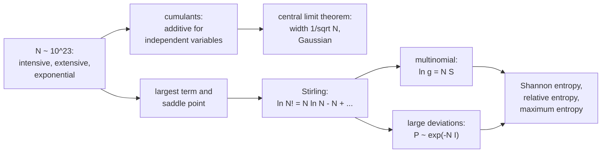

# SM01 · Probability, Large Numbers and Information

◀ [[TH06 From Kinetic Theory to Statistical Mechanics]] · [[Thermodynamics and Statistical Mechanics - Course Map|Course Map]] · next ▶ [[SM02 Phase Space Liouville and the Microcanonical Ensemble]]

> [!info] Source and approach
> Follows **Kardar, *Statistical Physics of Particles*, Ch. 2** (printed pp. 35–56; PDF page = printed + 12: [[Mehran Kardar - Statistical Physics of Particles (2007).pdf#page=47|PDF p.47 ff.]]), with the thermodynamic motivation from **Pathria and Beale §1.1** and the information theory from **Kardar §2.7**. The material overlaps the probability course ([[PR06 Moments Generating Functions and Limit Theorems]]) on purpose: here the point is not the theorem but **what happens to a probability when $N\sim10^{23}$**. Every number is recomputed in `scripts/sm_numbers.py`; figure `scripts/fig_sm01.py`. No course is behind this chapter, so there are no taught/extra labels, only the Provenance table at the end.

> [!tip] Start here (first read)
> - **The picture.** A glass of water has $10^{25}$ molecules, each with a position and a velocity. Nobody can or wants to follow them; we want a handful of numbers (energy, pressure, magnetisation). Statistical mechanics says: *treat the microscopic state as random, and ask what the average and the fluctuation of the few numbers we care about are*. This chapter is the toolbox for that: the average of a sum of $N$ things has relative fluctuation $1/\sqrt N$ (so $10^{-11.5}$ for a mole, which is why thermodynamics is deterministic); the *probability* of an unusual value is $e^{-N\times\text{something}}$ (so unusual values never happen); sums over $e^{N}$ terms are dominated by one term; and the logarithm of "number of ways" is the **entropy**.
> - **What you need.** Mean, variance, the binomial and Gaussian distributions ([[PR01 Counting and the Axioms of Probability]], [[PR06 Moments Generating Functions and Limit Theorems]]), the Gaussian integral ([[Gaussian Integral]]), and the ideas of a Taylor series and a Legendre transform ([[Legendre Transform]]).
> - **How to read.** §1–§4 are the central limit theorem seen through *cumulants* (the tool the rest of Part II keeps using). §5–§6 are the large-$N$ calculus: Stirling, saddle points, large deviations. §7 is information and entropy. If you are short of time: §1, §2.3, §4.1, §5.1, §6.1, §7.2.
> - **Notation.** $\langle\cdot\rangle$ average; $\kappa_n$ ($=\langle x^n\rangle_c$) the $n$-th cumulant; $K(t)=\ln\langle e^{tx}\rangle$ the cumulant generating function; $N$ number of particles or trials; $m$ a fraction; $S=-\sum p\ln p$ the (dimensionless) Shannon entropy, equal to $S/k_B$ when thermodynamic.

> [!key] After this chapter you can
> - classify any quantity as **intensive, extensive or exponential** in $N$, and say why exponentials of $N$ dominate everything,
> - compute **cumulants** of a distribution, state that the Gaussian is the distribution with only two, and use **Wick's theorem** for its moments,
> - derive the **central limit theorem** from $\kappa_n(\sum x_i)=N\kappa_n$ and say when it **fails** (Cauchy, Lévy),
> - evaluate sums and integrals of $e^{N\phi}$ by the **largest term** and the **saddle point**, and derive **Stirling's formula** with its first correction,
> - state the **large-deviation principle** $P\sim e^{-NI}$, derive the rate function of a coin and see it as a Legendre transform,
> - define the **Shannon entropy** and **relative entropy**, show $D\ge0$, and see the Boltzmann distribution appear from maximum entropy.

> [!intuition] The one-sentence story
> Add up $N$ independent contributions and the answer is *sharp* (relative width $1/\sqrt N$) and *Gaussian*, but the chance of a *large* deviation is $e^{-NI}$, and the exponent $I$ is an entropy deficit: that is the whole reason that entropy and the Boltzmann factor govern physics.

*Concept map of the chapter (left to right; each box is a section).*

![[fig_sm01_limits.png]]
*Figure SM1.1. A: the spin-sum distribution is already Gaussian at $N=100$ (§4). B: Stirling's relative error of $\ln N!$ falls as $1/N$ (crude) or much faster (with the $\tfrac12\ln2\pi N$ term) (§5). C: the middle half of the mean of $N$ Gaussian variables narrows as $1/\sqrt N$; that of Cauchy variables does not narrow at all (§4.3). D: the rate function $I(m)$ (black) is the limit of $-\tfrac1N\ln P$; the dashed Gaussian parabola is right only near $m=\tfrac12$ (§6).*

## 1. Why a theory of $10^{23}$ things is a theory of probability

A **microstate** says where every particle is and how fast it moves; a **macrostate** says only a few numbers ($E,V,N,\mathbf M,\dots$). Many microstates make one macrostate; which one the system happens to be in is, for our purposes, random. Three kinds of $N$-dependence appear in the thermodynamic limit ([[Mehran Kardar - Statistical Physics of Particles (2007).pdf#page=59|K §2.6, p.47]]):

| kind | scaling | examples |
|---|---|---|
| intensive | $N^0$ | $T$, $P$, $\mu$, magnetic field $B$ |
| extensive | $N^1$ | $E$, $S$, $V$, magnetisation $M$ |
| exponential | $e^{N\cdot\text{const}}$ | number of microstates, phase-space volume, probabilities of rare events |

Other scalings are not forbidden but rare in practice: the Coulomb energy of $N$ ions at fixed density would go as $Q^2/R\sim N^{5/3}$, but charges are screened by counter-ions and the energy is extensive after all (SM29, planned); the gravitational energy of a star is *not* screened, and the thermodynamics of self-gravitating systems is correspondingly strange (negative specific heats, SM27, planned).

> [!intuition] Why "exponential" is the word that matters
> Multiply the number of ways by 2 for each of $N$ spins and you get $2^N$. Doubling $N$ *squares* the number of states. Compare two macrostates whose entropies per particle differ by even $10^{-3}$: their state counts differ by $e^{10^{-3}N}=e^{10^{20}}$ for a mole. A system lives in the macrostate with the most microstates because the alternatives are not merely rarer, they are *incomparably* rarer. All of §5–§7 is a calculus for these numbers.

> [!example] A first exponential (recomputed)
> $N$ molecules, each equally likely to be in the left or right half of a box. The probability that **all** are in the left half is $2^{-N}$: $2^{-20}=9.5\times10^{-7}$; $2^{-100}=7.9\times10^{-31}$; for $N=N_A$ it is $e^{-4.2\times10^{23}}$. The *forbidden* in the second law is not forbidden by dynamics; it is forbidden by $e^{-N}$ (compare [[TH06 From Kinetic Theory to Statistical Mechanics]] §5).

### 1.1 What "probability" means here, and why it hardly matters at large $N$
Statistical mechanics uses three readings of "probability", and textbooks slide between them:
- **Frequency (Boltzmann).** The probability of a macrostate is the fraction of *time* the one system spends in it. This is the reading behind the ergodic hypothesis ([[SM02 Phase Space Liouville and the Microcanonical Ensemble]] §3).
- **Ensemble (Gibbs).** The probability is the fraction of an imagined ensemble of identical copies; averages are ensemble averages.
- **Inference (Jaynes).** The probability is a rational degree of belief, constrained by what is known; the Boltzmann distribution is the one that assumes *least* beyond the energy (§7.7).

For a macroscopic observable all three give the same number, because its relative fluctuation is $1/\sqrt N\approx10^{-12}$: the distribution is a delta function to twelve digits whatever its interpretation. The readings differ only (i) in the **tails** (large deviations, §6), where "never observed" and "probability $e^{-10^{23}}$" are equivalent in practice, and (ii) for **small systems** (a colloidal particle, a single molecule in an optical trap, a few hundred atoms), where the time average of one system is what you measure and whether it equals the ensemble average is a real, testable question (it does for an ergodic system, SM02 §3). Throughout Part II the working rule is: *use ensembles to compute, time averages to measure, and remember that the two agree because $N$ is large.*

## 2. Random variables, cumulants and Wick's theorem

Let $x$ be a random variable with density $p(x)$. Two generating functions package all its moments.

**Moment generating function** and **cumulant generating function** (the convention of the probability course, [[Moment Generating Function]]):
$$M(t)=\langle e^{tx}\rangle=\sum_{n\ge0}\frac{t^n}{n!}\langle x^n\rangle,\qquad K(t)=\ln M(t)=\sum_{n\ge1}\frac{t^n}{n!}\kappa_n .$$
The coefficients $\kappa_n=\langle x^n\rangle_c$ are the **cumulants** (or connected moments). Kardar works with the *characteristic function* $\tilde p(k)=\langle e^{-ikx}\rangle$ ([[Characteristic Function]]), which is $M(t)$ at $t=-ik$ and always exists; nothing below changes except the factor $(-i)^n$.

> [!derivation] Cumulants in terms of moments (to fourth order)
> Expand $\ln(1+u)=u-u^2/2+u^3/3-\dots$ with $u=M-1=t\langle x\rangle+\tfrac{t^2}2\langle x^2\rangle+\tfrac{t^3}6\langle x^3\rangle+\tfrac{t^4}{24}\langle x^4\rangle+\dots$ and collect powers of $t$:
> $$\kappa_1=\langle x\rangle,\quad\kappa_2=\langle x^2\rangle-\langle x\rangle^2=\sigma^2,\quad\kappa_3=\langle(x-\mu)^3\rangle,\quad\kappa_4=\langle(x-\mu)^4\rangle-3\sigma^4 .$$
> So $\kappa_1$ is the mean, $\kappa_2$ the variance, $\kappa_3/\sigma^3$ the **skewness**, $\kappa_4/\sigma^4$ the **excess kurtosis**. Inverting, for a zero-mean variable $\langle x^4\rangle=\kappa_4+3\kappa_2^2$: a fourth moment is a "connected" part plus all ways of pairing the variable with itself.

### 2.1 Why cumulants and not moments
> [!key] Cumulants add
> If $x$ and $y$ are **independent**, $M_{x+y}=M_xM_y$, hence $K_{x+y}=K_x+K_y$ and
> $$\boxed{\ \kappa_n(x+y)=\kappa_n(x)+\kappa_n(y)\ }$$
> for every $n$. For $N$ independent copies of one variable, $\kappa_n(\textstyle\sum x_i)=N\kappa_n(x)$. Moments do not do this (the variance does, the fourth moment does not).

For *dependent* variables the cross cumulants $\langle x_ix_j\rangle_c=\langle x_ix_j\rangle-\langle x_i\rangle\langle x_j\rangle$ (and higher analogues) measure the correlation that is left over; they vanish when the variables are independent ([[Covariance Matrix]]). This is the form in which correlations enter every later chapter (the virial and cluster expansions of SM14 (planned) are cumulant expansions of the same kind).

### 2.2 Examples
> [!example] Poisson and binomial (recomputed; all exact)
> **Poisson**, $p_n=\lambda^ne^{-\lambda}/n!$: $M=\exp\lambda(e^t-1)$, so $K=\lambda(e^t-1)$ and **every cumulant equals $\lambda$**: $\langle n\rangle=\sigma^2=\lambda$, skewness $\lambda^{-1/2}$, excess kurtosis $\lambda^{-1}$ ([[Poisson Distribution]]).
> **One Bernoulli trial** with $P(1)=p$, $q=1-p$: $K=\ln(q+pe^t)$, giving $\kappa_1=p$, $\kappa_2=pq$, $\kappa_3=pq(q-p)$. For $N$ trials multiply all by $N$ ([[Binomial Distribution]]): $\langle n\rangle=Np$, $\sigma^2=Npq$.
> **A spin $\pm1$** with probability $\tfrac12$ each: $K=\ln\cosh t=\tfrac{t^2}2-\tfrac{t^4}{12}+\dots$, so $\kappa_2=1$ and $\kappa_4=-2$ (it is *less* peaked than a Gaussian: two sharp points).

### 2.3 The Gaussian has two cumulants
> [!key] Gaussian
> $p(x)=\dfrac1{\sqrt{2\pi\sigma^2}}e^{-(x-\mu)^2/2\sigma^2}$ has $K(t)=\mu t+\tfrac12\sigma^2t^2$ **exactly**: $\kappa_1=\mu$, $\kappa_2=\sigma^2$, and **all higher cumulants are zero**. It is the only distribution with this property (a polynomial $K$ of degree above 2 cannot come from a positive density, Marcinkiewicz). ([[Normal Distribution]], [[Gaussian Integral]].)

Because all connected moments beyond the second vanish, every moment of a zero-mean Gaussian is built from pairings of the variance. This is **Wick's theorem** ([[Wick's Theorem]]):
$$\langle x^{2k}\rangle=(2k-1)!!\,\sigma^{2k},\qquad\langle x^4\rangle=3\sigma^4,\qquad\langle x^6\rangle=15\sigma^6 ,$$
and for several zero-mean jointly Gaussian variables $\langle x_ax_bx_cx_d\rangle=C_{ab}C_{cd}+C_{ac}C_{bd}+C_{ad}C_{bc}$ ([[Mehran Kardar - Statistical Physics of Particles (2007).pdf#page=57|K §2.4, p.45]]). *Proof for one variable:* from $M(t)=e^{\sigma^2t^2/2}=\sum_k\frac{(\sigma^2t^2/2)^k}{k!}$ the coefficient of $t^{2k}/(2k)!$ is $\frac{(2k)!}{2^kk!}\sigma^{2k}=(2k-1)!!\,\sigma^{2k}$ because $\frac{(2k)!}{2^kk!}$ is the number of ways to split $2k$ objects into $k$ pairs. In field theory the same statement is the rule that all Feynman diagrams of a free field are products of propagators.

### 2.4 Moments from cumulants: the sum over partitions
Expanding $M(t)=e^{K(t)}$ with $K=\sum_k\kappa_kt^k/k!$ gives the **moment–cumulant formula**
$$\langle x^n\rangle=\sum_{\pi\in\Pi_n}\ \prod_{B\in\pi}\kappa_{|B|},$$
a sum over all **set partitions** $\pi$ of $\{1,\dots,n\}$, one factor $\kappa_{|B|}$ for each block $B$. *Why:* the coefficient of $t^n/n!$ in $\sum_mK^m/m!$ counts the ways to split $n$ labelled objects into unlabelled blocks (the $1/m!$ removes the ordering of the blocks; the $1/k!$ in each $K$ is absorbed by the labelled counting). The fourth moment has $B_4=15$ partitions:
$$\langle x^4\rangle=\underbrace{\kappa_4}_{\{1234\}}+\underbrace{4\kappa_3\kappa_1}_{\{123\}\{4\}}+\underbrace{3\kappa_2^2}_{\{12\}\{34\}}+\underbrace{6\kappa_2\kappa_1^2}_{\{12\}\{3\}\{4\}}+\underbrace{\kappa_1^4}_{\text{singletons}}\qquad(1+4+3+6+1=15).$$
For a zero-mean Gaussian only blocks of size 2 survive and the $3$ pairings of Wick's theorem remain. *Check:* an exponential variable of rate 1 has $\kappa_n=(n-1)!$, so $\langle x^4\rangle=6+4\cdot2\cdot1+3+6+1=24=4!$ ✓; a Poisson variable has $\kappa_n=\lambda$ and $\langle x^4\rangle=\lambda^4+6\lambda^3+7\lambda^2+\lambda$. **Cumulants are the *connected* parts** of the moments: a block is a cluster of variables that cannot be factorised. This is the origin of the connected diagrams (Mayer clusters) in the virial expansion of interacting gases (SM14, planned) and of the Feynman diagrams of field theory.

## 3. The three distributions of statistical mechanics: binomial, Poisson, Gaussian

$N$ independent two-state objects (spins, molecules in left/right half, bits) have the **binomial** law $P(n)=\binom Nnp^nq^{N-n}$. Two limits:

- **Poisson**: $N\to\infty$, $p\to0$ with $Np=\lambda$ fixed (rare events); [[Poisson Limit Theorem]]. Typical use: the number of molecules in a *small* sub-volume of a large gas. All cumulants are $\lambda$.
- **Gaussian**: $N\to\infty$ with $p$ fixed, or $\lambda\to\infty$ in the Poisson. This is the central limit theorem (§4); the cumulants beyond the second die like $N^{1-n/2}$.

> [!example] Density fluctuations in air: the 1 µm³ box (recomputed)
> Take a sub-volume $V$ of a gas of mean density $n$. Each molecule is in $V$ independently with the small probability $V/V_{\rm tot}$, so the count is Poisson with $\langle N\rangle=nV$ and $\sigma_N^2=\langle N\rangle$. So the **relative** fluctuation is
> $$\frac{\sigma_N}{\langle N\rangle}=\frac1{\sqrt{nV}} .$$
> Air at 0 °C and 1 atm has $n=2.687\times10^{25}$ m$^{-3}$ (Loschmidt's number):
>
> | volume | $\langle N\rangle$ | $\sigma_N/\langle N\rangle$ |
> |---|---|---|
> | 1 cm$^3$ | $2.7\times10^{19}$ | $1.9\times10^{-10}$ |
> | 1 µm$^3$ | $2.7\times10^{7}$ | $1.9\times10^{-4}$ |
> | $(100\ \text{nm})^3$ | $2.7\times10^{4}$ | $6.1\times10^{-3}$ |
> | $(10\ \text{nm})^3$ | 27 | 0.19 |
> | $(1\ \text{nm})^3$ | 0.027 | 6.1 (Poisson with mean $\ll1$) |
>
> For a *thermodynamic* sub-volume the same result reads $\sigma_N^2/\langle N\rangle^2=k_BT\kappa_T/V$ with the isothermal compressibility $\kappa_T=1/P$ of an ideal gas ($=1/(nV)$ again: check $k_BT/(PV)=1/N$). The divergence of $\kappa_T$ at a critical point is why fluctuations become macroscopic there (SM19 (planned)).

> [!connection] Why the sky is blue (and not a coherent mirror)
> Light scattered by the molecules in a dilute gas adds with *random* phases, so the scattered intensity is $\propto N$ and not $N^2$: that is the Poisson variance again, and it is the statistical-mechanics basis of Rayleigh scattering ([[CL07 Optical Properties of the Atmosphere]]). In a dense medium the scattering that remains after destructive interference is exactly the density fluctuation $\sigma_N^2$ above (Smoluchowski and Einstein; stated here, derived in SM19 (planned)).

## 4. Sums of random variables and the central limit theorem

### 4.1 The cumulant proof
Let $X=\sum_{i=1}^Nx_i$ with the $x_i$ independent and identically distributed. By §2.1, $K_X(t)=NK(t)$. Standardise: $y=(X-N\kappa_1)/\sqrt N$. Then
$$K_y(t)=NK\!\Big(\frac t{\sqrt N}\Big)-\sqrt N\kappa_1t=\frac{\kappa_2t^2}{2}+\sum_{n\ge3}\frac{\kappa_n\,t^n}{n!}\,N^{1-n/2}\ \xrightarrow{\ N\to\infty\ }\ \frac{\kappa_2t^2}{2}.$$
**The $n$-th cumulant of $y$ is $\propto N^{1-n/2}$:** it vanishes for every $n\ge3$, and only a Gaussian has $K$ quadratic. Hence
$$\boxed{\ p(y)\to\frac1{\sqrt{2\pi\kappa_2}}\,e^{-y^2/2\kappa_2}\ }\qquad(N\to\infty)$$
([[Mehran Kardar - Statistical Physics of Particles (2007).pdf#page=57|K §2.5, pp.45–46]]; [[Central Limit Theorem]]). The proof uses only that the cumulants of the *individual* variable are finite.

Three facts to keep:
1. The mean of the sum grows as $N$, its **standard deviation only as $\sqrt N$**: the relative fluctuation is $1/\sqrt N$ ($3\times10^{-12}$ for $N=10^{23}$). That *is* the reason thermodynamics is deterministic.
2. Independence is not necessary: the theorem holds as long as the sums of connected correlations satisfy $\sum_{i_1\cdots i_m}\langle x_{i_1}\cdots x_{i_m}\rangle_c\ll N^{m/2}$ ([[Mehran Kardar - Statistical Physics of Particles (2007).pdf#page=58|K p.46]]), i.e. correlations have a finite range. At a critical point they do not, and the theorem fails (SM19).
3. The first correction is controlled by the third and fourth cumulants: skewness falls as $N^{-1/2}$ and excess kurtosis as $N^{-1}$ (Problem 10). Tails are *always* non-Gaussian at large enough distance (§6).

> [!example] 100 spins (recomputed)
> $N=100$ spins $\pm1$, $n$ = number up, $\sigma_n=\sqrt N/2=5$. Exact $P(n=50)=\binom{100}{50}2^{-100}=0.07959$; Gaussian $1/\sqrt{2\pi\cdot25}=0.07979$ (0.25 % high). $P(45\le n\le55)=0.7287$ exactly; Gaussian with the continuity correction ($\pm5.5$): 0.7287. Relative width $\sigma_n/\langle n\rangle=0.10$; for a mole it is $\sqrt{N_A}/2/(N_A/2)=1.3\times10^{-12}$.

> [!intuition] Why a sum is always Gaussian
> Each term contributes a little skew, a little kurtosis, and so on; a sum of $N$ terms has $N$ times as much, but the *spread* in units of the standard deviation grows only as $\sqrt N$, so in those units the skew is diluted by $N^{-1/2}$, the kurtosis by $N^{-1}$. Whatever is left is a parabola in $\ln p$, i.e. a Gaussian. The pattern "connected moments of order $n$ scale as $N^{1-n/2}$" is the template for every large-$N$ expansion in Part II.

### 4.2 The Gaussian of the sum is also the Gaussian of the vector
For several variables the same argument gives the **joint Gaussian**
$$p(\mathbf x)=\frac{1}{\sqrt{(2\pi)^N\det C}}\exp\Big[-\tfrac12\sum_{mn}(x_m-\mu_m)(C^{-1})_{mn}(x_n-\mu_n)\Big],\qquad C_{mn}=\langle x_mx_n\rangle_c .$$
$C$ is symmetric and positive definite; its determinant is the product of its eigenvalues (diagonalise to $N$ independent Gaussians) ([[Covariance Matrix]], [[PR07 Sums of Independent Variables Covariance and Correlation]]). In SM02 the momentum distribution of $N$ free particles will be exactly this with $C=mk_BT\,\mathbb 1$.

### 4.3 When the central limit theorem fails: Cauchy and Lévy
If the single-variable density falls like $|x|^{-1-\alpha}$ with $0<\alpha\le2$ then $\langle x^2\rangle=\infty$ and $K(t)$ does not exist near zero. The characteristic function has a **non-analytic** small-$k$ behaviour $\tilde p_1(k)\approx1-a|k|^\alpha$, so for the sum
$$\ln\tilde p_X(k)=N\ln\tilde p_1(k)\approx-Na|k|^\alpha\ \Rightarrow\ y=X/N^{1/\alpha}\ \text{has}\ \tilde p_y(k)=e^{-a|k|^\alpha},$$
a **Lévy stable law** ([[Mehran Kardar - Statistical Physics of Particles (2007).pdf#page=58|K pp.46–47]]). The case $\alpha=1$ is the **Cauchy** (Lorentzian) distribution $p(x)=\frac{a/\pi}{x^2+a^2}$ ([[Cauchy Distribution]]): the *mean of $N$ Cauchy variables has exactly the same distribution as one*, for every $N$, because $\tilde p_{\bar x}(k)=\big(e^{-a|k|/N}\big)^N=e^{-a|k|}$. Averaging does not help.

> [!example] Simulation (recomputed; Fig. SM1.1C)
> 1000 replicates for each $N$: the half-width of the middle 50 % of the sample mean is $0.6745/\sqrt N$ for Gaussian variables (from 0.67 at $N=1$ to 0.0067 at $N=10^4$) but stays at $1.0$ for Cauchy variables for **every** $N$ from 1 to 10 000. The fraction with $|\bar x|>10$ is 0.062, 0.069, 0.066, 0.067 for $N=1,10,100,10^4$; theory $1-\tfrac2\pi\arctan10=0.0635$.

> [!connection] Heavy tails in physics (stated, not derived)
> The gravitational force on a point from stars scattered at random is a Lévy variable with $\alpha=\tfrac32$ (the **Holtsmark distribution**, Chandrasekhar 1943): the force is dominated by the *nearest* star, not by the average over many. The same dominance of rare large events appears in avalanches, earthquake energies and sediment fluxes ([[LS24 Sediment Transport Mechanics]]).

### 4.4 How fast, and how wrong: Berry–Esseen and Edgeworth
The CLT is a limit; how good is it at finite $N$?

**A rigorous bound (Berry–Esseen, quoted).** For i.i.d. variables with $\rho=\langle|x-\mu|^3\rangle<\infty$, $\ \sup_y|F_N(y)-\Phi(y)|\le C\,\rho/(\sigma^3\sqrt N)$ with $C<0.48$. The error is **$O(N^{-1/2})$** and is controlled by the *third* cumulant. For fair coins $\rho/\sigma^3=1$: at $N=100$ the bound is $0.048$ and the true supremum is $0.040$ (half the largest atom of the discrete distribution, $\tfrac12P(n=50)$).

**An asymptotic series (Edgeworth).** Keep the next terms of $K_y(t)=\tfrac12t^2+\frac{\gamma_1t^3}{6\sqrt N}+\frac{\gamma_2t^4}{24N}+\cdots$ (with $\gamma_1=\kappa_3/\kappa_2^{3/2}$ the skewness and $\gamma_2=\kappa_4/\kappa_2^2$ the excess kurtosis of *one* variable) and invert term by term; $t^n\leftrightarrow(-\partial_y)^n$ acting on $\phi(y)$ gives the (probabilists') Hermite polynomials $He_n$ ([[Probabilists' Hermite Polynomials]]):
$$p(y)=\phi(y)\Big[1+\frac{\gamma_1}{6\sqrt N}He_3(y)+\frac1N\Big(\frac{\gamma_2}{24}He_4(y)+\frac{\gamma_1^2}{72}He_6(y)\Big)+O(N^{-3/2})\Big],\qquad F(y)\simeq\Phi(y)-\frac{\gamma_1}{6\sqrt N}(y^2-1)\phi(y)+\dots$$
So the skewness corrects the CLT at order $N^{-1/2}$ and the kurtosis and the squared skewness at order $N^{-1}$ (the pattern $N^{1-n/2}$ of §4.1).

> [!example] Poisson($\lambda=10$), a sum of ten Poisson(1) (recomputed; Fig. SM1.2A)
> Skewness of the sum $\gamma_1=\lambda^{-1/2}=0.316$. $P(X\le k)$:
>
> | $k$ | exact | Gaussian (continuity-corrected) | + skewness (Edgeworth) |
> |---|---|---|---|
> | 3 | 0.0103 | 0.0199 | 0.0117 |
> | 5 | 0.0671 | 0.0774 | 0.0695 |
> | 7 | 0.2202 | 0.2146 | 0.2204 |
> | 10 | 0.5830 | 0.5628 | 0.5831 |
> | 13 | 0.8645 | 0.8658 | 0.8633 |
> | 15 | 0.9513 | 0.9590 | 0.9496 |
>
> The largest error over the table drops from $0.020$ (Gaussian) to $0.0025$ (Edgeworth). This is the quantitative content of "a thousand-particle system is Gaussian": the corrections are $\sim\gamma_1/(6\sqrt N)$ in the bulk.

> [!pitfall] Asymptotic, not convergent
> The Edgeworth series is asymptotic: adding terms at fixed $N$ eventually makes things worse, and it can give negative "probabilities" in the far tails. Its natural domain is $|y|\lesssim\sqrt N$; beyond that use large deviations (§6).

## 5. Large numbers: the largest term and the saddle point

### 5.1 Sums of exponentials are dominated by one term
Let $\mathcal S=\sum_{i=1}^{\mathcal N}\mathcal E_i$ with positive terms $\mathcal E_i\sim e^{N\varphi_i}$ and a number of terms $\mathcal N$ at most a power of $N$. Then $\mathcal E_{\max}\le\mathcal S\le\mathcal N\mathcal E_{\max}$, so
$$\frac{\ln\mathcal E_{\max}}N\le\frac{\ln\mathcal S}N\le\frac{\ln\mathcal E_{\max}}N+\frac{\ln\mathcal N}N\ \Longrightarrow\ \lim_{N\to\infty}\frac{\ln\mathcal S}N=\varphi_{\max}$$
because $\ln\mathcal N/N\to0$ ([[Mehran Kardar - Statistical Physics of Particles (2007).pdf#page=60|K §2.6, p.48]]). *The logarithm of the sum per particle equals that of the largest term.* This is the most-used inequality of Part II (it is why $\ln\Omega$ and $\ln\Omega_{\text{shell}}$ agree, SM02, and why the canonical and microcanonical ensembles give the same thermodynamics, SM03).

> [!example] $\sum_k\binom Nk=2^N$ (exact check)
> The largest term is $\binom N{N/2}\approx2^N\sqrt{2/(\pi N)}$; the sum has $N+1$ terms. $\ln\big(\text{sum}/\text{largest}\big)=\tfrac12\ln(\pi N/2)\sim\tfrac12\ln N$ is **tiny against $N\ln2$**: the middle term carries all of $\ln2^N$ to relative accuracy $\tfrac{\ln N}{2N\ln2}$.

### 5.2 The saddle point (Laplace) method
For an integral $\mathcal I=\int\mathrm dx\,e^{N\varphi(x)}$ with $\varphi$ having a single maximum at $x^*$ ($\varphi'(x^*)=0$, $\varphi''(x^*)<0$) expand to second order:
$$\mathcal I\approx e^{N\varphi(x^*)}\int\mathrm dx\,e^{-\frac N2|\varphi''(x^*)|(x-x^*)^2}=\boxed{\ e^{N\varphi(x^*)}\sqrt{\frac{2\pi}{N|\varphi''(x^*)|}}\ }\Big(1+O(\tfrac1N)\Big),$$
extending the limits to $\pm\infty$ because the Gaussian is negligible outside a neighbourhood of width $N^{-1/2}$ ([[Saddle Point Method]]; [[Mehran Kardar - Statistical Physics of Particles (2007).pdf#page=60|K pp.48–49]]). A second, lower maximum at $x'$ adds a contribution smaller by $e^{-N[\varphi(x^*)-\varphi(x')]}$: negligible. For a complex integrand the same method deforms the path through a *saddle* of $\varphi$ in the complex plane, which is the form used to invert Laplace transforms in SM03.

### 5.3 Stirling's formula in three lines
> [!derivation] $N!$ from the Gamma function
> From $\int_0^\infty\mathrm dx\,e^{-\lambda x}=1/\lambda$, differentiating $N$ times in $\lambda$ gives $\int_0^\infty x^Ne^{-\lambda x}\,\mathrm dx=N!/\lambda^{N+1}$; set $\lambda=1$ and treat $N$ as continuous ($N!=\Gamma(N+1)$):
> $$N!=\int_0^\infty\mathrm dx\,e^{N\varphi(x)},\qquad N\varphi(x)=N\ln x-x\quad(\text{so }\varphi=\ln x-x/N).$$
> The exponent is stationary at $x^*=N$ with $N\varphi(x^*)=N\ln N-N$ and second derivative $-1/N$, so the Gaussian integral gives $\sqrt{2\pi N}$:
> $$\boxed{\ N!\approx N^Ne^{-N}\sqrt{2\pi N}\ ,\qquad\ln N!=N\ln N-N+\tfrac12\ln(2\pi N)+\frac1{12N}-\dots\ }$$
> (The $1/12N$ is the next term of the saddle-point series; [[Mehran Kardar - Statistical Physics of Particles (2007).pdf#page=61|K §2.6, pp.49–50]].)

> [!example] How good is it? (recomputed)
> | $N$ | $\ln N!$ | error of $N\ln N-N$ | error with $+\tfrac12\ln2\pi N$ | rel. error of $N!$ |
> |---|---|---|---|---|
> | 5 | 4.7875 | 1.740 | 0.0166 | 1.65 % |
> | 10 | 15.1044 | 2.079 | 0.0083 | 0.83 % |
> | 100 | 363.739 | 3.222 | 0.00083 | 0.083 % |
> | 1000 | 5912.128 | 4.373 | 0.000083 | 0.0083 % |
>
> The *relative* error of $\ln N!$ from the crude form $N\ln N-N$ is 0.89 % at $N=100$ and $7\times10^{-4}$ at $N=1000$. That is what the physicist needs: for $N\sim10^{23}$, $\ln N!$ per particle is $\ln N-1$ with error $\ln N/N\sim10^{-22}$. The *prefactor* $\sqrt{2\pi N}$ matters only for **probabilities** (§6) and for sub-extensive corrections.

### 5.4 The binomial coefficient and the entropy function
With Stirling, for $n=xN$ ($0<x<1$):
$$\ln\binom Nn=N\,s(x)-\tfrac12\ln\big(2\pi Nx(1-x)\big)+O(1/N),\qquad s(x)=-x\ln x-(1-x)\ln(1-x).$$
This is the first place where the **entropy of a binary distribution** $s(x)$ appears: it is $\ln$(number of ways)/$N$. At $x=\tfrac12$ it is $\ln2$ (maximum) and it vanishes at $x=0,1$.

> [!example] Check at $N=100$, $n=25$ (recomputed)
> $\ln\binom{100}{25}=53.845$; $Ns(\tfrac14)=100\times0.5623=56.234$; difference $-2.388$; the correction $-\tfrac12\ln(2\pi\cdot100\cdot\tfrac14\cdot\tfrac34)=-2.385$. The crude entropy overshoots the count by a factor $e^{2.4}\approx11$, yet $\ln$ per particle is off by only $0.024$.

### 5.5 The next order of the saddle point: where $1/12N$ comes from
Expand the exponent one order further, $N\varphi(x)=N\varphi^*-\tfrac12Na\delta^2+\tfrac16N\varphi'''\delta^3+\tfrac1{24}N\varphi^{(4)}\delta^4+\dots$ ($a=-\varphi''>0$, $\delta=x-x^*$) and expand the non-Gaussian factors, $e^{u}\simeq1+u+\tfrac12u^2$: to first order in the quartic term and second order in the cubic term, with the Gaussian moments $\langle\delta^4\rangle=3/(Na)^2$ and $\langle\delta^6\rangle=15/(Na)^3$,
$$\int e^{N\varphi}\mathrm dx=e^{N\varphi^*}\sqrt{\frac{2\pi}{Na}}\Big[1+\frac1N\Big(\frac{\varphi^{(4)}}{8a^2}+\frac{5\varphi'''^2}{24a^3}\Big)+O(N^{-2})\Big].$$
For $N!=N^{N+1}\int_0^\infty e^{N(\ln t-t)}\mathrm dt$: $\varphi=\ln t-t$, $t^*=1$, $a=1$, $\varphi'''=2$, $\varphi^{(4)}=-6$, so the bracket is $1+\frac1N\big(-\tfrac68+\tfrac{20}{24}\big)=1+\frac1{12N}$ ✓. The full series is
$$N!=\sqrt{2\pi N}\Big(\frac Ne\Big)^N\Big[1+\frac1{12N}+\frac1{288N^2}-\dots\Big]=\sqrt{2\pi N}\Big(\frac Ne\Big)^Ne^{\frac1{12N}-\frac1{360N^3}+\dots}.$$
(For $N=10$: $\sqrt{2\pi N}(N/e)^N=3\,598\,696$; times $e^{1/120}=1.008368$ gives $3\,628\,807$ against the exact $3\,628\,800$.) The corrections are $O(1/N)$ per particle and therefore invisible in intensive quantities: they are the sub-extensive terms of the entropy ([[SM02 Phase Space Liouville and the Microcanonical Ensemble]] §6, $-\ln(\pi\sqrt6N)$).

## 6. Large deviations

### 6.1 The coin
The probability that $N$ fair coins give a fraction $m$ of heads is $\binom N{mN}2^{-N}$, and §5.4 gives
$$P(m)\approx\frac{e^{-NI(m)}}{\sqrt{2\pi Nm(1-m)}},\qquad\boxed{\ I(m)=\ln2-s(m)=\ln2+m\ln m+(1-m)\ln(1-m)\ }$$
The **rate function** $I(m)$ is $\ge0$, zero only at $m=\tfrac12$, and $\to\ln2$ at $m\to0,1$ (all tails: $P=2^{-N}$, as in §1). Near $\tfrac12$ it is parabolic: $I\approx2(m-\tfrac12)^2$, which reproduces the Gaussian of the CLT with $\sigma^2=1/4N$. The exponential form $P\sim e^{-NI(m)}$ with a *non-quadratic* $I$ is the **large-deviation principle** ([[Large Deviation Principle]]).

![[fig_sm01_limits.png]]
*(Panel D above: dots $-\tfrac1N\ln P$ for $N=20,100,1000$ converge to the black rate function; the Gaussian parabola underestimates $I$, hence overestimates the tail, away from $\tfrac12$.)*

> [!example] Tails, three ways (recomputed)
> $P(\text{at least 60 % heads})$:
>
> | $N$ | exact | Gaussian (continuity-corrected) | $e^{-NI}$ alone | with prefactor and tail sum |
> |---|---|---|---|---|
> | 100 | $2.844\times10^{-2}$ | $2.872\times10^{-2}$ | $1.335\times10^{-1}$ | $3.26\times10^{-2}$ |
> | 1000 | $1.364\times10^{-10}$ | $1.558\times10^{-10}$ | $1.80\times10^{-9}$ | $1.39\times10^{-10}$ |
>
> ($I(0.6)=0.02014$, against the Gaussian value $0.02000$.) The exponent alone is too large by a factor 5–13: it ignores the prefactor $1/\sqrt{2\pi Nm(1-m)}$ (0.081 at $N=100$) and the factor $1/\big(1-\tfrac{1-m}m\big)=3$ from summing the geometric tail of successive terms (ratio $\tfrac{1-m}m=\tfrac23$ at $m=0.6$). It is nevertheless the *only* part that grows with $N$; at $N=1000$ the Gaussian is already 14 % off at 6.3 $\sigma$, and further out it is off by orders of magnitude.

### 6.2 The rate function is a Legendre transform (Cramér)
> [!derivation] Rate function from cumulants
> $P(\bar x\approx s)$ for the mean of $N$ i.i.d. variables is the inverse Laplace transform of $M(t)^N=e^{NK(t)}$:
> $$P(\bar x=s)\propto\int\mathrm dt\,e^{N[K(t)-ts]}\ \Rightarrow\ \text{saddle at }K'(t^*)=s\ \Rightarrow\ \boxed{\ I(s)=\sup_t\big[ts-K(t)\big]\ }$$
> **Check on the spins $\pm1$:** $K=\ln\cosh t$, $s=\tanh t^*$, so $I=s\,\mathrm{artanh}\,s-\ln\cosh t^*=\tfrac12[(1+s)\ln(1+s)+(1-s)\ln(1-s)]$; with $m=\tfrac{1+s}2$ this is $\ln2+m\ln m+(1-m)\ln(1-m)$, the rate function of §6.1. $\square$

So **$I$ is the Legendre transform of the cumulant generating function** ([[Legendre Transform]], [[TH05 Potentials Maxwell Relations Stability and the Third Law]]). The same structure returns twice more: the entropy $S(E)$ is the Legendre transform of $\ln Z(\beta)$ (SM03), and a thermodynamic potential is the transform of another ([[Helmholtz Free Energy]]). The theorem (Cramér) holds whenever $K(t)$ exists in a neighbourhood of zero, which excludes the heavy tails of §4.3.

> [!connection] The rate function is an entropy deficit
> For $N$ particles in two halves the macrostate "fraction $m$ on the left" has $\Omega\propto e^{Ns(m)}$ microstates, out of $2^N=e^{N\ln2}$ in total, so $P(m)=\Omega/2^N=e^{-N[\ln2-s(m)]}=e^{-N[S_{\max}-S(m)]/N}$. **Probability of a fluctuation $=e^{-\Delta S/k_B}$ with $\Delta S$ the entropy deficit**: Einstein's fluctuation formula (SM02, SM19). The numbers of §1 ($2^{-N}$) are the case $m=1$.

### 6.3 A rigorous bound (Chernoff) and Sanov's theorem
The exponent is not just an estimate; it is a **bound valid at every $N$**. For $s>\langle x\rangle$ and any $t>0$, Markov's inequality applied to $e^{tN\bar x}$ gives
$$P(\bar x\ge s)=P\big(e^{tN\bar x}\ge e^{tNs}\big)\le e^{-tNs}\langle e^{tN\bar x}\rangle=e^{-N[ts-K(t)]}\ \Longrightarrow\ \boxed{\ P(\bar x\ge s)\le e^{-NI(s)}\ }$$
after optimising over $t$ ([[Large Deviation Principle]]). The matching *lower* bound $e^{-NI-o(N)}$ comes from the tilted distribution $p_{t^*}\propto p\,e^{t^*x}$, whose mean is $s$ so that the CLT applies to it (Cramér's theorem; quoted).

![[fig_sm01b_rigour.png]]
*Figure SM1.2. A: for Poisson(10) the skewness term cuts the CDF error from $0.020$ to $0.0025$ (§4.4). B: the Chernoff bound $e^{-NI(0.6)}$ lies above the exact tail for every $N$ and runs parallel to it, the ratio growing like $\sqrt N$ (the missing prefactor); the Gaussian is wrong by orders of magnitude at large $N$ (§6.3). C: maximum-entropy distributions of a die for mean $2.5$, $3.5$, $4.5$ (§7.7).*

> [!example] The bound against exact values (recomputed)
> $P(\bar x\ge0.6)$ for a fair coin, $N=10,20,50,100,1000$: exact $0.377,\ 0.252,\ 0.101,\ 0.0284,\ 1.36\times10^{-10}$; bound $0.818,\ 0.669,\ 0.365,\ 0.134,\ 1.80\times10^{-9}$ (ratios $2.2,\ 2.7,\ 3.6,\ 4.7,\ 13$). Poisson tail $P(X\ge20)$, $\lambda=10$: exact $3.45\times10^{-3}$, bound $e^{-\lambda}(e\lambda/k)^k=2.10\times10^{-2}$.

**Sanov's theorem (quoted, finite alphabet).** For $N$ i.i.d. draws from $p$, the probability that the *empirical distribution* is $q$ is
$$P(\hat p\approx q)\asymp e^{-N\,D(q\|p)}\qquad(D\text{ the relative entropy of §7.3}),$$
a rate function on the space of distributions. For the coin it reproduces $I(m)$: $D\big((0.6,0.4)\|(\tfrac12,\tfrac12)\big)=0.02014=I(0.6)$ ✓. **The relative entropy is the large-deviation rate function for sampling**: it appears again as the free-energy excess $F[q]-F=k_BT\,D(q\|p)$ ([[SM03 The Canonical Ensemble]] §2.2) and as the Lyapunov function of the Boltzmann equation ($H-H_{\rm eq}$, [[SM04 Kinetic Theory and the Boltzmann Equation]] §6).

## 7. Information, entropy and the Boltzmann factor in embryo

### 7.1 Typical messages and the multinomial
A source emits $N$ symbols, each one of $M$ values with probabilities $p_i$. A long message contains about $N_i=Np_i$ symbols of type $i$ (the fluctuation of $N_i$ is $\sim\sqrt N$; [[Mehran Kardar - Statistical Physics of Particles (2007).pdf#page=62|K §2.7, p.50]]). The number of distinct such messages is the **multinomial coefficient** ([[Multinomial Coefficient]])
$$g=\frac{N!}{\prod_iN_i!}\ \Longrightarrow\ \ln g\approx-N\sum_ip_i\ln p_i\qquad(\text{Stirling}),$$
because $\sum_iN_i=N$ makes the linear terms cancel. Another way to the same result: $1=(\sum p_i)^N=\sum_{\{N_i\}}\frac{N!}{\prod N_i!}\prod p_i^{N_i}\approx g\prod_ip_i^{Np_i}$ by §5.1 (one term dominates), so $\ln g=-N\sum p_i\ln p_i$ again.

> [!example] A biased coin (recomputed)
> $p(\text{heads})=0.1$, $N=1000$. Messages without structure: $2^{1000}=e^{693.1}$. Typical messages: $\ln g\approx NH=1000\times0.3251=325.1$ nats ($=469$ bits); the exact $\ln\binom{1000}{100}=321.9$ (the $-\tfrac12\ln2\pi Nm(1-m)$ accounts for the 3.2). So only a fraction $e^{-368}$ of all sequences is *typical*, and Shannon's theorem says that $NH$ bits suffice to name any of them with vanishing error: **469 bits, not 1000, to store 1000 such flips.**

### 7.2 Shannon entropy
> [!key] Entropy of a distribution
> $$\boxed{\ S[p]=-\sum_{i=1}^Mp_i\ln p_i=-\langle\ln p\rangle\ }\qquad0\le S\le\ln M$$
> ([[Shannon Entropy]], [[Statistical Entropy]].) $S=0$ for a certain outcome, $S=\ln M$ for the uniform distribution (proof in §7.4). It does not depend on the *values* $x_i$, only on the probabilities; it is unchanged by relabelling, **additive** for independent variables ($S_{12}=S_1+S_2$), and **decreases** if distinct outcomes are merged (many-to-one mapping): merging $x_1,x_2$ into one changes $S$ by $p_1\ln\frac{p_1}{p_1+p_2}+p_2\ln\frac{p_2}{p_1+p_2}<0$. In bits ($\log_2$): a fair coin 1 bit, a fair die $\log_26=2.585$ bits, the $p=0.1$ coin $0.469$ bit.

Two readings that will be used all through Part II. **Counting:** $S[p]=\tfrac1N\ln(\text{number of typical sequences})$. **Surprise:** $-\ln p_i$ is the information gained when $i$ occurs, and $S$ is its average. When all $\Omega$ microstates are equally likely, $S=\ln\Omega$, **Boltzmann's entropy** (times $k_B$); for general $p_i$ it is **Gibbs's** $-k_B\sum p_i\ln p_i$ ([[SM02 Phase Space Liouville and the Microcanonical Ensemble]], [[SM03 The Canonical Ensemble]]).

### 7.3 Relative entropy and Gibbs' inequality
> [!key] Relative entropy (Kullback–Leibler divergence)
> $$D(p\,\|\,q)=\sum_ip_i\ln\frac{p_i}{q_i}\ \ge\ 0,\qquad=0\iff p=q$$
> *Proof.* $-D=\sum p_i\ln\frac{q_i}{p_i}\le\ln\sum_ip_i\frac{q_i}{p_i}=\ln\sum q_i\le0$ by [[Jensen Inequality]] for the concave $\ln$ (equality only for $q_i/p_i$ constant). $\square$ ([[Relative Entropy]].)

It measures how badly you do by assuming $q$ when the truth is $p$ (the extra bits per symbol). For uniform $q_i=1/M$: $D(p\|q)=\ln M-S[p]$, which re-proves $S\le\ln M$.

> [!example] A loaded four-sided die (recomputed)
> $p=(\tfrac12,\tfrac14,\tfrac18,\tfrac18)$: $S=1.75$ bits; uniform has 2 bits; $D(p\|\text{uniform})=0.25$ bits $=2-1.75$ ✓. A code that assigns 2 bits to every face wastes 0.25 bit per roll; the code with lengths $1,2,3,3$ bits wastes none.

### 7.4 Maximum entropy: the Boltzmann factor appears
Suppose all we know is $\langle F\rangle=f$. The least-biased assignment maximises $S$ subject to this and to normalisation (Lagrange multipliers $\lambda_0,\lambda_1$; [[Mehran Kardar - Statistical Physics of Particles (2007).pdf#page=63|K p.51]]):
$$\frac{\partial}{\partial p_i}\Big[-\sum p\ln p-\lambda_0\sum p-\lambda_1\sum pF\Big]=-\ln p_i-1-\lambda_0-\lambda_1F_i=0\ \Longrightarrow\ \boxed{\ p_i=\frac{e^{-\lambda_1F_i}}{\sum_je^{-\lambda_1F_j}}\ }.$$
With no constraint beyond normalisation $p_i=1/M$. With $F_i=E_i$ the energy, this **is the Boltzmann distribution** and $\lambda_1=\beta=1/k_BT$: SM03 derives it from a bath, SM06 develops the whole maximum-entropy programme (Jaynes) and its limits. The second derivative $-1/p_i<0$ shows that the stationary point is a **maximum**.

> [!example] Two levels with a known mean (recomputed)
> Energies $0$ and $\varepsilon$, with $\langle E\rangle=0.2\,\varepsilon$ known. Then $p_1=0.2$ and $e^{-\beta\varepsilon}=p_1/p_0=0.25$, i.e. $\beta\varepsilon=\ln4=1.386$, $k_BT=0.721\,\varepsilon$ ✓: **temperature is the Lagrange multiplier that enforces the energy constraint** (compare the two-level system in [[TH06 From Kinetic Theory to Statistical Mechanics]] §6).

### 7.5 Joint entropy, mutual information and subadditivity
For two variables with joint law $p(x,y)$: $S(X,Y)=-\sum p\ln p(x,y)$ and the **chain rule** $S(X,Y)=S(X)+S(Y|X)$, $S(Y|X)=-\sum p(x,y)\ln p(y|x)$. The **mutual information**
$$I(X;Y)=S(X)+S(Y)-S(X,Y)=D\big(p(x,y)\,\big\|\,p(x)p(y)\big)\ \ge0$$
is the relative entropy of the joint law to the product of its marginals. Hence **subadditivity** $S(X,Y)\le S(X)+S(Y)$, with equality iff $X,Y$ are independent; for $N$ variables, $S(\text{joint})\le\sum_iS(\text{marginal}_i)$, the gap being the *total correlation*. This is the inequality used in [[SM04 Kinetic Theory and the Boltzmann Equation]] §6: the Boltzmann entropy of $f_1$ (a sum of one-particle entropies) is at least the Gibbs entropy of the full $N$-body density, and the difference is the information stored in molecular correlations. **Data processing:** $I(X;g(Y))\le I(X;Y)$ for any function $g$ (coarse-graining cannot create information).

> [!example] A noisy channel (recomputed)
> Binary symmetric channel, flip probability $\varepsilon=0.1$, uniform input: $I(X;Y)=\ln2-H(0.1)=0.368$ nats $=0.531$ bit per use, which equals the **channel capacity** $1-H_2(0.1)$ (Shannon: reliable communication is possible at any rate below it).

### 7.6 Typical sets and Shannon's source-coding theorem
For i.i.d. symbols $-\tfrac1N\ln p(x_1\dots x_N)=\tfrac1N\sum_i(-\ln p(x_i))$ is a sample mean of i.i.d. variables with mean $S$ and finite variance; by Chebyshev it converges to $S$ (the **asymptotic equipartition property**, AEP). Define the **typical set** $T_\epsilon=\{x:|-\tfrac1N\ln p(x)-S|<\epsilon\}$. Then (i) $P(T_\epsilon)\to1$; (ii) every member has probability between $e^{-N(S+\epsilon)}$ and $e^{-N(S-\epsilon)}$, so $|T_\epsilon|\le e^{N(S+\epsilon)}$ and, for large $N$, $|T_\epsilon|\ge\tfrac12e^{N(S-\epsilon)}$. **Source-coding theorem:** $NS/\ln2$ bits suffice to name a typical sequence, and no scheme does asymptotically better.

> [!example] $p=0.1$, $N=1000$, $\epsilon=0.05$ (recomputed)
> $S=0.3251$ nats. Typical sequences have $78\le k\le122$ ones; $P(T_\epsilon)=0.982$; $\ln|T_\epsilon|=367.8\le N(S+\epsilon)=375.1$, against $N\ln2=693.1$ for all sequences. **Statistical mechanics is the same statement**: the microcanonical entropy counts the typical microstates, and $S=k_B\ln\Omega$ and $S=-k_B\sum p\ln p$ agree for the same reason that the shell and the ball have the same logarithm ([[SM02 Phase Space Liouville and the Microcanonical Ensemble]] §4.1).

### 7.7 Maximum entropy in full
Maximise $S[p]$ subject to $\sum_ip_i=1$ and $\sum_ip_if_a(i)=F_a$, $a=1\dots m$. Since $-p\ln p$ is strictly concave, the stationary point is the **unique global maximum** (the Hessian is $-\mathrm{diag}(1/p_i)\prec0$). It is
$$p_i=\frac{e^{-\sum_a\lambda_af_a(i)}}{Z(\boldsymbol\lambda)},\qquad Z=\sum_ie^{-\boldsymbol\lambda\cdot\mathbf f(i)},\qquad F_a=-\frac{\partial\ln Z}{\partial\lambda_a},\qquad S_{\max}=\ln Z+\sum_a\lambda_aF_a .$$
The last relation is a **Legendre transform**, and the one before it has the form of $\langle E\rangle=-\partial_\beta\ln Z$: *the structure of thermodynamics* ($S=\ln Z+\beta E$, [[SM03 The Canonical Ensemble]] §2.1) is the structure of maximum entropy, with $\beta$ the Lagrange multiplier of the energy and, for a gas that also constrains $N$ and $V$, $\beta\mu$ and $\beta P$.

> [!example] Jaynes' die with mean 4.5 (recomputed; Fig. SM1.2C)
> A six-sided die is known to average $4.5$ instead of $3.5$. Maximum entropy gives $p_i\propto e^{-\lambda i}$ with $\lambda=-0.3710$, i.e. $p=(0.054,\,0.079,\,0.114,\,0.165,\,0.240,\,0.348)$ and $S=1.6136$ nats against $\ln6=1.7918$ for the unbiased die; for mean $5.5$, $\lambda=-1.087$. Nothing else is assumed: no other distribution with that mean has a larger entropy.

> [!pitfall] What maximum entropy does and does not say
> It is a rule for *assigning* probabilities from constraints, not a theorem about dynamics. The physics lies in **which constraints are declared** ($E$, $N$, $V$: the conserved quantities), and that it suffices to constrain only those is a *dynamical* statement (mixing, SM02 §3). A different constraint set gives a different "equilibrium" (a generalised Gibbs ensemble for integrable systems).

> [!pitfall] Four traps
> 1. **Moments are not additive, cumulants are.** The variance of a sum of independent variables adds; the fourth moment does not.
> 2. **"Gaussian for large $N$" is a statement about the bulk.** In the tails (a deviation of order $N$, not $\sqrt N$) the right object is $e^{-NI}$, and the Gaussian can be off by orders of magnitude.
> 3. **Stirling in $\ln N!$ needs no prefactor to be useful; in a probability it does.** Dropping $\sqrt{2\pi N}$ in a *ratio of probabilities* is fine; in an *absolute* probability it is a factor $\sqrt{2\pi N}$ error.
> 4. **No finite variance, no CLT.** Averaging $N$ Cauchy variables is exactly as bad as one; the sample mean of heavy-tailed data (floods, earthquakes, returns) may *not* converge at the $1/\sqrt N$ rate.

## Map of this chapter
> [!connection] How SM01 connects
> **Builds on:** [[PR06 Moments Generating Functions and Limit Theorems]], [[PR07 Sums of Independent Variables Covariance and Correlation]], [[TH06 From Kinetic Theory to Statistical Mechanics]] (where $2^{-N}$, the canonical distribution and the Boltzmann factor first appear).
> **Leads to:** [[SM02 Phase Space Liouville and the Microcanonical Ensemble]] (entropy as $\ln\Omega$, equal-probability postulate), [[SM03 The Canonical Ensemble]] (cumulants of $E$ from $\ln Z$, equivalence of ensembles by saddle point), SM06 (maximum entropy), SM19 (fluctuations, the CLT at criticality), SM24 (the Gaussian propagator of Brownian motion).
> **Concepts:** [[Cumulant]] · [[Wick's Theorem]] · [[Stirling's Approximation]] · [[Saddle Point Method]] · [[Large Deviation Principle]] · [[Shannon Entropy]] · [[Relative Entropy]] · [[Cauchy Distribution]] · [[Central Limit Theorem]] · [[Characteristic Function]] · [[Moment Generating Function]] · [[Multinomial Coefficient]] · [[Jensen Inequality]] · [[Legendre Transform]]
> **More concepts (added with the deepening, 2026-10-30):** [[Maximum Entropy Principle]] · [[Mutual Information]] · [[Typical Set]] · [[Chernoff Bound]] · [[Edgeworth Expansion]]; kinetic-theory use of §7.5 and §6.3: [[SM04 Kinetic Theory and the Boltzmann Equation]]
> **Other subjects:** [[CL07 Optical Properties of the Atmosphere]] (Rayleigh scattering), [[Random Walk]] (the sum of $N$ steps), [[Normal Approximation to the Binomial]].

## Summary
> [!summary] Cheat-sheet
> - **Scalings:** intensive $N^0$, extensive $N$, exponential $e^{cN}$. Relative fluctuation of a sum: $1/\sqrt N$ ($10^{-11.5}$ for a mole). $P(\text{all in left half})=2^{-N}$.
> - **Cumulants:** $K=\ln\langle e^{tx}\rangle=\sum\kappa_nt^n/n!$; $\kappa_1=\mu$, $\kappa_2=\sigma^2$, $\kappa_4=\langle(x-\mu)^4\rangle-3\sigma^4$; additive for independent variables; Gaussian: only $\kappa_1,\kappa_2$; Poisson: all $=\lambda$; Wick: $\langle x^{2k}\rangle=(2k-1)!!\sigma^{2k}$.
> - **CLT:** $\kappa_n(y)\propto N^{1-n/2}$; fails for $p\sim|x|^{-1-\alpha}$, $\alpha\le2$ (Cauchy: the mean has the law of one sample).
> - **Largest term:** $\ln\sum e^{N\varphi_i}/N\to\varphi_{\max}$. **Saddle point:** $\int e^{N\varphi}=e^{N\varphi^*}\sqrt{2\pi/N|\varphi''|}$. **Stirling:** $\ln N!=N\ln N-N+\tfrac12\ln2\pi N+1/12N$.
> - **Large deviations:** $P\sim e^{-NI}$, $I(s)=\sup_t[ts-K(t)]$; coin: $I=\ln2+m\ln m+(1-m)\ln(1-m)$; $I$ = entropy deficit; $\ln\binom Nn=Ns-\tfrac12\ln(2\pi Nx(1-x))$.
> - **Information:** $S=-\sum p\ln p\in[0,\ln M]$; $D(p\|q)\ge0$; typical sequences $e^{NS}$; maximum entropy under $\langle F\rangle$ gives $p\propto e^{-\lambda F}$.

## Practice
1. **Cumulants.** (a) Show that every cumulant of a Poisson variable equals $\lambda$. (b) For one Bernoulli trial find $\kappa_3$ and verify $\kappa_3=pq(q-p)$. (c) What are the skewness and excess kurtosis of a binomial with $N=100$, $p=\tfrac12$?
2. **Wick.** Use Wick's theorem to compute $\langle x^6\rangle$ for a zero-mean Gaussian; how many pairings are there? Check against $(2k-1)!!$.
3. **Density fluctuations.** Compute the relative fluctuation in the number of molecules in 1 µm$^3$ of air at 1 atm and 288.15 K, and the radius of a sphere whose molecule count fluctuates by 10 %.
4. **Stirling.** Estimate $\ln1000!$ with $N\ln N-N$ and with the $\tfrac12\ln2\pi N$ term; give the relative error of each. Estimate $\ln(10^{23}!)$ to the accuracy that matters.
5. **Rare events.** (a) The probability that 100 molecules are all in the left half of a box. (b) The probability that at least 70 of 100 are in the left half: compute $e^{-NI(0.7)}$ and compare with the exact tail $3.9\times10^{-5}$.
6. **Saddle point.** Evaluate $\int_0^1x^N(1-x)^N\,\mathrm dx$ by the saddle point and compare with the exact $(N!)^2/(2N+1)!$ for $N=10$.
7. **Cauchy.** Show that the mean of $N$ independent Cauchy variables is Cauchy with the same width $a$. What is $P(|\bar x|>10a)$ for $N=1$ and for $N=10^4$?
8. **Entropy.** (a) $S$ in bits of a coin with $p=0.1$; how many bits to store $10^6$ flips? (b) $D(p\|q)$ for $p=(\tfrac12,\tfrac14,\tfrac18,\tfrac18)$, $q$ uniform.
9. **Maximum entropy.** Two levels $0,\varepsilon$ with known mean energy $0.2\varepsilon$: find $\beta$ and the temperature. What would $\langle E\rangle=\varepsilon/2$ give?
10. **Kurtosis.** Find the excess kurtosis of the sum of $N$ independent $\pm1$ spins and evaluate it at $N=100$; compare with the Gamma-distribution value $6/k$ found in SM03 for $k=3N/2$ degrees of freedom.
11. **Chernoff for the Poisson law.** Show that $P(X\ge k)\le e^{-\lambda}(e\lambda/k)^k$ for $k>\lambda$ and evaluate it for $\lambda=10$, $k=20$ against the exact $3.45\times10^{-3}$.
12. **Partition formula.** Use the moment–cumulant formula to show that the fourth moment of a Poisson variable is $\lambda^4+6\lambda^3+7\lambda^2+\lambda$ and evaluate it at $\lambda=10$.
13. **Edgeworth.** Compute the Poisson($\lambda=10$) CDF at $k=5$ by the continuity-corrected Gaussian and by the Edgeworth skewness term, and compare with the exact $0.0671$.
14. **Maximum entropy.** Find the maximum-entropy distribution of a six-sided die with mean 4.5: write the equation for $\lambda$ and give $p_i$ and $S$.
15. **Channel.** A binary symmetric channel flips each bit with probability $0.1$. Find $I(X;Y)$ for uniform input in bits and say what it means for sending $10^6$ bits.
16. **Typical set.** For $p=0.1$, $N=1000$ give the number of typical sequences (to the exponential) and the bits needed per flip.
17. **Next order of Stirling.** Evaluate $\sqrt{2\pi N}(N/e)^N$ for $N=10$, apply the factors $1+\frac1{12N}$ and $e^{1/12N}$, and compare with $10!$.

> [!example]- Solutions
> 1. (a) $K=\lambda(e^t-1)$, so $\kappa_n=\partial_t^nK|_0=\lambda$ for all $n$. (b) $K=\ln(q+pe^t)$: $K'=\frac{pe^t}{q+pe^t}\to p$; $K''=\frac{pqe^t}{(q+pe^t)^2}\to pq$; $K'''|_0=pq(q-p)$. (c) $N=100$, $p=\tfrac12$: skewness $0$ (since $q=p$); the number up is $n=(N+S)/2$ with $S$ the sum of $\pm1$ spins, so $\kappa_4(n)=\kappa_4(S)/16=-2N/16$ and $\kappa_2(n)=N/4$: excess kurtosis $=\kappa_4/\kappa_2^2=-2/N=-0.02$.
> 2. $\langle x^6\rangle=15\sigma^6$ ($\frac{6!}{2^33!}=15$ pairings of 6 objects).
> 3. $n=2.547\times10^{25}$ m$^{-3}$ at 288.15 K, so $N=2.55\times10^7$ in 1 µm$^3$ and $1/\sqrt N=1.98\times10^{-4}$. A 10 % fluctuation needs $N=100$ molecules: $V=100/n=3.9\times10^{-24}$ m$^3$, a sphere of radius $(3V/4\pi)^{1/3}=9.8$ nm.
> 4. $\ln1000!=5912.128$; crude $5907.755$ (error $4.37$, relative $7.4\times10^{-4}$); with the sqrt term $5912.1281$ (error $8\times10^{-5}$). For $10^{23}$: $\ln N!\approx N(\ln N-1)=10^{23}\times(52.96-1)=5.2\times10^{24}$ with error $\sim\tfrac12\ln(2\pi N)\approx27$: negligible.
> 5. (a) $2^{-100}=7.9\times10^{-31}$. (b) $I(0.7)=\ln2+0.7\ln0.7+0.3\ln0.3=0.0823$, $e^{-8.23}=2.7\times10^{-4}$: **7 times larger** than the exact $3.9\times10^{-5}$ because the prefactor $1/\sqrt{2\pi Nm(1-m)}=0.087$ and the tail geometric sum are not included (with them: the same order, $\approx4\times10^{-5}$).
> 6. $\varphi=\ln x(1-x)$, $x^*=\tfrac12$, $\varphi^*=-\ln4$, $\varphi''=-8$: $\mathcal I\approx4^{-N}\sqrt{\pi/4N}$. For $N=10$: $9.537\times10^{-7}\times0.2802=2.67\times10^{-7}$; exact $2.577\times10^{-7}$: **3.7 % high**, error $O(1/N)$ as claimed.
> 7. $\tilde p_{\bar x}(k)=[\tilde p_1(k/N)]^N=e^{-a|k|}$. $P(|\bar x|>10a)=1-\tfrac2\pi\arctan10=0.0635$ for **every** $N$ (so also 0.0635 at $N=10^4$).
> 8. (a) $H=-0.1\log_20.1-0.9\log_20.9=0.469$ bit; $10^6$ flips need $469{,}000$ bits (not $10^6$). (b) $D=\log_24-S=2-1.75=0.25$ bit.
> 9. $e^{-\beta\varepsilon}=p_1/p_0=0.2/0.8=0.25$, $\beta\varepsilon=\ln4=1.386$, $k_BT=0.721\varepsilon$. $\langle E\rangle=\varepsilon/2$ gives $p_1=p_0$, $\beta=0$, $T=\infty$ (the maximum-entropy point).
> 10. $\kappa_4(\text{one spin})=-2$, so $\kappa_4(\text{sum})=-2N$ and the excess kurtosis is $\kappa_4/\kappa_2^2=-2N/N^2=-2/N=-0.02$ at $N=100$. The *energy* of an ideal gas (SM03) is Gamma with positive $+6/k=+0.04$ at $N=100$; the signs differ because spins have bounded support while energies have a one-sided tail.
> 11. Markov on $e^{tX}$: $P(X\ge k)\le e^{-tk}e^{\lambda(e^t-1)}$; minimising over $t$ gives $e^t=k/\lambda$ and the bound $e^{-\lambda}(e\lambda/k)^k$. For $\lambda=10$, $k=20$: $e^{-10}\times(1.359)^{20}=2.10\times10^{-2}$, **6 times** the exact $3.45\times10^{-3}$ (the prefactor $\sim1/\sqrt{2\pi k}\,(1-\lambda/k)^{-1}$ is missing).
> 12. Partitions of $\{1,2,3,4\}$ with $\kappa_n=\lambda$: $\kappa_4=\lambda$; $4\kappa_3\kappa_1=4\lambda^2$; $3\kappa_2^2=3\lambda^2$; $6\kappa_2\kappa_1^2=6\lambda^3$; $\kappa_1^4=\lambda^4$. Total $\lambda^4+6\lambda^3+7\lambda^2+\lambda$; at $\lambda=10$: $10000+6000+700+10=16710$.
> 13. $z=(5.5-10)/\sqrt{10}=-1.423$: $\Phi=0.0774$; $\phi(z)=0.1455$, $z^2-1=1.025$, $\gamma_1=0.3162$: correction $\frac{0.3162}{6}\times1.025\times0.1455=0.0079$; Edgeworth $0.0774-0.0079=0.0695$. Exact $0.0671$: error $0.0024$ (against $0.0103$ for the Gaussian).
> 14. $\sum_i(i-4.5)e^{-\lambda i}=0$ gives $\lambda=-0.37105$; $p=(0.0544,0.0788,0.1142,0.1654,0.2398,0.3475)$; $\ln Z=3.2833$, $S=\ln Z+\lambda\cdot4.5=1.6136$ nats ($<\ln6=1.7918$).
> 15. $I=1-H_2(0.1)=1-0.469=0.531$ bit per bit sent: $10^6$ bits can carry at most $5.31\times10^5$ information bits reliably (the rest of the capacity is spent on redundancy).
> 16. $|T|\approx e^{NS}=e^{325.1}=2^{469}$: $469$ bits per $1000$ flips ($0.469$ bit per flip) against $1$ bit per flip uncoded. With the window $\epsilon=0.05$, $\ln|T|=367.8\le375.1$.
> 17. $\sqrt{2\pi\cdot10}(10/e)^{10}=3\,598\,696$; times $1+\frac1{120}$: $3\,628\,685$ (error $3\times10^{-5}$); times $e^{1/120}=1.008368$: $3\,628\,807$ (error $2\times10^{-6}$). The factor $e^{1/12N}$ includes the next term $1/288N^2$.

## Provenance
> [!provenance]- Source map for this chapter
> | Topic | Source | Origin |
> |---|---|---|
> | macrostates, intensive/extensive/exponential; sums of exponentials; saddle point; Stirling | [[Mehran Kardar - Statistical Physics of Particles (2007).pdf#page=59\|K §2.6, pp.47–50]] | book |
> | cumulants, joint Gaussian, Wick, CLT, Lévy laws | [[Mehran Kardar - Statistical Physics of Particles (2007).pdf#page=55\|K §2.4–2.5, pp.43–47]] | book |
> | information, multinomial, entropy, maximum entropy | [[Mehran Kardar - Statistical Physics of Particles (2007).pdf#page=62\|K §2.7, pp.50–52]] | book |
> | $S=k_B\ln\Omega$ context, typical numbers | Pathria and Beale §1.1 (read by OCR); [[TH06 From Kinetic Theory to Statistical Mechanics]] | book |
> | cumulant generating function convention; rate function as Legendre transform (Cramér) | my own derivation (standard result; checked on the spin example) | mine |
> | all numbers and figures | `scripts/sm_numbers.py`, `scripts/fig_sm01.py` | mine |
>
> **Flags.** (1) Kardar's printed equation numbers were lost in the text layer (Greek letters are missing), so page numbers are cited instead of equation numbers. (2) Holtsmark's $\alpha=\tfrac32$ and the Marcinkiewicz theorem are quoted from memory, not from a file in the folder. (3) The Rayleigh/Smoluchowski remark in §3 is a pointer; the derivation belongs to SM19. (5) **Deepening of 2026-10-30:** §1.1, §2.4, §4.4, §5.5, §6.3, §7.5–7.7 and Problems 11–17 added (numbers in `scripts/sm_deepen_numbers.py`, figure `fig_sm01b.py`); the Berry–Esseen constant, Cramér's lower bound, Sanov's theorem, the channel-capacity theorem, Jaynes's die and the Edgeworth series are quoted from standard texts (not in the folder). (4) The chapter intentionally repeats the central limit theorem of the probability course: here the proof is by cumulants and the failure case is Cauchy; the formal statement is in [[PR06 Moments Generating Functions and Limit Theorems]].

**References.** Kardar, M. *Statistical Physics of Particles* (CUP 2007), Ch. 2 · Pathria, R. K. and Beale, P. D. *Statistical Mechanics*, 3rd ed. (2011), §1.1 · Shannon, C. E. (1948) *A mathematical theory of communication* · Cramér, H. (1938) · Chandrasekhar, S. (1943) *Rev. Mod. Phys.* 15, 1 (Holtsmark distribution).

## Across subjects
- [[Random Walk]] (Probability): the end point of an $N$-step walk is exactly the sum of §4; the walk's Gaussian is the CLT and its diffusion constant is $\kappa_2$ per step ([[THX1 Diffusion Random Walks and the Heat Equation]]).
- [[Central Limit Theorem]] (Probability): the same theorem proved there by characteristic functions; here by cumulant scaling.
- [[Poisson Distribution]] (Probability): counting molecules, photons, radioactive decays ([[LSX1 Clocks in Rocks]]).
