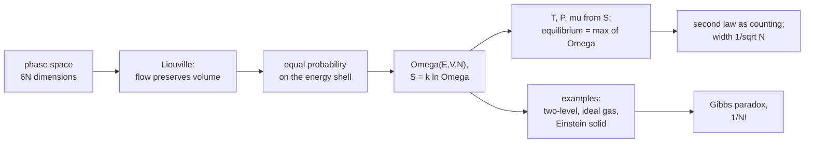

# SM02 · Phase Space, Liouville's Theorem and the Microcanonical Ensemble

◀ [[SM01 Probability Large Numbers and Information]] · [[Thermodynamics and Statistical Mechanics - Course Map|Course Map]] · next ▶ [[SM03 The Canonical Ensemble]]

> [!info] Source and approach
> Follows **Kardar Ch. 3 §3.1–3.2 (pp. 57–62) and Ch. 4 §4.1–4.5 (pp. 98–110)** ([[Mehran Kardar - Statistical Physics of Particles (2007).pdf#page=69|PDF p.69 ff.]]; PDF = printed + 12) and **Pathria and Beale Ch. 1–2** (printed pp. 1–38, PDF = printed + 27; read by OCR: [[R. K. Pathria, Paul D. Beale - Statistical Mechanics (2011).pdf#page=28|PDF p.28 ff.]]). The Einstein-solid example is in the spirit of Schroeder Ch. 2 (not reread); every number is recomputed in `scripts/sm_numbers.py`, figure `scripts/fig_sm02.py`. No course is behind this chapter: no taught/extra labels, only the Provenance table.

> [!tip] Start here (first read)
> - **The picture.** Take a box of gas, isolated, with total energy $E$. The microscopic state is a point in a $6N$-dimensional space (all positions and momenta). The energy fixes a thin *shell* in that space. The **one postulate** of equilibrium statistical mechanics: *all the points of the shell are equally likely*. The volume of the shell, $\Omega$, is the number of microstates; $S=k_B\ln\Omega$ is the entropy; and every thermodynamic fact (temperature, pressure, the second law) is a fact about how $\Omega$ changes when you change $E,V,N$.
> - **What you need.** SM01 (Stirling, saddle point, $e^{N}$-scalings), the Hamiltonian formulation of mechanics (positions $q$ and momenta $p$, $\dot q=\partial H/\partial p$, $\dot p=-\partial H/\partial q$), partial derivatives and the thermodynamic definitions of $T,P,\mu$ ([[TH04 The Second Law Carnot Engines and Entropy]], [[TH05 Potentials Maxwell Relations Stability and the Third Law]]).
> - **How to read.** §1–§3 are the foundations (phase space, Liouville, the postulate) and can be skimmed on a first pass; §4–§8 are the working machinery and carry the examples (two-level system, ideal gas, Einstein solids). Do the Einstein-solid example by hand once (Problem 6).
> - **Notation.** $\Gamma$ phase space; $\mu=(\{\mathbf p_i\},\{\mathbf q_i\})$ a microstate; $\rho$ phase-space density; $\Sigma(E)$ phase-space volume below $E$; $\Omega(E)$ its shell version; $\{A,B\}$ Poisson bracket; $\beta=1/k_BT$; $\lambda=h/\sqrt{2\pi mk_BT}$ thermal wavelength.

> [!key] After this chapter you can
> - state **Liouville's theorem**, prove it, and say what it does and does not imply about entropy,
> - state the **equal-a-priori-probability postulate** and the **ergodic hypothesis**, and list what is wrong with both,
> - compute $\Omega(E,V,N)$ and $S=k_B\ln\Omega$, define $T,P,\mu$ from $S$ and show that **equilibrium means equal $T$** (and equal $P/T$, $\mu/T$),
> - solve the **two-level system** exactly, find $T(E)$, and explain **negative temperatures**,
> - derive the **ideal-gas $\Omega$ and the Sackur–Tetrode entropy** from the volume of a $3N$-ball and show that the shell thickness does not matter,
> - resolve the **Gibbs paradox** with the factor $1/N!$ and compute entropies of mixing,
> - use an **Einstein solid** to see why energy flows until temperatures are equal, with a peak of relative width $1/\sqrt N$.

> [!intuition] The one-sentence story
> An isolated system wanders among all microstates it is allowed; a macroscopic condition is "likely" in proportion to the number of microstates it contains; counting those microstates and taking the logarithm gives the entropy, and the maximisation of the count under exchange of energy, volume or particles *is* the second law and the equality of temperature, pressure and chemical potential.

*Concept map of the chapter.*

![[fig_sm02_phasespace.png]]
*Figure SM2.1. A: a blob of initial conditions of a pendulum (blue disc) is sheared into a long filament but its area stays 0.3848 (Liouville, §2). B: two Einstein solids ($N_A=300$, $N_B=200$, 100 quanta) share energy; the probability of $q_A$ is a Gaussian of width 5.4 around 60 (§8). C: for a two-level system $S(E)$ turns over at half filling, so $1/T=\partial S/\partial E$ changes sign: negative temperatures (§5).*

## 1. Microstates and phase space

A classical system of $N$ particles in three dimensions is described at one instant by $3N$ coordinates $q_i$ and $3N$ momenta $p_i$. This list is a **point in phase space** $\Gamma=\mathbb R^{6N}$ (for a gas, $\mathbb R^{3N}\times$ the box); the **microstate** $\mu(t)=(\mathbf p_1,\dots,\mathbf p_N,\mathbf q_1,\dots,\mathbf q_N)$ moves according to Hamilton's equations ([[Mehran Kardar - Statistical Physics of Particles (2007).pdf#page=69|K §3.1, p.57]])
$$\dot q_i=\frac{\partial\mathcal H}{\partial p_i},\qquad\dot p_i=-\frac{\partial\mathcal H}{\partial q_i}.$$
A **macrostate** (a few measured numbers) corresponds to a *region* of $\Gamma$. We do not know which point of the region the system occupies, so we describe our ignorance by a **phase-space density** $\rho(\mu,t)\ge0$, normalised by $\int\mathrm d\Gamma\,\rho=1$ with $\mathrm d\Gamma=\prod_{i}\mathrm d^3p_i\,\mathrm d^3q_i$ (divided later by $N!\,h^{3N}$, §4). An imaginary collection of copies of the system, one for every microstate weighted by $\rho$, is a **Gibbs ensemble** and the expectation of any observable $\mathcal O(\mu)$ is
$$\langle\mathcal O\rangle=\int\mathrm d\Gamma\,\rho(\mu,t)\,\mathcal O(\mu).$$

> [!intuition] Phase space as a map of "everything this gas could be doing"
> One point = one complete snapshot of every molecule. A typical room of air is one point in a space of dimension $\approx10^{27}\times6$; "the room has pressure 1 atm and temperature 288 K" is a region of that space so huge that the system, whatever it does, never leaves it. We study the *size* of regions, not individual points.

## 2. Liouville's theorem

> [!key] Liouville's theorem
> Along any trajectory of a Hamiltonian system the phase-space density is constant: $\dfrac{\mathrm d\rho}{\mathrm dt}=0$. Equivalently, the phase-space **volume of any set of initial conditions is preserved** by the flow, and
> $$\boxed{\ \frac{\partial\rho}{\partial t}=-\{\rho,\mathcal H\}=-\sum_{i=1}^{3N}\Big(\frac{\partial\rho}{\partial q_i}\frac{\partial\mathcal H}{\partial p_i}-\frac{\partial\rho}{\partial p_i}\frac{\partial\mathcal H}{\partial q_i}\Big)\ }$$
> ([[Liouville's Theorem]]; [[Mehran Kardar - Statistical Physics of Particles (2007).pdf#page=71|K §3.2, p.59]]; PB §2.2.)

> [!derivation] Proof: probability is conserved and the flow is incompressible
> The number of ensemble members is conserved, so $\rho$ obeys a continuity equation in the $6N$-dimensional space with velocity field $\mathbf v=(\dot q_i,\dot p_i)$:
> $$\frac{\partial\rho}{\partial t}+\sum_i\Big[\frac{\partial(\rho\dot q_i)}{\partial q_i}+\frac{\partial(\rho\dot p_i)}{\partial p_i}\Big]=0.$$
> Now use Hamilton's equations: $\sum_i\big(\partial\dot q_i/\partial q_i+\partial\dot p_i/\partial p_i\big)=\sum_i\big(\frac{\partial^2\mathcal H}{\partial q_i\partial p_i}-\frac{\partial^2\mathcal H}{\partial p_i\partial q_i}\big)=0$: **the flow field is divergence-free** (incompressible). Therefore
> $$\frac{\partial\rho}{\partial t}+\sum_i\Big(\dot q_i\frac{\partial\rho}{\partial q_i}+\dot p_i\frac{\partial\rho}{\partial p_i}\Big)=\frac{\mathrm d\rho}{\mathrm dt}=0,$$
> and substituting Hamilton's equations for $\dot q_i,\dot p_i$ gives the Poisson-bracket form. $\square$
> The quantum counterpart is the von Neumann equation $\partial_t\hat\rho=-\tfrac i\hbar[\hat{\mathcal H},\hat\rho]$ (replace $\{\,,\}\to\tfrac1{i\hbar}[\,,]$): see SM07.

> [!example] A pendulum blob (recomputed; Fig. SM2.1A)
> $\mathcal H=p^2/2+(1-\cos q)$ ($m=\ell=g=1$). A disc of radius 0.35 centred at $(q,p)=(1.6,0)$ is evolved with a high-accuracy integrator and its boundary (400 points) is stretched into a long thin spiral by $t=30$, because the pendulum's period depends on amplitude (points at larger $q$ rotate more slowly: **shear**). The polygon area is $0.38483,\ 0.38483,\ 0.38483,\ 0.38482,\ 0.38478$ at $t=0,4,8,16,32$ against the exact initial $\pi(0.35)^2=0.38485$ (the small deficit is the 400-gon, not the flow). **Stretching without squeezing is what makes mixing possible**: a coarse grid looking at the filament sees it fill a region of $\Gamma$ of larger area. A *harmonic* oscillator, whose period does not depend on amplitude, only rotates the blob and never mixes it.

### 2.1 Consequences
1. **Stationarity.** $\rho$ is time-independent if $\{\rho,\mathcal H\}=0$. Any function of the Hamiltonian, $\rho=f(\mathcal H)$, qualifies, and so does any function of other conserved quantities ($\mathbf P$, $\mathbf L$). This is why the equilibrium ensembles of SM02–SM04 are functions of the energy ($\delta(E-\mathcal H)$ in §4, $e^{-\beta\mathcal H}$ in SM03).
2. **The fine-grained entropy cannot grow.** $S_G=-k_B\int\rho\ln\rho\,\mathrm d\Gamma$ is the Gibbs entropy of SM01 §7; by Liouville it is *constant in time* under Hamiltonian flow. The entropy increase of the second law is **coarse-grained**: measured with finite resolution, the filament of the figure looks like a diffuse blob (SM05, planned, and the Boltzmann equation of SM22, planned).
3. **Poincaré recurrence.** In a bounded phase space of finite volume an incompressible flow returns arbitrarily close to its starting point. The *time* is the point: to return within 10 % in each of the $6N$ coordinates takes of the order of $10^{6N}$ times a molecular time, $10^{600}$ for $N=100$, a number that has no meaning for $N=10^{23}$ (an *estimate*, not a theorem). Recurrence is not forbidden, it is astronomically improbable, which is how the "reversibility paradox" (Loschmidt) and the "recurrence paradox" (Zermelo) are answered: the second law is probabilistic, with probabilities $e^{-N\cdot\text{something}}$ (SM01 §1, §6).

## 3. Equilibrium, ergodicity and the postulate

**Equilibrium** means that macroscopic averages do not depend on time. A measurement takes a long time on the molecular scale, so what we measure is a **time average** along a trajectory, $\bar{\mathcal O}=\lim_{T\to\infty}\frac1T\int_0^T\mathcal O(\mu(t))\,\mathrm dt$. The **ergodic hypothesis** says that the trajectory visits every point of the energy surface in a "uniform" way, so $\bar{\mathcal O}$ equals the average over the *energy surface* with equal weights.

> [!pitfall] The ergodic hypothesis is not what we use, and it is not literally true
> Strictly ergodic Hamiltonian systems are rare: integrable systems stay on invariant tori; the KAM theorem says that weakly perturbed systems keep many tori; and even when a system is ergodic, the time to sample the surface is astronomical (§2.1). What is actually needed is (i) **mixing** (the stretching of §2) and (ii) that almost all of the energy surface looks the same to a macroscopic observable (concentration of measure, SM01 §6). Most textbooks (Kardar §4.1; Pathria §1.2, §2.3) therefore **postulate** the result:
>
> > [!key] Postulate of equal a priori probabilities
> > For an **isolated** system in equilibrium with energy between $E$ and $E+\delta E$, every accessible microstate is equally probable:
> > $$\rho(\mu)=\frac{1}{\Omega(E)}\quad\text{on the shell}\ E\le\mathcal H(\mu)\le E+\delta E,\qquad\rho=0\ \text{elsewhere}.$$
>
> It is justified by consistency (it is stationary by Liouville, §2.1(1), and no other normalisable choice treats all microstates alike) and by results (it gives thermodynamics, §4–§8). The deeper justification is one of the open problems of mathematical physics.

## 4. The microcanonical ensemble and the entropy

### 4.1 Definitions
With the **measure** $\mathrm d\Gamma=\dfrac{1}{N!}\prod_i\dfrac{\mathrm d^3p_i\,\mathrm d^3q_i}{h^3}$ (the factors $h^{3N}$ and $N!$ are explained in §6–§7: $h$ makes $\mathrm d\Gamma$ dimensionless and counts quantum states, $N!$ treats identical particles as indistinguishable) define
$$\Sigma(E,V,N)=\int_{\mathcal H\le E}\mathrm d\Gamma,\qquad\Omega(E,V,N)=\int\mathrm d\Gamma\,\delta(E-\mathcal H)=\frac{\partial\Sigma}{\partial E}\quad(\text{density of states}),$$
and the number of microstates in the shell is $\Omega\,\delta E$. The **Boltzmann entropy** is
$$\boxed{\ S(E,V,N)=k_B\ln\Omega\ }\qquad\text{(up to an additive constant that fixes the zero)}.$$
In a quantum system $\Omega$ is the number of eigenstates with energy in the shell ([[Statistical Entropy]], [[Mehran Kardar - Statistical Physics of Particles (2007).pdf#page=110|K §4.2, p.98]]).

> [!key] The shell thickness does not matter
> $\ln(\Omega\delta E)$, $\ln\Sigma$ and $\ln\Omega$ differ by terms of order $\ln N$, against $S\sim N$. For an energy $E\sim N\epsilon$ and any shell width between $\delta E\sim E$ and, say, $\delta E\sim E/N^{10}$, the term $\ln\delta E$ changes $S$ by at most $O(\ln N)$. This is the "largest term" argument of SM01 §5.1: volume in $6N$ dimensions is concentrated at the *outer surface*, so the whole ball below $E$ and its outermost shell have the same logarithm. (Exact check for the ideal gas in §6.)

### 4.2 Temperature, pressure and chemical potential from $S$
Define, for the isolated system, the three derivatives of $S(E,V,N)$:
$$\frac1T=\frac{\partial S}{\partial E}\Big|_{V,N},\qquad\frac PT=\frac{\partial S}{\partial V}\Big|_{E,N},\qquad\frac\mu T=-\frac{\partial S}{\partial N}\Big|_{E,V},\qquad\Longrightarrow\ \mathrm dS=\frac{\mathrm dE}T+\frac PT\mathrm dV-\frac\mu T\mathrm dN$$
which is the **fundamental relation** of thermodynamics ([[Fundamental Thermodynamic Relation]], [[TH05 Potentials Maxwell Relations Stability and the Third Law]]). That these are the same $T,P,\mu$ as in thermodynamics is *proved* by the next two paragraphs.

> [!derivation] Equal temperature is maximum probability
> Two systems $A,B$ with fixed volumes and particle numbers are brought into thermal contact but isolated from the outside: $E_A+E_B=E$. The number of microstates with $A$ having energy $E_A$ is $\Omega_A(E_A)\Omega_B(E-E_A)$ (equal weight to all, so independent), and
> $$p(E_A)\propto\Omega_A(E_A)\,\Omega_B(E-E_A)=\exp\Big[\frac{S_A(E_A)+S_B(E-E_A)}{k_B}\Big].$$
> The exponent is extensive ($\sim N$), so $p(E_A)$ is sharply peaked (SM01 §5.2). The maximum satisfies $\partial S_A/\partial E_A=\partial S_B/\partial E_B$, that is $T_A=T_B$. The curvature at the maximum, $\partial^2(S_A+S_B)/\partial E_A^2=-\big(\tfrac{1}{T_A^2C_A}+\tfrac1{T_B^2C_B}\big)<0$, fixes the Gaussian width $\sigma_{E_A}^2=k_BT^2\,C_AC_B/(C_A+C_B)$ (stability needs positive heat capacities, [[Thermodynamic Stability]]). Similarly, letting a movable partition between $A$ and $B$ settle gives $P_A/T_A=P_B/T_B$ and letting particles pass gives $\mu_A/T_A=\mu_B/T_B$. With $T_A=T_B$, **equal pressure and equal chemical potential**. $\square$

> [!derivation] The second law as a counting statement
> Removing a constraint (a partition, an insulating wall, a valve) can only *enlarge* the set of accessible microstates: $\Omega_{\rm after}\ge\Omega_{\rm before}$, so $\Delta S=k_B\ln(\Omega_{\rm after}/\Omega_{\rm before})\ge0$. If the volume available to $N$ ideal-gas molecules doubles, $\Omega$ grows by $2^N$ and $\Delta S=Nk_B\ln2$ (compare TH06 §5: $5.763$ J K$^{-1}$ per mole). The reverse is not impossible, only improbable by $2^{-N}$.

## 5. The two-level system and negative temperatures

$N$ distinguishable, non-interacting spins (or two-level atoms), each with energy $0$ or $\varepsilon$. A macrostate with $n$ spins "up" (energy $\varepsilon$) has $E=n\varepsilon$ and
$$\Omega(E)=\binom Nn,\qquad S=k_B\ln\binom Nn\simeq Nk_B\,s(x),\quad x=\frac nN=\frac E{N\varepsilon},\quad s(x)=-x\ln x-(1-x)\ln(1-x)$$
([[Mehran Kardar - Statistical Physics of Particles (2007).pdf#page=114|K §4.3, p.102]]; SM01 §5.4). Then
$$\frac1T=\frac{\partial S}{\partial E}=\frac{k_B}{\varepsilon}\ln\frac{1-x}{x}\ \Longrightarrow\ \boxed{\ x=\frac{1}{e^{\varepsilon/k_BT}+1}\ },\quad E=\frac{N\varepsilon}{e^{\varepsilon/k_BT}+1}$$
(so the occupation ratio is the **Boltzmann factor** $n/(N-n)=e^{-\varepsilon/k_BT}$, derived here from counting alone).

> [!example] Numbers (recomputed; $S/Nk_B=s(x)$, $k_BT/\varepsilon=1/\ln\frac{1-x}x$)
> | $x=n/N$ | 0.10 | 0.25 | 0.50 | 0.75 | 0.90 |
> |---|---|---|---|---|---|
> | $s(x)$ | 0.3251 | 0.5623 | 0.6931 | 0.5623 | 0.3251 |
> | $k_BT/\varepsilon$ | 0.455 | 0.910 | $\pm\infty$ | $-0.910$ | $-0.455$ |
>
> A finite-$N$ check ($N=100$, $n=25$): $\ln\Omega=53.845$ against $Ns=56.234$, the difference $-2.388$ being the Stirling prefactor $-\tfrac12\ln2\pi Nx(1-x)=-2.385$ (SM01).

> [!key] Negative temperature
> For $x>\tfrac12$ the entropy *decreases* with energy, so $1/T<0$: **$T<0$ is real**, provided (i) the energy spectrum has an **upper bound** (two levels do; a gas, whose kinetic energy is unbounded, does not) and (ii) the spin system is isolated from the lattice for long enough to equilibrate internally. Purcell and Pound (1951) produced it by suddenly reversing the magnetic field on the nuclear spins of LiF. A negative-$T$ system is **hotter than any positive $T$**: in terms of $\beta=1/k_BT$ the order from cold to hot is $\beta=+\infty$ ($T=0^+$), through $\beta=0$ ($T=\pm\infty$, maximum entropy), to $\beta=-\infty$ ($T=0^-$). Heat flows from a negative-$T$ system into any positive-$T$ system (the entropy of the combination rises). The Boltzmann factor $e^{-\beta E}$ then *weights high energy more*: a population inversion, the physics of a **laser medium**.

> [!intuition] Why temperature is $\partial S/\partial E$ and not "average kinetic energy"
> Temperature measures how much entropy you gain per unit of energy you add. In a gas, extra energy always opens up more states: $S$ increases with $E$ forever. In a two-level system the states run out: once most spins are up, adding energy forces them into a *more ordered* configuration, and $S$ falls. The sign of $\partial S/\partial E$ is the sign of $T$. (Heat capacity, $C=\partial E/\partial T$, of a *bounded* system must vanish both as $T\to0$ and $T\to\infty$; see the Schottky anomaly in SM03.)

## 6. The ideal gas

$N$ free particles in a volume $V$: $\mathcal H=\sum_i\mathbf p_i^2/2m$ inside the box, so the position integrals give $V^N$ and the momentum integral is the volume of a **ball in $3N$ dimensions** of radius $R=\sqrt{2mE}$. With $V_n(R)=\dfrac{\pi^{n/2}}{\Gamma(n/2+1)}R^n$ (the unit-ball volume, by Gaussian integrals: [[Gaussian Integral]]):
$$\Sigma(E,V,N)=\frac{V^N}{N!\,h^{3N}}\,\frac{(2\pi mE)^{3N/2}}{\Gamma(\tfrac{3N}2+1)},\qquad\Omega=\frac{\partial\Sigma}{\partial E}=\frac{3N}{2E}\Sigma .$$
Stirling ($\ln N!=N\ln N-N$, $\ln\Gamma(\tfrac{3N}2+1)=\tfrac{3N}2\ln\tfrac{3N}2-\tfrac{3N}2$) gives
$$\frac S{k_B}=N\ln\Big[\frac VN\Big(\frac{4\pi mE}{3Nh^2}\Big)^{3/2}\Big]+\frac52N .$$
The derivatives are the ideal gas: $\dfrac1T=\dfrac{3Nk_B}{2E}\Rightarrow E=\tfrac32Nk_BT$; $\dfrac PT=\dfrac{Nk_B}V\Rightarrow PV=Nk_BT$; and substituting $E=\tfrac32Nk_BT$:
$$\boxed{\ S=Nk_B\Big[\ln\Big(\frac V{N\lambda^3}\Big)+\frac52\Big],\qquad\lambda=\frac h{\sqrt{2\pi mk_BT}}\ }$$
the **Sackur–Tetrode entropy** ([[Sackur-Tetrode Equation]]; the same formula as TH06 §5, with $\lambda$ the thermal de Broglie wavelength). It reproduces the measured entropy of helium at 298.15 K and 1 bar: $126.15$ J mol$^{-1}$K$^{-1}$.

> [!example] Exact against Stirling, and the shell (recomputed, He at 300 K, 1 atm)
> Define $\ln\Sigma$ exactly (log-gamma function) and compare with $S_{ST}/k_B$ at $E=\tfrac32Nk_BT$. The algebra above gives exactly
> $$\ln\Sigma=\frac{S_{ST}}{k_B}-\ln\big(\pi\sqrt6\,N\big)+O(1/N),$$
> because Stirling's $\sqrt{2\pi N}$ for $N!$ and $\sqrt{3\pi N}$ for $\Gamma(\tfrac{3N}2+1)$ multiply to $\pi\sqrt6\,N$. Numerically:
>
> | $N$ | $\ln\Sigma$ | $S_{ST}/k_B$ | difference | $-\ln(\pi\sqrt6N)$ |
> |---|---|---|---|---|
> | 10 | 147.393 | 151.750 | $-4.357$ | $-4.343$ |
> | 100 | 1510.853 | 1517.500 | $-6.647$ | $-6.646$ |
> | 1000 | 15166.054 | 15175.003 | $-8.949$ | $-8.948$ |
> | $10^5$ | 1517486.7 | 1517500.3 | $-13.55$ | $-13.55$ |
>
> The shell gives $\ln\Omega\,\delta E=\ln\Sigma+\ln(3N\delta E/2E)$; for $\delta E=E$ this adds $\ln(3N/2)$ and the net difference from $S_{ST}/k_B$ is the **constant** $\ln\frac3{2\pi\sqrt6}=-1.635$ for every $N$. All three definitions of the entropy agree to $O(1)$ out of $\sim10^3$ to $10^{23}$.

> [!connection] $\lambda$ and the classical criterion
> $S_{ST}$ is meaningful only if $V/N\lambda^3\gg1$, the *classical* regime. Recomputed: $n\lambda^3=1.7\times10^{-7}$ for N$_2$ at 300 K and 1 atm; $0.13$ for He gas at 4.2 K; $4.5$ for liquid He-4 at 2.17 K; $6.8\times10^{3}$ for conduction electrons in copper at 300 K. When $n\lambda^3\gtrsim1$ the formula fails (it would give a negative entropy) and quantum statistics must be used (SM07, SM11, SM12). The third law ($S\to0$ as $T\to0$) is violated by the classical result for the same reason.

## 7. Mixing, indistinguishability and the Gibbs paradox

Two vessels, each of volume $V$ with $N$ molecules at the same $T$ and $P$, are connected. If the gases are **different** (He and Ar), each expands into the doubled volume and the entropy of mixing is
$$\Delta S_{\rm mix}=2\,Nk_B\ln2\ \Big(=2R\ln2=11.526\ \mathrm{J\,K^{-1}}\ \text{for 1 mol each}\Big).$$
If the gases are the **same**, nothing macroscopic happens and thermodynamics says $\Delta S=0$. But the formula $S\propto N\ln V+\dots$ derived *without* the $1/N!$ factor (call it $S_0$) gives for the same gas $S_0(2V,2N)-2S_0(V,N)=2Nk_B\ln2\ne0$: **the entropy is not extensive** and mixing identical gases creates entropy: the **Gibbs paradox** ([[Gibbs Paradox]]; [[Mehran Kardar - Statistical Physics of Particles (2007).pdf#page=119|K §4.5, p.107]]; PB §1.5–1.6).

> [!derivation] Resolution
> Identical particles are *indistinguishable*: swapping two of them is not a new microstate. The phase space volume $\int\mathrm d^{3N}p\,\mathrm d^{3N}q$ counts each physical state $N!$ times (one for each permutation of the labels), so the correct count is the raw volume divided by $N!$. With $\ln N!=N\ln N-N$ the $N\ln V$ becomes $N\ln(V/N)$; the entropy depends on $V/N$ only and is **extensive**: $S(2V,2N)=2S(V,N)$, and for identical gases $\Delta S_{\rm mix}=0$. For two *different* gases at the same $T,P$ in volumes $V_1,V_2$ (so $N_i/V_i=n$):
> $$\Delta S_{\rm mix}=-k_B\sum_iN_i\ln\frac{N_i}{N}=-Nk_B\sum_ix_i\ln x_i,\qquad x_i=\frac{N_i}N .$$
> This is $N$ times the **Shannon entropy of the composition** (SM01 §7.2). $\square$ (Classically $1/N!$ must be put in by hand; in quantum mechanics it follows from the symmetrisation postulate, SM07.)

> [!example] The entropy of mixing air (recomputed)
> $0.21$ O$_2$ + $0.79$ N$_2$ per mole of mixture: $\Delta S_{\rm mix}=-R(0.21\ln0.21+0.79\ln0.79)=0.514\,R=4.27$ J mol$^{-1}$K$^{-1}$ (the $x_i=\tfrac12$ maximum is $R\ln2=5.76$). The same formula with $x_i$ the mole fractions of any ideal-gas mixture is the origin of the "$RT\ln x_i$" term of chemical potentials in [[TH05 Potentials Maxwell Relations Stability and the Third Law]] and of the atmospheric partial pressures of [[CL05 Thermodynamic State of the Atmosphere]].

> [!pitfall] Is the mixing entropy discontinuous?
> Molecules that differ by an *arbitrarily small* property (isotopes, nuclear-spin states) are still "different" if you can separate them, giving $2Nk_B\ln2$; molecules that are exactly the same give 0. There is no continuous interpolation in the formula. The resolution (Jaynes) is that the entropy depends on **which macroscopic variables you are able to measure or control**; if you cannot tell the two gases apart, they are the same gas for you. Entropy is a property of the system *and* the description (SM05, planned).

## 8. Quantum counting and the Einstein solid

Why $h$? In quantum mechanics a state occupies a minimal phase-space cell $\Delta q\,\Delta p\gtrsim h$ ([[Heisenberg Uncertainty Principle]]), and the number of states below $E$ equals $\Sigma(E)$ *with* the factor $1/h^{3N}$. For one particle in a box $L^3$ the number of standing waves with $|\mathbf k|\le k_E=\sqrt{2mE}/\hbar$ is the volume of an octant of a sphere in $\mathbf n$-space, $\frac18\frac{4\pi}{3}(k_EL/\pi)^3=\frac{4\pi}3\frac{V(2mE)^{3/2}}{h^3}$: exactly the classical phase-space volume divided by $h^3$ (Problem 10).

The **Einstein solid**: $N$ distinguishable oscillators of the same frequency, energies $n\hbar\omega$ with $n=0,1,2,\dots$ ([[QM05 The Harmonic Oscillator]]); drop the zero-point. A state with $q$ quanta in total is one of
$$\Omega(N,q)=\binom{q+N-1}{q}$$
(put $q$ identical balls into $N$ boxes: "stars and bars"). It is a **fully discrete model in which the postulate can be tested by hand** (Problem 6).

> [!example] Two Einstein solids in contact (recomputed; Fig. SM2.1B)
> $N_A=300$ and $N_B=200$ oscillators share $q=100$ quanta. The probability that A holds $q_A$ is $\Omega(300,q_A)\Omega(200,100-q_A)/\Omega(500,100)$.
> - **Most probable** $q_A=60=q\,N_A/(N_A+N_B)$; $\langle q_A\rangle=60.000$, $\sigma=5.36$ (Gaussian-width formula, below: $5.37$).
> - $\log_{10}\Omega_{\rm tot}=115.967$ for all macrostates together and $114.837$ at the peak, so the peak macrostate alone has probability $10^{-1.13}=0.0741$.
> - $P(q_A=0)=3.0\times10^{-35}$ (all of the energy in B); $P(q_A=100)=1.8\times10^{-20}$.
> - At the peak both solids have the same temperature: $k_BT/\hbar\omega=1/\ln\frac{q_i+N_i}{q_i}=0.5581$ for A ($q_A=60$) and for B ($q_B=40$) ✓ (§4.2).
>
> **Width.** With $\ln\Omega(N,q)\approx(q+N)\ln(q+N)-q\ln q-N\ln N$ (Stirling), $\partial^2\ln\Omega/\partial q^2=-N/[q(q+N)]$, so $\sigma^{-2}=\dfrac{N_A}{q_A(q_A+N_A)}+\dfrac{N_B}{q_B(q_B+N_B)}$, giving $\sigma^2=28.8$ above. For two *equal* solids with $q=2N$: $\sigma=\sqrt N$ and $\sigma/q_A=1/\sqrt N$:
>
> | $N_A=N_B=N$ | $10$ | $10^2$ | $10^4$ | $10^6$ | $10^{22}$ |
> |---|---|---|---|---|---|
> | $\sigma/q_A$ | 0.32 | 0.10 | 0.010 | 0.0010 | $10^{-11}$ |
>
> For two blocks of a mole of copper the energy of one fluctuates by $10^{-11}$ of its value: **the "equal temperature" of thermodynamics is an equality to eleven digits.**

> [!intuition] Energy flows because there are more ways
> Put all the quanta in A: only one arrangement of "where in B" but huge numbers of arrangements within A. The macrostate "the quanta are shared 60:40" has $\sim10^{35}$ times more microstates than "all in A". Nothing pushes the energy across; there is simply almost nowhere else for the system to be. This is the content of "heat flows from hot to cold".

> [!pitfall] Four traps
> 1. **$S$ is defined up to a constant** in classical mechanics ($h$, $N!$ fix it; the third law needs quantum mechanics to say that it vanishes at $T=0$). Only *differences* are physical until SM07.
> 2. **Negative temperature is hotter, not colder**; $T=0^-$ is the hottest state. Use $\beta$ to avoid confusion.
> 3. **Do not drop $N!$ because "it is only a constant".** It changes $S$ by $-k_B(N\ln N-N)$, which is of the order of $S$, and destroys extensivity (§7).
> 4. **The microcanonical ensemble is a fiction for real systems.** No real system is perfectly isolated, and $\delta(E-\mathcal H)$ is hard to integrate. SM03 replaces it by contact with a bath, with identical thermodynamics (equivalence of ensembles).

## Map of this chapter
> [!connection] How SM02 connects
> **Builds on:** [[SM01 Probability Large Numbers and Information]] (largest-term, Stirling, multinomial), [[TH04 The Second Law Carnot Engines and Entropy]], [[TH05 Potentials Maxwell Relations Stability and the Third Law]] (the thermodynamic $T,P,\mu$), [[TH06 From Kinetic Theory to Statistical Mechanics]] §5 (the earlier sketch of the same results).
> **Leads to:** [[SM03 The Canonical Ensemble]] (bath instead of isolation), SM05 (entropy and information, planned), SM07 (quantum counting, $N!$ from symmetrisation), SM22 (the Boltzmann equation: the coarse-grained route to the arrow of time).
> **Concepts:** [[Liouville's Theorem]] · [[Phase Space]] · [[Ergodic Hypothesis]] · [[Microcanonical Ensemble]] · [[Density of States]] · [[Negative Temperature]] · [[Gibbs Paradox]] · [[Einstein Solid]] · [[Sackur-Tetrode Equation]] · [[Statistical Entropy]] · [[Stirling's Approximation]] · [[Thermal Wavelength]]
> **Other subjects:** [[Phase Space Picture of the Oscillator]] (Quantum Mechanics), [[QM05 The Harmonic Oscillator]], [[CL05 Thermodynamic State of the Atmosphere]] (mixtures).

## Summary
> [!summary] Cheat-sheet
> - **Phase space** $\Gamma=\mathbb R^{6N}$; Hamilton flow; $\partial_t\rho=-\{\rho,\mathcal H\}$; **Liouville:** $\mathrm d\rho/\mathrm dt=0$, volume preserved, $S_G=-k\int\rho\ln\rho$ constant; mixing needs shear (pendulum yes, oscillator no).
> - **Postulate:** isolated system, all microstates of the shell equally likely; $\rho=1/\Omega$.
> - **Entropy:** $S=k_B\ln\Omega$, $\Omega=\int\mathrm d\Gamma\,\delta(E-\mathcal H)$, $\mathrm d\Gamma=\prod\frac{\mathrm d^3p\,\mathrm d^3q}{h^3}\cdot\frac1{N!}$; shell width irrelevant ($O(\ln N)$).
> - **Derivatives:** $\frac1T=\partial_ES$, $\frac PT=\partial_VS$, $\frac\mu T=-\partial_NS$; equilibrium = $T_A=T_B$, $P_A/T_A=P_B/T_B$, $\mu_A/T_A=\mu_B/T_B$; width of $E_A$: $\sigma^2=k_BT^2C_AC_B/(C_A+C_B)$.
> - **Two-level:** $S=Nk[-x\ln x-(1-x)\ln(1-x)]$, $x=1/(e^{\varepsilon/kT}+1)$, $T<0$ for $x>\tfrac12$ (hotter than $+\infty$).
> - **Ideal gas:** $\Sigma=\frac{V^N(2\pi mE)^{3N/2}}{N!\,h^{3N}\Gamma(3N/2+1)}$, $E=\frac32NkT$, $PV=NkT$, $S=Nk[\ln\frac V{N\lambda^3}+\frac52]$, $\ln\Sigma=S_{ST}/k-\ln(\pi\sqrt6N)$.
> - **Gibbs:** divide by $N!$; $\Delta S_{\rm mix}=-Nk\sum x_i\ln x_i$ for different gases (air: $4.27$ J mol$^{-1}$K$^{-1}$), $0$ for identical.
> - **Einstein solid:** $\Omega=\binom{q+N-1}q$; two solids: peak $q_A=qN_A/N$, $\sigma/q_A\sim1/\sqrt N$.

## Practice
1. **Liouville for the oscillator.** For $\mathcal H=p^2/2m+\tfrac12m\omega^2q^2$ show that the flow is a rotation in the plane $(\sqrt{m\omega}\,q,\,p/\sqrt{m\omega})$, so that areas are preserved. What is the area enclosed by the energy curve $\mathcal H=E$, and what is $\Sigma(E)=\text{area}/h$ in units of $\hbar\omega$?
2. **Two-level counting.** $N=100$ spins, $n=25$ up. (a) $\Omega$, $S/k_B$. (b) The temperature from the *discrete* derivative $\Delta S/\Delta E$ between $n=25$ and $26$ and from the continuum formula.
3. **Population inversion.** What is $k_BT/\varepsilon$ if 90 % of two-level atoms are in the upper level? In which direction does heat flow when this system touches a room-temperature body?
4. **Two ideal gases in contact.** Two ideal gases ($N_A$, $N_B$ atoms, same species) share a total energy $E$. Find the most probable $E_A$ and the width $\sigma_E$. Evaluate $\sigma/E_A$ for $N_A=N_B=5\times10^{22}$.
5. **Mixing.** (a) 1 mol of He and 1 mol of Ar at 298 K and 1 atm are connected: $\Delta S$? (b) Two moles of He from two vessels? (c) 3 mol N$_2$ + 1 mol O$_2$ mixed.
6. **By hand.** Two Einstein solids, $N_A=N_B=3$, $q=6$ quanta. List $\Omega_A\Omega_B$ for $q_A=0,\dots,6$, check that they sum to $\Omega(6,6)=462$, and find $P(q_A=3)$ and the probability that A has *more* than 4 quanta.
7. **Peak width.** For the solids of §8 ($N_A=300$, $N_B=200$, $q=100$) compute the probability that A holds at most 50 quanta from the Gaussian, and compare with the exact value (use a table or code).
8. **Exact vs Stirling.** Derive $\ln\Sigma=S_{ST}/k_B-\ln(\pi\sqrt6\,N)$ and evaluate it for $N=1000$ He atoms ($T=300$ K, 1 atm).
9. **Certainty.** For $N$ molecules in a box, the probability that the left half holds a fraction $m$ with $|m-\tfrac12|>10^{-3}$: find it for $N=10^6$ (Gaussian) and estimate it for $N=10^{10}$ (large deviation).
10. **Counting quantum states.** For one He atom in a cube of 1 L, how many standing-wave states have energy below $\tfrac32k_BT$ at 300 K? Compare with $V/\lambda^3$.

> [!example]- Solutions
> 1. $\dot q=p/m$, $\dot p=-m\omega^2q$. With $X=\sqrt{m\omega}\,q$ and $Y=p/\sqrt{m\omega}$: $\dot X=\omega Y$, $\dot Y=-\omega X$, a rotation at angular velocity $\omega$; areas ($\mathrm dq\,\mathrm dp=\mathrm dX\,\mathrm dY$) are preserved. The energy curve is $X^2+Y^2=2E/\omega$, a circle of area $2\pi E/\omega$; $\Sigma=\dfrac{2\pi E/\omega}{2\pi\hbar}=\dfrac E{\hbar\omega}$: **one quantum state per $\hbar\omega$ of energy** (the oscillator ladder of [[QM05 The Harmonic Oscillator]]).
> 2. (a) $\ln\binom{100}{25}=53.845$ ($\Omega=2.4\times10^{23}$); $S/k_B=53.845$. (b) $\Delta S/\Delta E=\frac{k_B}{\varepsilon}\ln\binom{100}{26}/\binom{100}{25}=\frac{k_B}\varepsilon\ln\frac{75}{26}=1.060\,k_B/\varepsilon$, so $k_BT/\varepsilon=0.943$; the continuum formula gives $1/\ln3=0.910$ (the difference is the finite-$N$ correction $\sim1/N$).
> 3. $k_BT/\varepsilon=1/\ln\frac{0.1}{0.9}=-0.455$: $T=-0.455\,\varepsilon/k_B$. Heat flows from the inverted system into the body at room temperature (negative $T$ is hotter than any positive $T$).
> 4. $\Omega\propto E^{3N/2}$; $\ln\Omega_A+\ln\Omega_B=\tfrac32N_A\ln E_A+\tfrac32N_B\ln(E-E_A)$: maximum at $E_A=EN_A/(N_A+N_B)$ (equal energy per atom, equal $T$). Curvature $-\tfrac{3N_A}{2E_A^2}-\tfrac{3N_B}{2E_B^2}=-\dfrac{3N^2}{2E^2}\Big(\dfrac1{N_A}+\dfrac1{N_B}\Big)$ ($N=N_A+N_B$) so $\sigma_E^2=\dfrac{2E^2N_AN_B}{3N^3}$. For $N_A=N_B=N/2$: $\sigma_E=E/\sqrt{6N}$ and $\sigma/E_A=2/\sqrt{6N}=0.816/\sqrt N=2.6\times10^{-12}$ for $N=10^{23}$ (compare $\sqrt{2/3N_A}$, larger by $\sqrt2$, for a *bath*: SM03).
> 5. (a) $2R\ln2=11.53$ J K$^{-1}$. (b) $0$ (same gas). (c) $x=0.75,0.25$: $-R(0.75\ln0.75+0.25\ln0.25)=0.5623R=4.675$ J mol$^{-1}$K$^{-1}$ per mole of mixture; for 4 mol total $18.70$ J K$^{-1}$.
> 6. $\Omega(3,q)=\binom{q+2}2=1,3,6,10,15,21,28$ for $q=0..6$. Products: $28,63,90,100,90,63,28$; sum $462=\binom{11}6$ ✓. $P(q_A=3)=100/462=0.2165$; $P(q_A>4)=(63+28)/462=0.197$.
> 7. $z=(50.5-60)/5.366=-1.77$: Gaussian $\Phi(-1.77)=0.0383$; the exact sum of $\Omega_A\Omega_B/\Omega_{\rm tot}$ over $q_A\le50$ is $0.0395$ (3 % higher): the Gaussian is good, not exact, at 1.8 $\sigma$.
> 8. Stirling for $\ln N!$ adds $\tfrac12\ln2\pi N$, for $\ln\Gamma(\tfrac{3N}2+1)$ adds $\tfrac12\ln3\pi N$; their sum $=\tfrac12\ln(6\pi^2N^2)=\ln(\pi\sqrt6N)$ is subtracted from $\ln\Sigma$. $N=1000$: $S_{ST}/k_B=15175.003$ (He, 300 K, 1 atm), $\ln\Sigma=15166.054$, difference $-8.949=-\ln(7694.6)$ ✓.
> 9. $N=10^6$: $\sigma=\sqrt N/2=500$ molecules, while $|m-\tfrac12|>10^{-3}$ means $|n-N/2|>1000$, i.e. $2\sigma$: $P=\operatorname{erfc}(2/\sqrt2)=0.0455$ (two-sided). $N=10^{10}$: $I\approx2(10^{-3})^2=2\times10^{-6}$, $NI=2\times10^4$, $P\sim e^{-20000}=10^{-8686}$ (the Gaussian would give the same exponent here, since $m$ is near $\tfrac12$). No observer will ever see it.
> 10. $N_{\rm states}=\frac{4\pi}3\frac{V(2mE)^{3/2}}{h^3}$ with $E=\tfrac32k_BT=6.21\times10^{-21}$ J, $m=6.646\times10^{-27}$ kg: $2mE=8.26\times10^{-47}$ kg J, $(2mE)^{3/2}=7.51\times10^{-70}$, so $N_{\rm states}=\frac{4.189\times10^{-3}\times7.51\times10^{-70}}{2.91\times10^{-100}}=1.08\times10^{28}$. And $V/\lambda^3=10^{-3}/(0.0504\ \mathrm{nm})^3=7.8\times10^{27}$. The ratio is a pure number, $\tfrac{4\pi}3\big(\tfrac3{2\pi}\big)^{3/2}=1.38$ (put $E=\tfrac32k_BT$ and $\lambda=h/\sqrt{2\pi mk_BT}$ into the two expressions). **One** atom in a litre has about $10^{28}$ states below $\tfrac32k_BT$, while a litre at 1 atm and 300 K holds $N=2.45\times10^{22}$ atoms: the mean occupation per state is $\approx2\times10^{-6}\ll1$, the dilute regime in which counting states classically (and treating the atoms as distinguishable up to $N!$) is accurate.

## Provenance
> [!provenance]- Source map for this chapter
> | Topic | Source | Origin |
> |---|---|---|
> | phase space, Liouville's theorem | [[Mehran Kardar - Statistical Physics of Particles (2007).pdf#page=69\|K §3.1–3.2, pp.57–62]]; PB §2.1–2.2 | book |
> | microcanonical ensemble, two-level system, ideal gas, Gibbs paradox | [[Mehran Kardar - Statistical Physics of Particles (2007).pdf#page=110\|K §4.1–4.5, pp.98–110]]; PB Ch. 1 pp. 1–24 | book |
> | negative temperature, Einstein solids | Schroeder Ch. 2–3 (not reread: recalled); computed here | mine |
> | equal-$T$ derivation, Gaussian widths, exact-vs-Stirling identity $\ln\Sigma=S_{ST}-\ln(\pi\sqrt6N)$ | my own derivations | mine |
> | all numbers and figures | `scripts/sm_numbers.py`, `scripts/fig_sm02.py` | mine |
>
> **Flags.** (1) The Purcell–Pound LiF experiment and Jaynes's resolution of the mixing discontinuity are quoted from memory. (2) Problem 10: the ratio $1.38=\tfrac{4\pi}3(\tfrac3{2\pi})^{3/2}$ is exact and was confirmed numerically. (3) PB's printed page numbers were read by OCR from the scan; the section numbers are certain, the page numbers are good to ±1. (4) The recurrence estimate $10^{6N}$ is a rough scaling, not a theorem.

**References.** Kardar, M. *Statistical Physics of Particles* (2007), Ch. 3–4 · Pathria, R. K. and Beale, P. D. *Statistical Mechanics*, 3rd ed. (2011), Ch. 1–2 · Gibbs, J. W. *Elementary Principles in Statistical Mechanics* (1902) · Purcell, E. M. and Pound, R. V. (1951) *Phys. Rev.* 81, 279 · Jaynes, E. T. (1992) *The Gibbs paradox*.

## Across subjects
- [[Phase Space Picture of the Oscillator]] and [[QM05 The Harmonic Oscillator]] (Quantum Mechanics): one state per $\hbar\omega$ of area $=h$ (Problem 1).
- [[Poisson Distribution]] / [[Binomial Distribution]] (Probability): the spin counts of §5 and the particle numbers of §4.2.
- [[CL05 Thermodynamic State of the Atmosphere]] (Climate): the entropy of mixing and the partial pressure of dry air.
