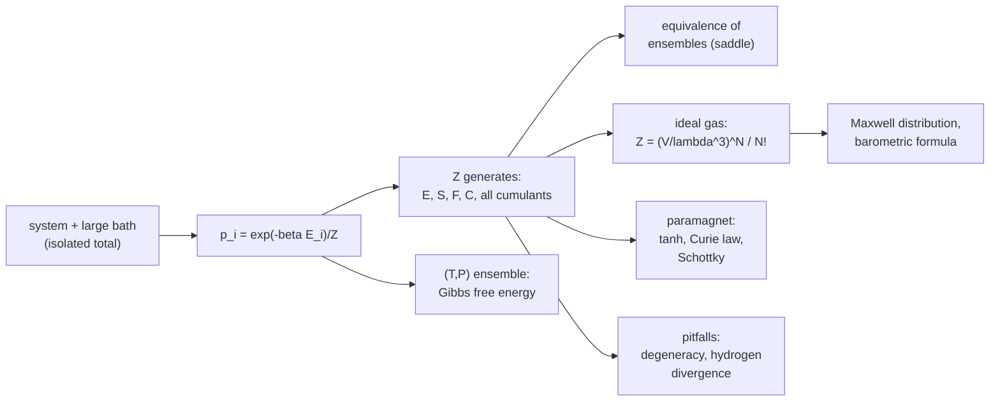

# SM03 · The Canonical Ensemble

◀ [[SM02 Phase Space Liouville and the Microcanonical Ensemble]] · [[Thermodynamics and Statistical Mechanics - Course Map|Course Map]] · next ▶ [[SM04 Kinetic Theory and the Boltzmann Equation]] (then SM05, planned: the grand canonical ensemble)

> [!info] Source and approach
> Follows **Kardar §4.6–4.8 (pp. 110–118)** ([[Mehran Kardar - Statistical Physics of Particles (2007).pdf#page=122|PDF p.122 ff.]]; PDF = printed + 12) and **Pathria and Beale Ch. 3** (printed pp. 39–90, §3.1–3.10; PDF = printed + 27, read by OCR: [[R. K. Pathria, Paul D. Beale - Statistical Mechanics (2011).pdf#page=66|PDF p.66 ff.]]). The barometric formula, the hydrogen-atom divergence and the exact Gamma law for the ideal-gas energy are my own additions (all numbers in `scripts/sm_numbers.py`; figure `scripts/fig_sm03.py`). It deepens the sketch in [[TH06 From Kinetic Theory to Statistical Mechanics]] §6 (which it does not replace). No course is behind this chapter: no taught/extra labels.

> [!tip] Start here (first read)
> - **The picture.** Real systems are not isolated: they sit in a room at a fixed temperature and exchange energy with it. A system in contact with a large **heat bath** takes each microstate $i$ with probability proportional to $e^{-E_i/k_BT}$ — a state of high energy is *exponentially* less likely because every joule it takes is a joule the bath no longer has, and the bath has $e^{\Delta S_R/k}$ fewer ways to arrange the rest. The sum of these weights, the **partition function** $Z$, is the single object from which every thermodynamic quantity follows by a derivative.
> - **What you need.** SM01 (cumulants, saddle point, relative entropy) and SM02 (microcanonical $S=k\ln\Omega$, $1/T=\partial S/\partial E$); the thermodynamic potentials of [[TH05 Potentials Maxwell Relations Stability and the Third Law]] ($F=E-TS$).
> - **How to read.** §1–§3 are the theory (derive; $Z$ as generating function; equivalence of ensembles). §4–§6 are four worked systems (ideal gas, atmosphere, paramagnet, hydrogen) that you should be able to reproduce. §7 is the $(T,P)$ version. Do Problems 1, 2 and 6 by hand.
> - **Notation.** $\beta=1/k_BT$; $Z=\sum_ie^{-\beta E_i}$; $F=-k_BT\ln Z$; $\lambda=h/\sqrt{2\pi mk_BT}$; $x=\mu_BB/k_BT$.

> [!key] After this chapter you can
> - **derive** $p_i=e^{-\beta E_i}/Z$ from the microcanonical postulate with a large reservoir,
> - obtain $\langle E\rangle$, $S$, $F$, $C_V$ and **all energy cumulants** from derivatives of $\ln Z$, and prove $F[q]-F=k_BT\,D(q\|p)\ge0$,
> - show **equivalence of ensembles** by the saddle point $Z=\int\mathrm dE\,\Omega(E)e^{-\beta E}$ and say when it fails,
> - solve the **classical ideal gas** exactly ($Z=(V/\lambda^3)^N/N!$) and the exact **Gamma distribution** of its energy,
> - derive the **Maxwell velocity distribution** and the **barometric formula** from the Boltzmann factor,
> - solve the **spin-½ paramagnet** (Curie law, saturation, Schottky heat capacity, cooling by demagnetisation),
> - explain why the **hydrogen atom's partition function diverges** and what cuts it off,
> - pass to the **$(T,P)$ ensemble** and compute volume fluctuations.

> [!intuition] The one-sentence story
> A small system in contact with a big one borrows energy from it; the cost of the loan is the Boltzmann factor, because the big system has fewer ways to arrange its remaining energy; summing the costs over all states gives $Z$, and the logarithm of $Z$ is the free energy.

*Concept map of the chapter.*

![[fig_sm03_canonical.png]]
*Figure SM3.1. A: the energy of $N$ ideal-gas atoms in a bath is Gamma-distributed; skewed for $N=10$, nearly Gaussian for $N=100$ (§3.2). B: the isothermal barometric formula against the standard atmosphere (§4.2). C: magnetisation of a spin-½ paramagnet, linear (Curie) at small $x$ and saturating at large $x$; dots are $B=1$ T at 300, 4.2 and 1 K (§5). D: the partial sums of the hydrogen-atom partition function grow without bound ($\propto n_{\max}^3$) unless cut off (§6).*

## 1. From the microcanonical to the canonical ensemble

Let a system $S$ with microstates $\mu$ and energies $E_\mu$ be in thermal contact with a **reservoir** $R$ much larger than $S$, with total energy $E$ shared and everything else fixed. The combined system is isolated, so by the postulate of SM02 all microstates of $S\cup R$ with $E_S+E_R=E$ are equally likely. The probability that $S$ is in the *particular* microstate $\mu$ is therefore proportional to the number of states of the reservoir compatible with it,
$$p(\mu)\propto\Omega_R(E-E_\mu)=\exp\Big[\frac{S_R(E-E_\mu)}{k_B}\Big].$$
Expand about $E_\mu=0$ (small compared with the total energy):
$$S_R(E-E_\mu)=S_R(E)-E_\mu\frac{\partial S_R}{\partial E}+\tfrac12E_\mu^2\frac{\partial^2S_R}{\partial E^2}-\dots=S_R(E)-\frac{E_\mu}T-\frac{E_\mu^2}{2T^2C_R}-\dots$$
using $\partial S_R/\partial E=1/T$ (SM02 §4.2) and $\partial^2S_R/\partial E^2=-1/T^2C_R$, with $C_R$ the heat capacity of the reservoir. For a large reservoir ($C_R\to\infty$) the second-order term is negligible and
$$\boxed{\ p(\mu)=\frac{e^{-\beta E_\mu}}{Z},\qquad Z(T,\{\text{parameters}\})=\sum_\mu e^{-\beta E_\mu}=\int\mathrm d\Gamma\,e^{-\beta\mathcal H(\mu)}\ }\qquad\beta=\frac1{k_BT}$$
([[Canonical Ensemble]], [[Boltzmann Distribution]]; [[Mehran Kardar - Statistical Physics of Particles (2007).pdf#page=122|K §4.6, p.110]]; PB §3.1–3.2). For a classical system the sum is the phase-space integral with the measure $\mathrm d\Gamma=\prod\frac{\mathrm d^3p\,\mathrm d^3q}{h^3}\frac1{N!}$ of SM02.

> [!intuition] Why a high-energy state is exponentially unlikely
> A state with energy $E_\mu$ leaves the bath $E-E_\mu$. The bath's entropy changes by $-E_\mu/T$, so the *number of bath states* that go with $\mu$ shrinks by $e^{-E_\mu/k_BT}$. The system does not "dislike" energy: it is the bath that has fewer ways to arrange itself, and the bath is where nearly all the microstates are. The temperature is the exchange rate between energy and logarithm-of-ways.

> [!pitfall] The sum is over **states**, not levels
> If a level $\epsilon_n$ has degeneracy $g_n$ then $Z=\sum_ng_ne^{-\beta\epsilon_n}$, and the probability that the system is *in the level* is $g_ne^{-\beta\epsilon_n}/Z$. A level with a larger energy but many more states can be more probable than the ground state: $F=E-TS$ is exactly this competition (§2.3, and again in the hydrogen atom of §6).

### 1.1 Three routes to the same distribution, and when it fails
The Boltzmann distribution can be reached by three independent arguments, which is why it is so robust:
1. **Reservoir** (above): the system's states are weighted by the number of reservoir states left over.
2. **Maximum entropy** ([[SM01 Probability Large Numbers and Information]] §7.7): maximise $S[p]=-\sum p\ln p$ at fixed $\sum p=1$ and fixed $\langle E\rangle=\sum pE$: the stationarity condition $-\ln p_i-1-\lambda_0-\beta E_i=0$ gives $p_i=e^{-\beta E_i}/Z$, with $\beta$ the Lagrange multiplier of the energy constraint and $S_{\max}=\ln Z+\beta\langle E\rangle$.
3. **Typicality and microcanonical marginals** ([[SM02 Phase Space Liouville and the Microcanonical Ensemble]] §3.2): one momentum (or one small subsystem) of an isolated system, uniformly distributed on its energy shell, is Boltzmann-distributed with $k_BT=\partial E/\partial S$; for a pure quantum state of the whole system chosen at random from the shell, a small subsystem is canonical with overwhelming probability (canonical typicality; quoted: Goldstein et al. 2006, Popescu–Short–Winter 2006).

**When it fails.** The distribution $e^{-\beta E_\mu}$ for the *system's own* Hamiltonian assumes the system–bath coupling is negligible next to the system's energy. For strong coupling (a molecule in a solvent, a protein) the exact statement is $\rho_S\propto\mathrm{Tr}_B\,e^{-\beta(H_S+H_B+H_{SB})}$, which defines a **Hamiltonian of mean force** $H^*_S$ (the potential of mean force of liquid-state theory) with $H^*_S\ne H_S$ and a *temperature-dependent* $H^*$. For small systems (a few particles) the ensembles are inequivalent and the energy fluctuates by order one (SM03 §3.2).

## 2. The partition function generates everything

### 2.1 Thermodynamics from $Z$
Write $\ln Z$ as a function of $\beta$ (and of the volume, field, and so on, through the energies $E_\mu$). The average energy and its fluctuation:
$$\langle E\rangle=\frac{\sum E_\mu e^{-\beta E_\mu}}{Z}=-\frac{\partial\ln Z}{\partial\beta},\qquad\mathrm{Var}(E)=\frac{\partial^2\ln Z}{\partial\beta^2}=-\frac{\partial\langle E\rangle}{\partial\beta}=k_BT^2\,C_V .$$
> [!key] $\ln Z$ is a cumulant generating function
> $\ln Z(\beta-s)-\ln Z(\beta)=\ln\langle e^{-sE}\rangle_\beta$ is the cumulant generating function $K(t)$ of SM01 §2 (with $t=-s$) for the energy in the canonical distribution at $\beta$. All energy cumulants are therefore derivatives of $\ln Z$:
> $$\boxed{\ \kappa_n(E)=(-1)^n\frac{\partial^n\ln Z}{\partial\beta^n}\ }\qquad\kappa_1=\langle E\rangle,\ \ \kappa_2=k_BT^2C_V,\ \ \kappa_3=\dots$$
> and the cumulants of the *sum* of independent subsystems add because $\ln Z$ does (§2.4): the central limit theorem of SM01 §4 is the statement that the energy of a large system is Gaussian with $\kappa_n\propto N$.

The **entropy** is Gibbs's $S=-k_B\sum p_\mu\ln p_\mu$ (SM01 §7.2); substituting $\ln p_\mu=-\beta E_\mu-\ln Z$,
$$S=k_B\beta\langle E\rangle+k_B\ln Z\quad\Longleftrightarrow\quad\boxed{\ F=\langle E\rangle-TS=-k_BT\ln Z\ }$$
the **Helmholtz free energy** ([[Helmholtz Free Energy]], [[Partition Function]]). Then $S=-\partial F/\partial T$, $P=-\partial F/\partial V$, $\mu=\partial F/\partial N$, $C_V=-T\,\partial^2F/\partial T^2$ and $\langle E\rangle=\partial(\beta F)/\partial\beta$ are all the thermodynamic relations of [[TH05 Potentials Maxwell Relations Stability and the Third Law]] derived in one line from $\ln Z$. The entropy of the *canonical* distribution agrees with the microcanonical one for large $N$ (§3).

### 2.2 The free energy is a minimum: relative entropy
For any trial distribution $q_\mu$ over the same states define $F[q]=\sum_\mu q_\mu E_\mu+k_BT\sum_\mu q_\mu\ln q_\mu=\langle E\rangle_q-TS[q]$. Then
$$\boxed{\ F[q]-F=k_BT\,D(q\,\|\,p)\ \ge0\ }$$
with $D$ the relative entropy of SM01 §7.3 and $p$ the Boltzmann distribution. *Proof.* $\ln p_\mu=-\beta E_\mu-\ln Z$, so $D(q\|p)=\sum q\ln q+\beta\langle E\rangle_q+\ln Z=\beta\big(F[q]-F\big)$. $\square$ Hence **the canonical distribution minimises $F[q]$**, the statistical version of "$F$ is minimised in equilibrium at fixed $T$" ([[TH05 Potentials Maxwell Relations Stability and the Third Law]] §2), with the cost of a wrong guess measured in bits. This variational principle is the basis of every approximation scheme in Part II (mean-field theory, SM17, is a minimisation of $F[q]$ over product distributions).

### 2.3 Energy versus entropy
Collect states by energy: $Z=\int\mathrm dE\,\Omega(E)e^{-\beta E}=\int\mathrm dE\,e^{-\beta[E-TS(E)]}$ with $S(E)=k_B\ln\Omega$. The integrand is the product of a rapidly *growing* function of $E$ (the number of states) and a rapidly *falling* one (the Boltzmann factor); it peaks where they balance. At low $T$ the exponential wins and the system sits in the ground state; at high $T$ entropy wins. The location of the peak is the average energy, and the free energy $F=\min_E[E-TS(E)]$ is the competition made quantitative.

### 2.4 Independent subsystems and indistinguishable particles
If $E_\mu=E_a+E_b$ with independent $a$, $b$ then $Z=Z_aZ_b$, $F=F_a+F_b$, and all cumulants add. For $N$ **distinguishable**, non-interacting particles each with single-particle partition function $z$: $Z=z^N$. For **indistinguishable** classical particles (dilute) the Gibbs correction applies: $Z=z^N/N!$ (SM02 §7).

### 2.5 The quantum form: $Z=\mathrm{Tr}\,e^{-\beta\hat H}$
For a quantum system the canonical state is the **density matrix** $\hat\rho=e^{-\beta\hat H}/Z$ with $Z=\mathrm{Tr}\,e^{-\beta\hat H}=\sum_ie^{-\beta E_i}$ (the trace is basis independent, so it may be evaluated in *any* basis, not only the energy basis) and $\langle\hat A\rangle=\mathrm{Tr}(\hat\rho\hat A)$. It is the stationary solution of the von Neumann equation $\partial_t\hat\rho=-\tfrac i\hbar[\hat H,\hat\rho]$ (the quantum Liouville equation, SM02 §2) and the maximiser of $S=-k_B\mathrm{Tr}\,\hat\rho\ln\hat\rho$ at fixed $\langle\hat H\rangle$. All of §2.1 goes through with $\sum_i\to\mathrm{Tr}$. For independent subsystems $Z=Z_aZ_b$ (the density matrix is a tensor product). The classical $Z$ is its limit when $\hbar\to0$: the quantum oscillator has $z_q=1/\big(2\sinh\tfrac x2\big)$ against the classical $z_c=1/x$ ($x=\hbar\omega/k_BT$), $z_q/z_c=1-x^2/24+\dots$ (recomputed: $0.9996$ at $x=0.1$, $0.9595$ at $x=1$, $0.7045$ at $x=3$), so the classical result is right to a percent for $k_BT>3\hbar\omega$ and wrong by a factor $x$ in the free energy per mode when $x\gg1$ (the zero-point and frozen modes of [[QM05 The Harmonic Oscillator]]; Fig. SM3.2C).

### 2.6 Static fluctuation–response relations; stability
Let the Hamiltonian depend on a parameter, $\hat H(\lambda)=\hat H_0-\lambda\hat B$ ($\lambda$ a field, $B$ the conjugate extensive observable). If $\hat B$ commutes with $\hat H_0$ (always so classically),
$$\frac{\partial\langle B\rangle}{\partial\lambda}=\beta\,\big\langle(\delta B)^2\big\rangle=\beta\big(\langle B^2\rangle-\langle B\rangle^2\big)\ \ge0 .$$
*Proof:* $\ln Z(\beta,\lambda)$ is a cumulant generating function in the variable $\beta\lambda$: $\partial_\lambda\ln Z=\beta\langle B\rangle$ and $\partial_\lambda^2\ln Z=\beta^2\mathrm{Var}(B)$; divide by $\beta$. So **the response of a quantity to its conjugate field is its equilibrium variance**: $\chi=\beta\,\mathrm{Var}(M)/V$ for the magnetic susceptibility, $C_V=\mathrm{Var}(E)/k_BT^2$ (the "field" is $-\beta$ and the conjugate variable is $E$), $\kappa_T=\mathrm{Var}(V)/(k_BT\langle V\rangle)$ in the $(T,P)$ ensemble (§7). Because they are variances, **$\chi\ge0$, $C_V\ge0$, $\kappa_T\ge0$: the stability conditions of thermodynamics ([[Thermodynamic Stability]]) follow from the canonical distribution itself.** (If $\hat B$ does not commute with $\hat H_0$ the left side is the Kubo–Mori susceptibility, still $\ge0$ and $\le\beta\langle\delta B^2\rangle$; see SM25, planned.)

> [!example] The paramagnet (recomputed)
> $M=N\mu\tanh x$ gives $\partial M/\partial B=N\mu^2\beta\,\mathrm{sech}^2x$; the variance of $M=\mu\sum\sigma_i$ for independent spins is $N\mu^2(1-\tanh^2x)=N\mu^2\mathrm{sech}^2x$ ✓ (at $x=0.5$: $\mathrm{sech}^2x=0.7864$ in both). At high $T$ the variance is $N\mu^2$ (free spins) and $\chi\to N\mu^2/k_BT$, the Curie law: *the magnetic susceptibility is the fluctuation of the magnetisation*.

## 3. Equivalence of ensembles and the energy distribution

### 3.1 The saddle point
$Z(\beta)=\int\mathrm dE\,\Omega(E)\,e^{-\beta E}$ is the **Laplace transform** of the density of states. With $\Omega=e^{S/k_B}$ and $S$ extensive, SM01 §5.2 applies: the integrand is $e^{N\varphi}$ with $N\varphi(E)=S(E)/k_B-\beta E$, stationary at $\partial S/\partial E=1/T$, i.e. at $E^*=\langle E\rangle$, and
$$\ln Z=\frac{S(E^*)}{k_B}-\beta E^*+O(\ln N)\quad\Longleftrightarrow\quad F=E^*-TS(E^*)+O(k_BT\ln N).$$
So **$F(T)$ is the Legendre transform of $E-TS$** ([[Legendre Transform]]; [[TH05 Potentials Maxwell Relations Stability and the Third Law]]), and the thermodynamics from $\ln Z$ coincides with that from $\ln\Omega$ to leading order in $N$. This is the **equivalence of ensembles** ([[Equivalence of Ensembles]]). The width of the peak is $\delta E=\sqrt{k_BT^2C_V}\propto\sqrt N$, i.e. $\delta E/E\sim1/\sqrt N$: a canonical system has an energy as sharp as an isolated one.

> [!pitfall] When ensembles are *not* equivalent
> Equivalence needs $S(E)$ concave (positive $C_V$) and short-range interactions. **(i)** At a **first-order transition** the integrand has two peaks and the canonical $E$ distribution is bimodal: the microcanonical $S(E)$ has a convex dip (the latent heat is the width of the gap); **(ii)** for **long-range** (gravitational) interactions the microcanonical $C_V$ can be negative, which a system in a bath cannot have (stability); stars and globular clusters are the known examples (SM27, planned).

### 3.2 Energy of an ideal gas: an exact Gamma law
For $N$ ideal-gas atoms in a bath, $\Omega(E)\propto E^{3N/2-1}$ (SM02 §6), so the energy density in the canonical ensemble is
$$p(E)\propto E^{3N/2-1}e^{-\beta E}\ \Longrightarrow\ \boxed{\ E\sim\mathrm{Gamma}\big(\text{shape }k=\tfrac{3N}2,\ \text{scale }k_BT\big)\ }$$
exactly. The cumulants follow from $\ln Z=-\tfrac{3N}2\ln\beta+\text{const}$ and the formula of §2.1: $\kappa_n(E)=\tfrac{3N}2(n-1)!\,(k_BT)^n$. Hence

$$\langle E\rangle=\tfrac{3N}2k_BT,\quad\mathrm{Var}E=\tfrac{3N}2(k_BT)^2,\quad\text{skewness}=\frac2{\sqrt k}=\sqrt{\frac8{3N}},\quad\text{excess kurtosis}=\frac6k=\frac4N .$$

> [!example] Skewness and tails (recomputed; Fig. SM3.1A)
> | $N$ | $\sigma_E/\langle E\rangle$ | skewness | excess kurtosis |
> |---|---|---|---|
> | 10 | 0.258 | 0.516 | 0.400 |
> | 100 | 0.0816 | 0.163 | 0.0400 |
> | 1000 | 0.0258 | 0.0516 | 0.0040 |
> | $10^{23}$ | $2.6\times10^{-12}$ | $5\times10^{-12}$ | $4\times10^{-23}$ |
>
> The tail beyond $+3\sigma$: Gaussian $1.35\times10^{-3}$; Gamma for $N=100$: $2.46\times10^{-3}$ (1.8 times); for $N=10$: $5.6\times10^{-3}$ (4 times). On the low side the Gamma tail is *thinner*: $5.6\times10^{-4}$ at $N=100$ below $-3\sigma$. The CLT of SM01 holds, but slowly in the tails. For $N=10^{23}$ the distribution is Gaussian to $10^{-12}$ and "the energy is $\tfrac32Nk_BT$" is an exact statement for all practical purposes.

### 3.3 The thermodynamic limit and small systems
The free energy is extensive in a precise sense (**van Hove**, quoted): for stable, tempered interactions the limit $f(T,v)=\lim_{N\to\infty}F/N$ at fixed $v=V/N$ exists, is independent of the shape of the container, and is convex in $v$; this is what makes the thermodynamics of SM02–SM03 well defined. For *finite* $N$ the ensembles differ at order $1/N$ (cumulants of $E$: the Gamma law of §3.2, skewness $\sqrt{8/3N}$), and for tiny systems the energy distribution of the canonical ensemble has real width: the **fluctuation theorems** and the thermodynamics of small systems (SM31, planned) live in that regime.

## 4. Classical systems: ideal gas, velocities, atmosphere

### 4.1 The ideal gas
$Z=\dfrac1{N!}\Big[\int\dfrac{\mathrm d^3p\,\mathrm d^3q}{h^3}e^{-\beta p^2/2m}\Big]^N=\dfrac1{N!}\Big(\dfrac V{\lambda^3}\Big)^N$ with $\lambda=h/\sqrt{2\pi mk_BT}$ (a Gaussian integral for each of the three momentum components: $\int\mathrm dp\,e^{-\beta p^2/2m}=\sqrt{2\pi mk_BT}$). Then with Stirling:
$$F=-Nk_BT\Big[\ln\frac V{N\lambda^3}+1\Big],\quad P=-\frac{\partial F}{\partial V}=\frac{Nk_BT}V,\quad\mu=\frac{\partial F}{\partial N}=k_BT\ln(n\lambda^3),\quad S=Nk_B\Big[\ln\frac V{N\lambda^3}+\frac52\Big].$$
**$S$ is the Sackur–Tetrode entropy of SM02 §6**, now from a much shorter calculation (equivalence of ensembles), and $E=-\partial_\beta\ln Z=\tfrac32Nk_BT$ ([[Sackur-Tetrode Equation]], [[Thermal Wavelength]]).

> [!example] The chemical potential of nitrogen (recomputed)
> For N$_2$ at 300 K and 1 atm: $\lambda=0.0190$ nm, $n\lambda^3=1.69\times10^{-7}$, so $\mu=k_BT\ln(n\lambda^3)=-15.59\,k_BT=-0.403$ eV $=-38.9$ kJ mol$^{-1}$ (measured from the zero of the translational energy). $\mu<0$ and large in units of $k_BT$ is the signature of a *dilute* gas: adding a molecule costs entropy ($\ln(n\lambda^3)\ll0$ is $-\Delta S/k_B$ per molecule). The same $\mu(T,P)=\mu_0+k_BT\ln(P/P_0)$ of [[TH05 Potentials Maxwell Relations Stability and the Third Law]] follows.

### 4.2 The Maxwell velocity distribution and the barometric formula
In $\mathcal H=\sum\mathbf p_i^2/2m+U(\{\mathbf q\})$ the momenta and positions factorise, so **the probability of a single particle's momentum** is $p(\mathbf p)\propto e^{-p^2/2mk_BT}$: three independent Gaussians of variance $mk_BT$ (the joint Gaussian of SM01 §4.2 with $C_{mn}=mk_BT\,\delta_{mn}$). Changing to the speed gives the Maxwell speed law of [[TH06 From Kinetic Theory to Statistical Mechanics]] §2: $f(v)=4\pi(m/2\pi k_BT)^{3/2}v^2e^{-mv^2/2k_BT}$ ([[Maxwell-Boltzmann Distribution]]). *This holds for any interaction potential $U$*, because the kinetic energy is quadratic and separate: the velocities of molecules in a liquid are Maxwellian too.

The **positions** are distributed by $e^{-\beta U}$. For a uniform gravitational field $U=mgz$ the density of an ideal gas (independent particles) is
$$\boxed{\ n(z)=n(0)\,e^{-mgz/k_BT}=n(0)\,e^{-z/H},\qquad H=\frac{k_BT}{mg}=\frac{RT}{Mg}\ }$$
the **barometric formula** ([[Barometric Formula]]; the scale height of [[Scale Height]] and [[CL06 Hydrostatic Balance and Vertical Structure]], here derived from the Boltzmann factor rather than from $\mathrm dP=-\rho g\,\mathrm dz$).

> [!example] The isothermal atmosphere (recomputed; Fig. SM3.1B)
> For air ($\bar m=28.9647$ u): $H=8.43$ km at 288.15 K, $7.46$ km at 255 K, $6.44$ km at 220 K. The pressure falls to a half at $z=H\ln2=5.85$ km (288 K). At 5.5 km $p/p_0=0.521$ (isothermal 288 K), $0.479$ (255 K), against $0.498$ in the standard atmosphere (6.5 K km$^{-1}$ lapse rate). At 10 km: $0.306$, $0.262$ against $0.261$ (standard); at the summit of Everest (8849 m): 31.0 kPa for $T=255$ K (isothermal), 35.5 kPa for 288 K, 31.4 kPa standard. The isothermal formula with $T\approx$ the *mean* tropospheric temperature (255 K, [[CL03 Radiation and Planetary Energy Balance]]) is within a few per cent of the real $p(z)$; the difference with the 288 K curve is the effect of the lapse rate.
>
> **Each species has its own scale height**: $H=5.55$ km for CO$_2$, $8.72$ km for N$_2$, $61$ km for He, $121$ km for H$_2$ (288 K). In true equilibrium the O$_2$:N$_2$ ratio would fall with height as $\exp[-(m_{O_2}-m_{N_2})gz/k_BT]$, to $0.196$ of its sea-level value at 100 km. The real atmosphere is **well mixed** up to $\sim100$ km because turbulence beats gravitational settling; above the turbopause the scale heights separate and light gases dominate (H, He escape: [[TH06 From Kinetic Theory to Statistical Mechanics]] §2).

> [!connection] Climate: the Boltzmann factor in the sky
> $n(z)\propto e^{-z/H}$ and the Maxwell tail $e^{-mv^2/2kT}$ are the *same* Boltzmann factor: $E=mgz$ or $\tfrac12mv^2$. Thermodynamic equilibrium is a competition of energy against entropy at every height. The **hydrostatic** structure of [[CL06 Hydrostatic Balance and Vertical Structure]] (pressure scale height, hypsometric equation) and the Rayleigh scale heights of [[CL07 Optical Properties of the Atmosphere]] are consequences.

### 4.3 Solids: the classical harmonic crystal and the Einstein model
A crystal of $N$ atoms near equilibrium has $\mathcal H=\sum_{j=1}^{3N}\big(\tfrac{p_j^2}{2m}+\tfrac12m\omega_j^2q_j^2\big)$ in normal coordinates ($3N$ independent oscillators; the harmonic approximation of SM10, planned). Classically each $z_j=k_BT/\hbar\omega_j$ and $\langle E\rangle=3Nk_BT$, so
$$C_V=3Nk_B=3R=24.94\ \mathrm{J\,mol^{-1}K^{-1}}\qquad\text{(Dulong–Petit)},$$
independent of the frequencies (equipartition, [[Equipartition of Energy]]). Room-temperature solids are close: Cu $24.4$, Al $24.2$, Au $25.4$, Pb $26.4$ J mol$^{-1}$K$^{-1}$ (recalled; $C_p>C_V$ by anharmonicity and thermal expansion), but **diamond has $6.1$** — a *quantum* effect.

With the quantum oscillator of §2.5 and a single frequency (**Einstein's model**, 1907; $\theta_E=\hbar\omega/k_B$):
$$\langle E\rangle=3N\hbar\omega\Big(\tfrac12+\frac1{e^{\theta_E/T}-1}\Big),\qquad\frac C{3Nk_B}=\Big(\frac{\theta_E}T\Big)^2\frac{e^{\theta_E/T}}{(e^{\theta_E/T}-1)^2}$$
(compare the heat capacity of the CO$_2$ bend in [[TH06 From Kinetic Theory to Statistical Mechanics]] §6). Recomputed: $C/3Nk_B=0.0045,\ 0.171,\ 0.426,\ 0.724,\ 0.921,\ 0.979,\ 0.997$ at $T/\theta_E=0.1,\ 0.2,\ 0.3,\ 0.5,\ 1,\ 2,\ 5$: equipartition is reached only for $T\gtrsim\theta_E$ and the heat capacity **vanishes exponentially** as $T\to0$ ($\propto e^{-\theta_E/T}$), in agreement with the third law. For diamond $\theta_E\approx1300$ K (a *fit*, not a prediction) gives $C=6.2$ J mol$^{-1}$K$^{-1}$ at 298 K against $6.1$ measured: the vibrations are largely frozen at room temperature (Fig. SM3.2B). Real solids have a *spectrum* of frequencies and an observed $T^3$ law at low $T$ rather than the exponential: the **Debye model** (SM10, planned).

![[fig_sm03b_response.png]]
*Figure SM3.2. A: Brillouin functions for $J=\tfrac12,\ 1,\ \tfrac72$ against the Langevin limit (§5.1); the point is Gd$^{3+}$ at 5 T and 2 K. B: the Einstein heat capacity rises from zero to the Dulong–Petit value; diamond at 298 K sits on the steep part (§4.3). C: the quantum oscillator's mean energy against equipartition (§2.5).*

## 5. The spin-½ paramagnet

$N$ non-interacting, distinguishable magnetic moments, each with energy $\mp\mu_BB$ ($\mu_B=9.274\times10^{-24}$ J T$^{-1}$; the Zeeman energy of an electron spin with $g=2$) [[Mehran Kardar - Statistical Physics of Particles (2007).pdf#page=125|K §4.7, p.113]]; PB §3.9–3.10. One-spin partition function $z=e^{x}+e^{-x}=2\cosh x$ with $x=\mu_BB/k_BT$, and $Z=z^N$ (distinguishable: located on lattice sites). Then
$$\boxed{\ M=N\mu_B\tanh x,\qquad E=-N\mu_BB\tanh x,\qquad\frac S{Nk_B}=\ln(2\cosh x)-x\tanh x,\qquad\frac C{Nk_B}=\frac{x^2}{\cosh^2x}\ }$$
([[Curie Law]]; [[Schottky Anomaly]]). Limits: $x\ll1$ (high $T$): $M\simeq N\mu_B^2B/k_BT$, the **Curie law** $\chi\propto1/T$; $x\gg1$ (low $T$): $M\to N\mu_B$ (saturation), $S\to0$ (third law). It is the two-level system of SM02 with $\varepsilon=2\mu_BB$, $x=\varepsilon/2k_BT$.

> [!example] Numbers (recomputed; Fig. SM3.1C)
> | $B$ | $T$ | $x$ | $M/N\mu_B=\tanh x$ |
> |---|---|---|---|
> | 1 T | 300 K | 0.00224 | 0.00224 |
> | 1 T | 4.2 K | 0.160 | 0.1586 |
> | 1 T | 1 K | 0.672 | 0.586 |
> | 1 T | 0.1 K | 6.72 | 0.99999 |
>
> Molar saturation magnetisation $N_A\mu_B=5.585$ J T$^{-1}$mol$^{-1}$. Curie constant per mole (SI) $\mu_0N_A\mu_B^2/k_B=4.714\times10^{-6}$ K m$^3$mol$^{-1}$, i.e. $0.3751$ emu K mol$^{-1}$ (the textbook value 0.375 for $g=2$, $S=\tfrac12$); $\chi_{\rm mol}(300\ \mathrm K)=1.57\times10^{-8}$ m$^3$mol$^{-1}$. **Schottky anomaly:** $C/Nk_B$ has a maximum $0.4392$ at $x_\varepsilon=\varepsilon/k_BT=2.3994$, so for $B=1$ T ($\varepsilon=2\mu_BB$) the peak is at $T=0.56$ K, for $B=5$ T at $2.8$ K: a bump in the specific heat of any system with a gap, a thermodynamic fingerprint of the two-level structure. Consistency check: at $x=0.5$ ($\varepsilon/k_BT=1$) $S/Nk_B=0.5822$ and $C/Nk_B=0.1966$, **the same numbers as the two-level system in TH06 §6** ✓.

> [!connection] Adiabatic demagnetisation (cooling below 1 K)
> $S$ depends on $B/T$ only. Magnetise isothermally (entropy falls, heat leaves), insulate, then lower $B$ slowly: $S$ is fixed, so $B/T$ is fixed and $T$ falls in proportion to $B$ ([[Adiabatic Demagnetisation]]). Paramagnetic salts reach millikelvin temperatures; nuclear demagnetisation reaches microkelvin. It is the quantitative content of "the third law forbids reaching $T=0$": $S(B/T)\to0$ only as $B/T\to\infty$.

> [!pitfall] Indistinguishability matters for a gas, not for a lattice
> Spins on sites are distinguishable by position, so $Z=z^N$ with **no** $N!$; for a gas of atoms $Z=z^N/N!$. Mixing the two up changes $S$ by $k_B\ln N!$.

### 5.1 Beyond spin ½: Brillouin and Langevin
For an atom with total angular momentum $J$ and Landé factor $g$, the levels in a field are $E_m=-g\mu_BBm$, $m=-J,\dots,J$. A geometric sum gives
$$Z_1=\sum_{m=-J}^{J}e^{y m/J}=\frac{\sinh\frac{(2J+1)y}{2J}}{\sinh\frac y{2J}},\qquad y=\frac{gJ\mu_BB}{k_BT},\qquad\boxed{\ M=Ng\mu_BJ\,\mathcal B_J(y),\quad\mathcal B_J(y)=\frac{2J+1}{2J}\coth\frac{(2J+1)y}{2J}-\frac1{2J}\coth\frac y{2J}\ }$$
(the **Brillouin function**). Limits: $J=\tfrac12$: $\mathcal B_{1/2}=\tanh y$ (§5); small $y$: $\mathcal B_J\simeq\frac{J+1}{3J}y$, i.e. $M\simeq Ng^2J(J+1)\mu_B^2B/3k_BT$ (Curie constant $\propto g^2J(J+1)$); $J\to\infty$ with $gJ\mu_B=\mu$ fixed: the **Langevin function** $L(y)=\coth y-1/y$ of **classical dipoles** of moment $\mu$ (there $Z_1=4\pi\sinh y/y$ from integrating $e^{y\cos\theta}$ over the sphere; $L\simeq y/3-y^3/45$).

> [!example] A paramagnetic salt (recomputed; Fig. SM3.2A)
> Gd$^{3+}$ ($J=\tfrac72$, $g=2$; saturation $7\mu_B$) at $B=5$ T, $T=2$ K: $x=\mu_BB/k_BT=1.679$, $y=gJx=11.76$ and $M/M_{\rm sat}=\mathcal B_{7/2}(y)=0.990$. The classical Langevin curve with the *same* saturation moment gives $0.915$: the discreteness of $m$ matters (and Henry's 1952 measurements on Gd sulphate followed the Brillouin curve; recalled). The Curie constant of Gd$^{3+}$ is $g^2J(J+1)=63$ against $3$ for spin ½ (21 times larger): large-$J$ salts are the working substances of **adiabatic demagnetisation** ([[Adiabatic Demagnetisation]]).

## 6. A cautionary tale: the hydrogen atom's partition function diverges

The bound states of hydrogen have $E_n=-13.6\ \mathrm{eV}/n^2$ with degeneracy $g_n=2n^2$ (spin of the electron; ignore fine structure, nuclear spin). Then, measured from the ground state,
$$Z=\sum_{n=1}^\infty2n^2\exp\Big[-\beta\,13.6\ \mathrm{eV}\Big(1-\frac1{n^2}\Big)\Big]\ \xrightarrow{\ n\to\infty\ }\ \sum2n^2e^{-\beta\cdot13.6\ \mathrm{eV}}=\infty .$$
**Each term tends to a constant times $n^2$: the sum diverges as $n_{\max}^3$** (Fig. SM3.1D). The isolated atom in infinite space has infinitely many states of nearly the same energy (the series of Rydberg levels accumulates at the ionisation limit) and the probability of the ground state is "$2/Z=0$": nonsense. This is a *warning* about "sum over all states" without checking convergence.

> [!example] How the divergence is resolved (recomputed)
> Partial sums, relative to the ground-state weight 2: at $T=5800$ K ($k_BT=0.50$ eV) the sum is $2.000$ up to $n_{\max}=45$, $2.001$ at $10^3$, $3.0$ at $10^4$, $1006$ at $10^5$; at $10^4$ K it is $2.009$ at 45, $95$ at $10^3$, $9\times10^4$ at $10^4$. In a real gas or plasma an orbital of radius $\approx n^2a_0$ cannot exceed the *distance to the neighbours*: at $n_H=10^{20}$ m$^{-3}$ the mean spacing is $r=215$ nm and $n_{\max}\approx\sqrt{r/2a_0}=45$. Then $Z=2.009$ at $10^4$ K and the ground state holds $99.55\%$ of the atoms; the first excited level $n=2$ holds $2.9\times10^{-5}$. At $T=5800$ K the Boltzmann ratio of the $n=2$ to $n=1$ populations is $4e^{-10.2\ \mathrm{eV}/k_BT}=5.4\times10^{-9}$, yet the Balmer lines (absorption *from* $n=2$) are among the strongest in the solar spectrum, because the column of hydrogen above the photosphere is enormous. The proper treatment includes **ionisation** (the continuum) and gives the *Saha equation*, which needs a particle-exchanging ensemble (SM05, planned).

## 7. The $(T,P)$ ensemble

For a system in contact with a bath of fixed $T$ **and** $P$ (a piston, a flexible wall), the system's volume fluctuates and the weight of state $(\mu,V)$ is $e^{-\beta(E_\mu+PV)}$ ([[Gibbs Canonical Ensemble]]; K §4.8, p.115; PB §4.6):
$$\mathcal Z_G(T,P,N)=\frac1{V_0}\int_0^\infty\mathrm dV\,e^{-\beta PV}Z(T,V,N),\qquad G(T,P,N)=-k_BT\ln\mathcal Z_G$$
($V_0$ an arbitrary unit of volume making $\mathcal Z_G$ dimensionless), and $\langle V\rangle=-\partial\ln\mathcal Z_G/\partial(\beta P)$, $\mathrm{Var}(V)=k_BT\,\langle V\rangle\kappa_T$ with $\kappa_T=-\frac1V\partial_PV$ ([[Gibbs Free Energy]]). The enthalpy $H=E+PV$ is the energy that appears.

> [!example] Ideal gas (exact and recomputed)
> $Z=V^N/(N!\lambda^{3N})$ gives $\int\mathrm dV\,V^Ne^{-\beta PV}=N!/(\beta P)^{N+1}$, so $\mathcal Z_G\propto(k_BT/P)^{N+1}$, $\langle V\rangle=(N+1)k_BT/P$ and $\mathrm{Var}V=(N+1)(k_BT/P)^2$: **relative fluctuation $1/\sqrt{N+1}$** (3.2 % for $N=1000$, $10^{-11.5}$ for a mole). $G=-k_BT\ln\mathcal Z_G=N\mu$ per particle, consistent with [[Gibbs-Duhem Relation]]. The compressibility form $\mathrm{Var}V=k_BTV\kappa_T$ is the same density-fluctuation formula as SM01 §3 (with $\kappa_T=1/P$).

> [!pitfall] Four traps
> 1. **$p_i\propto e^{-\beta E_i}$ is for states.** Levels carry $g_i$; classical integrals carry $N!$ and $h^{3N}$ (SM02). 
> 2. **A bath is large *and* weakly coupled.** If the system–bath interaction is comparable to the system's own energy, "$E_\mu$ is the energy of the system alone" fails (strong coupling needs the potential of mean force).
> 3. **Equipartition and $Z$ factorise only for independent, quadratic terms.** Anharmonic and interacting systems have corrections of order $1/N$ (SM14, planned).
> 4. **Do not average $e^{-\beta E}$ over a distribution of states and forget the Jacobian.** $Z=\int\Omega(E)e^{-\beta E}\mathrm dE$ needs the density of states, not just the energy range.

## Map of this chapter
> [!connection] How SM03 connects
> **Builds on:** [[SM01 Probability Large Numbers and Information]] (cumulants, saddle point, relative entropy), [[SM02 Phase Space Liouville and the Microcanonical Ensemble]] ($\Omega$, $T$, ideal gas), [[TH05 Potentials Maxwell Relations Stability and the Third Law]], [[TH06 From Kinetic Theory to Statistical Mechanics]] §6 (the sketch of the same ensemble).
> **Leads to:** SM05 (grand canonical, chemical equilibrium, Saha; planned), SM07 (equipartition, virial theorem, magnetic work; planned), SM09–SM11 (rotations, phonons, photons: $Z$ for quantum modes), SM14 (cumulant expansion of $Z$ for interacting gases; planned), SM17 (variational $F[q]$; planned).
> **Concepts:** [[Boltzmann Distribution]] · [[Canonical Ensemble]] · [[Partition Function]] · [[Equivalence of Ensembles]] · [[Helmholtz Free Energy]] · [[Gibbs Canonical Ensemble]] · [[Barometric Formula]] · [[Curie Law]] · [[Schottky Anomaly]] · [[Adiabatic Demagnetisation]] · [[Partition Function of the Hydrogen Atom]] · [[Thermal Wavelength]] · [[Maxwell-Boltzmann Distribution]] · [[Relative Entropy]] · [[Cumulant]]
> **More concepts (added with the deepening, 2026-10-30):** [[Brillouin Function]] · [[Langevin Function]] · [[Dulong-Petit Law]] · [[Fluctuation-Response Relation]] · [[Maximum Entropy Principle]]; next: [[SM04 Kinetic Theory and the Boltzmann Equation]]
> **Other subjects:** [[CL06 Hydrostatic Balance and Vertical Structure]], [[CL03 Radiation and Planetary Energy Balance]], [[Scale Height]] (Climate); [[Gaussian Integral]], [[Jensen Inequality]] (Foundations/Probability); [[QM05 The Harmonic Oscillator]] (the quantum oscillator $z$).

## Summary
> [!summary] Cheat-sheet
> - **Boltzmann:** $p_\mu=e^{-\beta E_\mu}/Z$, $Z=\sum_\mu e^{-\beta E_\mu}=\int\mathrm dE\,\Omega e^{-\beta E}$; levels: $\sum g_ne^{-\beta\epsilon_n}$; classical: $\int\mathrm d\Gamma$ with $\frac1{N!h^{3N}}$.
> - **Generating function:** $F=-kT\ln Z$; $\langle E\rangle=-\partial_\beta\ln Z$; $\kappa_n(E)=(-1)^n\partial_\beta^n\ln Z$; $\mathrm{Var}E=kT^2C_V$; $S=k\ln Z+\langle E\rangle/T$; $F[q]-F=kT\,D(q\|p)\ge0$.
> - **Equivalence:** saddle at $\partial_ES=1/T$; $\delta E/E\sim1/\sqrt N$; fails for first-order transitions and long-range forces.
> - **Ideal gas:** $Z=(V/\lambda^3)^N/N!$; $\mu=kT\ln n\lambda^3$; $E\sim$ Gamma$(3N/2,kT)$: skewness $\sqrt{8/3N}$, excess kurtosis $4/N$.
> - **Maxwell and barometric:** momenta Gaussian with variance $mkT$ for *any* interaction; $n(z)=n_0e^{-z/H}$, $H=kT/mg=8.43$ km (288 K, air), CO$_2$ 5.55 km, He 61 km.
> - **Paramagnet:** $Z=(2\cosh x)^N$, $M=N\mu\tanh x$, $S/Nk=\ln2\cosh x-x\tanh x$, $C/Nk=x^2\operatorname{sech}^2x$ (peak $0.4392$ at $\varepsilon/kT=2.399$); Curie constant $0.375$ emu K/mol.
> - **Hydrogen:** $Z=\sum2n^2e^{-\beta(E_n-E_1)}\to\infty$ as $n_{\max}^3$; cutoff $n_{\max}\approx45$ at $10^{20}$ m$^{-3}$; $n=2/n=1$ ratio $5.4\times10^{-9}$ at 5800 K.
> - **$(T,P)$:** $\mathcal Z_G=\int\mathrm dV\,e^{-\beta PV}Z$; $G=-kT\ln\mathcal Z_G$; $\mathrm{Var}V=kTV\kappa_T$; ideal gas $\mathrm{Var}V/V^2=1/(N+1)$.

## Practice
1. **Paramagnet and two-level.** Evaluate $\tanh x$, $S/Nk_B$ and $C/Nk_B$ for the spin-½ paramagnet at $x=\mu_BB/k_BT=0.5$ and show that $S$ and $C$ equal those of a two-level system at $\varepsilon/k_BT=1$ (energy gap $\varepsilon=2\mu_BB$).
2. **Cumulants.** Show that the energy of $N$ classical 1-D harmonic oscillators in a bath has $\ln Z=-N\ln(\beta\hbar\omega)$, $\langle E\rangle=Nk_BT$, $\kappa_n=N(n-1)!(k_BT)^n$. What is the distribution of the energy of one oscillator, and $P(E>3k_BT)$?
3. **Atmosphere.** Compute the isothermal pressure at the summit of Everest (8849 m) for $T=255$ K and 288.15 K and compare with the standard atmosphere value 31.4 kPa; give $H$ for N$_2$ at 288.15 K.
4. **Ideal-gas $\mu$.** Derive $\mu=k_BT\ln(n\lambda^3)$ and evaluate it for N$_2$ at 300 K and 1 atm, in eV and in kJ mol$^{-1}$.
5. **$(T,P)$ fluctuations.** Derive $\langle V\rangle$ and $\mathrm{Var}V$ for the ideal gas in the $(T,P)$ ensemble and find the relative fluctuation for $N=1000$.
6. **Hydrogen.** Truncate the hydrogen partition function at $n_{\max}=45$, evaluate $Z$ at $T=10^4$ K, and the populations of $n=1$ and $n=2$.
7. **Schottky peak.** At what temperature does the heat capacity of a spin-½ paramagnet in $B=1$ T peak, and what is the peak value? What are $C/Nk_B$ for $x\ll1$ and for $x\gg1$?
8. **Variational principle.** Prove $F[q]-F=k_BT\,D(q\|p)$ and use it to show that a *wrong* trial distribution always gives a higher free energy.
9. **Gamma law.** Verify that the Laplace integral $\int_0^\infty E^{3N/2-1}e^{-\beta E}\mathrm dE=\Gamma(3N/2)/\beta^{3N/2}$ and, using Stirling, that $\ln Z\approx S(E^*)/k_B-\beta E^*$ with $E^*=3N/2\beta$ (equivalence of ensembles).
10. **Heat-capacity bounds.** For a system with $g$ states and a non-degenerate ground state, show that $C_V\to0$ both as $T\to0$ and as $T\to\infty$, and that $\int_0^\infty(C_V/T)\,\mathrm dT=S(\infty)-S(0)=k_B\ln g$. Apply it to the two-level system.
11. **Fluctuation and response.** For the spin-½ paramagnet verify $\partial M/\partial B=\beta\,\mathrm{Var}(M)$ and evaluate $\mathrm{sech}^2x$ at $x=0.5$; what is the susceptibility at high $T$?
12. **Gadolinium.** Compute $x$, $y$ and $M/M_{\rm sat}$ for Gd$^{3+}$ ($J=7/2$, $g=2$) at $B=5$ T and $T=2$ K, and compare with the Langevin function at the same $y$ and with the spin-½ value $\tanh x$.
13. **Einstein solid.** Evaluate $C/3Nk_B$ at $T=\theta_E/5$ and $\theta_E/2$. For diamond ($\theta_E\approx1300$ K) find $C$ at 298 K and the temperature at which $C=\tfrac12\cdot3R$.
14. **Quantum versus classical oscillator.** Show $z_q/z_c=1-x^2/24+O(x^4)$ and find $\langle E\rangle/k_BT$ for $x=0.5,\ 2,\ 6$.
15. **Trace form.** For a spin ½ in a field show $\hat\rho=e^{-\beta\hat H}/Z$ with $\hat H=-\mu_BB\hat\sigma_z$ and compute $\langle\hat\sigma_x\rangle$ (the transverse magnetisation) from $\mathrm{Tr}(\hat\rho\hat\sigma_x)$.
16. **Maximum entropy.** Derive $p_i=e^{-\beta E_i}/Z$ by maximising $S=-\sum p\ln p$ at fixed $\langle E\rangle$, and show that $\beta=\partial S_{\max}/\partial\langle E\rangle$.

> [!example]- Solutions
> 1. $x=0.5$: $\tanh x=0.4621$; $S/Nk_B=\ln(2\cosh0.5)-0.5\tanh0.5=0.8133-0.2311=0.5822$; $C/Nk_B=x^2/\cosh^20.5=0.2500/1.2715=0.1966$. Two-level at $\varepsilon/k_BT=1$: $S/k_B=\ln(1+e^{-1})+1/(e+1)=0.3133+0.2689=0.5822$ and $C/k_B=e/(e+1)^2=0.1966$ ✓ (they are the same system with $\varepsilon=2\mu_BB$).
> 2. Classical $z=\int\frac{\mathrm dp\,\mathrm dq}{h}e^{-\beta(p^2/2m+m\omega^2q^2/2)}=\frac{1}{h}\sqrt{2\pi mk_BT}\sqrt{2\pi k_BT/m\omega^2}=\frac{k_BT}{\hbar\omega}$. $\ln Z=-N\ln(\beta\hbar\omega)$: $\kappa_n=(-1)^n\partial_\beta^n(-N\ln\beta)=N(n-1)!/\beta^n$ ✓, $\langle E\rangle=Nk_BT$. For one oscillator $N=1$: Gamma$(1,k_BT)$ = **exponential**, $p(E)=e^{-E/k_BT}/k_BT$, $P(E>3k_BT)=e^{-3}=0.0498$. (A 3-D oscillator, $N=3$: $0.423$.)
> 3. $H=k_BT/mg$ with $\bar m=28.9647$ u: 7.464 km at 255 K, so $p/p_0=e^{-8849/7464}=0.3056$ giving $30.96$ kPa; at 288.15 K, $H=8.435$ km: $35.49$ kPa; standard atmosphere: $31.44$ kPa. N$_2$ (28.0134 u): $H=8.721$ km at 288.15 K. The $255$ K isothermal value is within 1.5 % of the standard value because 255 K is close to the *mean* temperature of the column.
> 4. $F=-Nk_BT[\ln(V/N\lambda^3)+1]$, $\mu=\partial F/\partial N=-k_BT[\ln(V/N\lambda^3)+1]+Nk_BT/N=-k_BT\ln(V/N\lambda^3)=k_BT\ln(n\lambda^3)$. N$_2$: $\lambda=0.0190$ nm, $n\lambda^3=1.690\times10^{-7}$, $\mu/k_BT=-15.59$, $\mu=-0.4031$ eV $=-38.9$ kJ mol$^{-1}$.
> 5. $\mathcal Z_G\propto\int\mathrm dV\,V^Ne^{-\beta PV}=N!/(\beta P)^{N+1}$; $\ln\mathcal Z_G=-(N+1)\ln(\beta P)+\text{const}$; $\langle V\rangle=-\partial_{\beta P}\ln\mathcal Z_G=(N+1)/(\beta P)$, $\mathrm{Var}V=\partial^2_{\beta P}\ln\mathcal Z_G=(N+1)/(\beta P)^2$; relative fluctuation $1/\sqrt{N+1}=0.0316$ for $N=1000$.
> 6. $n_{\max}=45$, $T=10^4$ K, $k_BT=0.8617$ eV: $Z=2.0090$ (ground state $2$ plus excited states $0.009$). $p_1=2/2.0090=0.9955$; $p_2=8e^{-10.2/0.8617}/2.0090=8\times7.2\times10^{-6}/2.009=2.9\times10^{-5}$.
> 7. Peak at $x_\varepsilon=\varepsilon/k_BT=2.3994$ with $\varepsilon=2\mu_BB$: $T=2\mu_BB/(2.3994\,k_B)=0.560$ K for $B=1$ T (2.80 K for 5 T); $C_{\max}=0.4392\,Nk_B$. High $T$: $C\to Nk_Bx^2$ ($\propto T^{-2}$); low $T$: $C\to4Nk_B\,x^2e^{-2x}\to0$ (exponentially, because of the gap).
> 8. Shown in §2.2. Since $D\ge0$ with equality only for $q=p$ (SM01 §7.3), $F[q]>F$ for any $q\ne p$: the Boltzmann distribution *minimises* $F[q]$, and the excess free energy is $k_BT$ times the relative entropy.
> 9. Substituting $u=\beta E$: $\int E^{k-1}e^{-\beta E}\mathrm dE=\beta^{-k}\Gamma(k)$ with $k=3N/2$. Stirling: $\ln\Gamma(k)=k\ln k-k-\tfrac12\ln k+\tfrac12\ln2\pi$, so $\ln Z=k\ln(k/\beta)-k-\tfrac12\ln k+\tfrac12\ln2\pi$. At $E^*=k/\beta$: $\ln\Omega(E^*)-\beta E^*=(k-1)\ln(k/\beta)-k$. The difference $\ln Z-[S(E^*)/k_B-\beta E^*]=\ln(k/\beta)-\tfrac12\ln k+\tfrac12\ln2\pi=O(\ln N)$ ✓ against terms of order $N$ (numerically $\ln\Gamma(150)=600.0095$ against Stirling $600.0089$).
> 10. For a finite spectrum with $g$ states: $E$ is bounded, $C_V=\partial\langle E\rangle/\partial T=\beta^2\mathrm{Var}E$. As $T\to0$, $\mathrm{Var}E\sim e^{-\beta\Delta}\to0$ (gap $\Delta$); as $T\to\infty$, $\beta^2\to0$ with $\mathrm{Var}E$ bounded, so $C_V\to0$ as $T^{-2}$. $S=\int(C_V/T)\mathrm dT$ from the third law $S(0)=0$ (non-degenerate ground state) to $S(\infty)=k_B\ln g$. Two-level: $\ln2$, and indeed $S/Nk_B\to\ln2$ in SM02 §5 (the entropy saturates at $x=\tfrac12$).
> 11. $\ln Z=N\ln2\cosh x$, $x=\beta\mu_BB$: $\partial_B\ln Z=\beta N\mu_B\tanh x=\beta M$, so $\partial M/\partial B=\beta^{-1}\partial_B^2\ln Z=\beta N\mu_B^2\mathrm{sech}^2x=\beta\,\mathrm{Var}(M)$ ✓ ($\mathrm{Var}(\sigma)=1-\tanh^2x$ per spin). $\mathrm{sech}^2(0.5)=0.7864$. High $T$: $\mathrm{sech}^2\to1$, $\chi\to N\mu_B^2/k_BT$.
> 12. $x=9.274\times10^{-24}\times5/(1.381\times10^{-23}\times2)=1.679$; $y=gJx=7x=11.76$; $\mathcal B_{7/2}(y)=\tfrac87\coth(8y/7)-\tfrac17\coth(y/7)=1.1429\times1.0000-0.1429\times1.0722=0.9897$. Langevin with the same $y$: $\coth11.76-1/11.76=0.915$. Spin-½ with $x$: $\tanh1.679=0.933$ (but its saturation is $\mu_B$, not $7\mu_B$ per ion).
> 13. $C/3Nk_B=x^2e^x/(e^x-1)^2$ with $x=\theta_E/T$: $T=\theta_E/5$ ($x=5$): $25\times148.41/147.41^2=0.171$; $T=\theta_E/2$ ($x=2$): $4\times7.389/6.389^2=0.724$. Diamond at 298 K: $x=4.36$, $C/3Nk_B=0.249$, $C=0.249\times24.94=6.2$ J mol$^{-1}$K$^{-1}$. $C/3Nk_B=\tfrac12$ at $x=2.983$, i.e. $T=0.335\,\theta_E=436$ K.
> 14. $z_q/z_c=\frac{x/2}{\sinh(x/2)}=1-x^2/24+\dots$. $\langle E\rangle/k_BT=\tfrac x2\coth\tfrac x2$: $x=0.5$: $1.0207$; $x=2$: $1.3130$; $x=6$: $3.0149$ (approaching the zero-point value $x/2=3$).
> 15. $\hat\rho=\mathrm{diag}(e^{x},e^{-x})/2\cosh x$ in the $\sigma_z$ basis ($x=\beta\mu_BB$); $\mathrm{Tr}(\hat\rho\hat\sigma_x)=0$ since $\hat\sigma_x$ has no diagonal elements in that basis: the transverse magnetisation vanishes in equilibrium (a coherent transverse component appears only in non-equilibrium states, e.g. precession, [[QM09 The Stern-Gerlach Experiment and Spin]]).
> 16. Stationarity of $-\sum p\ln p-\lambda_0(\sum p-1)-\beta(\sum pE-\langle E\rangle)$: $-\ln p_i-1-\lambda_0-\beta E_i=0$, so $p_i=e^{-\beta E_i}/Z$. $S_{\max}=\ln Z+\beta\langle E\rangle$ with $\ln Z$ a function of $\beta$ only; $\mathrm dS_{\max}=(\partial_\beta\ln Z+\langle E\rangle)\mathrm d\beta+\beta\,\mathrm d\langle E\rangle=\beta\,\mathrm d\langle E\rangle$ because $\partial_\beta\ln Z=-\langle E\rangle$: so $\beta=\partial S_{\max}/\partial\langle E\rangle$, i.e. $\beta=1/k_BT$.

## Provenance
> [!provenance]- Source map for this chapter
> | Topic | Source | Origin |
> |---|---|---|
> | canonical ensemble from reservoir; $Z$; $F$; fluctuations; examples | [[Mehran Kardar - Statistical Physics of Particles (2007).pdf#page=122\|K §4.6–4.7, pp.110–115]]; PB §3.1–3.8 | book |
> | paramagnetism, magnetic systems | PB §3.9–3.10 (pp.70–90); K §4.7 | book |
> | Gibbs canonical $(T,P)$ ensemble | [[Mehran Kardar - Statistical Physics of Particles (2007).pdf#page=127\|K §4.8, p.115]]; PB §4.6–4.7 | book |
> | equivalence of ensembles by the saddle point; $F[q]-F=kT\,D(q\|p)$; Gamma law of $E$; exact cumulants | my own derivations (the saddle-point argument follows K §4.6 and SM01) | mine |
> | barometric formula and numbers; hydrogen divergence and the $n_{\max}=45$ cutoff; paramagnet numbers and the Curie constant | computed here (`scripts/sm_numbers.py`, `scripts/fig_sm03.py`); the hydrogen divergence is a standard textbook remark | mine |
>
> **Flags.** (1) Kardar §4.8's $(T,P)$ ensemble is read from the table of contents and page numbers only (the text was not re-read); the ideal-gas result is my own computation. (2) The Purcell–Pound and demagnetisation cooling remarks are stated from memory. (3) The standard-atmosphere comparison uses the ICAO troposphere $p=p_0(1-0.0065z/288.15)^{5.256}$, stated, not derived (that is [[CL06 Hydrostatic Balance and Vertical Structure]]). (4) The Saha-equation remark is a pointer; the treatment needs the grand canonical ensemble (SM05, planned). (5) **Deepening of 2026-10-30:** §1.1, §2.5–2.6, §3.3, §4.3, §5.1 and Problems 11–16 added (numbers in `scripts/sm_deepen_numbers.py`, figure `fig_sm03b.py`); canonical typicality, van Hove's theorem, Henry's Gd-sulphate measurements, the Dulong–Petit table and diamond's heat capacity are quoted from memory; $\theta_E\approx1300$ K for diamond is a fit. (6) The "$N_R\gg N_S^2$" strength of the large-reservoir approximation was *not* derived; §3 shows the end result is independent of this.

**References.** Kardar, M. *Statistical Physics of Particles* (2007), §4.6–4.8 · Pathria, R. K. and Beale, P. D. *Statistical Mechanics*, 3rd ed. (2011), Ch. 3 · Gibbs, J. W. (1902) · Boltzmann, L. (1877) · Saha, M. N. (1920) *Phil. Mag.* 40, 472.

## Across subjects
- [[CL06 Hydrostatic Balance and Vertical Structure]] and [[Scale Height]] (Climate): $H=k_BT/mg$ is the same scale height as $RT/Mg$ ([[Ideal Gas Law]]).
- [[QM05 The Harmonic Oscillator]] (Quantum Mechanics): the quantum oscillator's $z=e^{-x/2}/(1-e^{-x})$ and its classical limit $k_BT/\hbar\omega$ (Problem 2).
- [[Gaussian Integral]] (Foundations): the momentum integral behind $\lambda$ and the saddle point behind equivalence.
