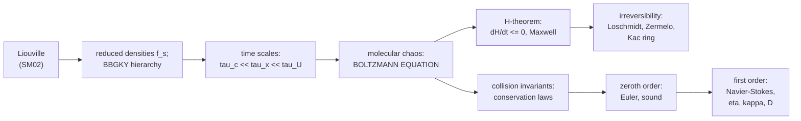

# SM04 · Kinetic Theory and the Boltzmann Equation

◀ [[SM03 The Canonical Ensemble]] · [[Thermodynamics and Statistical Mechanics - Course Map|Course Map]] · next ▶ [[SM05 The Grand Canonical Ensemble and Chemical Equilibrium]]

> [!info] Source and approach
> Follows **Kardar, *Statistical Physics of Particles*, Ch. 3** (printed pp. 57–97; PDF page = printed + 12: [[Mehran Kardar - Statistical Physics of Particles (2007).pdf#page=69|PDF p.69 ff.]]), whose route (reduced densities → BBGKY hierarchy → truncation by time-scale separation → Boltzmann equation → H-theorem → conservation laws → hydrodynamics at zeroth and first order) is kept. Cross-checked with **Huang, *Statistical Mechanics*, Ch. 3–5** (`physics/thermodynamics-stat-mech/books/Kerson Huang - Statistical Mechanics (1987).djvu`, now readable with `djvutxt`: djvu page = printed + 9; §3.3–3.5 pp. 60–72, §4.1 p. 73, §5.1–5.8 pp. 93–117) and **Reif, *Fundamentals of Statistical and Thermal Physics*, §12.2–12.3** (scattering cross section, viscosity; djvu page = printed + 17). The Chapman–Enskog numerical coefficients are quoted from the standard theory (Chapman and Cowling) and *checked against measured data* in §10, not rederived. Landau–Lifshitz Vol. 10 was not reread. This chapter **replaces nothing**: [[TH06 From Kinetic Theory to Statistical Mechanics]] §1–§4 is the elementary (mean-free-path) account, kept as the first pass; this is the second pass with the equation underneath it. The simulations (Kac ring, Kac collision model) are my own (`scripts/sm04_sims.py`, `sm04_numbers.py`, `fig_sm04.py`). No course is behind it: no taught/extra labels.

> [!tip] Start here (first read)
> - **The picture.** The ensembles of SM02–SM03 describe a gas *at rest*. Kinetic theory asks: what if it is not at rest? A gas poured into one corner, a shear flow, a hot plate beside a cold one. The one tool is the **one-particle distribution function** $f(\mathbf p,\mathbf q,t)$, the density of molecules in the six-dimensional $(\mathbf q,\mathbf p)$ space, and one equation for it: free streaming on the left, **collisions** on the right. Streaming alone would conserve everything; the collisions are what make $f$ relax to the Maxwell distribution, and, once they are treated *statistically*, they make the relaxation **one-way** (the H-theorem). Out of the same equation come the equations of fluid mechanics, with the **viscosity and thermal conductivity computed from molecular properties**.
> - **What you need.** Liouville's theorem and phase space ([[SM02 Phase Space Liouville and the Microcanonical Ensemble]]), the Maxwell distribution and mean free path ([[TH06 From Kinetic Theory to Statistical Mechanics]] §2–§3), Gaussian integrals ([[Gaussian Integral]], [[Wick's Theorem]]), the idea of relative entropy ([[SM01 Probability Large Numbers and Information]] §7).
> - **How to read.** §1–§4 build and justify the equation; §5–§6 are the two theorems (conservation laws, H-theorem); §7 is the paradox of irreversibility with two exactly solvable models you can run; §8–§11 are consequences (equilibrium, Euler, Navier–Stokes, transport coefficients with numbers). §10 is the payoff: $\kappa/\eta$ of five noble gases from one formula, to 1–3 %. Do Problems 1, 5, 8 and 11.
> - **Notation.** $f(\mathbf p,\mathbf q,t)$ one-particle density (normalised to $N$); $n=\int f\,\mathrm d^3p$; $\mathbf u$ mean velocity; $\mathbf c=\mathbf v-\mathbf u$ peculiar velocity; $P_{\alpha\beta}$ pressure tensor; $\mathbf h$ heat flux; $d$ molecular diameter; $\sigma=\pi d^2$; $\lambda$ mean free path; $\tau_c,\tau_\times,\tau_U$ collision, free-flight, external time scales; $D_t=\partial_t+\mathbf u\cdot\nabla$.

> [!key] After this chapter you can
> - define $f_1$ and its moments ($n,\mathbf u,T,P_{\alpha\beta},\mathbf h$) and write the **BBGKY hierarchy**, explaining why it cannot be closed exactly,
> - justify **truncation** from the ordering $\tau_c\ll\tau_\times\ll\tau_U$ ($\tau_c/\tau_\times\sim nd^3$), derive the **Boltzmann equation** with its collision integral, and state its assumptions, in particular **molecular chaos**,
> - prove the **conservation laws** (collision invariants $1,\mathbf p,p^2$) and the **H-theorem**, and read $-k_BH$ as the Boltzmann entropy that reproduces **Sackur–Tetrode**,
> - explain why the H-theorem is compatible with reversible mechanics (**Loschmidt, Zermelo**) with the solvable **Kac ring** and a simulated **Kac collision model**,
> - find the equilibrium solutions (Maxwell, with a potential, in a rotating container),
> - derive the **Euler equations**, the sound speed $c=\sqrt{5k_BT/3m}$ and the **hydrodynamic modes**,
> - derive $f^{(1)}$ in the relaxation-time approximation, get $\eta=nk_BT\tau$, $\kappa=\tfrac52nk_B^2T\tau/m$, the **Navier–Stokes** stress, and quote and test the exact first-approximation values $\eta=\tfrac5{16}\sqrt{mk_BT/\pi}/d^2$, $\kappa=\tfrac{15}4\tfrac{k_B}m\eta$, $\mathrm{Pr}=\tfrac23$.

> [!intuition] The one-sentence story
> A dilute gas is a swarm of free flights interrupted, rarely and briefly, by two-body collisions; because collisions are rare and brief, the one-particle density obeys a *closed* equation (streaming = collisions in and out), and because the incoming pairs of a collision are statistically independent while the outgoing pairs are not, the equation has an arrow of time that drives $f$ to the Maxwell distribution and, one order beyond, to viscous and heat-conducting fluid dynamics.

*Concept map of the chapter.*

![[fig_sm04_kinetic.png]]
*Figure SM4.1. A: in the Kac ring the colour imbalance decays as $(1-2\mu)^t$ until it reaches the $1/\sqrt N$ noise floor (§7). B: the same rule is exactly periodic: the ordered state returns at $t=N$ (Zermelo) (§7). C: the Kac collision model turns a uniform velocity distribution into a Gaussian. D: $H$ falls monotonically to $-\tfrac12\ln2\pi e$, and the fourth cumulant decays at the predicted rate $\tfrac14$ (§7). E: the exact first approximation $\kappa=\tfrac{15}4\tfrac{k_B}m\eta$ reproduces the measured conductivities of five noble gases to 0.3–3 %, the single-time approximation $\tfrac52\tfrac{k_B}m\eta$ misses by a third (§10). F: the ladder of time scales that makes the equation closed: $\tau_c/\tau_\times\sim nd^3$, and hydrodynamics lives between $\tau_\times$ and the macroscopic time (§3).*

## 1. The problem and why ensembles are not enough

SM02–SM03 gave the *probabilities of microstates* of an equilibrium system. Three questions stay open (Kardar, p. 57):
1. **What equation governs the evolution of a gas that is not in equilibrium?**
2. **Does it relax to the Maxwell–Boltzmann distribution, and why in one direction only?** The microscopic laws are time-reversal invariant; the full density $\rho$ obeys Liouville's equation and its Gibbs entropy is *constant* (SM02 §2.1).
3. **How do the equations of hydrodynamics (continuity, Navier–Stokes, heat conduction) come out of molecular motion, and what are $\eta$ and $\kappa$ in terms of $m$, $d$, $T$?**

[[TH06 From Kinetic Theory to Statistical Mechanics]] answered a slice of (3) with free flights and a mean free path. The answer was right in structure and wrong by factors of order one (§10 shows by how much). A proper theory needs an equation for $f$, and the equation needs **a reduced description**: $\rho(\mu,t)$ in $6N$ dimensions contains vastly more than we need, because pressure, flux and energy are sums of one-particle quantities.

> [!example] What a measurement of pressure needs
> $P$ is the average momentum transfer to a wall per unit area and time: a sum over molecules of one-particle quantities, so the one-particle density $f(\mathbf p,\mathbf q,t)$ suffices. Two-particle correlations are not needed until the gas is dense (virial corrections, SM14, planned).

## 2. Reduced distributions and the moments of $f$

> [!key] The $s$-particle densities
> From the $N$-particle density $\rho(\mu,t)$ (symmetric under permutations) define
> $$f_s(\mathbf p_1,\mathbf q_1,\dots,\mathbf p_s,\mathbf q_s,t)=\frac{N!}{(N-s)!}\int\prod_{i=s+1}^N\mathrm d^3p_i\,\mathrm d^3q_i\ \rho(\mu,t),\qquad f_1=\Big\langle\sum_{i=1}^N\delta^3(\mathbf p-\mathbf p_i)\delta^3(\mathbf q-\mathbf q_i)\Big\rangle$$
> ([[Mehran Kardar - Statistical Physics of Particles (2007).pdf#page=74|K §3.3, pp. 62–63]]). $f_1(\mathbf p,\mathbf q,t)\,\mathrm d^3p\,\mathrm d^3q$ is the expected number of molecules in the cell; $\int f_1=N$. $f_2$ is the expected number of *ordered pairs* ($\int f_2=N(N-1)$) ([[One-Particle Distribution Function]]).

The fields of fluid dynamics are **moments of $f_1$**: with $\mathbf v=\mathbf p/m$ and $\mathbf c=\mathbf v-\mathbf u$,
$$n=\int f_1\,\mathrm d^3p,\qquad\mathbf u=\frac1n\int\mathbf vf_1\,\mathrm d^3p,\qquad\tfrac32k_BT=\Big\langle\tfrac12mc^2\Big\rangle,\qquad P_{\alpha\beta}=nm\langle c_\alpha c_\beta\rangle,\qquad\mathbf h=n\Big\langle\tfrac12mc^2\,\mathbf c\Big\rangle$$
(the *pressure tensor* is the flux of $\alpha$-momentum in the $\beta$ direction, in the frame moving with the gas; $\mathbf h$ is the flux of random kinetic energy, the *heat flux*; $\langle\cdot\rangle=\frac1n\int\cdot\,f_1\mathrm d^3p$). In equilibrium $P_{\alpha\beta}=nk_BT\delta_{\alpha\beta}$ and $\mathbf h=0$. *Everything the rest of the chapter does is to find the form of $P_{\alpha\beta}$ and $\mathbf h$ when $f_1$ is not quite Maxwellian.*

## 3. The BBGKY hierarchy and the ordering of time scales

### 3.1 The hierarchy
Take the Hamiltonian of a weakly interacting gas,
$$\mathcal H=\sum_i\Big[\frac{\mathbf p_i^2}{2m}+U(\mathbf q_i)\Big]+\tfrac12\sum_{i\ne j}V(\mathbf q_i-\mathbf q_j),$$
an external potential $U$ plus a **two-body** interaction $V$ (three-body terms are negligible in a dilute gas). Liouville's equation $\partial_t\rho=\{\mathcal H,\rho\}$ is exact. To get an equation for $f_s$, integrate it over the coordinates of the other $N-s$ particles. Split $\mathcal H=\mathcal H_s+\mathcal H_{N-s}+\Delta\mathcal H$, where $\mathcal H_s$ and $\mathcal H_{N-s}$ contain everything internal to each group and $\Delta\mathcal H=\sum_{n\le s}\sum_{i>s}V(\mathbf q_n-\mathbf q_i)$ couples them.

> [!derivation] The three terms ([[Mehran Kardar - Statistical Physics of Particles (2007).pdf#page=75|K pp. 63–64]])
> 1. $\int\prod_{i>s}\mathrm dV_i\{\mathcal H_s,\rho\}=\{\mathcal H_s,\int\prod\mathrm dV_i\,\rho\}$, because $\mathcal H_s$ does not depend on the integration variables. This gives the streaming of the $s$-particle group.
> 2. $\int\prod_{i>s}\mathrm dV_i\{\mathcal H_{N-s},\rho\}=0$: integrate by parts; the boundary terms vanish and the integrand is a total derivative.
> 3. $\{\Delta\mathcal H,\rho\}$: $\Delta\mathcal H$ depends only on positions, so the bracket is $\sum_j(\partial\Delta\mathcal H/\partial\mathbf q_j)\cdot(\partial\rho/\partial\mathbf p_j)$. The terms with $j>s$ integrate to zero (total derivative in $\mathbf p_j$). For $j=n\le s$, $\partial\Delta\mathcal H/\partial\mathbf q_n=\sum_{i>s}\partial V(\mathbf q_n-\mathbf q_i)/\partial\mathbf q_n$; because $\rho$ is symmetric, the $N-s$ terms of this sum give equal integrals, and $\frac{N!}{(N-s)!}\times(N-s)=\frac{N!}{(N-s-1)!}$ is exactly the prefactor that turns $\int\prod_{i>s+1}\rho$ into $f_{s+1}$.
>
> Result: $$\boxed{\ \frac{\partial f_s}{\partial t}-\{\mathcal H_s,f_s\}=\sum_{n=1}^s\int\mathrm d^3p_{s+1}\,\mathrm d^3q_{s+1}\ \frac{\partial V(\mathbf q_n-\mathbf q_{s+1})}{\partial\mathbf q_n}\cdot\frac{\partial f_{s+1}}{\partial\mathbf p_n}\ }$$ The left side is Liouville's equation for $s$ isolated particles (incompressible flow); the right side is the **force exerted on the group by one outside particle**, averaged with the joint density $f_{s+1}$.

For $s=1$:
$$\Big[\frac\partial{\partial t}+\frac{\mathbf p_1}m\cdot\frac\partial{\partial\mathbf q_1}-\frac{\partial U}{\partial\mathbf q_1}\cdot\frac\partial{\partial\mathbf p_1}\Big]f_1=\int\mathrm d^3p_2\,\mathrm d^3q_2\ \frac{\partial V(\mathbf q_1-\mathbf q_2)}{\partial\mathbf q_1}\cdot\frac{\partial f_2}{\partial\mathbf p_1}.\tag{BBGKY-1}$$
$f_1$ depends on $f_2$, $f_2$ on $f_3$, and so on to $f_N$: **a hierarchy as complicated as the original problem** ([[BBGKY Hierarchy]]). Closing it requires a physical argument.

### 3.2 Three time scales
All bracketed terms are inverse times; estimate them by dimensional analysis ([[Mehran Kardar - Statistical Physics of Particles (2007).pdf#page=77|K §3.4, pp. 65–66]]).

| scale | meaning | definition | air, 300 K, 1 atm |
|---|---|---|---|
| $\tau_U$ | *extrinsic*: crossing a region of size $L$ | $L/\bar v$ | 2.1 µs (1 mm), 2.1 ms (1 m) |
| $\tau_c$ | *collision duration*: two molecules within range $d$ | $d/\bar v$ | $7.8\times10^{-13}$ s |
| $\tau_\times$ | *mean free time*: time between collisions | $\lambda/\bar v\sim1/(n\bar vd^2)$ | $1.41\times10^{-10}$ s |

Here $\bar v=476$ m s$^{-1}$ (N$_2$), $d=3.7$ Å and $\lambda=1/(\sqrt2\,n\pi d^2)=67.2$ nm $=182\,d$ (the numbers use this exact hard-sphere $\lambda$; the definition column gives only the scaling, without the factor $\sqrt2\pi=4.44$). The ratio of the first two *intrinsic* scales is
$$\boxed{\ \frac{\tau_c}{\tau_\times}\sim nd^3\ }\qquad(\text{air: }nd^3=1.24\times10^{-3},\ \tau_c/\tau_\times=\sqrt2\pi\,nd^3=5.5\times10^{-3}),$$
the probability of finding a second molecule inside the interaction volume of the first ([[Mean Free Path]]). **For a dilute gas with short-range forces, $nd^3\ll1$.**

![[fig_sm04_kinetic.png]]
*(Panel F above: the three scales for air; "hydrodynamics lives" between $\tau_\times$ and $\tau_U$.)*

> [!intuition] Why the hierarchy closes
> Compare the right-hand sides of the first two equations with their streaming terms. In the **$s=2$** equation the collision-type terms on the right are smaller than the streaming terms (which contain $1/\tau_c$, the rate at which two nearby molecules swing around each other) by the factor $\tau_c/\tau_\times\sim nd^3\ll1$. In the **$s=1$** equation, however, there are *no* large streaming terms for the interaction (a single molecule does not scatter off itself): the right-hand side is the *only* thing that changes $f_1$ over times $\sim\tau_\times$. So the first equation must be kept exactly, and the second can be truncated: set its right-hand side to zero, i.e. let a pair of molecules evolve in isolation as a two-body problem. That is a closed, solvable problem.

> [!pitfall] When $nd^3\ll1$ fails
> For **long-range** forces (Coulomb in a plasma, gravity) a molecule interacts with many others at once, $nd^3$ is not small, and the collision term is replaced by a *mean-field* force (the **Vlasov equation**, which has no collision integral) plus small corrections (Landau, Balescu–Lenard collision integrals). For a **dense** gas or liquid three-body collisions matter (Enskog theory, virial corrections: SM14, planned).

## 4. The Boltzmann equation

### 4.1 Solving the two-body problem
Drop the right side of the $s=2$ equation and look at times $\gg\tau_c$ (but possibly $\ll\tau_U$): $f_2$ then relaxes to a "steady state" in the *relative* coordinates, varying slowly with the centre of mass. Writing $\mathbf q=\mathbf q_2-\mathbf q_1$ for the relative coordinate and neglecting centre-of-mass gradients, the second BBGKY equation says
$$\frac{\mathbf p_2-\mathbf p_1}m\cdot\frac{\partial f_2}{\partial\mathbf q}=\frac{\partial V(\mathbf q_1-\mathbf q_2)}{\partial\mathbf q_1}\cdot\Big(\frac\partial{\partial\mathbf p_1}-\frac\partial{\partial\mathbf p_2}\Big)f_2 ,$$
so $f_2$ is **constant along the trajectories of the isolated two-body collision** ([[Mehran Kardar - Statistical Physics of Particles (2007).pdf#page=79|K eqs. (3.33)–(3.34), pp. 67–68]]). Substituting into the right side of (BBGKY-1) and using that the added $\partial_{\mathbf p_2}$ term is a total derivative:
$$\Big(\frac{\mathrm df_1}{\mathrm dt}\Big)_{\rm coll}=\int\mathrm d^3p_2\,\mathrm d^3q\ \frac{\mathbf p_2-\mathbf p_1}m\cdot\frac{\partial f_2(\mathbf p_1,\mathbf q_1;\mathbf p_2,\mathbf q_1+\mathbf q)}{\partial\mathbf q}.$$
The integrand is a *derivative of $f_2$ along the direction of relative motion*. Choose coordinates $\mathbf q=(a,\mathbf b)$ with $a$ along $\mathbf v_{\rm rel}=\mathbf v_2-\mathbf v_1$ ($a<0$ before the collision, $a>0$ after) and $\mathbf b$ the two-dimensional **impact parameter**. Then $\int\mathrm d^3q\,\mathbf v_{\rm rel}\cdot\nabla_{\mathbf q}f_2=\int\mathrm d^2b\,|\mathbf v_{\rm rel}|\big[f_2^{\rm after}-f_2^{\rm before}\big]$, and $\mathrm d^2b=\frac{\mathrm d\sigma}{\mathrm d\Omega}\mathrm d\Omega$ defines the differential **scattering cross section** ([[Scattering Cross Section]]; Reif §12.2, pp. 468–470, gives $\sigma=\pi d^2$ for identical hard spheres of diameter $d$).

### 4.2 Molecular chaos
Two inputs remain: $f_2$ before and after the collision.
- **Before** (incoming, separated by more than $d$): *the two molecules have not met recently, so they are uncorrelated*: $f_2(\mathbf p_1,\mathbf q_1;\mathbf p_2,\mathbf q_1)\to f_1(\mathbf p_1,\mathbf q_1)\,f_1(\mathbf p_2,\mathbf q_1)$. This is the **Stosszahlansatz**, the assumption of **molecular chaos** ([[Molecular Chaos]]).
- **After** (outgoing at $a>0$, momenta $\mathbf p_1,\mathbf p_2$): by constancy along the trajectory, $f_2^{\rm after}(\mathbf p_1,\mathbf p_2)=f_2^{\rm before}(\mathbf p_1',\mathbf p_2')=f_1(\mathbf p_1')f_1(\mathbf p_2')$, where $(\mathbf p_1',\mathbf p_2')$ are the incoming momenta that scatter into $(\mathbf p_1,\mathbf p_2)$.

> [!key] The Boltzmann equation
> $$\boxed{\ \Big[\frac\partial{\partial t}+\frac{\mathbf p}m\cdot\nabla_{\mathbf q}-\nabla_{\mathbf q}U\cdot\nabla_{\mathbf p}\Big]f_1(\mathbf p,\mathbf q,t)=\int\mathrm d^3p_2\,\mathrm d\Omega\ \frac{\mathrm d\sigma}{\mathrm d\Omega}\,|\mathbf v_1-\mathbf v_2|\Big[f_1(\mathbf p_1')f_1(\mathbf p_2')-f_1(\mathbf p_1)f_1(\mathbf p_2)\Big]\ }$$
> ([[Boltzmann Equation]]; [[Mehran Kardar - Statistical Physics of Particles (2007).pdf#page=83|K eq. (3.41), p.71]]; Huang §3.3, p. 60.) *Left:* free streaming in the external potential. *Right:* the **collision integral** $C[f_1]$: the **loss** of molecules with momentum $\mathbf p_1$ in collisions with $\mathbf p_2$ (rate $=$ flux $|\mathbf v_1-\mathbf v_2|\times$ cross section $\times$ pair density $f_1f_1$), **plus the gain** from *inverse* collisions $(\mathbf p_1',\mathbf p_2')\to(\mathbf p_1,\mathbf p_2)$ with the same cross section (time-reversal invariance of the two-body problem).

> [!intuition] Counting collisions like a physicist
> In a time $\mathrm dt$ a molecule moving at relative speed $|\mathbf v_{\rm rel}|$ sweeps out a cylinder of cross-section $\mathrm d\sigma$ and length $|\mathbf v_{\rm rel}|\mathrm dt$; the expected number of $\mathbf p_2$-molecules inside is $f_1(\mathbf p_2)\,\mathrm d^3p_2\cdot|\mathbf v_{\rm rel}|\mathrm dt\,\mathrm d\sigma$. Multiply by the number $f_1(\mathbf p_1)\mathrm d^3p_1$ of $\mathbf p_1$ molecules: that is the loss. *Writing "the number of pairs is the product of the numbers" is exactly the molecular-chaos assumption.* The gain term is the same count for the reversed process.

> [!example] Numbers behind the assumptions (recomputed)
> Air at 300 K and 1 atm: $nd^3=1.2\times10^{-3}$ (dilute ✓), $\tau_c/\tau_\times=5.5\times10^{-3}$ ✓, thermal wavelength $0.019$ nm $\ll d=0.37$ nm (classical scattering of wavepackets, fine). Helium (d = 2.2 Å): $\lambda=190$ nm, $\tau_\times=1.5\times10^{-10}$ s, $nd^3=2.6\times10^{-4}$. Conditions of validity: **(i)** dilute, binary collisions: $nd^3\ll1$; **(ii)** fields varying slowly on $d$ and $\tau_c$; **(iii)** molecular chaos for incoming pairs; **(iv)** the scattering is treated by two-body mechanics (quantum cross sections are used for light gases at low $T$; statistics stays classical until $n\lambda^3\sim1$: [[Thermal Wavelength]]).

> [!pitfall] Where the arrow of time enters
> The BBGKY hierarchy is time-reversal invariant. The *only* place where time asymmetry enters is the choice "uncorrelated **before** the collision". If instead you had assumed "uncorrelated **after**", you would obtain the same equation with the sign of the collision integral reversed, and $H$ would *increase*. The assumption is true for the *forward* evolution of an ordinary initial state (molecules that have not yet met) and false for its time-reverse (molecules that are about to undo their past collisions). §7 returns to this.

## 5. Collision invariants and the conservation laws

For any function $\chi(\mathbf p)$, multiply the collision integral by $\chi(\mathbf p_1)$ and integrate over $\mathbf p_1$ (and over $\mathbf q$ if desired). Write $w=\frac{\mathrm d\sigma}{\mathrm d\Omega}|\mathbf v_1-\mathbf v_2|$, a symmetric weight. Relabel $1\leftrightarrow2$ (the integral is symmetric):
$$\int\mathrm d^3p_1\,\chi_1C=\tfrac12\int w\,(\chi_1+\chi_2)\,(f_1'f_2'-f_1f_2).$$
Now relabel the *incoming* and *outgoing* momenta, $(\mathbf p_1,\mathbf p_2)\leftrightarrow(\mathbf p_1',\mathbf p_2')$: the inverse collision has the same measure and cross section, only the bracket changes sign, giving $\tfrac12\int w(\chi_1'+\chi_2')(f_1f_2-f_1'f_2')$. Averaging the two forms,
$$\int\mathrm d^3p_1\,\chi_1\,C[f]=\tfrac14\int\mathrm d^3p_1\mathrm d^3p_2\,\mathrm d\Omega\ w\ \big[\chi_1+\chi_2-\chi_1'-\chi_2'\big]\big[f_1'f_2'-f_1f_2\big].$$
So $\int\chi C=0$ for every $f$ **iff** $\chi_1+\chi_2=\chi_1'+\chi_2'$ in every collision: a **collision invariant** ([[Collision Invariants]]). There are exactly five independent ones, from the conservation laws of a two-body elastic collision:
$$\chi=1\ \ (\text{particle number}),\qquad\chi=\mathbf p\ \ (\text{3 momentum components}),\qquad\chi=p^2/2m\ \ (\text{energy}).$$

> [!derivation] Moment equations ([[Mehran Kardar - Statistical Physics of Particles (2007).pdf#page=90|K §3.7, pp. 78–82]]; Huang §5.3, p. 96)
> Multiply the Boltzmann equation by $\chi$, integrate over $\mathbf p$, integrate by parts the streaming terms, and use $\int\chi C=0$:
> $$\partial_t\langle\chi\rangle n+\nabla\cdot(n\langle\chi\mathbf v\rangle)-n\Big\langle\mathbf F\cdot\nabla_{\mathbf p}\chi\Big\rangle=0,\qquad\mathbf F=-\nabla U .$$
> For $\chi=1,\ \mathbf p,\ \tfrac12mc^2$ (with $\mathbf u,\mathbf c$ as in §2) this gives, exactly,
> $$D_tn=-n\nabla\cdot\mathbf u,\qquad mn\,D_tu_\alpha=-\partial_\beta P_{\alpha\beta}+nF_\alpha,\qquad\tfrac32nk_B\,D_tT=-\partial_\alpha h_\alpha-P_{\alpha\beta}\partial_\alpha u_\beta .$$
> These are **continuity, momentum balance and energy balance**; the right-hand sides contain $P_{\alpha\beta}$ and $\mathbf h$, which are *not yet known*: the equations are not closed until $f_1$ is known to some order. That is the business of §9 and §10.

## 6. The H-theorem

> [!key] Boltzmann's H-theorem
> If $f_1$ obeys the Boltzmann equation, then $$H(t)=\int\mathrm d^3q\,\mathrm d^3p\ f_1\ln f_1\quad\text{satisfies}\quad\frac{\mathrm dH}{\mathrm dt}\le0,$$ with equality **iff** $f_1(\mathbf p_1)f_1(\mathbf p_2)=f_1(\mathbf p_1')f_1(\mathbf p_2')$ for all collisions ([[H-Theorem]]; [[Mehran Kardar - Statistical Physics of Particles (2007).pdf#page=84|K §3.5, p.72]]; Huang §4.1, p. 73).

> [!derivation] Proof
> $\dfrac{\mathrm dH}{\mathrm dt}=\int(\ln f_1+1)\,\partial_tf_1$. The streaming terms integrate to zero: $\int f\,\nabla U\cdot\nabla_{\mathbf p}\ln f=\int\nabla U\cdot\nabla_{\mathbf p}f=0$ and $\int(\mathbf p/m)\cdot\nabla_{\mathbf q}(f\ln f-f)=0$ by integration by parts (the constant $+1$ gives $\int\partial_tf=0$ since $N$ is fixed). Therefore $\mathrm dH/\mathrm dt=\int\mathrm d^3q\,\mathrm d^3p_1\ln f_1\,C[f]$. Apply the symmetrisation of §5 with $\chi=\ln f$:
> $$\frac{\mathrm dH}{\mathrm dt}=-\tfrac14\int\mathrm d^3q\,\mathrm d^3p_1\mathrm d^3p_2\,\mathrm d\Omega\,\frac{\mathrm d\sigma}{\mathrm d\Omega}|\mathbf v_1-\mathbf v_2|\ \big(f_1'f_2'-f_1f_2\big)\ln\frac{f_1'f_2'}{f_1f_2}\ \le0,$$
> since $(x-y)\ln(x/y)\ge0$ for $x,y>0$, with equality only for $x=y$. $\square$ At a stationary point $\ln f$ is a collision invariant: $\ln f=a+\mathbf b\cdot\mathbf p+c\,p^2$ (§5) with $c<0$ for normalisability, i.e. the **Maxwell–Boltzmann** distribution:
> $$f_{\rm eq}=n(2\pi mk_BT)^{-3/2}\exp\Big[-\frac{m(\mathbf v-\mathbf u)^2}{2k_BT}\Big]\quad\text{(uniform case)}.$$

> [!connection] $-k_BH$ is the entropy: Sackur–Tetrode again
> Define the **Boltzmann entropy** $S_B=-k_B\int f_1\big(\ln(h^3f_1)-1\big)\,\mathrm d^3q\,\mathrm d^3p$ (the $h^3$ makes the argument of the log dimensionless, the $-1$ is the Stirling remainder of $\ln N!$: SM02 §6–§7). The H-theorem says $\mathrm dS_B/\mathrm dt\ge0$. For the Maxwell distribution $h^3f=n\lambda^3e^{-p^2/2mk_BT}$ with $\lambda=h/\sqrt{2\pi mk_BT}$, so $\langle\ln h^3f\rangle=\ln n\lambda^3-\tfrac32$ and
> $$S_B=Nk_B\Big[-\ln(n\lambda^3)+\tfrac52\Big]\ =\ \text{the Sackur–Tetrode entropy}$$
> (recomputed for He at 298.15 K and 1 bar: $15.173\,Nk_B$ $=126.15$ J mol$^{-1}$K$^{-1}$ ✓). So the **Maxwell distribution is the entropy maximum at fixed $n,\mathbf u,T$**: for any $f$ with the same three moments, $H[f]-H[f_{\rm MB}]=\int f\ln(f/f_{\rm MB})\ge0$ because $\int f\ln f_{\rm MB}$ depends only on the conserved moments (Problem 5; [[Relative Entropy]]). The entropy produced is the relative entropy to equilibrium.

> [!intuition] How $S_B$ differs from the Gibbs entropy of SM02
> The Gibbs entropy of the full $N$-body density is *constant* under Liouville flow (SM02 §2.1). $S_B$ is built from $f_1$ alone and **grows**. Their difference, $S_B-S_G\ge0$, is the information stored in **correlations between molecules** (the entropy of a joint distribution never exceeds the sum of the entropies of its marginals, [[Shannon Entropy]]). Each collision creates correlations between the two molecules that have just met; the Boltzmann equation, by *assuming* incoming pairs are uncorrelated, throws the correlations away at the next collision. That one-way discarding is the arrow of time. For a dilute gas the correlations are never recovered in practice: reversing them needs the exact reversal of $10^{23}$ momenta.

## 7. Irreversibility: Loschmidt, Zermelo, and two models you can run

**Loschmidt's objection (1876).** Reverse every velocity at time $t_0$; the equations of motion retrace the history, so the reversed motion has $H$ *increasing*. **Zermelo's objection (1896).** A bounded system returns arbitrarily close to its initial state (Poincaré): so $H$ must eventually go back up ([[Loschmidt and Zermelo Paradoxes]]; [[SM02 Phase Space Liouville and the Microcanonical Ensemble]] §2.1; Huang §4.5, p. 90).

> [!key] The resolution (Boltzmann)
> The H-theorem is a statement about **typical** (overwhelmingly probable) initial conditions: starting from an uncorrelated state, $H$ decreases for all but a set of initial conditions of exponentially small measure. The reversed state of Loschmidt is *exactly* such an atypical state (it has built-in correlations that conspire to undo collisions). The recurrence of Zermelo takes a time of order $e^{N\cdot\text{const}}$ molecular times ([[SM01 Probability Large Numbers and Information]] §1, §6): $\sim10^{600}\tau$ for 100 molecules, meaningless for $10^{23}$. Fluctuations of $H$ above its minimum have probability $e^{-\Delta S/k_B}$ ([[Large Deviation Principle]]): visible for a few molecules, never for a mole.

### 7.1 The Kac ring: exactly reversible, exactly periodic, and still irreversible
> [!example] The model (Kac 1956; recomputed) 
> $N$ sites on a ring, each holding a ball coloured white or black. Between $k$ of the $N$ edges there is a marker. In one time step every ball moves to the next site clockwise; **a ball crossing a marked edge changes colour**. The dynamics is deterministic, reversible, and **periodic**: after $N$ steps every ball has crossed every edge exactly once, so it has changed colour $k$ times; hence if **$k$ is even** the whole configuration returns at $t=N$ (if $k$ is odd, at $t=2N$). Simulation: $N=400$, $k=80$: $m_t=0$-ish noise for $15\le t\le300$ (rms $0.088$; the theory value $\sqrt{2.1/N}=0.072$ derived below holds for $t\ll N$; once $t>N/2$ the paths of distant balls also overlap round the ring, which adds correlation and raises the noise) and exactly $m_{400}=m_{800}=1$; $N=101$, $k=21$ (odd): $m_{101}=-1$, $m_{202}=+1$ (Fig. SM4.1B).
>
> **Stosszahlansatz:** assume that the colour of the ball arriving at a marker is uncorrelated with whether the marker is there. Then the imbalance $m_t=(N_{\rm white}-N_{\rm black})/N$ changes by the factor $(1-2\mu)$, $\mu=k/N$, at each step: $m_t=(1-2\mu)^t$ (the Boltzmann equation of the ring), and $H=\frac{1+m}2\ln\frac{1+m}2+\frac{1-m}2\ln\frac{1-m}2$ decreases from 0 to $-\ln2$.
>
> **This is exact on average:** place the markers independently with probability $\mu$ per edge. A ball that has crossed $t\le N$ *distinct* edges has flipped $(-1)^{\#\text{marked}}$, whose expectation is $(1-2\mu)^t$; summing over balls, $\langle m_t\rangle=(1-2\mu)^t$ **exactly**, for $t\le N$. *The noise.* Two balls a distance $j<t$ apart share $t-j$ edges; on a shared edge the two sign factors multiply to $(\pm1)^2=1$, so the pair correlation is $r^{2j}-r^{2t}$ with $r=1-2\mu$. Summing over pairs, $\mathrm{Var}\,m_t\simeq\frac1N\big[1+2\sum_{j\ge1}r^{2j}\big]=\frac1N\,\frac{1+r^2}{1-r^2}$ for $1\ll t\ll N$: $2.1/N$ for $\mu=0.2$ and $4.6/N$ for $\mu=0.1$. At $N=10^4$, $k=1000$ ($\mu=0.1$, noise $\sqrt{4.6\times10^{-4}}=0.02$) the measured $m_5=0.328$, $m_{10}=0.092$ match $0.8^5=0.328$, $0.8^{10}=0.107$ within that noise (Fig. SM4.1A).
>
> **Both paradoxes in 30 lines of code:** Loschmidt: run the dynamics backwards and the imbalance *grows* from noise back to 1 (the ring is invertible). Zermelo: the return time is $N$: for $N=10^4$ it is $10^4$ steps against a relaxation time $\ln(100)/(-\ln0.8)=20.6$ steps, a factor $500$; for $N\sim10^{23}$ the ratio is astronomical.

### 7.2 A caricature with a real H-theorem: the Kac collision model
> [!example] Velocities that relax (recomputed; Fig. SM4.1C–D)
> $N=10^5$ particles with scalar velocities. At each collision, a random pair $(v_1,v_2)$ is rotated by a random angle $\theta\in[0,2\pi)$: $v_1'=v_1\cos\theta+v_2\sin\theta$, $v_2'=-v_1\sin\theta+v_2\cos\theta$, which conserves $v_1^2+v_2^2$ (energy) and is reversible. Time is measured so that each particle suffers one collision per unit time. The mean-field limit obeys a Boltzmann-type equation with an H-theorem (McKean 1966; quoted, not derived here).
>
> **Prediction of the relaxation rate.** For a pair drawn independently from $f$, $\langle v_1'^4+v_2'^4\rangle=\tfrac34(a^4+b^4)+\tfrac32a^2b^2$ because $\langle\cos^4\theta\rangle=\tfrac38$ and $\langle\cos^2\theta\sin^2\theta\rangle=\tfrac18$ and odd terms average to zero; so a collision changes $\sum v^4$ by $-\tfrac12\big(m_4-3\sigma^4\big)$ on average, and
> $$\frac{\mathrm dm_4}{\mathrm dt}=-\tfrac14\big(m_4-3\sigma^4\big)\ \Rightarrow\ \text{excess kurtosis}\ =\ \kappa_0\,e^{-t/4}.$$
> **Simulation** starting from the uniform law on $[-\sqrt3,\sqrt3]$ (variance 1, $\kappa_0=-1.2$): excess kurtosis $-0.920,\ -0.705,\ -0.421,\ -0.149,\ -0.049,\ -0.0045$ at $t=1,2,4,8,12,20$ against the prediction $-0.935,-0.728,-0.442,-0.162,-0.060,-0.008$: agreement to $0.01$–$0.02$. The simulation runs consistently slightly *ahead* of the prediction; I have not traced the cause (the sampling noise of a kurtosis estimate from $N=10^5$ values, $\sqrt{24/N}=0.015$, is of the same size, but noise would not be one-signed). **$H$ falls monotonically** from $-1.26$ to $-1.4195$, reaching the Gaussian value $-\tfrac12\ln2\pi e=-1.4189$ (the histogram estimator has a bias of $\sim0.02$) with no step upward larger than the noise.

> [!connection] Boltzmann's H and SM01's rate function
> The relative entropy of SM01 §7.3 is the *Lyapunov function* of these dynamics: $H[f]-H_{\rm eq}=\int f\ln(f/f_{\rm eq})=D(f\|f_{\rm eq})$ decays to zero. Compare [[SM03 The Canonical Ensemble]] §2.2, where $F[q]-F=k_BT\,D(q\|p)$: the same quantity governs *equilibrium* (minimisation) and *relaxation* (monotone decrease). "Maximum entropy" and "second law" are one statement read in two time directions.

## 8. Equilibrium solutions

Stationarity of the Boltzmann equation requires both the collision integral and the streaming terms to vanish. The collision integral vanishes iff $\ln f$ is a linear combination of $1,\mathbf p,p^2$. The streaming term then requires this combination to be a *constant of the motion in the external field*.
- **Uniform gas, no potential:** $f=n(2\pi mk_BT)^{-3/2}e^{-m(\mathbf v-\mathbf u)^2/2k_BT}$ with constant $n,\mathbf u,T$.
- **External potential $U(\mathbf q)$:** $f\propto e^{-(p^2/2m+U)/k_BT}$: the Boltzmann factor of SM03, with the **barometric** density $n(z)=n_0e^{-mgz/k_BT}$ ([[Barometric Formula]], [[Scale Height]]).
- **Rotating container** (axisymmetric $U$): angular momentum $L_z=(\mathbf q\times\mathbf p)_z$ is also conserved by the streaming term, so $\ln f$ may contain $\omega L_z$: $f\propto e^{-[p^2/2m+U-\omega L_z]/k_BT}$, which is a Maxwellian about the **rigid-rotation** velocity $\mathbf u=\boldsymbol\omega\times\mathbf q$ with density $n(r)\propto\exp[(m\omega^2r^2/2-U)/k_BT]$: *an equilibrium gas in a rotating vessel rotates rigidly and is denser at the wall* (Landau–Lifshitz Vol. 5 §34; stated).

> [!example] The gas centrifuge (recomputed; Boltzmann factor in a rotating frame)
> Each species has its own radial scale: $n_i(r)\propto\exp[m_i\omega^2r^2/2k_BT]$. For UF$_6$ with $\Delta M=3$ g mol$^{-1}$ (isotopes 235/238) at a rim speed $\omega r=400$ m s$^{-1}$ and $T=300$ K:
> $$\ln\alpha=\frac{\Delta M\,v^2}{2RT}=\frac{3\times10^{-3}\times400^2}{2\times8.314\times300}=0.0962,\qquad\alpha=1.101,$$
> against $\sqrt{352/349}=1.0043$ for effusion ([[TH06 From Kinetic Theory to Statistical Mechanics]] §3): **a centrifuge stage separates $\ln\alpha=0.096$ versus $0.0043$, 22 times better**, which is why enrichment moved from diffusion plants to centrifuge cascades.

## 9. Zeroth-order hydrodynamics: Euler's equations

Local equilibrium $f_0=n(\mathbf q,t)(2\pi mk_BT)^{-3/2}\exp[-m\mathbf c^2/2k_BT]$ with slowly varying $n,\mathbf u,T$ makes the collision integral vanish *exactly* (the bracket $f_1'f_2'-f_1f_2=0$). It is not a solution of the full equation (the streaming operator acting on $f_0$ is not zero), but the *moments* of §5 close:
$$P^{(0)}_{\alpha\beta}=nk_BT\,\delta_{\alpha\beta},\qquad\mathbf h^{(0)}=0\ \ \Longrightarrow$$
> [!key] Euler equations ([[Euler Equations]]; K §3.8, pp. 82–84)
> $$D_tn=-n\nabla\cdot\mathbf u,\qquad mn\,D_t\mathbf u=-\nabla(nk_BT)+n\mathbf F,\qquad D_tT=-\tfrac23\,T\nabla\cdot\mathbf u .$$
> The third equation is the **adiabatic** law $D_t(Tn^{-2/3})=0$, i.e. $P\propto n^{5/3}$ along a flow line: the fluid is **non-dissipative**, entropy per particle is conserved.

**Normal modes.** Linearise about $n_0$, $T_0$, $\mathbf u=0$ (no force), $\delta\propto e^{i(\mathbf k\cdot\mathbf x-\omega t)}$: $\omega\delta n=n_0\mathbf k\cdot\delta\mathbf u$; $m n_0\omega\,\delta\mathbf u=\mathbf k(k_BT_0\delta n+n_0k_B\delta T)$; $\tfrac32n_0\omega\,\delta T=n_0T_0\mathbf k\cdot\delta\mathbf u$. Eliminating:
- **Two sound modes**, $\mathbf u\parallel\mathbf k$: $\omega=\pm c\,k$ with $$\boxed{\ c^2=\frac{5k_BT}{3m}=\gamma\frac{k_BT}m\ ,\qquad\gamma=\tfrac53\ }$$ (the monatomic adiabatic speed of sound; [[Speed of Sound]], [[Ratio of Specific Heats]]). **At 293.15 K: He $1007.4$ m s$^{-1}$; Ar: $318.9$; (with $\gamma=1.4$) N$_2$: $349.0$; air: $343.2$ m s$^{-1}$.** The mean molecular speed is $\bar v/c=\sqrt{8/\pi}/\sqrt{5/3}=1.236$ times the sound speed: *sound is carried by the molecules, at about their speed*.
- **Two shear (transverse) modes**, $\mathbf u\perp\mathbf k$: $\omega=0$ (undamped).
- **One entropy (heat) mode**: $\delta P=0$, $\omega=0$ (undamped).

Five modes for five conserved densities ($n$, three momenta, energy) ([[Hydrodynamic Modes]]). *At zeroth order none of the non-sound modes relaxes*: a shear flow or a temperature bump lives forever. That is wrong, and fixing it is the next order.

## 10. First-order hydrodynamics: viscosity and heat conduction

### 10.1 The first correction in the single-time approximation
Write $f_1=f_0(1+g)$ with $g$ small (of order $\tau_\times/\tau_U$, §3) and linearise the collision integral: $C[f_1]=-f_0\,\mathcal C_Lg$, with $\mathcal C_L$ a positive linear operator whose size is $1/\tau_\times$. As a first approximation replace it by the **single collision time** (relaxation-time, BGK) form
$$C[f_1]\simeq-\frac{f_1-f_0}{\tau},\qquad\tau\sim\tau_\times,\tag{RTA}$$
([[Relaxation Time Approximation]]; [[Mehran Kardar - Statistical Physics of Particles (2007).pdf#page=97|K eq. (3.112), p.85]]). To the first order in $g$, the streaming operator acts on $f_0$ alone: $g=-\tau\,\mathcal L f_0/f_0$ with $\mathcal L=\partial_t+\mathbf v\cdot\nabla+\mathbf F/m\cdot\nabla_{\mathbf v}$.

> [!derivation] The streaming operator on a local Maxwellian ([[Mehran Kardar - Statistical Physics of Particles (2007).pdf#page=96|K eqs. (3.107)–(3.110), p.84]])
> $\ln f_0=\ln n-\tfrac32\ln T-X$, $X=mc^2/2k_BT$. Use $\partial_t+\mathbf v\cdot\nabla=D_t+\mathbf c\cdot\nabla$, $D_tc_\alpha=-D_tu_\alpha$, $\partial_\alpha X=-X\partial_\alpha\ln T-(m/k_BT)c_\beta\partial_\alpha u_\beta$, and the Euler equations of §9 to *eliminate every time derivative*: $D_t\ln n=-\nabla\cdot\mathbf u$, $D_t\ln T=-\tfrac23\nabla\cdot\mathbf u$, $D_t\mathbf u=-(k_BT/m)(\nabla\ln n+\nabla\ln T)+\mathbf F/m$. The terms in $\nabla\ln n$ and $\mathbf F$ cancel (the force term from $\mathbf F\cdot\nabla_{\mathbf v}\ln f_0=-m\mathbf c\cdot\mathbf F/k_BT$ cancels the $\mathbf c\cdot\mathbf F/k_BT$ from $D_t\mathbf u$), and what remains is
> $$\frac{\mathcal Lf_0}{f_0}=\frac m{k_BT}\Big(c_\alpha c_\beta-\tfrac13c^2\delta_{\alpha\beta}\Big)\partial_\alpha u_\beta+\Big(\frac{mc^2}{2k_BT}-\frac52\Big)\mathbf c\cdot\frac{\nabla T}T .$$
> **Only two sources of departure from equilibrium survive: the traceless rate of strain and the temperature gradient.** A uniform gas, a uniform expansion ($\nabla\cdot\mathbf u$ only enters through the trace) and a gas in a force field are *not* driven away from $f_0$ at this order.

The first-order solution is therefore
$$f_1=f_0\Big[1-\tau\frac m{k_BT}\Big(c_\alpha c_\beta-\tfrac13c^2\delta_{\alpha\beta}\Big)\partial_\alpha u_\beta-\tau_K\Big(\frac{mc^2}{2k_BT}-\frac52\Big)\frac{\mathbf c\cdot\nabla T}T\Big]$$
(allowing different effective times $\tau,\tau_K$ for the two mechanisms, as the exact theory requires).

### 10.2 The transport coefficients
Use the Gaussian moments of $f_0$ (Wick's theorem, [[Wick's Theorem]]): $\langle c_\alpha c_\beta\rangle=\frac{k_BT}m\delta_{\alpha\beta}$; $\langle c_\alpha c_\beta c_\gamma c_\delta\rangle=(\frac{k_BT}m)^2(\delta_{\alpha\beta}\delta_{\gamma\delta}+\delta_{\alpha\gamma}\delta_{\beta\delta}+\delta_{\alpha\delta}\delta_{\beta\gamma})$; $\langle c^2c_\alpha c_\beta\rangle=5(\frac{k_BT}m)^2\delta_{\alpha\beta}$; $\langle c^4c_\alpha c_\beta\rangle=35(\frac{k_BT}m)^3\delta_{\alpha\beta}$ (checked numerically to $10^{-3}$).

> [!derivation] Viscosity ([[Viscosity of a Gas]]) and conductivity ([[Thermal Conductivity of a Gas]])
> **Pressure tensor.** $P_{\alpha\beta}=nm\langle c_\alpha c_\beta\rangle_{f_1}=nk_BT\delta_{\alpha\beta}+nm\langle c_\alpha c_\beta g\rangle_0$. The traceless moment $\langle c_\alpha c_\beta(c_\gamma c_\delta-\frac13c^2\delta_{\gamma\delta})\rangle=(\frac{k_BT}m)^2\big[\delta_{\alpha\gamma}\delta_{\beta\delta}+\delta_{\alpha\delta}\delta_{\beta\gamma}-\tfrac23\delta_{\alpha\beta}\delta_{\gamma\delta}\big]$ gives
> $$\boxed{\ P_{\alpha\beta}=nk_BT\delta_{\alpha\beta}-\eta\Big(\partial_\alpha u_\beta+\partial_\beta u_\alpha-\tfrac23\delta_{\alpha\beta}\nabla\cdot\mathbf u\Big),\qquad\eta=nk_BT\,\tau\ }$$
> **the Newtonian viscous stress** (and a vanishing bulk viscosity, as it should be for a monatomic gas).
> **Heat flux.** $\mathbf h=n\langle\tfrac12mc^2\,\mathbf c\,g\rangle_0$ and only the temperature-gradient part of $g$ contributes (odd in $\mathbf c$). It needs $\big\langle c^2c_\alpha c_\beta\big(\tfrac{mc^2}{2k_BT}-\tfrac52\big)\big\rangle=\Big[\tfrac m{2k_BT}\cdot35\Big(\tfrac{k_BT}m\Big)^3-\tfrac52\cdot5\Big(\tfrac{k_BT}m\Big)^2\Big]\delta_{\alpha\beta}=\Big(\tfrac{k_BT}m\Big)^2\Big[\tfrac{35}2-\tfrac{25}2\Big]\delta_{\alpha\beta}=5\Big(\tfrac{k_BT}m\Big)^2\delta_{\alpha\beta}$, so $h_\alpha=-\tau_Kn\,\tfrac m2\cdot5\big(\tfrac{k_BT}m\big)^2\partial_\alpha T/T$:
> $$\boxed{\ \mathbf h=-\kappa\nabla T,\qquad\kappa=\frac52\,\frac{n\,k_B^2T\,\tau_K}{m}\ }$$
> **Fourier's law** ([[Fick's and Fourier's Laws]]). In the single-time approximation $\tau=\tau_K$ and $\kappa=\tfrac52\frac{k_B}m\eta$: **Prandtl number** $\mathrm{Pr}=c_p\eta/\kappa=\tfrac52\frac{k_B}m\eta/\kappa=1$ ([[Prandtl Number]]).

> [!key] Maxwell's paradox
> $\eta=nk_BT\tau$ with $\tau\sim\tau_\times=1/(\sqrt2n\sigma\bar v)\propto1/n$: **the viscosity of a gas is independent of its density** (and, for hard spheres, $\propto\sqrt T$, $\propto\sqrt m$, $\propto1/d^2$). More carriers means more momentum transported, but also shorter free paths. Maxwell found this so surprising that he tested it by damping a pendulum in air at different pressures; it held (Huang §5.6, p. 110). It fails when $\lambda$ becomes comparable to the container ($\mathrm{Kn}\gtrsim0.1$, §11).

### 10.3 What the exact first approximation says
The single-time approximation cannot capture both mechanisms with one $\tau$: the linearised collision operator $\mathcal C_L$ has *different* eigenvalues on the shear mode ($\ell=2$, $\tau$) and the heat-flux mode ($\ell=1$). The **Chapman–Enskog** solution (first approximation, hard spheres; stated, from Chapman and Cowling) gives
$$\boxed{\ \eta=\frac5{16}\,\frac{\sqrt{mk_BT/\pi}}{d^2},\qquad\kappa=\frac{15}4\,\frac{k_B}m\,\eta,\qquad\mathrm{Pr}=\frac23,\qquad D_{\rm self}=\frac65\,\frac\eta{\rho}\ }$$
([[Chapman-Enskog Expansion]]), corresponding to $\tau_K/\tau=\tfrac32$. The crude **mean-free-path estimate** $\eta\approx\tfrac13nm\bar v\lambda$ (the elementary theory: TH06 §3, Reif §12.3, Huang §5.6) works out, with $\lambda=1/\sqrt2n\pi d^2$ and $\bar v=\sqrt{8k_BT/\pi m}$, to $\frac2{3\pi}\sqrt{mk_BT/\pi}/d^2$: a coefficient $0.2122$ against the exact $0.3125$, i.e. **32 % too low**.

> [!example] Testing the theory (recomputed; Fig. SM4.1E)
> *Air* ($m=28.96$ u, $d=3.7$ Å, 300 K): mean-free-path estimate $12.3$ µPa s; Chapman–Enskog $18.2$ µPa s; measured $\approx18.5$ µPa s (recalled). The single-time estimate with $\tau=\tau_\times$: $14.3$ µPa s. *Conductivity of noble gases from the measured viscosity alone* (300 K, 1 atm; η and κ are recalled CRC/NIST values):
>
> | gas | $d_{\rm vis}$ (Å) | $\kappa=\tfrac{15}4\frac{k_B}m\eta$ (W m$^{-1}$K$^{-1}$) | measured | ratio | $\mathrm{Pr}=c_p\eta/\kappa$ |
> |---|---|---|---|---|---|
> | He | 2.16 | 0.1550 | 0.1560 | 0.994 | 0.662 |
> | Ne | 2.56 | 0.0491 | 0.0493 | 0.997 | 0.664 |
> | Ar | 3.59 | 0.01772 | 0.01772 | 1.000 | 0.667 |
> | Kr | 4.07 | 0.00953 | 0.00949 | 1.004 | 0.669 |
> | Xe | 4.78 | 0.00551 | 0.00569 | 0.968 | 0.646 |
>
> The ratio $\kappa/\eta=\tfrac{15}4k_B/m$ involves no adjustable parameter and no molecular size: agreement is **0.3–3 %**, and the single-time value $\tfrac52\frac{k_B}m\eta$ would be low by a third (the orange bars). *Diatomic gases* need the **modified Eucken** formula $\kappa=\eta(c_v+\tfrac94\frac{R}{M})$: N$_2$: $0.0252$ against $0.0260$ W m$^{-1}$K$^{-1}$ (3 % low); air has $\mathrm{Pr}=0.71$, close to the monatomic $2/3$. *Air diffusion and momentum:* $\nu=\eta/\rho=1.57\times10^{-5}$ m$^2$ s$^{-1}$, thermal diffusivity $\kappa/\rho c_p=2.2\times10^{-5}$ m$^2$ s$^{-1}$, self-diffusion $D\approx\tfrac65\nu=1.9\times10^{-5}$ m$^2$ s$^{-1}$: all three are $\sim\bar v\lambda/3$, the *same number* because momentum, heat and particles are all carried by the same free flights ([[Diffusion Equation]], [[THX1 Diffusion Random Walks and the Heat Equation]]).

> [!verify] What is checked and what is quoted
> The *structure* ($\eta=nk_BT\tau$, $\kappa=\frac52nk_B^2T\tau_K/m$, $\mathrm{Pr}=1$ in the single-time model) is derived above. The *coefficients* $\frac5{16}$, $\frac{15}4$, $\frac65$ of the exact first approximation are quoted from the standard theory (I could not read Chapman–Enskog in the folder; Huang's §5 is a single-time treatment). The test above checks the **ratio** $\kappa/\eta$ and $\mathrm{Pr}=\tfrac23$ against data to 1–3 %; it does not check the $\tfrac5{16}$ (the viscosity-derived diameters 2.2–4.8 Å are reasonable but are *outputs*). Measured $\eta$, $\kappa$ are from memory of standard tables.

## 11. Navier–Stokes, Knudsen and the limits of the continuum

Insert $P_{\alpha\beta}$ and $\mathbf h$ of §10 in the exact balance equations of §5:
> [!key] Compressible Navier–Stokes and heat conduction ([[Navier-Stokes Equations]])
> $$\rho\,D_t\mathbf u=-\nabla P+\eta\nabla^2\mathbf u+\tfrac13\eta\nabla(\nabla\cdot\mathbf u)+\rho\mathbf F,\qquad\tfrac32nk_B\,D_tT=-P\nabla\cdot\mathbf u+\nabla\cdot(\kappa\nabla T)+\Phi,$$
> with $\Phi=\tfrac12\eta(\partial_\alpha u_\beta+\partial_\beta u_\alpha-\tfrac23\delta_{\alpha\beta}\nabla\cdot\mathbf u)^2$ the viscous heating. The equations that govern rivers ([[LS21 River Hydraulics and Hydraulic Geometry]]), the boundary layer and Ekman friction of the atmosphere ([[CL13 Horizontal Motion - Geostrophic Balance and Friction]]) and the angular-momentum transport of [[CL11 Mean Meridional Circulation and Angular Momentum]] are this equation with $\eta$ replaced by an *eddy* viscosity.

**First-order modes** ([[Mehran Kardar - Statistical Physics of Particles (2007).pdf#page=98|K eqs. (3.123)–(3.130), pp. 86–87]]): linearising, the zeroth-order undamped modes become
$$\text{shear: }\ \omega=-i\,\nu k^2,\ \ \nu=\frac\eta{mn};\qquad\text{heat: }\ \omega=-i\,D_Tk^2,\ \ D_T=\frac{2\kappa}{5nk_B}=\frac\kappa{\rho c_p};\qquad\text{sound: }\ \omega=\pm ck-i\Gamma k^2,\ \ \Gamma=\frac{2\eta}{3mn}+\frac{2\kappa}{15nk_B}.$$
The shear and heat modes **diffuse**: the damping rate grows as $k^2$, the signature of diffusive transport. Every perturbation of the five conserved densities dies out ($\Gamma>0$), which is the approach to *global* equilibrium promised by the H-theorem.

> [!example] Numbers for air (recomputed)
> A shear (momentum) perturbation of wavelength 1 cm ($k=628$ m$^{-1}$) decays at $\nu k^2=6.2$ s$^{-1}$ ($\tau=0.16$ s); a temperature bump of the same size at $D_Tk^2=8.8$ s$^{-1}$ ($0.11$ s). The classical (viscous plus heat-conduction) absorption of 1 kHz sound is $\Gamma\omega^2/c^3=1.5\times10^{-5}$ Np m$^{-1}=1.3\times10^{-4}$ dB m$^{-1}$, about 40 times *below* the measured $\approx5\times10^{-3}$ dB m$^{-1}$ (recalled): the excess is **molecular relaxation of rotation and vibration**, which this monatomic theory excludes. Flow past a 1 m body at 10 m s$^{-1}$: $\mathrm{Re}=U L/\nu=6.4\times10^5$, $\mathrm{Ma}=0.029$, $\mathrm{Kn}=6.7\times10^{-8}$.

### 11.1 When the continuum fails: the Knudsen number
The expansion is in $\tau_\times/\tau_U\sim\lambda/L$. The **Knudsen number** $\mathrm{Kn}=\lambda/L$ ([[Knudsen Number]]) sorts the regimes (Schaaf–Chambré classification, quoted): $\mathrm{Kn}\lesssim10^{-2}$ continuum (Navier–Stokes); $10^{-2}$–$10^{-1}$ slip flow (wall boundary conditions modified: *velocity slip* and *temperature jump* of order $\lambda$); $10^{-1}$–$10$ transition (use the Boltzmann equation, or its DSMC simulation); $>10$ free molecular flow (collisionless). For air at 1 atm ($\lambda=67$ nm): a 1 µm channel has $\mathrm{Kn}=0.067$ (slip), a 1 cm tube $6.7\times10^{-6}$. $\lambda=1$ cm requires $P=0.68$ Pa; at that pressure the **conductivity of a vacuum flask** (gap $\sim1$ cm) begins to fall linearly with $P$, which is the point of the vacuum. At 100 km altitude $\lambda\approx0.14$ m (recalled $n\approx1.2\times10^{19}$ m$^{-3}$), so a 1 m satellite flies in the transition regime ($\mathrm{Kn}\approx0.14$). The von Kármán relation $\mathrm{Kn}\sim\mathrm{Ma}/\mathrm{Re}$ ties the three dimensionless numbers together (order-of-magnitude, from $\nu\sim\lambda\bar v$).

> [!connection] Climate and the upper atmosphere
> The barometric and Maxwell factors of SM03 set the exosphere's density and the *Jeans escape* of H and He from the tail of the Maxwell distribution ([[TH06 From Kinetic Theory to Statistical Mechanics]] §2); the growth of $\lambda$ with height ($191$ nm at 10 km, $0.14$ m at 100 km) is why the *turbopause* near 100 km separates a well-mixed turbulent atmosphere below from diffusive separation by mass above (SM03 §4.2, [[CL06 Hydrostatic Balance and Vertical Structure]]).

> [!pitfall] Five traps
> 1. **Molecular chaos is an assumption on pre-collision pairs only.** Applying it after collisions reverses the arrow (§4.2).
> 2. **The Boltzmann equation is a closed equation for $f_1$ only for dilute, short-range gases.** For plasmas use Vlasov; for dense fluids it fails (the collision integral ignores the finite size of the collision volume and three-body events).
> 3. **$H$ decreases in the mean, not monotonically for a finite system**: the H-theorem is for $f_1$ (an expectation), and a real $N$-particle gas has fluctuations $\propto1/\sqrt N$ (Kac ring noise).
> 4. **Zeroth-order is not "no dissipation approximately".** Euler's equations have *no* relaxation of shear or heat modes at all; the damping $\propto k^2$ is a *first-order* effect and is what makes the system approach equilibrium.
> 5. **$\eta$ does not depend on density until $\mathrm{Kn}\sim0.1$; $\kappa$ is not $\eta c_v$.** The ratio $\kappa/(\eta c_v)$ (the **Eucken factor**) is $\tfrac52$ for a monatomic gas in the exact first approximation ($\tfrac{15}4\frac{k_B}m\eta/\tfrac32\frac{k_B}m\eta$), $\tfrac53$ in the single-time model, and $\tfrac14(9\gamma-5)=1.9$ for N$_2$ ($\gamma=1.4$, the modified Eucken formula): the internal degrees of freedom carry energy but do not diffuse as fast as translation.

<!-- interactive:start (generated by scripts/embed_interactive.py; edit the tool in scripts/interactive/tools/, not this block) -->
> [!interactive]+ Interactive: A gas relaxing to the Maxwell–Boltzmann distribution
> Hard disks bounce in a box and collide elastically.
>
> ![[sm_gas_box.png|720]]
>
> **Try:** Press 'all same speed' and watch the histogram (blue) broaden into the dashed Maxwell–Boltzmann curve within a few collisions per particle. Press 'one fast particle' to see the energy spread out. Turn collisions off and the distribution never changes.
>
> [▶ Open the tool in your browser](../Assets/interactive/sm_gas_box.html) · [absolute link](file:///home/swastik/Documents/notes/Assets/interactive/sm_gas_box.html) · all tools and coverage: [[Interactive Tools]]

<!-- interactive:end -->

## Map of this chapter
> [!connection] How SM04 connects
> **Builds on:** [[SM02 Phase Space Liouville and the Microcanonical Ensemble]] (Liouville, Poincaré recurrence, Gibbs vs Boltzmann entropy), [[SM03 The Canonical Ensemble]] (Boltzmann factor, Maxwell momenta, barometric formula), [[SM01 Probability Large Numbers and Information]] (large deviations, relative entropy, Wick), [[TH06 From Kinetic Theory to Statistical Mechanics]] (mean free path, effusion, equipartition).
> **Leads to:** SM23 (transport beyond the single-time approximation: Drude and Wiedemann–Franz for electrons, phonon heat conduction, Vlasov and plasmas; planned), SM24 (Brownian motion and the Fokker–Planck equation as the heavy-particle limit of the Boltzmann equation; planned), SM25 (linear response and Onsager relations: the transport coefficients of §10 as Green–Kubo integrals; planned), SM08 (quantum Boltzmann equation with $1\pm f$ Pauli/Bose factors; planned).
> **Concepts:** [[One-Particle Distribution Function]] · [[BBGKY Hierarchy]] · [[Boltzmann Equation]] · [[Molecular Chaos]] · [[Scattering Cross Section]] · [[Collision Invariants]] · [[H-Theorem]] · [[Loschmidt and Zermelo Paradoxes]] · [[Kac Ring]] · [[Euler Equations]] · [[Hydrodynamic Modes]] · [[Relaxation Time Approximation]] · [[Chapman-Enskog Expansion]] · [[Viscosity of a Gas]] · [[Thermal Conductivity of a Gas]] · [[Prandtl Number]] · [[Navier-Stokes Equations]] · [[Knudsen Number]] · [[Kinetic Theory of Gases]] · [[Mean Free Path]] · [[Maxwell-Boltzmann Distribution]]
> **Other subjects:** [[CL13 Horizontal Motion - Geostrophic Balance and Friction]], [[CL11 Mean Meridional Circulation and Angular Momentum]], [[CL06 Hydrostatic Balance and Vertical Structure]] (Climate); [[LS21 River Hydraulics and Hydraulic Geometry]] (Landscapes); [[Random Walk]], [[Péclet Number]] ([[THX1 Diffusion Random Walks and the Heat Equation]]).

## Summary
> [!summary] Cheat-sheet
> - **$f_1$ and moments:** $n=\int f$, $\mathbf u$, $\tfrac32kT=\langle\tfrac12mc^2\rangle$, $P_{\alpha\beta}=nm\langle c_\alpha c_\beta\rangle$, $\mathbf h=n\langle\tfrac12mc^2\mathbf c\rangle$.
> - **BBGKY:** $\partial_tf_s-\{\mathcal H_s,f_s\}=\sum_n\int\nabla V\cdot\partial_{p_n}f_{s+1}$; scales $\tau_c=d/\bar v\ll\tau_\times=\lambda/\bar v\ll\tau_U=L/\bar v$, $\tau_c/\tau_\times\sim nd^3$ (air: $5.5\times10^{-3}$).
> - **Boltzmann:** $[\partial_t+\mathbf v\cdot\nabla+\mathbf F/m\cdot\nabla_{\mathbf v}]f=\int\mathrm d^3p_2\mathrm d\Omega\,\sigma_\Omega|\mathbf v_{12}|(f_1'f_2'-f_1f_2)$; molecular chaos for *incoming* pairs.
> - **Invariants and laws:** $1,\mathbf p,p^2/2m$ give continuity, momentum, energy balance (exact, not closed).
> - **H-theorem:** $H=\int f\ln f$, $\dot H=-\frac14\int(f_1'f_2'-f_1f_2)\ln\frac{f_1'f_2'}{f_1f_2}\le0$; equilibrium $\Leftrightarrow\ln f$ invariant; $S_B=-k\int f(\ln h^3f-1)=Nk[-\ln n\lambda^3+\frac52]$ (Sackur–Tetrode).
> - **Irreversibility:** Loschmidt (reverse velocities: atypical), Zermelo (recurrence $\sim e^{N}$); Kac ring: $\langle m_t\rangle=(1-2\mu)^t$, exact return at $t=N$; Kac model: $\kappa_4\propto e^{-t/4}$.
> - **Equilibria:** Maxwell; $e^{-(p^2/2m+U)/kT}$; rotating gas: rigid rotation, $n\propto e^{m\omega^2r^2/2kT}$ (UF$_6$ centrifuge $\alpha=1.10$ vs effusion $1.0043$).
> - **Euler:** $P=nkT$, $\mathbf h=0$, $D_t(Tn^{-2/3})=0$; $c=\sqrt{5kT/3m}$ (He 1007, air 343 m s$^{-1}$); 5 modes, only sound oscillates.
> - **First order:** $\eta=nkT\tau$, $\kappa=\frac52nk^2T\tau/m$ (Pr = 1); exact (Chapman–Enskog): $\eta=\frac5{16}\sqrt{mkT/\pi}/d^2$, $\kappa=\frac{15}4\frac km\eta$, Pr $=\frac23$, $D=\frac65\eta/\rho$; **$\eta$ independent of $n$**; modes: shear $\nu k^2$, heat $D_Tk^2$, sound $\pm ck-i\Gamma k^2$.
> - **Validity:** $nd^3\ll1$; Kn $\lesssim0.01$ continuum, $>10$ free molecular.

## Practice
1. **Scales.** For helium at 300 K and 1 atm ($d=2.2$ Å) find $n$, $\lambda$, $\bar v$, $\tau_c$, $\tau_\times$, $\tau_c/\tau_\times$ and $nd^3$.
2. **Knudsen.** (a) At what pressure is the mean free path of N$_2$ at 300 K equal to 1 cm? (b) What Knudsen number does a 1 µm pore in air at 1 atm have, and what flow regime is it?
3. **Collision rate.** Show that the total collision frequency per molecule from the loss term of the Boltzmann equation is $\sqrt2n\sigma\bar v$ and evaluate it for N$_2$ ($d=3.7$ Å, 300 K, 1 atm). How many collisions per second occur in 1 m$^3$?
4. **Centrifuge.** Derive the radial density ratio of two species in a rigidly rotating gas, and the separation factor for UF$_6$ ($\Delta M=3$ g mol$^{-1}$) at rim speed 400 m s$^{-1}$, 300 K, per stage. Compare with effusion.
5. **Maximum entropy.** Show that for any $f$ with the same $n,\mathbf u,T$ as the Maxwell distribution $H[f]-H[f_{\rm MB}]=\int f\ln(f/f_{\rm MB})\ge0$. Why is $\int f\ln f_{\rm MB}$ the same for all such $f$?
6. **Kac ring.** (a) Show $\langle m_t\rangle=(1-2\mu)^t$ for $t\le N$. (b) For $\mu=0.1$ how many steps bring $|m|$ to $10^{-2}$? (c) Why does a ring with $k$ odd return at $2N$, and what is the ratio of the recurrence time to the relaxation time for $N=10^4$?
7. **Kac model.** Derive $\mathrm dm_4/\mathrm dt=-\tfrac14(m_4-3\sigma^4)$ and the time for the excess kurtosis to fall from $-1.2$ to $-0.012$.
8. **Single-time viscosity.** (a) Show that $\eta=nk_BT\tau$ by computing the momentum flux in a shear flow. (b) Evaluate it for air with $\tau=\tau_\times$ and compare with $18.5$ µPa s. (c) Why does $\eta$ not depend on pressure?
9. **Eucken.** Using only the viscosities 19.9 and 22.7 µPa s of He and Ar at 300 K, predict their thermal conductivities and Prandtl numbers.
10. **Sound.** Derive $c^2=5k_BT/3m$ from the linearised Euler equations; evaluate for He at 293 K and compare $\bar v$ with $c$.
11. **Damping.** For air ($\nu=1.57\times10^{-5}$, $D_T=2.2\times10^{-5}$ m$^2$ s$^{-1}$) find the decay time of a shear and a temperature perturbation of wavelength 1 cm, and of 1 m.
12. **Dimensionless numbers.** For air at 10 m s$^{-1}$ past a 1 m object compute $\mathrm{Re}$, $\mathrm{Ma}$, $\mathrm{Kn}$; which equations apply?

> [!example]- Solutions
> 1. $n=2.446\times10^{25}$ m$^{-3}$; $\bar v=\sqrt{8k_BT/\pi m}=1260$ m s$^{-1}$; $\lambda=1/(\sqrt2n\pi d^2)=190$ nm ($=860\,d$); $\tau_\times=\lambda/\bar v=1.51\times10^{-10}$ s; $\tau_c=d/\bar v=1.75\times10^{-13}$ s; $\tau_c/\tau_\times=1.2\times10^{-3}$; $nd^3=2.6\times10^{-4}$ (the ratio and $nd^3$ agree up to a factor $\sim\sqrt2\pi$).
> 2. (a) $\lambda=k_BT/(\sqrt2\pi d^2P)$: $\lambda=6.8$ mm at 1 Pa, so $P=0.68$ Pa for 1 cm. (b) $\lambda=67$ nm: $\mathrm{Kn}=0.067$, **slip flow** (Navier–Stokes with slip boundary conditions at the wall).
> 3. The loss term per molecule is $n\int\mathrm d^3p_2\ldots=n\langle\sigma|\mathbf v_1-\mathbf v_2|\rangle$ with $\langle|\mathbf v_{12}|\rangle=\sqrt2\bar v$ (the relative velocity of two Maxwellians has variance $2k_BT/m$ per component): $\nu=\sqrt2n\sigma\bar v=7.1\times10^{9}$ s$^{-1}$. Per m$^3$: $\tfrac12n\nu=8.7\times10^{34}$ s$^{-1}$ (each collision counted once).
> 4. In the rotating frame the Boltzmann factor includes $-\tfrac12m\omega^2r^2$: $n_i(r)\propto e^{m_i\omega^2r^2/2k_BT}$, so $n_{238}(R)/n_{235}(R)\Big/\big[n_{238}(0)/n_{235}(0)\big]=\exp[\Delta M\omega^2R^2/2RT]$, $=\exp(0.0962)=1.101$; effusion gives $\sqrt{352/349}=1.0043$. $\ln\alpha$ is $22.5\times$ larger.
> 5. $f_{\rm MB}$ has $\ln f_{\rm MB}=a+bp^2+\mathbf c\cdot\mathbf p$: a linear combination of $1,\mathbf p,p^2$, so $\int f\ln f_{\rm MB}$ depends only on the moments $n,\mathbf u,T$ (the same for all $f$ in the class). Then $H[f]-H[f_{\rm MB}]=\int f\ln f-\int f_{\rm MB}\ln f_{\rm MB}=\int f\ln f-\int f\ln f_{\rm MB}=\int f\ln(f/f_{\rm MB})=D(f\|f_{\rm MB})\ge0$ (Gibbs' inequality, SM01 §7.3).
> 6. (a) A ball that has crossed $t\le N$ distinct edges has colour $(-1)^{\#\text{marked}}$ times its initial colour; independent markers give $\langle(-1)^X\rangle=(1-2\mu)^t$; average over balls. (b) $t=\ln100/(-\ln0.8)=20.6\to21$ steps. (c) After $N$ steps every ball has crossed each edge once, so it has flipped $k$ times: identity iff $k$ even; if $k$ is odd every ball is inverted at $N$ and the identity returns at $2N$. Ratio for $N=10^4$, $k$ even: $10^4/20.6=485$.
> 7. $\langle v_1'^4\rangle=\tfrac38(a^4+b^4)+\tfrac34a^2b^2$ (using $\langle c^4\rangle=\langle s^4\rangle=\tfrac38$, $\langle c^2s^2\rangle=\tfrac18$, odd powers $\to0$); summing both outgoing particles: $\tfrac34(a^4+b^4)+\tfrac32a^2b^2$; minus the incoming $a^4+b^4$; average with independent $a,b$: $-\tfrac12m_4+\tfrac32\sigma^4=-\tfrac12(m_4-3\sigma^4)$ per collision. With $N/2$ collisions per unit time and $m_4=\frac1N\sum v^4$: $\dot m_4=-\tfrac14(m_4-3\sigma^4)$. Time: $4\ln100=18.4$.
> 8. (a) Shear $u_x(y)$: the molecules crossing a plane $y=$const carry $x$-momentum from where they last collided, $\sim\tau v_y$ away, so $P_{xy}=-\eta\,\partial_yu_x$ with $\eta=nm\langle c_y^2\rangle\tau=nk_BT\tau$ (exactly from $f_1$ of §10). (b) $14.3$ µPa s with $\tau_\times=1.41\times10^{-10}$ s: 23 % below the measured $18.5$ (the single-time model plus a crude $\tau$). (c) $\tau\propto1/n$ and $\eta=nk_BT\tau$: $n$ cancels.
> 9. $\kappa=\tfrac{15}4\frac{k_B}m\eta$: He ($m=6.646\times10^{-27}$ kg): $3.75\times2077\times19.9\times10^{-6}=0.155$ W m$^{-1}$K$^{-1}$ (measured 0.156), $\mathrm{Pr}=0.662$; Ar: $3.75\times208.1\times22.7\times10^{-6}=0.01772$ (measured 0.01772), $\mathrm{Pr}=0.667$.
> 10. Linearised Euler: $\omega\delta n=n_0\mathbf k\cdot\delta\mathbf u$; $mn_0\omega\delta\mathbf u=\mathbf k(k_BT\delta n+n_0k_B\delta T)$; $\tfrac32n_0\omega\delta T=n_0T\mathbf k\cdot\delta\mathbf u$. Then $\omega^2=k^2\frac{k_BT}m(1+\tfrac23)=\tfrac53\frac{k_BT}mk^2$. He at 293.15 K: $c=\sqrt{\tfrac53R T/M}=1007.4$ m s$^{-1}$; $\bar v=\sqrt{8/\pi}\sqrt{k_BT/m}\ldots=1.236c$.
> 11. $\tau=1/(\nu k^2)$ with $k=2\pi/\lambda_w$. For 1 cm: $k=628$ m$^{-1}$: shear $1/(1.57\times10^{-5}\times3.95\times10^5)=0.16$ s, heat $0.11$ s. For 1 m: $k=6.28$ m$^{-1}$: shear $1/(1.57\times10^{-5}\times39.5)=1.6\times10^3$ s (27 min), heat $1.1\times10^3$ s. Large scales are essentially inviscid (hence Euler or turbulence).
> 12. $\mathrm{Re}=UL/\nu=6.4\times10^5$ (turbulent regime, so eddy viscosity), $\mathrm{Ma}=0.029$ (incompressible), $\mathrm{Kn}=6.7\times10^{-8}$ (deep continuum): incompressible Navier–Stokes (plus turbulence modelling); Euler for the free stream.

## Provenance
> [!provenance]- Source map for this chapter
> | Topic | Source | Origin |
> |---|---|---|
> | reduced densities, BBGKY hierarchy, time scales, Boltzmann equation, molecular chaos | [[Mehran Kardar - Statistical Physics of Particles (2007).pdf#page=69\|K §3.1–3.4, pp. 57–71]]; Huang §3.3–3.5 (pp. 60–72, djvu = printed + 9) | book |
> | H-theorem, equilibrium, Poincaré cycle | [[Mehran Kardar - Statistical Physics of Particles (2007).pdf#page=83\|K §3.5–3.6, pp. 71–78]]; Huang §4.1, §4.5 (pp. 73, 90) | book |
> | conservation laws, zeroth-order hydrodynamics, normal modes | [[Mehran Kardar - Statistical Physics of Particles (2007).pdf#page=90\|K §3.7–3.8, pp. 78–84]]; Huang §5.3–5.4 (pp. 96–104) | book |
> | first-order (relaxation-time) hydrodynamics, $\eta$, $\kappa$, modes | [[Mehran Kardar - Statistical Physics of Particles (2007).pdf#page=96\|K §3.9, pp. 84–87]]; Huang §5.5–5.8 (pp. 104–117); Reif §12.2–12.3 (pp. 468–477) | book |
> | Chapman–Enskog coefficients $\frac5{16},\frac{15}4,\frac65$; modified Eucken; Knudsen regimes; Holtsmark-type remarks | standard kinetic theory (Chapman and Cowling): **quoted, not read in the folder** | recalled |
> | measured $\eta,\kappa$ of noble gases and air, sound absorption, Maxwell's pendulum, Kac ring and Kac model, McKean's theorem | recalled tables (CRC/NIST); Kac 1956; McKean 1966 | recalled |
> | derivation of $\mathcal Lf_0/f_0$, Gaussian moments, the Kac model rate $\frac14$, Sackur–Tetrode from $S_B$, centrifuge, all numbers and figures | my own derivations; `scripts/sm04_numbers.py`, `sm04_sims.py`, `fig_sm04.py` | mine |
>
> **Flags.** (1) Landau–Lifshitz Vol. 10 and the Chapman–Cowling monograph were not read; the exact transport coefficients are quoted (checked by the $\kappa/\eta$ data, §10). (2) Huang's equation numbers were garbled by the text layer; section and page numbers are used. (3) The rotating-gas equilibrium and the Knudsen regime boundaries are stated from standard references. (4) The measured transport and absorption values are from memory of standard tables and should be spot-checked before being used for anything beyond comparison. (5) The Kac model's Boltzmann-type equation and its H-theorem are quoted (McKean); the rate $\tfrac14$ and the simulation are my own. (6) The molecular diameters used for time scales ($3.7$ Å for N$_2$, $2.2$ Å for He) are *kinetic* diameters chosen to give the standard mean free paths; the $d_{\rm vis}$ of the table in §10 are the hard-sphere diameters that reproduce the viscosity, and differ slightly.

**References.** Kardar, M. *Statistical Physics of Particles* (2007), Ch. 3 · Huang, K. *Statistical Mechanics*, 2nd ed. (1987), Ch. 3–5 · Reif, F. *Fundamentals of Statistical and Thermal Physics* (1965), Ch. 12–14 · Boltzmann, L. (1872) *Weitere Studien über das Wärmegleichgewicht unter Gasmolekülen* · Maxwell, J. C. (1860, 1867) · Loschmidt, J. (1876) · Zermelo, E. (1896) · Chapman, S. and Cowling, T. G. *The Mathematical Theory of Non-uniform Gases* (1939) · Kac, M. (1956) *Some stochastic problems in physics and mathematics* · McKean, H. P. (1966) *Speed of approach to equilibrium for Kac's caricature of a Maxwellian gas*.

## Across subjects
- [[THX1 Diffusion Random Walks and the Heat Equation]] (this subject): the diffusion constant there is a *free parameter*; here $D$, $\nu$ and $D_T$ are computed from $m,d,T$ and all equal $\sim\bar v\lambda/3$; the Fick–Fourier laws of [[Fick's and Fourier's Laws]] are the first-order closures of §10.
- [[CL06 Hydrostatic Balance and Vertical Structure]], [[CL13 Horizontal Motion - Geostrophic Balance and Friction]] (Climate): barometric law as the equilibrium solution of §8; Navier–Stokes as the origin of Ekman friction.
- [[LS21 River Hydraulics and Hydraulic Geometry]] (Landscapes): the same Navier–Stokes equation, with turbulent (eddy) viscosity.
- [[Random Walk]] (Probability): free flights and collisions as a random walk with step $\lambda$ and time $\tau_\times$.
