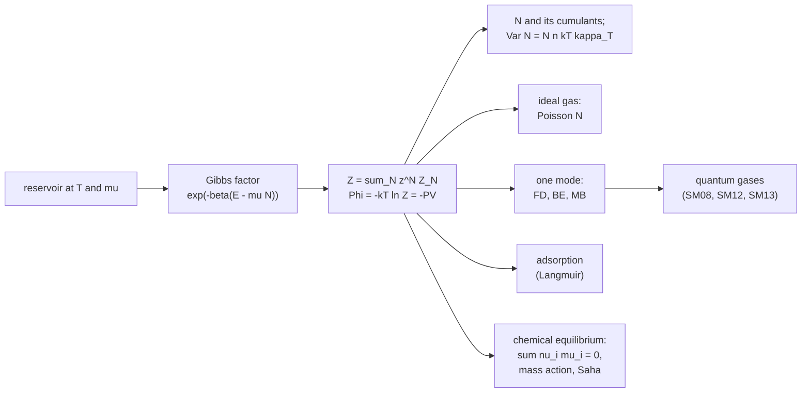

# SM05 · The Grand Canonical Ensemble and Chemical Equilibrium

◀ [[SM04 Kinetic Theory and the Boltzmann Equation]] · [[Thermodynamics and Statistical Mechanics - Course Map|Course Map]] · next ▶ [[SM06 Entropy Information and the Arrow of Time]]

> [!info] Source and approach
> Follows **Kardar §4.9 (pp. 118–120)** ([[Mehran Kardar - Statistical Physics of Particles (2007).pdf#page=130|PDF p.130 ff.]]; PDF = printed + 12) and **Pathria and Beale Ch. 4 (printed pp. 91–114)** and **§6.6 chemical equilibrium (pp. 170–178)** (PDF = printed + 27, read from the OCR'd table of contents). Cross-checked against **Huang §7.3–7.8 (printed pp. 149–170; `.djvu` page = printed + 8 in Part B)** and **Schroeder §5.6 (the Saha equation, printed pp. 218–219) and §7.1 (the Gibbs factor, pp. 257–263; `.djvu` page = printed + 10)**: Schroeder's numbers for the solar photosphere ($(2\pi m_ekT/h^2)^{3/2}=1.07\times10^{27}$ m$^{-3}$, $e^{-I/kT}=1.5\times10^{-12}$ at 5800 K) agree with the ones recomputed here. The cosmological Saha estimate, the number-fluctuation numbers for water and the N$_2$O$_4$ equilibrium are my own additions (`scripts/sm05_numbers.py`, `fig_sm05.py`). No course is behind this chapter: no taught/extra labels. It finishes the sketch of the grand ensemble in [[TH06 From Kinetic Theory to Statistical Mechanics]] §8 and the Saha remark in [[SM03 The Canonical Ensemble]] §6.

> [!tip] Start here (first read)
> - **The picture.** The canonical ensemble let a system trade *energy* with a reservoir; the **grand canonical ensemble** also lets it trade *particles*. This is the right description of a region of a larger gas, a surface in contact with a vapour, an electron gas in a metal, a reacting mixture, a photon cavity (SM11) and every quantum gas (SM12–SM13). It is nearly always the *easiest* ensemble to calculate in, because the particle number stops being a constraint: a sum over $N$ factorises.
> - **What you need.** The canonical ensemble ([[SM03 The Canonical Ensemble]]), the chemical potential and the grand potential from thermodynamics ([[Chemical Potential]], [[Grand Potential]], [[Gibbs-Duhem Relation]]), the cumulant machinery of [[SM01 Probability Large Numbers and Information]].
> - **How to read.** §1–§3 are the theory (derivation, thermodynamics, fluctuations). §4 is the classical gas. **§5 is the conceptual hinge of Part II-B: one single-particle state in the grand ensemble gives the Fermi–Dirac and Bose–Einstein distributions.** §6–§7 are the working applications: adsorption, mass action, and the Saha equation (stars, the early Universe). §8 is a table of all four ensembles; §9 is the chemical potential as a measurable quantity. Do Problems 1, 5, 7 and 8.
> - **Notation.** $\mu$ chemical potential; $z=e^{\beta\mu}$ fugacity; $\mathcal Z$ grand partition function; $\Phi=-k_BT\ln\mathcal Z$ grand potential; $\lambda=h/\sqrt{2\pi mk_BT}$; $\nu_i$ stoichiometric coefficients; $K_c,K_p$ equilibrium constants; $I=13.6$ eV the ionisation energy of hydrogen.

> [!key] After this chapter you can
> - derive the **Gibbs factor** $e^{-\beta(E_i-\mu N_i)}/\mathcal Z$ from a reservoir that exchanges both energy and particles, and write $\mathcal Z=\sum_Nz^NZ_N$,
> - obtain $\langle N\rangle$, $S$, $P$ and all cumulants of $N$ from $\Phi=-k_BT\ln\mathcal Z=-PV$, and prove $\mathrm{Var}\,N=k_BT(\partial N/\partial\mu)_{T,V}=\langle N\rangle\,nk_BT\kappa_T$,
> - solve the **classical ideal gas** ($\mathcal Z=e^{zV/\lambda^3}$, **Poisson** $P(N)$) and compute **energy and number fluctuations** in both ensembles,
> - obtain **Fermi–Dirac, Bose–Einstein and Maxwell–Boltzmann** occupations from a single mode and read off the occupation **variances**,
> - derive the **Langmuir isotherm** and the **law of mass action** $\prod n_i^{\nu_i}=\prod(z_i^{\rm int}/\lambda_i^3)^{\nu_i}$, and apply them to N$_2$O$_4\rightleftharpoons2$NO$_2$,
> - derive and use the **Saha equation** (photosphere, nebulae, the recombination of the Universe),
> - state when the four ensembles are equivalent and how the grand potential is a **Legendre transform**; use the **Widom insertion** formula for $\mu$.

> [!intuition] The one-sentence story
> If the system is allowed to borrow particles as well as energy from a big reservoir, the cost of a configuration is $E_i-\mu N_i$ (energy plus the entropy price of the particles taken from the reservoir); the sum of $e^{-\beta(E_i-\mu N_i)}$ over *all* particle numbers is the grand partition function, and its logarithm is $-PV/k_BT$.

*Concept map of the chapter.*

![[fig_sm05_grandcanonical.png]]
*Figure SM5.1. A: the number of molecules in an open region of an ideal gas is Poisson, close to Gaussian once $\langle N\rangle\gtrsim10$ (§4). B: Langmuir isotherms for a 0.5 eV binding site: the half-coverage pressure $P_0$ rises by five orders of magnitude between 300 and 600 K (§6). C: Saha ionisation of hydrogen against $T$ for three densities and for the expanding Universe: the transition is sharp and happens at $kT\approx0.03$–$0.09\,I$, far below $I/k=1.6\times10^5$ K (§7.3). D: the three one-mode occupations as functions of $x=(\varepsilon-\mu)/k_BT$: they coincide for $x\gtrsim4$ and differ sharply near $x=0$ (§5).*

## 1. From the canonical to the grand canonical ensemble

Let a system $S$ with microstates $i$ (energy $E_i$, particle number $N_i$) be in contact with a **reservoir** $R$ that can exchange both energy and particles; the combined system is isolated, with total energy $E$ and total number $N$. By the postulate of SM02 the probability that $S$ is in microstate $i$ is proportional to the number of reservoir microstates left over:
$$p_i\propto\Omega_R(E-E_i,\,N-N_i)=\exp\Big[\frac{S_R(E-E_i,N-N_i)}{k_B}\Big].$$
Expand about $(E,N)$ using the thermodynamic definitions $\big(\partial S/\partial E\big)=1/T$ and $\big(\partial S/\partial N\big)=-\mu/T$ ([[SM02 Phase Space Liouville and the Microcanonical Ensemble]] §4.2):
$$S_R(E-E_i,N-N_i)=S_R(E,N)-\frac{E_i-\mu N_i}T+\dots$$
The terms of second order are negligible for a large reservoir (as in SM03 §1). Hence
$$\boxed{\ p_i=\frac{e^{-\beta(E_i-\mu N_i)}}{\mathcal Z},\qquad\mathcal Z(T,V,\mu)=\sum_ie^{-\beta(E_i-\mu N_i)}=\sum_{N=0}^\infty z^N\,Z_N(T,V),\qquad z=e^{\beta\mu}\ }$$
([[Grand Canonical Ensemble]]; [[Mehran Kardar - Statistical Physics of Particles (2007).pdf#page=130|K §4.9, eqs. (4.99)–(4.101), pp. 118–119]]; PB §4.1–4.2; Huang §7.3; Schroeder's "Gibbs factor", §7.1). The second form groups the microstates by particle number; the restricted sums are the **canonical partition functions** $Z_N$. The weight $z^N$ is the **fugacity** ($z$ plays the role of an *activity*: the chemical potential measured on an exponential scale; [[Fugacity]]).

> [!intuition] What $\mu$ measures
> $\mu=-T(\partial S/\partial N)_{E,V}$ is the **entropy price of a particle**: it tells you how much the reservoir's entropy changes when it gives one particle to the system. A system with a very negative $\mu$ (a dilute gas: $\mu=k_BT\ln n\lambda^3\ll0$) has a reservoir that is *reluctant* to part with particles, so $N$ is small; a large positive $\mu$ means that adding particles is favoured (a degenerate Fermi gas, a condensing vapour). Particles flow from high $\mu$ to low $\mu$, as heat flows from high $T$ to low $T$.

> [!example] Why the grand ensemble is easy to calculate in
> In the canonical ensemble the constraint $N=$ fixed couples the particles (the $1/N!$ and the factorials of the combinatorics). In the grand ensemble the constraint is released: for non-interacting particles $\mathcal Z=\prod_{\rm modes}\mathcal Z_{\rm mode}$ with *no* constraint, so each single-particle state is solved independently (§5). For *interacting* particles the expansion in $z$ is the **cluster (Mayer) expansion** (SM14, planned).

## 2. Thermodynamics from $\mathcal Z$

Define the **grand potential**
$$\Phi(T,V,\mu)=-k_BT\ln\mathcal Z=E-TS-\mu N\qquad([[Grand Potential]]).$$
It is the Legendre transform of $F$: for large $N$ the sum $\sum_Nz^NZ_N=\sum_N e^{\beta(\mu N-F(N))}$ is dominated by its largest term (SM01 §5.1), at the $N^*$ where $\mu=\partial F/\partial N$, giving $\ln\mathcal Z=\beta(\mu N^*-F(N^*))$, i.e. $\Phi=F-\mu N$ ([[Mehran Kardar - Statistical Physics of Particles (2007).pdf#page=130|K eqs. (4.105)–(4.106)]]). Its differential is $\mathrm d\Phi=-S\,\mathrm dT-P\,\mathrm dV-N\,\mathrm d\mu$, so
$$\langle N\rangle=-\frac{\partial\Phi}{\partial\mu}=k_BT\frac{\partial\ln\mathcal Z}{\partial\mu}=z\frac{\partial\ln\mathcal Z}{\partial z},\qquad S=-\frac{\partial\Phi}{\partial T},\qquad P=-\frac{\partial\Phi}{\partial V}.$$

> [!key] $\Phi=-PV$
> For a *uniform, extensive* system $\Phi(T,\lambda V,\mu)=\lambda\Phi(T,V,\mu)$ (only $V$ is extensive among the arguments), so $\Phi=V\,\partial_V\Phi=-PV$. Therefore **$\ln\mathcal Z=PV/k_BT$**: the logarithm of the grand partition function *is* the equation of state. (This fails when surface terms matter: for a system with a surface of area $A$ and surface tension $\gamma$, $\Phi=-PV+\gamma A$.)

**Cumulants of $N$.** $\ln\mathcal Z$ is a cumulant generating function in the variable $\beta\mu$ (SM01 §2): $\ \kappa_n(N)=(k_BT\,\partial_\mu)^n\ln\mathcal Z$, so $\kappa_1=\langle N\rangle$ and
$$\mathrm{Var}\,N=k_BT\,\frac{\partial\langle N\rangle}{\partial\mu}\bigg|_{T,V}\ \ge0,\tag{GC-1}$$
which is the static fluctuation–response relation of SM03 §2.6 with the field $\mu$ conjugate to $N$ ([[Fluctuation-Response Relation]]).

## 3. Number fluctuations and the compressibility

> [!derivation] $\mathrm{Var}\,N$ in terms of the compressibility ([[Number Fluctuations]])
> At fixed $T$ the Gibbs–Duhem relation gives $\mathrm d\mu=\mathrm dP/n$ with $n=N/V$. The isothermal compressibility is $\kappa_T=\frac1n\big(\partial n/\partial P\big)_T$, so $(\partial n/\partial\mu)_T=n\,(\partial n/\partial P)_T=n^2\kappa_T$ and $(\partial N/\partial\mu)_{T,V}=Vn^2\kappa_T=N^2\kappa_T/V$. Insert in (GC-1):
> $$\boxed{\ \mathrm{Var}\,N=\frac{N^2\,k_BT\,\kappa_T}{V}\ ,\qquad\frac{\mathrm{Var}\,N}{\langle N\rangle}=n\,k_BT\,\kappa_T\ }$$
> The relative fluctuation $\sigma_N/\langle N\rangle=\sqrt{k_BT\kappa_T/V}\sim1/\sqrt N$.

- **Ideal gas.** $\kappa_T=1/P=1/(nk_BT)$, so $\mathrm{Var}\,N=\langle N\rangle$: **Poisson** (§4; SM01 §3).
- **Liquid water at 20 °C** ($n=3.34\times10^{28}$ m$^{-3}$, $\kappa_T=4.59\times10^{-10}$ Pa$^{-1}$; recalled): $\mathrm{Var}N/\langle N\rangle=nk_BT\kappa_T=0.062$. In a $(1\ \mathrm{nm})^3$ cell $\langle N\rangle=33$ and $\sigma_N=1.4$ (an ideal gas of that density would give $5.8$); in $(10\ \mathrm{nm})^3$, $\sigma_N/\langle N\rangle=1.4\times10^{-3}$. **A liquid is 16 times "stiffer" against number fluctuations than a gas of the same density**: molecules cannot overlap.
- **Critical point.** $\kappa_T\to\infty$, so $\mathrm{Var}\,N/\langle N\rangle\to\infty$: the density fluctuations become macroscopic and scatter light strongly (critical opalescence; SM19, planned). The same relation underlies the Rayleigh scattering of SM01 §3: the scattered intensity of a fluid is proportional to $nk_BT\kappa_T$ (Einstein–Smoluchowski).

> [!key] Energy fluctuations differ between the ensembles
> The law of total variance, $\mathrm{Var}\,E=\langle\mathrm{Var}(E|N)\rangle+\mathrm{Var}\langle E|N\rangle$, gives for the grand ensemble
> $$\mathrm{Var}\,E\big|_{\rm GC}=k_BT^2C_V\big|_N+\Big(\frac{\partial\langle E\rangle}{\partial N}\Big)^2_{T,V}\mathrm{Var}\,N .$$
> For the monatomic ideal gas the first term is $\tfrac32N(k_BT)^2$ and the second $\big(\tfrac32k_BT\big)^2N$, so $\mathrm{Var}\,E=\tfrac{15}4N(k_BT)^2$ (canonical: $\tfrac32N(k_BT)^2$). The relative energy fluctuation is $\sqrt{15/4}/(3/2)=1.29/\sqrt N$ instead of $0.816/\sqrt N$: a factor $1.58$ larger. **The ensembles differ in their fluctuations but all vanish as $1/\sqrt N$**, the content of equivalence in the thermodynamic limit.

## 4. The classical ideal gas, and the Poisson law

For $N$ non-interacting classical atoms $Z_N=(V/\lambda^3)^N/N!$ (SM03 §4.1), and
$$\mathcal Z=\sum_{N=0}^\infty\frac{1}{N!}\Big(\frac{zV}{\lambda^3}\Big)^N=\exp\Big(\frac{zV}{\lambda^3}\Big),\qquad P(N)=\frac{z^NZ_N}{\mathcal Z}=\frac{\langle N\rangle^N}{N!}e^{-\langle N\rangle},\qquad\langle N\rangle=\frac{zV}{\lambda^3}.$$
**The number of molecules in a region of an ideal gas is Poisson-distributed** (Fig. SM5.1A): $\mathrm{Var}\,N=\langle N\rangle$ exactly, $P(0)=e^{-\langle N\rangle}$. Then $\Phi=-k_BT\,zV/\lambda^3=-\langle N\rangle k_BT=-PV$ gives $P=k_BTz/\lambda^3=nk_BT$ ✓ and
$$\mu=k_BT\ln z=k_BT\ln\big(n\lambda^3\big)=k_BT\ln\frac{P\lambda^3}{k_BT}$$
([[Mehran Kardar - Statistical Physics of Particles (2007).pdf#page=131|K eqs. (4.108)–(4.112), pp. 119–120]]), identical to the canonical result of SM03 §4.1: **equivalence in action**. A gas with internal structure has $z\to z\,z^{\rm int}$ with $z^{\rm int}=\sum g_ke^{-\beta\epsilon_k}$, and a mixture has $\ln\mathcal Z=\frac V{\lambda^3}\sum_i\frac{z_iz_i^{\rm int}}{\ldots}$ (one term per species).

> [!example] Small open regions (recomputed; Fig. SM5.1A)
> $\langle N\rangle=3$: $P(0)=0.050$, $P(\text{peak})=0.224$ (Gaussian: $0.230$), $\sigma/\langle N\rangle=0.58$; $\langle N\rangle=10$: $P(0)=4.5\times10^{-5}$, peak $0.125$ ($0.126$); $\langle N\rangle=30$: $P(0)=9\times10^{-14}$. The Gaussian is a good description already at $\langle N\rangle\sim10$; in the far tail the Poisson is skewed (SM01 §3, §4.4). For N$_2$ at 300 K and 1 atm $z=n\lambda^3=1.69\times10^{-7}$ and $\mu/k_BT=-15.59$: the reservoir is very reluctant to give particles up (the density is low).

## 5. One mode at a time: where Fermi–Dirac and Bose–Einstein come from

Consider a **single quantum state** (an orbital) of energy $\varepsilon$ in the grand canonical ensemble. If the state can hold $n$ identical particles, its weight is $z^ne^{-\beta n\varepsilon}=e^{-n(\varepsilon-\mu)/k_BT}$. With $x=(\varepsilon-\mu)/k_BT$:

| statistics | allowed $n$ | $\mathcal Z_{\rm mode}$ | mean occupation $\langle n\rangle$ | variance |
|---|---|---|---|---|
| **fermions** (Pauli) | $0,1$ | $1+e^{-x}$ | $\dfrac1{e^{x}+1}$ (Fermi–Dirac) | $\langle n\rangle(1-\langle n\rangle)$ |
| **bosons** | $0,1,2,\dots$ | $\dfrac1{1-e^{-x}}$ | $\dfrac1{e^{x}-1}$ (Bose–Einstein) | $\langle n\rangle(1+\langle n\rangle)$ |
| classical (distinguishable, counted $1/n!$) | $0,1,2,\dots$ | $\exp(e^{-x})$ | $e^{-x}$ (Maxwell–Boltzmann) | $\langle n\rangle$ (Poisson) |

([[Fermi-Dirac Distribution]], [[Bose-Einstein Distribution]]; Schroeder §7.1 does the two-state case; the full theory is SM08.) *The three distributions differ only in how many particles a state can take, and the grand ensemble makes each single-mode problem trivial.* The full $\mathcal Z$ of a gas of non-interacting particles is the **product over modes**, $\ln\mathcal Z=\pm\sum_\varepsilon\ln(1\pm e^{-(\varepsilon-\mu)/k_BT})$, which SM08 turns into the equations of state of Fermi and Bose gases.

> [!example] Numbers (recomputed; Fig. SM5.1D)
> | $x=(\varepsilon-\mu)/k_BT$ | 0.5 | 1 | 2 | 5 | 10 |
> |---|---|---|---|---|---|
> | Fermi–Dirac | 0.378 | 0.269 | 0.119 | 0.00669 | $4.5\times10^{-5}$ |
> | Bose–Einstein | 1.541 | 0.582 | 0.157 | 0.00678 | $4.5\times10^{-5}$ |
> | Maxwell–Boltzmann | 0.607 | 0.368 | 0.135 | 0.00674 | $4.5\times10^{-5}$ |
>
> For $x\gtrsim5$ all three agree to 1 %: **the classical gas is the dilute limit, $\langle n\rangle\ll1$** (equivalently $n\lambda^3\ll1$, SM02 §6). For $x\lesssim2$ they differ drastically: fermions saturate at $\tfrac12$ for $x=0$ and approach 1 for $x\to-\infty$ (a filled Fermi sea); bosons diverge as $x\to0^+$ (the condensation of SM13). The sign of the **variance correction** is the statistical force: fermions' occupation fluctuations are *suppressed* ($1-\langle n\rangle$: antibunching), bosons' *enhanced* ($1+\langle n\rangle$: bunching, the Hanbury Brown–Twiss effect of photons).

> [!pitfall] $\mu$ must lie below the lowest level for bosons
> $\langle n\rangle=1/(e^x-1)$ is positive only for $x>0$, i.e. $\mu<\varepsilon$ for *every* mode: $\mu\le\varepsilon_{\min}$ (SM13). For fermions $\mu$ can lie anywhere (a metal has $\mu=E_F\approx$ several eV).

## 6. Adsorption: the Langmuir isotherm

A surface has $M$ identical, independent sites, each of which can bind **at most one** gas molecule with binding energy $-\epsilon$ ($\epsilon>0$). In equilibrium with a gas at pressure $P$ the sites are in the grand ensemble with the gas's chemical potential $\mu=k_BT\ln(P\lambda^3/k_BT)$ (§4). One site has $\mathcal Z_1=1+e^{\beta(\mu+\epsilon)}$ (empty or occupied), so the coverage $\theta=\langle n\rangle$ is
$$\boxed{\ \theta=\frac{e^{\beta(\mu+\epsilon)}}{1+e^{\beta(\mu+\epsilon)}}=\frac P{P+P_0(T)},\qquad P_0(T)=\frac{k_BT}{\lambda^3}\,e^{-\epsilon/k_BT}\ }$$
([[Langmuir Isotherm]]; Schroeder §7.1 treats the same two-state site for O$_2$ on haemoglobin). This is the *Fermi–Dirac occupation of a single site* (the site holds 0 or 1). $P_0$ is the pressure at half coverage: the **adsorption equilibrium is a competition between the binding energy and the entropy of the free gas**, $P_0\propto e^{-\epsilon/k_BT}$.

> [!example] Numbers for an N$_2$-mass molecule (recomputed; Fig. SM5.1B)
> **$\epsilon=0.5$ eV** (chemisorption scale): $k_BT/\lambda^3=6.0\times10^{11}$ Pa at 300 K; $P_0=2.4\times10^3$ Pa at 300 K, $6.2\times10^5$ Pa at 400 K, $2.1\times10^8$ Pa at 600 K. At 1 bar the coverage is $0.977,\ 0.139,\ 5\times10^{-4}$: a surface that is saturated at room temperature is *empty* at 600 K (this is why catalytic surfaces are cleaned by heating, "flash desorption"). At 1 Pa and 300 K the coverage is only $4.2\times10^{-4}$: ultrahigh vacuum is needed to keep a clean surface for an hour. **$\epsilon=0.1$ eV** (physisorption): $P_0=5.7\times10^3$ Pa at 77 K (coverage $0.946$ at 1 bar: nitrogen at liquid-nitrogen temperature is used to measure surface areas) but $1.3\times10^{10}$ Pa at 300 K (coverage zero).

> [!pitfall] What Langmuir leaves out
> Independent sites, one molecule per site, no lateral interaction. With interactions the surface layer becomes a **lattice gas** equivalent to the Ising model, and shows a two-dimensional condensation (SM16); multilayer adsorption (BET) allows several molecules per site.

## 7. Chemical equilibrium

### 7.1 The condition $\sum\nu_i\mu_i=0$
Consider a reaction $\sum_i\nu_iA_i=0$ ($\nu_i<0$ for reactants, $>0$ for products) in a gas at fixed $T,V$. A change of the **extent of reaction** $\xi$ changes the numbers by $\mathrm dN_i=\nu_i\,\mathrm d\xi$, so $\mathrm dF=\sum_i\mu_i\mathrm dN_i=\big(\sum_i\nu_i\mu_i\big)\mathrm d\xi$, and the equilibrium (minimum of $F$; at fixed $T,P$ minimum of $G$) is
$$\boxed{\ \sum_i\nu_i\mu_i=0\ }$$
(Pathria §6.6, Huang §7.5). The same condition holds in the grand ensemble: the reservoir's chemical potentials must be consistent with the reaction ($\mu_{\rm A}+\mu_{\rm B}=\mu_{\rm AB}$ for $\mathrm A+\mathrm B\to\mathrm{AB}$).

### 7.2 The law of mass action from partition functions
For ideal gases with internal partition function $z_i^{\rm int}=\sum_kg_{k}e^{-\beta\epsilon_k}$ (the energies measured from a **common** zero, so that the energy released in the reaction is included) $\mu_i=k_BT\ln(n_i\lambda_i^3/z_i^{\rm int})$. Then $\sum\nu_i\mu_i=0$ gives
$$\boxed{\ \prod_in_i^{\nu_i}=K_c(T)\equiv\prod_i\Big(\frac{z_i^{\rm int}}{\lambda_i^3}\Big)^{\nu_i}\ }$$
(the **law of mass action**, [[Law of Mass Action]]), and since $n_i=P_i/k_BT$, $K_p=\prod(P_i/P^\circ)^{\nu_i}=K_c(k_BT/P^\circ)^{\sum\nu_i}$. Comparison with thermodynamics ([[TH05 Potentials Maxwell Relations Stability and the Third Law]]) identifies $K_p=\exp(-\Delta_rG^\circ/RT)$, so **statistical mechanics computes $\Delta_rG^\circ$ from molecular properties** (masses, moments of inertia, vibrational frequencies, electronic levels: SM09).

> [!example] N$_2$O$_4\rightleftharpoons2$NO$_2$ (recomputed; thermodynamic data recalled)
> $\Delta_rG^\circ(298\ \mathrm K)=2(51.3)-97.9=+4.7$ kJ mol$^{-1}$ (recalled tables), so $K_p=e^{-\Delta G^\circ/RT}=0.148$. With $\alpha$ the dissociation fraction at total pressure $P$ (in bar): $K_p=4\alpha^2P/(1-\alpha^2)$, $\alpha=\sqrt{K_p/(K_p+4P)}$:
>
> | $P$ (bar) | 10 | 1 | 0.5 | 0.1 | 0.01 |
> |---|---|---|---|---|---|
> | $\alpha$ | 0.061 | 0.189 | 0.263 | 0.520 | 0.887 |
>
> Le Châtelier from counting: lowering $P$ favours the side with more molecules (more translational entropy $\propto\ln(V/N\lambda^3)$ each). With $\Delta H^\circ=57.2$ kJ mol$^{-1}$ (recalled) the van 't Hoff equation gives $K_p(350\ \mathrm K)=4.5$: the dimer is almost entirely dissociated at 350 K and 1 bar.

### 7.3 The Saha equation
The reaction H $\rightleftharpoons$ p + e is a chemical equilibrium of three ideal gases, with the ionisation energy $I=13.606$ eV as the energy difference between the ground states. The internal partition functions are the spin degeneracies, $g_e=2$, $g_p=2$ (proton spin), $g_{\rm H}=4$ (the electron and proton spins in the ground state, hyperfine splitting ignored), so $g_eg_p/g_{\rm H}=1$, and with $m_{\rm H}\approx m_p$ (the $\lambda$'s of H and p cancel):
$$\boxed{\ \frac{n_en_p}{n_{\rm H}}=\Big(\frac{2\pi m_ek_BT}{h^2}\Big)^{3/2}e^{-I/k_BT}\ }$$
([[Saha Equation]]; Schroeder §5.6 pp. 218–219, derived there from the same $\mu$'s; Pathria §6.6). The right-hand side is $1/\lambda_e^3$ times a Boltzmann factor. For a fully ionised hydrogen gas with $n_e=n_p=xn$ and $n_{\rm H}=(1-x)n$: $\;x^2/(1-x)=K/n$, $\;x=2/(1+\sqrt{1+4n/K})$.

> [!example] Stars, nebulae and the Universe (recomputed; Fig. SM5.1C)
> *Solar photosphere*, $T=5800$ K: $(2\pi m_ekT/h^2)^{3/2}=1.07\times10^{27}$ m$^{-3}$, $e^{-I/kT}=1.5\times10^{-12}$, $K=1.6\times10^{15}$ m$^{-3}$ (Schroeder's values ✓). With the actual electron density $\approx2\times10^{19}$ m$^{-3}$ (mostly from metals) $n_p/n_{\rm H}=8\times10^{-5}$: **less than one hydrogen atom in 10 000 is ionised at the surface of the Sun.** For pure hydrogen at $n=10^{23}$ m$^{-3}$ the ionised fraction would be $x=\sqrt{K/n}=1.3\times10^{-4}$.
> *Ionised fraction against $T$:*
>
> | $T$ (K) | 5800 | 8000 | 10 000 | 12 000 | 15 000 |
> |---|---|---|---|---|---|
> | $n=10^{23}$ m$^{-3}$ | 0.0001 | 0.0068 | 0.056 | 0.22 | 0.65 |
> | $n=10^{20}$ | 0.0040 | 0.19 | 0.81 | 0.98 | 0.999 |
>
> **Half ionisation** at $T=14\,000$ K ($n=10^{23}$), $9000$ K ($n=10^{20}$), $4000$ K ($n=10^{10}$ m$^{-3}$): i.e. at $k_BT=0.089,\ 0.057,\ 0.025\ I$, **far below $I/k_B=158\,000$ K**. The reason is entropy: ionising frees an electron into a volume per particle $1/n\gg\lambda^3$, and the gain $k_B\ln(1/n\lambda^3)\approx k_B\cdot17$ per atom (for $n=10^{20}$) pays for $I$ when $k_BT\approx I/17$. Less dense gases ionise at lower $T$ (HII regions are fully ionised at 10 000 K).
> *Recombination of the Universe.* Hydrogen plus photons with $n_B=\eta\,n_\gamma(T)$, $\eta=6.1\times10^{-10}$ (recalled), $n_\gamma=\frac{2\zeta(3)}{\pi^2}(k_BT/\hbar c)^3$: Saha gives half-recombination at $T=3760$ K, $z=1380$ (today $n_B=0.25$ m$^{-3}$, $n_\gamma=4.1\times10^8$ m$^{-3}$). The *observed* last scattering is at $z\approx1090$ ($T\approx2970$ K; recalled): the equilibrium estimate is too early because recombination to the ground state is blocked by the Lyman photons it emits and proceeds through slow two-photon decays, so it lags equilibrium (Peebles). A reminder that Saha is an *equilibrium* result.

> [!pitfall] Four traps
> 1. **The zero of energy.** $\mu_i$'s of different species must be measured from a common zero: the ionisation energy $I$ (or $\Delta H$) enters through $e^{-\epsilon_0/kT}$ in $z^{\rm int}$ ([[SM03 The Canonical Ensemble]] §6 for the hydrogen sum).
> 2. **$n_{\rm H}$ is the neutral density**, not the total hydrogen density: $x=n_p/(n_p+n_{\rm H})$.
> 3. **Ideal gases only.** Plasma screening lowers the effective ionisation energy (Debye–Hückel, SM29, planned) and excited states of H change $z^{\rm int}$ at high $T$ (the cutoff of §6 in SM03).
> 4. **Constraints beyond $\sum\nu\mu=0$.** Atom (not molecule) numbers are conserved: they fix the *total* quantities ($n_p+n_{\rm H}=$ const, $n_e=n_p$ by neutrality), which is what makes the Saha equation solvable.

## 8. The four ensembles side by side

| ensemble | fixed | weight of microstate | potential | fluctuating | variance |
|---|---|---|---|---|---|
| microcanonical | $E,V,N$ | uniform on the shell | $S=k_B\ln\Omega$ | none | — |
| canonical | $T,V,N$ | $e^{-\beta E}/Z$ | $F=-k_BT\ln Z$ | $E$ | $k_BT^2C_V$ |
| $(T,P)$ (Gibbs) | $T,P,N$ | $e^{-\beta(E+PV)}$ | $G=-k_BT\ln\mathcal Z_G$ | $V$ | $k_BTV\kappa_T$ |
| grand canonical | $T,V,\mu$ | $e^{-\beta(E-\mu N)}/\mathcal Z$ | $\Phi=-k_BT\ln\mathcal Z=-PV$ | $N$ (and $E$) | $N^2k_BT\kappa_T/V$ |

Each potential is the **Legendre transform** of the one above in the variable that is released (SM03 §3.1; [[Legendre Transform]]): $F=E-TS$, $G=F+PV$, $\Phi=F-\mu N$. The potentials $S$, $F$, $G$, $\Phi$ give the *same* thermodynamics for large $N$ because each sum is dominated by its largest term. (The combination $(T,P,\mu)$ is not an independent set: by Gibbs–Duhem $\mu=\mu(T,P)$, so the "isobaric grand ensemble" has no equilibrium.)

> [!pitfall] When the ensembles are *not* equivalent
> At a **first-order transition** the distribution $P(N)$ of the grand ensemble is **bimodal** at coexistence: one peak at the gas density and one at the liquid density, with weights depending on $\mu$ (the volume is fixed). A van der Waals isotherm computed in the canonical ensemble has a spurious loop; the grand ensemble replaces it by the **Maxwell construction** (equal areas) at the $\mu$ where the two peaks have equal height (Huang §7.7–7.8, pp. 161–170; SM15, planned). Only at that $\mu$ is the pressure $P=-\Phi/V$ common to both phases.

## 9. The chemical potential as a measurable quantity

**As an escape tendency.** In equilibrium between two phases or two regions $\mu$ is equal; the **difference** $\Delta\mu$ drives net transport. For an ideal gas $\mu(P_2)-\mu(P_1)=k_BT\ln(P_2/P_1)$: N$_2$ at 300 K compressed from 1 to 10 atm gains $0.0595$ eV $=5.74$ kJ mol$^{-1}$ per molecule (recomputed).

> [!derivation] Widom's insertion formula ([[Widom Insertion Method]])
> $\mu=F_{N+1}-F_N=-k_BT\ln(Z_{N+1}/Z_N)$. Write $Z_N=\dfrac1{N!\lambda^{3N}}\int\mathrm d^{3N}q\,e^{-\beta U_N}$ and let $\Delta U(\mathbf q';\mathbf q)$ be the interaction energy of an added particle at $\mathbf q'$ with the other $N$, so $U_{N+1}=U_N+\Delta U$. Then
> $$\frac{Z_{N+1}}{Z_N}=\frac1{(N+1)\lambda^3}\int\mathrm d^3q'\,\Big\langle e^{-\beta\Delta U(\mathbf q';\mathbf q)}\Big\rangle_N=\frac V{(N+1)\lambda^3}\big\langle e^{-\beta\Delta U}\big\rangle,$$
> where $\langle\cdot\rangle$ averages over the $N$-particle canonical ensemble *and* over the position $\mathbf q'$ of the ghost, uniform in $V$. Hence
> $$\mu=k_BT\ln\frac{(N+1)\lambda^3}V-k_BT\ln\big\langle e^{-\beta\Delta U}\big\rangle\ \Longrightarrow\ \mu=\mu_{\rm id}+\mu_{\rm ex},\qquad\mu_{\rm ex}=-k_BT\ln\big\langle e^{-\beta\Delta U}\big\rangle .$$
> $\mu_{\rm ex}$ is the **excess chemical potential**: the free-energy cost of making room for the ghost molecule. For an ideal gas $\Delta U=0$ and $\mu_{\rm ex}=0$. For hard spheres $e^{-\beta\Delta U}=1$ when the ghost fits and $0$ when it overlaps, so $\mu_{\rm ex}=-k_BT\ln p_{\rm fit}$ with $p_{\rm fit}$ the probability that a random point is the centre of a free cavity: the *scaled-particle* picture of dense fluids. The formula is used as a computational method (insert test molecules into a Monte Carlo or molecular-dynamics snapshot; SM26, planned).

> [!connection] Chemical potential in the vault
> $\mu$ appears in the Clausius–Clapeyron relation (equal $\mu$ in two phases, [[TH05 Potentials Maxwell Relations Stability and the Third Law]], [[Clausius-Clapeyron Relation]]), the saturation vapour pressure of [[CL05 Thermodynamic State of the Atmosphere]], the Nernst potential of neurons (electrochemical potential $\mu+q\phi$ equal across a membrane: the same equilibrium condition), the Fermi level of a metal or semiconductor (SM12) and the photon gas ($\mu=0$ because photon number is not conserved, SM11).

## Map of this chapter
> [!connection] How SM05 connects
> **Builds on:** [[SM03 The Canonical Ensemble]] ($Z$, equivalence, ideal gas), [[SM02 Phase Space Liouville and the Microcanonical Ensemble]] ($\mu=-T\partial_NS$), [[SM01 Probability Large Numbers and Information]] (cumulants, Poisson, largest term), [[TH05 Potentials Maxwell Relations Stability and the Third Law]], [[SM04 Kinetic Theory and the Boltzmann Equation]] (the same Boltzmann factor for a reacting plasma).
> **Leads to:** SM08 (quantum ensembles: $\ln\mathcal Z=\pm\sum\ln(1\pm ze^{-\beta\varepsilon})$ for Fermi and Bose gases), SM09 (internal partition functions $z^{\rm int}$ of molecules), SM11 (photon gas, $\mu=0$), SM12–SM13 (Fermi and Bose gases), SM14 (cluster expansion in powers of $z$), SM15 (gas–liquid coexistence and the Maxwell construction), SM19 (critical opalescence), SM29 (Debye–Hückel screening and Saha corrections); all planned.
> **Concepts:** [[Grand Canonical Ensemble]] · [[Fugacity]] · [[Number Fluctuations]] · [[Fermi-Dirac Distribution]] · [[Bose-Einstein Distribution]] · [[Langmuir Isotherm]] · [[Law of Mass Action]] · [[Saha Equation]] · [[Widom Insertion Method]] · [[Grand Potential]] · [[Chemical Potential]] · [[Gibbs-Duhem Relation]] · [[Fluctuation-Response Relation]] · [[Gibbs Canonical Ensemble]]
> **Other subjects:** [[CL05 Thermodynamic State of the Atmosphere]] (mixtures, $\mu$ and saturation), [[Poisson Distribution]] (Probability), [[Rayleigh Scattering]] (Climate: scattering by density fluctuations).

## Summary
> [!summary] Cheat-sheet
> - **Gibbs factor:** $p_i=e^{-\beta(E_i-\mu N_i)}/\mathcal Z$; $\mathcal Z=\sum_Nz^NZ_N$; $z=e^{\beta\mu}$; $\mu=-T\partial_NS=\partial_NF$.
> - **Thermodynamics:** $\Phi=-k_BT\ln\mathcal Z=F-\mu N=-PV$; $\langle N\rangle=k_BT\partial_\mu\ln\mathcal Z$; $S=-\partial_T\Phi$; $\ln\mathcal Z=PV/k_BT$.
> - **Fluctuations:** $\mathrm{Var}N=k_BT\partial_\mu N=N^2k_BT\kappa_T/V=\langle N\rangle nk_BT\kappa_T$ (ideal gas: Poisson; water: $0.062\langle N\rangle$; critical point: $\infty$). Energy in GC: $\mathrm{Var}E=k_BT^2C_V+(\partial_NE)^2\mathrm{Var}N$ ($\tfrac{15}4N(kT)^2$ for the ideal gas).
> - **Ideal gas:** $\mathcal Z=e^{zV/\lambda^3}$, $\mu=k_BT\ln n\lambda^3$, $P=nk_BT$.
> - **One mode:** FD $1/(e^x+1)$, BE $1/(e^x-1)$, MB $e^{-x}$; variances $\langle n\rangle(1\mp\langle n\rangle)$, $\langle n\rangle$; all agree for $x\gtrsim5$.
> - **Langmuir:** $\theta=P/(P+P_0)$, $P_0=(k_BT/\lambda^3)e^{-\epsilon/k_BT}$.
> - **Reactions:** $\sum\nu_i\mu_i=0\Rightarrow\prod n_i^{\nu_i}=\prod(z_i^{\rm int}/\lambda_i^3)^{\nu_i}$, $K_p=e^{-\Delta G^\circ/RT}$; N$_2$O$_4$: $K_p=0.148$, $\alpha(1\,\mathrm{bar})=0.19$.
> - **Saha:** $n_en_p/n_{\rm H}=(2\pi m_ekT/h^2)^{3/2}e^{-I/kT}$; Sun: $8\times10^{-5}$; half-ionised at $kT\approx0.03$–$0.09\,I$; Universe: $T\approx3760$ K (equilibrium).
> - **Widom:** $\mu_{\rm ex}=-k_BT\ln\langle e^{-\beta\Delta U}\rangle$.

## Practice
1. **Number variance.** Show $\mathrm{Var}\,N=k_BT\,\partial\langle N\rangle/\partial\mu$ and that for the ideal gas it equals $\langle N\rangle$.
2. **Small regions.** In an ideal gas an open region has $\langle N\rangle=3$: find $P(0)$, $P(N\ge10)$ and $\sigma_N/\langle N\rangle$.
3. **Water.** With $\kappa_T=4.59\times10^{-10}$ Pa$^{-1}$ and $n=3.34\times10^{28}$ m$^{-3}$ at 293 K find $\mathrm{Var}N/\langle N\rangle$ and $\sigma_N$ in a $(1\ \mathrm{nm})^3$ cell. Compare with an ideal gas of the same density.
4. **Energy fluctuations.** Show that in the grand ensemble $\mathrm{Var}E=\tfrac{15}4N(k_BT)^2$ for the monatomic ideal gas.
5. **Langmuir.** Derive $\theta(P)$ and compute $P_0$ and the coverage at 1 Pa and 1 bar for $\epsilon=0.5$ eV, $m=28$ u, $T=300$ K. At what temperature is the coverage at 1 bar equal to $\tfrac12$?
6. **One mode.** Derive the mean occupation and the variance for a fermion mode and for a boson mode; evaluate both at $x=1$ and compare with the classical value.
7. **Mass action.** For N$_2$O$_4\rightleftharpoons2$NO$_2$ with $K_p=0.148$ find $\alpha$ at 0.5 bar and at 10 bar, and explain the trend.
8. **Saha.** Pure hydrogen at $n=10^{20}$ m$^{-3}$ and $T=10\,000$ K: find $K$ and the ionised fraction. Estimate the temperature of half-ionisation.
9. **Pressure and $\mu$.** By how much does the chemical potential of N$_2$ at 300 K rise when the pressure goes from 1 to 10 atm? Derive $\Delta\mu=k_BT\ln(P_2/P_1)$.
10. **Widom.** Derive $\mu_{\rm ex}=-k_BT\ln\langle e^{-\beta\Delta U}\rangle$ and apply it to hard spheres (a fraction $p_{\rm fit}$ of random insertions does not overlap).
11. **Legendre transform.** Show that $\Phi(T,V,\mu)=\min_N[F(T,V,N)-\mu N]$ for large $N$ and find the width of $P(N)$.
12. **Recombination.** With $n_B=0.25(1+z)^3$ m$^{-3}$, $T=2.725(1+z)$ K, check that at $z=1380$ ($T=3760$ K) the Saha ionised fraction is $0.5$.

> [!example]- Solutions
> 1. $\ln\mathcal Z$ is a cumulant generating function in $\beta\mu$: $\partial_{\beta\mu}^2\ln\mathcal Z=\mathrm{Var}N$, so $\mathrm{Var}N=k_BT\,\partial_\mu\langle N\rangle$. Ideal gas: $\langle N\rangle=zV/\lambda^3$ is $\propto e^{\beta\mu}$, so $\partial_\mu\langle N\rangle=\beta\langle N\rangle$ and $\mathrm{Var}N=\langle N\rangle$.
> 2. Poisson: $P(0)=e^{-3}=0.0498$; $P(N\ge10)=1.10\times10^{-3}$; $\sigma/\langle N\rangle=1/\sqrt3=0.577$.
> 3. $nk_BT\kappa_T=3.34\times10^{28}\times4.04\times10^{-21}\times4.59\times10^{-10}=0.062$; $\langle N\rangle=33.4$, $\sigma_N=\sqrt{0.062\times33.4}=1.44$ (ideal gas of the same density: $\sqrt{33.4}=5.8$): the liquid is $16\times$ less fluctuating in variance.
> 4. $\mathrm{Var}E=\langle\mathrm{Var}(E|N)\rangle+\mathrm{Var}\langle E|N\rangle=\tfrac32\langle N\rangle(k_BT)^2+\big(\tfrac32k_BT\big)^2\mathrm{Var}N=\big(\tfrac32+\tfrac94\big)\langle N\rangle(k_BT)^2=\tfrac{15}4\langle N\rangle(k_BT)^2$ (using $\mathrm{Var}N=\langle N\rangle$).
> 5. $\mathcal Z_1=1+e^{\beta(\mu+\epsilon)}$, $\theta=e^{\beta(\mu+\epsilon)}/(1+e^{\beta(\mu+\epsilon)})$, with $e^{\beta\mu}=P\lambda^3/k_BT$: $\theta=P/(P+P_0)$. $P_0=(k_BT/\lambda^3)e^{-\epsilon/k_BT}=6.0\times10^{11}\times4.0\times10^{-9}=2.4\times10^3$ Pa; $\theta(1\ \mathrm{Pa})=4.2\times10^{-4}$, $\theta(1\ \mathrm{bar})=0.977$. $\theta=\tfrac12$ at 1 bar needs $P_0=10^5$ Pa, i.e. $T\approx360$ K (between $P_0=2.4\times10^3$ at 300 K and $6.2\times10^5$ at 400 K).
> 6. Fermion: $\mathcal Z=1+e^{-x}$, $\langle n\rangle=1/(e^x+1)$, $\langle n^2\rangle=\langle n\rangle$ so $\mathrm{Var}=\langle n\rangle(1-\langle n\rangle)$. Boson: $\mathcal Z=1/(1-e^{-x})$, $\langle n\rangle=1/(e^x-1)$, $\mathrm{Var}=\langle n\rangle(1+\langle n\rangle)$. At $x=1$: $\langle n\rangle_{FD}=0.269$ (variance $0.197$), $\langle n\rangle_{BE}=0.582$ (variance $0.921$), classical $0.368$ (variance $0.368$).
> 7. $\alpha=\sqrt{K_p/(K_p+4P)}$: $0.5$ bar: $\sqrt{0.148/2.148}=0.263$; $10$ bar: $\sqrt{0.148/40.15}=0.061$. Higher pressure favours the side with fewer molecules (N$_2$O$_4$).
> 8. $K=(2\pi m_ek_BT/h^2)^{3/2}e^{-I/k_BT}$ at 10 000 K: $2.415\times10^{27}\times1.39\times10^{-7}=3.36\times10^{20}$ m$^{-3}$; $x=2/(1+\sqrt{1+4n/K})=2/(1+\sqrt{2.19})=0.806$. Half ionisation, $x=\tfrac12$, requires $K=n/2$; solving numerically gives $T=9000$ K ($k_BT=0.776$ eV, $I/k_BT=17.5$).
> 9. $\mu=k_BT\ln(P\lambda^3/k_BT)$: $\Delta\mu=k_BT\ln10=0.0595$ eV $=5.74$ kJ mol$^{-1}$.
> 10. See §9: $Z_{N+1}/Z_N=\frac V{(N+1)\lambda^3}\langle e^{-\beta\Delta U}\rangle$, hence $\mu=-k_BT\ln(Z_{N+1}/Z_N)$. Hard spheres: $\langle e^{-\beta\Delta U}\rangle=p_{\rm fit}$.
> 11. $\mathcal Z=\sum_N\exp[\beta(\mu N-F(N))]$; expanding $\beta(\mu N-F)$ about its maximum at $\mu=\partial F/\partial N$ with second derivative $-\beta\,\partial^2F/\partial N^2=-\beta\,\partial\mu/\partial N$, the Gaussian integral gives $\ln\mathcal Z=\beta(\mu N^*-F^*)+O(\ln N)$; width $\sigma_N^2=k_BT/(\partial\mu/\partial N)=k_BT\,\partial N/\partial\mu$: the same as (GC-1).
> 12. At $T=3762$ K ($z=1380$): $n_B=0.2505\times(1381)^3=6.6\times10^8$ m$^{-3}$, and $K=(2\pi m_ek_BT/h^2)^{3/2}e^{-I/k_BT}=3.3\times10^8$ m$^{-3}\approx n_B/2$, so $x^2/(1-x)=K/n_B=\tfrac12$ gives $x=\tfrac12$ ✓ (the script gives $0.57$ at 3800 K and $0.14$ at 3500 K, and the root at $3762$ K).

## Provenance
> [!provenance]- Source map for this chapter
> | Topic | Source | Origin |
> |---|---|---|
> | grand canonical ensemble, $\Phi$, ideal gas | [[Mehran Kardar - Statistical Physics of Particles (2007).pdf#page=130\|K §4.9, pp. 118–120]]; PB §4.1–4.4 (pp. 91–103); Huang §7.3–7.6 (pp. 149–161) | book |
> | number fluctuations and compressibility, equivalence of ensembles | PB §4.5 (p. 103); Huang §7.4, §7.6–7.8 (pp. 152, 157–170) | book |
> | one-mode Fermi/Bose occupations, Gibbs factor, adsorption | Schroeder §7.1 (pp. 257–263); PB §5.4, §6.3 | book |
> | chemical equilibrium, mass action | PB §6.6 (pp. 170–178); Huang §7.5 (p. 154); Schroeder §5.6 | book |
> | Saha equation, solar numbers | Schroeder §5.6 (pp. 218–219): values reproduced; PB §9.8 (recombination, not read) | book |
> | $\mathrm{Var}N$ vs $\kappa_T$ derivation, GC energy variance, Widom formula, N$_2$O$_4$, cosmic Saha | my own derivations; `scripts/sm05_numbers.py`, `scripts/fig_sm05.py` | mine |
>
> **Flags.** (1) $\kappa_T$ of water, $\Delta_rG^\circ$ and $\Delta H^\circ$ of N$_2$O$_4$, the baryon-to-photon ratio $\eta=6.1\times10^{-10}$ and the redshift of last scattering are recalled values. (2) Peebles' account of why recombination lags Saha is quoted, not derived. (3) Widom's formula (1963) and Hanbury Brown–Twiss bunching are quoted from memory. (4) The Saha numbers for the photosphere use Schroeder's $n_e$; real photospheric ionisation involves H$^-$ and metals. (5) Pathria's printed page numbers come from an OCR'd table of contents (±1 page).

**References.** Kardar, M. *Statistical Physics of Particles* (2007), §4.9 · Pathria, R. K. and Beale, P. D. *Statistical Mechanics*, 3rd ed. (2011), Ch. 4, §6.6 · Huang, K. *Statistical Mechanics*, 2nd ed. (1987), Ch. 7 · Schroeder, D. V. *An Introduction to Thermal Physics* (2000), §5.6, §7.1 · Saha, M. N. (1920) *Phil. Mag.* 40, 472 · Langmuir, I. (1918) *J. Am. Chem. Soc.* 40, 1361 · Widom, B. (1963) *J. Chem. Phys.* 39, 2808 · Peebles, P. J. E. (1968) *Astrophys. J.* 153, 1.

## Across subjects
- [[CL05 Thermodynamic State of the Atmosphere]] (Climate): $\mu_i$ of mixtures and saturation; the entropy of mixing of SM02 §7 is the source of the $k_BT\ln x_i$ in $\mu_i$.
- [[Poisson Distribution]], [[Binomial Distribution]] (Probability): the open-region count and the Langmuir site occupancy.
- [[Quantum Mechanics - Course Map]]: the one-mode occupations are the thermal counterparts of the occupation-number basis of [[QM06 The Oscillator Toolbox]] (SM08).
