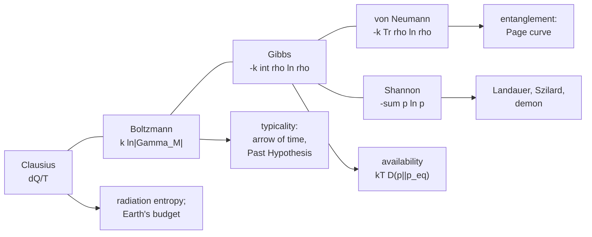

# SM06 · Entropy, Information and the Arrow of Time

◀ [[SM05 The Grand Canonical Ensemble and Chemical Equilibrium]] · [[Thermodynamics and Statistical Mechanics - Course Map|Course Map]] · next ▶ [[SM07 Equipartition the Virial Theorem and Magnetic Systems]]

> [!info] Source and approach
> Draws on **Kardar §2.7 (information, entropy, estimation; pp. 50–52) and §4.5 (mixing entropy and the Gibbs paradox, p. 107)** ([[Mehran Kardar - Statistical Physics of Particles (2007).pdf#page=62|PDF p.62 ff.]]; PDF = printed + 12) and on **Blundell and Blundell, *Concepts in Thermal Physics*, Ch. 14 (§14.5–14.8: statistical basis, entropy of mixing, Maxwell's demon, entropy and probability, printed pp. 146–151) and Ch. 15 (information theory: §15.1–15.4, Landauer's principle at p. 160, quantum information p. 163)** (text layer present: [[Concepts in Thermal Physics by Stephen J. Blundell, Katherine M. Blundell.pdf#page=168|PDF p.168 ff.]]; PDF = printed + 19). Most of the *mathematics* of information (Shannon entropy, relative entropy, typical sets, maximum entropy, mutual information) is already in [[SM01 Probability Large Numbers and Information]] §7; this chapter is about what entropy *means*: the several entropies and how they relate, what a demon can and cannot do, how the Earth lives on an entropy difference, and where the arrow of time comes from. The Earth's radiative entropy budget, the Page-curve simulation and the heat-flow numbers are my own (`scripts/sm06_numbers.py`, `fig_sm06.py`). Historical results (Szilard, Landauer, Bennett, Sagawa–Ueda, Page, Penrose) are quoted from memory and flagged. No course is behind this chapter: no taught/extra labels.

> [!tip] Start here (first read)
> - **The picture.** "Entropy" names at least five different things that agree for a large system in equilibrium: Clausius's $\int\delta Q_{\rm rev}/T$, Boltzmann's $k_B\ln$(volume of the macrostate), Gibbs's $-k_B\int\rho\ln\rho$, von Neumann's $-k_B\mathrm{Tr}\rho\ln\rho$, Shannon's $-\sum p\ln p$. Knowing *which* one is meant resolves nearly every apparent paradox: why entropy increases though Liouville says the Gibbs entropy is constant, why a demon cannot cheat, why entropy depends on what you can measure. The same bookkeeping explains why the Earth stays alive: it receives energy as few high-energy photons and sends it back as 23 times as many low-energy photons, exporting entropy.
> - **What you need.** SM01 §7 (Shannon and relative entropy), SM02 (phase space, $S=k_B\ln\Omega$, coarse-graining), SM03 §2.2 ($F[q]-F=k_BT\,D(q\|p)$), SM04 §6–§7 (H-theorem, irreversibility), the entropy of blackbody radiation from [[TH06 From Kinetic Theory to Statistical Mechanics]] §7.
> - **How to read.** §1 (the five entropies) and §3 (demon and Landauer) are the core; §2 (mixing entropy as operational), §4 (radiation and the Earth), §5 (von Neumann and entanglement), §6 (availability) and §7 (arrow of time) stand alone. Do Problems 1, 3, 6 and 9.
> - **Notation.** $|\Gamma_M|$ phase-space volume of macrostate $M$; $S_B,S_G,S_{\rm cg},S_{\rm vN}$; $D(p\|q)$ relative entropy; $I$ mutual information; $J$ energy flux; $T_e$ effective emission temperature.

> [!key] After this chapter you can
> - define the **Boltzmann, Gibbs, coarse-grained and von Neumann entropies**, relate them ($S_{\rm cg}=\langle S_B\rangle+H[p_M]$) and say which one grows under Liouville flow (none of the fine-grained ones; the coarse-grained one does),
> - explain why the **entropy of mixing** is the maximum work extractable with the separations *you can perform*, and compute it,
> - derive **Landauer's bound** $k_BT\ln2$ per erased bit and the **Szilard engine** work $k_BT\ln2$, and resolve **Maxwell's demon**,
> - derive the **entropy of blackbody radiation** ($s=\tfrac43aT^3$, $3.60\,k_B$ per photon) and compute the **entropy budget of the Earth**,
> - define the **von Neumann entropy**, compute **entanglement entropy** of a bipartite pure state and quote **Page's theorem**,
> - show that the entropy produced in a relaxation equals $k_BD(p\|p_{\rm eq})$ and that the **availability** (maximum work) is $k_BT\,D(p\|p_{\rm eq})$,
> - state the **Past Hypothesis** and explain what it, rather than the dynamics, contributes to the arrow of time.

> [!intuition] The one-sentence story
> Entropy counts the microscopic descriptions that your macroscopic description cannot tell apart: what you know, what you can measure and what you can do define the macrostates, so entropy is a joint property of the system and the description; its increase is the statistical statement that the vast majority of microstates look like equilibrium, and the arrow of time is the statement that the Universe began in a very atypical macrostate.

*Concept map of the chapter.*

![[fig_sm06_entropy.png]]
*Figure SM6.1. A: the Szilard engine: knowing which half holds the molecule lets an isothermal expansion extract $k_BT\ln2$. B: Landauer's bound against the energy per bit operation of real logic (orders of magnitude; recalled). C: the Earth absorbs sunlight with an entropy flux of $0.055$ W m$^{-2}$K$^{-1}$ and emits infrared with $1.25$: it exports entropy, 22.7 times more than it takes in. D: for random pure states of 12 qubits the entanglement entropy of a subsystem follows Page's curve, close to its maximum when the subsystem is half the system.*

## 1. Five entropies, and how they fit together

| name | definition | applies to | changes in time? |
|---|---|---|---|
| **Clausius** | $\mathrm dS=\delta Q_{\rm rev}/T$ | macroscopic equilibrium states | grows for an isolated system (second law) |
| **Boltzmann** | $S_B(M)=k_B\ln|\Gamma_M|$ | one macrostate $M$ (a region of phase space) | grows as the trajectory enters bigger macro-regions |
| **Gibbs** | $S_G=-k_B\int\rho\ln\rho\,\mathrm d\Gamma$ | a probability density $\rho$ | **constant** under Liouville flow (SM02 §2.1) |
| **von Neumann** | $S_{\rm vN}=-k_B\mathrm{Tr}\,\hat\rho\ln\hat\rho$ | a quantum density matrix | **constant** under unitary evolution |
| **Shannon** | $H=-\sum p_i\ln p_i$ | any distribution | (the template of the last two) |

**Boltzmann's definition** ([[Boltzmann Entropy]]) starts from a *coarse* description: a **macrostate** $M$ is a list of macroscopic variables with finite resolution (energy within $\delta E$, the number of molecules in each half of a box, ...) and $\Gamma_M\subset\Gamma$ is the set of microstates compatible with it; $S_B(M)=k_B\ln|\Gamma_M|$ (measure $\mathrm d\Gamma/N!h^{3N}$). The equilibrium macrostate occupies almost all of the energy shell, so $S_B(\text{eq})=k_B\ln\Omega$ (SM02 §4). **Gibbs's definition** ([[Gibbs Entropy]]) is a property of *our probability distribution*, not of the state of the system.

**How they relate.**
1. *Microcanonical:* $\rho=1/\Omega$ on the shell: $S_G=k_B\ln\Omega=S_B(\text{eq})$. *Canonical:* $S_G=k_B\ln Z+\langle E\rangle/T=-\partial F/\partial T=S_{\rm Clausius}$ (SM03 §2.1).
2. *Coarse-graining.* Partition $\Gamma$ into macro-cells $M$ with probabilities $p_M=\int_M\rho$ and replace $\rho$ by its average in each cell. Then
$$S_{\rm cg}[\rho]=-k_B\sum_Mp_M\ln\frac{p_M}{|\Gamma_M|}=\underbrace{\sum_Mp_M\,S_B(M)}_{\text{average Boltzmann entropy}}\ +\ \underbrace{\Big(-k_B\sum_Mp_M\ln p_M\Big)}_{\text{uncertainty about which macrostate}},\qquad S_G\le S_{\rm cg},$$
the inequality because coarse-graining can only lose information (SM01 §7.5; the cat map of SM02 §3.1 shows $S_{\rm cg}$ rising at the Lyapunov rate while $S_G$ is constant). For a system known to be in macrostate $M$, $S_{\rm cg}=S_B(M)$. For large $N$ the second term is $O(\ln N)$ (the distribution of macro-variables is sharp) so **$S_{\rm cg}\approx S_B$ of the typical macrostate**.
3. *Shannon.* With $k_B=1$ all of the above are Shannon entropies of the corresponding distribution; $S_G$ is the Shannon entropy of the microstate, $S_{\rm cg}$ of the macro-resolved description.

> [!example] Two boxes, $N=100$ molecules (recomputed)
> Macrostate $M=n$ = number in the left half: $|\Gamma_n|\propto\binom{100}n$, $S_B(n)=k_B\ln\binom{100}n$. Fraction of phase space and entropy deficit relative to $n=50$ ($S_{\max}/k_B=66.78$):
>
> | $n$ | fraction of all microstates | $S_B(n)/k_B$ | $S_B(n)-S_{\max}$ |
> |---|---|---|---|
> | 50 | $7.96\times10^{-2}$ | 66.78 | 0 |
> | 55 | $4.85\times10^{-2}$ | 66.29 | $-0.50$ |
> | 60 | $1.08\times10^{-2}$ | 64.79 | $-1.99$ |
> | 70 | $2.3\times10^{-5}$ | 58.64 | $-8.14$ |
> | 100 | $7.9\times10^{-31}$ | 0 | $-66.78$ |
>
> The Gaussian estimate $-2(n-N/2)^2/N$ gives $-2.00$ at $n=60$ (exact $-1.993$). A system that starts at $n=70$ has $S_B$ lower by $8.1\,k_B$ and, at an exchange of molecules, drifts to $n\approx50\pm5$: not because anything pushes it, but because there are $e^{8.1}=3400$ times as many microstates there. **The second law is $P(\Delta S)\sim e^{\Delta S/k_B}$ read in the likely direction** ([[Large Deviation Principle]]; [[SM01 Probability Large Numbers and Information]] §6).

> [!pitfall] "Entropy never decreases" has three different meanings
> (i) *Clausius/thermodynamic:* for an isolated macroscopic system, a law. (ii) *Boltzmann:* for a *typical* initial microstate in a low-entropy macrostate, with exceptions of probability $e^{-\Delta S/k_B}$ (SM04 §7). (iii) *Gibbs:* **false** as stated: $S_G$ is exactly constant under Hamiltonian flow; only $S_{\rm cg}$ grows. Mixing up (ii) and (iii) gave the old confusion that "the second law contradicts Liouville".

## 2. Entropy depends on what you can distinguish

SM02 §7 found $\Delta S_{\rm mix}=-Nk_B\sum x_i\ln x_i$ for different gases, $0$ for identical ones: a *step* function of "different or not". The operational meaning ([[Concepts in Thermal Physics by Stephen J. Blundell, Katherine M. Blundell.pdf#page=166|Blundell §14.6, p. 147]]; Kardar §4.5; Jaynes):

> [!key] Mixing entropy as available work
> If you possess **semipermeable membranes** (one transparent to A only, one to B only) you can run the mixing *reversibly* and isothermally and extract the work $W_{\rm max}=-\Delta F_{\rm mix}=T\Delta S_{\rm mix}=-Nk_BT\sum_ix_i\ln x_i$. If you cannot tell A from B (no such membrane) there is no way to extract anything, and *for you* the gases are the same gas and $\Delta S=0$.

> [!example] Numbers (recomputed)
> 1 mol He + 1 mol Ar at 298.15 K: $W_{\rm max}=2RT\ln2=3.44$ kJ. Air ($0.21$ O$_2$, $0.79$ N$_2$), per mole of mixture: $-RT(0.21\ln0.21+0.79\ln0.79)=1.27$ kJ (the minimum energy cost of separating air by an ideal isothermal process; real plants need several times this).

So **entropy is relative to a set of resolvable macrovariables**. This is not subjectivity: given the apparatus (the partition of $\Gamma$ into macrostates) the answer is unique. It is the same statement as "$S_{\rm cg}$ depends on the cell size" (the cat map) and it makes isotopes distinguishable in an isotope-separation plant and indistinguishable in a calorimeter.

## 3. Maxwell's demon, Szilard's engine and Landauer's principle

**The demon (Maxwell 1867; Blundell §14.7, p. 149).** A small being operates a door between two chambers of gas, letting fast molecules through one way and slow ones the other (or only letting molecules into one side), thereby creating a temperature or pressure difference with no work. It *appears* to violate the second law.

### 3.1 Szilard's engine (1929)
One molecule in a box of volume $V$ at temperature $T$. Insert a partition in the middle: the molecule is on the left or the right, *1 bit* of information. The demon **measures** which side. Then it lets the molecule push the partition isothermally to the end, with $P=k_BT/V'$, extracting
$$W=\int_{V/2}^{V}\frac{k_BT}{V'}\mathrm dV'=k_BT\ln2\qquad(=2.87\times10^{-21}\ \mathrm J=17.9\ \mathrm{meV}\ \text{at 300 K}),$$
(Fig. SM6.1A; [[Szilard Engine]]). Repeating the cycle would extract $k_BT\ln2$ of work per cycle from a single heat bath: a perpetual-motion machine of the second kind, unless something costs at least as much.

### 3.2 Landauer's principle and Bennett's resolution
> [!key] Landauer's principle (1961; Blundell §15.2, p. 160)
> **Erasing one bit of information, i.e. resetting a memory cell to a standard state irrespective of its prior content, dissipates at least $k_BT\ln2$ of heat into the surroundings.** ([[Landauer Principle]])

> [!derivation] Why
> A memory with two states 0 and 1 (a bistable well), initially with equal probability $\tfrac12$ for each, has Shannon entropy $\ln2$ (SM01 §7.2). Resetting to 0 maps both onto one state: the phase-space volume available to the memory halves and its entropy falls by $k_B\ln2$. The second law forbids the total entropy from decreasing, so the surroundings must gain $\ge k_B\ln2$, i.e. receive heat $Q\ge k_BT\ln2$. For a memory with a non-uniform distribution of Shannon entropy $H$ (nats) the bound is $Q\ge k_BT\,\Delta H$: **the cost of erasing is the *ignorance* about the content**, and a memory in a *known* state can be reset for free.

The demon's memory is the key (Bennett 1982): to run the cycle it must store the outcome of each measurement; to repeat, it must erase it. Measurement can be done reversibly (no minimal cost); **erasure cannot**. The cycle then costs at least $k_BT\ln2$ in erasure, cancelling the work $k_BT\ln2$ gained: no net extraction. The popular argument that the demon needs light to see the molecules (Brillouin) is *not* the resolution: observation can be done with arbitrarily little dissipation ([[Concepts in Thermal Physics by Stephen J. Blundell, Katherine M. Blundell.pdf#page=169|Blundell p. 150]]).

> [!example] How large is the demon's problem for a mole? (recomputed)
> To reverse the Joule expansion of one mole the demon must record $N_A$ bits; erasing them costs $N_Ak_BT\ln2=RT\ln2=1.72$ kJ at 298 K, equal to $T\times R\ln2=T\times5.76$ J K$^{-1}$: exactly the entropy decrease it created. (A finite disk would have to be erased many times over: Blundell's remark.)

> [!example] Landauer against technology (recomputed; Fig. SM6.1B)
> $k_BT\ln2=2.87\times10^{-21}$ J at 300 K ($7.4\times10^{-22}$ J at 77 K, $4.0\times10^{-23}$ J at 4.2 K). Erasing a gigabyte ($8\times10^9$ bits) costs at least $2.3\times10^{-11}$ J; a processor erasing $10^9$ bits per second at the bound would dissipate $2.9\times10^{-12}$ W. Real logic dissipates roughly $10^{-17}$ to $10^{-15}$ J per switching event (recalled orders of magnitude), i.e. $3.5\times10^3$ to $3.5\times10^5$ times the bound: **computation is nowhere near thermodynamically limited**, but the bound is a hard floor for *irreversible* logic and (with Bennett's reversible computing, which erases nothing) not for logic in general. The principle has been tested (Bérut et al. 2012: a colloidal bead in a double-well optical trap, heat approaching $k_BT\ln2$ in the slow limit; Toyabe et al. 2010 converted information to energy; both recalled).

### 3.3 The general bound
Let a feedback controller learn $I$ (nats) of mutual information about the system by measurement. The extractable work obeys (Sagawa and Ueda, quoted)
$$\langle W_{\rm ext}\rangle\le-\Delta F+k_BT\,I,$$
which reduces to $k_BT\ln2$ for Szilard's engine ($\Delta F=0$, $I=\ln2$). Information is a *thermodynamic resource* with an exchange rate $k_BT$ per nat ([[Maxwell's Demon]]; the fluctuation-theorem version is SM31, planned).

## 4. The entropy of radiation and the Earth's entropy budget

### 4.1 Blackbody radiation
A photon gas has $u=aT^4$ and $P=u/3$ ($a=4\sigma/c=7.566\times10^{-16}$ J m$^{-3}$K$^{-4}$; [[Stefan-Boltzmann Law]]). From $\mathrm dS=(\mathrm dU+P\,\mathrm dV)/T$ with $U=aT^4V$:
$$\mathrm dS=4aT^2V\,\mathrm dT+\tfrac43aT^3\,\mathrm dV\ \Longrightarrow\ \boxed{\ s=\frac43aT^3=\frac43\frac uT\ }$$
([[Entropy of Radiation]]; $S(0)=0$). With the photon density $n_\gamma=\frac{2\zeta(3)}{\pi^2}(k_BT/\hbar c)^3$, the entropy per photon is $s/n_\gamma=\frac{2\pi^4}{45\zeta(3)}k_B=3.602\,k_B$ and the energy per photon $\pi^4/(30\zeta(3))\,k_BT=2.701\,k_BT$. A blackbody surface at $T$ emits energy flux $\sigma T^4$ and entropy flux $\tfrac43\sigma T^3$; a **dilute beam of blackbody radiation** (sunlight at the Earth, from a source of temperature $T_\odot$ filling a small solid angle) has energy and entropy fluxes both reduced by the same geometric factor, so its entropy flux is $\tfrac43J/T_\odot$ with $J$ the energy flux.

### 4.2 The Earth as an entropy exporter
> [!example] The budget (recomputed; Fig. SM6.1C)
> Solar constant $1361$ W m$^{-2}$, albedo $0.30$ (recalled), $T_\odot=5772$ K. Absorbed (spherical average) $J=(1-0.30)\times1361/4=238.2$ W m$^{-2}$; in steady state the Earth emits the same $J$ at the effective temperature $T_e=(J/\sigma)^{1/4}=254.6$ K ([[CL03 Radiation and Planetary Energy Balance]]).
> - entropy flux **in**: $\tfrac43J/T_\odot=0.0550$ W m$^{-2}$K$^{-1}$;
> - entropy flux **out**: $\tfrac43J/T_e=1.247$ W m$^{-2}$K$^{-1}$;
> - **production** $1.19$ W m$^{-2}$K$^{-1}$, i.e. $6.1\times10^{14}$ W K$^{-1}$ over the whole planet ($5.10\times10^{14}$ m$^2$).
>
> *In photon language:* the average solar photon carries $2.70k_BT_\odot=1.34$ eV and the average infrared photon $2.70k_BT_e=0.059$ eV, so the Earth turns **one sunlight photon into $T_\odot/T_e=22.7$ infrared photons**; each photon carries $3.6\,k_B$, so the entropy flux rises by the same factor $22.7$. Every process on Earth that organises matter (weather, water cycle, photosynthesis) is paid for by this $22.7$-fold photon multiplication.
> *Free energy available:* relative to $T_e$ the absorbed sunlight has exergy flux $J-T_es_{\rm in}=J\big[1-\tfrac43\tfrac{T_e}{T_\odot}\big]=224.2$ W m$^{-2}$ ($0.941\,J$; Petela's exergy of *enclosed* radiation adds a negligible $\tfrac13(T_e/T_\odot)^4\approx4\times10^{-6}$). Of this the atmosphere's kinetic-energy dissipation (the Lorenz energy cycle, $\approx2.5$ W m$^{-2}$, recalled) is about $1\,\%$ and net primary production ($\approx130$ TW $=0.25$ W m$^{-2}$, recalled) about $0.1\,\%$: *life is a rounding error on the entropy budget*, and the climate system is a very inefficient heat engine whose dissipation is dominated by sensible-heat and latent-heat transport and radiation, not by dynamics. (The "maximum entropy production" principle of Paltridge, which proposes that the atmosphere organises to maximise the production, is a *hypothesis*, not a theorem.)

## 5. Von Neumann entropy and entanglement

For a quantum state with density matrix $\hat\rho=\sum_ip_i|i\rangle\langle i|$ the **von Neumann entropy** $S_{\rm vN}=-k_B\mathrm{Tr}\,\hat\rho\ln\hat\rho=-k_B\sum p_i\ln p_i$ is the Shannon entropy of the eigenvalues ([[Von Neumann Entropy]]). It is **invariant under unitary evolution** ($\hat\rho\to U\hat\rho U^\dagger$: the quantum Liouville equation, SM03 §2.5), zero for a pure state, and maximal ($\ln d$) for $\hat\rho=\mathbb 1/d$. The canonical state $e^{-\beta\hat H}/Z$ maximises it at fixed $\langle\hat H\rangle$.

**Entanglement entropy.** Let a *pure* state $|\psi\rangle$ of a system $A\cup B$ be written in its Schmidt form $|\psi\rangle=\sum_i\sqrt{\lambda_i}|a_i\rangle|b_i\rangle$. Then the reduced states $\hat\rho_A=\mathrm{Tr}_B|\psi\rangle\langle\psi|$ and $\hat\rho_B$ have the *same* eigenvalues $\lambda_i$, so $S(\rho_A)=S(\rho_B)=-\sum\lambda_i\ln\lambda_i$, **even though the whole is pure** ($S=0$). The entropy of a subsystem is the entropy of its **ignorance of the rest** ([[Entanglement Entropy]]): the singlet $(|\uparrow\downarrow\rangle-|\downarrow\uparrow\rangle)/\sqrt2$ has $\hat\rho_A=\mathrm{diag}(\tfrac12,\tfrac12)$ and $S_A=\ln2=1$ bit ([[QM09 The Stern-Gerlach Experiment and Spin]]).

> [!key] Page's theorem (1993, quoted): typical states are thermal-looking
> For a random pure state of a system of Hilbert-space dimension $d_Ad_B$ with $d_A\le d_B$, the average entanglement entropy of $A$ is $\langle S_A\rangle=\ln d_A-\dfrac{d_A}{2d_B}+\dots$: almost the maximum $\ln d_A$.

> [!example] Simulation of the Page curve (recomputed; Fig. SM6.1D)
> 300 random pure states of $N$ qubits, subsystem of $m$: $N=12$, $m=6$: simulated $3.659$ (sd $0.008$) vs formula $3.659$; $m=3$: $2.0717$ vs $2.0716$; $N=10$, $m=5$: $2.966$ vs $2.966$; $N=14$, $m=7$: $4.352$ vs $4.352$; the maximum is $\ln d_A=4.159$ (12, 6). At half the system the deficit from the maximum is $\tfrac12$ nat (independent of $N$); for a subsystem of a few qubits it is exponentially small. **A typical pure state of the whole is a *maximally mixed* state for any small part**: the quantum root of "equilibrium is typical", and of the canonical typicality of SM03 §1.1 (with an energy constraint, a typical state of a shell gives the canonical state for a small subsystem).

## 6. Entropy production, availability and the arrow in practice

### 6.1 The entropy produced in a relaxation
A system with distribution $p$ over states of energy $E_i$, in contact with a bath at $T$, relaxes to $p_{\rm eq}\propto e^{-\beta E_i}$. The total entropy change (system plus bath) is $\Delta S_{\rm tot}=\Delta S_{\rm sys}-\Delta E_{\rm sys}/T=-\big(F_{\rm eq}-F[p]\big)/T$, and by SM03 §2.2
$$\boxed{\ \Delta S_{\rm tot}=\frac{F[p]-F_{\rm eq}}{T}=k_B\,D(p\,\|\,p_{\rm eq})\ \ge0\ }\qquad W_{\rm avail}=F[p]-F_{\rm eq}=k_BT\,D(p\|p_{\rm eq}).$$
**The entropy produced in the approach to equilibrium is the relative entropy to equilibrium; the maximum work that can be extracted from the non-equilibrium state is $k_BT$ times the same quantity** ([[Exergy and Availability]]). This is the thermodynamic meaning of the H-theorem of SM04: $H-H_{\rm eq}=D$ is the *availability* that has not yet been wasted.

> [!example] Examples (recomputed)
> *Szilard:* $p=(1,0)$ against $p_{\rm eq}=(\tfrac12,\tfrac12)$: $D=\ln2$, $W=k_BT\ln2$ ✓. *Gas confined to half the volume* ($N_A$ molecules, 298 K): $D=N_A\ln2$ and $W=RT\ln2=1.72$ kJ: the work of an isothermal expansion. *Heat flow* $Q$ from $T_h$ to $T_c$: $\dot S=\dot Q(1/T_c-1/T_h)$; **Gouy–Stodola:** the work lost is $T_0\dot S$ with $T_0$ the temperature of the coldest reservoir. For $100$ W from $500$ K to $300$ K: $\dot S=0.133$ W K$^{-1}$, lost work $T_0\dot S=40$ W $=$ exactly the Carnot work $100(1-300/500)=40$ W that a reversible engine would have produced.
> The entropy production can also be written as a relative entropy between the *probability of a trajectory and of its time reverse* (Kawai–Parrondo–Van den Broeck, quoted), which is the starting point of the fluctuation theorems of SM31 (planned).

## 7. The arrow of time and the Past Hypothesis

The microscopic laws (classical and unitary quantum) are invariant under time reversal. Boltzmann's resolution of Loschmidt's objection (SM04 §7) is that the **overwhelming majority of microstates compatible with a given macrostate evolve into macrostates of higher $S_B$ in the *future* direction, and equally the overwhelming majority evolve from macrostates of higher $S_B$ in the *past* direction**: by symmetry, a microstate drawn uniformly from a non-equilibrium macrostate looks like a **fluctuation** in both time directions. This is false of the world we see (ice melts and does not unmelt, we remember the past and not the future), so something outside the dynamics breaks the symmetry: **the Past Hypothesis**, the statement that the Universe began in a macrostate of very low entropy ([[Past Hypothesis]]; Boltzmann, Feynman, Penrose, Albert; quoted). *All* the entropy increase we observe is the relaxation of that initial atypicality; "the arrow of time" is the arrow of increasing distance from the Big Bang.

> [!example] Scales (recomputed; the physics is quoted)
> The observable Universe's photons (CMB at $2.7255$ K, $n_\gamma=4.11\times10^8$ m$^{-3}$, comoving radius $4.4\times10^{26}$ m) carry $S\approx5.3\times10^{89}k_B$. The Bekenstein–Hawking entropy of a black hole, $S=4\pi GM^2k_B/\hbar c$, is $1.05\times10^{77}k_B$ for one solar mass and $1.9\times10^{90}k_B$ for Sgr A* ($4.3\times10^6M_\odot$): **a single supermassive black hole holds several times the entropy of all the photons in the observable Universe** (the supermassive black holes of the Universe reach $\sim10^{104}k_B$, Egan and Lineweaver, recalled). Gravitationally clumped matter has far more entropy than a smooth gas: the early Universe was nearly smooth, i.e. of *low* entropy in the gravitational sector though in thermal equilibrium otherwise, which is the form of the Past Hypothesis (Penrose). Hawking's temperature of a solar-mass black hole is $6.2\times10^{-8}$ K: its heat capacity is negative, as for any self-gravitating system ([[SM07 Equipartition the Virial Theorem and Magnetic Systems]] §4).

> [!pitfall] Six traps
> 1. **Gibbs entropy is constant** under Hamiltonian flow; it is the *coarse-grained* entropy that grows.
> 2. **Entropy $\ne$ disorder.** Hard spheres freeze at a packing fraction $\approx0.49$ (recalled) because the crystal gives each sphere *more* free volume, hence more entropy, than the fluid at that density: the ordered phase has the higher entropy.
> 3. **Landauer concerns *logically irreversible* operations** (erasure, AND gates that lose information). Reversible computation and measurement have no lower bound.
> 4. **The Past Hypothesis is not derivable from the dynamics.** Without it, the second law predicts entropy increase toward the past too.
> 5. **The Earth is not in equilibrium and the entropy export is not "life defying the second law".** The decrease of entropy of the biosphere ($\sim10^{-4}$ of the flux) is paid many times over by the production of $1.2$ W m$^{-2}$K$^{-1}$.
> 6. **Maximum-entropy production** is a conjecture for non-equilibrium steady states, unlike the maximum-entropy *principle* of SM01 §7.7 for assigning probabilities.

<!-- interactive:start (generated by scripts/embed_interactive.py; edit the tool in scripts/interactive/tools/, not this block) -->
> [!interactive]+ Interactive: A gas relaxing to the Maxwell–Boltzmann distribution
> Hard disks bounce in a box and collide elastically.
>
> ![[sm_gas_box.png|720]]
>
> **Try:** Press 'all same speed' and watch the histogram (blue) broaden into the dashed Maxwell–Boltzmann curve within a few collisions per particle. Press 'one fast particle' to see the energy spread out. Turn collisions off and the distribution never changes.
>
> [▶ Open the tool in your browser](../Assets/interactive/sm_gas_box.html) · [absolute link](file:///home/swastik/Documents/notes/Assets/interactive/sm_gas_box.html) · all tools and coverage: [[Interactive Tools]]

> [!interactive]+ Interactive: Why equilibrium is overwhelmingly likely: multiplicity and entropy
> Two Einstein solids exchange q_tot quanta of energy.
>
> ![[sm_multiplicity.png|720]]
>
> **Try:** With N_A = N_B and q_tot = 100: peak at q_A = 50. Grow N to 300: the relative width shrinks ~1/√N. Make N_A larger than N_B: the energy is shared in proportion to the sizes (equal temperatures).
>
> [▶ Open the tool in your browser](../Assets/interactive/sm_multiplicity.html) · [absolute link](file:///home/swastik/Documents/notes/Assets/interactive/sm_multiplicity.html) · all tools and coverage: [[Interactive Tools]]

<!-- interactive:end -->

## Map of this chapter
> [!connection] How SM06 connects
> **Builds on:** [[SM01 Probability Large Numbers and Information]] (Shannon, relative entropy, maximum entropy, mutual information), [[SM02 Phase Space Liouville and the Microcanonical Ensemble]] (Boltzmann entropy, coarse-graining, Gibbs paradox), [[SM03 The Canonical Ensemble]] ($F[q]-F=k_BT\,D$), [[SM04 Kinetic Theory and the Boltzmann Equation]] (H-theorem, Loschmidt/Zermelo), [[TH04 The Second Law Carnot Engines and Entropy]], [[TH06 From Kinetic Theory to Statistical Mechanics]] (radiation constants).
> **Leads to:** SM08 (density matrix and quantum statistics; planned), SM11 (photon gas, blackbody radiation: entropy of the photon gas from the partition function; planned), SM24–SM26 (stochastic dynamics: master equations and entropy production; planned), SM31 (fluctuation theorems and the thermodynamics of information; planned).
> **Concepts:** [[Boltzmann Entropy]] · [[Gibbs Entropy]] · [[Von Neumann Entropy]] · [[Entanglement Entropy]] · [[Landauer Principle]] · [[Szilard Engine]] · [[Maxwell's Demon]] · [[Entropy of Radiation]] · [[Exergy and Availability]] · [[Past Hypothesis]] · [[Shannon Entropy]] · [[Relative Entropy]] · [[Mutual Information]] · [[Statistical Entropy]] · [[Irreversibility]] · [[Gibbs Paradox]]
> **Other subjects:** [[CL03 Radiation and Planetary Energy Balance]] (effective emission temperature), [[Blackbody Radiation]], [[Stefan-Boltzmann Law]] (Climate); [[QM09 The Stern-Gerlach Experiment and Spin]] (the singlet and Bell states; Quantum Mechanics).

## Summary
> [!summary] Cheat-sheet
> - **Five entropies:** Clausius $\int\delta Q/T$; Boltzmann $k\ln|\Gamma_M|$; Gibbs $-k\int\rho\ln\rho$ (constant under Liouville); von Neumann $-k\mathrm{Tr}\rho\ln\rho$ (constant under unitaries); Shannon $-\sum p\ln p$.
> - **Coarse-graining:** $S_{\rm cg}=\langle S_B\rangle+H[p_M]\ge S_G$; $S_{\rm cg}$ grows (cat map: slope $\lambda=0.962$); $P(\Delta S_B)\sim e^{\Delta S/k_B}$ ($N=100$: $n=70$ has $-8.1k_B$).
> - **Mixing:** $W_{\rm max}=-NkT\sum x_i\ln x_i$ with perfect membranes (He+Ar: 3.44 kJ; air 1.27 kJ/mol); entropy is relative to the resolvable macrovariables.
> - **Szilard** $W=kT\ln2$ per bit; **Landauer** erasure $\ge kT\ln2$ ($2.87\times10^{-21}$ J at 300 K); generalised: $W\le-\Delta F+kTI$; real logic $3.5\times10^3$–$3.5\times10^5$ times above the bound.
> - **Radiation:** $s=\tfrac43aT^3$; $3.60k_B$ and $2.70kT$ per photon; surface flux $\tfrac43\sigma T^3$; **Earth:** $J=238.2$ W m$^{-2}$, $T_e=254.6$ K, in $0.055$, out $1.247$, production $1.19$ W m$^{-2}$K$^{-1}$ ($6.1\times10^{14}$ W K$^{-1}$); photons $\times22.7$; exergy $224$ W m$^{-2}$.
> - **Entanglement:** pure $AB$: $S_A=S_B$; singlet $\ln2$; Page $\langle S_A\rangle=\ln d_A-d_A/2d_B$ ($N=12$, $m=6$: 3.659).
> - **Availability:** $\Delta S_{\rm tot}=kD(p\|p_{\rm eq})$, $W_{\rm avail}=kT\,D$; Gouy–Stodola: lost work $=T_0\dot S$ (100 W, 500→300 K: 0.133 W/K, 40 W).
> - **Arrow of time:** Past Hypothesis; $S_{\rm CMB}=5.3\times10^{89}k$, $S_{\rm BH}(\mathrm{Sgr\ A^*})=1.9\times10^{90}k$.

## Practice
1. **Boltzmann entropy.** For $N=100$ molecules in two halves, find the fraction of microstates with $n=60$ in the left half and the entropy deficit $S_B(60)-S_{\max}$. What is the probability that all 100 are on one side?
2. **Coarse-grained entropy.** Show that $S_{\rm cg}=\sum_Mp_MS_B(M)+H[p_M]$ and that $S_{\rm cg}\ge S_G$.
3. **Szilard and Landauer.** Compute $k_BT\ln2$ at 300 K, 77 K and 4.2 K in joules and meV. What is the minimum energy to erase a terabyte at 300 K, and the power of a processor erasing $10^9$ bits per second at the bound?
4. **Mixing work.** Compute the maximum work obtainable by reversibly mixing 1 mol of He with 1 mol of Ar at 298.15 K, and per mole of mixture for $x_{\rm O_2}=0.21$, $x_{\rm N_2}=0.79$.
5. **Demon.** A demon reverses the Joule expansion of 1 mol of gas at 298 K, recording one bit per molecule. Show that erasing its memory dissipates exactly $T\Delta S$ of the entropy decrease it created.
6. **Radiation entropy.** Derive $s=\tfrac43aT^3$ from $U=aT^4V$ and $P=u/3$, and show that the entropy per photon is $\frac{2\pi^4}{45\zeta(3)}k_B=3.60k_B$.
7. **The Earth.** Compute the absorbed flux, $T_e$, the entropy fluxes in and out and the entropy production. What is the ratio of infrared to solar photon numbers?
8. **Exergy.** Show that $J-T_es_{\rm in}=J\big[1-\tfrac43\tfrac{T_e}{T_\odot}+\tfrac13(\tfrac{T_e}{T_\odot})^4\big]$ and evaluate it; compare with the atmospheric dissipation 2.5 W m$^{-2}$.
9. **Availability.** Show that $\Delta S_{\rm tot}=k_BD(p\|p_{\rm eq})$ for a system relaxing in a bath, and use it for $N_A$ molecules confined to half a box at 298 K.
10. **Entanglement.** For a random pure state of 12 qubits compute $\langle S_A\rangle$ for $m=3$ and $m=6$ from Page's formula and the fraction of the maximum. What is $S_A$ for a singlet?
11. **Heat flow.** 100 W flows from a reservoir at 500 K to one at 300 K through a conductor. Find the entropy production and the work lost relative to $T_0=300$ K.
12. **Entropy and order.** Explain, using free volume, why hard spheres crystallise at high density although the crystal looks "ordered".

> [!example]- Solutions
> 1. $\binom{100}{60}/2^{100}=1.08\times10^{-2}$; $S_B(60)-S_B(50)=\ln\binom{100}{60}-\ln\binom{100}{50}=64.79-66.78=-1.99\,k_B$ (Gaussian: $-2$). All on one side: $2\cdot2^{-100}=1.6\times10^{-30}$.
> 2. $S_{\rm cg}=-k\sum p_M\ln(p_M/|\Gamma_M|)=\sum p_M\,k\ln|\Gamma_M|-k\sum p_M\ln p_M$. For $S_{\rm cg}\ge S_G$: $S_{\rm cg}-S_G=k\int\rho\ln(\rho/\bar\rho)=kD(\rho\|\bar\rho)\ge0$ where $\bar\rho=p_M/|\Gamma_M|$ is the cell average.
> 3. $300$ K: $2.871\times10^{-21}$ J $=17.9$ meV; $77$ K: $7.37\times10^{-22}$ J $=4.60$ meV; $4.2$ K: $4.02\times10^{-23}$ J $=0.251$ meV. One terabyte ($8\times10^{12}$ bits): $2.3\times10^{-8}$ J. $10^9$ bit s$^{-1}$: $2.9\times10^{-12}$ W.
> 4. $2RT\ln2=2\times8.3145\times298.15\times0.6931=3437$ J $=3.44$ kJ. Air: $-RT(0.21\ln0.21+0.79\ln0.79)=2478.9\times0.5139=1274$ J $=1.27$ kJ per mole of mixture.
> 5. $N_A$ bits erased at $\ge k_BT\ln2$ each: $N_Ak_BT\ln2=RT\ln2=1718$ J. The entropy decrease of the gas when the Joule expansion is reversed is $R\ln2=5.763$ J K$^{-1}$; $T\times5.763=1718$ J ✓.
> 6. $U=aT^4V$, $P=\tfrac13aT^4$: $\mathrm dS=\frac1T(\mathrm dU+P\mathrm dV)=4aT^2V\mathrm dT+\tfrac43aT^3\mathrm dV$, integrable to $S=\tfrac43aT^3V$ (check: $\partial_V(4aT^2V)=4aT^2=\partial_T(\tfrac43aT^3)$ ✓). $n_\gamma=\frac{2\zeta(3)}{\pi^2}(kT/\hbar c)^3$ and $a=\frac{\pi^2k^4}{15\hbar^3c^3}$ give $s/n=\frac43\frac{\pi^2}{15}\frac{\pi^2}{2\zeta(3)}k=\frac{2\pi^4}{45\zeta(3)}k=3.602\,k$.
> 7. $J=0.7\times1361/4=238.2$ W m$^{-2}$; $T_e=(238.2/5.670\times10^{-8})^{1/4}=254.6$ K; $\dot s_{\rm in}=\tfrac43\times238.2/5772=0.0550$; $\dot s_{\rm out}=\tfrac43\times238.2/254.6=1.247$; production $1.192$ W m$^{-2}$K$^{-1}$ ($\times5.10\times10^{14}$ m$^2=6.08\times10^{14}$ W K$^{-1}$); photon ratio $T_\odot/T_e=22.7$ (same as the entropy ratio).
> 8. $s_{\rm in}=\tfrac43J/T_\odot$, so $J-T_es_{\rm in}=J\big[1-\tfrac43\tfrac{T_e}{T_\odot}\big]=238.2\times(1-0.0588)=224.2$ W m$^{-2}$ (Petela's expression for the exergy of enclosed blackbody radiation has the extra $+\tfrac13(T_e/T_\odot)^4\approx4\times10^{-6}$, invisible). The Lorenz cycle's $2.5$ W m$^{-2}$ is $1.1\,\%$ of it.
> 9. With $p$ the initial and $p_{\rm eq}$ the final distribution, $\Delta S_{\rm sys}=S_{\rm eq}-S[p]$ and the bath receives $E[p]-E_{\rm eq}$ of heat, $\Delta S_{\rm bath}=(E[p]-E_{\rm eq})/T$. Total: $\Delta S_{\rm tot}=\big[(E[p]-TS[p])-(E_{\rm eq}-TS_{\rm eq})\big]/T=(F[p]-F_{\rm eq})/T=kD(p\|p_{\rm eq})$ by SM03 §2.2. For $N_A$ molecules confined to half a box, $D=N_A\ln2$ and $W=RT\ln2=1.72$ kJ (the isothermal-expansion work).
> 10. Page: $m=3$ ($d_A=8$, $d_B=512$): $\ln8-\tfrac{8}{1024}=2.0716$, maximum $2.0794$ (99.6 %); $m=6$ ($d_A=d_B=64$): $\ln64-\tfrac12=3.6589$, maximum $4.1589$ (88.0 %). Singlet: $\ln2$ (1 bit).
> 11. $\dot S=100(1/300-1/500)=0.1333$ W K$^{-1}$; lost work $T_0\dot S=40$ W, equal to the Carnot work that a reversible engine between 500 K and 300 K would extract from 100 W.
> 12. At low density the fluid has the larger entropy (positions disordered). Near the packing fraction $\approx0.49$ the *free volume* per sphere (the room each sphere has to rattle) is larger in the crystal, whose spheres sit in regular cages, than in the jammed, disordered fluid; the gain in vibrational entropy exceeds the loss of configurational entropy, so the ordered state has the higher entropy: an entropy-driven transition.

## Provenance
> [!provenance]- Source map for this chapter
> | Topic | Source | Origin |
> |---|---|---|
> | information, entropy, estimation; mixing entropy | [[Mehran Kardar - Statistical Physics of Particles (2007).pdf#page=62\|K §2.7, pp. 50–52]]; [[Mehran Kardar - Statistical Physics of Particles (2007).pdf#page=119\|K §4.5, p. 107]] | book |
> | statistical basis of entropy, entropy of mixing, Maxwell's demon, entropy and probability | [[Concepts in Thermal Physics by Stephen J. Blundell, Katherine M. Blundell.pdf#page=165\|Blundell §14.5–14.8, pp. 146–151]] | book |
> | information theory, Landauer's principle, data compression, quantum information | [[Concepts in Thermal Physics by Stephen J. Blundell, Katherine M. Blundell.pdf#page=176\|Blundell Ch. 15, pp. 157–166]] | book |
> | Boltzmann–Gibbs relations, coarse-grained decomposition, availability $=kT\,D$, Gouy–Stodola numbers | my own derivations from SM01–SM03 | mine |
> | radiation entropy and the Earth's budget; Page-curve simulation; Universe/black-hole entropies | computed here (`scripts/sm06_numbers.py`, `fig_sm06.py`) | mine |
> | Szilard 1929, Landauer 1961, Bennett 1982, Sagawa–Ueda, Bérut 2012, Toyabe 2010, Page 1993, Penrose and the Past Hypothesis, Egan–Lineweaver, Paltridge's MEP, hard-sphere freezing | recalled | recalled |
>
> **Flags.** (1) Solar constant, albedo, $T_\odot$, the Lorenz-cycle power, NPP and the CMOS switching energies are recalled values (the CMOS numbers are orders of magnitude only). (2) The Sagawa–Ueda bound, Page's formula and Kac's/KPV results are quoted (Page's formula was checked by simulation). (3) The cosmological numbers use $R=4.4\times10^{26}$ m for the comoving horizon and are order-of-magnitude. (4) Blundell's printed page numbers are PDF $-19$; section numbers are certain. (5) I did not find Landauer or Szilard in Kardar, Pathria, Huang or Reif; Tolman and Schwabl mention demons (not read).

**References.** Kardar, M. *Statistical Physics of Particles* (2007), §2.7, §4.5 · Blundell, S. J. and Blundell, K. M. *Concepts in Thermal Physics*, 2nd ed. (2010), Ch. 14–15 · Szilard, L. (1929) *Z. Phys.* 53, 840 · Landauer, R. (1961) *IBM J. Res. Dev.* 5, 183 · Bennett, C. H. (1982) *Int. J. Theor. Phys.* 21, 905 · Sagawa, T. and Ueda, M. (2008–2010) · Bérut, A. et al. (2012) *Nature* 483, 187 · Page, D. N. (1993) *Phys. Rev. Lett.* 71, 1291 · Penrose, R. *The Road to Reality* (2004), Ch. 27 · Jaynes, E. T. (1992) *The Gibbs paradox*.

## Across subjects
- [[CL03 Radiation and Planetary Energy Balance]] (Climate): $T_e=255$ K and the 238 W m$^{-2}$ budget are the energy half of the same calculation; the entropy half is §4.2.
- [[Poisson Distribution]] and [[Binomial Distribution]] (Probability): the two-box counting of §1.
- [[QM09 The Stern-Gerlach Experiment and Spin]] (Quantum Mechanics): the singlet and the reduced density matrix of an entangled pair.
- [[THX1 Diffusion Random Walks and the Heat Equation]] (this subject): diffusion is the canonical irreversible process whose entropy production is $\dot S=\int\kappa(\nabla T)^2/T^2$ (Fourier) or $\int D(\nabla n)^2/n$ (Fick).
