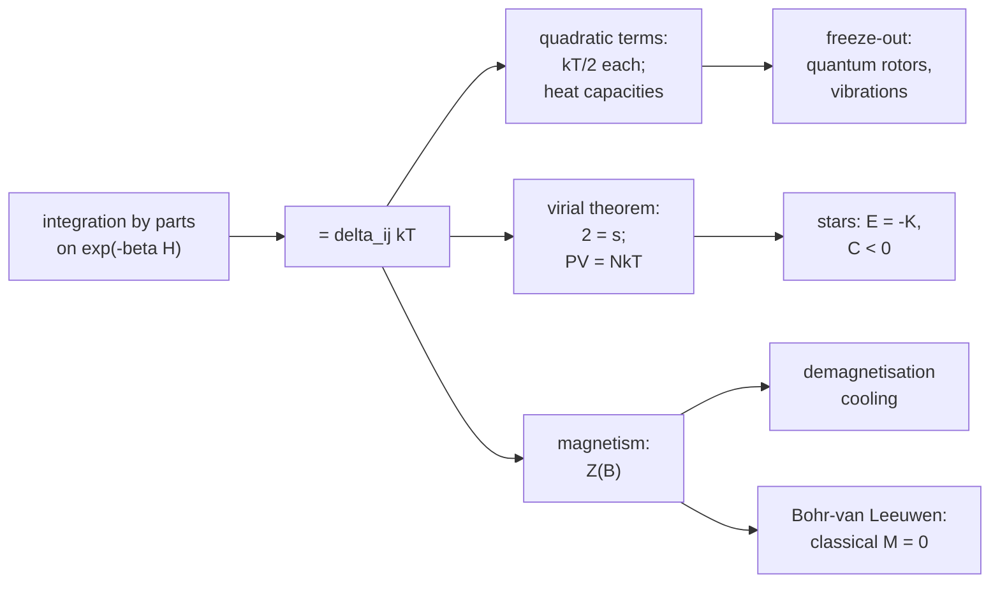

# SM07 · Equipartition, the Virial Theorem and Magnetic Systems

◀ [[SM06 Entropy Information and the Arrow of Time]] · [[Thermodynamics and Statistical Mechanics - Course Map|Course Map]] · next ▶ [[SM08 Quantum Ensembles and Identical Particles]]

> [!info] Source and approach
> Follows **Pathria and Beale §3.7 (the equipartition and virial theorems, printed pp. 61–65; read by OCR: [[R. K. Pathria, Paul D. Beale - Statistical Mechanics (2011).pdf#page=88|PDF p.88 ff.]], PDF = printed + 27)**, **§3.9–3.10 (paramagnetism, thermodynamics of magnetic systems and negative temperatures, pp. 70–83)** and **Problem 3.43 (the Bohr–van Leeuwen theorem)**, with **Kardar §4.7 (Curie law, p. 113)**, **Huang §6.4 (equipartition, p. 136) and §11.5 (escape from Van Leeuwen's theorem, p. 258; `.djvu` page = printed + 8 in Part B)**, **Reif §7.5 (equipartition theorem, p. 248; djvu = printed + 17)** and **Schwabl §6.2 (Langevin diamagnetism and the measured molar susceptibilities of the noble gases, Table 6.1; djvu = printed + 12)**. The test of the diatomic heat capacity, the rigid-rotor overshoot, the virial estimates for the Sun, the paramagnet isentropes and the Langevin diamagnetism of helium are my own computations (`scripts/sm07_numbers.py`, `fig_sm07.py`); every measured value (JANAF $C_p$ of N$_2$, noble-gas susceptibilities, solar parameters, $\langle r^2\rangle$ of helium) is recalled or taken from Schwabl's table and flagged. No course is behind this chapter: no taught/extra labels. It closes Part II-A.

> [!tip] Start here (first read)
> - **The picture.** A single integration by parts on the Boltzmann distribution gives a theorem more general than the textbook "$\tfrac12k_BT$ per quadratic term": $\langle x_i\,\partial\mathcal H/\partial x_j\rangle=\delta_{ij}k_BT$ for *any* Hamiltonian. Choosing $x_i$ cleverly gives the heat capacities of gases and solids, the pressure of an ideal gas, the scale height of the atmosphere and (with the time-average cousin, **Clausius's virial theorem**) the temperature of a star. Its failures are as instructive as its successes: they are where quantum mechanics enters (frozen vibrations, rotational overshoot) and where the canonical ensemble itself fails (negative heat capacity of gravitating systems). The chapter ends with magnetic systems, where the same Boltzmann factor gives cooling by demagnetisation, and where the one case that classical statistical mechanics gets *exactly* wrong, **zero magnetism of charged particles (Bohr–van Leeuwen)**, shows that magnetism is a quantum phenomenon.
> - **What you need.** The canonical ensemble and the paramagnet ([[SM03 The Canonical Ensemble]] §5, §4.3), Hamilton's equations, the thermodynamic potentials with a field variable ([[TH05 Potentials Maxwell Relations Stability and the Third Law]]).
> - **How to read.** §1–§2 (equipartition and its failure) are standalone; §3–§4 (virial theorem, stars) build on §1; §5 (magnetism) uses §1 only for background. Do Problems 1, 4, 7, 9 and 11.
> - **Notation.** $x_i$ any of the $6N$ phase-space coordinates; $K$ kinetic energy; $f$ number of quadratic terms; $\theta_r,\theta_v$ rotational and vibrational temperatures; $\mathbf M$ total magnetic moment, $B$ applied field, $\mu_B$ Bohr magneton, $\chi$ susceptibility.

> [!key] After this chapter you can
> - prove the **general equipartition theorem** $\langle x_i\partial\mathcal H/\partial x_j\rangle=\delta_{ij}k_BT$ and name the boundary condition it needs,
> - derive from it the $\tfrac12k_BT$ rule, $\langle V\rangle=k_BT/s$ for $V\propto|q|^s$, the barometric $\langle z\rangle=k_BT/mg$ and $\langle\varepsilon\rangle=3k_BT$ for an ultrarelativistic gas,
> - predict $C_V$ and $\gamma$ of monatomic, diatomic and polyatomic gases, explain **freeze-out**, and test the formula against N$_2$ from 298 to 2000 K,
> - derive **Clausius's virial theorem** (time average) and its **thermal** form, obtain $PV=Nk_BT$ and the virial equation of state, and use $2\langle K\rangle=s\langle V\rangle$,
> - show that a **self-gravitating system has negative heat capacity**, estimate the temperature and Kelvin–Helmholtz time of the Sun, and say why the canonical ensemble fails,
> - set up the **thermodynamics of magnetic systems**, derive the **magnetocaloric effect** and the cooling rule $T\propto B$,
> - **prove the Bohr–van Leeuwen theorem** and explain where diamagnetism comes from (Langevin diamagnetism of helium to 0.5 %).

> [!intuition] The one-sentence story
> The Boltzmann weight $e^{-\beta\mathcal H}$ is so smooth that its logarithmic derivative can be integrated by parts: the *average of $x\,\partial\mathcal H/\partial x$ equals $k_BT$, whatever $\mathcal H$ is*; everything else (energy per degree of freedom, the gas law, the virial of a star) is this identity read for a particular $x$, and where it fails (quantum freezing, long-range gravity, classical magnetism) is where the assumptions behind the Boltzmann factor fail.

*Concept map of the chapter.*

![[fig_sm07_equipartition.png]]
*Figure SM7.1. A: the constant-pressure heat capacity of N$_2$: rotation fully excited, vibration frozen at $\tfrac72R$ at room temperature and approaching $\tfrac92R$ above 3000 K; the dots are recalled JANAF values (§2). B: a quantum rigid rotor overshoots equipartition before settling (maximum $1.098k_B$ at $0.81\,\theta_r$) (§2). C: the entropy of a spin-½ paramagnet depends on $B/T$ only, so adiabatic demagnetisation cools in proportion to $B$ (§5.2). D: spin paramagnetism ($+1.25\times10^{-3}$ cm$^3$mol$^{-1}$ at 300 K for $g=2$, $S=\tfrac12$) dwarfs the (negative) diamagnetism of the noble gases, while classical orbital magnetism is exactly zero (§5.3–5.4).*

## 1. The general equipartition theorem

> [!key] Theorem ([[Generalised Equipartition Theorem]]; PB §3.7, pp. 61–62; Huang §6.4; Reif §7.5)
> For a classical system in the canonical ensemble with Hamiltonian $\mathcal H(x_1,\dots,x_{6N})$ ($x$ any phase-space coordinates $q_i,p_i$),
> $$\boxed{\ \Big\langle x_i\frac{\partial\mathcal H}{\partial x_j}\Big\rangle=\delta_{ij}\,k_BT\ }$$
> provided $x_i\,e^{-\beta\mathcal H}\to0$ at the limits of the range of $x_j$.

> [!derivation] Proof
> $\langle x_i\partial_j\mathcal H\rangle=\dfrac1Z\int\mathrm d\Gamma\;x_i\,\partial_j\mathcal H\,e^{-\beta\mathcal H}$. Since $\partial_j\mathcal H\,e^{-\beta\mathcal H}=-\beta^{-1}\partial_je^{-\beta\mathcal H}$, integrate by parts in $x_j$:
> $$\int\mathrm d\Gamma\,x_i\,\partial_j\mathcal H\,e^{-\beta\mathcal H}=-\frac1\beta\Big[x_ie^{-\beta\mathcal H}\Big]_{\rm ends}+\frac1\beta\int\mathrm d\Gamma\,\frac{\partial x_i}{\partial x_j}\,e^{-\beta\mathcal H}=0+\frac{\delta_{ij}}{\beta}Z .$$
> The integrated term vanishes if $\mathcal H\to\infty$ at the extremes: for a momentum $p\to\pm\infty$ the kinetic energy diverges; for a position at a wall the potential diverges. $\square$ (The boundary term can also vanish because $x_i=0$ at the end of the range: see the atmosphere, below.)

**Corollaries.**
1. **Kinetic energy.** $x_i=x_j=p$: $\langle p\,\partial\mathcal H/\partial p\rangle=\langle p\dot q\rangle=k_BT$. For $\mathcal H_{\rm kin}=p^2/2m$ this is $\langle p^2/m\rangle=k_BT$, i.e. $\langle\tfrac12mv_x^2\rangle=\tfrac12k_BT$ *whatever the potential*: **the Maxwell distribution of velocities holds for every interaction** (SM03 §4.2).
2. **Positions.** $x_i=x_j=q$: $\langle q\,\partial\mathcal H/\partial q\rangle=k_BT=-\langle q\,\dot p\rangle=-\langle qF\rangle$.
3. **Quadratic terms.** If $\mathcal H=\sum_iA_iP_i^2+\sum_iB_iQ_i^2$ then $\sum_jx_j\partial_j\mathcal H=2\mathcal H$ and $\langle\mathcal H\rangle=\tfrac f2k_BT$ with $f$ the number of non-zero coefficients: **each quadratic term contributes $\tfrac12k_BT$** to the energy and $\tfrac12k_B$ to $C_V$ ([[Equipartition of Energy]]; first stated for kinetic energy by Boltzmann, 1871).
4. **Power-law potentials.** For $V=a|q|^s$: $q\,\partial_qV=sV$, so $\boxed{\langle V\rangle=k_BT/s}$. Checked numerically: $s=1,2,4,6$ give $\langle V\rangle/k_BT=1,\ 0.5,\ 0.25,\ 0.1667$. An anharmonic quartic well has $\langle E\rangle=\tfrac12k_BT+\tfrac14k_BT=\tfrac34k_BT$ per degree of freedom and $C=\tfrac34k_B$.
5. **The atmosphere.** $V=mgz$ on $z>0$ ($s=1$): $\langle mgz\rangle=k_BT$, so $\langle z\rangle=k_BT/mg=8434.6$ m for air at 288.15 K: **the scale height of SM03 §4.2**, here from one line (the boundary term at $z=0$ vanishes because $x_i=z=0$ there).
6. **Ultrarelativistic particles.** $\varepsilon=c|\mathbf p|$: $\sum_i p_i\partial_{p_i}\varepsilon=\varepsilon$, so $\langle\varepsilon\rangle=3k_BT$ per particle, $C_V=3Nk_B$ (twice the non-relativistic value) and $PV=E/3$, $\gamma=\tfrac43$, as for radiation ([[TH06 From Kinetic Theory to Statistical Mechanics]] §7).

## 2. Heat capacities of gases and solids, and where equipartition fails

By corollary 3, a molecule with $f$ quadratic degrees of freedom has $C_V=\tfrac f2Nk_B$ and $\gamma=1+2/f$ ([[Ratio of Specific Heats]]):

| molecule | $f$ | $C_V/R$ | $\gamma$ | note |
|---|---|---|---|---|
| monatomic | 3 | $\tfrac32$ | $1.667$ | translation |
| diatomic (rigid) | 5 | $\tfrac52$ | $1.400$ | + 2 rotations |
| diatomic with vibration | 7 | $\tfrac72$ | $1.286$ | + 2 (one oscillator: $p^2$ and $q^2$) |
| nonlinear polyatomic (rigid) | 6 | $3$ | $1.333$ | + 3 rotations |
| harmonic crystal | $6N_{\rm at}$ | $3$ per atom | | Dulong–Petit ([[Dulong-Petit Law]]) |

**Maxwell's puzzle.** Air has $\gamma=1.40$, not $1.286$: the vibrations of N$_2$ and O$_2$ contribute *nothing* at room temperature; and H$_2$ has $C_V=\tfrac32R$ below $\sim60$ K and $\tfrac52R$ at room temperature (Eucken, 1912; recalled): degrees of freedom *switch off* as $T$ falls. Maxwell (1860, 1875) recognised this as the great difficulty of the molecular theory; the resolution is **quantisation**: a degree of freedom with level spacing $\Delta\epsilon\gg k_BT$ cannot be excited and is *frozen* ([[Planck Mean Energy]]; [[SM03 The Canonical Ensemble]] §2.5). Characteristic temperatures (recalled): rotation $\theta_r$ = H$_2$ 85 K, N$_2$ 2.9 K, O$_2$ 2.1 K, CO 2.8 K; vibration $\theta_v$ = H$_2$ 6215 K, N$_2$ 3394 K (from $\omega_e=2358.6$ cm$^{-1}$), O$_2$ 2256 K, the CO$_2$ bend 960 K ($667$ cm$^{-1}$).

> [!example] A test with N$_2$ (recomputed; Fig. SM7.1A)
> Rotation fully excited ($T\gg\theta_r$), harmonic vibration with $\theta_v=3394$ K: $C_p=\tfrac72R+R\,\dfrac{x^2e^x}{(e^x-1)^2}$, $x=\theta_v/T$.
>
> | $T$ (K) | $x$ | vibrational factor | $C_p$ predicted | $C_p$ recalled (JANAF) | difference |
> |---|---|---|---|---|---|
> | 298.15 | 11.38 | 0.0015 | 29.11 | 29.12 | $-0.04\%$ |
> | 500 | 6.79 | 0.052 | 29.53 | 29.58 | $-0.16\%$ |
> | 1000 | 3.39 | 0.414 | 32.54 | 32.70 | $-0.47\%$ |
> | 2000 | 1.70 | 0.791 | 35.68 | 35.97 | $-0.82\%$ |
>
> (J mol$^{-1}$K$^{-1}$.) With *no adjustable parameter* (the frequency is spectroscopic) the model of free rotation plus a harmonic oscillator reproduces $C_p$ to better than 1 %; the growing discrepancy at high $T$ is anharmonicity and rotation–vibration coupling. The heat-capacity ratio $\gamma$ falls from $1.400$ (300 K) to $1.304$ (2000 K): the speed of sound in hot air is *not* $\sqrt{1.4RT/M}$ ([[Speed of Sound]]). The CO$_2$ bend at 288 K ($x=3.33$): $C=0.427k_B$, $\langle n\rangle=0.037$ (TH06 §6): about 40 % excited, which is why CO$_2$ radiates and absorbs in the infrared at atmospheric temperatures.

> [!example] The rotor overshoots (recomputed; Fig. SM7.1B)
> A heteronuclear rigid rotor has levels $\epsilon_J=k_B\theta_rJ(J+1)$, degeneracy $2J+1$. Its heat capacity $C_{\rm rot}/k_B=\mathrm{Var}(\epsilon)/(k_BT)^2$ is $0.014$ at $T=0.2\theta_r$, $0.168$ at $0.3\theta_r$, $0.794$ at $0.5\theta_r$, then **exceeds the equipartition value**, reaching $1.098\,k_B$ at $T=0.81\,\theta_r$, and returns to $1$ from above ($1.073$ at $\theta_r$, $1.021$ at $1.5\theta_r$, $1.009$ at $2\theta_r$, $1.0010$ at $5\theta_r$). (Homonuclear molecules such as H$_2$ are further modified by the ortho/para spin statistics, SM09, planned.) The overshoot is the same sign as the high-temperature (Euler–Maclaurin) expansion $C_{\rm rot}/k_B=1+\frac1{45}(\theta_r/T)^2+\frac{16}{945}(\theta_r/T)^3+\dots$ (checked: $1.00105$ exact against $1.00102$ at $T=5\theta_r$).

## 3. The virial theorem

### 3.1 Clausius's theorem (mechanical, time average)
Let $G=\sum_i\mathbf q_i\cdot\mathbf p_i$. Then $\dot G=\sum\dot{\mathbf q}_i\cdot\mathbf p_i+\sum\mathbf q_i\cdot\dot{\mathbf p}_i=2K+\sum_i\mathbf q_i\cdot\mathbf F_i$. For **bounded** motion $G$ stays bounded, so its long-time average of $\dot G$ vanishes:
$$\boxed{\ 2\langle K\rangle=-\Big\langle\sum_i\mathbf q_i\cdot\mathbf F_i\Big\rangle\ }\qquad(\text{the virial of Clausius, 1870}).$$
For a potential energy that is homogeneous of degree $s$ in the coordinates, $\sum\mathbf q_i\cdot\nabla_iV=sV$, so $\boxed{2\langle K\rangle=s\langle V\rangle}$ ([[Virial Theorem]]).
- $s=2$ (oscillators): $\langle K\rangle=\langle V\rangle$.
- $s=-1$ (Coulomb, gravity): $2\langle K\rangle=-\langle V\rangle$, hence $E=K+V=-K=\tfrac12V<0$. **Hydrogen:** $\langle K\rangle=13.606$ eV, $\langle V\rangle=-27.21$ eV, $E=-13.606$ eV ✓. Binary stars, planets and galaxy clusters satisfy the same relation.

### 3.2 The thermal virial theorem and the gas law
In the canonical ensemble the generalised equipartition theorem (§1) gives $\big\langle\sum_i\mathbf q_i\cdot\partial\mathcal H/\partial\mathbf q_i\big\rangle=3Nk_BT$, i.e. $\langle\sum_i\mathbf q_i\cdot\mathbf F_i\rangle=-3Nk_BT$ (PB eq. (6), (10)). Split the force into the wall force and the interparticle forces. The wall force on a surface element is $-P\,\mathrm d\mathbf S$ (inward), so the wall virial is
$$-P\oint\mathbf r\cdot\mathrm d\mathbf S=-P\int\nabla\cdot\mathbf r\,\mathrm dV=-3PV$$
by the divergence theorem (only the surface contributes: no force in the interior of an ideal gas). Hence
$$3PV-\Big\langle\sum_{i<j}\mathbf r_{ij}\cdot\mathbf F_{ij}\Big\rangle=3Nk_BT\ \Longrightarrow\ \boxed{\ PV=Nk_BT-\frac13\Big\langle\sum_{i<j}r_{ij}\,u'(r_{ij})\Big\rangle\ }\ \ (u'=\partial u/\partial r)$$
(PB eq. (15)). For an ideal gas the second term is zero: **$PV=Nk_BT$ derived from equipartition and the wall virial** (equivalently: the wall virial $-3PV$ equals $-2\langle K\rangle=-3Nk_BT$). For real gases a *repulsive* core ($u'<0$) raises $P$ above the ideal value, and an *attractive* tail ($u'>0$) lowers it: the qualitative content of the van der Waals equation and the origin of the virial coefficients (SM14, planned: the *same* equation of state expanded in the density).

## 4. Self-gravitating systems: negative heat capacity

For $N$ particles bound by gravity ($s=-1$) the virial theorem gives $E=-K=-\tfrac32Nk_B\bar T$ with $\bar T$ the mean kinetic temperature. Hence
$$\boxed{\ C=\frac{\mathrm dE}{\mathrm d\bar T}=-\tfrac32Nk_B<0\ }\qquad([[Negative Heat Capacity]])$$
**A self-gravitating system heats up when it loses energy.** A star radiates, $E$ falls, $K$ rises, it contracts and heats; the radiated energy comes from the shrinking of the potential energy (half of it is stored as heat, half is radiated: the virial split).

> [!example] The Sun (recomputed; solar $M$, $R$, $L$ recalled, $\mu=0.6$)
> $GM^2/R=3.795\times10^{41}$ J. A uniform sphere has $U=-\tfrac35GM^2/R=-2.28\times10^{41}$ J, so the thermal energy is $K=|U|/2=1.14\times10^{41}$ J. With $N=M/\mu m_H=1.98\times10^{57}$ particles, $3Nk_B\bar T=|U|$ gives
> $$\bar T=\frac{GM\mu m_H}{5k_BR}=2.8\times10^6\ \text{K}$$
> (a uniform-density estimate; the real Sun is centrally concentrated with mass-weighted mean $\sim4\times10^6$ K and central $\sim1.6\times10^7$ K, recalled): the right order, from first principles and no stellar model. The **Kelvin–Helmholtz time**, the time to radiate the gravitational energy at the present luminosity, is $GM^2/(RL)=9.9\times10^{14}$ s $=3.1\times10^7$ yr (half that if only half the released energy is radiated): *far* too short for the age of the Sun (4.6 Gyr), the nineteenth-century puzzle (Kelvin) that was solved only by nuclear fusion. The heat capacity of the Sun is $C=-\tfrac32Nk_B=-4.1\times10^{34}$ J K$^{-1}$. A virialised star in thermal contact with a colder surroundings *heats*, so a star in contact with a colder surrounding cannot reach equilibrium with it. Stars are stable because nuclear burning acts as a thermostat: contraction raises $T$, the fusion rate rises steeply with $T$, the pressure rises and the star re-expands (SM27, planned).

> [!pitfall] Why the canonical ensemble fails for gravity
> A heat capacity $C<0$ cannot be written as $C=\mathrm{Var}(E)/k_BT^2\ge0$ (SM03 §2.6), so **no canonical ensemble exists** (the partition function diverges: the gravitational energy is unbounded below) and the microcanonical and canonical ensembles are *not equivalent* (SM03 §3.1; [[Equivalence of Ensembles]]). The microcanonical entropy of a self-gravitating system has a convex section: the standard cases are globular clusters (core collapse) and the Lynden-Bell–Wood gravothermal catastrophe (quoted). Long-range forces break the additivity that makes entropy concave (SM02 §4.3).

## 5. Magnetic systems

### 5.1 Potentials and conventions
Let a sample with total magnetic moment $M$ (along the field) be in a uniform applied field $B$ produced by fixed external currents. The Hamiltonian is $\mathcal H=\mathcal H_0-MB$ (the Zeeman term), so the canonical partition function $Z(T,B)$ gives $F(T,B)=-k_BT\ln Z$ with
$$\mathrm dF=-S\,\mathrm dT-M\,\mathrm dB,\qquad M=-\frac{\partial F}{\partial B}=\langle M\rangle,\qquad\Big(\frac{\partial S}{\partial B}\Big)_T=\Big(\frac{\partial M}{\partial T}\Big)_B\quad\text{(Maxwell relation)}.$$
$F(T,B)$ plays the role of a **Gibbs free energy** (its natural variable is the intensive $B$). The energy $\langle\mathcal H_0\rangle$ obeys $\mathrm d\langle\mathcal H_0\rangle=T\,\mathrm dS+B\,\mathrm dM$, and the "enthalpy" $\langle\mathcal H\rangle=\langle\mathcal H_0\rangle-MB$ obeys $\mathrm d\langle\mathcal H\rangle=T\,\mathrm dS-M\,\mathrm dB$ ([[Magnetic Work and Potentials]]; Kardar's $\mathcal H=-BM$ is the second one, with $C_B=-BM/T$ in the Curie regime; PB §3.10). *The sign of the "magnetic work" $\pm B\,\mathrm dM$ versus $\mp M\,\mathrm dB$ depends on whether the field energy is counted with the sample*; the physics (the Maxwell relation above) does not.

### 5.2 The magnetocaloric effect and cooling by demagnetisation
For the ideal paramagnet $M=N\mu_B\tanh x$ with $x=\mu_BB/k_BT$ (SM03 §5): $(\partial M/\partial T)_B<0$, so the Maxwell relation gives $(\partial S/\partial B)_T<0$: **isothermal magnetisation lowers the entropy and releases heat**, $Q=T\Delta S$. Using $S/Nk_B=\ln(2\cosh x)-x\tanh x$:

> [!example] Numbers (recomputed; Fig. SM7.1C)
> $B=1$ T: $x=0.0022$ (300 K, $S/Nk_B=0.6931=\ln2$), $0.160$ (4.2 K, $0.6805$), $0.672$ (1 K, $0.5099$), $6.72$ (0.1 K, $0.0000$). Magnetising at 1 K from 0 to 1 T lowers $S$ by $0.183\,Nk_B$ and releases $Q=RT\times0.183=1.52$ J mol$^{-1}$ into the bath. At 300 K the entropy change is below $10^{-5}Nk_B$: at room temperature paramagnets barely respond.

Since $S=S(B/T)$ for non-interacting moments, an **adiabatic (isentropic) change keeps $B/T$ fixed**:
$$\Big(\frac{\partial T}{\partial B}\Big)_S=-\frac T{C_B}\Big(\frac{\partial M}{\partial T}\Big)_B=\frac TB,\qquad T_f=T_i\frac{B_f}{B_i}.$$
From 1 K and 1 T to 0.01 T: $T_f=0.01$ K; from 2 K and 5 T to 0.05 T: $0.02$ K. Magnetise isothermally (heat out), insulate, demagnetise (the spins cool). The limit is the **internal field** of the moments' own interactions ($\sim$ mT–0.1 T for electronic paramagnetic salts, reaching mK; much less for nuclear spins, reaching µK; recalled), where the independence assumption fails and the entropy is no longer a function of $B/T$ ([[Adiabatic Demagnetisation]], the third law).

### 5.3 The Bohr–van Leeuwen theorem
> [!key] Classical statistical mechanics predicts no magnetism of charged particles (Bohr 1911, van Leeuwen 1919; [[Bohr-van Leeuwen Theorem]]; PB Problem 3.43; Huang §11.5)
> For charged particles obeying classical mechanics and classical statistics in a static magnetic field, the free energy is independent of $B$ and **$M=\chi B=0$ identically**.

> [!derivation] Proof
> The Hamiltonian of $N$ charges $q_i$ in a vector potential $\mathbf A(\mathbf r)$ with $\mathbf B=\nabla\times\mathbf A$, plus any scalar potential and interaction $U(\{\mathbf r\})$, is $\mathcal H=\sum_i\dfrac{(\mathbf p_i-q_i\mathbf A(\mathbf r_i))^2}{2m_i}+U$. The partition function is
> $$Z=\frac1{N!h^{3N}}\int\prod_i\mathrm d^3r_i\int\prod_i\mathrm d^3p_i\ e^{-\beta\mathcal H}.$$
> For *fixed* positions change the momentum variables to $\mathbf p_i'=\mathbf p_i-q_i\mathbf A(\mathbf r_i)$: the Jacobian is 1 and the range of integration is all of $\mathbb R^{3N}$, so
> $$Z=\frac1{N!h^{3N}}\int\prod\mathrm d^3r_i\,e^{-\beta U}\int\prod\mathrm d^3p_i'\,e^{-\beta\sum p_i'^2/2m_i},$$
> **independent of $\mathbf A$ and hence of $\mathbf B$**. Therefore $F=-k_BT\ln Z$ is independent of $B$ and $M=-\partial F/\partial B=0$. $\square$

> [!intuition] Bohr's picture
> The magnetic force $q\mathbf v\times\mathbf B$ does no work, so it cannot change the Boltzmann weights of positions and velocities. A field makes every orbit in the bulk circulate in the *diamagnetic* sense, but a particle that hits the wall of the container makes *skipping orbits* that circulate the other way, and in thermal equilibrium the bulk and boundary currents cancel **exactly**. Counting only the bulk orbits would give a spurious diamagnetic moment; the proof above shows that the boundary orbits restore $M=0$. The cancellation is delicate, which is why the theorem is so easily lost in approximate treatments.

**The consequence.** Magnetism has no classical explanation: neither diamagnetism, nor ferromagnetism, nor paramagnetism arising from *orbital* motion. The **Langevin paramagnet** ($Z_1=4\pi\sinh y/y$, SM03 §5.1) is not a counter-example: it *assumes* permanent moments of fixed size $\mu$, which in reality are spins or quantised angular momenta. The escape for a quantum system is that the spectrum depends on $B$ (Landau levels with spacing $\hbar\omega_c$, Zeeman levels), so $Z(B)$ is not the classical integral; Huang notes that the flux quantum sets a finite minimum orbit size, "the escape from Van Leeuwen's theorem" (p. 258).

### 5.4 Where diamagnetism comes from: Langevin diamagnetism
In the quantum treatment a closed-shell atom (no spin or orbital moment: $L=S=J=0$) acquires, in first-order perturbation theory, a **diamagnetic** energy shift $E_1=\dfrac{e^2B^2}{12m}\big\langle\sum_ir_i^2\big\rangle$ (SI), so $\mu_z=-\partial E_1/\partial B<0$ and
$$\chi_{\rm mol}=-\frac{N_Ae^2}{6mc^2}\Big\langle\sum_ir_i^2\Big\rangle=-\frac{N_Ar_e}6\Big\langle\sum_ir_i^2\Big\rangle\ \ (\text{CGS, }r_e=2.818\times10^{-13}\ \text{cm})$$
(Schwabl §6.2, eq. (6.2.2); stated). The magnetic moment opposes the field (Lenz).

> [!example] Helium (recomputed; Fig. SM7.1D)
> With $\langle r^2\rangle=1.1935\,a_0^2$ per electron (recalled) the two electrons give $\langle\sum r^2\rangle=6.68\times10^{-17}$ cm$^2$ and
> $$\chi_{\rm mol}(\mathrm{He})=-6.022\times10^{23}\times2.818\times10^{-13}\times6.68\times10^{-17}/6=-1.89\times10^{-6}\ \mathrm{cm^3\,mol^{-1}},$$
> against the measured $-1.9\times10^{-6}$ (Schwabl, Table 6.1: Ne $-7.2$, Ar $-15.4$, Kr $-28.0$, Xe $-43.0$, in $10^{-6}$ cm$^3$mol$^{-1}$; the sizes grow with $\langle r^2\rangle$ and the number of electrons). **Agreement to 0.5 %.** Compare spin paramagnetism: a $g=2$, $S=\tfrac12$ system has $\chi_{\rm mol}=0.3751/T=+1.25\times10^{-3}$ cm$^3$mol$^{-1}$ at 300 K (SM03 §5): $\sim660$ times larger than helium's diamagnetism. The cyclotron energy is small, $\hbar\omega_c/k_BT=4.5\times10^{-3}$ at 1 T and 300 K, which is why the classical estimate zero is *almost* right, but zero it is.
> The metallic cases are SM12 (planned): **Pauli paramagnetism** of the electron spins and **Landau diamagnetism** of their orbital motion, with $\chi_{\rm Landau}=-\tfrac13\chi_{\rm Pauli}$ for free electrons (quoted).

### 5.5 Negative temperatures in a field-reversed spin system
For a spin system the energy is bounded above, so $T<0$ is meaningful (SM02 §5). **Reverse the field suddenly** (non-adiabatically, faster than the Larmor precession, so the moments cannot follow): the spin populations do not change but $\mathcal H=-MB\to+MB$, so $x\to-x$ and the Boltzmann distribution at $+T$ becomes the distribution at $-T$ (Purcell and Pound, 1951; Pathria §3.10; the entropy $S(x)=S(-x)$ is unchanged, the energy changes sign). The system relaxes back to $+T$ only through coupling to the lattice, over the spin–lattice time $T_1$ (minutes for LiF). The negative-temperature state is the population inversion of a maser or laser medium.

> [!pitfall] Five traps
> 1. **The boundary term.** Equipartition fails when $x_ie^{-\beta\mathcal H}$ does not vanish at the limits (a particle on a ring with a finite potential at the ends; a hard-wall box for *positions* works because $\mathcal H\to\infty$ at the wall).
> 2. **Quantum freezing.** $f$ counts only the *thermally accessible* quadratic terms: vibrations of N$_2$ and O$_2$ do not count at 300 K but do at 2000 K; a classical crystal has $3R$ only above $\theta_E$.
> 3. **The virial theorem has two forms.** Clausius's is a *time average over a bound orbit* (no ensemble, no temperature); the thermal one is an *ensemble average* that includes the wall. For gravity the wall is absent and only the first applies.
> 4. **$C<0$ is allowed in the microcanonical ensemble, not in the canonical.** Reading $-\tfrac32Nk_B$ as a statement about a heat bath is a category error (§4).
> 5. **Magnetic work signs.** $T\mathrm dS=\mathrm d\langle\mathcal H_0\rangle-B\,\mathrm dM$ and $T\mathrm dS=\mathrm d\langle\mathcal H\rangle+M\,\mathrm dB$ describe the same physics; check which energy your textbook calls $E$.

<!-- interactive:start (generated by scripts/embed_interactive.py; edit the tool in scripts/interactive/tools/, not this block) -->
> [!interactive]+ Interactive: The Boltzmann distribution: populations, energy, entropy and heat capacity
> A system with energy levels ε_i in contact with a heat bath at temperature T occupies level i with probability p_i = e^{−ε_i/kT}/Z.
>
> ![[sm_boltzmann.png|720]]
>
> **Try:** Two-level: C peaks near kT ≈ 0.42Δ (Schottky anomaly) and falls to zero at both low and high T. Harmonic ladder: C → k only for kT ≫ ħω (equipartition), exponentially frozen below. Watch populations of 'frozen' modes.
>
> [▶ Open the tool in your browser](../Assets/interactive/sm_boltzmann.html) · [absolute link](file:///home/swastik/Documents/notes/Assets/interactive/sm_boltzmann.html) · all tools and coverage: [[Interactive Tools]]

> [!interactive]+ Interactive: The 2D Ising model: a phase transition you can see
> A square lattice of spins s = ±1 with nearest-neighbour coupling J (set to 1) and an external field h, simulated with the Metropolis algorithm.
>
> ![[sm_ising.png|720]]
>
> **Try:** Quench from T = 5 to T = 1: domains coarsen. Sit at T ≈ 2.27 and watch clusters of every size. Apply a field h ≠ 0 below T_c to see the first-order flip of the magnetisation at h = 0.
>
> [▶ Open the tool in your browser](../Assets/interactive/sm_ising.html) · [absolute link](file:///home/swastik/Documents/notes/Assets/interactive/sm_ising.html) · all tools and coverage: [[Interactive Tools]]

<!-- interactive:end -->

## Map of this chapter
> [!connection] How SM07 connects
> **Builds on:** [[SM03 The Canonical Ensemble]] (Boltzmann factor, paramagnet, oscillator $Z$, Dulong–Petit), [[SM02 Phase Space Liouville and the Microcanonical Ensemble]] (concavity, negative temperature), [[SM06 Entropy Information and the Arrow of Time]] (entropy and the Past Hypothesis for the gravitational case), [[TH05 Potentials Maxwell Relations Stability and the Third Law]].
> **Leads to:** SM08 (quantum ensembles; the quantisation behind freeze-out), SM09 (rotational and vibrational partition functions of molecules; ortho/para H$_2$), SM10 (Debye solids), SM12 (Pauli and Landau magnetism of electrons), SM14 (virial series), SM16–SM19 (spontaneous magnetisation and the Ising model), SM27 (white dwarfs and stellar structure); all planned.
> **Concepts:** [[Generalised Equipartition Theorem]] · [[Equipartition of Energy]] · [[Virial Theorem]] · [[Negative Heat Capacity]] · [[Rigid Rotor]] · [[Magnetic Work and Potentials]] · [[Adiabatic Demagnetisation]] · [[Bohr-van Leeuwen Theorem]] · [[Langevin Diamagnetism]] · [[Kelvin-Helmholtz Time]] · [[Curie Law]] · [[Brillouin Function]] · [[Negative Temperature]] · [[Dulong-Petit Law]]
> **Other subjects:** [[Speed of Sound]], [[Ratio of Specific Heats]], [[CL07 Optical Properties of the Atmosphere]] (CO$_2$ bend and the greenhouse effect), [[QM05 The Harmonic Oscillator]], [[Scale Height]] and [[CL06 Hydrostatic Balance and Vertical Structure]] (Climate).

## Summary
> [!summary] Cheat-sheet
> - **Equipartition (general):** $\langle x_i\partial_j\mathcal H\rangle=\delta_{ij}kT$ (boundary term zero); quadratic term $\tfrac12kT$; $V\propto|q|^s$: $\langle V\rangle=kT/s$; gravity $z>0$: $\langle z\rangle=kT/mg$; ultrarelativistic: $\langle\varepsilon\rangle=3kT$, $\gamma=\tfrac43$.
> - **Gases:** $C_V=\tfrac f2R$, $\gamma=1+2/f$ (3: $\tfrac53$; 5: $1.40$; 7: $1.286$; 6: $1.333$); freeze-out below $\theta_r$ (H$_2$ 85 K, N$_2$ 2.9 K), $\theta_v$ (N$_2$ 3394 K); N$_2$ $C_p=\tfrac72R+Rf_{\rm vib}$: 29.11, 29.53, 32.54, 35.68 at 298, 500, 1000, 2000 K (JANAF 29.12, 29.58, 32.70, 35.97); rotor overshoot $1.098k$ at $0.81\theta_r$.
> - **Virial:** $2\langle K\rangle=-\langle\sum\mathbf q\cdot\mathbf F\rangle=s\langle V\rangle$; hydrogen $K=13.6$, $V=-27.2$ eV; thermal: $PV=NkT-\tfrac13\langle\sum r_{ij}u'\rangle$.
> - **Gravity:** $E=-K$, $C=-\tfrac32Nk$ ($-4.1\times10^{34}$ J/K for the Sun), $\bar T_\odot=GM\mu m_H/5kR=2.8\times10^6$ K, $t_{KH}=GM^2/RL=3.1\times10^7$ yr; canonical ensemble does not exist.
> - **Magnetic:** $\mathrm dF=-S\mathrm dT-M\mathrm dB$; $(\partial S/\partial B)_T=(\partial M/\partial T)_B$; paramagnet $S=S(B/T)$, $T_f=T_iB_f/B_i$ (1 K, 1 T $\to$ 0.01 T: 0.01 K; heat released 1.52 J/mol).
> - **Bohr–van Leeuwen:** shift $\mathbf p\to\mathbf p-q\mathbf A$: $Z$ independent of $B$, $M=0$; Langevin diamagnetism $\chi_{\rm mol}=-N_Ar_e\langle\sum r^2\rangle/6$: He $-1.89\times10^{-6}$ (measured $-1.9\times10^{-6}$) vs Curie $+1.25\times10^{-3}$ cm$^3$mol$^{-1}$.
> - **Field reversal** $x\to-x$: $T\to-T$ (Purcell–Pound).

## Practice
1. **Equipartition.** Prove $\langle x_i\partial_j\mathcal H\rangle=\delta_{ij}kT$ and state the condition on the boundary term. Apply it to $\mathcal H=p^2/2m+mgz$ ($z>0$) to find $\langle z\rangle$ and $\langle p^2\rangle$.
2. **Anharmonic oscillator.** For $\mathcal H=p^2/2m+aq^4$ find $\langle K\rangle$, $\langle V\rangle$, $\langle E\rangle$ and $C$ per oscillator.
3. **Ultrarelativistic gas.** For $\varepsilon=c|\mathbf p|$ find $\langle\varepsilon\rangle$, $C_V$, $\gamma$ and the relation between $P$ and $E/V$.
4. **N$_2$.** Compute $C_p$ at 1000 K with free rotation and a harmonic vibration of $\theta_v=3394$ K, and $\gamma$ at 300 K and 2000 K.
5. **Rotor.** Compute $C_{\rm rot}/k_B$ for a rigid heteronuclear rotor at $T=0.5\theta_r$ and $\theta_r$ and explain why it exceeds 1.
6. **Virial theorem.** Show $2\langle K\rangle=s\langle V\rangle$ for a homogeneous potential and apply it to the hydrogen atom (find $\langle K\rangle$, $\langle V\rangle$ from $E=-13.6$ eV) and to a harmonic oscillator.
7. **The Sun.** Estimate $\bar T$ from the virial theorem for a uniform sphere, the Kelvin–Helmholtz time, and $C$.
8. **Real-gas pressure.** Derive $PV=Nk_BT-\tfrac13\langle\sum r_{ij}u'(r_{ij})\rangle$ and argue the sign of the correction for a Lennard-Jones gas at low and high temperature.
9. **Magnetocaloric effect.** For a spin-½ paramagnet at 1 K and 1 T find $S/Nk_B$ and the heat released on magnetising from 0 to 1 T; find the final temperature on demagnetising adiabatically to 0.01 T.
10. **Maxwell relation.** Derive $(\partial S/\partial B)_T=(\partial M/\partial T)_B$ from $\mathrm dF=-S\mathrm dT-M\mathrm dB$ and use it with $M=CB/T$ to show $(\partial T/\partial B)_S=T/B$ (with $C_B=CB^2/T^2$).
11. **Bohr–van Leeuwen.** Prove it, say what role the walls play, and say why a quantum system escapes.
12. **Helium.** Compute $\chi_{\rm mol}$ of He from $\langle r^2\rangle=1.1935a_0^2$ per electron and compare with $-1.9\times10^{-6}$ cm$^3$mol$^{-1}$ and with the spin-½ Curie susceptibility at 300 K.

> [!example]- Solutions
> 1. Proof in §1: integrate by parts; the boundary term $x_ie^{-\beta\mathcal H}\to0$ if $\mathcal H\to\infty$ (or $x_i=0$) at the ends. Take $x_i=x_j=z$: $\langle z\,mg\rangle=kT$ (the boundary term at $z=0$ vanishes since $z=0$ there, at $\infty$ because $e^{-\beta mgz}\to0$): $\langle z\rangle=kT/mg=8.43$ km (air, 288 K). Take $x_i=x_j=p$: $\langle p\cdot p/m\rangle=kT$, so $\langle p^2\rangle=mkT$.
> 2. $\langle p\,\partial_p\mathcal H\rangle=\langle p^2/m\rangle=kT$: $\langle K\rangle=\tfrac12kT$; $\langle q\,\partial_q\mathcal H\rangle=4\langle V\rangle=kT$: $\langle V\rangle=\tfrac14kT$; $\langle E\rangle=\tfrac34kT$, $C=\tfrac34k$ (numerical check: $\langle V\rangle/kT=0.25000$ for $s=4$).
> 3. $\sum_ip_i\partial_{p_i}\varepsilon=\varepsilon$ and $\langle p_i\partial_{p_i}\mathcal H\rangle=kT$ for each of the 3 components: $\langle\varepsilon\rangle=3kT$, $C_V=3k$ per particle, $\gamma=1+1/3=\tfrac43$; the wall virial gives $PV=\tfrac13E$ ($P=u/3$ as for photons).
> 4. $C_p=\tfrac72R+Rf_{\rm vib}(x=3.394)$; $f_{\rm vib}=x^2e^x/(e^x-1)^2=0.414$; $C_p=29.10+3.44=32.54$ J mol$^{-1}$K$^{-1}$ (recalled 32.70). $\gamma(300\ \mathrm K)=\tfrac72/\tfrac52=1.400$; $\gamma(2000\ \mathrm K)=(\tfrac72+0.79)R/(\tfrac52+0.79)R=1.304$.
> 5. $C_{\rm rot}/k_B=0.794$ at $0.5\theta_r$ and $1.073$ at $\theta_r$ (computed from $\mathrm{Var}(\epsilon_J)/(kT)^2$ with weights $(2J+1)e^{-J(J+1)\theta_r/T}$). It exceeds 1 because the level spacing grows with $J$ ($\epsilon_J\propto J(J+1)$): the variance of the energy is larger than the equipartition value while the first few levels are thermally accessible; at high $T$ the Euler–Maclaurin sum gives $1+\frac1{45}(\theta_r/T)^2$.
> 6. $\sum_i\mathbf q_i\cdot\nabla_iV=sV$ (Euler's theorem for homogeneous functions) in $2\langle K\rangle=-\langle\sum\mathbf q\cdot\mathbf F\rangle=\langle\sum\mathbf q\cdot\nabla V\rangle$. Hydrogen $s=-1$: $E=K+V=-K$ gives $K=13.606$ eV, $V=2E=-27.21$ eV. Oscillator $s=2$: $\langle K\rangle=\langle V\rangle=E/2$.
> 7. $\bar T=GM\mu m_H/5kR=(6.674\times10^{-11}\times1.989\times10^{30}\times1.004\times10^{-27})/(5\times1.381\times10^{-23}\times6.957\times10^8)=2.78\times10^6$ K; $t_{KH}=GM^2/RL=3.795\times10^{41}/3.828\times10^{26}=9.9\times10^{14}$ s $=3.1\times10^7$ yr; $C=-\tfrac32Nk_B=-4.1\times10^{34}$ J K$^{-1}$.
> 8. From §3.2: $\langle\sum_iq_i\cdot F_i\rangle=-3Nk_BT$ with the wall part $-3PV$ and the pair part $\sum_{i<j}\mathbf r_{ij}\cdot\mathbf F_{ij}=-\sum_{i<j}r_{ij}u'(r_{ij})$, so $-3PV-\langle\sum r_{ij}u'\rangle=-3Nk_BT$, i.e. $PV=Nk_BT-\tfrac13\langle\sum r_{ij}u'\rangle$. For Lennard-Jones $u'<0$ for $r<r_{\min}$ (repulsion) and $u'>0$ for $r>r_{\min}$ (attraction): at high $T$ molecules probe the core, the correction is *positive* ($Z=PV/Nk_BT>1$); at low $T$ they sit in the well, the correction is *negative* ($Z<1$): the sign change of the second virial coefficient at the Boyle temperature.
> 9. At 1 K, 1 T: $x=0.672$, $S/Nk_B=0.510$; $\Delta S=-0.183\,Nk_B$; heat per mole $=T\,R\times0.183=1.52$ J. Isentropic: $B/T$ fixed: $T_f=1\times0.01/1=0.01$ K.
> 10. $\partial_B(-S)=\partial_T(-M)$ from the exactness of $\mathrm dF$, i.e. $(\partial S/\partial B)_T=(\partial M/\partial T)_B$. With $M=CB/T$: $(\partial M/\partial T)_B=-CB/T^2$. Then $(\partial T/\partial B)_S=-\dfrac{(\partial S/\partial B)_T}{(\partial S/\partial T)_B}=\dfrac{CB/T^2}{C_B/T}=\dfrac{CB}{TC_B}=\dfrac{CB}{T\,CB^2/T^2}=\dfrac TB$.
> 11. §5.3. The shift $\mathbf p\to\mathbf p-q\mathbf A(\mathbf r)$ is done at fixed position, so it needs only that the momentum integral runs over all of $\mathbb R^{3N}$, which is true inside any container; the walls enter only through the *position* integral (which excludes points outside the container) and do not involve $\mathbf A$. The bulk-versus-boundary cancellation of Bohr's picture is hidden in this exact statement. A quantum system escapes because the spectrum of $\hat H(B)$ (Landau levels $\hbar\omega_c(n+\tfrac12)$, Zeeman splitting) depends on $B$, and $\mathrm{Tr}\,e^{-\beta\hat H(B)}$ cannot be made $B$-independent by a change of integration variables.
> 12. $\langle\sum r^2\rangle=2\times1.1935\times(0.5292\times10^{-8}\ \mathrm{cm})^2=6.68\times10^{-17}$ cm$^2$; $\chi_{\rm mol}=-6.022\times10^{23}\times2.818\times10^{-13}\times6.68\times10^{-17}/6=-1.89\times10^{-6}$ cm$^3$mol$^{-1}$ (measured $-1.9\times10^{-6}$: 0.5 %). Curie at 300 K: $0.3751/300=1.25\times10^{-3}$ cm$^3$mol$^{-1}$: 661 times the helium value.

## Provenance
> [!provenance]- Source map for this chapter
> | Topic | Source | Origin |
> |---|---|---|
> | general equipartition theorem, virial theorem, $PV=NkT$, pair-virial equation of state | PB §3.7 (pp. 61–65, read from the OCR of [[R. K. Pathria, Paul D. Beale - Statistical Mechanics (2011).pdf#page=88\|PDF pp. 88–92]]); Huang §6.4 (p. 136); Reif §7.5 (p. 248) | book |
> | paramagnetism, magnetic thermodynamics, negative temperatures | PB §3.9–3.10 (pp. 70–83); Kardar §4.7 (p. 113) | book |
> | Bohr–van Leeuwen theorem | PB Problem 3.43 (the statement); Huang §11.5 (p. 258: "the escape from Van Leeuwen's theorem"); the proof is my own write-up of the standard argument | book / mine |
> | Langevin diamagnetism and the noble-gas susceptibilities | Schwabl §6.2 (pp. 278–279, Table 6.1) | book |
> | N$_2$ heat-capacity test, rotor curve, virial estimates for the Sun, paramagnet numbers, helium diamagnetism | computed here: `scripts/sm07_numbers.py`, `fig_sm07.py` | mine |
> | JANAF $C_p$ of N$_2$, characteristic temperatures, solar $M,R,L$, $\langle r^2\rangle_{\rm He}$, Kelvin's age argument, Lynden-Bell–Wood, Eucken's H$_2$ data, Purcell–Pound, Landau and Pauli susceptibilities | recalled | recalled |
>
> **Flags.** (1) The JANAF values and the recalled $\langle r^2\rangle=1.1935a_0^2$ of helium carry the stated agreement: they were not looked up in the folder. (2) Pathria's printed page numbers come from an OCR'd table of contents (±1); §3.7 itself was read by OCR. (3) The wall-virial argument is PB's; I added the sign analysis of the real-gas correction (Problem 8). (4) The Boyle-temperature remark and the estimate $\chi_{\rm Landau}=-\tfrac13\chi_{\rm Pauli}$ are quoted. (5) The centrally concentrated solar temperatures are recalled; the uniform-density $2.8\times10^6$ K is a computed estimate. (6) Kardar's equation numbers are lost in the text layer; sections and pages are cited.

**References.** Pathria, R. K. and Beale, P. D. *Statistical Mechanics*, 3rd ed. (2011), §3.7, §3.9–3.10, Problem 3.43 · Kardar, M. *Statistical Physics of Particles* (2007), §4.7 · Huang, K. *Statistical Mechanics*, 2nd ed. (1987), §6.4, §11.5 · Reif, F. *Fundamentals of Statistical and Thermal Physics* (1965), §7.5 · Schwabl, F. *Statistical Mechanics* (2006), §6.2 · Clausius, R. (1870) *Phil. Mag.* 40, 122 · Boltzmann, L. (1871) · Bohr, N. (1911) thesis; van Leeuwen, H.-J. (1921) *J. Phys. Radium* 2, 361 · Purcell, E. M. and Pound, R. V. (1951) *Phys. Rev.* 81, 279 · Lynden-Bell, D. and Wood, R. (1968) *MNRAS* 138, 495 · Giauque, W. F. (1927) (adiabatic demagnetisation).

## Across subjects
- [[CL07 Optical Properties of the Atmosphere]] and [[CL06 Hydrostatic Balance and Vertical Structure]] (Climate): the CO$_2$ bend's partial excitation at atmospheric temperatures; $\langle z\rangle=k_BT/mg$ as the scale height.
- [[QM05 The Harmonic Oscillator]] and [[QM09 The Stern-Gerlach Experiment and Spin]] (Quantum Mechanics): the oscillator and spin-½ partition functions behind freeze-out and magnetism.
- [[Evolution of Earth and Life - Course Map]]: the Kelvin–Helmholtz argument for a short solar lifetime and its refutation by nuclear energy is the background to the geological timescale.
