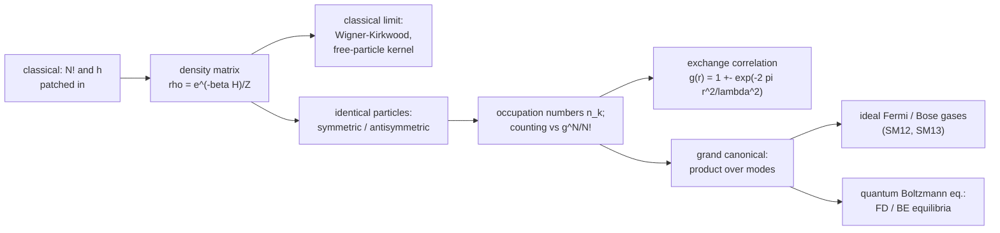

# SM08 · Quantum Ensembles and Identical Particles

◀ [[SM07 Equipartition the Virial Theorem and Magnetic Systems]] · [[Thermodynamics and Statistical Mechanics - Course Map|Course Map]] · next: SM09 (planned: molecular gases, rotation, vibration and nuclear spin)

> [!info] Source and approach
> Follows **Kardar §6.4–6.5 (quantum microstates, p. 170; quantum macrostates and the density matrix, p. 172) and §7.1–7.3 (the Hilbert space of identical particles p. 181, the canonical formulation p. 184, the grand canonical formulation p. 187)** ([[Mehran Kardar - Statistical Physics of Particles (2007).pdf#page=193|PDF p.193 ff.]]; PDF = printed + 12), with **Pathria and Beale Ch. 5 (formulation of quantum statistics, printed pp. 115–138: §5.1 the density matrix p. 115, §5.2 statistics of the ensembles p. 119, §5.3 examples p. 122, §5.4 indistinguishable particles p. 128, §5.5 density matrix and partition function of free particles p. 133)** (PDF = printed + 27, from the OCR'd table of contents) and **Huang Ch. 8 (§8.1 postulates p. 171, §8.2 density matrix p. 174, §8.3 ensembles p. 176, §8.5 ideal gases, microcanonical p. 179, §8.6 grand canonical p. 185; `.djvu` page = printed + 8 or 9)**. Kardar's §7.2 permutation expansion and first quantum correction (eqs. (7.15)–(7.21)) are reproduced here from the page text; the counting tables, the exact canonical recursion (a standard result, derived and checked by me), the pair-correlation numbers, the box example and the ideal-gas pressure numerics are my own (`scripts/sm08_numbers.py`, `fig_sm08.py`). The spin-½ density matrix was introduced in [[QM09 The Stern-Gerlach Experiment and Spin]] §6; this chapter extends it to thermal many-body states. No course is behind this chapter: no taught/extra labels. It opens Part II-B.

> [!tip] Start here (first read)
> - **The picture.** Classical statistical mechanics needed three patches that it could not justify: the $1/N!$ (Gibbs), Planck's constant $h$ in the phase-space measure, and the third law. Quantum mechanics supplies all three: the number of states is a number of *Hilbert-space* states; and **identical particles are not "labelled and then divided by $N!$"; their states are symmetric (bosons) or antisymmetric (fermions) under exchange**, which produces *real* effects at low temperature: Pauli repulsion, Bose bunching, and (in the next chapters) degenerate Fermi gases, Bose–Einstein condensation, blackbody radiation. Two tools do the work: the **density matrix** (the quantum version of $\rho(\mu)$, valid for statistical mixtures and for subsystems of entangled states) and the **occupation-number description** of identical particles.
> - **What you need.** The canonical and grand canonical ensembles ([[SM03 The Canonical Ensemble]], [[SM05 The Grand Canonical Ensemble and Chemical Equilibrium]]); the density matrix of a spin-½ and the Bloch ball ([[QM09 The Stern-Gerlach Experiment and Spin]]); the free particle in a box and the occupation-number basis ([[Free Particle]], [[Number Basis]]); the Gaussian integral ([[Gaussian Integral]]).
> - **How to read.** §1–§3 (when quantum, the density matrix, the classical limit) set the language; §4 (identical particles) and §5 (the canonical and grand canonical ideal quantum gas) are the core; §6 (the quantum Boltzmann equation) connects to SM04. Do Problems 1, 3, 7 and 9.
> - **Notation.** $\hat\rho$ density matrix; $\epsilon=+1$ bosons, $-1$ fermions; $n_k$ occupation numbers; $g_s$ spin degeneracy; $\lambda=h/\sqrt{2\pi mk_BT}$; $f^\pm_\nu(z)$ Fermi/Bose integrals; $\mathcal P$ a permutation.

> [!key] After this chapter you can
> - say **when** quantum statistics matters ($n\lambda^3/g_s\gtrsim1$) and quote the numbers for gases, liquid helium and metals,
> - define the **density matrix**, state its properties, compute purity, entropy and the Bloch vector of a thermal spin, and write the **microcanonical, canonical and grand canonical density matrices** (and derive the canonical one by maximising the von Neumann entropy),
> - derive the **free-particle density matrix** $\langle\mathbf r|e^{-\beta\hat p^2/2m}|\mathbf r'\rangle=\lambda^{-3}e^{-\pi|\mathbf r-\mathbf r'|^2/\lambda^2}$ and the **first quantum correction** to the partition function (**Wigner–Kirkwood**, tested on the oscillator),
> - construct **symmetrised and antisymmetrised states**, normalise them ($\sqrt{N!\prod n_k!}$), and **count** the states of identical particles against $g^N/N!$,
> - derive the **exchange correlation** $g(r)=1\pm e^{-2\pi r^2/\lambda^2}$, the second-virial correction $B_2=\mp\lambda^3/2^{5/2}$ and the sign of the **statistical pressure**,
> - obtain the **ideal-gas $\ln\mathcal Z$**, the equation of state $PV=\tfrac23E$ for any statistics, the exact canonical **recursion**, and the **quantum Boltzmann equation** whose equilibrium is Fermi–Dirac or Bose–Einstein.

> [!intuition] The one-sentence story
> A classical state is a point; a quantum ensemble is a density matrix, in which "which of the $N!$ ways of labelling" is no longer a counting convention but a symmetry of the wavefunction; the symmetry is a *correlation* between particles, with no force involved, that raises the pressure of fermions, lowers that of bosons, and becomes the whole story once $n\lambda^3\gtrsim1$.

*Concept map of the chapter.*

![[fig_sm08_identical.png]]
*Figure SM8.1. A: the pair correlation of an ideal quantum gas: bosons bunch, same-spin fermions avoid each other within a thermal wavelength (§5.1). B: the number of states of $N$ identical particles in $g$ levels, relative to the classical $g^N/N!$: both statistics approach 1 only for $g\gg N^2$, along $1\pm N(N-1)/2g$ (dotted) (§4.2). C: the exact ideal-gas pressure $P/nk_BT$ against $n\lambda^3/g_s$: fermions above, bosons below 1, first-order lines dotted (§5.2). D: two particles in a box (levels 1 and 2): the mean *squared* separation is 4.4 times smaller in the symmetric than in the antisymmetric state, so the rms separation is $\sqrt{4.4}=2.1$ times smaller (§4.2).*

## 1. When is statistics quantum?

The classical treatment treats a particle as having a position *and* a momentum to arbitrary precision, and is justified when the particles' **thermal de Broglie wavelength** $\lambda=h/\sqrt{2\pi mk_BT}$ ([[Thermal Wavelength]]) is small against their mean separation $n^{-1/3}$. The criterion is $n\lambda^3/g_s\ll1$ ($g_s$ the spin degeneracy). Values (recomputed, SM02 §6):

| system | $\lambda$ (nm) | $n\lambda^3$ | verdict |
|---|---|---|---|
| N$_2$, 300 K, 1 atm | 0.0190 | $1.7\times10^{-7}$ | classical (spacing/$\lambda=181$) |
| He gas, 300 K | 0.0504 | $3.1\times10^{-6}$ | classical |
| He gas, 4.2 K | 0.426 | 0.13 | first quantum corrections ($\sim2\%$) |
| liquid He-4, 2.17 K | 0.592 | 4.5 | quantum (superfluid) |
| conduction electrons in Cu, 300 K | 4.30 | $6.8\times10^{3}$ | **massively degenerate** (spacing/$\lambda=0.053$) |

Three things that classical statistical mechanics assumed, and quantum mechanics explains:
1. **The factor $1/N!$** of the Gibbs paradox (SM02 §7) is the *dilute limit* of the symmetrisation (§4, §5.1): $Z_N=\frac1{N!}(V/\lambda^3)^N\big[1\pm\ldots\big]$.
2. **The factor $h^{3N}$** counts quantum states: the number of states in a phase-space cell is $\mathrm d\Gamma/h^{3N}$ (SM02 §8).
3. **The third law** $S\to k_B\ln g_0$ comes from a *discrete* spectrum with a ground state (SM02 §4.4).

## 2. The density matrix and quantum ensembles

### 2.1 Definition and properties
A quantum system whose state is not known exactly, but is $|\psi_i\rangle$ with probability $p_i$, has the **density matrix** ([[Density Matrix]], [[Pure and Mixed States]]; K §6.5, p. 172; PB §5.1; Huang §8.2)
$$\hat\rho=\sum_ip_i\,|\psi_i\rangle\langle\psi_i|,\qquad\langle\hat A\rangle=\mathrm{Tr}(\hat\rho\hat A),\qquad\hat\rho=\hat\rho^\dagger,\ \ \hat\rho\ge0,\ \ \mathrm{Tr}\,\hat\rho=1.$$
The quantity $\mathrm{Tr}\,\hat\rho^{\,2}=\sum_ip_i^2\le1$ (the **purity**) equals 1 iff the state is pure. Because $\mathrm{Tr}$ is basis independent, $\langle A\rangle$ may be evaluated in any basis. The same $\hat\rho$ arises from different ensembles (the preparations $\tfrac12(|{\uparrow_z}\rangle\langle\uparrow_z|+|{\downarrow_z}\rangle\langle\downarrow_z|)$ and the same in the $x$-basis give $\tfrac12\mathbb 1$), so *only $\hat\rho$ is physical*. It also describes the state of a **subsystem of an entangled pure state** (SM06 §5): $\hat\rho_A=\mathrm{Tr}_B|\psi\rangle\langle\psi|$ has eigenvalues $\lambda_i$ and entropy $-\sum\lambda_i\ln\lambda_i$. Evolution: the **von Neumann equation** $\mathrm i\hbar\,\partial_t\hat\rho=[\hat H,\hat\rho]$ (the quantum Liouville equation, [[Liouville's Theorem]]), so any $\hat\rho=f(\hat H)$ is stationary and **$S_{\rm vN}=-k_B\mathrm{Tr}\hat\rho\ln\hat\rho$ is constant** (SM06 §5).

> [!example] A thermal spin-½ (recomputed; QM09 numbers)
> $\hat\rho=\tfrac12(\mathbb 1+\mathbf r\cdot\boldsymbol\sigma)$, $\mathbf r=\tanh(\mu_BB/k_BT)\,\hat z$ (the Bloch vector, [[Bloch Sphere]]). For $B=1$ T: at 1 K $|\mathbf r|=0.586$, eigenvalues $0.793,\ 0.207$, purity $\tfrac12(1+r^2)=0.672$, $S=0.510\,k_B$ (the SM07 value); at 4.2 K $|\mathbf r|=0.159$, purity $0.513$, $S=0.681$; at 300 K $|\mathbf r|=0.0022$, $S=0.6931=\ln2$. Temperature is the *length of the Bloch vector*: $T\to0$ gives a pure state on the surface of the ball, $T\to\infty$ the centre.

### 2.2 The three equilibrium ensembles
> [!key] Quantum ensembles ([[Quantum Ensembles]])
> - **microcanonical:** $\hat\rho=\hat\Pi_{E,\delta E}/\Omega$, the projector onto the energy shell, $S=k_B\ln\Omega$ ($\Omega$ = number of eigenstates in the shell);
> - **canonical:** $\hat\rho=e^{-\beta\hat H}/Z$, $Z=\mathrm{Tr}\,e^{-\beta\hat H}$;
> - **grand canonical:** $\hat\rho=e^{-\beta(\hat H-\mu\hat N)}/\mathcal Z$, $\mathcal Z=\mathrm{Tr}\,e^{-\beta(\hat H-\mu\hat N)}$ (trace over the Fock space of all particle numbers).

*Derivation by maximum entropy* (SM01 §7.7, SM03 §1.1): maximise $-\mathrm{Tr}\hat\rho\ln\hat\rho$ subject to $\mathrm{Tr}\hat\rho=1$, $\mathrm{Tr}\hat\rho\hat H=E$ (add $\mathrm{Tr}\hat\rho\hat N=N$ for the grand ensemble). The variation $-\ln\hat\rho-1-\lambda_0-\beta\hat H=0$ gives $\hat\rho=e^{-\beta\hat H}/Z$ (the operators commute: $\hat\rho$ is a function of $\hat H$). All of SM03 §2 follows with $\sum_i\to\mathrm{Tr}$: $F=-k_BT\ln Z$, $S=-\partial F/\partial T$, $\mathrm{Var}\,E=k_BT^2C_V$.

## 3. The classical limit

### 3.1 The free-particle density matrix
For a free particle in a large volume the canonical density matrix in the position representation follows by inserting the momentum eigenstates $\langle\mathbf r|\mathbf k\rangle=e^{\mathrm i\mathbf k\cdot\mathbf r}/\sqrt V$ (the one-particle version of K §7.2, p. 184–185): 
$$\langle\mathbf r|e^{-\beta\hat p^2/2m}|\mathbf r'\rangle=\int\frac{\mathrm d^3k}{(2\pi)^3}\,e^{\mathrm i\mathbf k\cdot(\mathbf r-\mathbf r')-\beta\hbar^2k^2/2m}=\boxed{\ \frac1{\lambda^3}\exp\Big[-\frac{\pi|\mathbf r-\mathbf r'|^2}{\lambda^2}\Big]\ }$$
(a Gaussian integral, [[Gaussian Integral]]). Its trace $\int\mathrm d^3r\,\lambda^{-3}=V/\lambda^3$ is the classical single-particle $Z_1$ of SM03 §4.1, and the off-diagonal width $\lambda/\sqrt{2\pi}$ shows **each particle is smeared over a thermal wavelength**: the classical picture of a point is valid when the particles are separated by $\gg\lambda$ ([[Free Particle]]; PB §5.5).

### 3.2 The first quantum correction (Wigner–Kirkwood)
Expanding $\mathrm{Tr}\,e^{-\beta(\hat T+\hat V)}$ in powers of $\hbar$ gives, for a system of particles of mass $m$ in a potential $V(\{\mathbf r_i\})$ (stated; [[Wigner-Kirkwood Expansion]]),
$$Z=Z_{\rm cl}\Big[1-\frac{\beta^3\hbar^2}{24m}\sum_i\big\langle(\nabla_iV)^2\big\rangle_{\rm cl}+O(\hbar^4)\Big],\qquad\ln Z=\ln Z_{\rm cl}-\frac{\beta^3\hbar^2}{24m}\sum_i\langle F_i^2\rangle+\dots$$
*quantum effects reduce $Z$ by the mean squared force*: confinement raises the energy. (dimensionally $\beta^3\hbar^2F^2/m$ is a pure number: $\beta^2$ cancels two powers of energy, $\hbar^2/m$ is energy$\times$length$^2$, $F^2$ is energy$^2$/length$^2$, and the remaining $\beta$ cancels the last energy.) **Check on the oscillator.** $V=\tfrac12m\omega^2q^2$: $\langle(V')^2\rangle=m^2\omega^4\langle q^2\rangle=m\omega^2k_BT$, so the correction is $-\frac{\beta^3\hbar^2}{24m}\,m\omega^2k_BT=-\frac{\beta^2\hbar^2\omega^2}{24}=-\frac{x^2}{24}$ with $x=\hbar\omega/k_BT$: **the series $z_q/z_c=1-x^2/24+\dots$ of SM03 §2.5** (exact $\frac{x/2}{\sinh x/2}$: $0.99958,\ 0.98966,\ 0.95952,\ 0.85092$ against $1-x^2/24=0.99958,\ 0.98958,\ 0.95833,\ 0.83333$ at $x=0.1,\ 0.5,\ 1,\ 2$).

## 4. Identical particles

### 4.1 Symmetric and antisymmetric states
The probability density of finding identical particles at $(\mathbf x_1,\mathbf x_2)$ must be unchanged by exchanging the labels, $|\psi(\mathbf x_1,\mathbf x_2)|^2=|\psi(\mathbf x_2,\mathbf x_1)|^2$, so $\psi(\mathbf x_2,\mathbf x_1)=e^{\mathrm i\phi}\psi(\mathbf x_1,\mathbf x_2)$; exchanging twice is the identity, so $e^{2\mathrm i\phi}=1$: **$+$ (bosons) or $-$ (fermions)** (K §7.1; in two dimensions *anyons* with other phases exist; [[Identical Particles]]). For $N$ particles $\hat P\psi=\psi$ (bosons) or $=(-1)^P\psi$ (fermions) for every permutation $P\in S_N$ ([[Symmetric Group]]); the **spin–statistics theorem** (quoted; [[Spin-Statistics Theorem]]) ties bosons to integer spin and fermions to half-integer spin.

From a product of single-particle states $|k_1\cdots k_N\rangle_\otimes$:
$$|k_1\cdots k_N\rangle_\pm=\frac1{\mathcal N_\pm}\sum_{P}(\pm1)^P\,P\,|k_1\cdots k_N\rangle_\otimes,\qquad\mathcal N_-=\sqrt{N!},\quad\mathcal N_+=\sqrt{N!\prod_kn_k!}$$
(K §7.1, eqs. (7.6)–(7.9), pp. 183–184). For fermions this is the **Slater determinant** ([[Slater Determinant]]): it vanishes if any $k$ appears twice (**Pauli exclusion**). For bosons the factor $\prod n_k!$ is the number of permutations that leave the list unchanged; e.g. $|\alpha\alpha\beta\rangle_+$ has $\mathcal N_+=\sqrt{3!\,2!\,1!}=\sqrt{12}$. A state is labelled by the **occupation numbers** $\{n_k\}$ with $\sum n_k=N$: $n_k\in\{0,1\}$ for fermions, $n_k\in\{0,1,2,\dots\}$ for bosons ([[Number Basis]]). **Everything physical depends on the occupation numbers only**; the labelling of particles has disappeared.

### 4.2 Counting: where $N!$ comes from, and where it fails
$N$ particles distributed over $g$ single-particle states ($g\ge N$):
$$\Omega_{\rm dist}=g^N,\qquad\Omega_{\rm bosons}=\binom{N+g-1}{N},\qquad\Omega_{\rm fermions}=\binom gN,\qquad\text{classical limit }g\gg N:\ \ \to\frac{g^N}{N!}.$$

> [!example] Counting (recomputed; Fig. SM8.1B)
> $N=2$, $g=3$: 9 distinguishable, 6 boson, 3 fermion states; the probability that *both particles are in the same orbital* is $\tfrac39=0.33$ (distinguishable), $\tfrac36=0.50$ (bosons), $0$ (fermions). $N=3$, $g=10$: 1000 / 220 / 120 against $g^N/N!=166.7$; $g=100$: $10^6$ / 171 700 / 161 700 against $166\,667$ (ratios $1.030,\ 0.970$); $N=10$, $g=1000$: ratios $1.0459$ (bosons) and $0.9559$ (fermions). The leading correction is $\Omega_\pm/(g^N/N!)\simeq1\pm N(N-1)/(2g)$ (the dotted lines): classical counting is correct only if **$g\gg N^2$** (a stronger condition than $g\gg N$: it says that the *pairs* of particles rarely occupy the same orbital, since there are $N(N-1)/2$ pairs).

> [!example] Two particles in a box (recomputed; Fig. SM8.1D)
> Put two particles in levels 1 and 2 of an infinite well of width $L$: $\varphi_n=\sqrt{2/L}\sin(n\pi x/L)$. Distinguishable: $\langle(x_1-x_2)^2\rangle/L^2=\langle x^2\rangle_1+\langle x^2\rangle_2-2\langle x\rangle_1\langle x\rangle_2=0.2827+0.3207-0.5=0.1033$. For the symmetric/antisymmetric combinations $\langle(x_1-x_2)^2\rangle=0.1033\mp2|\langle1|x|2\rangle|^2$ with $\langle1|x|2\rangle=-16L/(9\pi^2)=-0.1801L$: **bosons $0.0384$, fermions $0.1682$**, a ratio of $4.4$ in the mean square, i.e. $2.1$ in the rms separation. *Pure exchange symmetry, with no interaction, changes the rms separation by a factor of 2*: fermions stay apart (the exchange hole), bosons sit closer. (Why the sign: the exchange term $\mp2|\langle1|x|2\rangle|^2$ comes from the cross terms $\varphi_1(x_1)\varphi_2(x_2)\varphi_2(x_1)\varphi_1(x_2)$ of $|\psi_\pm|^2$, which are large where $x_1\approx x_2$; the $+$ combination piles probability there and the $-$ combination removes it.)

## 5. The ideal quantum gas

### 5.1 The canonical ensemble: permutations and the exchange correlation
For $N$ free identical particles the canonical density matrix is a sum over permutations $Q$ of products of free-particle kernels (K §7.2, eqs. (7.15)–(7.16), p. 185; PB §5.5):
$$Z_N=\frac1{N!\,\lambda^{3N}}\int\prod_{i=1}^N\mathrm d^3x_i\ \sum_Q\epsilon^{Q}\exp\Big[-\frac\pi{\lambda^2}\sum_i|\mathbf x_i-\mathbf x_{Q(i)}|^2\Big],\qquad\epsilon^Q=\begin{cases}1&\text{bosons}\\(-1)^Q&\text{fermions}\end{cases}$$
**The identity permutation gives exactly $Z_N=\frac1{N!}(V/\lambda^3)^N$**, justifying the Gibbs factor: *the division by $N!$ is the leading term of a sum over $N!$ permutations*. The next terms are the two-particle exchanges ($N(N-1)/2$ of them), each carrying $\epsilon\,e^{-2\pi r_{12}^2/\lambda^2}$ (K eq. (7.17), p. 185): the two-particle (symmetrised) probability density for particles at $\mathbf r_1,\mathbf r_2$ is $\lambda^{-6}\big[1+\epsilon\,e^{-2\pi r_{12}^2/\lambda^2}\big]$, i.e. the **pair correlation function**
$$\boxed{\ g(r)=1+\epsilon\,e^{-2\pi r^2/\lambda^2}\ }\qquad([[Exchange Correlation of the Ideal Gas]]).$$
Bosons: $g(0)=2$ (bunching); same-spin fermions: $g(0)=0$ (**the exchange hole**, the Pauli principle expressed as a correlation); $g\to1$ beyond $\sim\lambda$.

> [!example] Numbers (recomputed; Fig. SM8.1A)
> $r/\lambda=0,\ 0.25,\ 0.5,\ 0.75,\ 1$: $e^{-2\pi r^2/\lambda^2}=1,\ 0.675,\ 0.208,\ 0.029,\ 0.0019$; bosons $g=2,\ 1.675,\ 1.208,\ 1.029,\ 1.002$; fermions $0,\ 0.325,\ 0.792,\ 0.971,\ 0.998$. In **air** the mean spacing is $181\,\lambda$, so the exchange factor is $\exp[-2\pi\cdot181^2]\approx10^{-89\,000}$: *no exchange effects at all*. In **copper** the electron spacing is $0.053\,\lambda$: the exchange hole covers many neighbours and the gas is strongly degenerate.

**Effect on pressure.** Integrate the pair term: $\int\mathrm d^3r\,e^{-2\pi r^2/\lambda^2}=\lambda^3/2^{3/2}$, so
$$\ln Z_N\simeq\ln\frac{(V/\lambda^3)^N}{N!}+\epsilon\frac{N(N-1)}{2V}\frac{\lambda^3}{2^{3/2}},\qquad\boxed{\ P=nk_BT\Big[1-\epsilon\frac{n\lambda^3}{2^{5/2}}+\dots\Big]\ },\qquad B_2=-\epsilon\frac{\lambda^3}{2^{5/2}}$$
(K eqs. (7.18)–(7.21), pp. 185–186). **Bosons reduce the pressure, fermions raise it**, as if an effective statistical potential $u_{\rm eff}(r)=-k_BT\ln\big(1+\epsilon e^{-2\pi r^2/\lambda^2}\big)$, attractive for bosons and repulsive for fermions, acted between them (there is no force; it is a correlation): consistently, $B_2=-\tfrac12\int(g-1)\,\mathrm d^3r=-\epsilon\lambda^3/2^{5/2}$. With spin degeneracy $g_s$ only particles in the *same* spin state exchange: $B_2\to-\epsilon\lambda^3/(g_s2^{5/2})$.

> [!example] Helium gas at 4.2 K and 1 atm (recomputed)
> $n\lambda^3=0.135$ for He-4 (bosons, $g_s=1$): $P/nk_BT=1-0.135/5.657=0.976$ ($-2.4\%$). He-3 is lighter ($n\lambda^3=0.206$), fermionic with $g_s=2$: $P/nk_BT=1+0.206/(2\times5.657)=1.018$ ($+1.8\%$). (The *real* second virial coefficients of helium at these temperatures are dominated by the van der Waals attraction, so the statistical term is a small correction there; it dominates for the ideal gas of electrons and for dilute cold atoms.)

### 5.2 The grand canonical ensemble: a product over modes
The constraint $\sum n_k=N$ makes the canonical sum awkward; in the grand ensemble it disappears (SM05 §5). With $\epsilon=+1$ for bosons and $-1$ for fermions:
$$\mathcal Z=\prod_k\big(1-\epsilon\,ze^{-\beta\varepsilon_k}\big)^{-\epsilon},\qquad\ln\mathcal Z=-\epsilon\sum_k\ln\big(1-\epsilon\,ze^{-\beta\varepsilon_k}\big),\qquad\langle n_k\rangle=\frac1{z^{-1}e^{\beta\varepsilon_k}-\epsilon},$$
$PV=k_BT\ln\mathcal Z$, $N=\sum_k\langle n_k\rangle$, $E=\sum_k\varepsilon_k\langle n_k\rangle$ ([[Ideal Quantum Gas]]; K §7.3, p. 187; PB §5.4 and Ch. 6; Huang §8.6, p. 185). The thermodynamics of Fermi and Bose gases (SM12, SM13) is this formula evaluated with the free-particle density of states.

> [!key] $PV=\tfrac23E$ for **any** statistics (non-relativistic)
> With $\varepsilon_k=\hbar^2k^2/2m$ the density of states is $g(\varepsilon)=C\,V\varepsilon^{1/2}$, so $G(\varepsilon)\equiv\int_0^\varepsilon g=\tfrac23\varepsilon\,g(\varepsilon)$. Integrate $\ln\mathcal Z=-\epsilon\int_0^\infty g(\varepsilon)\ln\big(1-\epsilon ze^{-\beta\varepsilon}\big)\mathrm d\varepsilon$ by parts. The boundary term vanishes, and $\frac{\mathrm d}{\mathrm d\varepsilon}\ln(1-\epsilon ze^{-\beta\varepsilon})=\epsilon\beta\langle n(\varepsilon)\rangle$ (with $\epsilon^2=1$), so
> $$\ln\mathcal Z=\beta\int_0^\infty G(\varepsilon)\langle n(\varepsilon)\rangle\,\mathrm d\varepsilon=\tfrac23\beta\int_0^\infty\varepsilon\,g(\varepsilon)\langle n(\varepsilon)\rangle\,\mathrm d\varepsilon\ \Longrightarrow\ PV=k_BT\ln\mathcal Z=\tfrac23E.$$
> It holds for FD, BE and MB (the classical limit gives $PV=Nk_BT$, $E=\tfrac32Nk_BT$) and is a consequence of the *form* $\varepsilon\propto p^2$ and $g\propto\varepsilon^{1/2}$ alone: it fixes $P=\tfrac23u$ even deep in the degenerate regime ($P_F=\tfrac25nE_F$, SM12).

**Equation of state in series.** With $n=\frac{g_s}{\lambda^3}f_{3/2}(z)$ and $P/k_BT=\frac{g_s}{\lambda^3}f_{5/2}(z)$ where $f_\nu(z)=\frac1{\Gamma(\nu)}\int_0^\infty\frac{x^{\nu-1}\mathrm dx}{z^{-1}e^x-\epsilon}$ ($=\sum_{l\ge1}\epsilon^{l-1}z^l/l^\nu$), $P/(nk_BT)=f_{5/2}/f_{3/2}=1-\epsilon z/2^{5/2}+\dots$

> [!example] Exact against first order (recomputed; Fig. SM8.1C)
> | $z$ | 0.1 | 0.3 | 0.6 |
> |---|---|---|---|
> | FD: $n\lambda^3/g_s$ | 0.0967 | 0.2725 | 0.5029 |
> | FD: $P/nk_BT$ (first order) | 1.0171 (1.0171) | 1.0479 (1.0482) | 1.0881 (1.0889) |
> | BE: $n\lambda^3/g_s$ | 0.1037 | 0.3383 | 0.7982 |
> | BE: $P/nk_BT$ (first order) | 0.9816 (0.9817) | 0.9398 (0.9402) | 0.8567 (0.8589) |
>
> The first-order law $1\mp n\lambda^3/(g_s2^{5/2})$ is accurate to better than $0.01\,\%$ for $n\lambda^3/g_s\lesssim0.1$, to $0.1\,\%$ at $0.5$ (fermions) and to $0.3\,\%$ at $0.8$ (bosons). Bosons stop at $n\lambda^3/g_s=\zeta(3/2)=2.612$ ($z\to1$: SM13).

### 5.3 An exact check: the canonical recursion
The canonical $Z_N$ of non-interacting identical particles obeys the exact recursion ([[Quantum Ensembles]]; standard, e.g. in the literature on the canonical ideal Bose gas)
$$Z_N=\frac1N\sum_{l=1}^N(\epsilon')^{\,l-1}\,Z_1(l\beta)\,Z_{N-l},\qquad Z_0=1,\ \ \epsilon'=+1\ (\text{bosons}),\ -1\ (\text{fermions}),\ \ Z_1(\beta)=\sum_ke^{-\beta\varepsilon_k}$$
(obtained by differentiating $\ln\mathcal Z=\sum_k\ldots$ in $z$ and matching powers). *Check.* Levels $\varepsilon_k=k=0,\dots,11$ in units where $\beta=0.7$: **brute-force enumeration vs recursion**: $N=2$ bosons $2.63572791$ vs $2.63572791$; $N=2$ fermions $1.30841716$ vs $1.30841716$; $N=3$ bosons $3.00336285$ vs $3.00336285$; $N=3$ fermions $0.36734071$ vs $0.36734071$ (agreement to 8 digits). The recursion shows the structure: $Z_2=\tfrac12\big[Z_1(\beta)^2\pm Z_1(2\beta)\big]$: the **direct term** $\tfrac12Z_1^2$ is the classical $Z_1^2/2!$, and **$\pm\tfrac12Z_1(2\beta)$ is the exchange term**, whose weight $Z_1(2\beta)\sim V/(\sqrt2\lambda)^3$ is smaller by $2^{-3/2}\,\lambda^3/V$ (the first correction above).

## 6. The quantum Boltzmann equation

SM04's collision integral treated the final states as always available. For fermions a collision into an occupied state is *forbidden*; for bosons it is *enhanced* by the occupation. Including the factors $(1\pm f)$ gives the **Uehling–Uhlenbeck equation** ([[Quantum Boltzmann Equation]]; recalled)
$$C[f]=\int\mathrm d^3p_2\,\mathrm d\Omega\,\sigma_\Omega|\mathbf v_{12}|\Big[f_1'f_2'(1+\epsilon f_1)(1+\epsilon f_2)-f_1f_2(1+\epsilon f_1')(1+\epsilon f_2')\Big]$$
($\epsilon=+1$ bosons, $-1$ fermions). The H-theorem goes through with $H=\int[f\ln f-\epsilon(1+\epsilon f)\ln(1+\epsilon f)]$. **Equilibrium** requires the bracket to vanish for every collision, i.e. $\ln\dfrac f{1+\epsilon f}$ must be a collision invariant ($1,\mathbf p,\varepsilon$):
$$\ln\frac{f}{1+\epsilon f}=\alpha-\beta\varepsilon\ \ \Longrightarrow\ \ f=\frac1{e^{\beta\varepsilon-\alpha}-\epsilon},$$
**Bose–Einstein for $\epsilon=+1$ and Fermi–Dirac for $\epsilon=-1$**, with $\alpha=\beta\mu$: the same distributions as the grand canonical ensemble (SM05 §5), now as the unique stationary solution of a *dynamical* equation. The kinetic coefficients of metals (electrical and thermal conductivity, the Wiedemann–Franz law) follow from this equation with Pauli blocking (SM23, planned).

> [!pitfall] Six traps
> 1. **Statistics is not an interaction.** The exchange correlation changes pressures and densities without any force; it appears even in a perfect gas.
> 2. **Same-spin only.** Exchange acts between particles in the *same* spin state: opposite-spin pairs have $g(r)=1$ (no exchange), so the spin-averaged $g(0)$ of an unpolarised electron gas ($g_s=2$) is $\tfrac12$, not 0.
> 3. **$g\gg N$ is not enough.** Classical counting needs $g\gg N^2$ (§4.2).
> 4. **The density matrix is not a wave function.** Different ensembles give the same $\hat\rho$ and it can describe a subsystem of a pure state; purity distinguishes them.
> 5. **$\mu$ in the grand ensemble must lie below the lowest level for bosons** (SM05 §5); fermions have no such restriction.
> 6. **Wigner–Kirkwood is an expansion in $\beta^3\hbar^2\langle F^2\rangle/m$ (the squared ratio of the thermal wavelength to the length over which the potential changes by $k_BT$), not in $\lambda/L$ alone**: for hard cores or strong forces it fails (the series is asymptotic).

<!-- interactive:start (generated by scripts/embed_interactive.py; edit the tool in scripts/interactive/tools/, not this block) -->
> [!interactive]+ Interactive: Fermions, bosons and classical particles: occupation numbers
> Mean occupation of a single-particle level of energy ε: Fermi–Dirac n = 1/(e^{(ε−μ)/kT}+1), Bose–Einstein n = 1/(e^{(ε−μ)/kT}−1), Maxwell–Boltzmann n = e^{−(ε−μ)/kT}.
>
> ![[sm_quantum_stats.png|720]]
>
> **Try:** Move (ε−μ)/kT through 0: the Bose curve blows up, the Fermi curve passes through ½, the classical curve through 1. For large positive x the three agree. In the Planck panel raise T and watch the peak move as T (Wien) while the area grows as T⁴.
>
> [▶ Open the tool in your browser](../Assets/interactive/sm_quantum_stats.html) · [absolute link](file:///home/swastik/Documents/notes/Assets/interactive/sm_quantum_stats.html) · all tools and coverage: [[Interactive Tools]]

<!-- interactive:end -->

## Map of this chapter
> [!connection] How SM08 connects
> **Builds on:** [[SM05 The Grand Canonical Ensemble and Chemical Equilibrium]] (one mode: FD/BE, $\ln\mathcal Z=\sum\ln$), [[SM03 The Canonical Ensemble]] ($Z=\mathrm{Tr}\,e^{-\beta\hat H}$, oscillator, $-x^2/24$), [[SM06 Entropy Information and the Arrow of Time]] (von Neumann and entanglement entropy), [[SM04 Kinetic Theory and the Boltzmann Equation]] (the collision integral), [[QM09 The Stern-Gerlach Experiment and Spin]] (density matrix, Bloch ball).
> **Leads to:** SM09 (molecular partition functions and ortho/para symmetrisation of homonuclear molecules), SM10 (phonons), SM11 (photons: bosons with $\mu=0$), SM12 (ideal Fermi gas), SM13 (ideal Bose gas and condensation), SM14 (cumulant/cluster expansion of the quantum gas), SM23 (Boltzmann theory of metals); all planned.
> **Concepts:** [[Density Matrix]] · [[Pure and Mixed States]] · [[Quantum Ensembles]] · [[Identical Particles]] · [[Spin-Statistics Theorem]] · [[Pauli Exclusion Principle]] · [[Slater Determinant]] · [[Exchange Correlation of the Ideal Gas]] · [[Wigner-Kirkwood Expansion]] · [[Ideal Quantum Gas]] · [[Quantum Boltzmann Equation]] · [[Fermi-Dirac Distribution]] · [[Bose-Einstein Distribution]] · [[Thermal Wavelength]] · [[Number Basis]] · [[Bloch Sphere]] · [[Gibbs Paradox]]
> **Other subjects:** [[Symmetric Group]] (Group Theory: the permutation group $S_N$ and its sign representation), [[Free Particle]] and [[QM06 The Oscillator Toolbox]] (Quantum Mechanics), [[Exchangeability]] (Probability: the statistical analogue of indistinguishability).

## Summary
> [!summary] Cheat-sheet
> - **Quantum when** $n\lambda^3/g_s\gtrsim1$ (N$_2$ $10^{-7}$; He 4.2 K 0.13; liquid He 4.5; Cu electrons $6.8\times10^3$).
> - **Density matrix:** $\hat\rho=\sum p_i|\psi_i\rangle\langle\psi_i|$, $\langle A\rangle=\mathrm{Tr}\hat\rho\hat A$, purity $\mathrm{Tr}\hat\rho^2\le1$; microcanonical $\Pi/\Omega$, canonical $e^{-\beta\hat H}/Z$, grand $e^{-\beta(\hat H-\mu\hat N)}/\mathcal Z$ (max von Neumann entropy); spin-½: $\tfrac12(1+\mathbf r\cdot\boldsymbol\sigma)$, $|\mathbf r|=\tanh x$ (1 K, 1 T: $0.586$, $S=0.510$).
> - **Free kernel:** $\langle\mathbf r|e^{-\beta p^2/2m}|\mathbf r'\rangle=\lambda^{-3}e^{-\pi|\mathbf r-\mathbf r'|^2/\lambda^2}$; Wigner–Kirkwood $Z=Z_{\rm cl}[1-\tfrac{\beta^3\hbar^2}{24m}\sum\langle F^2\rangle]$ (oscillator $-x^2/24$).
> - **Identical particles:** $\psi$ symmetric (bosons)/antisymmetric (fermions); $\mathcal N_+=\sqrt{N!\prod n_k!}$, $\mathcal N_-=\sqrt{N!}$; counting $g^N/N!\,(1\pm N(N-1)/2g)$; classical iff $g\gg N^2$.
> - **Exchange:** $g(r)=1\pm e^{-2\pi r^2/\lambda^2}$; $P=nkT[1\mp n\lambda^3/(g_s2^{5/2})]$, $B_2=\mp\lambda^3/(g_s2^{5/2})$ (He-4 4.2 K $-2.4\%$; He-3 $+1.8\%$); box: $\langle(x_1-x_2)^2\rangle$ 0.038/0.103/0.168.
> - **Grand:** $\ln\mathcal Z=-\epsilon\sum\ln(1-\epsilon ze^{-\beta\varepsilon_k})$, $n_k=1/(z^{-1}e^{\beta\varepsilon_k}-\epsilon)$, $PV=\tfrac23E$ (any statistics); canonical recursion $Z_N=\tfrac1N\sum(\pm)^{l-1}Z_1(l\beta)Z_{N-l}$ (checked to 8 digits).
> - **Quantum Boltzmann:** collision term with $(1+\epsilon f)$; equilibrium $f=1/(e^{\beta\varepsilon-\alpha}-\epsilon)$.

## Practice
1. **Thermal spin.** For a spin-½ at $B=1$ T and $T=1$ K find the Bloch vector, density-matrix eigenvalues, purity and entropy; at what $T$ is the purity $0.55$?
2. **Purity.** Show $\mathrm{Tr}\hat\rho^2\le1$ with equality iff pure, and find it for the maximally mixed $d$-level state.
3. **Free kernel.** Derive $\langle\mathbf r|e^{-\beta\hat p^2/2m}|\mathbf r'\rangle=\lambda^{-3}e^{-\pi|\mathbf r-\mathbf r'|^2/\lambda^2}$ and check $\mathrm{Tr}=V/\lambda^3$.
4. **Wigner–Kirkwood.** For an oscillator show the first correction is $-x^2/24$ and compare with the exact $\frac{x/2}{\sinh(x/2)}$ at $x=1$ and $2$.
5. **Counting.** For $N=3$ in $g=10$ levels give the numbers of distinguishable, boson and fermion states and compare with $g^N/N!$. For $N=2$, $g=3$ give the probability of double occupancy in the three cases.
6. **Normalisation.** Normalise the bosonic state with occupations $(n_\alpha,n_\beta)=(2,1)$ and the fermion two-particle state $|k_1k_2\rangle_-$.
7. **Exchange correlation.** Derive $g(r)=1\pm e^{-2\pi r^2/\lambda^2}$ from the symmetrised two-particle density matrix, evaluate it at $r=\lambda/2$ and obtain $B_2=\mp\lambda^3/2^{5/2}$.
8. **Helium.** Evaluate the first quantum correction to the pressure for He-4 and He-3 at 4.2 K and 1 atm ($n\lambda^3=0.135$ for He-4).
9. **Recursion.** Show $Z_2=\tfrac12[Z_1(\beta)^2\pm Z_1(2\beta)]$ and evaluate it for levels $\varepsilon_k=k$ ($k=0,1,\dots$), $\beta=0.7$ using the infinite geometric series.
10. **$PV=\tfrac23E$.** Prove it for FD, BE and MB gases with $g(\varepsilon)\propto\varepsilon^{1/2}$.
11. **Quantum Boltzmann.** Show that the bracket in the Uehling–Uhlenbeck collision integral vanishes if and only if $\ln[f/(1+\epsilon f)]$ is additive in collisions, and obtain FD/BE.
12. **Exchange hole.** Two same-spin electrons in a metal with $n=8.5\times10^{28}$ m$^{-3}$ at 300 K: compare $\lambda$ with the spacing and say whether classical statistics can be used.

> [!example]- Solutions
> 1. $x=\mu_BB/k_BT=0.672$, $|\mathbf r|=\tanh x=0.586$; eigenvalues $(1\pm r)/2=0.793,\ 0.207$; purity $\tfrac12(1+r^2)=0.672$; $S=-\sum\lambda\ln\lambda=0.510$. Purity $0.55$ needs $r^2=0.10$, $r=0.316$, $x=\mathrm{artanh}(0.316)=0.327$, so $T=\mu_BB/(0.327k_B)=2.05$ K.
> 2. $\mathrm{Tr}\hat\rho^2=\sum p_i^2\le(\sum p_i)^2=1$ with equality iff only one $p_i\ne0$ (pure); $\mathbb 1/d$ gives $d\cdot d^{-2}=1/d$.
> 3. $\int\frac{\mathrm d^3k}{(2\pi)^3}e^{\mathrm i\mathbf k\cdot\mathbf\Delta-\beta\hbar^2k^2/2m}=(m/2\pi\beta\hbar^2)^{3/2}e^{-m|\mathbf\Delta|^2/2\beta\hbar^2}$; with $\lambda^2=2\pi\beta\hbar^2/m$ this is $\lambda^{-3}e^{-\pi|\mathbf\Delta|^2/\lambda^2}$. Trace: $\int\mathrm d^3r\,\lambda^{-3}=V/\lambda^3$.
> 4. $\langle(V')^2\rangle=m^2\omega^4\langle q^2\rangle=m\omega^2k_BT$, so $-\frac{\beta^3\hbar^2}{24m}\,m\omega^2k_BT=-\frac{\beta^2\hbar^2\omega^2}{24}=-\frac{x^2}{24}$ ($x=\beta\hbar\omega$). Exact $x/(2\sinh(x/2))$: $0.95952$ ($x=1$; series $0.95833$) and $0.85092$ ($x=2$; series $0.83333$).
> 5. $g^N=1000$; bosons $\binom{12}3=220$; fermions $\binom{10}3=120$; $g^N/N!=166.7$ (ratios $1.32$ and $0.72$). $N=2$, $g=3$: both in the same state: $3/9=0.333$, $3/6=0.5$, $0$.
> 6. $\mathcal N_+=\sqrt{3!\,2!\,1!}=\sqrt{12}$, so $|\alpha\alpha\beta\rangle_+=\frac1{\sqrt{12}}\sum_P P|\alpha\alpha\beta\rangle=\frac1{\sqrt3}\big(|\alpha\alpha\beta\rangle+|\alpha\beta\alpha\rangle+|\beta\alpha\alpha\rangle\big)$ (the sum has 6 terms = 2 copies of each of 3 distinct products). Fermions: $|k_1k_2\rangle_-=\frac1{\sqrt2}\big(|k_1k_2\rangle-|k_2k_1\rangle\big)$.
> 7. Two-particle density matrix with exchange: $\lambda^{-6}\big[\exp(-\pi\Delta_{11}^2/\lambda^2-\pi\Delta_{22}^2/\lambda^2)+\epsilon\exp(-\pi|\mathbf x_1-\mathbf x_2'|^2/\lambda^2-\pi|\mathbf x_2-\mathbf x_1'|^2/\lambda^2)\big]$; on the diagonal ($\mathbf x'=\mathbf x$) the direct term is 1 and the exchange term $\epsilon e^{-2\pi r^2/\lambda^2}$ with $r=|\mathbf x_1-\mathbf x_2|$. At $r=\lambda/2$: $e^{-\pi/2}=0.208$, $g=1.208$ (bosons), $0.792$ (fermions). $B_2=-\tfrac12\int(g-1)\mathrm d^3r=-\tfrac\epsilon2\cdot\lambda^3/2^{3/2}=-\epsilon\lambda^3/2^{5/2}$.
> 8. He-4: $-0.135/2^{5/2}=-0.0238$ ($P/nkT=0.976$); He-3: $n\lambda^3=0.206$, $g_s=2$: $+0.206/(2\times5.657)=+0.0182$ ($1.018$).
> 9. $Z_2=\tfrac12\big[Z_1(\beta)^2\pm Z_1(2\beta)\big]$ from the recursion ($l=1,2$). With $Z_1(\beta)=1/(1-e^{-0.7})=1.9864$ and $Z_1(2\beta)=1/(1-e^{-1.4})=1.3273$: $Z_1(\beta)^2=3.9459$: bosons $\tfrac12(3.9459+1.3273)=2.6366$, fermions $\tfrac12(3.9459-1.3273)=1.3093$ (the 12-level truncation used in the brute-force check gives $2.6357$ and $1.3084$; the difference, of order $10^{-3}$, is the weight of the levels $k\ge12$).
> 10. With $G(\varepsilon)=\int_0^\varepsilon g=\tfrac23\varepsilon g(\varepsilon)$ integrate $\ln\mathcal Z=-\epsilon\int g\ln(1-\epsilon ze^{-\beta\varepsilon})\mathrm d\varepsilon$ by parts: the boundary term $[G\ln(\ldots)]_0^\infty$ vanishes ($G(0)=0$; the logarithm decays exponentially), and $\frac{\mathrm d}{\mathrm d\varepsilon}\ln(1-\epsilon ze^{-\beta\varepsilon})=\epsilon\beta\langle n\rangle$, so $\ln\mathcal Z=\beta\int G\langle n\rangle\mathrm d\varepsilon=\tfrac23\beta\int\varepsilon g\langle n\rangle\mathrm d\varepsilon=\tfrac23\beta E$; hence $PV=k_BT\ln\mathcal Z=\tfrac23E$. (MB: replace $\ln(1-\epsilon ze^{-\beta\varepsilon})$ by $-ze^{-\beta\varepsilon}$.)
> 11. Set the bracket to zero: $f_1'f_2'(1+\epsilon f_1)(1+\epsilon f_2)=f_1f_2(1+\epsilon f_1')(1+\epsilon f_2')$. Divide by $(1+\epsilon f_1)(1+\epsilon f_2)(1+\epsilon f_1')(1+\epsilon f_2')$: $\frac{f_1'}{1+\epsilon f_1'}\frac{f_2'}{1+\epsilon f_2'}=\frac{f_1}{1+\epsilon f_1}\frac{f_2}{1+\epsilon f_2}$, i.e. $\varphi(\mathbf p)=\ln\frac f{1+\epsilon f}$ is a collision invariant, $\varphi=\alpha+\mathbf b\cdot\mathbf p-\beta\varepsilon$; solving, $f=1/(e^{\beta\varepsilon-\alpha}-\epsilon)$ ($\mathbf b$ absorbed in a shift of $\mathbf p$).
> 12. $\lambda=4.30$ nm; spacing $n^{-1/3}=0.227$ nm: $\lambda/\text{spacing}=19$, $n\lambda^3=6.8\times10^3$, $n\lambda^3/g_s=3.4\times10^3\gg1$: the electron gas is *far* in the degenerate regime; the exchange factor $e^{-2\pi(d/\lambda)^2}\approx1-0.0176$ for $d=0.053\lambda$: the hole has no room to decay; classical statistics gives nonsense (SM12: the Fermi energy of copper is $7$ eV and $T_F\approx8\times10^4$ K).

## Provenance
> [!provenance]- Source map for this chapter
> | Topic | Source | Origin |
> |---|---|---|
> | quantum microstates, density matrix, ensembles | [[Mehran Kardar - Statistical Physics of Particles (2007).pdf#page=182\|K §6.4, p. 170]], K §6.5, p. 172; PB §5.1–5.3 (pp. 115–127); Huang §8.1–8.3 (pp. 171–178) | book |
> | Hilbert space of identical particles, permutation expansion of $Z_N$, first quantum correction, grand canonical | [[Mehran Kardar - Statistical Physics of Particles (2007).pdf#page=193\|K §7.1–7.3, pp. 181–188]]; PB §5.4–5.5 (pp. 128–138); Huang §8.5–8.6 (pp. 179–189) | book |
> | free-particle kernel, exchange correlation $g(r)$ and statistical potential, $B_2$ cross-check | K eqs. (7.14)–(7.21); my own write-up of the pair term | book / mine |
> | counting tables, box example, exact recursion and its check, ideal-gas $P/nkT$ numerics, spin-½ thermal purity, $\lambda$ table | `scripts/sm08_numbers.py`, `scripts/fig_sm08.py` | mine |
> | Wigner–Kirkwood coefficient $\beta^2\hbar^2/24m$, spin–statistics theorem, anyons, Uehling–Uhlenbeck equation and its H-function | stated (the oscillator check confirms the coefficient) | recalled |
>
> **Flags.** (1) Wigner–Kirkwood's general formula is quoted; the oscillator reproduces the SM03 series, which checks the coefficient but not the multi-particle form. (2) The He-3 correction uses $g_s=2$ and the helium numbers of SM02 §6; real helium virial coefficients are dominated by the interaction. (3) The Uehling–Uhlenbeck H-function and the Pauli-blocking factors are recalled; Problem 11 derives only the equilibrium. (4) Kardar's equation numbers in the text layer are partly garbled; sections and pages are cited. (5) Recalled inputs in the $\lambda$ table: liquid He-4 density $145$ kg/m$^3$ at 2.17 K and the copper electron density $8.5\times10^{28}$ m$^{-3}$; $T_F\approx8\times10^4$ K for copper (Problem 12) is recalled, not recomputed here. (6) The recursion is a standard result; its source is not one of the three books' pages cited above.

**References.** Kardar, M. *Statistical Physics of Particles* (2007), §6.4–6.5, §7.1–7.3 · Pathria, R. K. and Beale, P. D. *Statistical Mechanics*, 3rd ed. (2011), Ch. 5 · Huang, K. *Statistical Mechanics*, 2nd ed. (1987), Ch. 8 · von Neumann, J. (1927) · Wigner, E. (1932) *Phys. Rev.* 40, 749; Kirkwood, J. G. (1933) *Phys. Rev.* 44, 31 · Uehling, E. A. and Uhlenbeck, G. E. (1933) *Phys. Rev.* 43, 552.

## Across subjects
- [[Symmetric Group]] (Group Theory): the permutation group $S_N$ acting on $N$-particle states; bosons and fermions are its trivial and sign representations (the other irreducible representations are the parastatistics excluded in three dimensions).
- [[QM09 The Stern-Gerlach Experiment and Spin]] (Quantum Mechanics): the Bloch vector, the density matrix of an oven beam, the singlet's reduced state; here its thermal and many-body version.
- [[Exchangeability]] (Probability): exchangeable random variables have a joint law invariant under permutation, the classical analogue of the symmetric wavefunction.
