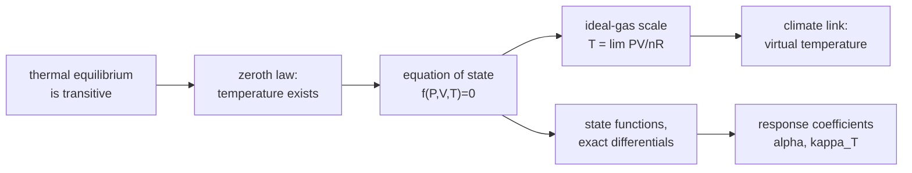

# TH01 · Temperature and the Zeroth Law

◀ [[Thermodynamics and Statistical Mechanics - Course Map|Course Map]] · [[TH02 Work Heat and the First Law]] ▶

taught · in syllabus extra · book extra · beyond

> [!syllabus] Syllabus map: what is in the syllabus and what is extra in this chapter
> 🟢 **In syllabus (taught)**: [[0d0ec730e8e02ed0399d39ff05054a72_MIT8_333F13_Lec1.pdf|MIT 8.333 Lecture 1]] (Kardar), §I.A–I.B (pp.1–3 of the PDF): definitions, the zeroth law and the existence of temperature, equations of state, the ideal-gas scale. **The folder does not state which course this is**; the MIT lectures are the only lecture-type material, so they are treated as the syllabus (see Provenance).
> - §1 what thermodynamics is; equilibrium; coordinates; walls (L1 §I.A)
> - §2 the zeroth law and the existence of an empirical temperature (L1 §I.B)
> - §3 equations of state: wire, paramagnet, gas (L1 eqs. I.7–I.9)
> - §4 the ideal-gas temperature scale (L1 eq. I.10)
>
> 🟡 **Extra · book** (Zemansky and Dittman, *Heat and Thermodynamics*, Ch. 1–2; and the AI summaries of them)
> - §5 thermometers and why empirical scales disagree; §6 exact differentials, the reciprocity and cyclic relations, expansivity and compressibility
>
> 🔵 **Extra · beyond** (my additions, labelled)
> - §4 the 2019 SI note; §6 the sealed-water pressure example; §7 the van der Waals critical point; all worked numbers (`scripts/th_numbers.py`)

> [!key] After this chapter you can
> - say what **equilibrium**, a **state function**, a **closed** system and **adiabatic/diathermic walls** are,
> - state the **zeroth law** and prove that it implies a function $\Theta$ of the coordinates (the empirical temperature) that is equal for systems in equilibrium,
> - write the equations of state of a **van der Waals gas**, a **Curie paramagnet** and a **rubber band**, and read an **isotherm** off them,
> - define the **ideal-gas temperature** $T=273.16\,\lim(PV)/\lim(PV)_{\rm tp}$ and explain why a dilute gas is a universal thermometer,
> - test whether $\mathrm dz=M\mathrm dx+N\mathrm dy$ is **exact**, use the **reciprocity** and **cyclic** identities, and compute $(\partial P/\partial T)_V=\beta/\kappa_T$.

> [!intuition] The one-sentence story
> If two bodies are each in balance with a third, they are in balance with each other; that innocent fact is what allows us to give every equilibrium state a number called temperature, and it is the reason a thermometer works.

<!-- intuition-v1 -->

*Concept map: how the ideas of this chapter depend on each other (read left to right; every box is a section).*

## 1. What thermodynamics is
taught *L1 §I.A ([[0d0ec730e8e02ed0399d39ff05054a72_MIT8_333F13_Lec1.pdf#page=1|p.1]])*

**Thermodynamics** is a **phenomenological** description of the **equilibrium** properties of **macroscopic** systems. It rests on a few empirical laws; a coherent logical and mathematical structure is built on them, giving useful concepts and testable relations between measurable quantities. The laws can only be *justified* by a more fundamental microscopic theory: statistical mechanics tries to obtain them from the classical or quantum mechanics of many particles ([[TH06 From Kinetic Theory to Statistical Mechanics]]).

> [!key] Equilibrium is timescale-relative
> A system is in **equilibrium** when its properties do not change appreciably over the intervals of interest. Window glass is in equilibrium as a solid over decades but flows over millennia; matter and radiation in the first minutes of the Big Bang can be treated as in equilibrium. The observation time makes the concept partly subjective.

A system in equilibrium is described by a few **thermodynamic coordinates**, also called **state functions**: pressure and volume for a fluid; surface tension and area for a film; tension and length for a wire; electric field and polarisation for a dielectric. A **closed** system is an idealisation (like a point mass in mechanics): it is isolated by **adiabatic** walls that allow no heat exchange. **Diathermic** walls allow heat exchange, so the system is not isolated thermally. The laws imply further state functions beyond the mechanical ones: temperature ([[Zeroth Law]]), internal energy ([[TH02 Work Heat and the First Law]]) and entropy ([[TH04 The Second Law Carnot Engines and Entropy]]).

## 2. The zeroth law and the existence of temperature
taught *L1 §I.B ([[0d0ec730e8e02ed0399d39ff05054a72_MIT8_333F13_Lec1.pdf#page=2|pp.2–3]])*

> [!intuition] Why temperature is a label, not a stuff
> If A is in equilibrium with C and B is in equilibrium with C then A and B are in equilibrium. So one number (what C reads) can label every body that is in mutual equilibrium: that number is temperature. The law says *nothing* about how it should be scaled.

> [!key] Zeroth law
> If two systems A and B are separately in equilibrium with a third system C, then they are also in equilibrium with one another (**thermal equilibrium is transitive**).

Its consequence is a new state function: the **empirical temperature** $\Theta$, such that systems in equilibrium have the same $\Theta$.

> [!derivation] Proof that $\Theta$ exists (L1)
> Let the coordinates of A, B, C be $\{A_1,A_2,\dots\}$, $\{B_i\}$, $\{C_i\}$. Equilibrium of A with C is a constraint $f_{AC}(A_1,A_2,\dots;C_1,C_2,\dots)=0$, and of B with C a constraint $f_{BC}(B_i;C_i)=0$. Solve each for $C_1$:
> $$C_1=F_{AC}(A_1,A_2,\dots;C_2,\dots),\qquad C_1=F_{BC}(B_1,B_2,\dots;C_2,\dots).$$
> If C is in equilibrium with both, $F_{AC}=F_{BC}$. The zeroth law says A and B are also in equilibrium: $f_{AB}(A_i;B_i)=0$, a relation that **does not contain** the coordinates of C. So the equation $F_{AC}(A;C_2,\dots)=F_{BC}(B;C_2,\dots)$ must hold or fail independently of $C_2,\dots$: the $C$-dependence has to cancel between the two sides. (For instance both could have the form $\alpha(C_2,\dots)\,\Theta(\cdot)+\beta(C_2,\dots)$, with the same $\alpha,\beta$; then $\alpha$ and $\beta$ drop out.) After cancelling $C$'s coordinates the condition is
> $$\Theta_A(A_1,A_2,\dots)=\Theta_B(B_1,B_2,\dots).$$
> Equilibrium is therefore characterised by a **function $\Theta$ of the coordinates**. The relation $\Theta_A(A_1,A_2,\dots)=\Theta$ (fixed) defines an **isotherm** of A, and the function is its **equation of state**.

> [!pitfall] The zeroth law gives isotherms, not a scale
> It says a temperature function exists but not which numbers to assign. Any monotonic function of $\Theta$ would do; a practical scale needs a reference system (§4) or, better, a material-independent definition ([[TH04 The Second Law Carnot Engines and Entropy]]).

## 3. Equations of state: three examples
taught *L1 eqs. (I.7)–(I.9) ([[0d0ec730e8e02ed0399d39ff05054a72_MIT8_333F13_Lec1.pdf#page=3|p.3]])*

> [!intuition] An equation of state is a surface
> For a simple fluid $(P,V,T)$ live on a 2-D surface in 3-D space: fix any two and the third is determined. Every thermodynamic process is a path on this surface.

Take three different systems: (A) a wire of length $L$ under tension $F$, (B) a paramagnet of magnetisation $M$ in a field $B$, (C) a gas of volume $V$ at pressure $P$. Observation shows that when they are in equilibrium their coordinates satisfy constraints of the form
$$\Big(P+\frac a{V^2}\Big)(V-b)(L-L_0)-c\,[F-K(L-L_0)]=0,\qquad\Big(P+\frac a{V^2}\Big)(V-b)\,M-d\,B=0 .$$
These can be organised into three **empirical temperature functions** that are all equal in equilibrium:
$$\Theta\ \propto\ \Big(P+\frac a{V^2}\Big)(V-b)=c\Big[\frac F{L-L_0}-K\Big]=d\,\frac BM .$$
Each factor is the **equation of state** of one system, taken in its familiar form:

| system | equation of state | name |
|---|---|---|
| gas | $\big(P+a/V^2\big)(V-b)=Nk_BT$ | van der Waals gas |
| paramagnet | $M=N\mu^2B/(3k_BT)$ | Curie law |
| rubber | $F=(K+DT)(L-L_0)$ | Hooke's law with a $T$-dependent constant |

> [!example] An isotherm and the critical point of CO$_2$ (🔵 numbers)
> Van der Waals with $a=0.364$ Pa m$^6$ mol$^{-2}$ and $b=4.267\times10^{-5}$ m$^3$ mol$^{-1}$ (CO$_2$): setting $\partial P/\partial V=\partial^2P/\partial V^2=0$ gives $T_c=8a/27Rb=304.0$ K, $P_c=a/27b^2=7.40$ MPa and $V_c=3b=128$ cm$^3$ mol$^{-1}$ (real CO$_2$: $304.1$ K, $7.38$ MPa). Above $T_c$ the isotherms are monotonic; below it they have a loop ([[TH05 Potentials Maxwell Relations Stability and the Third Law]], Fig. TH5.1).

## 4. The ideal-gas temperature scale
taught *L1 eq. (I.10) ([[0d0ec730e8e02ed0399d39ff05054a72_MIT8_333F13_Lec1.pdf#page=3|p.3]])*

> [!intuition] Why gases make the best thermometers
> Real gases differ at high density but all obey $PV=nRT$ as $P\to0$. So the *limit* $\lim PV/nR$ is the same whichever gas you use: a scale that does not depend on the substance.

The zeroth law merely states the existence of isotherms. For a **practical scale** one needs a reference system, and the dilute gas occupies an important place. Observations show that the product $PV$ is constant along the isotherms of any sufficiently dilute gas; the **ideal gas** is the dilute limit of real gases, and the ideal-gas temperature is proportional to $PV$. The constant of proportionality is fixed by the triple point of the ice-water-vapour system, assigned $273.16$ K:
$$\boxed{\ T(\mathrm K)\equiv273.16\times\frac{\lim_{P\to0}(PV)_{\rm system}}{\lim_{P\to0}(PV)_{\text{ice-water-gas}}}\ }$$

> [!example] A constant-volume gas thermometer (🔵 numbers)
> At constant volume $PV\propto P$, so $T=273.16\,P/P_{\rm tp}$. With $P_{\rm tp}=80$ kPa and a reading $P=109.3$ kPa: $T=273.16\times109.3/80=373.2$ K. In practice one repeats at lower and lower gas pressures and extrapolates $P\to0$, because real gases differ slightly at finite density.

> [!extra-beyond]- 🔵 Extra (beyond): the kelvin since 2019
> The lecture states the 1954 convention (the triple point of water is **defined** as $273.16$ K). Since the 2019 redefinition of the SI the Boltzmann constant $k_B=1.380649\times10^{-23}$ J K$^{-1}$ is fixed and the triple point of water is a **measured** quantity, equal to $273.16$ K to within about $0.1$ mK. For everything here the two agree.

## 5. Thermometers: why empirical scales disagree
extra · book *Zemansky Ch. 1, §1.5–1.8 ([[Heat and thermodynamics an intermediate textbook (Mark Waldo Zemansky Richard Dittman) (z-library.sk, 1lib.sk, z-lib.sk).pdf#page=25|PDF pp.25–47]]; book page = PDF − 20)*

A **thermometer** is a system with a coordinate $X$ that changes monotonically with temperature (the mercury length, a resistance, the pressure of a gas at constant volume). Assign $\theta(X)=aX$ with $a$ fixed by the triple point. Two different thermometers (different substances or different coordinates) agree at the fixed points but **not in between**, because a linear relation in one is not linear in the other: an empirical scale is **thermometer-dependent**. The constant-volume dilute-gas thermometer is the standard because every sufficiently dilute gas gives the same limit (§4); and the **thermodynamic** scale of [[TH04 The Second Law Carnot Engines and Entropy]], defined through Carnot engines, depends on no substance at all and coincides with it.

## 6. State functions, exact differentials and response coefficients
extra · book *Zemansky Ch. 2, §2.3–2.4 ([[Heat and thermodynamics an intermediate textbook (Mark Waldo Zemansky Richard Dittman) (z-library.sk, 1lib.sk, z-lib.sk).pdf#page=52|PDF pp.52–58]])*

> [!intuition] State function versus path
> Altitude is a state function (it depends on where you are); distance walked is not. $dU$ is exact: integrating around any closed loop gives zero. $\delta Q$ and $\delta W$ are not, which is why they get a $\delta$.

For a simple (hydrostatic) system the state is fixed by two of $(P,V,T)$ and the third follows from the equation of state, e.g. $P=P(T,V)$. A quantity $z(x,y)$ is a **state function** if its change depends only on the endpoints. Its differential
$$\mathrm dz=M\,\mathrm dx+N\,\mathrm dy\quad(M=\partial_xz,\ N=\partial_yz)$$
is **exact** iff $\partial M/\partial y=\partial N/\partial x$ (the order of differentiation does not matter). A differential that fails the test is **inexact**, written with a bar, $\bar\mathrm dQ,\bar\mathrm dW$ ([[TH02 Work Heat and the First Law]]).

> [!example] Test (checked symbolically)
> $\mathrm df=y\,\mathrm dx+x\,\mathrm dy$ (that is $f=xy$): $\partial_yy=1=\partial_xx$: exact. $\mathrm dg=y\,\mathrm dx$: $\partial_yy=1\ne\partial_x0=0$: **inexact**; its integral depends on the path.

**Two identities for functions of two variables.** If $x,y,z$ are related by one constraint,
$$\Big(\frac{\partial x}{\partial y}\Big)_z=\Big[\Big(\frac{\partial y}{\partial x}\Big)_z\Big]^{-1}\quad\text{(reciprocity)},\qquad\Big(\frac{\partial x}{\partial y}\Big)_z\Big(\frac{\partial y}{\partial z}\Big)_x\Big(\frac{\partial z}{\partial x}\Big)_y=-1\quad\text{(cyclic)}.$$

**Response coefficients.** The measurable derivatives of $V(T,P)$:
$$\beta\equiv\frac1V\Big(\frac{\partial V}{\partial T}\Big)_P\ \ (\text{volume expansivity}),\qquad\kappa_T\equiv-\frac1V\Big(\frac{\partial V}{\partial P}\Big)_T\ \ (\text{isothermal compressibility}).$$
The cyclic relation $(\partial P/\partial T)_V=-(\partial P/\partial V)_T(\partial V/\partial T)_P$ becomes
$$\boxed{\ \Big(\frac{\partial P}{\partial T}\Big)_V=\frac\beta{\kappa_T}\ }$$
so the pressure rise on heating at fixed volume follows from two table values.

> [!example] Ideal gas, and water sealed in a rigid vessel
> Ideal gas: $\beta=1/T$, $\kappa_T=1/P$, so $(\partial P/\partial T)_V=P/T$: at 300 K and 1 atm, $338$ Pa K$^{-1}$ (1 part in 300 per kelvin). **Liquid water at 20 °C** (recalled literature values $\beta=2.07\times10^{-4}$ K$^{-1}$, $\kappa_T=4.59\times10^{-10}$ Pa$^{-1}$): $(\partial P/\partial T)_V=4.5\times10^{5}$ Pa K$^{-1}$, i.e. **$4.5$ bar per kelvin**: heat a completely full, rigid, sealed container of water by 10 K and the pressure rises by about 45 bar. Liquids are nearly incompressible, so even a small expansion is resisted enormously. (Cyclic check for the ideal gas: $(\partial P/\partial V)_T(\partial V/\partial T)_P(\partial T/\partial P)_V=-1$ verified.)

> [!pitfall] $(\partial x/\partial y)_z$ is not a ratio of changes at fixed anything
> What is held constant matters: $(\partial P/\partial T)_V\ne(\partial P/\partial T)_S$. State the subscript every time, and do not "cancel" partial derivatives with different subscripts.

## 7. A first connection to the climate chapters
extra · beyond *cross-link*

The ideal-gas law of [[Ideal Gas Law]] is the equation of state used in [[CL05 Thermodynamic State of the Atmosphere]]; the empirical temperature is the one in [[CL02 Observing Global Temperature]]; and the idea that **only differences of a potential matter** (a recurring theme: energy, geopotential, [[Geopotential]]) appears again in the energy and entropy of the next chapters.

## Map of this chapter
> [!connection] How TH01 connects
> **Builds on:** school physics (pressure, volume, gas laws).
> **Leads to:** [[TH02 Work Heat and the First Law]] → [[TH03 The Ideal Gas and Adiabatic Processes]] → [[TH04 The Second Law Carnot Engines and Entropy]] → [[TH05 Potentials Maxwell Relations Stability and the Third Law]] → [[TH06 From Kinetic Theory to Statistical Mechanics]].
> **Concepts:** [[Thermodynamic Equilibrium]] · [[State Function]] · [[Zeroth Law]] · [[Empirical Temperature]] · [[Equation of State]] · [[Ideal Gas Temperature Scale]] · [[Exact Differential]] · [[Response Functions]] · [[Ideal Gas Law]]
> **Other subjects:** [[CL05 Thermodynamic State of the Atmosphere]], [[Fixed Points and Linear Stability]] (stability of equilibria), [[Probability - Course Map]] (equilibrium as the most probable macrostate).

## Summary
> [!summary] Cheat-sheet
> - **Thermodynamics** = phenomenological equilibrium description of macroscopic systems; equilibrium is **timescale-relative**; closed = adiabatic walls, diathermic = heat can pass.
> - **Zeroth law:** A~C and B~C $\Rightarrow$ A~B $\Rightarrow$ $\exists\,\Theta(\text{coordinates})$ equal in equilibrium; isotherm $\Theta_A=\Theta$ is the equation of state.
> - Equations of state: vdW $(P+a/V^2)(V-b)=Nk_BT$; Curie $M=N\mu^2B/3k_BT$; rubber $F=(K+DT)(L-L_0)$. CO$_2$ vdW: $T_c=304.0$ K, $P_c=7.40$ MPa, $V_c=128$ cm$^3$/mol.
> - **Ideal-gas scale:** $T=273.16\,\lim(PV)/\lim(PV)_{\rm tp}$; constant-volume thermometer $T=273.16\,P/P_{\rm tp}$.
> - Empirical scales agree only at fixed points; the dilute-gas and **thermodynamic** scales are substance-independent.
> - $\mathrm dz=M\mathrm dx+N\mathrm dy$ exact iff $\partial_yM=\partial_xN$; reciprocity; cyclic rule $=-1$; $\beta=\frac1V(\partial_TV)_P$, $\kappa_T=-\frac1V(\partial_PV)_T$, $(\partial_TP)_V=\beta/\kappa_T$ (ideal gas $P/T$; water $4.5$ bar/K).

## Practice
1. **Zeroth law.** Systems A and B are each in equilibrium with C but a careless experimenter finds A and B *not* in equilibrium with each other. What does that say about the zeroth law, and what does it say about $\Theta$?
2. **Empirical temperature.** Show that the van der Waals gas and the rubber band of §3 can have a common temperature function, and give the isotherm of the gas in the $(P,V)$ plane for $\Theta$ fixed.
3. **Gas thermometer.** A constant-volume thermometer reads $P_{\rm tp}=60.0$ kPa at the triple point and $P=81.9$ kPa when immersed in a bath. Find $T$ in kelvin and °C. What happens to the answer if the gas is far from dilute?
4. **Critical constants.** Derive $T_c=8a/27Rb$, $P_c=a/27b^2$, $V_c=3b$ for the van der Waals gas from $\partial P/\partial V=0=\partial^2P/\partial V^2$ and evaluate them for $a=0.364$ Pa m$^6$ mol$^{-2}$, $b=4.267\times10^{-5}$ m$^3$ mol$^{-1}$. Find $Z_c=P_cV_c/RT_c$.
5. **Exactness.** Which of $\mathrm d\phi=(2xy+1)\mathrm dx+x^2\mathrm dy$ and $\mathrm d\psi=y\,\mathrm dx-x\,\mathrm dy$ is exact? For the exact one find $\phi$.
6. **Cyclic relation.** Verify $(\partial P/\partial V)_T(\partial V/\partial T)_P(\partial T/\partial P)_V=-1$ for the ideal gas, and for a van der Waals gas show that $(\partial P/\partial T)_V=R/(V_m-b)$.
7. **Thermal stress.** Copper has $\beta=5\times10^{-5}$ K$^{-1}$ and $\kappa_T=7.2\times10^{-12}$ Pa$^{-1}$. By how much does the pressure rise if a rigid copper block is heated by 1 K at constant volume? Why does a liquid burst a sealed container so easily?
8. **Empirical scales.** Two thermometers, one linear in the length of mercury and one linear in the resistance of platinum, agree at 0 and 100 °C. Why do they disagree at 50 °C? Which scale is substance-independent?
9. **Isotherms.** For a paramagnet at $B=1$ T sketch $M(T)$ from the Curie law. For which temperatures is the law (valid for small $B/T$) unreliable?
10. **Equilibrium.** Give an example of a system that is in equilibrium for the experiment you are doing but not forever, and say what sets the observation time.

> [!example]- Solutions
> 1. The zeroth law would be violated: for systems with equilibrium transitive, A~C and B~C force A~B. The experiment must have an error (A and B not truly in thermal contact, or a non-equilibrium state). If it held, no $\Theta$ could exist: the relation "equal $\Theta$" would not be transitive.
> 2. The wire and paramagnet of §3 share a $\Theta\propto(P+a/V^2)(V-b)$ with the gas. For a given $\Theta$ the gas isotherm is $P=\Theta'/(V-b)-a/V^2$ where $\Theta'=Nk_BT$: a hyperbola-like curve $\Theta'/(V-b)$ lowered by the $a/V^2$ term; for the rubber, $F=(K+DT)(L-L_0)$ with $T\propto\Theta$.
> 3. $T=273.16\times81.9/60.0=372.9$ K $=99.7$ °C. For a dense gas the $P\to0$ extrapolation is not taken and different gases give slightly different numbers.
> 4. $P=RT/(V-b)-a/V^2$; $\partial_VP=-RT/(V-b)^2+2a/V^3=0$ and $\partial_V^2P=2RT/(V-b)^3-6a/V^4=0$. Divide the second by the first: $2/(V-b)=3/V$, so $V_c=3b$; then $T_c=8a/27Rb=304.0$ K and $P_c=a/27b^2=7.40$ MPa; $Z_c=3/8=0.375$ (real gases $\approx0.27$–$0.29$).
> 5. $\partial_y(2xy+1)=2x=\partial_x(x^2)$: $\mathrm d\phi$ exact, $\phi=x^2y+x+\text{const}$. $\partial_yy=1\ne\partial_x(-x)=-1$: $\mathrm d\psi$ inexact.
> 6. Ideal gas: $P=RT/V$: $(\partial_VP)_T=-P/V$, $(\partial_TV)_P=V/T$, $(\partial_PT)_V=V/R$: product $-(P/V)(V/T)(V/R)=-PV/(RT)=-1$. vdW: $(\partial_TP)_V=R/(V_m-b)$.
> 7. $(\partial P/\partial T)_V=\beta/\kappa_T=5\times10^{-5}/7.2\times10^{-12}=6.9\times10^{6}$ Pa K$^{-1}$ ($\approx69$ bar per K). A sealed container of liquid bursts because the liquid's expansivity (water $2\times10^{-4}$ K$^{-1}$) is several times that of the solid walls, so on heating the liquid tries to occupy more volume than the container gains; the liquid is also nearly incompressible ($\kappa_T\approx4.6\times10^{-10}$ Pa$^{-1}$), so squeezing it back costs about 4.5 bar per kelvin (§6).
> 8. A linear relation in one property is not linear in the other (the two properties depend differently on the true temperature), so they agree at the two fixed points but not between; the thermodynamic (Carnot) scale does not depend on any substance.
> 9. $M=N\mu^2B/(3k_BT)$ is proportional to $1/T$; it fails at low $T$ and large $B$ where $M$ saturates at $N\mu$. The law is valid for $\mu B\ll k_BT$.
> 10. Window glass (solid for decades, flowing for millennia), or a cup of coffee that cools in minutes; equilibrium is relative to the time over which the properties are observed.

## Provenance
> [!provenance]- Source map for this chapter
> | Topic | Source | Scope |
> |---|---|---|
> | definitions, equilibrium, walls, state functions | [[0d0ec730e8e02ed0399d39ff05054a72_MIT8_333F13_Lec1.pdf#page=1\|MIT 8.333 L1 §I.A, p.1]] | taught |
> | zeroth law and existence of $\Theta$ | [[0d0ec730e8e02ed0399d39ff05054a72_MIT8_333F13_Lec1.pdf#page=2\|L1 §I.B, pp.2–3]] | taught |
> | the three equations of state; ideal-gas scale | [[0d0ec730e8e02ed0399d39ff05054a72_MIT8_333F13_Lec1.pdf#page=3\|L1 eqs. I.7–I.10, p.3]] | taught |
> | thermometers; exact differentials; $\beta,\kappa_T$ | Zemansky Ch. 1–2 (OCR, PDF pp.25–58) | extra/book |
> | 2019 SI note; water example; vdW critical point; worked numbers | recomputed here (`scripts/th_numbers.py`) | extra/beyond |
>
> **Read and not read.** MIT Lecture 1 was read in full. Zemansky is a scan: I OCR'd chapters 1–5 (PDF pp.14–150) to locate sections and read the passages cited; the AI summaries `Thermodynamics_Ch1-5_Notes.pdf` and `Zemansky_Thermodynamics_Overview.pdf` were skimmed, not relied on.
>
> **Notes.** (1) The folder does not say which course the MIT lectures serve; I treat them as the syllabus because they are the only lecture material, and Zemansky Ch. 1–5 as book-level companions. **Ask the instructor to confirm.** (2) The lecture quotes $k_B\approx1.4\times10^{-23}$ J K$^{-1}$ (the exact value is $1.380649\times10^{-23}$). (3) The water coefficients $\beta=2.07\times10^{-4}$ K$^{-1}$ and $\kappa_T=4.59\times10^{-10}$ Pa$^{-1}$ are recalled literature values, not checked in the folder.

**References.** Kardar, M. *Statistical Physics of Particles* (Cambridge, 2007), Ch. 1 · MIT OpenCourseWare 8.333 *Statistical Mechanics I* (Fall 2013), Lecture 1 · Zemansky, M. W. and Dittman, R. H. *Heat and Thermodynamics*, Ch. 1–2 · BIPM *SI Brochure* (2019).
