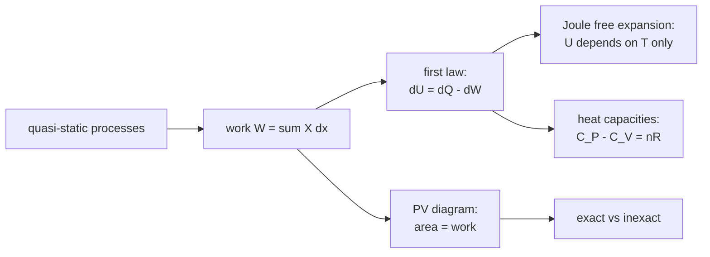

# TH02 · Work, Heat and the First Law

◀ [[TH01 Temperature and the Zeroth Law]] · [[Thermodynamics and Statistical Mechanics - Course Map|Course Map]] · [[TH03 The Ideal Gas and Adiabatic Processes]] ▶

taught · in syllabus extra · book extra · beyond

> [!syllabus] Syllabus map: what is in the syllabus and what is extra in this chapter
> 🟢 **In syllabus (taught)**: [[0d0ec730e8e02ed0399d39ff05054a72_MIT8_333F13_Lec1.pdf|MIT 8.333 Lecture 1]] §I.C (PDF pp.4–6): the first law, quasi-static work, generalised forces and displacements, Joule's free expansion, response functions, $C_P-C_V$.
> - §1 quasi-static processes; generalised force and displacement (L1 §I.C, Table 1)
> - §2 **sign conventions** (the lecture counts work added to the system)
> - §3 the first law: adiabatic work defines $E$; heat as the remainder; inexact differentials
> - §4 Joule's free expansion and the ideal gas $E(T)$
> - §5 response functions and heat capacities; $C_V$, $C_P$; Mayer's relation
>
> 🟡 **Extra · book** (Zemansky Ch. 3–4)
> - §6 work in changing the volume of a fluid, the $PV$ diagram, path dependence; the enthalpy as the natural energy at constant $P$
>
> 🔵 **Extra · beyond** (my additions, labelled)
> - §6 the numbers for four processes and for two paths; §7 the test that $\bar\mathrm dQ$ is inexact but $\bar\mathrm dQ/T$ is exact for an ideal gas; the air heat capacities

> [!key] After this chapter you can
> - define a **quasi-static** process and the pairs $(J_i,x_i)$ with $\bar\mathrm dW=\sum J_i\mathrm dx_i$, and convert between the **MIT** (work *on* the system) and **Zemansky/climate** (work *by* the system) sign conventions,
> - compute the work of isothermal, isobaric, isochoric and adiabatic processes and show that work and heat depend on the **path**,
> - state the **first law** as: adiabatic work depends only on the endpoints, so $E$ is a state function and $\Delta Q=\Delta E-\Delta W$,
> - explain **Joule's free expansion** and why it implies $E=E(T)$ for the ideal gas,
> - write $C_V=(\partial E/\partial T)_V$, $C_P=(\partial H/\partial T)_P$ and prove $C_P-C_V=Nk_B$ for the ideal gas.

> [!intuition] The one-sentence story
> Energy can enter a system as work or as heat, and **how much of each** depends on the road you take, but their **sum**, the change of the internal energy, depends only on where you start and finish.

<!-- intuition-v1 -->

*Concept map: how the ideas of this chapter depend on each other (read left to right; every box is a section).*

## 1. Quasi-static processes and generalised work
taught *L1 §I.C ([[0d0ec730e8e02ed0399d39ff05054a72_MIT8_333F13_Lec1.pdf#page=4|pp.4–5]])*

> [!intuition] Work is organised energy transfer, heat is disorganised
> Pushing a piston moves *all* molecules in step (work). Warming through a wall nudges molecules at random (heat). Both move energy; only the first can lift a weight.

We now consider transformations between equilibrium states, achieved by applying work or heat. A **quasi-static** transformation is performed slowly enough that the system is always in equilibrium, so its coordinates exist at every stage. For such a transformation the state functions split into **generalised displacements** $\{x_i\}$ (usually extensive) and conjugate **generalised forces** $\{J_i\}$ (intensive), and the work done *on* the system is
$$\bar\mathrm dW=\sum_iJ_i\,\mathrm dx_i .$$

| system | force $J$ | displacement $x$ |
|---|---|---|
| wire | tension $F$ | length $L$ |
| film | surface tension $S$ | area $A$ |
| fluid | **pressure $-P$** | volume $V$ |
| magnet | field $H$ | magnetisation $M$ |
| dielectric | electric field $E$ | polarisation $P$ |
| chemical reaction | chemical potential $\mu$ | particle number $N$ |

*Table TH2.1 (L1 Table 1).* The displacement is usually **extensive**, the force **intensive**. Pressure is calculated from the force the *system* exerts on the walls, opposite to the force on a spring; that is the origin of the **minus sign** in hydrostatic work, $\bar\mathrm dW=-P\,\mathrm dV$.

## 2. Sign conventions: read this twice
taught *L1 ([[0d0ec730e8e02ed0399d39ff05054a72_MIT8_333F13_Lec1.pdf#page=4|p.4]]); the Zemansky/climate convention for comparison*

> [!intuition] Pick a sign convention and say it out loud
> $\Delta U=Q-W$ ($W$ done *by* the system) is the convention of these notes and the engines chapter; $\Delta U=Q+W$ is the convention of the climate and chemistry texts. They describe the same energy bookkeeping; mixing them is the commonest error.

| | **MIT / Kardar** (this chapter) | **Zemansky, Wallace and Hobbs, the climate chapters** |
|---|---|---|
| $W$ means | work done **on** the system | work done **by** the system |
| fluid work | $\bar\mathrm dW=-P\,\mathrm dV$ | $\bar\mathrm dW=+P\,\mathrm dV$ |
| first law | $\mathrm dE=\bar\mathrm dQ+\bar\mathrm dW$ | $\mathrm dU=\bar\mathrm dQ-\bar\mathrm dW$ |
| $Q$ means | heat **added** | heat **added** |

> [!pitfall] Same physics, opposite sign of $W$
> The two conventions describe the same experiment; only the sign of the symbol $W$ differs. A gas that expands against its surroundings does $+500$ J of work **by** it ($W_{\rm Zem}=+500$ J) and has $W_{\rm MIT}=-500$ J done **on** it. Always state which you use. In this note set, TH02–TH05 use the **MIT** convention $\mathrm dE=\bar\mathrm dQ+\bar\mathrm dW$, with $\bar\mathrm dW=-P\mathrm dV$, and **say so** when quoting a "work by the gas" ($W_{\rm by}=-W_{\rm MIT}=\int P\,\mathrm dV$). The existing climate notes ([[First Law of Thermodynamics]]) use the Zemansky convention.

## 3. The first law
taught *L1 §I.C ([[0d0ec730e8e02ed0399d39ff05054a72_MIT8_333F13_Lec1.pdf#page=4|p.4]])*

> [!intuition] $U$ is the bank balance, $Q$ and $W$ are transactions
> You cannot say a gas 'contains' so much heat or so much work; you can say it has so much internal energy, and that deposits (heat in, work done on it) change it.

> [!key] First law (L1 formulation)
> The amount of **work** required to change the state of an **otherwise adiabatically isolated** system depends only on the initial and final states, **not on the means by which the work is performed**, nor on the intermediate stages.

Hence there exists a state function, the **internal energy** $E(X)$, determined up to a constant by
$$\Delta W=E(X_f)-E(X_i)\qquad(\text{adiabatic transformation}).$$
In a generic (non-adiabatic) transformation the work does **not** equal $\Delta E$. The difference is **defined** as the heat taken in from the surroundings:
$$\boxed{\ \Delta Q\equiv\Delta E-\Delta W\ ,\qquad\bar\mathrm dQ=\mathrm dE-\bar\mathrm dW\ }$$
$Q$ and $W$ are **not** separately functions of state: they depend on the way the work is applied, not only on the endpoints. For a differential change we therefore write $\bar\mathrm dQ$ and $\bar\mathrm dW$ with a bar, to emphasise they are **inexact** differentials, while $\mathrm dE=\sum_i\partial_iE\,\mathrm dX_i$ is exact. The sign convention counts energy **added to** the system.

> [!intuition] An energy ledger
> The internal energy is the balance in an account. Work and heat are two kinds of deposit; the ledger remembers only the **balance**, not the deposits. This is why "how much heat does the gas have?" is a meaningless question while "how much did it absorb on this process?" is a good one.

## 4. Joule's free expansion
taught *L1 ([[0d0ec730e8e02ed0399d39ff05054a72_MIT8_333F13_Lec1.pdf#page=5|p.5]])*

> [!intuition] Why free expansion tells you about $U$
> The gas expands into a vacuum: it does no work and exchanges no heat, so $\Delta U=0$. If the temperature does not change then $U$ cannot depend on volume: $U=U(T)$ for an ideal gas.

If a gas expands **adiabatically** (no heat, $\Delta Q=0$) into a vacuum from $V_i$ to $V_f$, not necessarily quasi-statically, no external work is done ($\Delta W=0$), so $\Delta E=0$. Observation: for a (dilute) gas the **temperature is unchanged**. Since $P$ and $V$ changed but $T$ did not, the internal energy cannot depend on $V$ at fixed $T$:
$$E(V,T)=E(T)\qquad\text{for the ideal gas}.$$
This is a consequence of the equation of state $PV\propto T$: in [[TH05 Potentials Maxwell Relations Stability and the Third Law]] we prove $(\partial E/\partial V)_T=T(\partial P/\partial T)_V-P$, which vanishes for $P=Nk_BT/V$.

> [!example] Free expansion, numbers (🔵)
> 1 mol of ideal gas doubling its volume: $\Delta E=0$, $\Delta T=0$, $Q=W=0$, yet the process is **irreversible**: its entropy rises by $R\ln2=5.76$ J K$^{-1}$ ([[TH04 The Second Law Carnot Engines and Entropy]]). The "no work" is because there is no piston to push. A real gas cools slightly: for van der Waals gas $E=C_VT-a/V+\text{const}$, so $\Delta T=-(a/C_V)(1/V_1-1/V_2)$: for CO$_2$ ($a=0.364$ Pa m$^6$ mol$^{-2}$, $C_V\approx28.8$ J mol$^{-1}$K$^{-1}$) going from 1 L to 2 L, $\Delta T\approx-6.3$ K.

## 5. Response functions, heat capacities and Mayer's relation
taught *L1 ([[0d0ec730e8e02ed0399d39ff05054a72_MIT8_333F13_Lec1.pdf#page=5|pp.5–6]])*

**Response functions** are the usual way to characterise a system: they are measured as the change of a coordinate under an external probe.

- **Heat capacities** (change of temperature on adding heat; the path must be specified). For a gas:
$$C_V=\frac{\bar\mathrm dQ}{\mathrm dT}\Big|_V=\frac{\mathrm dE-\bar\mathrm dW}{\mathrm dT}\Big|_V=\frac{\mathrm dE+P\,\mathrm dV}{\mathrm dT}\Big|_V=\Big(\frac{\partial E}{\partial T}\Big)_V,$$
$$C_P=\frac{\bar\mathrm dQ}{\mathrm dT}\Big|_P=\Big(\frac{\partial E}{\partial T}\Big)_P+P\Big(\frac{\partial V}{\partial T}\Big)_P .$$
$C_P>C_V$ since some of the heat goes into the work of changing the volume. With the **enthalpy** $H=E+PV$, $C_P=(\partial H/\partial T)_P$ ([[Enthalpy]]).
- **Force constants** (displacement per force; generalised spring constants): $\kappa_T=-\frac1V(\partial V/\partial P)_T$; the susceptibility $\chi_T=\frac1V(\partial M/\partial B)_T$. For the ideal gas $\kappa_T=1/P$.
- **Thermal responses**: the expansivity $\alpha_P=\frac1V(\partial V/\partial T)_P$ (called $\beta$ in [[TH01 Temperature and the Zeroth Law]]); ideal gas $\alpha_P=1/T$.

> [!derivation] Mayer's relation for the ideal gas
> Since $E=E(T)$, $(\partial E/\partial T)_V=(\partial E/\partial T)_P=\mathrm dE/\mathrm dT$. Then
> $$C_P-C_V=P\Big(\frac{\partial V}{\partial T}\Big)_P=PV\alpha_P=\frac{PV}{T}\equiv Nk_B,$$
> where the last step uses extensivity: $PV/T$ is proportional to the number of particles, and the constant is Boltzmann's constant ($k_B=1.380649\times10^{-23}$ J K$^{-1}$; the lecture rounds to $1.4\times10^{-23}$). Per mole, $c_P-c_V=R=8.314$ J mol$^{-1}$K$^{-1}$.

> [!example] Heating at constant volume and at constant pressure (🔵, recomputed)
> 1 mol of a **diatomic** gas ($C_V=\tfrac52R=20.79$, $C_P=\tfrac72R=29.10$ J mol$^{-1}$K$^{-1}$) heated from 300 K to 400 K: at constant volume $Q=\Delta E=2079$ J; at constant pressure $Q=\Delta H=2910$ J; the difference $831$ J is the work the gas does pushing back the surroundings ($=R\Delta T$). For **air** ($M=28.97$ g mol$^{-1}$): $c_p=\frac72R/M=1004.5$ J kg$^{-1}$K$^{-1}$, $c_v=717.5$, $R_d=287.0$, the values used in the climate chapters.

## 6. Work in a fluid: processes on the $PV$ diagram
extra · book *Zemansky Ch. 3 ([[Heat and thermodynamics an intermediate textbook (Mark Waldo Zemansky Richard Dittman) (z-library.sk, 1lib.sk, z-lib.sk).pdf#page=69|PDF pp.69–91]]) and Ch. 4 ([[Heat and thermodynamics an intermediate textbook (Mark Waldo Zemansky Richard Dittman) (z-library.sk, 1lib.sk, z-lib.sk).pdf#page=92|PDF pp.92–125]]); numbers recomputed here*

> [!intuition] Read the diagram: area is work
> The area under a path on the $PV$ plane is the work done by the gas; a closed loop encloses the *net* work. Going round clockwise is an engine, anticlockwise a refrigerator.

In the Zemansky convention the work done **by** a fluid in a quasi-static volume change is $W_{\rm by}=\int_{V_i}^{V_f}P\,\mathrm dV$: the **area under the curve** in the $PV$ plane. It depends on the **path**, not just the endpoints.

![[fig_th02_processes.png]]
*Figure TH2.1. A: four quasi-static processes of 1 mol of ideal gas from (1 atm, 300 K, 24.6 L). B: two paths between the same endpoints, with different work.*

| process | condition | $W_{\rm by}$ (ideal gas) | 1 mol, $V\to2V$, 300 K |
|---|---|---|---|
| isothermal | $T$ const | $nRT\ln(V_2/V_1)$ | $1729$ J ($Q=W$, $\Delta E=0$) |
| isobaric | $P$ const | $P(V_2-V_1)$ | $2494$ J $(=RT_1)$ |
| isochoric | $V$ const | $0$ | $0$ |
| adiabatic ($\gamma=5/3$) | $\bar\mathrm dQ=0$ | $C_V(T_1-T_2)$ | $T_2=189.0$ K, $1385$ J |

For the **isothermal** case $\Delta E=0$ (ideal gas), so $Q=W_{\rm by}$; for the **adiabatic** case $Q=0$ and $W_{\rm by}=-\Delta E=C_V(T_1-T_2)$: the gas does work at the expense of its internal energy and cools.

> [!example] Same endpoints, different heat and work (Fig. TH2.1B)
> Take $A=(2\text{ atm},10\text{ L})\to B=(1\text{ atm},20\text{ L})$. $PV$ is the same at both ends so $T_A=T_B$ and $\Delta E=0$ (monatomic: $E=\tfrac32PV$). **Path 1** (isochoric cool to 1 atm, then isobaric expansion): $W_{\rm by}=P_2\Delta V=1013$ J. **Path 2** (isobaric expansion at 2 atm, then isochoric cool): $W_{\rm by}=P_1\Delta V=2026$ J. A straight line gives $1520$ J. In each case $Q=W_{\rm by}$ since $\Delta E=0$: **heat is not a state function either**.

> [!pitfall] Closed cycles do net work
> Around a closed loop $\Delta E=0$ exactly, but $W$ and $Q$ do not vanish: a clockwise loop in the $PV$ plane converts heat into work (the heat engine of [[TH04 The Second Law Carnot Engines and Entropy]]). A rectangular loop between 1 and 2 atm and 10 to 20 L does net work $(P_1-P_2)(V_2-V_1)=1013$ J per cycle.

## 7. Inexact versus exact (a worked test)
extra · beyond *derived here*

For one mole of ideal gas, $\bar\mathrm dQ=C_V\mathrm dT+P\,\mathrm dV=C_V\mathrm dT+\dfrac{RT}V\mathrm dV$. Test exactness with $M=C_V$, $N=RT/V$: $\partial_VM=0$ but $\partial_TN=R/V\ne0$: **inexact**. Multiply by $1/T$:
$$\frac{\bar\mathrm dQ_{\rm rev}}T=C_V\frac{\mathrm dT}T+R\frac{\mathrm dV}V,$$
whose cross derivatives are both zero: **exact**. So $1/T$ is an **integrating factor** and $\mathrm dS=\bar\mathrm dQ_{\rm rev}/T$ defines a state function. This is the content of the second law, [[TH04 The Second Law Carnot Engines and Entropy]]; see also the entropy of the ideal gas, $S=C_V\ln T+R\ln V+S_0$, which is path-independent (checked: $\Delta S=14.19$ J K$^{-1}$ for $300\to450$ K and $V\to3V$ in either order).

<!-- interactive:start (generated by scripts/embed_interactive.py; edit the tool in scripts/interactive/tools/, not this block) -->
> [!interactive]+ Interactive: First law on a P–V diagram: work, heat and internal energy for four processes
> One mole of ideal gas taken from state A to a new volume by an isothermal, isobaric, isochoric or adiabatic process.
>
> ![[th_pv_processes.png|720]]
>
> **Try:** Expand from V = 10 L to 20 L at T = 300 K: isothermal W = RT ln2 = 1.729 kJ, Q = W, ΔU = 0. Adiabatic: Q = 0 and W = −ΔU (the gas cools). The isobaric W = P ΔV is the area of a rectangle. Compare the four areas.
>
> [▶ Open the tool in your browser](../Assets/interactive/th_pv_processes.html) · [absolute link](file:///home/swastik/Documents/notes/Assets/interactive/th_pv_processes.html) · all tools and coverage: [[Interactive Tools]]

<!-- interactive:end -->

## Map of this chapter
> [!connection] How TH02 connects
> **Builds on:** [[TH01 Temperature and the Zeroth Law]] (state functions, exact differentials, the ideal gas).
> **Leads to:** [[TH03 The Ideal Gas and Adiabatic Processes]] (the reversible adiabat, $\gamma$, the speed of sound) → [[TH04 The Second Law Carnot Engines and Entropy]] (what limits the conversion of heat to work).
> **Concepts:** [[First Law of Thermodynamics]] · [[Quasi-Static Process]] · [[Generalised Force and Displacement]] · [[Internal Energy]] · [[Heat and Work]] · [[Heat Capacity]] · [[Enthalpy]] · [[Joule Expansion]] · [[Mayer Relation]] · [[Response Functions]]
> **Other subjects:** [[CL05 Thermodynamic State of the Atmosphere]] ($c_p$, $c_v$ of air), [[CL09 Radiative-Convective Equilibrium]] (the energy equation of a parcel), [[Quantum Mechanics - Course Map]] (equipartition and degrees of freedom).

## Summary
> [!summary] Cheat-sheet
> - **Conventions:** MIT: $\mathrm dE=\bar\mathrm dQ+\bar\mathrm dW$, $\bar\mathrm dW=\sum J_i\mathrm dx_i$ (fluid $-P\mathrm dV$), work **on** the system. Zemansky/climate: $\mathrm dU=\bar\mathrm dQ-\bar\mathrm dW$, $W_{\rm by}=\int P\mathrm dV$. $Q$ is always heat **added**.
> - **First law:** adiabatic work depends only on endpoints $\Rightarrow$ $E$; $\Delta Q=\Delta E-\Delta W$; $Q,W$ inexact ($\bar\mathrm d$), $E$ exact.
> - **Processes (1 mol, $V\to2V$, 300 K):** isothermal $1729$ J; isobaric $2494$ J; adiabatic ($5/3$) $1385$ J, $T_2=189.0$ K; isochoric $0$. Same endpoints, different paths: $1013$, $1520$, $2026$ J.
> - **Joule free expansion** ($Q=W=0$): $\Delta T=0$ for the ideal gas $\Rightarrow$ $E=E(T)$.
> - $C_V=(\partial E/\partial T)_V$; $C_P=(\partial E/\partial T)_P+P(\partial V/\partial T)_P=(\partial H/\partial T)_P$; $\kappa_T$, $\alpha_P$; ideal gas $C_P-C_V=Nk_B$ ($R$ per mol); air $c_p=1004.5$, $c_v=717.5$ J kg$^{-1}$K$^{-1}$.
> - $\bar\mathrm dQ$ inexact but $\bar\mathrm dQ_{\rm rev}/T$ exact for the ideal gas: the integrating factor $1/T$.

## Practice
1. **Conventions.** A gas expands, doing $500$ J of work on its surroundings, while absorbing $800$ J of heat. Find $\Delta E$, and give $W$ in both conventions.
2. **Isothermal.** 2 mol of ideal gas at 350 K expand isothermally from 10 L to 40 L. Find the work done by the gas and the heat absorbed.
3. **Adiabatic.** 1 mol of monatomic ideal gas at 300 K doubles its volume adiabatically and reversibly. Find $T_2$, $W_{\rm by}$ and $\Delta E$.
4. **Three paths.** For $A=(2\text{ atm},10\text{ L})\to B=(1\text{ atm},20\text{ L})$ (monatomic ideal gas) find $W_{\rm by}$ and $Q$ along the straight line in the $PV$ plane.
5. **A cycle.** A cycle consists of (1) isobaric expansion at 2 atm from 10 L to 20 L, (2) isochoric cooling to 1 atm, (3) isobaric compression at 1 atm, (4) isochoric heating. Find the net work per cycle and the net heat. In which direction must the cycle run to be an engine?
6. **Heat capacities.** 2 mol of a diatomic ideal gas are heated from 300 K to 500 K (a) at constant volume, (b) at constant pressure. Find $Q$ in each case and $Q_P-Q_V$.
7. **Mayer.** Show $C_P-C_V=PV\alpha_P$ for the ideal gas and evaluate it for 1 mol. Why is $C_P>C_V$?
8. **Air.** 1 kg of air is heated by 10 K at (a) constant volume, (b) constant pressure. Find $Q$, and the work done in (b).
9. **Joule.** Why does a free expansion of a dilute gas not cool it, while a real gas cools slightly? What would a measurement of $\Delta T$ tell you about the intermolecular forces?
10. **Inexact.** Show that $\bar\mathrm dW=-P\,\mathrm dV$ is inexact for the ideal gas (compare two paths), and that $\bar\mathrm dQ_{\rm rev}/T$ is exact.

> [!example]- Solutions
> 1. $\Delta E=Q+W_{\rm MIT}=800+(-500)=+300$ J. Zemansky: $W=+500$ J and $\Delta U=Q-W=300$ J. MIT: $W=-500$ J.
> 2. $W_{\rm by}=nRT\ln(V_2/V_1)=2\times8.314\times350\times\ln4=8068$ J ($=8.07$ kJ). $\Delta E=0$ so $Q=+8068$ J.
> 3. $T_2=T_1(V_1/V_2)^{2/3}=300\times0.630=189.0$ K; $W_{\rm by}=\tfrac32R(T_1-T_2)=1385$ J; $\Delta E=-1385$ J; $Q=0$.
> 4. Straight line: mean pressure $1.5$ atm, $\Delta V=10$ L: $W_{\rm by}=1.5\times101325\times0.010=1520$ J. $\Delta E=0$ so $Q=1520$ J.
> 5. Net work $=(P_1-P_2)(V_2-V_1)=1013$ J (area of the rectangle, positive for a clockwise loop in the $PV$ plane). $\Delta E=0$ so net heat $=+1013$ J. Clockwise (expand at the high pressure, compress at the low pressure) is the engine direction.
> 6. (a) $Q_V=2\times\tfrac52R\times200=8314$ J; (b) $Q_P=2\times\tfrac72R\times200=11\,640$ J; difference $3326$ J $=nR\Delta T$ (the work of expansion).
> 7. $(\partial E/\partial T)_P=C_V$ for the ideal gas, so $C_P-C_V=P(\partial V/\partial T)_P=P\cdot V/T=R$ per mol ($8.314$ J mol$^{-1}$K$^{-1}$). $C_P>C_V$ because at constant pressure the gas expands and does work on the surroundings, so more heat is needed for the same $\Delta T$.
> 8. (a) $Q_V=717.5\times10=7175$ J. (b) $Q_P=1004.5\times10=10\,045$ J. Work done by the air in (b): $Q_P-\Delta E=10\,045-7175=2870$ J ($=R_d\Delta T=287\times10$).
> 9. For an ideal gas there are no intermolecular forces, so $E$ depends only on $T$ (kinetic), and $\Delta E=0$ means $\Delta T=0$. A real gas has attractive forces (van der Waals $a$): expansion increases the mean separation and the potential energy $-a/V$ rises, which must come from the kinetic energy, so the gas cools by $(a/C_V)(1/V_1-1/V_2)$. The measured $\Delta T$ gives $a$.
> 10. Ideal gas from $A$ to $B$: along path 1 of Fig. TH2.1B the work done on the gas is $-1013$ J, along path 2 it is $-2026$ J: different, so $\bar\mathrm dW$ is not exact. $\bar\mathrm dQ_{\rm rev}/T=C_V\mathrm dT/T+R\mathrm dV/V$ has $\partial_V(C_V/T)=0=\partial_T(R/V)$: exact.

## Provenance
> [!provenance]- Source map for this chapter
> | Topic | Source | Scope |
> |---|---|---|
> | quasi-static, generalised work, table of forces/displacements | [[0d0ec730e8e02ed0399d39ff05054a72_MIT8_333F13_Lec1.pdf#page=4\|MIT L1 §I.C, pp.4–5]] | taught |
> | first law, heat as remainder, inexact differentials | [[0d0ec730e8e02ed0399d39ff05054a72_MIT8_333F13_Lec1.pdf#page=4\|L1 pp.4–5, eqs. I.11–I.12]] | taught |
> | Joule expansion; response functions; $C_P-C_V$ | [[0d0ec730e8e02ed0399d39ff05054a72_MIT8_333F13_Lec1.pdf#page=5\|L1 pp.5–6, eqs. I.14–I.15]] | taught |
> | work of a fluid, $PV$ diagram, adiabatic work | Zemansky Ch. 3–4 (OCR, PDF pp.69–125) | extra/book |
> | process table, path-dependence numbers, air $c_p$, vdW Joule cooling, exactness test | recomputed here (`scripts/th_numbers.py`) | extra/beyond |
>
> **Read and not read.** MIT L1 was read in full. Zemansky Ch. 3–4 were located by OCR and the section headings and key statements read; the full worked problems were not. The proof that $E=E(T)$ follows from the equation of state is deferred to TH05 (the lecture refers to "test 1 review problems", which are not in the folder).
>
> **Notes.** (1) The sign convention differs from the climate notes and from Zemansky (table in §2). (2) The vdW result $E=C_VT-a/V$ and the CO$_2$ $C_V\approx28.8$ J mol$^{-1}$K$^{-1}$ are standard values, not checked in the folder.

**References.** Kardar, M. *Statistical Physics of Particles*, Ch. 1 · MIT OpenCourseWare 8.333 (Fall 2013), Lecture 1 · Zemansky and Dittman, *Heat and Thermodynamics*, Ch. 3–4 · Wallace, J. M. and Hobbs, P. V. *Atmospheric Science*, §3.

## Continued in the vault (added 2026-11-04)
- Enthalpy as heat at constant pressure, $\Delta H$ against $\Delta U$ for reactions, Hess's law, Kirchhoff's law and calorimetry (the tutorial material) continue in [[TH07 Enthalpy Thermochemistry and Calorimetry]].
