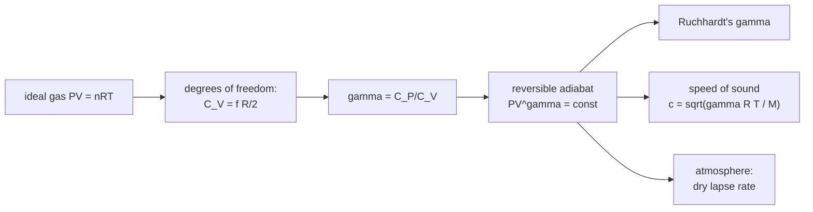

# TH03 · The Ideal Gas and Adiabatic Processes

◀ [[TH02 Work Heat and the First Law]] · [[Thermodynamics and Statistical Mechanics - Course Map|Course Map]] · [[TH04 The Second Law Carnot Engines and Entropy]] ▶

taught · in syllabus extra · book extra · beyond

> [!syllabus] Syllabus map: what is in the syllabus and what is extra in this chapter
> 🟢 **In syllabus (taught)**: [[1a131e225246d9749a298f49675c5fe5_MIT8_333F13_Lec2.pdf|MIT 8.333 Lecture 2]] (the reversible adiabat of a monatomic ideal gas, eqs. I.18–I.19, PDF p.2) and the ideal-gas statements of [[0d0ec730e8e02ed0399d39ff05054a72_MIT8_333F13_Lec1.pdf|Lecture 1]] ($E=E(T)$, $C_P-C_V=Nk_B$; PDF pp.5–6).
> - §1 the ideal gas: $PV=Nk_BT$ and $E=E(T)$
> - §2 heat capacities, $\gamma$ and the degrees of freedom
> - §3 the reversible adiabat $PV^\gamma=$ const (L2 eqs. I.18–I.19)
>
> 🟡 **Extra · book** (Zemansky Ch. 5, [[Heat and thermodynamics an intermediate textbook (Mark Waldo Zemansky Richard Dittman) (z-library.sk, 1lib.sk, z-lib.sk).pdf#page=126|PDF pp.126–150]]; and the AI summaries)
> - §4 Rüchhardt's method of measuring $\gamma$; §5 the speed of sound (Newton's mistake and Laplace's correction)
>
> 🔵 **Extra · beyond** (my additions, labelled)
> - §1–2 the general-$\gamma$ adiabats, work formula and numbers; §6 the dry adiabatic lapse rate and potential temperature, with their link to the climate chapters; the compression numbers for air

> [!key] After this chapter you can
> - define the **ideal gas** by $PV=Nk_BT$ and $E=E(T)$ and say how it is the limit of real gases,
> - relate $C_V=\tfrac f2Nk_B$, $C_P=C_V+Nk_B$ and $\gamma=1+2/f$ to the **degrees of freedom** and quote $\gamma$ for monatomic, diatomic and polyatomic gases,
> - derive $PV^\gamma=$ const, $TV^{\gamma-1}=$ const and $T^\gamma P^{1-\gamma}=$ const, and compute the **work** and **temperature change** of an adiabatic compression,
> - derive $T=2\pi\sqrt{mV/\gamma PA^2}$ for the **Rüchhardt** oscillation and $c=\sqrt{\gamma RT/M}$ for **sound**,
> - connect the adiabat to the **dry adiabatic lapse rate** $g/c_p$.

> [!intuition] The one-sentence story
> A gas that cannot exchange heat pays for its own expansion out of its internal energy, so it cools; the amount depends on how many ways its molecules can store energy ($\gamma$), and the same fact that sets the cooling of a rising air parcel sets the speed of sound.

<!-- intuition-v1 -->

*Concept map: how the ideas of this chapter depend on each other (read left to right; every box is a section).*

## 1. The ideal gas
taught *L1 §I.B–I.C ([[0d0ec730e8e02ed0399d39ff05054a72_MIT8_333F13_Lec1.pdf#page=3|pp.3, 5–6]])*

> [!key] Definition
> An **ideal gas** obeys
> $$PV=Nk_BT\ (=nRT),\qquad E=E(T)\ \text{(independent of $V$)}.$$
> It is the dilute limit of every real gas ([[TH01 Temperature and the Zeroth Law]] §4); the second property follows from the first (proved in [[TH05 Potentials Maxwell Relations Stability and the Third Law]]) and is checked by **Joule's free expansion** ([[TH02 Work Heat and the First Law]] §4). Then $\kappa_T=1/P$, $\alpha_P=1/T$ and $C_P-C_V=Nk_B$.

For atmospheric work the same law appears per unit mass as $P=\rho R_dT$ with $R_d=R/M=287.0$ J kg$^{-1}$K$^{-1}$ for dry air ($M=28.97$ g mol$^{-1}$) ([[Ideal Gas Law]], [[CL05 Thermodynamic State of the Atmosphere]]).

## 2. Heat capacities, $\gamma$ and degrees of freedom
extra · beyond *equipartition is derived in [[TH06 From Kinetic Theory to Statistical Mechanics]]; stated here*

> [!intuition] $\gamma$ counts the ways a molecule can hold energy
> Monatomic gas: 3 ways (translation), $\gamma=5/3$. Diatomic at room temperature: 5 (add 2 rotations), $\gamma=7/5$. The more storage modes, the more heat it takes per kelvin and the closer $\gamma$ is to 1.

An ideal gas of molecules with $f$ **active quadratic degrees of freedom** (translations, rotations, and vibrations that are not frozen out) has $E=\tfrac f2Nk_BT$ (**equipartition**), so
$$C_V=\frac f2Nk_B,\qquad C_P=C_V+Nk_B=\frac{f+2}2Nk_B,\qquad\boxed{\ \gamma\equiv\frac{C_P}{C_V}=1+\frac2f\ }$$

| gas | $f$ | $C_V/R$ | $C_P/R$ | $\gamma$ |
|---|---|---|---|---|
| monatomic (He, Ar) | 3 | 3/2 | 5/2 | $5/3=1.667$ |
| diatomic (N$_2$, O$_2$), rotation active, vibration frozen | 5 | 5/2 | 7/2 | $7/5=1.400$ |
| polyatomic non-linear (rotating), vibrations frozen | 6 | 3 | 4 | $4/3=1.333$ |

**Air** is mostly N$_2$ and O$_2$, so $\gamma=1.40$, $c_v=\tfrac52R_d=717.5$ and $c_p=\tfrac72R_d=1004.5$ J kg$^{-1}$K$^{-1}$ (checked). The vibrational modes of N$_2$ and O$_2$ are frozen at ordinary temperatures because $\hbar\omega\gg k_BT$; whether a mode counts is decided by the ratio $x=\hbar\omega/k_BT$ ([[QM05 The Harmonic Oscillator]], [[TH06 From Kinetic Theory to Statistical Mechanics]]). In CO$_2$ the $15\,\mu$m bend has $x=3.3$ at 288 K, so it is **partly** excited (a heat-capacity contribution of $0.43k_B$).

![[fig_th03_gas.png]]
*Figure TH3.1. A: temperature after reversible adiabatic compression of a gas initially at 300 K. B: the speed of sound in air, adiabatic and isothermal. C: $\gamma=1+2/f$.*

## 3. The reversible adiabat
taught *L2 §I.E, eqs. (I.18)–(I.19) ([[1a131e225246d9749a298f49675c5fe5_MIT8_333F13_Lec2.pdf#page=2|p.2]])*

> [!intuition] Why the adiabat is steeper than the isotherm
> Compress quickly: all the work goes into heating the gas (no time for heat to leave), so pressure rises both from smaller $V$ *and* higher $T$. The isotherm only has the first effect.

For a monatomic ideal gas $E=\tfrac32Nk_BT=\tfrac32PV$. Along a quasi-static path (MIT convention $\bar\mathrm dW=-P\mathrm dV$):
$$\bar\mathrm dQ=\mathrm dE-\bar\mathrm dW=\mathrm d\Big(\tfrac32PV\Big)+P\,\mathrm dV=\tfrac32V\,\mathrm dP+\tfrac52P\,\mathrm dV .$$
The **adiabatic** condition $\bar\mathrm dQ=0$ gives
$$\frac{\mathrm dP}P+\frac53\frac{\mathrm dV}V=0\ \Longrightarrow\ \boxed{\ PV^\gamma=\text{const},\quad\gamma=\frac53\ }$$
The adiabats are distinct from the isotherms ($PV=$ const) and steeper; two of each intersect to make a **Carnot cycle** ([[TH04 The Second Law Carnot Engines and Entropy]]). The assumption $E\propto T$ is not necessary: the lecture notes that adiabatics can be constructed for any $E(T)$ (and for any two-parameter system $E(J,x)$).

> [!derivation] General $\gamma$ (🔵)
> With $\bar\mathrm dQ=C_V\mathrm dT+P\,\mathrm dV$ and $P=Nk_BT/V$: for $\bar\mathrm dQ=0$,
> $$C_V\frac{\mathrm dT}T+Nk_B\frac{\mathrm dV}V=0\ \Rightarrow\ TV^{Nk_B/C_V}=\text{const}.$$
> Since $Nk_B/C_V=(C_P-C_V)/C_V=\gamma-1$:
> $$\boxed{\ TV^{\gamma-1}=\text{const},\qquad PV^\gamma=\text{const},\qquad T^\gamma P^{1-\gamma}=\text{const}\ }$$
> (the last two follow with $PV=Nk_BT$). The **work** done by the gas along the adiabat is $W_{\rm by}=-\Delta E=C_V(T_1-T_2)=\dfrac{P_1V_1-P_2V_2}{\gamma-1}$.

> [!example] Compressing air (recomputed)
> Reversible adiabatic compression of air ($\gamma=1.4$) from 300 K and 1 atm by a **volume ratio 10**: $T_2=300\times10^{0.4}=754$ K, $P_2=10^{1.4}=25.1$ atm. By a ratio **15** (a diesel engine): $T_2=886$ K and $P_2=44.3$ atm, well above the ignition temperature of diesel fuel; the work done **on** the gas per mole is $C_V(T_2-T_1)=20.79\times586=12.2$ kJ. A bicycle pump heats by the same mechanism: compression is fast compared with heat loss, so it is nearly adiabatic.
> **Expansion:** doubling the volume of 1 L of air at 1 atm adiabatically gives $P_2=0.379$ atm and the work done by the gas $=(P_1V_1-P_2V_2)/(\gamma-1)=61.3$ J, against $70.2$ J for the isothermal case ($P_1V_1\ln2$).

> [!pitfall] Adiabatic is not isothermal
> "No heat exchange" ($\bar\mathrm dQ=0$) is a statement about the **walls**, not about the temperature: an adiabatic compression heats the gas and an adiabatic expansion cools it. The reversible adiabat is also a line of **constant entropy** (an **isentrope**, [[TH04 The Second Law Carnot Engines and Entropy]]); a fast, irreversible adiabatic expansion (Joule) does *not* follow $PV^\gamma=$ const.

## 4. Rüchhardt's method of measuring $\gamma$
extra · book *Zemansky §5.6 ([[Heat and thermodynamics an intermediate textbook (Mark Waldo Zemansky Richard Dittman) (z-library.sk, 1lib.sk, z-lib.sk).pdf#page=138|PDF p.138]]); derivation re-done here*

A ball of mass $m$ fits snugly in a vertical tube of cross-section $A$ above a vessel of gas of volume $V$ at pressure $P$. Displace the ball by $x$; if the motion is fast enough to be adiabatic, $\mathrm dP=-\gamma P\,\mathrm dV/V$ with $\mathrm dV=A\,x$, so the restoring force is
$$F=A\,\mathrm dP=-\frac{\gamma PA^2}{V}\,x\ \Longrightarrow\ \omega=A\sqrt{\frac{\gamma P}{mV}},\qquad T=2\pi\sqrt{\frac{mV}{\gamma PA^2}},\qquad\gamma=\frac{4\pi^2mV}{PA^2T^2}.$$
(Here $P$ is the equilibrium gas pressure, atmospheric plus the weight of the ball over $A$.) Measuring the period gives $\gamma$.

> [!example] Numbers
> $m=20$ g, $V=10$ L, $A=1$ cm$^2$, $P=1$ atm: $T=2.36$ s for $\gamma=1.40$ (air). A period of $2.36$ s gives back $\gamma=1.40$. A monatomic gas would oscillate faster: $T\propto\gamma^{-1/2}$, so $2.36\sqrt{1.4/1.667}=2.16$ s.

## 5. The speed of sound
extra · book *Zemansky §5.7 ([[Heat and thermodynamics an intermediate textbook (Mark Waldo Zemansky Richard Dittman) (z-library.sk, 1lib.sk, z-lib.sk).pdf#page=141|PDF pp.141–146]]); numbers recomputed*

> [!intuition] Sound is adiabatic
> Compressions and rarefactions pass too fast for heat to flow between neighbours, so the stiffness is $\gamma P$, not $P$, giving $c=\sqrt{\gamma RT/M}$ (343 m/s at 20 °C).

A sound wave is a longitudinal compression: $c=\sqrt{K/\rho}$ with the bulk modulus $K$ of the medium. Newton took the compressions to be **isothermal**, $K_T=-V(\partial P/\partial V)_T=P$, giving $c=\sqrt{P/\rho}=\sqrt{RT/M}$; this is a factor $\sqrt\gamma=1.18$ too small (about $15\%$ below the measured value). **Laplace** realised the oscillations are too fast for heat to flow between the compressed and rarefied regions: they are **adiabatic**, $K_S=-V(\partial P/\partial V)_S=\gamma P$, so
$$\boxed{\ c=\sqrt{\frac{\gamma P}\rho}=\sqrt{\frac{\gamma RT}M}\ }$$

| | formula | air at 0 °C | air at 20 °C |
|---|---|---|---|
| Newton (isothermal) | $\sqrt{RT/M}$ | $280.0$ m s$^{-1}$ | $290.1$ m s$^{-1}$ |
| Laplace (adiabatic) | $\sqrt{\gamma RT/M}$ | $331.3$ m s$^{-1}$ | $343.2$ m s$^{-1}$ |

The ratio is $\sqrt\gamma=1.183$. Sound speed depends on temperature only (not on pressure): $c\propto\sqrt T$. In helium at 20 °C ($\gamma=5/3$, $M=4.003$ g mol$^{-1}$) $c=1007$ m s$^{-1}$, $2.9$ times larger than in air, which is why a voice sounds higher in helium (the vocal-tract resonances scale with $c$).

> [!pitfall] Isothermal versus adiabatic compressibility
> $\kappa_S=1/K_S=\kappa_T/\gamma$ for the ideal gas. The difference is the whole reason the speed of sound is not $\sqrt{RT/M}$. Very slow oscillations (frequency below the thermal-diffusion rate) would be isothermal; audible sound is not.

## 6. The adiabat in the atmosphere
extra · beyond *links to the climate chapters*

> [!intuition] A rising parcel cools without losing heat
> Rising air expands into lower pressure and does work on its surroundings, so it cools: $dT/dz=-g/c_p\approx-9.8$ K/km. This is the dry adiabatic lapse rate used throughout the climate chapters.

A parcel of air rising or sinking quickly exchanges negligible heat with its surroundings and stays close to the **adiabat**. In hydrostatic balance $\mathrm dP/\mathrm dz=-\rho g=-Pg/(R_dT)$, and from $T^\gamma P^{1-\gamma}=$ const, $\mathrm dT/T=\frac{\gamma-1}\gamma\,\mathrm dP/P=\frac{R_d}{c_p}\mathrm dP/P$. Combining,
$$\boxed{\ \frac{\mathrm dT}{\mathrm dz}=-\frac g{c_p}\equiv-\Gamma_d=-9.77\ \text{K km}^{-1}}$$
the **dry adiabatic lapse rate** (with $g=9.807$ m s$^{-2}$, $c_p=1004$ J kg$^{-1}$K$^{-1}$), derived from the first law and hydrostatic balance in [[CL09 Radiative-Convective Equilibrium]]; the invariant $\theta=T(P_0/P)^{R_d/c_p}$ ([[Adiabatic Process and Potential Temperature]]) is the temperature a parcel would have if brought adiabatically to the reference pressure $P_0$. Rising 3 km, a dry parcel cools by $29$ K; a parcel that rises and condenses cools more slowly because latent heat is released ([[Clausius-Clapeyron Relation]]), which is the origin of the warm foehn and chinook winds.

> [!connection] Same equation, three uses
> The relation $PV^\gamma=$ const sets (i) the **temperature change on compression** (engines, pumps), (ii) the **speed of sound** (acoustics) and (iii) the **lapse rate** (meteorology): in each case it is the statement that no heat flows during the change.

## Map of this chapter
> [!connection] How TH03 connects
> **Builds on:** [[TH02 Work Heat and the First Law]] (heat capacities, the first law) and [[TH01 Temperature and the Zeroth Law]] (equation of state).
> **Leads to:** [[TH04 The Second Law Carnot Engines and Entropy]] (the Carnot cycle needs two adiabats), [[TH06 From Kinetic Theory to Statistical Mechanics]] (why $\gamma=1+2/f$).
> **Concepts:** [[Ideal Gas Law]] · [[Adiabatic Process and Potential Temperature]] · [[Heat Capacity]] · [[Ratio of Specific Heats]] · [[Equipartition of Energy]] · [[Reversible Adiabatic Process]] · [[Speed of Sound]] · [[Ruchhardt Method]] · [[Mayer Relation]]
> **Other subjects:** [[CL06 Hydrostatic Balance and Vertical Structure]], [[CL09 Radiative-Convective Equilibrium]] (lapse rates), [[Dry Adiabatic Lapse Rate]], [[Waves - Course Map]] (sound waves).

## Summary
> [!summary] Cheat-sheet
> - **Ideal gas:** $PV=Nk_BT$, $E=E(T)$; $C_V=\tfrac f2Nk_B$, $C_P-C_V=Nk_B$, $\gamma=1+2/f$: monatomic $5/3$, diatomic (air) $7/5$, polyatomic $4/3$. Air: $c_v=717.5$, $c_p=1004.5$ J kg$^{-1}$K$^{-1}$.
> - **Adiabat** ($\bar\mathrm dQ=0$): monatomic $\bar\mathrm dQ=\tfrac32V\mathrm dP+\tfrac52P\mathrm dV\Rightarrow PV^{5/3}$; in general $TV^{\gamma-1}$, $PV^\gamma$, $T^\gamma P^{1-\gamma}$ const; $W_{\rm by}=(P_1V_1-P_2V_2)/(\gamma-1)=C_V(T_1-T_2)$.
> - **Numbers:** air $\times10$: $754$ K, $25.1$ atm; $\times15$: $886$ K, $44.3$ atm.
> - **Rüchhardt:** $T=2\pi\sqrt{mV/\gamma PA^2}$, $\gamma=4\pi^2mV/PA^2T^2$.
> - **Sound:** $c=\sqrt{\gamma P/\rho}=\sqrt{\gamma RT/M}$ (Laplace; Newton's isothermal value is $1/\sqrt\gamma$ times smaller): $331.3$ m/s at 0 °C, $343.2$ at 20 °C.
> - **Lapse rate:** $\mathrm dT/\mathrm dz=-g/c_p=-9.77$ K km$^{-1}$.

## Practice
1. **Derive.** For a diatomic ideal gas ($E=\tfrac52Nk_BT$) show from $\bar\mathrm dQ=0$ that $PV^{7/5}=$ const.
2. **Compression.** Air at 300 K, 1 atm is compressed reversibly and adiabatically by a volume ratio 15. Find $T_2$, $P_2$ and the work done on 1 mol.
3. **Expansion.** 1 L of air at 1 atm expands adiabatically to 2 L. Find $P_2$, $T_2$ (from 300 K) and the work done by the gas; compare with the isothermal work.
4. **Rüchhardt.** A ball of mass 20 g in a tube of 1.00 cm$^2$ above a 10.0 L vessel at $1.013\times10^5$ Pa oscillates with period 2.36 s. Find $\gamma$. What period would you expect for argon?
5. **Sound.** Find the speed of sound in helium at 20 °C and in CO$_2$ at 20 °C ($\gamma\approx1.30$, $M=44.0$ g mol$^{-1}$). Explain the $\sqrt{T}$ dependence.
6. **Lapse rate.** Compute $g/c_p$ for dry air. A dry parcel rises from sea level to 2400 m; find its final temperature if it starts at 25 °C. If it were saturated and cooled at 5 K km$^{-1}$ instead, how much warmer would it be?
7. **Isotherm versus adiabat.** Show that at any point of the $PV$ plane the adiabat is steeper than the isotherm by the factor $\gamma$: $(\mathrm dP/\mathrm dV)_S=\gamma(\mathrm dP/\mathrm dV)_T$.
8. **$\gamma$ and degrees of freedom.** What is $\gamma$ of a gas whose molecules have 3 translations, 3 rotations and 2 fully excited vibrations ($f=8$)? What does an experimental $\gamma=1.30$ for CO$_2$ at room temperature suggest about its vibrational modes?
9. **Compressibility.** Show that $\kappa_S=\kappa_T/\gamma$ for the ideal gas and that $c=1/\sqrt{\rho\kappa_S}$.
10. **Foehn.** Air at 10 °C rises over a mountain from 500 m to 2500 m, cooling at the moist rate 5 K km$^{-1}$ on the way up (condensation), then descends dry to 500 m on the lee side. Find its final temperature.

> [!example]- Solutions
> 1. $\bar\mathrm dQ=\mathrm d(\tfrac52PV)+P\mathrm dV=\tfrac52V\mathrm dP+\tfrac72P\mathrm dV=0\Rightarrow\mathrm dP/P+\tfrac75\mathrm dV/V=0\Rightarrow PV^{7/5}$ const.
> 2. $T_2=300\times15^{0.4}=886$ K; $P_2=15^{1.4}=44.3$ atm; $W_{\rm on}=C_V(T_2-T_1)=\tfrac52R\times586=12.2$ kJ.
> 3. $P_2=1\times2^{-1.4}=0.379$ atm; $T_2=300\times2^{-0.4}=227.4$ K; $W_{\rm by}=(P_1V_1-P_2V_2)/(\gamma-1)=61.3$ J; isothermal: $P_1V_1\ln2=101.3\times0.693=70.2$ J. Less work adiabatically because the gas cools.
> 4. $\gamma=4\pi^2mV/PA^2T^2=39.48\times0.020\times0.010/(1.013\times10^5\times10^{-8}\times5.570)=1.40$. Argon ($\gamma=5/3$): $T=2.36\sqrt{1.4/1.667}=2.16$ s.
> 5. $c_{\rm He}=\sqrt{(5/3)\,8.314\times293.15/0.004003}=1007$ m s$^{-1}$; $c_{\rm CO_2}=\sqrt{1.30\times8.314\times293.15/0.0440}=268$ m s$^{-1}$. $c\propto\sqrt{T}$ because $P/\rho=RT/M$: pressure cancels in $\sqrt{\gamma P/\rho}$.
> 6. $g/c_p=9.807/1004=9.77$ K km$^{-1}$. After 2.4 km: $25-23.4=1.6$ °C. At 5 K km$^{-1}$ it would be $25-12=13$ °C: $11.4$ K warmer.
> 7. $PV=$ const gives $(\mathrm dP/\mathrm dV)_T=-P/V$; $PV^\gamma=$ const gives $(\mathrm dP/\mathrm dV)_S=-\gamma P/V$. The ratio is $\gamma>1$.
> 8. $\gamma=1+2/8=1.25$. CO$_2$'s experimental $\approx1.30$ lies between $f=6$ ($1.33$) and $f=8$ ($1.25$), i.e. $f\approx7$: the vibrational modes are partly excited (they freeze out when $\hbar\omega\gg k_BT$; the 15 µm bend has $x=3.3$).
> 9. $\kappa_T=1/P$ and $K_S=\gamma P$ so $\kappa_S=1/(\gamma P)=\kappa_T/\gamma$. $c=\sqrt{K_S/\rho}=1/\sqrt{\rho\kappa_S}$.
> 10. Up from 500 m to 2500 m (2 km) at 5 K km$^{-1}$: $10-10=0$ °C. Down 2 km dry at $9.77$ K km$^{-1}$: $0+19.5=19.5$ °C. The lee-side air is $9.5$ K warmer than it started (the foehn effect).

## Provenance
> [!provenance]- Source map for this chapter
> | Topic | Source | Scope |
> |---|---|---|
> | ideal gas $E(T)$, $C_P-C_V=Nk_B$ | [[0d0ec730e8e02ed0399d39ff05054a72_MIT8_333F13_Lec1.pdf#page=5\|MIT L1 pp.5–6, eqs. I.14–I.15]] | taught |
> | monatomic adiabat $PV^{5/3}$ | [[1a131e225246d9749a298f49675c5fe5_MIT8_333F13_Lec2.pdf#page=2\|MIT L2 p.2, eqs. I.18–I.19]] | taught |
> | Rüchhardt; speed of sound | Zemansky §5.6–5.7 (OCR, PDF pp.138–146) | extra/book |
> | general $\gamma$, work formula, $\gamma=1+2/f$, lapse rate, all numbers | derived and recomputed here (`scripts/th_numbers.py`) | extra/beyond |
>
> **Read and not read.** The relevant lecture pages were read in full; Zemansky §5.6–5.7 were located by OCR and the derivations re-done rather than transcribed. The Zemansky pages on the equation of state of real gases and on the measurement of heat capacities (§5.1–5.5) were not used in detail.
>
> **Notes.** (1) The speed-of-sound and lapse-rate formulas are standard; the CO$_2$ $\gamma\approx1.30$ and $M$ are recalled literature values. (2) The adiabats of this chapter are **reversible**; a free expansion is adiabatic but not isentropic (TH04).

**References.** Kardar, M. *Statistical Physics of Particles*, §1.E · MIT OpenCourseWare 8.333 (Fall 2013), Lectures 1–2 · Zemansky and Dittman, Ch. 5 · Laplace, P.-S. (1816) · Rüchhardt, E. (1929) *Phys. Z.* 30, 58 · Wallace, J. M. and Hobbs, P. V. *Atmospheric Science*, §3.
