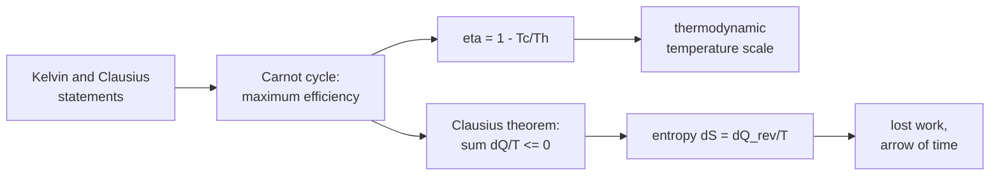

# TH04 · The Second Law, Carnot Engines and Entropy

◀ [[TH03 The Ideal Gas and Adiabatic Processes]] · [[Thermodynamics and Statistical Mechanics - Course Map|Course Map]] · [[TH05 Potentials Maxwell Relations Stability and the Third Law]] ▶

taught · in syllabus extra · beyond

> [!syllabus] Syllabus map: what is in the syllabus and what is extra in this chapter
> 🟢 **In syllabus (taught)**: [[1a131e225246d9749a298f49675c5fe5_MIT8_333F13_Lec2.pdf|MIT 8.333 Lecture 2]] (Kardar §I.D–I.F; printed pp.7–12 = PDF pp.1–6): heat engines, Kelvin and Clausius statements, Carnot engines, thermodynamic temperature, Clausius's theorem, entropy.
> - §1 heat engines and refrigerators; perpetual motion of the first and second kind (L2 §I.D)
> - §2 the Kelvin and Clausius statements and their equivalence
> - §3 the Carnot engine and Carnot's theorem (§I.E)
> - §4 the thermodynamic temperature scale; $\eta=1-T_C/T_H$; $T>0$
> - §5 Clausius's theorem; entropy; $\mathrm dS\ge\bar\mathrm dQ/T$; the fundamental relation (§I.F)
>
> 🔵 **Extra · beyond** (my additions, labelled)
> - §3 a numerical Carnot cycle (volumes, heats, work); §6 entropy-change examples; §7 lost work $T_C\Delta S$, the efficiency of an Earth engine, and coefficients of performance

> [!key] After this chapter you can
> - define the **efficiency** $\eta=W/Q_H$ and the **coefficient of performance** $\omega=Q_C/W$,
> - state the **Kelvin** and **Clausius** forms of the second law and show that violating one violates the other,
> - describe a **Carnot cycle** (two isotherms, two adiabats) and prove **Carnot's theorem**: no engine between two reservoirs beats a reversible one,
> - derive the **thermodynamic temperature** $Q_C/Q_H=T_C/T_H$ and $\eta=1-T_C/T_H$, and say why $T>0$,
> - prove **Clausius's theorem** $\oint\bar\mathrm dQ/T\le0$ and define the **entropy** $\mathrm dS=\bar\mathrm dQ_{\rm rev}/T$,
> - use $\mathrm dS\ge\bar\mathrm dQ/T$, $\delta S\ge0$ for an isolated system, and $\mathrm dE=T\,\mathrm dS+\sum J_i\mathrm dx_i$.

> [!intuition] The one-sentence story
> Heat runs from hot to cold on its own, never the reverse; that single observation, pushed through the logic of engines, produces a temperature scale that depends on no material and a state function, the entropy, that never decreases in an isolated system.

<!-- intuition-v1 -->

*Concept map: how the ideas of this chapter depend on each other (read left to right; every box is a section).*

## 1. Heat engines and refrigerators
taught *L2 §I.D ([[1a131e225246d9749a298f49675c5fe5_MIT8_333F13_Lec2.pdf#page=1|p.1]])*

The historical development of thermodynamics follows the industrial revolution: practical considerations of engine efficiency lead to abstract ideas like entropy. An idealised **heat engine** takes heat $Q_H$ from a hot source, converts a part to work $W$, and dumps the rest $Q_C$ into a cold sink. Its **efficiency** is
$$\eta=\frac W{Q_H}=\frac{Q_H-Q_C}{Q_H}\le1 .$$
A **refrigerator** is the engine run backwards: it uses work $W$ to extract $Q_C$ from a cold system and dump $Q_H=Q_C+W$ at a higher temperature. Its figure of merit is
$$\omega=\frac{Q_C}W=\frac{Q_C}{Q_H-Q_C} .$$

The first law rules out **perpetual motion of the first kind** (work from nothing). It does not forbid an engine that makes work by freezing water to ice, extracting heat from a single reservoir: a **perpetual motion machine of the second kind**. That is ruled out by the second law: the natural direction of heat flow is from hotter to colder bodies.

## 2. The Kelvin and Clausius statements
taught *L2 §I.D ([[1a131e225246d9749a298f49675c5fe5_MIT8_333F13_Lec2.pdf#page=1|pp.1–2]])*

> [!intuition] Two faces of one law
> Clausius: heat will not flow from cold to hot by itself. Kelvin: you cannot turn heat from one reservoir entirely into work. If either failed, you could use it to break the other: they are equivalent.

> [!key] Two statements of the second law
> - **Kelvin:** no process is possible whose **sole result** is the complete conversion of heat into work. (A "perfect engine" is forbidden.)
> - **Clausius:** no process is possible whose **sole result** is the transfer of heat from a colder to a hotter body. (A "perfect refrigerator" is forbidden.)

They are **equivalent**: if one is violated so is the other.

> [!derivation] Equivalence (L2)
> (a) *A Clausius-violating machine gives a Kelvin-violating one.* Suppose a machine moves heat $Q$ from $T_C$ to $T_H$ with no other effect. Run an ordinary engine between the same two temperatures, taking $Q_H$ from $T_H$, doing work $W=Q_H-Q_C$, dumping $Q_C$ at $T_C$. Adjust the engine so that $Q_C=Q$. The combination takes $Q_H-Q$ from $T_H$, delivers $W$, and leaves $T_C$ unchanged ($Q_C-Q=0$): all of the net heat taken is turned into work, violating Kelvin.
> (b) *A Kelvin-violating machine gives a Clausius-violating one.* Let it convert heat $Q$ entirely into work $Q$ and use that work to run a refrigerator, which moves heat from cold to hot: the net result is heat transferred from the colder to the hotter body at no cost.

> [!pitfall] "Sole result"
> Both statements say **sole**: an ordinary refrigerator moves heat from cold to hot, but it needs work and dumps extra heat; an isothermal expansion converts heat completely to work, but the gas ends up expanded (a different final state). The restriction is on processes whose **only** effect is the conversion or transfer.

## 3. The Carnot engine and Carnot's theorem
taught *L2 §I.E ([[1a131e225246d9749a298f49675c5fe5_MIT8_333F13_Lec2.pdf#page=2|pp.2–3]])*

> [!intuition] Carnot is the speed limit
> No engine between two reservoirs beats a reversible one, and all reversible engines have the same efficiency $1-T_c/T_h$, independent of the working substance. A 500 K to 300 K engine can never exceed 40 %.

A **reversible** process can be run backward in time by reversing its inputs and outputs (the thermodynamic analogue of frictionless motion). Reversibility implies equilibrium at each stage, so a reversible process is quasi-static; the converse is false (friction dissipates even in a slow process). An engine that **runs in a cycle** returns to its initial internal state.

> [!key] Carnot engine
> A **Carnot engine** is any engine that is reversible, runs in a cycle, and exchanges heat only at **two temperatures**, a source $T_H$ and a sink $T_C$.

Heat is not a function of state, so in general we do not know how to join two isotherms by reversible adiabatic paths; for an **ideal gas** we do (§3 of [[TH03 The Ideal Gas and Adiabatic Processes]]): the adiabats are $PV^\gamma=$ const.

![[fig_th04_carnot.png]]
*Figure TH4.1. A Carnot cycle of 1 mol of monatomic ideal gas between 500 K and 300 K. A: $PV$ plane (two isotherms, two adiabats). B: $TS$ plane, where the same cycle is a rectangle.*

> [!example] A numerical Carnot cycle (🔵, recomputed)
> $n=1$ mol, $\gamma=5/3$, $T_H=500$ K, $T_C=300$ K, isothermal expansion $1\to2$ from $V_1=1.00$ L to $V_2=2.00$ L. The adiabats satisfy $T_HV_2^{\gamma-1}=T_CV_3^{\gamma-1}$ and $T_HV_1^{\gamma-1}=T_CV_4^{\gamma-1}$, so
> $$V_3=V_2(T_H/T_C)^{3/2}=4.303\ \text{L},\qquad V_4=V_1(T_H/T_C)^{3/2}=2.152\ \text{L},\qquad V_2/V_1=V_3/V_4 .$$
> Heats: $Q_H=nRT_H\ln(V_2/V_1)=2882$ J; $Q_C=nRT_C\ln(V_3/V_4)=1729$ J; $W=Q_H-Q_C=1153$ J; **$\eta=0.400=1-T_C/T_H$** and $Q_C/Q_H=T_C/T_H=0.6000$. The equality $V_2/V_1=V_3/V_4$ is exactly what makes $Q_H/Q_C=T_H/T_C$ for the ideal gas.

> [!derivation] Carnot's theorem and corollary
> **Theorem.** No engine operating between two reservoirs ($T_H,T_C$) is more efficient than a Carnot engine operating between them.
> *Proof.* Let the Carnot engine run **backward** as a refrigerator, driven by the work of the other engine. Call the heats of the other engine $Q_H,Q_C$ and of the Carnot engine $Q_H',Q_C'$, with the same work $W$ involved. The net effect is to transfer $Q_H-Q_H'=Q_C-Q_C'$ from $T_H$ to $T_C$. By Clausius's statement this cannot be negative, so $Q_H\ge Q_H'$. With the same $W$,
> $$\frac W{Q_H}\le\frac W{Q_H'}\ \Longrightarrow\ \eta_{\rm Carnot}\ge\eta_{\rm any}.\ \square$$
> **Corollary.** All reversible (Carnot) engines between the same two temperatures have the **same** universal efficiency $\eta(T_H,T_C)$, since each can run the other backward.

## 4. The thermodynamic temperature scale
taught *L2 §I.E ([[1a131e225246d9749a298f49675c5fe5_MIT8_333F13_Lec2.pdf#page=3|pp.3–4]])*

Since the maximum efficiency depends only on the two temperatures and **not on the material**, it can define a temperature scale independent of any substance (unlike the ideal-gas scale, which depends on the dilute-gas limit).

> [!derivation] $1-\eta=T_C/T_H$
> Run two Carnot engines in series, one between $T_1>T_2$, the other between $T_2>T_3$, the second taking the heat $Q_2$ the first dumps. The combination is a Carnot engine between $T_1$ and $T_3$. With $Q_2=Q_1[1-\eta(T_1,T_2)]$ and $Q_3=Q_2[1-\eta(T_2,T_3)]=Q_1[1-\eta(T_1,T_3)]$,
> $$1-\eta(T_1,T_3)=\big[1-\eta(T_1,T_2)\big]\big[1-\eta(T_2,T_3)\big].$$
> This forces $1-\eta(T_1,T_2)=f(T_2)/f(T_1)$; by convention $f(T)=T$:
> $$\boxed{\ \frac{Q_C}{Q_H}=\frac{T_C}{T_H},\qquad\eta(T_H,T_C)=\frac{T_H-T_C}{T_H}=1-\frac{T_C}{T_H}\ }$$
> The proportionality constant is fixed, as before, by the triple point of water at $273.16$ K. For the ideal-gas Carnot cycle of §3 this $T$ equals the ideal-gas temperature, so the two scales **coincide**.

All thermodynamic temperatures are **positive**: by $Q_C/Q_H=T_C/T_H$ the heat extracted at $T$ is proportional to $T$. If a **negative** temperature existed, an engine between it and a positive one would extract heat from **both** reservoirs and convert the sum entirely to work, violating Kelvin.

> [!example] Efficiencies and coefficients of performance (🔵)
> $T_H=500$ K, $T_C=300$ K: $\eta=0.40$; a **Carnot refrigerator** has $\omega=T_C/(T_H-T_C)=1.5$; a **heat pump** delivering heat at $T_H$ has $\mathrm{COP}=T_H/(T_H-T_C)=2.5$ (one joule of work delivers $2.5$ J of heat). A steam power plant at $800$ K and $300$ K has $\eta_{\rm Carnot}=0.625$ (real plants $\approx0.33$–$0.40$). A crude bound for an engine run by the solar-driven temperature difference between Earth's surface ($\approx288$ K) and its emission level ($\approx255$ K): $\eta<1-255/288=0.115$; the real atmospheric heat engine is far less efficient (an upper bound only, not a model).

## 5. Clausius's theorem and entropy
taught *L2 §I.F ([[1a131e225246d9749a298f49675c5fe5_MIT8_333F13_Lec2.pdf#page=4|pp.4–6]])*

> [!intuition] Entropy is what's conserved in a reversible round trip
> $\delta Q$ is not exact, but $\delta Q_{\rm rev}/T$ is: dividing by $T$ turns heat into the change of a state function. In an irreversible process the total entropy goes *up*.

> [!key] Clausius's theorem
> For **any** cyclic transformation (reversible or not), $\displaystyle\oint\frac{\bar\mathrm dQ}T\le0$, where $\bar\mathrm dQ$ is the heat supplied to the system at temperature $T$ (the temperature at the boundary where the heat enters).

> [!derivation] Proof sketch (L2)
> Divide the cycle into infinitesimal steps in which the system receives $\bar\mathrm dQ$ and $\bar\mathrm dW$ (it need not be in equilibrium). Connect each heat exchange to a Carnot engine whose other port is a fixed reservoir at $T_0$. To deliver $\bar\mathrm dQ$ at $T$ the engine takes $\bar\mathrm dQ_R=T_0\,\bar\mathrm dQ/T$ from the reservoir. After one cycle system and engines return to their states; the net effect is heat $Q_R=\oint\bar\mathrm dQ_R$ extracted from one reservoir and converted to work. By Kelvin, $Q_R\le0$, so $T_0\oint\bar\mathrm dQ/T\le0$.

**Consequences.**
1. For a **reversible** cycle $\oint\bar\mathrm dQ_{\rm rev}/T=0$ (run it backward: both $\ge0$ and $\le0$). Hence $\int_A^B\bar\mathrm dQ_{\rm rev}/T$ is **path-independent**.
2. So there is a state function, the **entropy**: $\displaystyle S(B)-S(A)\equiv\int_A^B\frac{\bar\mathrm dQ_{\rm rev}}T$ (defined up to a constant). For reversible processes $\bar\mathrm dQ_{\rm rev}=T\,\mathrm dS$; constant $S$ defines the adiabats of a general system.
3. For an **irreversible** change $A\to B$, close the cycle with a reversible return: $\int_A^B\bar\mathrm dQ/T\le S(B)-S(A)$, i.e.
$$\boxed{\ \mathrm dS\ \ge\ \frac{\bar\mathrm dQ}T\ }$$
In particular, adiabatically isolating subsystems that come to joint equilibrium ($\bar\mathrm dQ=0$) gives $\delta S\ge0$: **an isolated system attains maximum entropy in equilibrium**, spontaneous internal changes can only increase $S$, and the direction of increasing entropy marks the **arrow of time**.
4. For a reversible, quasi-static transformation, $\bar\mathrm dQ=T\mathrm dS$ and $\bar\mathrm dW=\sum J_i\mathrm dx_i$, so
$$\boxed{\ \mathrm dE=T\,\mathrm dS+\sum_iJ_i\,\mathrm dx_i\ }$$
a relation between state functions that holds **generally** (not just for reversible paths). $S$ and $T$ appear as conjugate variables, $S$ playing the role of a displacement.
5. With $n$ ways of doing work (pairs $(J_i,x_i)$), $n+1$ independent coordinates are needed. Taking $(E,\{x_i\})$ as coordinates: $\left(\dfrac{\partial S}{\partial E}\right)_x=\dfrac1T$ and $\left(\dfrac{\partial S}{\partial x_i}\right)_E=-\dfrac{J_i}T$.

> [!pitfall] Entropy is a state function, heat is not
> $\bar\mathrm dQ$ is inexact; the integrating factor $1/T$ makes $\bar\mathrm dQ_{\rm rev}/T$ exact ([[TH02 Work Heat and the First Law]] §7). The *definition* uses a **reversible** path even when the actual process is irreversible: $\Delta S$ between two states is computed along any reversible path joining them, and it is **not** $\int\bar\mathrm dQ/T$ along the real irreversible path (that is only a lower bound).

## 6. Entropy changes: worked examples
extra · beyond *recomputed here (`scripts/th_numbers.py`)*

> [!example] Four cases
> - **Heat flow.** $Q=1000$ J flows from a body at 500 K to one at 300 K: $\Delta S=1000(1/300-1/500)=+1.333$ J K$^{-1}$ (the hot body loses $2.0$, the cold gains $3.33$). Positive: irreversible.
> - **Free expansion** of 1 mol of ideal gas, $V\to2V$: nothing leaves, $Q=W=0$, yet the entropy of the gas rises by $\Delta S=R\ln2=5.76$ J K$^{-1}$ (computed along a reversible **isothermal** expansion between the same states: $Q_{\rm rev}/T=1729/300$). $5.76$ J K$^{-1}$ is also $k_B\ln2^{N_A}$, the statistics of each molecule being able to be in either half ([[TH06 From Kinetic Theory to Statistical Mechanics]]).
> - **Melting** 1 kg of ice at 273.15 K ($L=3.34\times10^5$ J kg$^{-1}$): $\Delta S=L/T=1223$ J K$^{-1}$, i.e. reversible and isothermal.
> - **Ideal gas.** $\mathrm dS=\bar\mathrm dQ_{\rm rev}/T=C_V\mathrm dT/T+R\,\mathrm dV/V$ gives $S=C_V\ln T+R\ln V+S_0$ per mole; from $(300\text{ K},V)$ to $(450\text{ K},3V)$: $\Delta S=\tfrac32R\ln1.5+R\ln3=14.19$ J K$^{-1}$, whichever order the two changes are made. A reversible adiabat has $\Delta S=0$.

## 7. Lost work, the arrow of time, and the microscopic view
extra · beyond *and the statement at the end of [[1a131e225246d9749a298f49675c5fe5_MIT8_333F13_Lec2.pdf#page=4|L2 §I.F]]; the microscopic definition is in [[97dcd8dee3d3301cd7c27745b17b10b5_MIT8_333F13_Lec4.pdf#page=5|L4 §I.J]]*

> [!intuition] Why time has a direction
> Entropy counts microstates. The macrostate with overwhelmingly more microstates is the one you will find; the reverse path is not forbidden, just absurdly unlikely. That is the arrow of time.

**Lost work.** In the heat-flow example the 1000 J flowing from 500 K to 300 K could, through a reversible engine, have delivered $W_{\max}=1000(1-300/500)=400$ J. By letting the heat flow irreversibly that work is **lost**, and $T_C\,\Delta S_{\rm gen}=300\times1.333=400$ J: the lost work equals the sink temperature times the entropy generated (a general result, the Gouy-Stodola theorem). Entropy generation measures irreversibility.

**Arrow of time.** Mechanics is time-reversal symmetric; entropy increase is not. Lecture 4 closes the chapter by relating the two: in statistical mechanics $S=k_B\ln g$ with $g$ the number of microstates of the same energy, so the second law becomes "the macrostate with the most microstates is overwhelmingly the most probable" ([[TH06 From Kinetic Theory to Statistical Mechanics]]).

> [!pitfall] The second law is statistical in character
> It does not say entropy can never decrease in a small system for a short time; it says that for a macroscopic system the probability is astronomically small. For $N\sim10^{23}$ molecules, a fluctuation in which the gas spontaneously occupies half the box has probability $2^{-N}$.

## Map of this chapter
> [!connection] How TH04 connects
> **Builds on:** [[TH02 Work Heat and the First Law]] (the first law, work and heat), [[TH03 The Ideal Gas and Adiabatic Processes]] (adiabats and the ideal-gas Carnot cycle).
> **Leads to:** [[TH05 Potentials Maxwell Relations Stability and the Third Law]] (entropy $\to$ potentials and equilibrium conditions) → [[TH06 From Kinetic Theory to Statistical Mechanics]] ($S=k_B\ln g$).
> **Concepts:** [[Second Law of Thermodynamics]] · [[Heat Engine]] · [[Kelvin and Clausius Statements]] · [[Carnot Engine]] · [[Carnot Theorem]] · [[Thermodynamic Temperature]] · [[Clausius Theorem]] · [[Entropy]] · [[Fundamental Thermodynamic Relation]] · [[Refrigerator and Heat Pump]] · [[Irreversibility]]
> **Other subjects:** [[CL09 Radiative-Convective Equilibrium]] (the atmosphere as a heat engine driven by a temperature difference), [[Bistability and Tipping Points]] (non-equilibrium steady states), [[Probability - Course Map]] (entropy as $\ln$ of a count), [[Quantum Mechanics - Course Map]] (the third law needs a unique ground state).

## Summary
> [!summary] Cheat-sheet
> - $\eta=W/Q_H=(Q_H-Q_C)/Q_H$; refrigerator $\omega=Q_C/(Q_H-Q_C)$. **Kelvin** (no complete heat $\to$ work) $\Leftrightarrow$ **Clausius** (no cold $\to$ hot alone).
> - **Carnot engine:** reversible cycle, two reservoirs; ideal gas: two isotherms + two adiabats, $V_2/V_1=V_3/V_4$. **Carnot's theorem:** $\eta\le\eta_{\rm Carnot}$ for any engine; all reversible engines share $\eta(T_H,T_C)$.
> - **Thermodynamic temperature:** $1-\eta(T_1,T_3)=[1-\eta(T_1,T_2)][1-\eta(T_2,T_3)]\Rightarrow Q_C/Q_H=T_C/T_H$, $\eta=1-T_C/T_H$; $T>0$; equals the ideal-gas scale.
> - **Clausius:** $\oint\bar\mathrm dQ/T\le0$; reversible: $=0\Rightarrow S(B)-S(A)=\int\bar\mathrm dQ_{\rm rev}/T$; $\mathrm dS\ge\bar\mathrm dQ/T$; isolated: $\delta S\ge0$; $\mathrm dE=T\mathrm dS+\sum J_i\mathrm dx_i$; $(\partial S/\partial E)_x=1/T$.
> - **Numbers:** $T_H=500$, $T_C=300$ K: $\eta=0.40$, $\omega=1.5$, heat-pump COP $2.5$; Carnot cycle $V_3=4.30$ L, $Q_H=2882$ J, $Q_C=1729$ J, $W=1153$ J. $\Delta S$: heat flow $1.333$ J/K per kJ, free expansion $R\ln2=5.76$, melting ice $1223$ J/K per kg.

## Practice
1. **Allowed?** An engine takes 1000 J from a source at 600 K, rejects 700 J to a sink at 300 K. Find $\eta$ and the Carnot bound. Is this engine possible? Is one that rejects 400 J?
2. **Clausius check.** An engine between 500 K and 300 K takes 1000 J and delivers 600 J of work. Evaluate $\sum Q/T$ and decide whether it is allowed.
3. **Refrigerator.** A refrigerator holds 270 K in a room at 300 K and removes 1 kW of heat. What is the minimum power input? What is the heat released to the room?
4. **Water.** 1 kg of water is heated reversibly from 20 °C to 80 °C ($c=4186$ J kg$^{-1}$K$^{-1}$). Find $\Delta S$. If instead it is placed in contact with a 80 °C reservoir, what is $\Delta S$ of water plus reservoir?
5. **Lost work.** 1000 J flows by conduction from 500 K to 300 K. How much work could a reversible engine have extracted, and how much is lost? Check $W_{\rm lost}=T_C\Delta S_{\rm gen}$.
6. **Free expansion.** Compute $\Delta S$ for 1 mol of ideal gas expanding freely to double volume by two routes (the actual path and a reversible isothermal one). Why do they agree?
7. **Melting.** 1 kg of ice at 0 °C melts reversibly. Find $\Delta S$ and the heat required.
8. **Ideal-gas entropy.** Show $\mathrm dS=C_V\mathrm dT/T+R\mathrm dV/V$ is exact and integrate it from $(300\text{ K},V)$ to $(450\text{ K},3V)$ for a monatomic gas.
9. **Carnot cycle.** For a monatomic gas between 400 K and 250 K with $V_1=2$ L and $V_2=6$ L, find $V_3$, $V_4$, $Q_H$ per mole and $\eta$.
10. **Negative temperature.** Explain why a negative thermodynamic temperature would violate the Kelvin statement.
11. **[Tutorial 1, Q4]** If body A is losing heat to body B, entropy generation is always positive. Prove it, first for two reservoirs and then for two finite bodies of heat capacities $C_A$, $C_B$; evaluate for $C_A=C_B=1000$ J K$^{-1}$ at 500 K and 300 K.

> [!example]- Solutions
> 1. $\eta=(1000-700)/1000=0.30$; Carnot bound $1-300/600=0.50$. Allowed ($0.30<0.50$). Rejecting 400 J gives $\eta=0.60>0.50$: **impossible** (violates Carnot's theorem).
> 2. $Q_C=1000-600=400$ J. $\oint\bar\mathrm dQ/T=1000/500-400/300=2-1.333=+0.667$ J K$^{-1}>0$: violates Clausius's theorem, so **not allowed** ($\eta=0.60>0.40$).
> 3. $\omega=T_C/(T_H-T_C)=270/30=9$, so $W_{\min}=1000/9=111$ W; heat to the room $=1000+111=1111$ W.
> 4. $\Delta S_{\rm rev}=mc\ln(353.15/293.15)=4186\times0.18635=780$ J K$^{-1}$. In contact with the 80 °C reservoir: water $+780$, reservoir $-Q/353.15=-1\times4186\times60/353.15=-711$; total $+69$ J K$^{-1}>0$ (irreversible).
> 5. $W_{\max}=1000(1-300/500)=400$ J; lost $=400$ J. $\Delta S_{\rm gen}=1000(1/300-1/500)=1.333$ J K$^{-1}$; $T_C\Delta S_{\rm gen}=400$ J: equal.
> 6. Actual: $Q=0$, but $S$ is a state function so $\Delta S=\int\bar\mathrm dQ_{\rm rev}/T$ along the reversible isothermal route: $nRT\ln2/T=R\ln2=5.76$ J K$^{-1}$. They agree because the final states agree.
> 7. $Q=mL=3.34\times10^5$ J; $\Delta S=Q/T=334\,000/273.15=1223$ J K$^{-1}$.
> 8. $\partial_V(C_V/T)=0=\partial_T(R/V)$: exact. $\Delta S=\tfrac32R\ln\tfrac{450}{300}+R\ln3=5.056+9.134=14.19$ J K$^{-1}$.
> 9. $V_3=V_2(T_H/T_C)^{3/2}=6\times(400/250)^{1.5}=6\times2.024=12.14$ L; $V_4=V_1\times2.024=4.05$ L; $Q_H=RT_H\ln3=8.314\times400\times1.0986=3654$ J; $\eta=1-250/400=0.375$.
> 10. If $T<0$ existed, $Q_C/Q_H=T_C/T_H$ would be negative for $T_C<0<T_H$: the engine would take heat from **both** reservoirs and convert $Q_H+|Q_C|$ completely into work, a Kelvin violation.
> 11. Reservoirs: $\mathrm dS_A=-\delta Q/T_A$, $\mathrm dS_B=+\delta Q/T_B$, so $\delta S_{\rm gen}=\delta Q(1/T_B-1/T_A)=\delta Q(T_A-T_B)/(T_AT_B)>0$ because heat flows only from the hotter body ($T_A>T_B$, the Clausius statement); it is zero only when $T_A=T_B$. Finite bodies: $T_f=(C_AT_A+C_BT_B)/(C_A+C_B)$ and $S_{\rm gen}=C_A\ln(T_f/T_A)+C_B\ln(T_f/T_B)\ge0$ by Jensen's inequality for the concave logarithm. Numbers: $T_f=400$ K, $S_{\rm gen}=1000\ln(400^2/(500\cdot300))=64.5$ J K$^{-1}$. Full discussion, the logical status of the proof and the microscopic version: [[TH08 Gibbs Energy Equilibrium Constants and Phase Boundaries]] §2 and [[TH09 Microstates Macrostates and Multiplicity]] §4.3.

## Provenance
> [!provenance]- Source map for this chapter
> | Topic | Source | Scope |
> |---|---|---|
> | engines, refrigerators, perpetual motion, Kelvin and Clausius statements and their equivalence | [[1a131e225246d9749a298f49675c5fe5_MIT8_333F13_Lec2.pdf#page=1\|MIT L2 §I.D, pp.1–2]] | taught |
> | Carnot engine, theorem, thermodynamic temperature, $T>0$ | [[1a131e225246d9749a298f49675c5fe5_MIT8_333F13_Lec2.pdf#page=2\|L2 §I.E, pp.2–4]] | taught |
> | Clausius's theorem, entropy, fundamental relation | [[1a131e225246d9749a298f49675c5fe5_MIT8_333F13_Lec2.pdf#page=4\|L2 §I.F, pp.4–6]] | taught |
> | numerical Carnot cycle; COPs; entropy examples; lost work | recomputed here (`scripts/th_numbers.py`, `fig_th04_carnot.py`) | extra/beyond |
> | Practice 11: entropy generation in heat transfer (the question) | [[TD2213_Tutorial1.pdf#page=1\|Tutorial 1, Q4]] (added 2026-11-04; solution mine) | taught |
>
> **Read and not read.** MIT Lecture 2 was read in full. The AI summaries (`Thermo_ConceptSummary_FormulaSheet.pdf` §3) repeat it faithfully (I checked the definitions and eq. numbers). Zemansky's second-law chapters are beyond the OCR range used.
>
> **Notes.** (1) The lecture cites "test 1 review problems" (not in the folder) for the proof that the ideal-gas and thermodynamic scales coincide; the ideal-gas Carnot calculation above shows it. (2) The Gouy-Stodola relation and the Earth-engine bound are standard results I added; the latter is an upper bound only.

**References.** Kardar, M. *Statistical Physics of Particles*, §1.4–1.5 · MIT OpenCourseWare 8.333 (Fall 2013), Lecture 2 · Carnot, S. (1824) *Réflexions sur la puissance motrice du feu* · Clausius, R. (1865) *Ann. Phys.* 125, 353 · Kelvin (1851).

## Continued in the vault (added 2026-11-04)
- The entropy generated by heat flow (Tutorial 1, Q4) is proved for reservoirs and finite bodies in [[TH08 Gibbs Energy Equilibrium Constants and Phase Boundaries]] §2, and *explained by counting* in [[TH09 Microstates Macrostates and Multiplicity]] §4.
