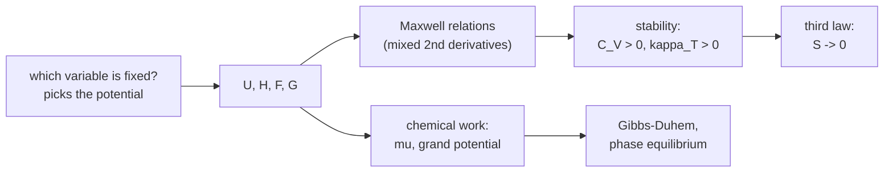

# TH05 · Potentials, Maxwell Relations, Stability and the Third Law

◀ [[TH04 The Second Law Carnot Engines and Entropy]] · [[Thermodynamics and Statistical Mechanics - Course Map|Course Map]] · [[TH06 From Kinetic Theory to Statistical Mechanics]] ▶

taught · in syllabus extra · beyond

> [!syllabus] Syllabus map: what is in the syllabus and what is extra in this chapter
> 🟢 **In syllabus (taught)**: [[df0c4e121858c0be246b496dd8c39d2c_MIT8_333F13_Lec3.pdf|MIT 8.333 Lecture 3]] (Kardar §I.G–I.H; printed pp.13–18 = PDF pp.1–6) and [[97dcd8dee3d3301cd7c27745b17b10b5_MIT8_333F13_Lec4.pdf|Lecture 4]] (§I.I–I.J; printed pp.19–24 = PDF pp.1–6).
> - §1 approach to equilibrium: enthalpy, Helmholtz and Gibbs free energy, the grand potential (L3 §I.G; eqs. I.30–I.44)
> - §2 chemical equilibrium: $\mu_w=\mu_s$ (L3, steam example)
> - §3 extensivity, the fundamental equation, Gibbs-Duhem, $\mu$ of an ideal gas (§I.H, eqs. I.45–I.51)
> - §4 Maxwell relations (eqs. I.52–I.59)
> - §5 stability conditions and the critical point (L4 §I.I)
> - §6 the third law and its consequences (L4 §I.J)
>
> 🔵 **Extra · beyond** (my additions, labelled)
> - §4 $(\partial E/\partial V)_T$ for the ideal and van der Waals gases (the proof that $E=E(T)$) and $C_P-C_V=TV\alpha^2/\kappa_T$; §2 the Clausius-Clapeyron equation and its numbers (connects to the climate chapters); §6 the two-level (Schottky) example

> [!key] After this chapter you can
> - build **$H,F,G$ and the grand potential** from $E(S,x,N)$ by Legendre transforms and say which one is **minimised** under which constraint,
> - write each differential ($\mathrm dH=T\mathrm dS-x\mathrm dJ$, $\mathrm dF=-S\mathrm dT+J\mathrm dx$, $\mathrm dG=-S\mathrm dT-x\mathrm dJ$) and read off $T,S,J,x$ as derivatives,
> - state the **chemical-equilibrium** condition $\mu_1=\mu_2$ and use the **Gibbs-Duhem** relation and $E=TS+J\!\cdot\!x+\mu N$,
> - derive and use the **Maxwell relations**, including $(\partial E/\partial V)_T=T(\partial P/\partial T)_V-P$,
> - derive the **stability conditions** ($C_x\ge0$, $\kappa_T\ge0$, positive-definite response matrix) and locate the critical point,
> - state the **third law** and its four consequences, and explain its microscopic meaning ($g=1$).

> [!intuition] The one-sentence story
> The right "energy" to minimise depends on what you hold fixed: keep the system isolated and entropy is maximal; keep $T$ fixed and $F$ is minimal; keep $T$ and $P$ fixed and $G$ is minimal. Each potential is the energy with the **conjugate pair** swapped, and the equality of mixed second derivatives then gives relations between measurable quantities for free.

<!-- intuition-v1 -->

*Concept map: how the ideas of this chapter depend on each other (read left to right; every box is a section).*

![[TH05 The Potentials by Legendre Transform.svg]]
*Figure TH5.0. The potentials as Legendre transforms of $E(S,x,N)$ (MIT Lecture 3).*

## 1. Approach to equilibrium and the potentials
taught *L3 §I.G ([[df0c4e121858c0be246b496dd8c39d2c_MIT8_333F13_Lec3.pdf#page=1|pp.1–3]])*

> [!intuition] The potential is the thing nature minimises under your constraints
> Hold $T$ and $V$ fixed and the system minimises $F=U-TS$; hold $T$ and $P$ and it minimises $G=U-TS+PV$. Same physics, different bookkeeping for the surroundings.

Evolution towards equilibrium obeys the second law: for an adiabatically isolated system $\delta S\ge0$. For systems that are not isolated one can define **other thermodynamic potentials** that are extremal in equilibrium. A ball of mass $m$ on a spring (constant $K$, extension $x$) settles where $\tfrac12Kx^2-mgx$ is minimal, at $x_{\rm eq}=mg/K$, after oscillating and losing energy to friction: the same logic for thermodynamics.

**Enthalpy** $H=E-J\cdot x$ (for a fluid $H=E+PV$). No heat exchange ($\bar\mathrm dQ=0$) and constant generalised forces: $\bar\mathrm dW\le J\cdot\delta x$ (equality if reversible, otherwise friction loses some work), so $\delta E\le J\cdot\delta x$ and
$$\delta H\le0,\qquad\mathrm dH=T\,\mathrm dS-x\,\mathrm dJ,\qquad x_i=-\Big(\frac{\partial H}{\partial J_i}\Big)_S,\qquad C_P=\Big(\frac{\partial H}{\partial T}\Big)_P .$$
**Helmholtz free energy** $F=E-TS$. Isothermal, no work ($\bar\mathrm dW=0$): Clausius gives $\bar\mathrm dQ\le T\delta S$, so $\delta E\le T\delta S$ and
$$\delta F\le0,\qquad\mathrm dF=-S\,\mathrm dT+J\cdot\mathrm dx,\qquad J_i=\Big(\frac{\partial F}{\partial x_i}\Big)_T,\quad S=-\Big(\frac{\partial F}{\partial T}\Big)_x,\quad E=F+TS=-T^2\frac\partial{\partial T}\Big(\frac FT\Big)_x .$$
**Gibbs free energy** $G=E-TS-J\cdot x$. Isothermal at constant forces: $\delta E\le T\delta S+J\cdot\delta x$, so
$$\delta G\le0,\qquad\mathrm dG=-S\,\mathrm dT-x\cdot\mathrm dJ .$$

| | $\bar\mathrm dQ=0$ | constant $T$ |
|---|---|---|
| $\bar\mathrm dW=0$ (constant $x$) | $\delta S\ge0$ | $\delta F\le0$ |
| constant $J$ | $\delta H\le0$ | $\delta G\le0$ |

*Table TH5.1 (L3 Table 2): inequalities satisfied by the potentials on the approach to equilibrium.* These are **Legendre transformations**: change variables to the most natural set for the situation ($\mathrm dH$ in $(S,J)$, $\mathrm dF$ in $(T,x)$, $\mathrm dG$ in $(T,J)$).

> [!pitfall] $\delta$ versus $\mathrm d$
> The inequalities ($\delta H\le0$, etc.) describe variations **on approaching equilibrium** as some non-state parameter changes (e.g. the velocity of the weight on the spring); the equalities ($\mathrm dH=T\mathrm dS-x\mathrm dJ$) relate equilibrium coordinates. The lecture uses $\delta$ for the former to avoid confusion.

> [!example] Fluid forms
> $J=-P$, $x=V$: $\mathrm dE=T\mathrm dS-P\mathrm dV$; $H=E+PV$, $\mathrm dH=T\mathrm dS+V\mathrm dP$; $F=E-TS$, $\mathrm dF=-S\mathrm dT-P\mathrm dV$; $G=E-TS+PV$, $\mathrm dG=-S\mathrm dT+V\mathrm dP$. For an ideal gas (per mole, checked symbolically) $-(\partial F/\partial T)_V=S$ and $-(\partial F/\partial V)_T=P$ with $F=C_VT-T(C_V\ln T+R\ln V)$.

## 2. Chemical work, the grand potential, and phase equilibrium
taught *L3 §I.G ([[df0c4e121858c0be246b496dd8c39d2c_MIT8_333F13_Lec3.pdf#page=3|pp.3–4]])*

When the number of particles changes (chemical reactions, phase equilibrium) there is **chemical work** $\bar\mathrm dW=\mu\cdot\mathrm dN$, with $\mu_\alpha$ the work needed to add a particle of species $\alpha$. Traditionally this is treated separately from mechanical work and not subtracted in $G$. For chemical equilibrium without mechanical work the right function is the **grand potential**
$$\tilde G=E-TS-\mu\cdot N,\qquad\mathrm d\tilde G=-S\,\mathrm dT-J\cdot\mathrm dx-N\cdot\mathrm d\mu,$$
minimised at equilibrium at fixed $(T,\mu,x)$.

> [!example] Steam condensing (L3)
> $N$ molecules of supersaturated steam in volume $V$ at temperature $T$: the fixed coordinates are $V,T,N$ so use $F(V,T,N)$, $\mathrm dF=-S\mathrm dT-P\mathrm dV+\mu\,\mathrm dN$. Away from equilibrium, with $N_w$ in liquid and $N-N_w$ in vapour, $F(V,T,N|N_w)=F_w(T,N_w)+F_s(V,T,N-N_w)$. Minimising over $N_w$:
> $$\delta F=\Big(\frac{\partial F_w}{\partial N_w}-\frac{\partial F_s}{\partial N_s}\Big)\delta N_w=0\ \Longrightarrow\ \boxed{\ \mu_w(V,T)=\mu_s(V,T)\ }$$
> **Equality of chemical potentials is the condition for chemical (phase) equilibrium.** To go further one needs expressions for $\mu_w,\mu_s$.

> [!extra-beyond]- 🔵 Extra (beyond): Clausius-Clapeyron from $\mu_l=\mu_g$
> Along the coexistence curve $\mu_l(T,P)=\mu_g(T,P)$, so $\mathrm d\mu_l=\mathrm d\mu_g$. With $\mathrm d\mu=-s\,\mathrm dT+v\,\mathrm dP$ per unit mass (Gibbs-Duhem below): $-s_l\mathrm dT+v_l\mathrm dP=-s_g\mathrm dT+v_g\mathrm dP$, hence
> $$\frac{\mathrm dP}{\mathrm dT}=\frac{s_g-s_l}{v_g-v_l}=\frac L{T\,\Delta v},\qquad L=T\Delta s .$$
> For a vapour far from critical, $v_g\gg v_l$ and $v_g\approx R_vT/P$: $\dfrac{\mathrm dP}{\mathrm dT}=\dfrac{LP}{R_vT^2}$, so $\ln P=-L/(R_vT)+$ const. **Numbers** (water; $R_v=461.5$ J kg$^{-1}$K$^{-1}$): at 100 °C, $L=2.257\times10^6$ J kg$^{-1}$, $\mathrm dP/\mathrm dT=3559$ Pa K$^{-1}$ (steam-table $v_g=1.673$ gives $3618$); the fractional rate $\mathrm d\ln P/\mathrm dT=L/R_vT^2=6.3\%$ per K at 15 °C. Fitting a constant $L_{\rm eff}=2.404\times10^6$ J kg$^{-1}$ to the triple point and boiling point reproduces the saturation pressure within $4\%$ at 20 °C ($2245$ Pa vs $2339$) and $5\%$ at 40 °C; with $L$ of 100 °C alone the error is $+21\%$ at 20 °C (Fig. TH5.2). **Boiling at altitude:** at 70 kPa (about 3000 m) the fit gives $T_b=90.4$ °C. This is the equation behind [[Clausius-Clapeyron Relation]] in the climate notes: saturation vapour pressure rises $\approx6$–$7\%$ per kelvin.

![[fig_th05_cc.png]]
*Figure TH5.2. A: integrating $\mathrm dP/\mathrm dT=LP/R_vT^2$ with a constant $L$. B: the fractional growth rate. (Tabulated points are recalled standard values.)*

## 3. Extensivity, the fundamental equation and Gibbs-Duhem
taught *L3 §I.H ([[df0c4e121858c0be246b496dd8c39d2c_MIT8_333F13_Lec3.pdf#page=4|pp.4–5]])*

Including chemical work, $\mathrm dE=T\,\mathrm dS+J\cdot\mathrm dx+\mu\cdot\mathrm dN$. The extensive variables scale with system size:
$$E(\lambda S,\lambda x,\lambda N)=\lambda E(S,x,N).$$
Differentiating with respect to $\lambda$ at $\lambda=1$ and identifying $\partial E/\partial S=T$, $\partial E/\partial x_i=J_i$, $\partial E/\partial N_\alpha=\mu_\alpha$:
$$\boxed{\ E=TS+J\cdot x+\mu\cdot N\ }\qquad\text{(fundamental/Euler equation)}.$$
Combining its variation with $\mathrm dE$ gives the constraint between the **intensive** variables,
$$\boxed{\ S\,\mathrm dT+x\cdot\mathrm dJ+N\cdot\mathrm d\mu=0\ }\qquad\text{(Gibbs-Duhem)}.$$
For a fluid $G=\mu N$ and $\mathrm d\mu=-s\,\mathrm dT+v\,\mathrm dP$ (per particle).

> [!example] Chemical potential of an ideal gas (L3 eqs. I.50–I.51; numbers 🔵)
> Fixed $N$ and constant $T$: Gibbs-Duhem gives $-V\mathrm dP+N\mathrm d\mu=0$, so $\mathrm d\mu=\dfrac VN\mathrm dP=k_BT\dfrac{\mathrm dP}P$ and
> $$\mu=\mu_0+k_BT\ln\frac P{P_0}=\mu_0-k_BT\ln\frac V{V_0}.$$
> At 300 K a doubling of pressure raises $\mu$ by $k_BT\ln2=2.87\times10^{-21}$ J per molecule, i.e. $1729$ J mol$^{-1}$ (the same number as the isothermal work $RT\ln2$).

## 4. Maxwell relations
taught *L3 §I.H ([[df0c4e121858c0be246b496dd8c39d2c_MIT8_333F13_Lec3.pdf#page=5|pp.5–6]])*

> [!intuition] Maxwell relations let you measure the unmeasurable
> Entropy has no meter, but $(\partial S/\partial V)_T=(\partial P/\partial T)_V$ and the right side does. They all come from one fact: for a smooth potential the order of the two derivatives does not matter.

Mixed second derivatives of a state function do not depend on the order of differentiation, so each potential yields a relation between measurable derivatives.

- From $E(S,x)$ with $T=(\partial E/\partial S)_x$, $J_i=(\partial E/\partial x_i)_S$: $\ \big(\frac{\partial T}{\partial x_i}\big)_S=\big(\frac{\partial J_i}{\partial S}\big)_x$, equivalently $\big(\frac{\partial S}{\partial J_i}\big)_{x}=\big(\frac{\partial x_i}{\partial T}\big)_S$ (L3 eq. I.54).
- From $F=E-TS$, $\mathrm dF=-S\mathrm dT+J\mathrm dx$: $\ \boxed{-\Big(\frac{\partial S}{\partial x}\Big)_T=\Big(\frac{\partial J}{\partial T}\Big)_x}$ (I.55).
- From $G$ (or $E-TS-Jx$), $\mathrm dG=-S\mathrm dT-x\mathrm dJ$: $\ \boxed{\Big(\frac{\partial S}{\partial J}\Big)_T=\Big(\frac{\partial x}{\partial T}\Big)_J}$ (I.56).

Fluid forms ($J=-P$, $x=V$): $\ (\partial S/\partial V)_T=(\partial P/\partial T)_V$ and $(\partial S/\partial P)_T=-(\partial V/\partial T)_P$. The lecture's advice: do not memorise mnemonics (magic squares, Jacobians); remember $\mathrm dE=T\mathrm dS+J\mathrm dx$ and manipulate it. It also gives the chain-rule identity $(\partial S/\partial V)_E(\partial E/\partial S)_V(\partial V/\partial E)_S=-1$ (I.59).

> [!example] The ideal gas satisfies it (checked symbolically)
> $S=\tfrac32R\ln T+R\ln V$: $(\partial S/\partial V)_T=R/V$ and $(\partial P/\partial T)_V=\partial_T(RT/V)=R/V$. Equal.

> [!derivation] Why $E=E(T)$ for the ideal gas, and $C_P-C_V$ in general (🔵)
> $$\Big(\frac{\partial E}{\partial V}\Big)_T=T\Big(\frac{\partial S}{\partial V}\Big)_T-P=T\Big(\frac{\partial P}{\partial T}\Big)_V-P .$$
> **Ideal gas** $P=Nk_BT/V$: $T\cdot Nk_B/V-P=0$: $E$ is independent of $V$ (the content of **Joule's experiment**, [[TH02 Work Heat and the First Law]]). **Van der Waals** $P=RT/(V-b)-a/V^2$: $T\,R/(V-b)-P=a/V^2$, so $E=C_VT-a/V$ (internal pressure $a/V^2$; free expansion cools). For any substance the general relation
> $$C_P-C_V=T\Big(\frac{\partial P}{\partial T}\Big)_V\Big(\frac{\partial V}{\partial T}\Big)_P=\frac{TV\alpha_P^2}{\kappa_T}\ \ge0$$
> follows from the cyclic identity of [[TH01 Temperature and the Zeroth Law]] ($(\partial P/\partial T)_V=\alpha_P/\kappa_T$). Ideal gas: $TV(1/T)^2P=PV/T=Nk_B$ (Mayer). **Liquid water** at 20 °C ($V=18.0$ cm$^3$ mol$^{-1}$, recalled $\alpha=2.07\times10^{-4}$ K$^{-1}$, $\kappa_T=4.59\times10^{-10}$ Pa$^{-1}$): $C_P-C_V=0.49$ J mol$^{-1}$K$^{-1}$, under 1% of $C_P=75.3$.

> [!pitfall] A Maxwell relation needs the right potential
> To get $(\partial S/\partial x)_T$ you need a potential whose differential contains $S\,\mathrm dT$ and $J\,\mathrm dx$: that is $F$. For $(\partial S/\partial J)_T$ it is $G$. Choosing a potential whose natural variables do not include the two you hold fixed gives nothing.

## 5. Stability conditions
taught *L4 §I.I ([[97dcd8dee3d3301cd7c27745b17b10b5_MIT8_333F13_Lec4.pdf#page=1|pp.1–3]])*

> [!intuition] A ball in a bowl, not on a hill
> Stable equilibrium needs the potential to be convex: $C_V>0$ and $\kappa_T>0$. If $\kappa_T$ were negative squeezing the gas would *lower* its pressure and it would collapse.

A particle in a potential settles at a **minimum**, with the loss of energy to friction guaranteeing it. In thermodynamics the requirement that spontaneous changes always increase entropy constrains the **response functions**. Divide a homogeneous system at equilibrium (intensive $T,J,\mu$; extensive $E,x,N$) into two halves A and B, and let A transfer $\delta E,\delta x,\delta N$ to B at fixed totals; to first order the intensive variables of A change by $\delta T,\delta J,\delta\mu$ and those of B by the opposite amounts. Expanding $S=S_A+S_B=\sum(E/T-J\cdot x/T-\mu N/T)$ about equilibrium (the first-order terms vanish) gives the second-order change
$$\delta S=-\frac{2}{T_A}\big[\delta T\,\delta S_A+\delta J\cdot\delta x+\delta\mu\,\delta N\big].$$
**Stable equilibrium** requires $\delta S\le0$, i.e.
$$\boxed{\ \delta T\,\delta S+\delta J\cdot\delta x+\delta\mu\cdot\delta N\ \ge\ 0\ }$$
which applies to any part of the system and for any constraints (all coordinates enter symmetrically). Taking variations in $(T,x)$ at $\delta N=0$, the cross terms $\delta T\delta x_i$ cancel by the Maxwell relation (I.56) and
$$\Big(\frac{\partial S}{\partial T}\Big)_x(\delta T)^2+\Big(\frac{\partial J_i}{\partial x_j}\Big)_T\delta x_i\delta x_j\ge0 .$$
This is a quadratic form that must be positive for all $\delta T,\delta x$. Consequences:

- **Positive heat capacity:** only $\delta T\ne0$: $\ C_x=T(\partial S/\partial T)_x\ge0$.
- **Positive response functions:** only one $\delta x_i\ne0$: $\ (\partial x_i/\partial J_i)_T>0$. For a fluid, $\kappa_T=-V^{-1}(\partial V/\partial P)_T\ge0$: the pressure **must** fall as the volume rises.
- **Positive-definite matrix:** with all $\delta x$ non-zero, the matrix $(\partial J_i/\partial x_j)_T$ must be positive definite (all eigenvalues positive); positive diagonal elements are necessary but **not sufficient**. For a gas with chemical work the matrix is $\begin{pmatrix}-\partial P/\partial V&-\partial P/\partial N\\\partial\mu/\partial V&\partial\mu/\partial N\end{pmatrix}$: besides $\kappa_{T,N}\ge0$ and $(\partial N/\partial\mu)_{T,V}\ge0$, its **determinant** must be non-negative.
- **The critical point.** At $T_c$ where $(\partial P/\partial V)_{T_c}=0$, expand $\delta P=\partial_VP\,\delta V+\tfrac12\partial^2_VP\,\delta V^2+\tfrac16\partial_V^3P\,\delta V^3$. The stability condition $-\delta P\,\delta V\ge0$ forces $\partial_V^2P=0$ and $\partial_V^3P<0$: the critical isotherm has an inflexion with negative slope. This is how the critical point of **van der Waals** isotherms is located (TH01).

> [!example] Van der Waals CO$_2$ (🔵, recomputed)
> Isotherms with $a=0.364$, $b=4.267\times10^{-5}$: at 280 K the region $(\partial P/\partial V)_T>0$ spans $95$–$185$ cm$^3$ mol$^{-1}$; at 300 K it shrinks to $113$–$147$ cm$^3$ mol$^{-1}$; at $T_c=304$ K it has closed to a point (the critical point, $V_c=128$ cm$^3$ mol$^{-1}$); above $T_c$ the system is stable at every volume. States in the red region are **unstable** and cannot exist in equilibrium: the gas separates into two phases (liquid and vapour) instead (Fig. TH5.1).

![[fig_th05_vdw.png]]
*Figure TH5.1. A: van der Waals isotherms of CO$_2$; red marks $(\partial P/\partial V)_T>0$. B: this unstable (spinodal) region closes at the critical temperature.*

> [!extra-beyond]- 🔵 Extra (beyond): signs that follow
> From §4, $C_P-C_V=TV\alpha_P^2/\kappa_T\ge0$ and $C_V\ge0$ give $C_P\ge C_V\ge0$; and $\gamma=C_P/C_V=\kappa_T/\kappa_S\ge1$ (TH03). Stability is why a normal substance **cannot** have negative heat capacity or negative compressibility; "negative" values occur only in the spinodal of phase transitions or in self-gravitating systems.

## 6. The third law
taught *L4 §I.J ([[97dcd8dee3d3301cd7c27745b17b10b5_MIT8_333F13_Lec4.pdf#page=4|pp.4–6]])*

> [!intuition] Why absolute zero cannot be reached
> Cooling steps remove less entropy the colder you get because $S\to0$; infinitely many steps would be needed. The third law is a statement about entropy differences vanishing, not just about a number.

Entropy differences follow from the second law, $\Delta S=\int\bar\mathrm dQ_{\rm rev}/T$. Low-temperature experiments show that $\Delta S(X,T)\to0$ as $T\to0$ for any coordinates $X$ (independent of the other laws).

> [!key] Third law (Nernst)
> The entropy of **all systems at zero absolute temperature is a universal constant**, which can be taken to be zero: $\displaystyle\lim_{T\to0}S(X,T)=0$.

This is stronger than the vanishing of differences. It has been tested with **metastable allotropes** (sulphur, phosphine): phase A stable above $T^*$ transforms to B releasing latent heat $L$; cooling fast avoids the transition. The entropy just above $T^*$ computed along both routes,
$$S(T^*+\epsilon)=S_A(0)+\int_0^{T^*}\frac{C_A}{T'}\mathrm dT'=S_B(0)+\int_0^{T^*}\frac{C_B}{T'}\mathrm dT'+\frac L{T^*},$$
agrees with $S_A(0)=S_B(0)=0$ in the experiments.

**Consequences.**
1. $S(0,X)=0$ for all $X$ $\Rightarrow$ $\lim_{T\to0}(\partial S/\partial X)_T=0$.
2. **Heat capacities vanish:** $S(T,X)-S(0,X)=\int_0^TC_X(T')/T'\,\mathrm dT'$ diverges unless $C_X\to0$. With $C=aT^n$ the entropy $aT^n/n$ is finite only for $n>0$ (Debye solids: $C\propto T^3$, $S=C/3$).
3. **Thermal expansivities vanish:** $\alpha_J=\frac1x(\partial x/\partial T)_J=\frac1x(\partial S/\partial J)_T$ by the Maxwell relation, and this $\to0$ by (1).
4. **Absolute zero is unattainable in a finite number of steps.** Cooling by adiabatic pressure reduction follows curves of $S(T)$ at different $P$ which must meet at $T=0$, so each step gets smaller; equivalently $S(0,P)$ is independent of $P$.

**Microscopic meaning.** Statistical mechanics gives $S=k_B\ln g$, $g$ the degeneracy (number of microstates of the same energy), so the third law says $g=1$ at $T=0$: **the ground state is unique**. This fails in classical statistical mechanics (an ideal gas has a degenerate ground state; frustrated spins on a triangular antiferromagnet have a finite zero-temperature entropy) but classical mechanics fails at low $T$ where quantum effects matter; the third law is then the statement that the quantum ground state is unique (provable for non-interacting systems; no general proof with interactions). The temperature at which quantum effects set in is system-specific. The law does **not** apply to **glasses**, frozen supercooled liquids that are effectively but not truly in equilibrium.

> [!example] The two-level system respects it (🔵, recomputed)
> $N$ independent two-level particles with splitting $\varepsilon$ (per particle, $k_B=1$): $S/k_B=\ln(1+e^{-x})+x/(e^x+1)$, $x=\varepsilon/k_BT$. As $T\to0$: $S\to0$ (the unique ground state, $g=1$); as $T\to\infty$: $S\to\ln2$ (both levels equally likely). The heat capacity $C/k_B=x^2e^x/(e^x+1)^2$ vanishes at both ends and peaks at $0.439$ at $k_BT=0.417\varepsilon$ (the **Schottky anomaly**); the vanishing at low $T$ is consequence 2. See [[TH06 From Kinetic Theory to Statistical Mechanics]].

> [!pitfall] Zero is not the target but the limit
> The third law concerns the **limit** $T\to0$ with equilibrium maintained; it says nothing about glasses or about systems whose ground state is degenerate for exact symmetry reasons. Unattainability is a separate (weaker) statement that follows from the entropy curves meeting at $T=0$.

## Map of this chapter
> [!connection] How TH05 connects
> **Builds on:** [[TH04 The Second Law Carnot Engines and Entropy]] (entropy, $\mathrm dE=T\mathrm dS+J\mathrm dx$).
> **Leads to:** [[TH06 From Kinetic Theory to Statistical Mechanics]] ($S=k_B\ln g$, the partition function and $F=-k_BT\ln Z$).
> **Concepts:** [[Enthalpy]] · [[Helmholtz Free Energy]] · [[Gibbs Free Energy]] · [[Grand Potential]] · [[Legendre Transform]] · [[Chemical Potential]] · [[Gibbs-Duhem Relation]] · [[Maxwell Relations]] · [[Thermodynamic Stability]] · [[Third Law of Thermodynamics]] · [[Clausius-Clapeyron Relation]]
> **Other subjects:** [[CL04 Feedback and Multiple Steady States]] and [[Bistability and Tipping Points]] (the unstable middle branch of an isotherm is the unstable equilibrium of a bistable system), [[EE06 Eutrophication and Alternative Stable States]] (hysteresis), [[Fixed Points and Linear Stability]] (the quadratic form above is the same positive-definiteness test), [[Quantum Mechanics - Course Map]] (unique ground state).

## Summary
> [!summary] Cheat-sheet
> - **Potentials:** $H=E-J\cdot x$ ($\delta H\le0$ at $\bar\mathrm dQ=0$, constant $J$), $F=E-TS$ ($\delta F\le0$ at constant $T$, $\bar\mathrm dW=0$), $G=E-TS-J\cdot x$ ($\delta G\le0$ at constant $T,J$), $\tilde G=E-TS-\mu N$; $\mathrm dH=T\mathrm dS-x\mathrm dJ$, $\mathrm dF=-S\mathrm dT+J\mathrm dx$, $\mathrm dG=-S\mathrm dT-x\mathrm dJ$, $\mathrm d\tilde G=-S\mathrm dT-J\mathrm dx-N\mathrm d\mu$; fluid $J=-P$, $x=V$.
> - **Phase equilibrium:** $\mu_w=\mu_s$; Clausius-Clapeyron $\mathrm dP/\mathrm dT=L/T\Delta v$ ($3.56$ kPa K$^{-1}$ at 100 °C; $6.3\%$ K$^{-1}$ at 15 °C).
> - **Extensivity:** $E=TS+J\cdot x+\mu\cdot N$; **Gibbs-Duhem** $S\mathrm dT+x\cdot\mathrm dJ+N\cdot\mathrm d\mu=0$; ideal gas $\mu=\mu_0+k_BT\ln(P/P_0)$.
> - **Maxwell:** $-(\partial S/\partial x)_T=(\partial J/\partial T)_x$; $(\partial S/\partial J)_T=(\partial x/\partial T)_J$; fluid $(\partial S/\partial V)_T=(\partial P/\partial T)_V$; $(\partial E/\partial V)_T=T(\partial P/\partial T)_V-P$ ($0$ ideal, $a/V^2$ vdW); $C_P-C_V=TV\alpha^2/\kappa_T$.
> - **Stability:** $\delta T\delta S+\delta J\delta x+\delta\mu\delta N\ge0$: $C_x\ge0$, $\kappa_T\ge0$, response matrix positive definite; critical point $\partial_VP=\partial_V^2P=0$, $\partial_V^3P<0$.
> - **Third law:** $S(T\to0)=0$; $\partial S/\partial X\to0$; $C\to0$; $\alpha\to0$; $T=0$ unattainable; $S=k_B\ln g$, $g=1$; fails for glasses.

## Practice
1. **Differentials.** From $G=E-TS+PV$ show $\mathrm dG=-S\mathrm dT+V\mathrm dP$ and hence $(\partial G/\partial P)_T=V$; for an ideal gas show $G=G_0(T)+Nk_BT\ln(P/P_0)$.
2. **Maxwell.** Derive $(\partial S/\partial P)_T=-(\partial V/\partial T)_P$ from $\mathrm dG$ and evaluate it for 1 mol of ideal gas at 300 K and 1 atm.
3. **Internal pressure.** Show $(\partial E/\partial V)_T=T(\partial P/\partial T)_V-P$ and evaluate it for the van der Waals gas. By how much does 1 mol of CO$_2$ ($C_V=28.8$ J mol$^{-1}$K$^{-1}$) cool in a Joule expansion from 1 L to 2 L?
4. **$C_P-C_V$.** For liquid water at 20 °C ($V=18.0$ cm$^3$ mol$^{-1}$, $\alpha=2.07\times10^{-4}$ K$^{-1}$, $\kappa_T=4.59\times10^{-10}$ Pa$^{-1}$) compute $C_P-C_V$. Compare with $C_P=75.3$ J mol$^{-1}$K$^{-1}$.
5. **Boiling.** Use $\ln P=-L_{\rm eff}/(R_vT)+$ const with $L_{\rm eff}=2.404\times10^6$ J kg$^{-1}$ to find the boiling temperature of water at 70 kPa.
6. **Chemical potential.** At 300 K an ideal gas is compressed isothermally from 1 atm to 2 atm. Find $\Delta\mu$ per molecule and per mole, and compare with the reversible work per mole.
7. **Stability.** Start from the fluid form of the stability condition, $\delta T\,\delta S-\delta P\,\delta V\ge0$, and show that $C_V\ge0$ and $\kappa_T\ge0$. Why is a gas with $(\partial P/\partial V)_T>0$ unstable?
8. **Spinodal.** For van der Waals CO$_2$ at 300 K the unstable region lies between 112.7 and 147.1 cm$^3$ mol$^{-1}$. Verify that $(\partial P/\partial V)_T=0$ at these volumes and positive between.
9. **Third law.** Show that a heat capacity $C=aT^n$ gives finite $S(0)$ only if $n>0$. For a Debye solid ($n=3$) find $S$ in terms of $C$. Why does $\alpha\to0$ follow?
10. **Legendre.** Starting from $E(S,V)$ derive $H(S,P)$ and the Maxwell relation $(\partial T/\partial P)_S=(\partial V/\partial S)_P$. Evaluate $(\partial T/\partial P)_S$ for an ideal gas (the adiabatic temperature rise per unit pressure).

> [!example]- Solutions
> 1. $\mathrm dG=\mathrm dE-T\mathrm dS-S\mathrm dT+P\mathrm dV+V\mathrm dP=-S\mathrm dT+V\mathrm dP$ using $\mathrm dE=T\mathrm dS-P\mathrm dV$. $(\partial G/\partial P)_T=V=Nk_BT/P$; integrating, $G=G_0(T)+Nk_BT\ln(P/P_0)$ ($\mu=G/N$ as in §3).
> 2. $\partial^2G/\partial T\partial P$: $-(\partial S/\partial P)_T=(\partial V/\partial T)_P$. Ideal gas: $(\partial V/\partial T)_P=R/P$ per mole $=8.314/101325=8.2\times10^{-5}$ m$^3$ mol$^{-1}$K$^{-1}$, so $(\partial S/\partial P)_T=-8.2\times10^{-5}$ J K$^{-1}$Pa$^{-1}$ (isothermal compression lowers $S$).
> 3. $(\partial E/\partial V)_T=T(\partial S/\partial V)_T-P$ and $(\partial S/\partial V)_T=(\partial P/\partial T)_V=R/(V-b)$ gives $a/V^2$. Joule: $\Delta T=-(a/C_V)(1/V_1-1/V_2)=-0.364\times500/28.8=-6.3$ K.
> 4. $C_P-C_V=TV\alpha^2/\kappa_T=293.15\times18.0\times10^{-6}\times(2.07\times10^{-4})^2/4.59\times10^{-10}=0.49$ J mol$^{-1}$K$^{-1}$, i.e. $0.65\%$ of $C_P$.
> 5. $1/T=1/373.15-(461.5/2.404\times10^6)\ln(70/101.325)=2.6799\times10^{-3}+7.1\times10^{-5}=2.751\times10^{-3}$: $T=363.5$ K $=90.4$ °C.
> 6. $\Delta\mu=k_BT\ln2=2.87\times10^{-21}$ J per molecule $=1729$ J mol$^{-1}$, equal to the isothermal work $RT\ln2$ done on the gas.
> 7. For a fluid $\delta W=-P\delta V$: stability $\delta T\delta S-\delta P\delta V\ge0$. Only $\delta T$: $\delta S=(C_V/T)\delta T$ so $C_V(\delta T)^2/T\ge0$. Only $\delta V$ at fixed $T$: $-(\partial P/\partial V)_T(\delta V)^2\ge0$, i.e. $\kappa_T\ge0$. If $(\partial P/\partial V)_T>0$, a compression would lower the pressure and the region would compress further (and its neighbour expand): the fluctuation grows.
> 8. $\partial P/\partial V=-RT/(V-b)^2+2a/V^3$. At 300 K, $V=112.7$ and $147.1$ cm$^3$ mol$^{-1}$ both make it $0$ (checked numerically); between them it is positive (e.g. at 130 cm$^3$ mol$^{-1}$: $+$).
> 9. $S=\int_0^TaT'^{n-1}\mathrm dT'=aT^n/n$ finite iff $n>0$. For $n=3$: $S=C/3$. $\alpha_J=\frac1x(\partial S/\partial J)_T\to0$ because $S(0,X)=0$ for all $X$ makes $(\partial S/\partial J)_T\to0$.
> 10. $H=E+PV$, $\mathrm dH=T\mathrm dS+V\mathrm dP$; $(\partial T/\partial P)_S=(\partial V/\partial S)_P$. For any substance $(\partial V/\partial S)_P=(\partial V/\partial T)_P(\partial T/\partial S)_P=(V\alpha_P)(T/C_P)$; for the ideal gas ($\alpha_P=1/T$) this is $V/C_P=Nk_BT/(PC_P)=(\gamma-1)T/(\gamma P)$: for air at 300 K, 1 atm: $0.2857\times300/101\,325=8.5\times10^{-4}$ K Pa$^{-1}$ (i.e. $8.5$ K per $10^4$ Pa). This is the adiabat $T\propto P^{(\gamma-1)/\gamma}$.

## Provenance
> [!provenance]- Source map for this chapter
> | Topic | Source | Scope |
> |---|---|---|
> | enthalpy, free energies, table of inequalities, grand potential, steam example | [[df0c4e121858c0be246b496dd8c39d2c_MIT8_333F13_Lec3.pdf#page=1\|MIT L3 §I.G, pp.1–4]] | taught |
> | extensivity, fundamental equation, Gibbs-Duhem, Maxwell relations | [[df0c4e121858c0be246b496dd8c39d2c_MIT8_333F13_Lec3.pdf#page=4\|L3 §I.H, pp.4–6]] | taught |
> | stability conditions, critical point | [[97dcd8dee3d3301cd7c27745b17b10b5_MIT8_333F13_Lec4.pdf#page=1\|MIT L4 §I.I, pp.1–3]] | taught |
> | third law, consequences, microscopic meaning | [[97dcd8dee3d3301cd7c27745b17b10b5_MIT8_333F13_Lec4.pdf#page=4\|L4 §I.J, pp.4–6]] | taught |
> | Clausius-Clapeyron; $(\partial E/\partial V)_T$; $C_P-C_V$; vdW numbers; Schottky | derived and recomputed here (`scripts/th_numbers.py`, `fig_th05_*.py`) | extra/beyond |
>
> **Read and not read.** MIT L3 and L4 were read in full. The lecture cites "test 1 review problems" (not in the folder) for the proof of $E(T)$ and for the glass test; I supplied the first from the Maxwell relation. The AI summary (`Thermo_ConceptSummary_FormulaSheet.pdf` §4–5) matches the lecture.
>
> **Notes.** (1) Kardar's potentials use $J\cdot x$ with $J=-P$ for fluids, so $H=E+PV$ and $G=E-TS+PV$ in the usual fluid notation. (2) The lecture warns that Taylor-expanding the critical isotherm is "usually not justified" (real critical points are non-analytic); the inequality $-\delta P\,\delta V\ge0$ remains valid, and the mean-field (van der Waals) conditions $\partial_VP=\partial_V^2P=0$ are what locate the critical point there. (3) The saturation-pressure "tabulated" values and the water coefficients are recalled, not checked in the folder.

**References.** Kardar, M. *Statistical Physics of Particles*, §1.6–1.10 · MIT OpenCourseWare 8.333 (Fall 2013), Lectures 3–4 · Gibbs, J. W. (1876) · Nernst, W. (1906) · Clapeyron, É. (1834).

## Continued in the vault (added 2026-11-04)
- The chemical-thermodynamics applications of $G$ (spontaneity, $\Delta G^\circ=-RT\ln K$, Gibbs–Helmholtz, van 't Hoff, the molar Clausius–Clapeyron equation and boiling points, Trouton's rule, entropy generation) are worked in [[TH08 Gibbs Energy Equilibrium Constants and Phase Boundaries]]; enthalpy numbers and calorimetry in [[TH07 Enthalpy Thermochemistry and Calorimetry]].
