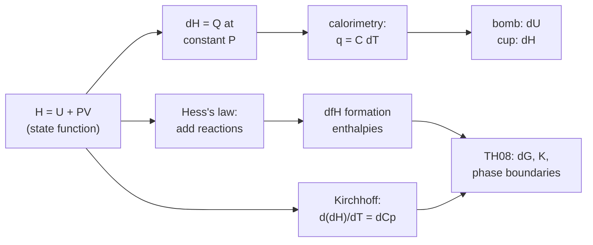

# TH07 · Enthalpy, Thermochemistry and Calorimetry

◀ [[TH06 From Kinetic Theory to Statistical Mechanics]] · [[Thermodynamics and Statistical Mechanics - Course Map|Course Map]] · [[TH08 Gibbs Energy Equilibrium Constants and Phase Boundaries]] ▶

taught · in syllabus extra · book extra · beyond

> [!syllabus] Syllabus map: what is in the syllabus and what is extra in this chapter
> 🟢 **In syllabus (taught)**: the course's own tutorial sheets, which identify the course as **TD2213** and show that it has a *chemical-thermodynamics* side that the MIT lectures alone did not reveal: [[TD2213_Tutorial1.pdf#page=1|Tutorial 1, Q1]] ($\Delta H=\Delta U+P\Delta V$) and [[Thermodynamics_Tutorial_2_Questions.pdf#page=1|Tutorial 2, Q1 and Q3–Q6]] (Kirchhoff's law, Hess's law, the enthalpy of reaction at another temperature, constant-volume and constant-pressure calorimetry). Every one of these questions is solved in full in **Practice 1–6**.
> - §1 enthalpy as heat at constant pressure; §2 reaction enthalpy and internal energy, standard states; §3 Hess's law and the Born–Haber type cycle; §4 Kirchhoff's law; §5 calorimetry
>
> 🟡 **Extra · book**: Schroeder, *An Introduction to Thermal Physics*, §1.6 ("Latent heat; enthalpy", pp. 28–37) and the data table *Thermodynamic Properties of Selected Substances* (pp. 404–405); Tutorial 2 Q4 supplies **no data**, so the table is used for it (see the `[!verify]` box in §4).
>
> 🔵 **Extra · beyond** (my additions, labelled)
> - §2 the table of $\Delta n_gRT$; §4 a worked temperature-dependent $C_p$ integral (graphite); §5 the extrapolation correction for heat loss (illustrative curve, Fig. TH7.1C); Practice 7–13; all numbers (`scripts/th_tutorial_numbers.py`, `fig_th07.py`)

> [!key] After this chapter you can
> - define **enthalpy** $H=U+PV$ and show that $\Delta H=Q_P$ at constant pressure (only $PV$ work), and convert between $\Delta H$ and $\Delta U$ for processes ($P\Delta V$) and reactions ($\Delta n_gRT$),
> - state the **standard state** (1 bar), the **standard enthalpy of formation** $\Delta_fH^\circ$ (elements: zero) and the **reaction enthalpy** per reaction *as written*,
> - use **Hess's law** (enthalpy is a state function) to obtain $\Delta_rH^\circ$ from $\Delta_fH^\circ$ and to close a **cycle** such as the dissolution of MgCl$_2$,
> - use **Kirchhoff's law** $\Delta_rH(T_2)=\Delta_rH(T_1)+\int\Delta_rC_p\,\mathrm dT$, and say when constant $\Delta C_p$ is allowed,
> - analyse **bomb (constant-volume)** and **coffee-cup (constant-pressure)** calorimeters: $q=C\Delta T$, $\Delta_cU=-q/n$, $\Delta H=-q/n$.

> [!intuition] The one-sentence story
> At constant pressure the heat you collect is the change in a state function, $H$, so the heat of a reaction can be computed by adding up reactions you never ran (Hess), moved to another temperature by integrating the heat capacities (Kirchhoff), and measured by watching a thermometer in an insulated vessel (calorimetry).

<!-- intuition-v1 -->

*Concept map: every box is a section; the arrows are logical dependence. TH08 continues from the right-hand box.*

![[fig_th07_thermochemistry.png]]
*Figure TH7.1. A: the Hess cycle of Tutorial 2 Q3 (MgCl$_2$ dissolving), energy levels in kJ mol$^{-1}$. B: Kirchhoff's law as straight lines of slope $\Delta C_p$, with the Q1 and Q4 corrections marked. C: a bomb-calorimeter heating curve (illustrative model, not data) with the extrapolation that fixes $\Delta T$. D: $\Delta H-\Delta U=\Delta n_gRT$ for six reactions at 298 K.*

## 1. Enthalpy: the heat you collect at constant pressure #quiz/th-tut1 #quiz/th-tut2

The first law ([[TH02 Work Heat and the First Law]]) for a system doing only $PV$ work reads $\Delta U=Q-P_{\rm ext}\Delta V$ (here $W$ is the work *done by* the system; sign conventions in TH02 §2). If the pressure is constant, $P_{\rm ext}=P=$ const, and
$$Q_P=\Delta U+P\Delta V=\Delta(U+PV)\equiv\Delta H,\qquad H\equiv U+PV.$$
$H$ is a state function because $U$, $P$ and $V$ are ([[State Function]], [[Enthalpy]]); its differential is $\mathrm dH=T\,\mathrm dS+V\,\mathrm dP$ (TH05 §1), so **$\mathrm dH=Q_P$ along an isobar** and $C_p=(\partial H/\partial T)_P$. The relation $\Delta H=\Delta U+P\Delta V$ holds for any constant-pressure process; for a general process $\Delta H=\Delta U+\Delta(PV)$.

> [!example] Tutorial 1, Q1 (taught): a constant-pressure expansion #quiz/th-tut1
> $\Delta U=+2.50$ kJ; $P=2.0$ bar $=2.0\times10^5$ Pa; $V:3.0\to8.0$ L. Convert the volume to m$^3$: $\Delta V=5.0\times10^{-3}$ m$^3$, so $P\Delta V=2.0\times10^5\times5.0\times10^{-3}=1.00\times10^3$ J, and
> $$\Delta H=\Delta U+P\Delta V=2.50+1.00=\boxed{3.50\ \text{kJ}}.$$
> *Meaning:* the system absorbed 3.50 kJ as heat ($Q_P=\Delta H$): 2.50 kJ went into internal energy and 1.00 kJ into pushing the atmosphere back. (The sign of $P\Delta V$ is positive because the volume *increases*.)

> [!pitfall] Units
> $1\ \mathrm{bar}=10^5$ Pa, $1\ \mathrm{L}=10^{-3}$ m$^3$, so **$1\ \mathrm{bar\cdot L}=100$ J**. The common error is to multiply 2.0 by 5.0 and call the answer 10 J or 10 kJ.

For solids and liquids $P\Delta V$ is tiny ($1\ \mathrm{cm^3}$ at 1 bar is $0.1$ J), so $\Delta H\approx\Delta U$; for gases $P\Delta V=\Delta n_gRT$ (§2) is of the order of kilojoules per mole.

## 2. Reaction enthalpy and reaction internal energy

### 2.1 Definitions
For a reaction written with stoichiometric coefficients $\nu_i$ (positive for products, negative for reactants), the **reaction enthalpy** is $\Delta_rH=\sum_i\nu_iH_{{\rm m},i}$: the enthalpy change *per mole of reaction as written* (per unit extent of reaction $\xi$). Rewriting the equation with twice the coefficients doubles $\Delta_rH$. The **standard** values $\Delta_rH^\circ$ refer to every substance in its **standard state**: pure, at the standard pressure $P^\circ=1$ bar (the older convention is 1 atm; the difference is negligible for the numbers here), and at the stated temperature, usually 298.15 K. Exothermic: $\Delta_rH<0$; endothermic: $\Delta_rH>0$ (heat measured from the *system's* point of view, the chemistry sign).

The **standard enthalpy of formation** $\Delta_fH^\circ$ of a compound is $\Delta_rH^\circ$ of the reaction that forms one mole of it from its elements in their most stable forms (graphite, O$_2$(g), H$_2$(g), …), and is **zero for the elements** by definition. For example (Schroeder's table, 298 K, kJ mol$^{-1}$): CO$_2$(g) $-393.51$; H$_2$O(l) $-285.83$; H$_2$O(g) $-241.82$; CO(g) $-110.53$; CH$_4$(g) $-74.81$; NH$_3$(g) $-46.11$; C(diamond) $+1.895$.

### 2.2 $\Delta_rH$ versus $\Delta_rU$ #quiz/th-tut1 #quiz/th-tut2
With $H=U+PV$ at constant $T$ and $P$, $\Delta_rH=\Delta_rU+\Delta_r(PV)$. Solids and liquids contribute negligibly; the gases, treated as ideal, contribute $PV=n_gRT$:
$$\boxed{\ \Delta_rH=\Delta_rU+\Delta n_g\,RT\ },\qquad\Delta n_g=\sum_{\rm gas\ products}\nu-\sum_{\rm gas\ reactants}|\nu|.$$
At 298.15 K, $RT=2.479$ kJ mol$^{-1}$.

> [!example] When do they differ? (recomputed; Fig. TH7.1D)
> $\mathrm N_2+3\mathrm H_2\to2\mathrm{NH}_3$: $\Delta n_g=-2$, $\Delta H-\Delta U=-4.96$ kJ (so $\Delta U=-92.22+4.96=-87.26$ kJ, a $5.4\%$ difference). CH$_4$ burning to liquid water: $-4.96$ kJ. Benzoic acid: $\Delta n_g=-\tfrac12$, $-1.24$ kJ. Glucose burning, $\Delta n_g=0$: no difference. C + H$_2$O(g) → CO + H$_2$: $+2.48$ kJ. Vaporising water ($\Delta n_g=+1$): at 373 K, $\Delta_{\rm vap}H=40.66$ kJ but $\Delta_{\rm vap}U=40.66-3.10=37.56$ kJ: the missing 3.10 kJ is the work of pushing back the atmosphere.

## 3. Hess's law #quiz/th-tut2

**Hess's law:** because $H$ is a state function, the enthalpy change of a reaction depends only on its initial and final states, not on the route. Hence if reaction (3) is the sum of reactions (1) and (2), $\Delta H_3=\Delta H_1+\Delta H_2$; reversing a reaction changes the sign; multiplying it by $k$ multiplies $\Delta H$ by $k$. For a reaction with tabulated formation enthalpies,
$$\Delta_rH^\circ=\sum_{\rm products}\nu\,\Delta_fH^\circ-\sum_{\rm reactants}|\nu|\,\Delta_fH^\circ\qquad(\text{route: reactants}\to\text{elements}\to\text{products}).$$

> [!example] Combustion of methane (recomputed)
> $\mathrm{CH}_4+2\mathrm O_2\to\mathrm{CO}_2+2\mathrm H_2\mathrm O(\mathrm l)$: $\Delta_cH^\circ=-393.51+2(-285.83)-(-74.81)=-890.36$ kJ mol$^{-1}$, i.e. $55.5$ kJ per gram of methane; $\Delta_cU^\circ=-890.36+4.96=-885.40$ kJ mol$^{-1}$. Graphite to diamond: $\Delta H=+1.895$ kJ mol$^{-1}$ (endothermic: diamond is the less stable, "higher-enthalpy" form).

### 3.1 A cycle with ions: the hydration of Mg$^{2+}$ #quiz/th-tut2
> [!example] Tutorial 2, Q3 (taught): the enthalpy of hydration of Mg$^{2+}$(g) #quiz/th-tut2
> **Data:** lattice dissociation enthalpy of MgCl$_2$(s), $\mathrm{MgCl_2(s)}\to\mathrm{Mg^{2+}(g)}+2\mathrm{Cl^-(g)}$: $+2526$ kJ mol$^{-1}$; enthalpy of solution, $\mathrm{MgCl_2(s)}\to\mathrm{Mg^{2+}(aq)}+2\mathrm{Cl^-(aq)}$: $-155$ kJ mol$^{-1}$; hydration of Cl$^-$(g) → Cl$^-$(aq): $-381$ kJ mol$^{-1}$ per mole of ions.
> **Cycle (Fig. TH7.1A).** Two routes from MgCl$_2$(s) to the aqueous ions: *direct* dissolution ($-155$), or *via the gas-phase ions*: dissociate the lattice ($+2526$), hydrate Mg$^{2+}$ ($x$), hydrate two Cl$^-$ ($2\times(-381)=-762$). Hess's law equates the two routes:
> $$-155=2526+x+2(-381)\ \Longrightarrow\ x=-155-2526+762=\boxed{-1919\ \text{kJ mol}^{-1}}.$$
> *Sanity check:* the hydration of the doubly charged, small Mg$^{2+}$ ion is about five times that of Cl$^-$: charge and size set the strength of the ion–water interaction, and nearly all the $2526$ kJ needed to pull the lattice apart is paid back by the hydration of the ions, leaving a small net $-155$.

> [!pitfall] Signs in a cycle
> Every step must be written in the direction you traverse it. "Enthalpy of hydration" is negative (exothermic) while "lattice dissociation enthalpy" is positive; if the textbook quotes the *lattice formation* enthalpy ($-2526$), the sign of that step flips. The check is that the sum around the closed loop is zero: $+2526-1919-762+155=0$.

## 4. Kirchhoff's law: reaction enthalpy at another temperature #quiz/th-tut2

Differentiate $\Delta_rH(T)=\sum\nu_iH_{{\rm m},i}(T)$ with respect to $T$ at constant $P$, using $(\partial H/\partial T)_P=C_p$:
$$\boxed{\ \frac{\mathrm d\,\Delta_rH}{\mathrm dT}=\Delta_rC_p,\qquad\Delta_rH(T_2)=\Delta_rH(T_1)+\int_{T_1}^{T_2}\Delta_rC_p\,\mathrm dT\ },\qquad\Delta_rC_p=\sum_i\nu_iC_{p,i}.$$
If $\Delta_rC_p$ is constant, $\Delta_rH(T_2)=\Delta_rH(T_1)+\Delta_rC_p(T_2-T_1)$. The law requires that **no phase transition** occurs for any reactant or product between $T_1$ and $T_2$ (otherwise add the latent heat of each transition at its own temperature). Geometrically (Fig. TH7.1B) $\Delta_rH(T)$ is the vertical gap between two enthalpy curves $H_{\rm products}(T)$ and $H_{\rm reactants}(T)$, and its slope is the difference of their slopes.

> [!example] Tutorial 2, Q1 (taught): HCl #quiz/th-tut2
> $\mathrm H_2+\mathrm{Cl}_2\to2\mathrm{HCl}$: $\Delta_rH(298\ \mathrm K)=-120$ kJ mol$^{-1}$, $\Delta_rC_p=+25$ J mol$^{-1}$K$^{-1}$ (independent of $T$, no phase change). Then
> $$\Delta_rH(350\ \mathrm K)=-120\,000+25\times(350-298)=-120\,000+1300=\boxed{-118.7\ \text{kJ mol}^{-1}}.$$
> The correction is $1.1\%$: for a modest $\Delta T$ and a modest $\Delta C_p$ the enthalpy of reaction hardly varies with temperature, which is why tabulated 298 K values are used near room temperature.

> [!example] Tutorial 2, Q4 (taught): the water-gas reaction at 298 K and 378 K #quiz/th-tut2
> $\mathrm C(\text{graphite})+\mathrm H_2\mathrm O(\mathrm g)\to\mathrm{CO}(\mathrm g)+\mathrm H_2(\mathrm g)$.
> **(a)** $\Delta_rH^\circ(298)=\Delta_fH^\circ(\mathrm{CO})+0-0-\Delta_fH^\circ(\mathrm{H_2O,g})=-110.53+241.82=\boxed{+131.29\ \text{kJ mol}^{-1}}$ (endothermic; this is why steam passed over hot coke cools it).
> **(b)** $\Delta_rC_p=C_p(\mathrm{CO})+C_p(\mathrm{H_2})-C_p(\mathrm C)-C_p(\mathrm{H_2O,g})=29.14+28.82-8.53-33.58=+15.85$ J mol$^{-1}$K$^{-1}$, so
> $$\Delta_rH^\circ(378)=131.29+15.85\times10^{-3}\times80=\boxed{+132.56\ \text{kJ mol}^{-1}}.$$

> [!verify] The tutorial gives no data for Q4
> The printed question supplies no enthalpies of formation or heat capacities. I used **Schroeder's table (pp. 404–405, 298 K, 1 bar)** for $\Delta_fH^\circ$ and $C_p$. The instructor's data sheet may differ in the last digit (e.g. $\Delta_fH^\circ(\mathrm{H_2O,g})=-241.83$), which changes the answer by $\le0.01$ kJ mol$^{-1}$. Also note that the constant-$C_p$ assumption is stated in the question; it is acceptable over 80 K but not over 700 K (below).

> [!note] Update 2026-11-12: the instructor's answer sheet supplies the data for Q4 and agrees with this chapter
> [[TDD213_Tutorial_2_Answers.pdf#page=2|Tutorial 2 Answers]] (3 pp., read in full) lists, for Q4, $\Delta_fH^\circ/\mathrm{kJ\,mol^{-1}}$ and $C_{p,m}/\mathrm{J\,K^{-1}mol^{-1}}$ at 298 K: C(graphite) $0$, $8.527$; H$_2$O(g) $-241.82$, $33.58$; CO(g) $-110.53$, $29.14$; H$_2$(g) $0$, $28.824$. These are the table values used above (to the last digit I rounded: $8.53$, $28.82$). Results: $\Delta_rH^\circ(298\ \mathrm K)=+131.29$ kJ mol$^{-1}$, $\Delta_rC_p=+15.857$ J K$^{-1}$mol$^{-1}$ (mine $15.85$), $\Delta_rH^\circ(378\ \mathrm K)=+132.56$ kJ mol$^{-1}$: **identical**. So the flag above ("no data") applies only to the printed question, not to the course. The other answers on the sheet also agree with this chapter: Q1 $-118.7$ kJ mol$^{-1}$, Q3 $-1919$ kJ mol$^{-1}$, Q5 $15.0$ kJ, $\Delta_cU=-3664$ and $\Delta_cH=-3665$ kJ mol$^{-1}$ (mine $-3663.6$, $-3664.8$: rounding), Q6 $2.80$ kJ and $-56.0$ kJ mol$^{-1}$, and Q2 $\Delta_rG^\circ=+3.02$ kJ mol$^{-1}$, $\Delta_rH^\circ=-10.4$ kJ mol$^{-1}$ ([[TH08 Gibbs Energy Equilibrium Constants and Phase Boundaries]] §3).

> [!extra-beyond]- 🔵 Extra (beyond): when $C_p$ is not constant
> Reference works represent heat capacities by formulas. Schroeder's Problem 3.31 gives graphite as $C_p=a+bT-c/T^2$ with $a=16.86$ J K$^{-1}$, $b=4.77\times10^{-3}$ J K$^{-2}$, $c=8.54\times10^5$ J K (so $C_p(298)=8.67$, against $8.53$ in the table). Integrating,
> $$\Delta H(298\to500\ \mathrm K)=a\Delta T+\tfrac b2(T_2^2-T_1^2)+c\Big(\frac1{T_2}-\frac1{T_1}\Big)=3405.7+384.5-1157.8=2632\ \text{J mol}^{-1},$$
> whereas constant $C_p=8.53$ gives $1723$ J: **35% too small** (equivalently the true value is 53% larger) over $\Delta T=202$ K, because $C_p$ rises to $15.8$ J K$^{-1}$ mol$^{-1}$ at 500 K. For the water-gas reaction, constant $\Delta C_p$ would give $\Delta_rH(1000\ \mathrm K)=131.29+15.85\times0.70185=142.41$ kJ mol$^{-1}$, probably good to a few per cent only; and it matters in TH08 (the temperature at which $\Delta_rG$ changes sign moves from 981 K to 931 K once $\Delta C_p$ is included).

## 5. Calorimetry #quiz/th-tut2

A **calorimeter** is a vessel that isolates (as well as possible) a reaction from its surroundings and measures the temperature change of the vessel and its contents. If the heat released by the reaction, $q_{\rm released}$, goes entirely into a body of **heat capacity** $C$ (the calorimeter plus its contents) that rises by $\Delta T$, then
$$q_{\rm released}=C\,\Delta T,\qquad\Delta_{\rm rxn}=-\frac{q_{\rm released}}{n}\ \ (\text{per mole of the reactant that sets the extent}).$$
$C$ is found by **calibration**: burn a standard (benzoic acid) or dissipate a known electrical energy $IVt$.

### 5.1 Constant volume: the bomb calorimeter #quiz/th-tut2
A strong sealed steel "bomb" holds the sample in excess O$_2$; $V$ is constant, no $PV$ work is done, and the first law gives $q_V=\Delta U$. Therefore the bomb measures the **internal energy** of combustion; the enthalpy follows from §2.2.

> [!example] Tutorial 2, Q5 (taught): benzoic acid #quiz/th-tut2
> $m=0.500$ g, $M=122.12$ g mol$^{-1}$, $C=10.0$ kJ K$^{-1}$, $\Delta T=1.50$ K, $\Delta n_g=-0.5$, $T=298$ K.
> - **Heat released:** $q=C\Delta T=10.0\times1.50=\boxed{15.0\ \text{kJ}}$ (that is $30.0$ kJ per gram).
> - **Amount:** $n=0.500/122.12=4.094\times10^{-3}$ mol.
> - **Molar internal energy of combustion:** $\Delta_cU=-q/n=-15.0/4.094\times10^{-3}=\boxed{-3.66\times10^3\ \text{kJ mol}^{-1}}$ ($-3663.6$).
> - **(not asked)** $\Delta_cH=\Delta_cU+\Delta n_gRT=-3663.6+(-0.5)(8.314\times10^{-3})(298)=-3664.8$ kJ mol$^{-1}$: the correction is only $0.03\%$ because $|\Delta n_g|$ is small.
>
> The balanced reaction, $\mathrm C_7\mathrm H_6\mathrm O_2(\mathrm s)+\tfrac{15}2\mathrm O_2\to7\mathrm{CO}_2+3\mathrm H_2\mathrm O(\mathrm l)$, has $\Delta n_g=7-\tfrac{15}2=-\tfrac12$ (only gases count; the liquid water does not).

> [!verify] The numbers are the problem's, not a measurement
> The certified energy of combustion of benzoic acid (the calorimetric standard) is about $26.4$ kJ g$^{-1}$, i.e. $\Delta_cU\approx-3228$ kJ mol$^{-1}$ (recalled, not looked up in a file of the folder), against $30.0$ kJ g$^{-1}$ implied by the question's $C$ and $\Delta T$. The question is an exercise in method, not a calibration. The sign: heat is *released* to the calorimeter, so the reaction's $\Delta_cU$ is negative.

### 5.2 Constant pressure: the coffee-cup calorimeter #quiz/th-tut2
In an insulated cup open to the atmosphere $P$ is constant and $q_P=\Delta H$.

> [!example] Tutorial 2, Q6 (taught): neutralisation #quiz/th-tut2
> $\mathrm{HCl(aq)}+\mathrm{NaOH(aq)}\to\mathrm{NaCl(aq)}+\mathrm H_2\mathrm O(\mathrm l)$: $50.0$ mL of $1.00$ mol L$^{-1}$ HCl plus $50.0$ mL of $1.00$ mol L$^{-1}$ NaOH, $25.0\to31.7$ °C; density $1.00$ g mL$^{-1}$, $c=4.18$ J g$^{-1}$K$^{-1}$; the cup is neglected.
> **(a)** Mass $100$ g, $\Delta T=6.7$ K: $q=mc\Delta T=100\times4.18\times6.7=2.80\times10^3$ J $=\boxed{2.80\ \text{kJ}}$ released.
> **(b)** Amount of each reagent $=0.0500\ \mathrm L\times1.00\ \mathrm{mol\,L^{-1}}=0.0500$ mol (they react 1 : 1, so neither is in excess): $\Delta_{\rm neut}H=-q/n=-2.80/0.0500=\boxed{-56.0\ \text{kJ mol}^{-1}}$.
> *Remark:* the accepted standard value for a strong acid and strong base is close to $-57$ kJ mol$^{-1}$ (recalled); the small gap is the heat that leaks away and the heat taken by the cup. Because the net ionic reaction is $\mathrm H^+(\mathrm{aq})+\mathrm{OH}^-(\mathrm{aq})\to\mathrm H_2\mathrm O$, the molar enthalpy is nearly the same for any strong acid–strong base pair.

### 5.3 Heat loss #quiz/th-tut2
No calorimeter is perfectly adiabatic. The standard cure (Fig. TH7.1C) is to record $T(t)$ for several minutes before and after the reaction, extrapolate **both straight stretches to the time of ignition** (or mixing) and read $\Delta T$ as the gap between the extrapolations. The curve in the figure is an illustrative Newton-cooling model with the tutorial's $C$ and $\Delta T$ and is not data.

## Map of this chapter
> [!connection] How TH07 connects
> **Builds on:** [[TH02 Work Heat and the First Law]] (first law, $C_p$, work), [[TH05 Potentials Maxwell Relations Stability and the Third Law]] (enthalpy as a potential, $\mathrm dH=T\mathrm dS+V\mathrm dP$), [[TH03 The Ideal Gas and Adiabatic Processes]] ($PV=nRT$).
> **Leads to:** [[TH08 Gibbs Energy Equilibrium Constants and Phase Boundaries]] ($\Delta G=\Delta H-T\Delta S$, $K$, van 't Hoff, Clausius–Clapeyron, entropy generation) and, for the statistical foundation of heat capacities, [[TH09 Microstates Macrostates and Multiplicity]].
> **Concepts:** [[Enthalpy]] · [[Heat Capacity]] · [[State Function]] · [[Hess's Law]] · [[Kirchhoff's Law]] · [[Standard Enthalpy of Formation]] · [[Reaction Enthalpy]] · [[Calorimetry]] · [[Lattice and Hydration Enthalpy]] · [[First Law of Thermodynamics]]
> **Other subjects:** [[Inorganic Chemistry - Course Map|Inorganic Chemistry course map]] (lattice enthalpies, hydration enthalpies and Born–Haber cycles), [[Clausius-Clapeyron Relation]] (latent heats), [[Climate - Course Map|Climate]] (latent heat and static energy).

## Summary
> [!summary] Cheat-sheet
> - **Enthalpy:** $H=U+PV$; $\Delta H=Q_P$; $\Delta H=\Delta U+P\Delta V$ (constant $P$); reactions: $\Delta_rH=\Delta_rU+\Delta n_gRT$ ($RT=2.479$ kJ mol$^{-1}$ at 298.15 K). Tutorial 1 Q1: $3.50$ kJ.
> - **Standard formation enthalpies:** elements $=0$; $\Delta_rH^\circ=\sum\nu\Delta_fH^\circ$; Hess: route independent. CH$_4$ burning $-890.36$ kJ mol$^{-1}$.
> - **Hess cycles:** $\Delta_{\rm sol}H=\Delta_{\rm lat}H+\Delta_{\rm hyd}H(\text{cation})+\sum\Delta_{\rm hyd}H(\text{anions})$; Mg$^{2+}$: $-1919$ kJ mol$^{-1}$.
> - **Kirchhoff:** $\mathrm d\Delta_rH/\mathrm dT=\Delta_rC_p$; HCl: $-118.70$; water-gas: $+131.29\to+132.56$ kJ mol$^{-1}$; not for ranges with phase changes; not for large $\Delta T$ when $C_p$ varies (graphite: constant $C_p$ is $35\%$ low over 200 K).
> - **Calorimetry:** $q=C\Delta T$; bomb ($V$ const): $\Delta U$; cup ($P$ const): $\Delta H$. Benzoic acid example: $15.0$ kJ, $\Delta_cU=-3.66\times10^3$ kJ mol$^{-1}$; neutralisation: $2.80$ kJ, $-56.0$ kJ mol$^{-1}$.

## Practice
1. **[Tutorial 1, Q1]** A system has $\Delta U=+2.50$ kJ at constant pressure $2.0$ bar while the volume rises from $3.0$ L to $8.0$ L. Calculate $\Delta H$. #quiz/th-tut1
2. **[Tutorial 2, Q1]** For H$_2$(g) + Cl$_2$(g) → 2HCl(g), $\Delta_rH^\circ(298\ \mathrm K)=-120$ kJ mol$^{-1}$ and $\Delta_rC_p=+25$ J mol$^{-1}$K$^{-1}$, both independent of temperature; no phase transitions between 298 and 350 K. Find $\Delta_rH(350\ \mathrm K)$. #quiz/th-tut2
3. **[Tutorial 2, Q3]** Lattice dissociation enthalpy of MgCl$_2$(s): $+2526$ kJ mol$^{-1}$; enthalpy of solution in water: $-155$; hydration enthalpy of Cl$^-$(g): $-381$. Find the hydration enthalpy of Mg$^{2+}$(g). #quiz/th-tut2
4. **[Tutorial 2, Q4]** For C(graphite) + H$_2$O(g) → CO(g) + H$_2$(g) find $\Delta_rH^\circ$ at 298 K and 378 K, taking $C_p$ constant. (Data not given in the tutorial: use $\Delta_fH^\circ$ and $C_p$ from the table: CO $-110.53$, $29.14$; H$_2$O(g) $-241.82$, $33.58$; H$_2$ $28.82$; C(graphite) $8.53$.) #quiz/th-tut2
5. **[Tutorial 2, Q5]** $0.500$ g of benzoic acid is burned in a bomb calorimeter of heat capacity $10.0$ kJ K$^{-1}$; the temperature rises by $1.50$ K. ($M=122.12$ g mol$^{-1}$, $\Delta n_g=-0.5$, $T=298$ K.) Find the heat released and $\Delta_cU$ per mole; also $\Delta_cH$. #quiz/th-tut2
6. **[Tutorial 2, Q6]** $50.0$ mL of $1.00$ mol L$^{-1}$ HCl and $50.0$ mL of $1.00$ mol L$^{-1}$ NaOH are mixed in an insulated cup; $T$ rises from $25.0$ to $31.7$ °C ($\rho=1.00$ g mL$^{-1}$, $c=4.18$ J g$^{-1}$K$^{-1}$, cup neglected). Find the heat released and the molar enthalpy of neutralisation. #quiz/th-tut2
7. **$\Delta H$ against $\Delta U$.** Compute $\Delta_rU^\circ$ for N$_2$ + 3H$_2$ → 2NH$_3$ at 298.15 K ($\Delta_rH^\circ=-92.22$ kJ) and for the vaporisation of water at 373 K ($\Delta_{\rm vap}H=40.66$ kJ mol$^{-1}$). What does the difference represent physically?
8. **Hess.** Use the formation enthalpies in §2.1 to find $\Delta_cH^\circ$ of methane per mole and per gram, and the enthalpy change of C(graphite) → C(diamond).
9. **Glucose.** Burn glucose, C$_6$H$_{12}$O$_6$(s) + 6O$_2$ → 6CO$_2$ + 6H$_2$O(l), with $\Delta_fH^\circ(\text{glucose})=-1268$ kJ mol$^{-1}$ (table, $\pm$ a few kJ). Find $\Delta_cH^\circ$ per mole and per gram, in kcal per gram, and $\Delta n_g$.
10. **Variable $C_p$.** Using $C_p=a+bT-c/T^2$ for graphite ($a=16.86$, $b=4.77\times10^{-3}$, $c=8.54\times10^5$), find $\Delta H$ for heating 1 mol from 298 to 500 K. By what percentage does constant $C_p=8.53$ J K$^{-1}$mol$^{-1}$ err?
11. **Calibration.** A $50$ W heater runs for $120$ s in a calorimeter and the temperature rises by $0.83$ K. Find the heat capacity of the calorimeter. A reaction then raises the temperature by $2.10$ K: how much heat is released?
12. **Kirchhoff over a large range.** Estimate $\Delta_rH$ of the water-gas reaction at 1000 K with constant $\Delta C_p$. Why should the answer be treated with caution?
13. **When does $\Delta H=Q$ fail?** A gas at high pressure is released from a cylinder against a constant external pressure $P_{\rm ext}$ and ends at a pressure different from $P_{\rm ext}$. Is $\Delta H=Q$? State exactly which condition of §1 is needed.

> [!example]- Solutions
> 1. $P\Delta V=(2.0\times10^5\ \mathrm{Pa})(5.0\times10^{-3}\ \mathrm{m^3})=1.00$ kJ; $\Delta H=2.50+1.00=3.50$ kJ.
> 2. $\Delta H(350)=-120\,000+25\times52=-118\,700$ J mol$^{-1}=-118.7$ kJ mol$^{-1}$.
> 3. $-155=2526+x+2(-381)\Rightarrow x=-155-2526+762=-1919$ kJ mol$^{-1}$.
> 4. $\Delta_rH^\circ(298)=-110.53-(-241.82)=+131.29$ kJ mol$^{-1}$. $\Delta_rC_p=29.14+28.82-8.53-33.58=+15.85$ J mol$^{-1}$K$^{-1}$; $\Delta_rH^\circ(378)=131.29+0.01585\times80=+132.56$ kJ mol$^{-1}$.
> 5. $q=10.0\times1.50=15.0$ kJ; $n=0.500/122.12=4.094$ mmol; $\Delta_cU=-15.0/0.004094=-3.66\times10^3$ kJ mol$^{-1}$; $\Delta_cH=\Delta_cU+\Delta n_gRT=-3663.6-1.24=-3664.8$ kJ mol$^{-1}$.
> 6. $q=100\times4.18\times6.7=2.80$ kJ; $n=0.0500$ mol; $\Delta H=-2.80/0.0500=-56.0$ kJ mol$^{-1}$.
> 7. NH$_3$: $\Delta n_g=-2$, $\Delta_rU=\Delta_rH-\Delta n_gRT=-92.22+4.96=-87.26$ kJ. Vaporisation: $\Delta n_g=+1$, $\Delta_{\rm vap}U=40.66-3.10=37.56$ kJ mol$^{-1}$. The difference $\Delta n_gRT$ is the work done by (on) the system against the atmosphere when gas is created (destroyed): for vaporisation 3.10 kJ per mole.
> 8. $\Delta_cH^\circ=-393.51+2(-285.83)+74.81=-890.36$ kJ mol$^{-1}$; $M=16.043$ g mol$^{-1}$: $-55.50$ kJ g$^{-1}$. Diamond: $+1.895$ kJ mol$^{-1}$.
> 9. $\Delta_cH^\circ=6(-393.51)+6(-285.83)-(-1268)=-2808.0$ kJ mol$^{-1}$; $M=180.16$: $-15.59$ kJ g$^{-1}=-3.73$ kcal g$^{-1}$ (the familiar "4 kcal per gram of carbohydrate"); $\Delta n_g=6-6=0$, so $\Delta_cH=\Delta_cU$.
> 10. $a\Delta T=16.86\times202=3405.7$; $\tfrac b2(T_2^2-T_1^2)=2.385\times10^{-3}\times(250\,000-88\,804)=384.5$; $c(1/T_2-1/T_1)=8.54\times10^5(0.002-0.003356)=-1157.8$; total $2632$ J mol$^{-1}$. Constant $C_p$: $8.53\times202=1723$ J, i.e. $34.5\%$ below the true value (the true value is $53\%$ above the constant-$C_p$ estimate).
> 11. $q=Pt=50\times120=6000$ J; $C=6000/0.83=7.23$ kJ K$^{-1}$; reaction: $q=7.23\times2.10=15.2$ kJ.
> 12. $131.29+0.01585\times(1000-298.15)=142.41$ kJ mol$^{-1}$. Caution: $C_p$ of each gas rises with $T$ (the formulas are not constant; graphite's $C_p$ nearly doubles by 500 K), so $\Delta_rC_p$ changes over a 700 K interval; use the tabulated $C_p(T)$ formulas and integrate.
> 13. $Q=\Delta U+P_{\rm ext}\Delta V$ (first law with only $PV$ work against $P_{\rm ext}$), but $\Delta H=\Delta U+\Delta(PV)=\Delta U+P_fV_f-P_iV_i$. They are equal only if $\Delta(PV)=P_{\rm ext}\Delta V$, which holds when $P_i=P_f=P_{\rm ext}$ (the pressure may differ from $P_{\rm ext}$ in between, since $H$ is a state function). Here $P_f\ne P_{\rm ext}$, so $\Delta H\ne Q$: $\Delta H$ is still well defined (it depends only on the end points) but it is no longer the heat.

## Provenance
> [!provenance]- Source map for this chapter
> | Topic | Source | Scope |
> |---|---|---|
> | $\Delta H=\Delta U+P\Delta V$ (Q1); Kirchhoff's law (Tutorial 2 Q1, Q4); Hess's law cycle (Q3); bomb calorimetry (Q5); coffee-cup calorimetry (Q6) | [[TD2213_Tutorial1.pdf#page=1\|Tutorial 1]], [[Thermodynamics_Tutorial_2_Questions.pdf#page=1\|Tutorial 2, pp. 1–2]] (the questions only; solutions are mine) | taught |
> | the instructor's answers to Tutorial 1 Q1 and Tutorial 2 Q1–Q6 (including the Q4 data table), compared with this chapter: all agree | [[TD2213_Tutorial1_Questions_Answers.pdf]] (Q1), [[TDD213_Tutorial_2_Answers.pdf]] (3 pp.); read in full 2026-11-12 | taught |
> | propene combustion by Hess's law, what is zero in $\Delta_fH^\circ$, Kirchhoff's two assumptions, the Cu-block calorimetry example, constant-$V$ calibration | [[post midsem thermo.pdf#page=21\|post-midsem notebook pp. 21–24]] (photographs; read in full this session) | taught (class notes, inferred) |
> | enthalpy, latent heat, $C_p$ | Schroeder §1.6, pp. 28–37 (djvu page = printed + 10) | extra/book |
> | $\Delta_fH^\circ$, $C_p$ and $S^\circ$ used in §2–§4 | Schroeder, *Thermodynamic Properties of Selected Substances*, pp. 404–405 (data from Atkins 1998, Lide 1994, Anderson 1996) | extra/book |
> | graphite $C_p(T)$ formula | Schroeder Problem 3.31 | extra/book |
> | $\Delta n_gRT$ table, calorimeter extrapolation, all worked numbers | `scripts/th_tutorial_numbers.py`, `fig_th07.py` | extra/beyond |
>
> **Flags.** (1) Tutorial 2 Q4 gives no data: the table values are Schroeder's. (2) The certified benzoic-acid energy ($26.4$ kJ g$^{-1}$) and the accepted neutralisation enthalpy ($\approx-57$ kJ mol$^{-1}$) are recalled. (3) $\Delta_{\rm vap}H(\text{water})=40.66$ kJ mol$^{-1}$ is recalled (TH05 uses $L=2.26$ MJ kg$^{-1}$, which agrees). (4) $\Delta_fH^\circ$(glucose) in the table is rounded ($-1268$, $\pm$ a few kJ). (5) Fig. TH7.1C is an illustrative model, not data. (6) The course's actual syllabus is still not stated in the folder; the tutorials fix the course code (TD2213) and show that thermochemistry is examined.

**References.** Schroeder, D. V. *An Introduction to Thermal Physics* (2000), §1.6, Ch. 5 and the data tables · Atkins, P. W. *Physical Chemistry* (the standard source of the tutorial's data) · Zemansky, M. W. and Dittman, R. H. *Heat and Thermodynamics* · Hess, G. H. (1840) · Kirchhoff, G. (1858).

## Across subjects
- [[Inorganic Chemistry - Course Map|Inorganic Chemistry]]: lattice enthalpies and hydration enthalpies are the Born–Haber/Hess quantities of §3.1; the same cycle explains the solubility trends of ionic salts.
- [[Climate - Course Map|Climate]]: latent-heat release and the moist static energy are enthalpy accounting in the atmosphere ([[CL05 Thermodynamic State of the Atmosphere]]).

## Continued in the vault (added 2026-11-12): worked examples from the post-midsem class notebook #quiz/th-tut2
*Source: [[post midsem thermo.pdf#page=21|post midsem thermo.pdf pp. 21–24]] (phone photographs of the handwritten notebook, dated 28 Oct 2026 and after; read page by page this session, upside-down and rotated). They are the lecture version of §3–§5 above; the new content is three worked examples and three remarks. Numbers: `scripts/th_notebook_numbers.py`.*

> [!example] Hess's law with combustion and formation data: the enthalpy of combustion of propene (p. 22)
> $\mathrm{CH_2{=}CH{-}CH_3(g)}+\tfrac92\mathrm O_2\to3\mathrm{CO_2}+3\mathrm{H_2O}$. The notebook adds three known steps: (1) propene $+\mathrm H_2\to$ propane, $\Delta H=-121$ kJ mol$^{-1}$; (2) propane $+5\mathrm O_2\to3\mathrm{CO_2}+4\mathrm{H_2O}$, $\Delta_cH=-2220$ kJ mol$^{-1}$; (3) $\mathrm{H_2O(l)}\to\mathrm H_2+\tfrac12\mathrm O_2$, $\Delta H=+286$ kJ mol$^{-1}$ (the reverse of formation, $\Delta_fH^\circ(\mathrm{H_2O,l})=-285.83$ kJ mol$^{-1}$, p. 21). Adding (1)+(2)+(3) cancels propane, $\mathrm H_2$, one $\mathrm{H_2O}$ and the extra $\tfrac12\mathrm O_2$ and gives
> $$\Delta_cH^\circ(\text{propene})=-121-2220+286=165-2220=\boxed{-2055\ \text{kJ mol}^{-1}}$$
> (atom-checked: $\mathrm C_3\mathrm H_6+\tfrac92\mathrm O_2\to3\mathrm{CO_2}+3\mathrm{H_2O}$). The page's Hess triangle: $A\to B$ with $\Delta H$, or $A\to C\to B$ with $\Delta H_1+\Delta H_2$, "useful when $A\to B$ blows up the lab", and the combustion route $\Delta_cH^\circ=\sum\Delta_fH^\circ(\text{products})-\sum\Delta_fH^\circ(\text{reactants})$ ($\mathrm{CH_4}+2\mathrm O_2\to\mathrm{CO_2}+2\mathrm{H_2O}$).

> [!key] Standard enthalpy of formation: what is zero and why (p. 21)
> $\Delta_fH^\circ=0$ for an **element in its standard state at 298 K, 1 bar**: $\mathrm O_2(g)\to\mathrm O_2(g)$, and "likewise for $\mathrm H_2$, $\mathrm N_2$, as no phase change occurs", $\mathrm C(\text{graphite})\to\mathrm C(\text{graphite})$; the page then concludes "ignore the enthalpy of $\mathrm O_2$": the elemental reference states drop out of $\sum\Delta_fH^\circ$. $\Delta_fH^\circ<0$ (exothermic): $\mathrm H_2(g)+\tfrac12\mathrm O_2(g)\to\mathrm{H_2O(l)}$, $-285.83$ kJ mol$^{-1}$ (298 K).

> [!key] Kirchhoff's law: its two assumptions (p. 23)
> $\Delta_rH^\circ(T_2)=\Delta_rH^\circ(T_1)+\int_{T_1}^{T_2}\Delta_rC_p^\circ\,\mathrm dT$ holds **at constant $P$ and within one phase** (no phase change of any species between $T_1$ and $T_2$), with $\Delta_rC_p^\circ=\sum_{\rm products}\nu C_{p,m}-\sum_{\rm reactants}\nu C_{p,m}$ ("weighted by stoichiometric coefficients"); the notebook's **second assumption** is that $C_p$ does not change over the temperature range, which turns the integral into $\Delta_rC_p\,\Delta T$ (used in Tutorial 2 Q1 and Q4). "To measure enthalpy at different $T$ we need fixed $P$ and no phase change."

> [!example] Calorimetry with a hot metal block (p. 23)
> A copper block ($120$ g, specific heat $0.39$ J g$^{-1}$K$^{-1}$, initial temperature $T_2$) is dropped into $150$ g of water at $25$ °C in a sealed styrofoam cup; the final temperature is $30$ °C. Heat gained by the water: $q=mc\Delta T=150\times4.18\times5=\mathbf{3135}$ J. The copper loses the same (insulated cup): $-3135=120\times0.39\times(30-T_2)$, so $T_2=30+\dfrac{3135}{46.8}=\mathbf{96.99}$ °C (the page: $96.98$, rounding). Same method as Tutorial 2 Q6 (§5.2), with the unknown being the initial temperature of the hot body.

> [!key] Constant-$V$ calorimetry in one line (p. 24)
> The bomb calorimeter measures $\Delta U$: heat released $\propto\Delta T$ of the water bath, $q_{\rm released}=-C_{\rm cal}\Delta T$; $C_{\rm cal}$ is found by burning a **reference material (benzoic acid)** and calibrating; the sketch labels the steel box, sample, ignition wire, thermometer and water. (The same page begins the microstates topic: phase space of $N$ particles has $6N$ coordinates, "every other motion other than vibration can be frozen", and Boltzmann's $S=k_B\ln\Omega$, with entropy increase as maximising the probability of the event: [[TH09 Microstates Macrostates and Multiplicity]].)
