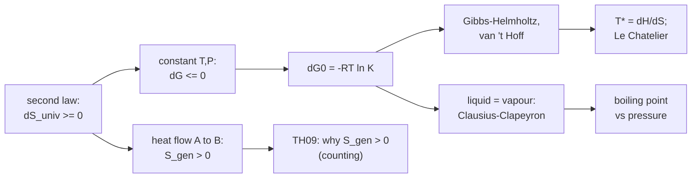

# TH08 · Gibbs Energy, Equilibrium Constants and Phase Boundaries

◀ [[TH07 Enthalpy Thermochemistry and Calorimetry]] · [[Thermodynamics and Statistical Mechanics - Course Map|Course Map]] · [[TH09 Microstates Macrostates and Multiplicity]] ▶

taught · in syllabus extra · book extra · beyond

> [!syllabus] Syllabus map: what is in the syllabus and what is extra in this chapter
> 🟢 **In syllabus (taught)**: the course's own tutorial sheets: [[TD2213_Tutorial1.pdf#page=1|Tutorial 1]] Q2 (the Gibbs–Helmholtz equation: $\Delta G^\circ/T$ at another temperature), Q3 (Clausius–Clapeyron: a new boiling point), Q4 (**entropy generation in heat transfer is positive**), and [[Thermodynamics_Tutorial_2_Questions.pdf#page=1|Tutorial 2]] Q2 (an equilibrium constant and $\Delta S^\circ$ give $\Delta H^\circ$). Solved in full in **Practice 1–4**.
> - §1 Gibbs energy and the entropy of the universe; §2 entropy generation (Tutorial 1 Q4); §3 $\Delta G^\circ=-RT\ln K$ (Tutorial 2 Q2); §4 Gibbs–Helmholtz and van 't Hoff (Tutorial 1 Q2); §5 Clausius–Clapeyron (Tutorial 1 Q3)
>
> 🟡 **Extra · book**: Schroeder §5.1 (free energy as available work), §5.3 (phase transformations of pure substances, Clausius–Clapeyron), §5.6 (chemical equilibrium) and Problem 5.85 (van 't Hoff's equation); the data table, pp. 404–405.
>
> 🔵 **Extra · beyond** (my additions, labelled)
> - §2 the finite-bodies proof (Jensen) and numbers; §4 the effect of $\Delta C_p$ (water-gas: $T^*=981$ K becomes $931$ K; NH$_3$: $K(773\ \mathrm K)=6.9\times10^{-5}$ becomes $5.5\times10^{-5}$); §3.3 the biochemical standard state; §5 Trouton's rule, boiling on Everest; §6 entropy production of a reaction; Practice 5–13; all numbers (`scripts/th_tutorial_numbers.py`, `fig_th08.py`)

> [!key] After this chapter you can
> - show that at constant $T$ and $P$ the criterion of spontaneity is $\Delta G=\Delta H-T\Delta S<0$ and that $\Delta S_{\rm universe}=-\Delta G/T$,
> - **prove** that heat flowing from a body at $T_A$ to a body at $T_B$ generates entropy $\delta Q(1/T_B-1/T_A)>0$, for reservoirs and for finite bodies,
> - derive $\Delta G^\circ=-RT\ln K$ and $\Delta G=\Delta G^\circ+RT\ln Q$, and use them with $\Delta H^\circ$ and $\Delta S^\circ$,
> - derive the **Gibbs–Helmholtz equation** $\partial(G/T)/\partial T=-H/T^2$ and the **van 't Hoff equation** $\mathrm d\ln K/\mathrm dT=\Delta H^\circ/RT^2$, and integrate them for constant $\Delta H$ (and say when that fails),
> - integrate the **Clausius–Clapeyron** equation to get a boiling point at another pressure and recognise it as the van 't Hoff equation for $\mathrm{liquid}\rightleftharpoons\mathrm{vapour}$,
> - state **Trouton's rule** and the temperature $T^*=\Delta H/\Delta S$ at which $\Delta G$ changes sign.

> [!intuition] The one-sentence story
> Spontaneity is the second law with the surroundings accounted for: at fixed $T$ and $P$ the universe's entropy increases by $-\Delta G/T$, so the equilibrium constant is $e^{-\Delta G^\circ/RT}$, its temperature dependence is set by $\Delta H^\circ$, and the same equation, with "reaction" replaced by "boiling", moves the boiling point with pressure.

<!-- intuition-v1 -->

*Concept map: every box is a section; the arrow to TH09 is the microscopic reason for the inequality.*

![[fig_th08_gibbs_equilibrium.png]]
*Figure TH8.1. A: $\Delta_rG^\circ(T)$ of C + H$_2$O(g) → CO + H$_2$ with constant $\Delta H^\circ,\Delta S^\circ$ (981 K) and with $\Delta C_p=+15.85$ J K$^{-1}$ (931 K). B: van 't Hoff plot of N$_2$ + 3H$_2$ → 2NH$_3$ (constant $\Delta H^\circ$, solid; with $\Delta C_p$, dashed). C: vapour-pressure curves; the Tutorial 1 Q3 liquid (+25% pressure raises $T_b$ by 5.88 K) and water (Everest: 71.1 °C). D: $G(\xi)$ for A ⇌ B at three values of $K$: the minimum is the equilibrium, its slope is $\Delta G$.*

## 1. Gibbs energy: the second law with the surroundings included

For a system in contact with a reservoir at $T$ and at constant pressure $P$, doing only $PV$ work, the Clausius inequality (TH04 §5) states $\delta Q\le T\,\mathrm dS$ for the system. At constant $P$, $\delta Q=\mathrm dH$ (TH07 §1). Hence $\mathrm dH-T\mathrm dS\le0$, i.e.
$$\mathrm dG\le0\ \ \text{at constant }T,P,\qquad G\equiv H-TS,\qquad\Delta G=\Delta H-T\Delta S.$$
The system's $G$ can only decrease; equilibrium is the minimum of $G$ ([[Gibbs Free Energy]]; TH05 §1). The same statement in terms of *universe* entropy: the reservoir receives $-\Delta H$ reversibly at $T$ and so changes by $-\Delta H/T$, hence
$$\boxed{\ \Delta S_{\rm universe}=\Delta S_{\rm sys}-\frac{\Delta H}{T}=-\frac{\Delta G}{T}\ \ge0\ }.$$
*So $\Delta G<0$ means the universe's entropy increases*: $-\Delta G/T$ is the **entropy generated** by the process ([[Entropy Production]]). A process with $\Delta H<0$ and $\Delta S<0$ is driven by the surroundings' gain at low $T$ and opposed at high $T$; one with $\Delta H>0$ and $\Delta S>0$ (vaporisation, the water-gas reaction) is driven by the system's own entropy gain at high $T$. The sign changes at **$T^*=\Delta H/\Delta S$** (if both are taken constant).

## 2. Entropy generation: heat flowing between two bodies

> [!example] Tutorial 1, Q4 (taught): "If body A is losing heat to body B, then entropy generation will always be positive. Prove."
> **Setting.** A and B exchange heat only with each other; the pair is isolated. A loses $\delta Q>0$ to B while at temperatures $T_A$, $T_B$.
> **Step 1: bookkeeping.** $\mathrm dS_A=-\delta Q/T_A$, $\mathrm dS_B=+\delta Q/T_B$, so the total entropy change, which is the *entropy generated* because no entropy flows in from outside, is
> $$\delta S_{\rm gen}=\delta Q\Big(\frac1{T_B}-\frac1{T_A}\Big)=\delta Q\,\frac{T_A-T_B}{T_AT_B}.$$
> **Step 2: the sign.** Heat flows spontaneously from the hotter to the colder body (the Clausius statement of the second law, TH04 §2; with the zeroth law, TH01 §2, this defines "hotter"): "A loses heat to B" means $T_A>T_B$, so $\delta S_{\rm gen}>0$, and it vanishes only when $T_A=T_B$ (no heat flows; the reversible limit as $T_A-T_B\to0$).
> **Step 3: finite bodies.** If A and B have constant heat capacities $C_A$, $C_B$ and are brought into contact, they reach $T_f=\dfrac{C_AT_A+C_BT_B}{C_A+C_B}$ (energy conservation) and
> $$S_{\rm gen}=C_A\ln\frac{T_f}{T_A}+C_B\ln\frac{T_f}{T_B}=(C_A+C_B)\Big[\ln\big(w_AT_A+w_BT_B\big)-w_A\ln T_A-w_B\ln T_B\Big],\quad w_i=\frac{C_i}{C_A+C_B}.$$
> Because $\ln$ is concave, **Jensen's inequality** $\ln(\sum w_iT_i)\ge\sum w_i\ln T_i$ gives $S_{\rm gen}\ge0$, with equality iff $T_A=T_B$. *Numbers (recomputed):* two bodies of $1000$ J K$^{-1}$ at $500$ K and $300$ K: $T_f=400$ K, $S_{\rm gen}=1000\ln\frac{400^2}{500\cdot300}=64.5$ J K$^{-1}$; with $C_B=3000$ J K$^{-1}$: $T_f=350$ K, $S_{\rm gen}=105.8$ J K$^{-1}$. Two reservoirs at $500$ K and $300$ K passing $1000$ J: $S_{\rm gen}=1000(1/300-1/500)=1.333$ J K$^{-1}$, and the work lost is $T_CS_{\rm gen}=400$ J (the Carnot work of TH04 §7).

> [!pitfall] What is being proved, logically
> The second law (heat does not flow from cold to hot by itself) is what fixes the **direction** $T_A>T_B$; the entropy statement follows by algebra. Conversely, $S_{\rm gen}\ge0$ *is* the Clausius statement rewritten: if heat flowed from the colder to the hotter body, $S_{\rm gen}$ would be negative. So the "proof" does not derive the second law, it shows that the entropy form and the heat-flow form say the same thing. The microscopic reason why the direction is overwhelmingly probable is counting (TH09 §4).

## 3. The equilibrium constant

### 3.1 From chemical potentials to $K$
For a reaction $\sum_i\nu_iA_i=0$ at constant $T$, $P$, the Gibbs energy changes with the extent of reaction $\xi$ as $\left(\partial G/\partial\xi\right)_{T,P}=\sum_i\nu_i\mu_i\equiv\Delta_rG$ (TH05 §2: $\mathrm dG=\sum_i\mu_i\mathrm dN_i$). For an ideal gas $\mu_i=\mu_i^\circ+RT\ln(P_i/P^\circ)$ (TH05 §3; SM05 §7), and similarly with activities for solutions, so
$$\Delta_rG=\Delta_rG^\circ+RT\ln Q,\qquad Q=\prod_i a_i^{\nu_i}\ (\text{reaction quotient}),\qquad\Delta_rG^\circ=\sum_i\nu_i\mu_i^\circ.$$
$\Delta_rG<0$: the reaction runs forward ($\xi$ increases); $>0$: backwards. At equilibrium $\Delta_rG=0$, $Q=K$:
$$\boxed{\ \Delta_rG^\circ=-RT\ln K,\qquad K=e^{-\Delta_rG^\circ/RT}\ },\qquad\Delta_rG=RT\ln\frac QK.$$
$K$ is dimensionless (pressures divided by $P^\circ=1$ bar, concentrations by $1$ mol L$^{-1}$ or mol kg$^{-1}$). Fig. TH8.1D shows $G(\xi)$ for $A\rightleftharpoons B$ ideal gases: $G/RT=\xi\ln\xi+(1-\xi)\ln(1-\xi)+\xi\Delta G^\circ/RT$ (the first two terms are the entropy of mixing), whose minimum is at $\xi_{\rm eq}=K/(1+K)=0.0909,\ 0.5,\ 0.909$ for $K=0.1,\ 1,\ 10$. A small $\Delta G^\circ$ moves $K$ by a lot: $\Delta G^\circ=-5.71$ kJ mol$^{-1}$ at 298.15 K is exactly $K=10$; $-50$ kJ mol$^{-1}$ is $K=5.7\times10^8$.

### 3.2 Using $\Delta H^\circ$, $\Delta S^\circ$ and $K$ together
Since $\Delta_rG^\circ=\Delta_rH^\circ-T\Delta_rS^\circ$ and $\Delta_rG^\circ=-RT\ln K$, any two of $\{K,\Delta H^\circ,\Delta S^\circ\}$ (at one temperature) give the third.

> [!example] Tutorial 2, Q2 (taught): the ATPase reaction
> $\mathrm{ATP^{4-}(aq)}+\mathrm H_2\mathrm O(\mathrm l)\rightleftharpoons\mathrm{ADP^{3-}(aq)}+\mathrm{HPO_4^{2-}(aq)}+\mathrm H^+(\mathrm{aq})$; $K=0.295$ at 298 K and $\Delta_rS^\circ=-45.0$ J K$^{-1}$mol$^{-1}$. Find $\Delta_rH^\circ$.
> $$\Delta_rG^\circ=-RT\ln K=-(8.314)(298)\ln0.295=+3.02\ \text{kJ mol}^{-1}\quad(\ln0.295=-1.2208),$$
> $$\Delta_rH^\circ=\Delta_rG^\circ+T\Delta_rS^\circ=3.02+(298)(-45.0\times10^{-3})=3.02-13.41=\boxed{-10.4\ \text{kJ mol}^{-1}}.$$
> *Reading it:* $K<1$ means $\Delta G^\circ>0$ at these (standard-state, $\mathrm H^+$ at unit activity) conditions, even though the reaction is **exothermic** ($-10.4$ kJ): the entropy of the system *falls* ($-45$ J K$^{-1}$), costing $T\Delta S=13.4$ kJ, more than the heat gives back. (A fall in $S$ when ions are produced is typical: charged products order the surrounding water; recalled.)

### 3.3 The biochemical standard state (a check that $K=0.295$ is sensible)
Biochemists quote $\Delta G^{\circ\prime}$ at pH 7, where $a_{\mathrm H^+}=10^{-7}$ instead of 1. Absorbing the $\mathrm H^+$ factor, $K'=K/a_{\mathrm H^+}=0.295/10^{-7}=2.95\times10^6$ and $\Delta G^{\circ\prime}=-RT\ln K'=-2.479\times14.90=-36.9$ kJ mol$^{-1}$ (recomputed; the commonly quoted $-30$ to $-37$ kJ mol$^{-1}$ for ATP hydrolysis is recalled): at pH 7 the hydrolysis is strongly favoured, which is why ATP is a store of free energy. The *same* reaction has $\Delta G^\circ=+3.0$ kJ at pH 0 and $\Delta G^{\circ\prime}=-36.9$ kJ at pH 7; the difference is $RT\ln10^7=40.0$ kJ mol$^{-1}$: **the standard state is part of the question.**

## 4. Temperature dependence: Gibbs–Helmholtz and van 't Hoff

### 4.1 The Gibbs–Helmholtz equation
From $G=H-TS$ and $S=-(\partial G/\partial T)_P$ (TH05 §1):
$$\frac{\partial}{\partial T}\Big(\frac GT\Big)_P=\frac1T\frac{\partial G}{\partial T}-\frac G{T^2}=-\frac{S}{T}-\frac{G}{T^2}=-\frac{TS+G}{T^2}=\boxed{-\frac H{T^2}}.$$
For a reaction, $\mathrm d(\Delta_rG/T)/\mathrm dT=-\Delta_rH/T^2$, or, with $\mathrm d(1/T)=-\mathrm dT/T^2$, $\ \mathrm d(\Delta_rG/T)=\Delta_rH\,\mathrm d(1/T)$. If $\Delta_rH$ is constant between $T_1$ and $T_2$,
$$\frac{\Delta_rG(T_2)}{T_2}=\frac{\Delta_rG(T_1)}{T_1}+\Delta_rH\Big(\frac1{T_2}-\frac1{T_1}\Big).$$

> [!example] Tutorial 1, Q2 (taught)
> $\Delta G^\circ(25\ ^\circ\mathrm C)=-50$ kJ mol$^{-1}$, $\Delta H^\circ=-80$ kJ mol$^{-1}$ (constant). $T_1=298.15$ K, $T_2=773.15$ K (500 °C).
> $$\frac{\Delta G^\circ}{T}\Big|_{773}=\frac{-50\,000}{298.15}+(-80\,000)\Big(\frac1{773.15}-\frac1{298.15}\Big)=-167.70+164.85=\boxed{-2.85\ \text{J K}^{-1}\text{mol}^{-1}}.$$
> So $\Delta G^\circ(773\ \mathrm K)=-2.85\times773.15=-2.2$ kJ mol$^{-1}$ (with $298$ K and $773$ K as the temperatures the answer is $-2.82$ J K$^{-1}$mol$^{-1}$, $-2.18$ kJ mol$^{-1}$: three significant figures depend on the $273.15$ convention). *Check:* constant $\Delta H$ and $\Delta G$ at 298 K give $\Delta S^\circ=(\Delta H-\Delta G)/T=-100.6$ J K$^{-1}$mol$^{-1}$, and $\Delta G(773)=-80\,000+773.15\times100.6=-2.2$ kJ: the same, as it must be (Gibbs–Helmholtz with constant $\Delta H$ *is* $\Delta G=\Delta H-T\Delta S$ with constant $\Delta S$). *Chemistry:* the equilibrium constant falls from $K=5.7\times10^8$ at 25 °C to $K=1.41$ at 500 °C: a strongly exothermic reaction loses its driving force on heating.

### 4.2 The van 't Hoff equation
Put $\Delta_rG^\circ=-RT\ln K$ into Gibbs–Helmholtz:
$$\boxed{\ \frac{\mathrm d\ln K}{\mathrm dT}=\frac{\Delta_rH^\circ}{RT^2}\ },\qquad\ln\frac{K_2}{K_1}=-\frac{\Delta_rH^\circ}{R}\Big(\frac1{T_2}-\frac1{T_1}\Big)\ \ (\text{constant }\Delta H^\circ).$$
A plot of $\ln K$ against $1/T$ is a line of slope $-\Delta_rH^\circ/R$ and intercept $\Delta_rS^\circ/R$ (Fig. TH8.1B): the way $\Delta H^\circ$ and $\Delta S^\circ$ are measured. **Le Chatelier:** $\Delta H^\circ>0$ (endothermic): $K$ rises with $T$; $\Delta H^\circ<0$: $K$ falls.

> [!example] Ammonia synthesis (recomputed; Schroeder §5.6 and Problem 5.86)
> $\mathrm N_2+3\mathrm H_2\to2\mathrm{NH}_3$: $\Delta_rH^\circ=-92.22$ kJ, $\Delta_rG^\circ=-32.90$ kJ (298 K), so $K(298)=e^{13.27}=5.8\times10^5$ and $\Delta_rS^\circ=-198.96$ J K$^{-1}$. With constant $\Delta H^\circ$: $K(500\ \mathrm K)=0.174$ and $K(773\ \mathrm K)=6.9\times10^{-5}$, the value Schroeder quotes for 500 °C (p. 213). Including $\Delta_rC_p=2(35.06)-29.12-3(28.82)=-5.48$ J K$^{-1}$ lowers the 773 K value to $5.5\times10^{-5}$ (a $20\%$ change); the straight line of Fig. TH8.1B bends slightly. The industrial consequence: favourable thermodynamics at low $T$ (but slow kinetics), hence the compromise of high pressure and a catalyst.

> [!extra-beyond]- 🔵 Extra (beyond): $T^*$ and the role of $\Delta C_p$
> For C(graphite) + H$_2$O(g) → CO + H$_2$: $\Delta_rH^\circ=+131.29$ kJ, $\Delta_rS^\circ=+133.78$ J K$^{-1}$ (data of Schroeder's table; $\Delta_rG^\circ(298)=91.40$ kJ, in agreement with $\Delta_fG^\circ$: $-137.17+228.57=91.40$). With constant $\Delta H,\Delta S$ the sign of $\Delta_rG^\circ$ changes at $T^*=\Delta H/\Delta S=981$ K (Fig. TH8.1A); with $\Delta C_p=+15.85$ J K$^{-1}$ inserted into $\Delta H(T)=\Delta H_{298}+\Delta C_p(T-298.15)$ and $\Delta S(T)=\Delta S_{298}+\Delta C_p\ln(T/298.15)$, $T^*=931$ K ($-5\%$). $K$: $9.7\times10^{-17}$ (298 K), $3.6\times10^{-5}$ (600 K, constant) against $5.3\times10^{-5}$ (corrected), $1.35$ against $3.56$ (1000 K), $18.8$ against $63.6$ (1200 K). *Constant $\Delta H$ is a good approximation when $|\Delta C_p|(T_2-T_1)\ll|\Delta H|$ and a poor one over several hundred kelvin.*

## 5. Phase boundaries: Clausius–Clapeyron as a van 't Hoff equation

On the coexistence curve of a liquid and its vapour $\mu_l(T,P)=\mu_g(T,P)$ (TH05 §2), which gives the **Clapeyron equation** $\mathrm dP/\mathrm dT=\Delta_{\rm vap}H/(T\,\Delta_{\rm vap}V)$ (TH05, extra-beyond box, with $L=T\Delta s$ per unit mass). Neglect the liquid volume and treat the vapour as an ideal gas, $\Delta V\simeq RT/P$ per mole:
$$\frac{\mathrm d\ln P}{\mathrm dT}=\frac{\Delta_{\rm vap}H}{RT^2},\qquad\ln\frac{P_2}{P_1}=-\frac{\Delta_{\rm vap}H}{R}\Big(\frac1{T_2}-\frac1{T_1}\Big)\ \ (\text{constant }\Delta_{\rm vap}H).$$
This is **exactly the van 't Hoff equation** for the "reaction" $\mathrm{A(l)}\rightleftharpoons\mathrm{A(g)}$ with $K=P/P^\circ$ (the liquid has unit activity): boiling is a chemical equilibrium, and the boiling point at pressure $P$ is the temperature at which $K=P/P^\circ$, i.e. $\Delta G^\circ=-RT\ln(P/P^\circ)$.

> [!example] Tutorial 1, Q3 (taught): a new boiling point
> Normal boiling point $T_1=80\ ^\circ\mathrm C=353.15$ K at $P_1=1$ atm; $\Delta_{\rm vap}H=40$ kJ mol$^{-1}$ (constant); ideal vapour; the pressure rises by $25\%$: $P_2/P_1=1.25$. Then
> $$\frac1{T_2}=\frac1{T_1}-\frac R{\Delta_{\rm vap}H}\ln\frac{P_2}{P_1}=\frac1{353.15}-\frac{8.314}{40\,000}(0.22314)=0.0028316-4.638\times10^{-5}=0.0027852\ \mathrm K^{-1},$$
> $$T_2=359.03\ \text{K}=\boxed{85.9\ ^\circ\text{C}}\qquad(\text{a rise of }5.88\ \text{K}).$$
> *Check by linearising:* $\Delta T\simeq RT_1^2\ln(P_2/P_1)/\Delta H=25.9\ \mathrm K\times0.2231=5.79$ K ($1.5\%$ low, since $T$ also changes).
> *Meaning:* the boiling point rises with pressure (pressure cooker). **Trouton's rule:** $\Delta_{\rm vap}S=\Delta_{\rm vap}H/T_b=40\,000/353.15=113.3$ J K$^{-1}$mol$^{-1}$ ($\approx13.6R$), against the $85$–$88$ J K$^{-1}$mol$^{-1}$ of simple liquids (recalled) and $109.0$ for water ($40.66$ kJ mol$^{-1}$ at 373.15 K): a liquid above the Trouton value is more ordered than a simple liquid at its boiling point (hydrogen bonding, association), so more entropy is gained on vaporising.

> [!example] Water at altitude (recomputed; pressures recalled)
> With $\Delta_{\rm vap}H=40.66$ kJ mol$^{-1}$ and $T_1=373.15$ K at 101.325 kPa: at **3000 m** ($P\approx70$ kPa) water boils at **89.8 °C**; on the **summit of Everest** ($P\approx33.7$ kPa) at **71.1 °C**: tea made at the summit is made with water 29 K cooler than at sea level.

> [!pitfall] Constant $\Delta H$ again
> $\Delta_{\rm vap}H$ falls with $T$ (water: $44.01$ kJ mol$^{-1}$ at 298 K from the table, $40.66$ at 373 K; Kirchhoff with $\Delta C_p=C_p(\mathrm g)-C_p(\mathrm l)<0$, TH07 §4). The constant-$L$ formula is good over tens of kelvin, not hundreds.

## 6. The entropy production of a reaction

At fixed $T$, $P$ the universe's entropy rises by $-\Delta_rG/T$ per mole of reaction (§1). The water-gas reaction at 1000 K, with the corrected $\Delta_rG=-10.55$ kJ, generates $10.55$ J K$^{-1}$ per mole of forward reaction, and $\Delta S_{\rm sys}-\Delta H/T$ is the same number: $\Delta S(1000\ \mathrm K)=133.78+15.85\ln(1000/298.15)=152.96$ J K$^{-1}$, $\Delta H(1000)/T=142.41$ J K$^{-1}$, difference $10.55$ J K$^{-1}$. At 800 K, $\Delta_rG>0$: the reaction runs *backwards* (CO + H$_2$ → C + H$_2$O), and the entropy generated per mole of reverse reaction is $24.6$ J K$^{-1}$. The **maximum non-$PV$ work** obtainable from a reaction at fixed $T,P$ is $-\Delta G$ (fuel cells, Schroeder §5.1): the part of $-\Delta H$ not so extracted is $T\,S_{\rm gen}$ plus $T\Delta S$, the "lost work" of TH04 §7. The microscopic origin of all these inequalities is the subject of TH09.

<!-- interactive:start (generated by scripts/embed_interactive.py; edit the tool in scripts/interactive/tools/, not this block) -->
> [!interactive]+ Interactive: van der Waals isotherms and the Maxwell construction
> The van der Waals equation (P + a/V²)(V − b) = RT for CO₂.
>
> ![[th_vdw_maxwell.png|720]]
>
> **Try:** T = 300 K: the unstable region is 112.7 < V < 147.1 cm³/mol (TH05). T = 304 K: the loop has closed to the critical point V_c = 128 cm³/mol. Below ~290 K watch the equal-area tie line drop to lower pressures; the two shaded lobes have equal area.
>
> [▶ Open the tool in your browser](../Assets/interactive/th_vdw_maxwell.html) · [absolute link](file:///home/swastik/Documents/notes/Assets/interactive/th_vdw_maxwell.html) · all tools and coverage: [[Interactive Tools]]

<!-- interactive:end -->

## Map of this chapter
> [!connection] How TH08 connects
> **Builds on:** [[TH04 The Second Law Carnot Engines and Entropy]] (Clausius inequality, lost work), [[TH05 Potentials Maxwell Relations Stability and the Third Law]] ($G$, $\mu$, Clausius–Clapeyron), [[TH07 Enthalpy Thermochemistry and Calorimetry]] ($\Delta H$, Kirchhoff, standard data).
> **Leads to:** [[TH09 Microstates Macrostates and Multiplicity]] (why $S_{\rm gen}\ge0$: counting), [[SM05 The Grand Canonical Ensemble and Chemical Equilibrium]] ($K$ from partition functions, the Saha equation) and [[SM06 Entropy Information and the Arrow of Time]] (availability, Landauer).
> **Concepts:** [[Gibbs Free Energy]] · [[Gibbs-Helmholtz Equation]] · [[Equilibrium Constant]] · [[Van 't Hoff Equation]] · [[Entropy Production]] · [[Trouton's Rule]] · [[Clausius-Clapeyron Relation]] · [[Law of Mass Action]] · [[Chemical Potential]] · [[Second Law of Thermodynamics]]
> **Other subjects:** [[Climate - Course Map|Climate]] (Clausius–Clapeyron and the saturation vapour pressure of the atmosphere: [[CL05 Thermodynamic State of the Atmosphere]]); [[Inorganic Chemistry - Course Map|Inorganic Chemistry]] (redox potentials: $\Delta G=-nFE$, the same Gibbs energy).

## Summary
> [!summary] Cheat-sheet
> - **Gibbs:** $G=H-TS$; constant $T,P$: $\mathrm dG\le0$, $\Delta S_{\rm univ}=-\Delta G/T$; $T^*=\Delta H/\Delta S$.
> - **Entropy generation (Tutorial 1 Q4):** $\delta S_{\rm gen}=\delta Q(1/T_B-1/T_A)>0$ for $T_A>T_B$; finite bodies: $S_{\rm gen}=C_A\ln(T_f/T_A)+C_B\ln(T_f/T_B)\ge0$ (Jensen). $1000$ J, 500 K → 300 K: $1.333$ J K$^{-1}$.
> - **Equilibrium:** $\Delta G=\Delta G^\circ+RT\ln Q$; $\Delta G^\circ=-RT\ln K$; ATPase: $\Delta G^\circ=+3.02$ kJ, $\Delta H^\circ=-10.4$ kJ mol$^{-1}$; $\Delta G^{\circ\prime}(\mathrm{pH}\ 7)=-36.9$ kJ mol$^{-1}$.
> - **Gibbs–Helmholtz:** $\partial(G/T)/\partial T=-H/T^2$; Tutorial 1 Q2: $\Delta G^\circ/T=-2.85$ J K$^{-1}$mol$^{-1}$ at 773 K ($\Delta G=-2.2$ kJ).
> - **van 't Hoff:** $\mathrm d\ln K/\mathrm dT=\Delta H^\circ/RT^2$; slope $-\Delta H^\circ/R$ of $\ln K$ vs $1/T$. NH$_3$: $5.8\times10^5\to6.9\times10^{-5}$ (298 → 773 K).
> - **Clausius–Clapeyron:** $\ln(P_2/P_1)=-(\Delta_{\rm vap}H/R)(1/T_2-1/T_1)$; Tutorial 1 Q3: $T_b=85.9$ °C ($+5.88$ K); water on Everest $71.1$ °C; Trouton $\Delta S_{\rm vap}\approx85$–$88$ J K$^{-1}$mol$^{-1}$.

## Practice
1. **[Tutorial 1, Q2]** For a reaction, $\Delta G^\circ(25\ ^\circ\mathrm C)=-50$ kJ mol$^{-1}$ and $\Delta H^\circ=-80$ kJ mol$^{-1}$ (constant). Find $\Delta G^\circ/T$ at 500 °C. Also find $\Delta G^\circ$ and $K$ there.
2. **[Tutorial 1, Q3]** A liquid has $T_b=80\ ^\circ$C at 1 atm and $\Delta_{\rm vap}H=40$ kJ mol$^{-1}$ (constant). Find the new boiling point if the pressure increases by $25\%$ (ideal vapour; $R=8.314$ J mol$^{-1}$K$^{-1}$).
3. **[Tutorial 1, Q4]** Prove that when body A loses heat to body B the entropy generation is positive. Do it for two reservoirs and for two finite bodies of heat capacities $C_A$, $C_B$.
4. **[Tutorial 2, Q2]** For ATP$^{4-}$ + H$_2$O ⇌ ADP$^{3-}$ + HPO$_4^{2-}$ + H$^+$, $K=0.295$ at 298 K and $\Delta_rS^\circ=-45.0$ J K$^{-1}$mol$^{-1}$. Find $\Delta_rH^\circ$.
5. **$K$ from $\Delta G^\circ$.** Find $K$ at 298.15 K for $\Delta G^\circ=-50$ kJ mol$^{-1}$ and the value of $\Delta G^\circ$ that gives $K=10$. What is $\Delta G$ at 298.15 K if $Q=0.1K$ and $Q=10K$?
6. **van 't Hoff.** For N$_2$ + 3H$_2$ → 2NH$_3$, $\Delta_rH^\circ=-92.22$ kJ, $\Delta_rG^\circ(298)=-32.90$ kJ. Estimate $K$ at 500 °C with constant $\Delta H^\circ$ and with $\Delta C_p=-5.48$ J K$^{-1}$.
7. **Water-gas.** Using $\Delta H=+131.29$ kJ, $\Delta S=+133.78$ J K$^{-1}$ and $\Delta C_p=+15.85$ J K$^{-1}$, find the temperature at which $\Delta_rG^\circ$ changes sign with and without $\Delta C_p$, and $K(1000\ \mathrm K)$ for both.
8. **Altitude.** At what temperature does water boil at 70 kPa and at 33.7 kPa? ($\Delta_{\rm vap}H=40.66$ kJ mol$^{-1}$.)
9. **Trouton.** Compute $\Delta_{\rm vap}S$ for the Q3 liquid and for water, and the change of $\Delta_{\rm vap}G$ with $T$.
10. **Biochemical standard state.** Compute $K'$ and $\Delta G^{\circ\prime}$ at pH 7 from $K=0.295$; what does the difference from Q4 show?
11. **Extent.** For $A\rightleftharpoons B$ (ideal gases) find the equilibrium extent for $K=0.1,\ 1,\ 10$, and say what the slope of $G(\xi)$ is at $\xi=0.1$ when $K=1$.
12. **Why $T^*$?** For vaporisation of the Q3 liquid at 1 atm find the temperature at which $\Delta_{\rm vap}G^\circ=0$ with $\Delta H=40$ kJ and $\Delta S=113.3$ J K$^{-1}$; why is this the boiling point?
13. **Entropy production.** For the water-gas reaction at 1000 K with the corrected $\Delta_rG=-10.55$ kJ, find the entropy generated per mole of forward reaction, and the same at 800 K.

> [!example]- Solutions
> 1. $\dfrac{\Delta G}{T}\Big|_{773.15}=\dfrac{-50\,000}{298.15}+(-80\,000)\Big(\dfrac1{773.15}-\dfrac1{298.15}\Big)=-167.70+164.85=-2.85$ J K$^{-1}$mol$^{-1}$; $\Delta G^\circ=-2.85\times773.15=-2.2$ kJ mol$^{-1}$; $K=e^{2205/(8.314\times773.15)}=e^{0.343}=1.41$ (against $5.7\times10^8$ at 25 °C).
> 2. $\ln1.25=0.22314$; $1/T_2=0.0028316-(8.314/40\,000)(0.22314)=0.0027852$; $T_2=359.03$ K $=85.9$ °C ($\Delta T=5.88$ K).
> 3. Reservoirs: $S_{\rm gen}=Q/T_B-Q/T_A=Q(T_A-T_B)/(T_AT_B)>0$ since $T_A>T_B$. Finite bodies: $T_f=(C_AT_A+C_BT_B)/(C_A+C_B)$, $S_{\rm gen}=C_A\ln(T_f/T_A)+C_B\ln(T_f/T_B)\ge0$ by concavity of $\ln$ (Jensen with weights $C_i/(C_A+C_B)$); equality iff $T_A=T_B$. (Equivalent: $\int\delta Q(1/T_B-1/T_A)\ge0$ because the integrand is non-negative at every instant.) For $1000$ J K$^{-1}$ each, 500 and 300 K: $T_f=400$ K, $S_{\rm gen}=64.5$ J K$^{-1}$.
> 4. $\Delta G^\circ=-RT\ln K=+3.02$ kJ mol$^{-1}$; $\Delta H^\circ=3.02+298(-45.0\times10^{-3})=-10.4$ kJ mol$^{-1}$.
> 5. $K=e^{50\,000/(8.314\times298.15)}=e^{20.17}=5.7\times10^8$. $K=10$: $\Delta G^\circ=-RT\ln10=-5.71$ kJ mol$^{-1}$. $\Delta G=RT\ln(Q/K)$: $Q=0.1K$: $-5.71$ kJ mol$^{-1}$ (forward); $Q=10K$: $+5.71$ (backward).
> 6. Constant $\Delta H$: $\ln K_1=32\,900/(8.314\times298.15)=13.272$; $\ln K_2=\ln K_1-\dfrac{\Delta H}R\Big(\dfrac1{T_2}-\dfrac1{T_1}\Big)=13.272-\dfrac{-92\,220}{8.314}(0.0012934-0.0033540)=13.272-22.856=-9.584$, so $K(773\ \mathrm K)=6.9\times10^{-5}$ (and $0.174$ at 500 K). With $\Delta C_p=-5.48$: $\Delta H(773)=-92.22-0.00548\times475=-94.82$ kJ, $\Delta S(773)=-198.96-5.48\ln(773.15/298.15)=-204.17$ J K$^{-1}$, $\Delta G=-94.82+773.15\times0.20417=+63.04$ kJ, $K=e^{-63\,040/(8.314\times773.15)}=5.5\times10^{-5}$.
> 7. Constant: $T^*=131\,290/133.78=981$ K; $K(1000)=e^{2490/(8.314\times1000)}=1.35$. Corrected: $\Delta H(T)=131.29+0.01585(T-298.15)$ kJ, $\Delta S(T)=133.78+15.85\ln(T/298.15)$ J K$^{-1}$; root of $\Delta G(T)=0$ at $T^*=931$ K; $\Delta G(1000)=-10.55$ kJ, $K=e^{10\,547/8314}=3.56$.
> 8. $1/T_2=1/373.15-(8.314/40\,660)\ln(P/101.325)$: $70$ kPa: $\ln(0.6908)=-0.3699$, $1/T_2=0.0026799+7.564\times10^{-5}=0.0027555$, $T_2=362.9$ K $=89.8$ °C; $33.7$ kPa: $\ln0.3326=-1.1009$, $1/T_2=0.0026799+2.251\times10^{-4}=0.0029050$, $T_2=344.2$ K $=71.1$ °C.
> 9. $\Delta_{\rm vap}S=40\,000/353.15=113.3$ J K$^{-1}$mol$^{-1}$ ($13.6R$); water: $40\,660/373.15=109.0$. $\Delta_{\rm vap}G^\circ(T)=\Delta H-T\Delta S$: slope $-\Delta S$; it is zero at $T_b$ ($P=P^\circ$), negative above (vapour favoured), positive below.
> 10. $K'=0.295/10^{-7}=2.95\times10^6$; $\Delta G^{\circ\prime}=-RT\ln K'=-36.9$ kJ mol$^{-1}$ (against $+3.0$ at pH 0): the standard state of $\mathrm H^+$ changes $\Delta G^\circ$ by $RT\ln10^7=40.0$ kJ mol$^{-1}$.
> 11. $K/(1+K)$: $0.0909,\ 0.5,\ 0.909$. With $K=1$, $\Delta G^\circ=0$ and $\partial(G/RT)/\partial\xi=\ln[\xi/(1-\xi)]$, at $\xi=0.1$: $\ln(1/9)=-2.197$, so the slope is $-2.197RT=-5.45$ kJ mol$^{-1}$ at 298.15 K (the reaction runs forward).
> 12. $T^*=40\,000/113.3=353.1$ K $=80$ °C. At $T^*$, $\Delta G^\circ=0$ means $K=1$, i.e. $P=P^\circ$: the vapour pressure is 1 atm, which is the definition of the normal boiling point (here $\Delta S$ was itself computed as $\Delta H/T_b$, so $T^*=T_b$ by construction; the content is that $T_b$ follows from $\Delta H$ and $\Delta S$ alone).
> 13. $S_{\rm gen}=-\Delta G/T=10.55$ kJ$/1000$ K$=10.55$ J K$^{-1}$ per mole at 1000 K; at 800 K, $\Delta G=+19.70$ kJ for the forward reaction, so the *reverse* reaction generates $19.70/800=24.6$ J K$^{-1}$ per mole.

## Provenance
> [!provenance]- Source map for this chapter
> | Topic | Source | Scope |
> |---|---|---|
> | Gibbs–Helmholtz, $\Delta G^\circ/T$ at 500 °C (Q2); boiling point at $+25\%$ pressure (Q3); entropy generation of heat flow (Q4) | [[TD2213_Tutorial1.pdf#page=1\|Tutorial 1]] (questions only; solutions mine) | taught |
> | $K$ and $\Delta S^\circ$ to $\Delta H^\circ$ (ATPase, Q2) | [[Thermodynamics_Tutorial_2_Questions.pdf#page=1\|Tutorial 2, Q2]] (question only; solution mine) | taught |
> | free energy as available work, phase transformations, Clausius–Clapeyron, chemical equilibrium, van 't Hoff (Problem 5.85–5.86) | Schroeder §5.1 (p. 149), §5.3 (p. 166), §5.6 (p. 208), p. 213–214 (djvu page = printed + 10) | extra/book |
> | data for the water-gas and NH$_3$ examples | Schroeder, *Thermodynamic Properties of Selected Substances*, pp. 404–405 | extra/book |
> | $\partial(G/T)/\partial T$ derivation, Jensen proof of $S_{\rm gen}\ge0$, effect of $\Delta C_p$, $T^*$, entropy production per mole, altitude boiling, biochemical $K'$ | `scripts/th_tutorial_numbers.py`, `fig_th08.py` | extra/beyond |
>
> **Flags.** (1) $\Delta_{\rm vap}H(\text{water})=40.66$ kJ mol$^{-1}$, the pressures $70$ and $33.7$ kPa, the Trouton range $85$–$88$ J K$^{-1}$mol$^{-1}$, the ATP pH 7 convention and the quoted $-30$ to $-37$ kJ mol$^{-1}$ are recalled. (2) Tutorial 1 Q3 does not say whether "1 atm" or "1 bar"; the ratio $1.25$ is what enters. (3) Tutorial 1 Q2: temperature conventions ($273.15$, $298.15$) change the third significant figure. (4) The sign of $\Delta_rS^\circ<0$ for ATP hydrolysis and its ion-ordering explanation are not derived here. (5) The course's actual syllabus is still not stated; the tutorials show that this material is examined.

**References.** Schroeder, D. V. *An Introduction to Thermal Physics* (2000), Ch. 5 and data tables · Atkins, P. W. *Physical Chemistry* · Zemansky, M. W. and Dittman, R. H. *Heat and Thermodynamics* · van 't Hoff, J. H. (1884) · Gibbs, J. W. (1876) · Clausius, R. (1850).

## Across subjects
- [[CL05 Thermodynamic State of the Atmosphere]] (Climate): the Clausius–Clapeyron equation sets the saturation vapour pressure, $\approx6.3\%$ per K, the feedback that amplifies warming.
- [[Inorganic Chemistry - Course Map|Inorganic Chemistry]] (redox, Ch. 5 of Shriver and Atkins): $\Delta G^\circ=-nFE^\circ$ and $E^\circ=(RT/nF)\ln K$ are the same Gibbs energy expressed electrically.
