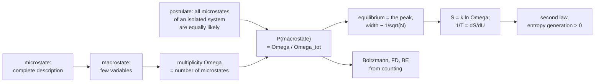

# TH09 · Microstates, Macrostates and Multiplicity

◀ [[TH08 Gibbs Energy Equilibrium Constants and Phase Boundaries]] · [[Thermodynamics and Statistical Mechanics - Course Map|Course Map]] · Part II begins: [[SM01 Probability Large Numbers and Information]] ▶

extra · book extra · beyond taught · in syllabus (only the pointers)

> [!syllabus] Syllabus map: what is in the syllabus and what is extra in this chapter
> 🟢 **In syllabus (taught)**: only the **pointers**. MIT 8.333 Lecture 4 ends by saying that statistical mechanics must justify the laws, with $S=k_B\ln g$ and $g=1$ at $T=0$ ([[97dcd8dee3d3301cd7c27745b17b10b5_MIT8_333F13_Lec4.pdf#page=5|L4 §I.J, p.5]]); and [[TD2213_Tutorial1.pdf#page=1|Tutorial 1, Q4]] ("if body A is losing heat to body B, entropy generation will always be positive") is the thermodynamic statement whose *microscopic reason* is §4 here.
>
> 🟡 **Extra · book** (requested by the user on 2026-11-04: "elaborate more microstate/macrostate and related stuff"):
> - Koks, *Microstates, Entropy and Quanta* (2018): §1.1–1.4 (counting, the binomial and its Gaussian limit), §2.1–2.5 (states, microstates, phase-space cells, the **fundamental postulate**), §3.5 and §3.8 (temperature and entropy from counting), §5.1 (the Boltzmann distribution), §7.9 (particle statistics from counting configurations)
> - Schroeder, *An Introduction to Thermal Physics*: Ch. 2 (two-state systems, the Einstein solid, interacting systems, large systems, the ideal gas, entropy) and §3.1–3.2 (temperature, entropy and heat)
> - Reif, *Fundamentals of Statistical and Thermal Physics*: §2.1–2.4 (state, ensemble, **basic postulates**, probability calculations), §2.5, §3.3–3.4; Blundell and Blundell, *Concepts in Thermal Physics*, §4.3 (microstates and macrostates)
>
> 🔵 **Extra · beyond** (my additions, labelled): the exact tables of §3–§4 and the numbers (`scripts/th09_numbers.py`), the **random-exchange simulation** of §5, the **exact enumeration** that shows the Boltzmann, Fermi–Dirac and Bose–Einstein laws emerging from equal weights of microstates (§6), and the figures (`fig_th09a.py`, `fig_th09b.py`).

> [!key] After this chapter you can
> - define **microstate**, **macrostate** and **multiplicity** $\Omega$, and say which one a given measurement specifies,
> - state the **fundamental postulate** (equal a priori probabilities) with its justification and its limits, and turn it into $P(\text{macrostate})=\Omega(\text{macrostate})/\Omega_{\rm total}$,
> - count the microstates of a **two-state system**, an **Einstein solid** and an **ideal gas** and quote the numbers (e.g. $\binom{100}{50}=1.01\times10^{29}$; $2^{-100}=10^{-30}$),
> - show that two systems in contact settle at the macrostate of maximum $\Omega_A\Omega_B$, that this peak has relative width $\sim1/\sqrt N$, and **derive** $1/T=\partial S/\partial U$ and the entropy generation $\delta Q(1/T_B-1/T_A)>0$ from counting,
> - derive the **Boltzmann distribution** by the method of the most probable distribution, and see it (and the Fermi–Dirac and Bose–Einstein laws) emerge from exact enumeration,
> - say what is and is not random in the "approach to equilibrium", and why a *microstate* of an unlikely macrostate is no less probable than one of a likely macrostate.

> [!intuition] The one-sentence story
> Give every microstate the same probability and the second law becomes bookkeeping: the equilibrium macrostate is simply the one with overwhelmingly the most microstates, temperature is the exchange rate between energy and $\ln\Omega$, and "irreversibility" is the statement that a system leaves a rare macrostate for a common one for the same reason that a shaken box of coins ends with about half heads.

<!-- intuition-v1 -->

*Concept map: every box is a section (§1 microstates … §6 distributions).*

![[fig_th09a_macrostates.png]]
*Figure TH9.1. A: probability of the macrostate "fraction $f$ of heads" for $N=10,\ 10^2,\ 10^3,\ 10^4$ (each curve divided by its maximum). B: two Einstein solids ($N_A=300$, $N_B=200$, $q=100$ quanta): the probability of $q_A$ quanta in A (bars: exact; line: Gaussian of width $5.36$). C: $S_{\rm tot}/k_B=\ln\Omega_A\Omega_B$ against $q_A$. D: probability that a gas is within 1% or 5% of half-and-half against $N$ (lines: Gaussian limit $\operatorname{erf}(\delta\sqrt{2N})$; dots: exact binomial; the lines overshoot the dots at small $N$ because the window contains only a few integers).*

![[fig_th09b_dynamics.png]]
*Figure TH9.2. A: a simulation of the postulate in motion: $q_A(t)$ and $S_{\rm tot}/k_B$ for solids A (300 oscillators) and B (200) exchanging $q=100$ quanta at random, all quanta starting in A. B: histogram of $q_A$ after relaxation against the exact multiplicity. C: occupation of a single oscillator: simulation, exact counting and the Boltzmann (geometric) law. D: the fraction of particles in each level, averaged over *all* microstates with equal weight ($N=10,\ 30,\ 120$), against the Boltzmann distribution.*

## 1. Microstates and macrostates

### 1.1 Definitions
A **microstate** is a complete specification of the system at the finest level the physics allows: in quantum mechanics a single energy eigenstate $|i\rangle$ (all occupation numbers or quantum numbers given); in classical mechanics a point $(\mathbf q,\mathbf p)$ of phase space, or, once a cell size $h^{3N}$ is fixed, one cell of it ([[Phase Space]]). A **macrostate** is a specification by a few **macroscopic variables** (energy, volume, number of particles, the magnetisation, the number of heads, how many molecules lie in the left half…) and contains every microstate consistent with those values ([[Microstate]], [[Macrostate]]). The **multiplicity** $\Omega(M)$ of a macrostate $M$ is the number of microstates in it ([[Multiplicity]]). The word "state" alone, as Koks notes (§2.1, p. 83), means whichever of the two the context implies.

> [!example] Examples (recomputed)
> | system | microstate | macrostate | numbers |
> |---|---|---|---|
> | two dice | the ordered pair $(a,b)$ | the sum | $36$ microstates, $11$ macrostates; $\Omega(7)=6$, $\Omega(2)=\Omega(12)=1$ |
> | 4 coins | $\mathrm{hhth},\ldots$ | number of heads $k$ | $\Omega(k)=1,4,6,4,1$; 16 microstates, 5 macrostates |
> | 100 coins (Blundell Ex. 4.1) | which coins are heads | number of heads | $2^{100}=1.27\times10^{30}$ microstates, $101$ macrostates; $\Omega(50)=1.01\times10^{29}$ |
> | spin-½ paramagnet | each spin up or down | $N_\uparrow$ (equivalently the energy) | same counting as coins |
> | Einstein solid ($N$ oscillators, $q$ quanta) | the quanta on each oscillator | $q$ (the energy) | $\Omega=\binom{q+N-1}{q}$ |
> | ideal gas | positions and momenta (cells) | $U,V,N$ (or the number in the left half) | $\Omega\propto V^NU^{3N/2}$ |
> | a quantum system | an eigenstate of $\hat H$ | $E$ in a window $[E,E+\delta E]$ | $\Omega(E)$ |

### 1.2 Which description is "the" macrostate depends on what you measure
The macrostate is *not* a property of the system but of the **questions you ask**. Two shaken coins: the outcomes "both heads", "both tails", "one of each" are three macrostates (probabilities $\tfrac14,\tfrac14,\tfrac12$) of four microstates (Koks §2.1). If you cannot tell coin 1 from coin 2, the macrostate "one of each" is a single observable fact, but the microstates $\mathrm{ht}$ and $\mathrm{th}$ are still two. A six-molecule water–ink mixture in one dimension (Koks §2.1, Fig. 2.1) has $3!\times3!=36$ microstates (the three ink molecules permuted among themselves, and the three water molecules among themselves), yet only one macrostate "left half: ink, right half: water". Coarsening the macrostate (e.g. "the ink is somewhere in the glass") merges macrostates and raises $\Omega$; the **entropy $S=k_B\ln\Omega$ is the entropy of a chosen macrostate** (§4 and SM06 §2: "entropy depends on what you can distinguish").

### 1.3 Accessible states and the isolated system
For an **isolated** system with energy fixed to a window $E\le E_i\le E+\delta E$ (volume and particle number fixed), the **accessible** microstates are those in that window; $\Omega(E,V,N)$ counts them ([[Accessible States]], [[Microcanonical Ensemble]]). For a macroscopic system the answer depends negligibly on $\delta E$ because $\Omega$ grows so fast with $E$ that $\ln\Omega$ is insensitive to the width (Koks §2.5, Reif §2.5; SM02 §4). Constraints (a wall that does not conduct heat or move, a conserved quantity) *remove* microstates from the accessible set; removing a constraint *adds* microstates: that is the origin of spontaneous change (§4).

## 2. The fundamental postulate

> [!key] Postulate of equal a priori probabilities (Reif §2.3, p. 58; Koks §2.1, p. 85)
> *An isolated system in equilibrium is equally likely to be found in any of its accessible microstates.* ([[Fundamental Postulate of Statistical Mechanics]])

**Consequence (the whole of the machinery).** If a macrostate $M$ contains $\Omega(M)$ of the $\Omega_{\rm tot}$ accessible microstates,
$$\boxed{\ P(M)=\frac{\Omega(M)}{\Omega_{\rm tot}}\ }.$$
Probability becomes counting. The equilibrium macrostate is the one with the largest multiplicity (§3–§4), and when $\Omega$ is astronomically peaked, it is the only macrostate ever seen.

**What the postulate does *not* say** (Koks, p. 86). It does not say that the system jumps to any other microstate with equal probability in the next second; a fly released at a corner of a room takes time to reach a far corner, yet after a few minutes it is equally likely to be anywhere. The postulate is about the *long-time (or ensemble) distribution*, not the rate; "relaxation time" can be microseconds or centuries (Reif §2.3).

**Why it is reasonable** (four arguments, increasing in strength; none is a proof):
1. **No state is favoured.** Nothing in the laws of mechanics prefers one accessible microstate over another (Reif).
2. **Stationarity.** By Liouville's theorem (the density in phase space is conserved along the flow), a uniform distribution over the accessible region stays uniform for ever, so it is a possible equilibrium ([[Liouville's Theorem]]; SM02 §2). In quantum mechanics the analogue is that $\hat\rho=\Pi_{E,\delta E}/\Omega$ commutes with $\hat H$ (SM08 §2); Reif adds that the amplitudes must also have random phases.
3. **Ergodicity.** If the trajectory visits all accessible states with equal frequency, the time average equals the uniform average ([[Ergodic Hypothesis]]; SM02 §3, with the cat map and the Maxwell distribution derived from the hypersphere). Proven only for special systems.
4. **Maximum ignorance.** Among all distributions on the accessible states, the uniform one has the largest Shannon entropy, i.e. is the least biased ([[Maximum Entropy Principle]]; SM01 §7.4).

**Where it can fail:** systems with additional conserved quantities (integrable systems), glasses, systems that have not equilibrated, and any system that is not isolated (then the relevant distribution is canonical, §6, SM03).

## 3. Counting that can be done by hand

### 3.1 The two-state system (coins, spins)
$N$ two-state objects (coins; spin-½ magnets in a field; up/down) have $2^N$ microstates and $\Omega(N,k)=\binom Nk$ macrostates "k up". For $N=10$: $1,10,45,120,210,252,210,\ldots$; for $N=100$: $\Omega(50)=1.0089\times10^{29}$ out of $1.2677\times10^{30}$, so $P(50)=0.0796$; **no single macrostate is probable**, but a *band* is. With Stirling's formula (SM01 §5), writing $f=k/N$:
$$\ln\Omega=N\Big[-f\ln f-(1-f)\ln(1-f)\Big]-\tfrac12\ln(2\pi Nf(1-f)),\qquad\frac{S}{Nk_B}=-f\ln f-(1-f)\ln(1-f).$$
It peaks at $f=\tfrac12$ with $\ln\Omega_{\max}\simeq N\ln2$ and, expanding about the peak, $\Omega(f)\propto\exp[-2N(f-\tfrac12)^2]$, a Gaussian of standard deviation $\sigma_k=\sqrt N/2$ in $k$, i.e. **relative width $1/\sqrt N$ in $f$**.

> [!example] How sharp is the macrostate? (recomputed; Fig. TH9.1A, D)
> | $N$ | $\sigma_k=\sqrt N/2$ | $P(k=N/2)$ | $P(\lvert f-\tfrac12\rvert\le0.01)$ | $P(\lvert f-\tfrac12\rvert\le0.05)$ |
> |---|---|---|---|---|
> | 10 | 1.58 | 0.2461 | 0.2461 | 0.2461 |
> | 100 | 5.00 | 0.0796 | 0.2357 | 0.7288 |
> | 1000 | 15.8 | 0.0252 | 0.4933 | 0.9986 |
> | 10 000 | 50.0 | 0.0080 | 0.9556 | 1.0000 |
>
> The probability of the *single* most probable macrostate falls like $1/\sqrt N$ (more outcomes), while the probability of "within $1\%$ of it" rises to 1 like $\operatorname{erf}(0.01\sqrt{2N})$. For $N=100$: $P(k\ge60)=0.0284$, $P(k=100)=2^{-100}=7.9\times10^{-31}$.

*Energy as the macrostate.* In a field $B$ each spin has energy $\mp\mu B$, so $U=-(N_\uparrow-N_\downarrow)\mu B$ and the energy macrostate is the same as the count of up spins: $S(U)=k_B\ln\binom N{N_\uparrow}$, and $1/T=\partial S/\partial U$ (§4) gives $kT=2\mu B/\ln\frac{N_\downarrow}{N_\uparrow}$ ($N_\uparrow<N/2$ means $U>0$ and $T<0$, SM02 §5; [[Negative Temperature]]).

### 3.2 The Einstein solid
A solid of $N$ oscillators sharing $q$ indistinguishable quanta of energy $\varepsilon$ has
$$\Omega(N,q)=\binom{q+N-1}{q}\qquad(\text{"stars and bars": }q\text{ quanta and }N-1\text{ dividers}).$$
For $N=3$: $q=0,1,2,\dots,6$ give $\Omega=1,3,6,10,15,21,28$ ([[Einstein Solid]]; Schroeder §2.2, p. 53). For large $N,\ q$, Stirling gives
$$\frac{S}{Nk_B}=(1+r)\ln(1+r)-r\ln r,\qquad r=\frac qN,$$
and $\frac1T=\frac{\partial S}{\partial U}=\frac1{\varepsilon}\frac{\partial S}{\partial q}=\frac{k_B}{\varepsilon}\ln\frac{q+N}{q}$, so $\ k_BT/\varepsilon=1/\ln(1+1/r)$; the energy $U=q\varepsilon=N\varepsilon/(e^{\varepsilon/kT}-1)$ and the heat capacity are the Einstein formulas of SM03 §4.3.

> [!example] The temperature scale of a solid (recomputed)
> | $q/N$ | 0.1 | 0.5 | 1 | 2 | 5 |
> |---|---|---|---|---|---|
> | $k_BT/\varepsilon=1/\ln(1+1/r)$ | 0.417 | 0.910 | 1.443 | 2.466 | 5.485 |
> | $C/Nk_B=x^2e^x/(e^x-1)^2$, $x=\varepsilon/kT$ | 0.633 | 0.905 | 0.961 | 0.986 | 0.997 |
> | $S/Nk_B$ | 0.335 | 0.955 | 1.386 | 1.910 | 2.703 |
>
> $C\to Nk_B$ (Dulong–Petit per mode) when $kT\gg\varepsilon$ and $S$ grows only logarithmically in $U$: $S\to Nk_B\ln(eq/N)$ ($2.61$ against the exact $2.70$ at $q/N=5$). At low $T$ the heat capacity falls: *the heat capacity is a statement about how fast $\ln\Omega$ grows with energy.*

### 3.3 The ideal gas
Each of the $N$ molecules can be anywhere in $V$: dividing $V$ into cells of volume $v_0$ gives $(V/v_0)^N$ positional microstates, so $\Omega\propto V^N$. The momenta must satisfy $\sum p_i^2/2m=U$, a sphere of radius $\sqrt{2mU}$ in $3N$-dimensional momentum space whose surface scales as $U^{(3N-1)/2}$, so $\Omega\propto U^{3N/2}$. With cells $h^{3N}$ and the factor $1/N!$ for identical particles (Gibbs, SM02 §7; SM08 §5.1):
$$\Omega(U,V,N)=f(N)\,V^N\,U^{3N/2}\quad\Longrightarrow\quad\Delta S=Nk_B\ln\frac{V_2}{V_1}+\tfrac32Nk_B\ln\frac{U_2}{U_1}.$$
(Koks §2.3–2.5, Schroeder §2.5, p. 68; the full Sackur–Tetrode entropy, with all constants, is SM02 §6.) For one mole, doubling $V$ gives $\Delta S=R\ln2=5.763$ J K$^{-1}$ and doubling $T$ at constant $V$ gives $\tfrac32R\ln2=8.645$ J K$^{-1}$.

> [!example] A gas in a box (recomputed)
> *All $N$ molecules in the left half:* $P=2^{-N}$: $10^{-30.1}$ ($N=100$), $10^{-90.3}$ ($N=300$), $10^{-301.0}$ ($N=1000$), $10^{-1.8\times10^{23}}$ for a mole. If a box of $100$ molecules is examined every picosecond, the expected wait to see them all on one side is about $2^{100}\times10^{-12}\ \mathrm s=1.3\times10^{18}$ s $\approx3$ ages of the universe (Kac's lemma, SM02 §2.3); at $N=300$ it is $\approx5\times10^{60}$ times the age of the universe.
> *A one-part-in-$10^9$ imbalance.* For one mole, $P(\text{left fraction}>\tfrac12+10^{-9})\approx\exp(-2N\delta^2)=\exp(-1.2\times10^6)$: the fluctuations are $\sim N^{-1/2}\sim10^{-12}$, so a macroscopic imbalance is not "rare", it is *absent*.

## 4. Two systems in contact: the second law as counting

### 4.1 The multiplicity of the combined system
Let two systems A and B exchange energy only with each other, the pair isolated with total energy $U$. A macrostate of the pair is specified by $U_A$ (then $U_B=U-U_A$). The microstates of the pair with that split number $\Omega_A(U_A)\Omega_B(U-U_A)$ (any microstate of A with any of B), and the total is $\Omega_{\rm tot}=\sum_{U_A}\Omega_A\Omega_B$. By the postulate $P(U_A)=\Omega_A(U_A)\Omega_B(U-U_A)/\Omega_{\rm tot}$.

> [!example] The smallest example (recomputed, Schroeder §2.3)
> $N_A=N_B=3$, $q=6$: $\Omega_{\rm tot}=\binom{11}{6}=462$.
> | $q_A$ | 0 | 1 | 2 | 3 | 4 | 5 | 6 |
> |---|---|---|---|---|---|---|---|
> | $\Omega_A$ | 1 | 3 | 6 | 10 | 15 | 21 | 28 |
> | $\Omega_B$ | 28 | 21 | 15 | 10 | 6 | 3 | 1 |
> | $\Omega_A\Omega_B$ | 28 | 63 | 90 | 100 | 90 | 63 | 28 |
> | $P(q_A)$ | 0.061 | 0.136 | 0.195 | **0.217** | 0.195 | 0.136 | 0.061 |
>
> Even here the even split is the most probable, but only by a factor $3.6$ over "all in one".

> [!example] A larger example: $N_A=300$, $N_B=200$, $q=100$ (recomputed; Fig. TH9.1B, C)
> $\ln\Omega_{\rm tot}=267.02$. **Peak at $q_A=60=qN_A/(N_A+N_B)$** (energy shared in proportion to size), $P(\text{peak})=0.0741$, $\ln\Omega(\text{peak})=264.42$ ($S/k_B$). Width $\sigma=5.36$; $P(|q_A-60|\le5)=0.695$, $P(\le10)=0.950$. The extremes: $P(q_A=80)=4.0\times10^{-5}$ ($S/k_B=256.9$) and $P(q_A=100)=1.8\times10^{-20}$ ($S/k_B=221.6$). The ratio $e^{(264.4-221.6)}=e^{42.8}$ says: *the state with all energy in A is $4\times10^{18}$ times rarer than the peak* even for 500 oscillators.
> **Sharpness grows with size**: for $N_A=N_B=N$, $q=2N$: $\sigma/\langle q_A\rangle=0.309,\ 0.0998,\ 0.0316,\ 0.0100$ for $N=10,\ 10^2,\ 10^3,\ 10^4$, i.e. $\approx1/\sqrt N$ (the number of microstates multiplies; the *relative* spread shrinks). For $N\sim10^{23}$ it is $\sim10^{-12}$.

### 4.2 Temperature from counting
The peak of $\Omega_A(U_A)\Omega_B(U-U_A)$, i.e. of $\ln\Omega_A+\ln\Omega_B=(S_A+S_B)/k_B$, satisfies
$$\frac{\partial S_A}{\partial U_A}=\frac{\partial S_B}{\partial U_B}\qquad\Longrightarrow\qquad\boxed{\ \frac1T\equiv\frac{\partial S}{\partial U}\Big|_{V,N}\ }$$
with $S=k_B\ln\Omega$ ([[Boltzmann Entropy]], [[Statistical Entropy]]; Koks §3.5, Schroeder §3.1). Two bodies at equilibrium therefore have equal $\partial S/\partial U$, which we *call* $1/T$: the zeroth law (TH01 §2) is a consequence of counting, and the thermodynamic entropy of TH04 (with $\mathrm dS=\delta Q_{\rm rev}/T$) agrees with $k_B\ln\Omega$ up to a constant. In the same way, exchange of volume gives $\partial S/\partial V=P/T$ (mechanical equilibrium) and exchange of particles gives $\partial S/\partial N=-\mu/T$ (diffusive equilibrium): the three equilibrium conditions of TH05 §2. Because $\Omega$ multiplies for independent parts, $S$ **adds**; this is why the logarithm is the right measure.

### 4.3 Heat flow and entropy generation: Tutorial 1, Q4 from first principles
> [!example] Entropy generated when A at $T_A$ loses heat to B at $T_B$ (microscopic version)
> Move $\delta U$ from A to B. Then $\delta\ln\Omega_{\rm tot}=\delta\ln\Omega_A+\delta\ln\Omega_B=-\frac{\delta U}{k_BT_A}+\frac{\delta U}{k_BT_B}$, hence
> $$\delta S_{\rm gen}=k_B\,\delta\ln\Omega_{\rm tot}=\delta U\Big(\frac1{T_B}-\frac1{T_A}\Big)>0\quad\text{if }T_A>T_B,$$
> exactly the expression of TH08 §2. **What the counting adds:** the heat flows from A to B *because the pair has more microstates afterwards* (more positive $\delta\ln\Omega$), which is also why $T_A>T_B$ means "A has the smaller $\partial S/\partial U$". Heat flowing from B to A would **decrease** $\ln\Omega_{\rm tot}$: it is not forbidden by any force or law of motion; it is merely improbable by a factor $e^{\Delta S/k}$.
> *Numbers (Fig. TH9.1B, with the solids of §4.1).* At $q_A=80$ (A holds 80 of the 100 quanta): $k_BT_A/\varepsilon=1/\ln(1+300/80)=0.642$ and $k_BT_B/\varepsilon=1/\ln(1+200/20)=0.417$, so A is hotter. Passing one quantum from A to B raises $S/k_B$ by $1/(k_BT_B/\varepsilon)-1/(k_BT_A/\varepsilon)=2.398-1.558=0.840$ (continuum slopes) against the exact finite-difference $\ln\Omega(79)-\ln\Omega(80)=0.794$ (the slopes are evaluated at the end point, not the mid-point). At the peak $q_A=60$ the two temperatures coincide: $k_BT_A=k_BT_B=0.558\,\varepsilon$ and the entropy is stationary.

### 4.4 Why this *is* the second law
Immediately after a constraint is lifted (a partition removed, a thermal contact made), the system is in some macrostate of tiny multiplicity compared with the one it can now reach; all microstates being equally likely, it moves, in effect, to the macrostate that contains almost all of them. The entropy $k_B\ln\Omega$ therefore increases to its maximum. **The second law is not a force: it is a probability statement** whose reliability grows as $e^{N}$ (Koks §3.8: "the odds are overwhelmingly likely"). The $1/\sqrt N$ width is the quantitative content of "thermodynamic fluctuations are negligible". For small systems (a nanoparticle, 100 molecules) the probability of seeing entropy *decrease* is not negligible, which is the subject of fluctuation theorems (SM31, planned); and the problem of why the microscopic laws, which are time-reversible, give this one-way behaviour is treated in SM04 §7 (Loschmidt, Zermelo, the Kac ring) and SM06 §7 (the Past Hypothesis).

## 5. The postulate in motion: a simulation

The solids A (300 oscillators) and B (200 oscillators) share $q=100$ quanta, all initially in A. *Rule:* at each step pick two oscillators $i,j$ uniformly at random from the 500; if $i$ holds a quantum, move one to $j$. The proposal $i\to j$ and its reverse $j\to i$ have the same probability $1/N^2$, so the chain obeys **detailed balance with equal weights**: its stationary distribution is uniform over all $\binom{599}{100}$ microstates, which is the postulate (the rule is chosen to realise it; the rule does *not* mimic physical dynamics). Result (seed 20261104; 600 000 steps; Fig. TH9.2):
- $q_A(t)$ falls from 100 to $94$ after 100 steps and to $67$ after 1000 steps (then wanders about 60: $68$ at $10^4$, $53$ at $10^5$ steps); $S_{\rm tot}/k_B$ rises from $221.6$ to $263.6$ by step 1000 and fluctuates about $263.98$ thereafter. **No force drives it; there are simply far more microstates on the far side** (Fig. TH9.2A).
- After 40 000 steps, $\langle q_A\rangle=59.87$ (exact 60) and $\sigma=5.10$ (exact $5.36$; the $5\%$ shortfall is the finite run with strongly correlated successive samples, not a bias of the rule). The histogram of 28 000 samples matches the exact multiplicity to within $0.0053$ in probability, with exact peak value $0.0741$ (Fig. TH9.2B).
- **One oscillator:** $P(n=0,1,2,3)=0.8331,\ 0.1392,\ 0.0232,\ 0.0038$ in the simulation, $0.8331,\ 0.1393,\ 0.0231,\ 0.0038$ from the exact counting $\binom{q-n+N-2}{q-n}/\binom{q+N-1}{q}$, and $(1-r)r^n$ with $r=\tfrac16$ (the Boltzmann form) $=0.8333,\ 0.1389,\ 0.0231,\ 0.0039$ (Fig. TH9.2C): *counting alone produces an exponential law*; §6 explains why.

## 6. The Boltzmann, Fermi–Dirac and Bose–Einstein laws from counting

### 6.1 Most probable distribution (Boltzmann's derivation; Koks §5.1 and §7.9, Reif Ch. 6 preliminaries)
Let $N$ weakly interacting, *distinguishable* particles (localised oscillators or spins) occupy levels $\varepsilon_i$ of degeneracy $g_i$, with $N_i$ in level $i$. The macrostate is $\{N_i\}$ with $\sum N_i=N$, $\sum N_i\varepsilon_i=E$. Its multiplicity is
$$W(\{N_i\})=\frac{N!}{\prod_iN_i!}\prod_ig_i^{N_i}\quad\text{(choose which particles go to which level, and which of the }g_i\text{ states).}$$
Maximise $\ln W\simeq N\ln N-\sum_i[N_i\ln N_i-N_i-N_i\ln g_i]$ with Lagrange multipliers $\alpha,\beta$ for the two constraints:
$$\frac{\partial}{\partial N_i}\Big[\ln W-\alpha\sum_jN_j-\beta\sum_jN_j\varepsilon_j\Big]=-\ln\frac{N_i}{g_i}-\alpha-\beta\varepsilon_i=0\ \Longrightarrow\ \boxed{N_i=g_i\,e^{-\alpha}\,e^{-\beta\varepsilon_i}}.$$
The multiplier $\beta$ is identified as $1/k_BT$ by comparing $\delta S=k_B\delta\ln W=\beta k_B\,\delta E$ at fixed $N$ with $\delta S=\delta E/T$ (§4.2). $e^{-\alpha}=N/Z$ with $Z=\sum_ig_ie^{-\beta\varepsilon_i}$ the partition function ([[Method of the Most Probable Distribution]], [[Boltzmann Distribution]]; SM03 §1). *Is the most probable distribution the typical one?* Yes when $W$ is sharply peaked (it is: $\ln W_{\max}$ of order $N$, width of order $\sqrt N$ in each $N_i$, the same Gaussian mechanism as in §3.1). The numerical check below tests this directly.

> [!example] An exact enumeration (recomputed; Fig. TH9.2D)
> Levels $\varepsilon=0,1,2,3,4$ (non-degenerate), total energy $E=N\varepsilon_1$ (mean energy $1$). Boltzmann with $\beta=0.5661$ predicts the fractions $(0.4594,\ 0.2608,\ 0.1481,\ 0.0841,\ 0.0477)$. Enumerate **every** occupancy vector, weight it by $N!/\prod N_i!$ (the number of microstates), and average:
> | $N$ | vectors | microstates | most probable vector $N_i/N$ | max $\lvert\bar N_i/N-\text{Boltzmann}\rvert$ |
> |---|---|---|---|---|
> | 10 | 23 | $7.2\times10^4$ | (0.40, 0.30, 0.20, 0.10, 0) | 0.0145 |
> | 30 | 297 | $2.0\times10^{16}$ | (0.467, 0.233, 0.167, 0.100, 0.033) | 0.0047 |
> | 60 | 1906 | $4.6\times10^{33}$ | (0.467, 0.250, 0.150, 0.083, 0.050) | 0.0023 |
> | 120 | 13 561 | $3.4\times10^{68}$ | (0.458, 0.267, 0.142, 0.083, 0.050) | 0.0012 |
>
> The deviation falls as $1/N$. *Equal weights for microstates, the postulate, alone deliver the Boltzmann law.*

### 6.2 Indistinguishable particles: Fermi–Dirac and Bose–Einstein
For indistinguishable particles the number of ways to put $n_i$ particles in the $g_i$ states of level $i$ is $\binom{g_i}{n_i}$ (**fermions**: at most one per state) or $\binom{n_i+g_i-1}{n_i}$ (**bosons**: any number), and $W=\prod_i(\text{these})$ (SM08 §4.2). The same Lagrange maximisation gives
$$\frac{n_i}{g_i}=\frac{1}{e^{\alpha+\beta\varepsilon_i}+1}\ \ (\text{FD}),\qquad\frac{n_i}{g_i}=\frac1{e^{\alpha+\beta\varepsilon_i}-1}\ \ (\text{BE}),\qquad\frac{n_i}{g_i}\to e^{-\alpha-\beta\varepsilon_i}\ \ (\text{MB, }n_i\ll g_i)$$
([[Fermi-Dirac Distribution]], [[Bose-Einstein Distribution]]). **Exact enumeration** (recomputed): 6 levels $\varepsilon=0,1,\dots,5$, each with $g$ states, $N=2g$ particles and total energy $E=3g$ (mean energy $1.5$ per particle): $g=8,\ 16,\ 32$ gives $N=16,\ 32,\ 64$ and $E=24,\ 48,\ 96$. Averaging $n_i/g$ over all microstates with equal weight and comparing with the FD/BE formulae at the $(\alpha,\beta)$ that fit $N,E$ gives maximum deviations:

| $g$ (system size) | 8 | 16 | 32 |
|---|---|---|---|
| Fermi–Dirac | 0.0063 | 0.0031 | 0.0015 |
| Bose–Einstein | 0.0302 | 0.0150 | 0.0075 |

each halving as the system doubles ($1/N$ convergence): the quantum distributions, too, are what equal weights produce in the thermodynamic limit.

## 7. Pitfalls and how to think about them
> [!pitfall] Seven traps
> 1. **Every microstate is equally (un)likely.** A specific sequence of 100 coins with all heads has probability $2^{-100}$, *the same as any other specific sequence*. The macrostate "100 heads" is improbable because it has **one** microstate; "50 heads" is probable because it has $10^{29}$. "All quanta in A" in §4.1 is rare for the same reason.
> 2. **Macrostate is defined by what you measure** (§1.2); change the question, change $\Omega$ and $S$. Entropy "of the system" always carries an unstated macrostate definition.
> 3. **Not "disorder".** The multiplicity counts accessible microstates; "disorder" is a picture, not a definition. A crystal freezing from a melt lowers the system's entropy (the surroundings gain more through the latent heat, TH08 §1), and hard spheres at high density order into a lattice because that *increases* the free volume per sphere and hence $\Omega$ (recalled).
> 4. **$\Omega$ depends on the cell size** (classical): $S$ is defined up to an additive constant; only $\Delta S$ is meaningful until $h$ (and $N!$ for identical particles) is imposed (SM02 §7–8, SM08).
> 5. **The postulate is for isolated systems.** For a system in contact with a bath, microstates of the system alone are *not* equally likely: they carry the Boltzmann weight (SM03).
> 6. **Probability of a macrostate $\ne$ rate.** The postulate says nothing about how fast equilibrium is reached (§2).
> 7. **Small systems fluctuate.** $1/\sqrt N$ is only small when $N$ is large: 100 molecules in a box spend a visible fraction of time in the $55:45$ states (Fig. TH9.1D).

## Map of this chapter
> [!connection] How TH09 connects
> **Builds on:** [[TH04 The Second Law Carnot Engines and Entropy]] (entropy, lost work), [[TH06 From Kinetic Theory to Statistical Mechanics]] (§5: $S=k_B\ln\Omega$, Sackur–Tetrode), [[TH08 Gibbs Energy Equilibrium Constants and Phase Boundaries]] (entropy generation, $\Delta S_{\rm univ}=-\Delta G/T$).
> **Leads to:** [[SM01 Probability Large Numbers and Information]] (Stirling, the saddle point and large deviations that make the peaks sharp, Shannon entropy), [[SM02 Phase Space Liouville and the Microcanonical Ensemble]] (the rigorous version: Liouville, ergodicity, $\Omega(E,V,N)$, Gibbs paradox, Einstein solids), [[SM03 The Canonical Ensemble]] (contact with a bath), [[SM06 Entropy Information and the Arrow of Time]] (five entropies, Landauer, the Past Hypothesis), [[SM08 Quantum Ensembles and Identical Particles]] (counting for bosons and fermions).
> **Concepts:** [[Microstate]] · [[Macrostate]] · [[Multiplicity]] · [[Fundamental Postulate of Statistical Mechanics]] · [[Accessible States]] · [[Two-State System]] · [[Method of the Most Probable Distribution]] · [[Statistical Temperature]] · [[Einstein Solid]] · [[Boltzmann Entropy]] · [[Statistical Entropy]] · [[Microcanonical Ensemble]] · [[Binomial Distribution]]
> **Other subjects:** [[Binomial Distribution]] and [[Central Limit Theorem]] (Probability: the macrostate peaks are binomial and Gaussian), [[Random Walk]] (Probability), [[Quantum Mechanics - Course Map|Quantum Mechanics]] (energy eigenstates as microstates).

## Summary
> [!summary] Cheat-sheet
> - **Definitions:** microstate = complete specification; macrostate = few variables; $\Omega(M)$ = number of microstates in $M$. Dice: $36$ micro, $11$ macro; $100$ coins: $2^{100}=1.27\times10^{30}$, $\Omega(50)=1.01\times10^{29}$.
> - **Postulate:** isolated system in equilibrium: all accessible microstates equally likely; $P(M)=\Omega(M)/\Omega_{\rm tot}$; about the *distribution*, not the rate.
> - **Counting:** two-state $\binom Nk$ (width $\sqrt N/2$, relative $1/\sqrt N$); Einstein solid $\binom{q+N-1}q$, $k_BT/\varepsilon=1/\ln(1+N/q)$; ideal gas $\Omega\propto V^NU^{3N/2}$, free expansion $Nk_B\ln2$, all in half $2^{-N}$.
> - **Contact:** maximise $\Omega_A\Omega_B$: $\partial S_A/\partial U_A=\partial S_B/\partial U_B$, $1/T=\partial S/\partial U$, $P/T=\partial S/\partial V$, $-\mu/T=\partial S/\partial N$; $N_A=300$, $N_B=200$, $q=100$: peak $q_A=60$, $\sigma=5.36$, $P(100)=1.8\times10^{-20}$.
> - **Entropy generation:** $\delta S_{\rm gen}=\delta U(1/T_B-1/T_A)>0$; a prob. statement ($e^{\Delta S/k}$), not a force.
> - **Distributions:** $W=N!\prod g_i^{N_i}/N_i!$ → $N_i\propto g_ie^{-\beta\varepsilon_i}$; $\binom{g}{n}$ → FD; $\binom{n+g-1}n$ → BE; exact enumeration agrees to $1/N$.

## Practice
1. **Dice.** For two dice give the multiplicity of every sum, $P(7)$, $P(2)$, and the number of microstates and macrostates. Repeat for three dice and the sum $10$.
2. **Coins.** For $N=4$ coins list $\Omega(k)$ and the probability of exactly 2 heads. For $N=100$ find $P(k=50)$, $P(k\ge60)$ and $P(k=100)$.
3. **Stars and bars.** Count the microstates of an Einstein solid with $N=3$ oscillators and $q=4$ quanta, and list them as occupancy triples.
4. **Two small solids.** For $N_A=N_B=3$, $q=6$ reproduce the table of §4.1; what is the probability that A holds at most 1 quantum?
5. **Two larger solids.** For $N_A=300$, $N_B=200$, $q=100$ find the most probable $q_A$, the standard deviation, $P(q_A=80)$ and how many times rarer than the peak the state with all 100 quanta in A is.
6. **Gaussian width.** Show that $\Omega(N,k)\propto\exp[-2N(f-\tfrac12)^2]$ near $f=\tfrac12$ and obtain $\sigma_k=\sqrt N/2$.
7. **Einstein temperature.** For $q/N=1$ find $k_BT/\varepsilon$, $S/Nk_B$ and $C/Nk_B$.
8. **Free expansion.** One mole of an ideal gas doubles its volume: find $\Delta S$ and $\Delta\ln\Omega$. What is the probability that the $N=100$ molecules in a box all return to one half, and how long (one examination per picosecond) would one wait on average?
9. **Heat flow.** At $q_A=80$ in the solids of §4.1, find $T_A$ and $T_B$ (in $\varepsilon/k_B$), the entropy gain for transferring one quantum A→B and the probability ratio of the reverse transfer.
10. **Tutorial 1 Q4, microscopically.** Show that if $\ln\Omega_{\rm tot}=\ln\Omega_A(U_A)+\ln\Omega_B(U-U_A)$ and a heat $\delta Q$ moves from A to B, then $\delta S_{\rm gen}=\delta Q(1/T_B-1/T_A)$ and explain why it is positive.
11. **Most probable distribution.** Maximise $\ln W$ for $N$ distinguishable particles over non-degenerate levels with fixed $N$ and $E$ and obtain $N_i\propto e^{-\beta\varepsilon_i}$. Identify $\beta$.
12. **Counting identical particles.** For $N=3$ identical particles in $g=5$ single-particle states give the number of microstates for distinguishable particles, bosons and fermions, and compare with $g^N/N!$.
13. **Macrostate choice.** In the 100-coin box: $\Omega$ of "exactly 50 heads", of "between 45 and 55 heads", and the entropy difference $\Delta S/k_B$ between them.
14. **Why Boltzmann's factor?** In the Einstein-solid simulation (A: 300, B: 200, $q=100$) the probability that one given oscillator holds $n$ quanta is geometric with $r=\tfrac16$. Derive $r$ from $\langle n\rangle=q/N=0.2$ and the geometric law $\langle n\rangle=r/(1-r)$, and compare with the exact $P(n)$.

> [!example]- Solutions
> 1. Sum $s=2..12$: $\Omega=1,2,3,4,5,6,5,4,3,2,1$; $P(7)=6/36=1/6$, $P(2)=1/36$; $36$ microstates, $11$ macrostates. Three dice, sum 10: $27$ of the $216$ ordered triples ($P=0.125$).
> 2. $N=4$: $\Omega(k)=1,4,6,4,1$; $P(2)=6/16=0.375$. $N=100$: $P(50)=1.0089\times10^{29}/1.2677\times10^{30}=0.0796$; $P(\ge60)=0.0284$; $P(100)=7.9\times10^{-31}$.
> 3. $\Omega=\binom{6}{4}=15$: $(4,0,0)\times3$, $(3,1,0)\times6$, $(2,2,0)\times3$, $(2,1,1)\times3$: $3+6+3+3=15$ ✓.
> 4. See table; $P(q_A\le1)=(28+63)/462=0.197$.
> 5. Peak $q_A=60$; $\sigma=5.36$; $P(q_A=80)=3.98\times10^{-5}$; $P(100)=1.8\times10^{-20}$, $P(60)/P(100)=0.0741/1.8\times10^{-20}=4.1\times10^{18}$ (equivalently $e^{264.42-221.57}=e^{42.85}$).
> 6. $\ln\binom Nk\simeq N\ln2-\tfrac12\ln(\pi N/2)-2N(f-\tfrac12)^2$ from Stirling and $s(f)=-f\ln f-(1-f)\ln(1-f)$ with $s''(\tfrac12)=-4$ (so $\tfrac12s''\,(f-\tfrac12)^2=-2(f-\tfrac12)^2$). In $k=Nf$: $\exp[-2(k-N/2)^2/N]$, i.e. $\sigma_k^2=N/4$.
> 7. $x=\ln2=0.6931$; $k_BT/\varepsilon=1.4427$; $S/Nk_B=2\ln2=1.3863$; $C/Nk_B=x^2e^x/(e^x-1)^2=0.4805\times2/1=0.9609$.
> 8. $\Delta S=Nk_B\ln2=R\ln2=5.763$ J K$^{-1}$, $\Delta\ln\Omega=N\ln2=4.17\times10^{23}$. $N=100$: $2^{-100}=7.9\times10^{-31}$; wait $2^{100}\times10^{-12}\ \mathrm s=1.27\times10^{18}$ s $=4\times10^{10}$ yr $\approx3$ ages of the universe.
> 9. $k_BT_A/\varepsilon=1/\ln(1+300/80)=0.642$, $k_BT_B/\varepsilon=1/\ln(1+200/20)=0.417$; $\delta S/k_B=1/0.417-1/0.642=0.840$ (exact finite difference $0.794$). Moving one quantum A→B multiplies $\Omega_{\rm tot}$ by $e^{0.794}=2.21$; moving one quantum B→A multiplies it by $e^{-0.848}=0.43$, so the first outcome is $5.2$ times as probable as the second per quantum.
> 10. $\delta\ln\Omega_A=-\delta Q/(k_BT_A)$ (A loses $\delta Q$), $\delta\ln\Omega_B=+\delta Q/(k_BT_B)$; sum times $k_B$ is $\delta S_{\rm gen}=\delta Q(1/T_B-1/T_A)$, positive because heat flows only if $T_A>T_B$, i.e. $\partial S_A/\partial U_A<\partial S_B/\partial U_B$: moving energy toward the system whose $\ln\Omega$ grows faster with energy raises $\ln\Omega_{\rm tot}$.
> 11. See §6.1: $N_i=Ne^{-\beta\varepsilon_i}/Z$; $\beta=1/k_BT$ from $\delta S=k_B\beta\delta E$.
> 12. Distinguishable: $5^3=125$; bosons $\binom{7}{3}=35$; fermions $\binom53=10$; $g^N/N!=20.8$ (the ratios $1.68$ and $0.48$: $g=5\not\gg N^2$).
> 13. $\Omega(50)=1.0089\times10^{29}$; $\Omega(45\le k\le55)=0.72875\times1.2677\times10^{30}=9.24\times10^{29}$; $\Delta S/k_B=\ln(9.24\times10^{29}/1.0089\times10^{29})=\ln9.16=2.21$ (the coarser macrostate has $9.2$ times more microstates).
> 14. $\langle n\rangle=r/(1-r)=0.2\Rightarrow r=0.2/1.2=1/6$; $P(n)=(1-r)r^n=0.8333,\ 0.1389,\ 0.0231,\ 0.0039$ against the exact $0.8331,\ 0.1393,\ 0.0231,\ 0.0038$.

## Provenance
> [!provenance]- Source map for this chapter
> | Topic | Source | Scope |
> |---|---|---|
> | $S=k_B\ln g$, $g=1$ at $T=0$ (pointer); entropy generation of heat transfer (Tutorial 1 Q4) | [[97dcd8dee3d3301cd7c27745b17b10b5_MIT8_333F13_Lec4.pdf#page=5\|MIT L4 §I.J, p.5]]; [[TD2213_Tutorial1.pdf#page=1\|Tutorial 1, Q4]] | taught (pointer) |
> | microstates, macrostates, the fundamental postulate, accessible states, phase-space cells, density of states | Koks Ch. 2 (§2.1 p. 83, §2.3 p. 91, §2.4 p. 95, §2.5 p. 116; PDF = printed + 20); Reif §2.1–2.5, §3.3–3.4 (§2.3 basic postulates p. 58, §2.4 p. 60, §2.5 p. 61; djvu = printed + 17); Blundell §4.3 (p. 35; PDF = printed + 19) | extra/book |
> | the binomial, Gaussian limit, ink drop | Koks §1.1–1.4 (pp. 2–30) | extra/book |
> | temperature, entropy, second law, negative temperature from counting | Koks §3.5 (p. 148), §3.8 (p. 167), §3.9 (p. 177); Schroeder §3.1–3.2 (pp. 85–98) | extra/book |
> | two-state systems, Einstein solid, interacting systems, large systems, ideal gas multiplicity, entropy | Schroeder Ch. 2 (§2.1 p. 49, §2.2 p. 53, §2.3 p. 56, §2.4 p. 60, §2.5 p. 68, §2.6 p. 74; djvu = printed + 10) | extra/book |
> | Boltzmann distribution, particle statistics from counting | Koks §5.1 (p. 277) and §7.9 (p. 432); Reif Ch. 6 | extra/book |
> | all tables, the exact enumerations, the random-exchange simulation, the width and sharpness numbers | `scripts/th09_numbers.py`, `fig_th09a.py`, `fig_th09b.py` | extra/beyond |
>
> **Flags.** (1) I read Koks §2.1 and §3.8 and Reif §2.3–2.4 in detail and Blundell's Example 4.1 and Schroeder's table of contents; the other cited sections were not read line by line, and the book's own digits for $\binom{100}{k}$ are garbled in the text layer, so every number here is recomputed. (2) The "age of the universe" comparison uses $4.35\times10^{17}$ s (recalled). (3) The simulation rule is a *sampler of the postulate*, not a model of the real dynamics; its agreement with exact counting is a check on code and counting, not evidence for the postulate. (4) Pitfall 3 (disorder) is stated qualitatively; hard-sphere freezing is recalled, not derived here. (5) The solutions to Practice 8 and 14 use rounded values; Practice 12's $g^N/N!$ ratio is for illustration since $g\not\gg N^2$ there. (6) The MIT lectures and the tutorials do not say whether counting arguments are examined; the chapter is optional.

**References.** Koks, D. *Microstates, Entropy and Quanta* (2018) · Schroeder, D. V. *An Introduction to Thermal Physics* (2000), Ch. 2–3 · Reif, F. *Fundamentals of Statistical and Thermal Physics* (1965; 2009 reprint), Ch. 1–3 · Blundell, S. J. and Blundell, K. M. *Concepts in Thermal Physics* (2nd ed.), Ch. 4 · Boltzmann, L. (1877) · Planck, M. (1901) · Gibbs, J. W. (1902).

## Across subjects
- [[Binomial Distribution]] and [[Central Limit Theorem]] (Probability): the multiplicity of the "$k$ up" macrostate is binomial and its peak is the Gaussian of the CLT; $1/\sqrt N$ is the CLT width ([[SM01 Probability Large Numbers and Information]]).
- [[Quantum Mechanics - Course Map|Quantum Mechanics]]: an energy eigenstate is a microstate; the Einstein solid is $N$ quantum oscillators ([[QM06 The Oscillator Toolbox]]); identical particles reduce the counting (SM08).
- [[Evolution of Earth and Life - Course Map|Earth and life]]: the arrow of time and the entropy budget of the Earth rest on the same counting ([[SM06 Entropy Information and the Arrow of Time]] §4 and §7).
