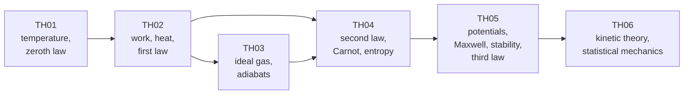
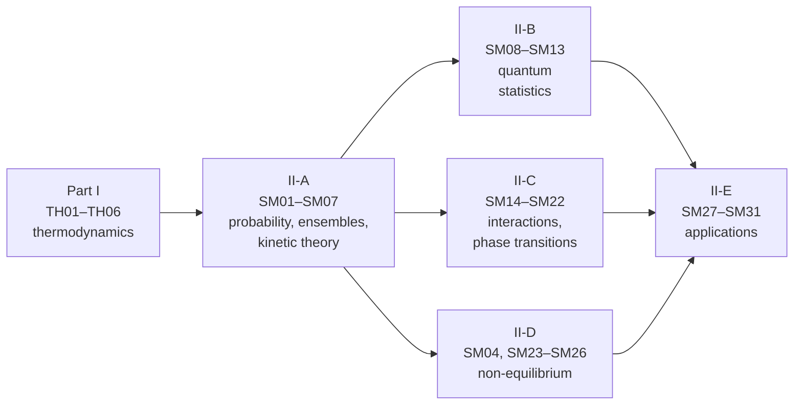

# Thermodynamics and Statistical Mechanics: Course Map

> [!info] Two parts, two kinds of provenance (2026-10-30)
> **Part I, thermodynamics (TH01–TH06, THX1):** built from the MIT 8.333 lectures and Zemansky, so it carries the green/yellow/blue scope labels below (<span class="scope-taught">taught · in syllabus</span> <span class="scope-extra-book">extra · book</span>).
> **Part II, statistical mechanics and statistical physics (SM01 onward):** the user's **own self-study**, written from the books in `physics/thermodynamics-stat-mech/books/` with **no course behind it**, so Part II chapters carry **no taught/extra labels**, only a Provenance table. Part I is untouched; Part II builds on it. **Written so far: SM01–SM07, i.e. Part II-A is complete** (SM04, kinetic theory, added on request 2026-10-30 and SM01–SM03 deepened the same day; SM05–SM07 written 2026-11-02). See [[#Part II: statistical mechanics (self-study, from the books)]].

Six chapters: temperature and the zeroth law; work, heat and the first law; the ideal gas and adiabats; the second law, Carnot engines and entropy; thermodynamic potentials, Maxwell relations, stability and the third law; and an optional bridge from kinetic theory to statistical mechanics. The main line follows the **MIT 8.333 lectures 1–4** (Kardar's Chapter I), with Zemansky's *Heat and Thermodynamics* Ch. 1–5 for the more elementary ground (thermometers, simple systems, work, ideal-gas experiments).

> [!warning] What is and is not in the sources
> The folder **does not say which course this is** or what its syllabus contains. The only lecture-type material is four MIT OpenCourseWare lecture notes (7 pp. each, with a text layer); they are treated as the syllabus (🟢). Zemansky (a scan; I OCR'd Ch. 1–5) and the AI-written notes are treated as book-level (🟡); my own derivations and numbers are 🔵. **Ask the instructor** whether the intended course is "thermodynamics" (TH01–TH05) or "thermodynamics and statistical mechanics" (adds TH06 and more), and whether kinetic theory and ensembles are examinable. Not in the folder: MIT Lectures 5+ (probability, kinetic theory, classical statistical mechanics, quantum statistics).

## The storyline

Central thread: **temperature exists (0th) $\to$ energy is conserved (1st) $\to$ a state function, entropy, grows (2nd) $\to$ the right potential for each constraint and the stability of equilibrium $\to$ unique ground state at $T=0$ (3rd) $\to$ all of it from counting microstates.**

## Chapters
| # | Chapter | Main sources | Status |
|---|---|---|---|
| 01 | [[TH01 Temperature and the Zeroth Law]] | MIT L1 §I.A–B; Zemansky Ch. 1–2 | draft |
| 02 | [[TH02 Work Heat and the First Law]] | MIT L1 §I.C; Zemansky Ch. 3–4 | draft |
| 03 | [[TH03 The Ideal Gas and Adiabatic Processes]] | MIT L1–L2; Zemansky Ch. 5 | draft |
| 04 | [[TH04 The Second Law Carnot Engines and Entropy]] | MIT L2 | draft |
| 05 | [[TH05 Potentials Maxwell Relations Stability and the Third Law]] | MIT L3–L4 | draft |
| 06 | [[TH06 From Kinetic Theory to Statistical Mechanics]] | AI notes (`KTG_Chapter`, `Thermo_StatMech_Notes`); MIT L4 pointer | draft (optional) |

```dataview
TABLE chapter AS "#", scope AS "Scope", status AS "Status"
FROM #subject/thermo AND #type/chapter
SORT chapter ASC
```

## Part II: statistical mechanics (self-study, from the books)
**Decisions (user, 2026-10-30).** Build **all four** parts: the equilibrium core, interacting systems and phase transitions, non-equilibrium, and applications and extras. **Spine: Kardar**, *Statistical Physics of Particles* (graduate-leaning, continuing TH01–TH05 directly, in the same rigorous style). Where Kardar's particle volume stops (Ising, phase transitions, the renormalisation group are in his second volume, *Fields*, which is **not in the folder**) the chapters follow **Pathria and Beale**, with Huang, Schwabl, Landau–Lifshitz Vols. 5, 9, 10 and Tanaka as cross-checks, and Reif, Schroeder and Blundell for the plain-language intuition boxes. Existing notes are never removed; Part II only adds.



**Source keys** (book pages are the *printed* pages): **K** = Kardar 2007 (PDF page = printed + 12) · **PB** = Pathria and Beale, 3rd ed. 2011 (PDF page = printed + 27; text layer absent, read by OCR) · **R** = Reif, *Fundamentals of Statistical and Thermal Physics* (djvu) · **RB** = Reif, Berkeley Physics Course Vol. 5 · **L5, L9, L10** = Landau and Lifshitz Vols. 5, 9, 10 · **Hu** = Huang · **Sw** = Schwabl · **Sc** = Schroeder · **Bl** = Blundell and Blundell · **Ta** = Tanaka · **Hi** = Hill · **Go** = Goodstein.

### II-A Foundations, ensembles and kinetic theory
| # | Chapter | Main sources | Status |
|---|---|---|---|
| SM01 | [[SM01 Probability Large Numbers and Information]] | K Ch. 2 pp. 35–56; PB §1.1; RB Ch. 1–2 | **draft (deepened)** |
| SM02 | [[SM02 Phase Space Liouville and the Microcanonical Ensemble]] | K §3.1–3.2, §4.1–4.5; PB Ch. 1–2; Sc Ch. 2 | **draft (deepened)** |
| SM03 | [[SM03 The Canonical Ensemble]] | K §4.6–4.8 pp. 110–118; PB Ch. 3 pp. 39–90; Sc Ch. 6 | **draft (deepened)** |
| SM04 | [[SM04 Kinetic Theory and the Boltzmann Equation]] (opens II-D as well) | K Ch. 3 pp. 57–97; Hu Ch. 3–5; R §12.2–12.3; Landau Vol. 10 (unread) | **draft** |
| SM05 | [[SM05 The Grand Canonical Ensemble and Chemical Equilibrium]] | K §4.9 pp. 118–120; PB Ch. 4, §6.6; Hu §7.3–7.8; Sc §5.6, §7.1 | **draft** |
| SM06 | [[SM06 Entropy Information and the Arrow of Time]] | K §2.7, §4.5; Blundell Ch. 14–15; own | **draft** |
| SM07 | [[SM07 Equipartition the Virial Theorem and Magnetic Systems]] | PB §3.7–3.10, Problem 3.43; K §4.7; Hu §6.4, §11.5; Sw §6.2 | **draft** |

### II-B Quantum statistical mechanics
| # | Chapter | Main sources | Status |
|---|---|---|---|
| SM08 | Quantum ensembles, the density matrix, identical particles (quantum Boltzmann equation) | K §6.4–6.5, §7.1–7.3; PB Ch. 5 | planned |
| SM09 | Molecular gases: rotation, vibration, nuclear spin | K §6.1; PB §6.5 | planned |
| SM10 | Phonons and the specific heat of solids (Einstein, Debye) | K §6.2; PB §7.4–7.5 | planned |
| SM11 | The photon gas and blackbody radiation | K §6.3; PB §7.3 | planned |
| SM12 | The ideal Fermi gas | K §7.4–7.5; PB Ch. 8 | planned |
| SM13 | The ideal Bose gas and Bose–Einstein condensation | K §7.6; PB §7.1–7.2, §13.6 | planned |

### II-C Interacting systems and phase transitions
| # | Chapter | Main sources | Status |
|---|---|---|---|
| SM14 | Cumulant and cluster expansions: the virial series | K §5.1–5.2; PB Ch. 10 | planned |
| SM15 | van der Waals, condensation and corresponding states | K §5.3–5.8; PB §12.1–12.2, §4.6–4.7 | planned |
| SM16 | The Ising model in one dimension and the lattice gas | PB §12.4, §13.1–13.2; Hu; Sw | planned |
| SM17 | Mean-field theory and variational methods | K §5.6; PB §12.5–12.7; Hu Ch. 17 | planned |
| SM18 | Landau theory and symmetry breaking | PB §12.8–12.9, §12.13; L5 Ch. 14 | planned |
| SM19 | Fluctuations, correlations, scaling and universality | PB §12.10–12.12; L5; Hu | planned |
| SM20 | The two-dimensional Ising model | PB §13.4; Hu Ch. 15; Sw | planned |
| SM21 | The renormalisation group | PB Ch. 14; Hu Ch. 18; Sw | planned |
| SM22 | Spin waves, Goldstone modes and low dimensions | PB §13.3, §13.5; Sw; Ta | planned |

### II-D Non-equilibrium (SM04 is the entry point)
| # | Chapter | Main sources | Status |
|---|---|---|---|
| SM23 | Transport beyond the single-time approximation: Drude and Wiedemann–Franz, phonon conduction, Vlasov and plasmas | R Ch. 13–14; L10; Hermann; PB §6.4 | planned |
| SM24 | Brownian motion, the Langevin and Fokker–Planck equations | PB §15.2–15.4; R Ch. 15; builds on [[THX1 Diffusion Random Walks and the Heat Equation]] | planned |
| SM25 | Linear response, fluctuation–dissipation, Onsager relations (Green–Kubo for SM04's $\eta,\kappa$) | PB §15.5–15.7; L9 | planned |
| SM26 | Master equations, detailed balance and Monte Carlo | PB Ch. 16; R | planned |

### II-E Applications and extras
| # | Chapter | Main sources | Status |
|---|---|---|---|
| SM27 | Stars: white dwarfs, neutron stars, the early universe | PB §8.5, Ch. 9; Hu | planned |
| SM28 | Superfluid helium | K §7.7; PB §7.6; Go | planned |
| SM29 | Coulomb systems: Debye–Hückel, plasmas, electrolytes | L5 §78; Hu; PB Ch. 10 | planned |
| SM30 | Polymers, rubber elasticity and adsorption | Hi; Go; derived | planned |
| SM31 | Fluctuation theorems and the thermodynamics of information | K, R, Bl; derived (source gap: Jarzynski, Crooks, Landauer are papers, not in the folder) | planned |

```dataview
TABLE chapter AS "#", part AS "Part", status AS "Status"
FROM #subject/thermo AND #type/chapter AND #src/book
SORT chapter ASC
```

> [!note] Order and numbering
> The numbering is the *teaching* order, not the order of the books: Kardar puts kinetic theory (Boltzmann equation) before ensembles; here ensembles come first (SM02–SM03) and the kinetic theory chapter SM04 follows, needing only Liouville's theorem from SM02 (user request 2026-10-30: "add a kinetic theory chapter separately and link properly"; the old plan had it as SM22–SM23, so everything after it moved up by one and the old SM23 was redefined as the transport chapter beyond the single-time approximation). The unwritten chapters appear as plain text until they exist, so that the graph has no empty nodes. The `.djvu` books (Reif's *Fundamentals*, Huang, Schwabl, Landau Vol. 9, Callen, Schroeder, Hill, Tolman, Goodstein, Pathria 1996) became readable on 2026-10-30 (`djvulibre` installed; `djvutxt book.djvu out.txt`): Huang djvu page = printed + 9, Reif = printed + 17; Kardar and Huang equations are garbled in the text layer, so cite sections and pages, not equation numbers. Landau–Lifshitz Vol. 10 and Chapman–Cowling remain unread.

## Sources and what they are
| ID | File | What it is | Role |
|---|---|---|---|
| L1 | [[0d0ec730e8e02ed0399d39ff05054a72_MIT8_333F13_Lec1.pdf]] | MIT 8.333 Lecture 1, Kardar §I.A–I.C (definitions, zeroth law, first law, response functions), 7 pp. | taught: TH01–TH03 |
| L2 | [[1a131e225246d9749a298f49675c5fe5_MIT8_333F13_Lec2.pdf]] | Lecture 2, §I.D–I.F (second law, Carnot, entropy), 7 pp. | taught: TH03–TH04 |
| L3 | [[df0c4e121858c0be246b496dd8c39d2c_MIT8_333F13_Lec3.pdf]] | Lecture 3, §I.G–I.H (potentials, Maxwell relations), 7 pp. | taught: TH05 |
| L4 | [[97dcd8dee3d3301cd7c27745b17b10b5_MIT8_333F13_Lec4.pdf]] | Lecture 4, §I.I–I.J (stability, third law), 7 pp. | taught: TH05 |
| Z | [[Heat and thermodynamics an intermediate textbook (Mark Waldo Zemansky Richard Dittman) (z-library.sk, 1lib.sk, z-lib.sk).pdf]] | Zemansky and Dittman, 508 pp., a scan (OCR'd PDF pp.14–150; book page = PDF − 20; chapters start at PDF 23, 49, 69, 92, 126) | extra/book |
| AI | `Thermodynamics_Ch1-5_Notes.pdf`, `Zemansky_Thermodynamics_Overview.pdf`, `Thermo_ConceptSummary_FormulaSheet.pdf`, `StatMech_Thermodynamics_Kardar_Ch1.pdf`, `KTG_Chapter.pdf`(+`.tex`), `Thermo_StatMech_Notes.pdf` | AI-written notes on Zemansky Ch. 1–5, on Kardar Ch. I and on kinetic theory and ensembles (83 pp.) | secondary; used for cross-checks and TH06 |
| K | [[Mehran Kardar - Statistical Physics of Particles (2007).pdf]] (+ [[Mehran Kardar - Statistical Physics of Particles, Solution Manual.pdf\|solution manual]]) | *Statistical Physics of Particles*, 332 pp., text layer; PDF page = printed + 12; Ch. 1 thermodynamics, 2 probability, 3 kinetic theory, 4 classical statistical mechanics, 5 interacting particles, 6 quantum statistical mechanics, 7 ideal quantum gases; solutions to selected problems on pp. 211–317 | **Part II spine** |
| PB | [[R. K. Pathria, Paul D. Beale - Statistical Mechanics (2011).pdf]] (and 2021, 1996 editions, instructor's manual, in the same folder) | Pathria and Beale 3rd ed., 733 pp., scan without text layer (OCR); PDF page = printed + 27; Ch. 1–5 ensembles, 6–8 quantum gases, 9 early universe, 10–11 interacting systems, 12–14 phase transitions and the RG, 15 fluctuations and non-equilibrium, 16 simulations | Part II: phase transitions, non-equilibrium, cross-checks |
| other books | `physics/thermodynamics-stat-mech/books/`: Reif (two books), Landau–Lifshitz Vols. 5, 9, 10, Huang, Schwabl, Tanaka, Hermann, Yoshioka, Schroeder (+ solutions), Blundell, Callen, Hill, Tolman, Goodstein, Koks, Fuchs, Zemansky 1996 | cross-checks, intuition, problems; the `.djvu` ones await `djvulibre` | Part II: secondary |

## Gaps (to ask the instructor / supply later)
- **Part II has no course behind it.** Which chapters are "needed" for any examination is unknown; the plan follows the books and the user's instruction to cover the equilibrium core, interacting systems and phase transitions, non-equilibrium and applications. Kardar's second volume (*Statistical Physics of Fields*) is not in the folder: SM15–SM21 follow Pathria, Huang, Schwabl and Landau–Lifshitz instead.
- **Which course and which syllabus** (see the warning above).
- MIT Lectures **5 onward** (probability, central limit theorem, kinetic theory, Liouville, ensembles) are not present; TH06 stands in with the AI notes.
- Statistical mechanics of **quantum** systems (Bose and Fermi gases, photon gas derivation of Planck, Debye model) is only touched (TH06 §7).
- The MIT notes cite **"test 1 review problems"** (proofs that $E=E(T)$ for the ideal gas, the Carnot construction for any $E(T)$, a test of the third law for glasses); not in the folder. TH05 supplies the first.

## Interdisciplinary chapter (host: Thermodynamics)
[[THX1 Diffusion Random Walks and the Heat Equation]] (in `Interdisciplinary/`): the random walk, Fick's and Fourier's laws, the heat kernel, skin depth, Einstein's relation, the Péclet number, genetic drift as a diffusion, and the free-particle propagator, with the same equation shown to govern hillslopes, alluvial rivers, geotherms and closure temperatures ([[LSX1 Clocks in Rocks]]). Concept notes: [[Diffusion Equation]] · [[Fick's and Fourier's Laws]] · [[Brownian Motion and the Einstein Relation]] (with [[Random Walk]], [[Wright-Fisher Drift as Diffusion]] and [[Péclet Number]] in their own subjects).

## Why this subject is tightly linked to the others
- **Climate:** the equation of state of air, $c_p$, the first law of a parcel, adiabats and the lapse rate (TH01–TH03; [[CL05 Thermodynamic State of the Atmosphere]], [[CL09 Radiative-Convective Equilibrium]]); entropy and the atmosphere as a heat engine (TH04); Clausius-Clapeyron and the saturation vapour pressure (TH05; [[Clausius-Clapeyron Relation]]); equipartition, vibrational modes and the Planck factor (TH06; [[CL07 Optical Properties of the Atmosphere]], [[Planck Law]], [[Blackbody Radiation]], [[Stefan-Boltzmann Law]], [[Wien Displacement Law]]).
- **Quantum mechanics:** the oscillator and two-level energies in the partition function ([[Quantum Mechanics - Course Map]]; [[QM05 The Harmonic Oscillator]]), the unique ground state of the third law.
- **Eco-evo and foundations:** stability and the unstable branch of a bistable curve ([[Bistability and Tipping Points]], [[Fixed Points and Linear Stability]], [[EE06 Eutrophication and Alternative Stable States]]); fluctuations scale as $1/\sqrt N$.
- **Probability:** Boltzmann factor, multinomial counting, Gaussian fluctuations ([[Probability - Course Map]]).
- Earlier concept notes in this folder ([[First Law of Thermodynamics]], [[Ideal Gas Law]], [[Adiabatic Process and Potential Temperature]]) are the climate-oriented versions; they use the **Zemansky sign convention** for work (see [[TH02 Work Heat and the First Law]] §2).

## Revision
- A printable formula sheet: [[th-formula-sheet.pdf]] (2 pages).
- Practice with solutions lives at the end of each chapter (6 × 10 problems).
- Part II-A (SM01–SM07) formula sheet: [[sm-formula-sheet.pdf]] (3 pages: formulas, key numbers, recalled inputs flagged). The numbers behind every chapter are in `scripts/sm*_numbers.py`.

## Concept index
```dataview
LIST FROM #type/concept AND #subject/thermo SORT file.name ASC
```

See [[Subject Map]] for how this subject relates to the others and [[Roadmap]] for its place in the plan.

<!-- graph-spine:start (generated by scripts/graph_spine.py; do not edit between the markers) -->
## Atlas: every note in this subject
The graph view draws only real links, so this block links **every** note of the subject (the map is the hub of its cluster; [[Home]] is the hub of all maps).

> [!abstract]- Atlas (generated): 15 chapters · 141 concept notes
> **Chapters (15):** [[SM01 Probability Large Numbers and Information]] · [[SM02 Phase Space Liouville and the Microcanonical Ensemble]] · [[SM03 The Canonical Ensemble]] · [[SM04 Kinetic Theory and the Boltzmann Equation]] · [[SM05 The Grand Canonical Ensemble and Chemical Equilibrium]] · [[SM06 Entropy Information and the Arrow of Time]] · [[SM07 Equipartition the Virial Theorem and Magnetic Systems]] · [[SM08 Quantum Ensembles and Identical Particles]] · [[TH01 Temperature and the Zeroth Law]] · [[TH02 Work Heat and the First Law]] · [[TH03 The Ideal Gas and Adiabatic Processes]] · [[TH04 The Second Law Carnot Engines and Entropy]] · [[TH05 Potentials Maxwell Relations Stability and the Third Law]] · [[TH06 From Kinetic Theory to Statistical Mechanics]] · [[THX1 Diffusion Random Walks and the Heat Equation]]
>
> **Concept notes (141):** [[Adiabatic Demagnetisation]] · [[Adiabatic Process and Potential Temperature]] · [[Arnold Cat Map]] · [[Barometric Formula]] · [[BBGKY Hierarchy]] · [[Blackbody Radiation]] · [[Bohr-van Leeuwen Theorem]] · [[Boltzmann Distribution]] · [[Boltzmann Entropy]] · [[Boltzmann Equation]] · [[Bose-Einstein Distribution]] · [[Brillouin Function]] · [[Brownian Motion and the Einstein Relation]] · [[Canonical Ensemble]] · [[Carnot Engine]] · [[Carnot Theorem]] · [[Chapman-Enskog Expansion]] · [[Chemical Potential]] · [[Chernoff Bound]] · [[Clausius Theorem]] · [[Clausius-Clapeyron Relation]] · [[Collision Invariants]] · [[Cumulant]] · [[Curie Law]] · [[Density of States]] · [[Diffusion Equation]] · [[Dulong-Petit Law]] · [[Edgeworth Expansion]] · [[Einstein Solid]] · [[Empirical Temperature]] · [[Entanglement Entropy]] · [[Enthalpy]] · [[Entropy of Radiation]] · [[Entropy]] · [[Equation of State]] · [[Equipartition of Energy]] · [[Equivalence of Ensembles]] · [[Ergodic Hypothesis]] · [[Euler Equations]] · [[Exact Differential]] · [[Exergy and Availability]] · [[Fermi-Dirac Distribution]] · [[Fick's and Fourier's Laws]] · [[First Law of Thermodynamics]] · [[Fluctuation-Response Relation]] · [[Fugacity]] · [[Fundamental Thermodynamic Relation]] · [[Generalised Equipartition Theorem]] · [[Generalised Force and Displacement]] · [[Gibbs Canonical Ensemble]] · [[Gibbs Entropy]] · [[Gibbs Free Energy]] · [[Gibbs Paradox]] · [[Gibbs-Duhem Relation]] · [[Grand Canonical Ensemble]] · [[Grand Potential]] · [[H-Theorem]] · [[Heat and Work]] · [[Heat Capacity]] · [[Heat Engine]] · [[Helmholtz Free Energy]] · [[Hydrodynamic Modes]] · [[Ideal Gas Law]] · [[Ideal Gas Temperature Scale]] · [[Internal Energy]] · [[Irreversibility]] · [[Joule Expansion]] · [[Kac Ring]] · [[Kelvin and Clausius Statements]] · [[Kelvin-Helmholtz Time]] · [[Kinetic Theory of Gases]] · [[Knudsen Number]] · [[Landauer Principle]] · [[Langevin Diamagnetism]] · [[Langevin Function]] · [[Langmuir Isotherm]] · [[Large Deviation Principle]] · [[Law of Mass Action]] · [[Legendre Transform]] · [[Liouville's Theorem]] · [[Loschmidt and Zermelo Paradoxes]] · [[Magnetic Work and Potentials]] · [[Maximum Entropy Principle]] · [[Maxwell Relations]] · [[Maxwell's Demon]] · [[Maxwell-Boltzmann Distribution]] · [[Mayer Relation]] · [[Mean Free Path]] · [[Microcanonical Ensemble]] · [[Molecular Chaos]] · [[Mutual Information]] · [[Navier-Stokes Equations]] · [[Negative Heat Capacity]] · [[Negative Temperature]] · [[Number Fluctuations]] · [[One-Particle Distribution Function]] · [[Partition Function of the Hydrogen Atom]] · [[Partition Function]] · [[Past Hypothesis]] · [[Phase Space]] · [[Planck Law]] · [[Planck Mean Energy]] · [[Poincare Recurrence]] · [[Prandtl Number]] · [[Quasi-Static Process]] · [[Ratio of Specific Heats]] · [[Refrigerator and Heat Pump]] · [[Relative Entropy]] · [[Relaxation Time Approximation]] · [[Residual Entropy of Ice]] · [[Response Functions]] · [[Reversible Adiabatic Process]] · [[Rigid Rotor]] · [[Ruchhardt Method]] · [[Sackur-Tetrode Equation]] · [[Saddle Point Method]] · [[Saha Equation]] · [[Scattering Cross Section]] · [[Schottky Anomaly]] · [[Second Law of Thermodynamics]] · [[Shannon Entropy]] · [[Speed of Sound]] · [[State Function]] · [[Statistical Entropy]] · [[Stefan-Boltzmann Law]] · [[Stirling's Approximation]] · [[Szilard Engine]] · [[Thermal Conductivity of a Gas]] · [[Thermal Wavelength]] · [[Thermodynamic Equilibrium]] · [[Thermodynamic Stability]] · [[Thermodynamic Temperature]] · [[Third Law of Thermodynamics]] · [[Typical Set]] · [[03-Thermodynamics-and-Statistical-Mechanics/Concepts/Virial Theorem|Virial Theorem]] · [[Viscosity of a Gas]] · [[Von Neumann Entropy]] · [[Wick's Theorem]] · [[Widom Insertion Method]] · [[Wien Displacement Law]] · [[Zeroth Law]]
<!-- graph-spine:end -->
