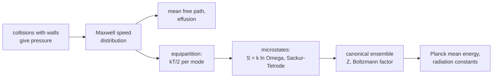

# TH06 · From Kinetic Theory to Statistical Mechanics

◀ [[TH05 Potentials Maxwell Relations Stability and the Third Law]] · [[Thermodynamics - Course Map|Course Map]]

extra · book extra · beyond taught · in syllabus (only the pointers)

> [!syllabus] Syllabus map: what is in the syllabus and what is extra in this chapter
> 🟢 **In syllabus (taught)**: only the **motivation**. MIT Lectures 1–4 end by saying that statistical mechanics must justify the laws, with $S=k_B\ln g$ and $g=1$ at $T=0$ ([[97dcd8dee3d3301cd7c27745b17b10b5_MIT8_333F13_Lec4.pdf#page=5|L4 §I.J, p.5]]).
>
> 🟡 **Extra · book** (the AI-written chapters in the folder: [[KTG_Chapter.pdf|`KTG_Chapter.pdf`]] §1.1–1.8 and [[Thermo_StatMech_Notes.pdf|`Thermo_StatMech_Notes.pdf`]] §3–6; I re-derived every formula and recomputed every number rather than copy them)
> - §1 pressure from molecular collisions; §2 the Maxwell speed distribution; §3 effusion and the mean free path; §4 equipartition
> - §5 microstates, $S=k_B\ln\Omega$, the Sackur-Tetrode entropy; §6 the canonical ensemble and the partition function
>
> 🔵 **Extra · beyond** (my additions, labelled)
> - §2 atmospheric escape; §6 two-level system and oscillator heat capacities; §7 the Planck mean energy, radiation constant and Wien constant from the oscillator (the bridge to [[Planck Law]] and the climate chapters); all numbers (`scripts/th_numbers.py`)
>
> **This chapter is not examinable on the evidence in the folder.** The folder does not say whether the course covers kinetic theory or ensembles; they are included because the AI notes and the climate links (equipartition, Planck) need them.

> [!key] After this chapter you can
> - derive $P=\tfrac13nm\langle v^2\rangle$ and identify $\tfrac12m\langle v^2\rangle=\tfrac32k_BT$,
> - write the **Maxwell speed distribution** and compute $v_{mp}$, $\langle v\rangle$, $v_{rms}$ and the tail fraction,
> - compute the **mean free path** and collision rate of air and the **effusion** ratio of two gases,
> - state the **equipartition theorem** and explain **freeze-out** ($x=\hbar\omega/k_BT$),
> - relate **entropy to counting**, $S=k_B\ln\Omega$, and evaluate the **Sackur-Tetrode** entropy of a monatomic gas,
> - use the **canonical ensemble**: $p_i=e^{-\beta E_i}/Z$, $F=-k_BT\ln Z$, $E=-\partial_\beta\ln Z$, $C_V$, $\mathrm{Var}(E)=k_BT^2C_V$,
> - evaluate the two-level (Schottky) and oscillator results and derive the **Planck mean energy** of a radiation mode.

> [!intuition] The one-sentence story
> Thermodynamics is what is left when you average over $10^{23}$ molecules: temperature is the mean kinetic energy, entropy is the logarithm of the number of ways to arrange them, and the Boltzmann factor $e^{-E/k_BT}$ tells you how likely each arrangement is.

<!-- intuition-v1 -->

*Concept map: how the ideas of this chapter depend on each other (read left to right; every box is a section).*

## 1. Pressure from collisions
extra · book *`KTG_Chapter.pdf` §1.1–1.2; re-derived*

> [!intuition] Pressure is a rain of tiny impacts
> Each molecule hitting the wall delivers a momentum $2mv_x$; billions per second average into a steady force. $P=\tfrac13n m\langle v^2\rangle$ and so $\tfrac12m\langle v^2\rangle=\tfrac32kT$: temperature is average kinetic energy.

Model: $N$ point molecules of mass $m$ in a volume $V$, colliding elastically with the walls (and rarely with each other). A molecule with velocity component $v_x$ hitting a wall perpendicular to $x$ transfers momentum $2mv_x$. Per unit area per unit time $\tfrac12nv_x$ molecules with $v_x>0$ arrive ($n=N/V$), so
$$P=\sum\tfrac12n\,(2mv_x)\,v_x=nm\langle v_x^2\rangle=\tfrac13nm\langle v^2\rangle=\tfrac23\,n\Big\langle\tfrac12mv^2\Big\rangle .$$
Comparing with $PV=Nk_BT$:
$$\boxed{\ \Big\langle\tfrac12mv^2\Big\rangle=\tfrac32k_BT\ }$$
The **temperature** is a measure of the mean translational kinetic energy: $3/2\,k_BT=38.8$ meV at 300 K, independent of the gas.

> [!example] Numbers (N$_2$, 300 K, recomputed)
> $n=P/k_BT=2.45\times10^{25}$ m$^{-3}$; $v_{rms}=\sqrt{3k_BT/m}=517$ m s$^{-1}$; check $P=\tfrac13nm\langle v^2\rangle=101\,325$ Pa.

## 2. The Maxwell speed distribution
extra · book *`KTG_Chapter.pdf` §1.3*

> [!intuition] Why the distribution has that shape
> Each velocity component is independent and Gaussian. Speeds are the length of a 3-D Gaussian vector: few are very slow (small phase-space), few very fast (Boltzmann suppression); the peak sits at $\sqrt{2kT/m}$.

In equilibrium the probability of a velocity is proportional to the **Boltzmann factor** $e^{-mv^2/2k_BT}$; integrating over directions:
$$\boxed{\ f(v)=4\pi\Big(\frac m{2\pi k_BT}\Big)^{3/2}v^2\,e^{-mv^2/2k_BT}\ }$$
- most probable $v_{mp}=\sqrt{2k_BT/m}$; mean $\langle v\rangle=\sqrt{8k_BT/\pi m}$; root-mean-square $v_{rms}=\sqrt{3k_BT/m}$ (ratios $1:1.128:1.225$).
- The fraction of molecules faster than $x\,v_{mp}$ is $\operatorname{erfc}(x)+\frac2{\sqrt\pi}xe^{-x^2}$: $57.2\%$ above $v_{mp}$, $4.60\%$ above $2v_{mp}$, $0.044\%$ above $3v_{mp}$.

![[fig_th06_stat.png]]
*Figure TH6.1. A: Maxwell distributions for N$_2$ at 300 and 600 K and He at 300 K. B: heat capacity of a quantum oscillator and of a two-level system against $x$; C: the Planck occupation factor against $x$.*

> [!example] Numbers (recomputed)
> N$_2$ at 300 K: $v_{mp},\langle v\rangle,v_{rms}=422,\ 476,\ 517$ m s$^{-1}$ (402.7, 454.4, 493.2 at 273 K). Helium: $1116,\ 1260,\ 1367$ m s$^{-1}$.
> **Atmospheric escape** (🔵). The escape speed from Earth is $11.2$ km s$^{-1}$. $v_{rms}/v_{esc}=0.046$ for N$_2$, $0.12$ for He and $0.17$ for H$_2$ (at 300 K; the upper atmosphere is hotter): only the **tail** of the distribution can escape, and the lighter the molecule the fatter the tail at a given speed ratio, which is why Earth keeps N$_2$ and O$_2$ but loses H$_2$ and He.

## 3. Collisions, effusion and the mean free path
extra · book *`KTG_Chapter.pdf` §1.4, §1.7*

**Effusion.** Molecules leaving through a small hole of area $A$ do so at the rate $\Phi A=\tfrac14n\langle v\rangle A$, so at equal $T$ and $P$ the rates scale as $1/\sqrt m$ (**Graham's law**): He/N$_2$: $\sqrt{28.01/4.003}=2.65$; H$_2$/O$_2$: $3.98$. Effusion enriches the lighter component.

**Mean free path.** A molecule of diameter $d$ has collision cross-section $\sigma=\pi d^2$ and travels, between collisions with others (relative speeds $\sqrt2$ larger),
$$\boxed{\ \lambda=\frac1{\sqrt2\,n\sigma}=\frac{k_BT}{\sqrt2\,\pi d^2P}\ ,\qquad\text{collision rate}=\frac{\langle v\rangle}\lambda}$$

> [!example] Air (🔵, recomputed with $d=3.7$ Å)
> At 300 K and 1 atm: $\lambda=67$ nm ($\approx180$ molecular diameters) and the collision rate is $7.1\times10^9$ s$^{-1}$. At 10 km (265 hPa, 223 K): $\lambda=191$ nm. The mean free path exceeds the molecular size by two orders of magnitude, which is why the **ideal gas** is a good model.

The mean free path also sets the **transport coefficients** (viscosity, thermal conductivity, diffusion; $\propto\lambda\langle v\rangle$): the AI chapter §1.8 treats them; the surprising fact that gas viscosity is independent of density (since $\lambda\propto1/n$ and the number of carriers $\propto n$) holds while $\lambda\ll$ the container.

## 4. Equipartition
extra · book *`KTG_Chapter.pdf` §1.5; `Thermo_StatMech_Notes.pdf` §5.5*

> [!intuition] Equipartition works until $kT$ is smaller than the level spacing
> Each quadratic degree of freedom stores $\tfrac12kT$ if the thermal energy is large compared with its quantum spacing. Vibrations freeze out at room temperature (the Einstein oscillator, [[QM06 The Oscillator Toolbox]] §8).

> [!key] Equipartition theorem
> In classical equilibrium, every degree of freedom that enters the energy **quadratically** ($\tfrac12mv_x^2$, $\tfrac12I\omega^2$, $\tfrac12\kappa x^2$, ...) contributes $\tfrac12k_BT$ to the mean energy, so $E=\tfrac f2Nk_BT$, $C_V=\tfrac f2Nk_B$, $\gamma=1+2/f$ ([[TH03 The Ideal Gas and Adiabatic Processes]]).

*Proof for one term.* With weight $e^{-\kappa x^2/2k_BT}$, $\langle\tfrac12\kappa x^2\rangle=\dfrac{\int\frac12\kappa x^2e^{-\kappa x^2/2k_BT}\mathrm dx}{\int e^{-\kappa x^2/2k_BT}\mathrm dx}=\tfrac12k_BT$ ([[Gaussian Integral]]). An oscillator has two quadratic terms (kinetic and potential), so $E=k_BT$ and $C=k_B$.

> [!pitfall] Freeze-out
> A degree of freedom with level spacing $\hbar\omega\gg k_BT$ cannot be excited and contributes nothing to $C_V$. At room temperature N$_2$ and O$_2$ have $f=5$ (vibrations frozen), giving $\gamma=1.40$; and the CO$_2$ bend ($x=3.3$) contributes only $0.43k_B$ (§6). Equipartition is the classical limit $x\to0$ of the quantum results.

## 5. Microstates and the Sackur-Tetrode entropy
extra · book *`Thermo_StatMech_Notes.pdf` §3–4; formulas checked below*

A **microstate** specifies the state of every particle; a **macrostate** specifies only $E,V,N$. Postulate: in equilibrium of an isolated system all accessible microstates are equally likely. If $\Omega(E,V,N)$ is their number,
$$\boxed{\ S=k_B\ln\Omega\ }$$
which matches the thermodynamic $S$: $1/T=\partial S/\partial E$ ([[TH04 The Second Law Carnot Engines and Entropy]]). The second law becomes: **the macrostate with the most microstates is overwhelmingly the most probable**; the third law ([[TH05 Potentials Maxwell Relations Stability and the Third Law]]) is $\Omega=1$ at $T=0$ (unique ground state).

> [!example] Free expansion by counting (recomputed)
> Doubling the volume doubles the positions available to each of $N$ molecules, so $\Omega\to2^N\Omega$ and $\Delta S=k_B\ln2^N=Nk_B\ln2$; for $N=N_A$: $5.763$ J K$^{-1}$, identical to $R\ln2$ from the reversible calculation. The probability that all molecules are found back in one half is $2^{-N}$: not forbidden, merely never seen.

For $N$ identical, non-interacting point particles in volume $V$, counting phase space (dividing by $N!$ and by $h^{3N}$ so the count is dimensionless and extensive) gives the **Sackur-Tetrode entropy**:
$$\boxed{\ S=Nk_B\Big[\ln\Big(\frac VN\Big(\frac{2\pi mk_BT}{h^2}\Big)^{3/2}\Big)+\frac52\Big]\ }$$

> [!example] Checked against measurement (🔵)
> Evaluated at 298.15 K and 1 bar:
> | gas | He | Ne | Ar | Kr | Xe |
> |---|---|---|---|---|---|
> | $S$ (J mol$^{-1}$K$^{-1}$), formula | 126.15 | 146.33 | 154.85 | 164.09 | 169.69 |
> | measured (recalled, NIST-JANAF) | 126.15 | 146.33 | 154.85 | 164.08 | 169.68 |
>
> The formula reproduces calorimetric entropies (obtained from heat capacities integrated down to $T\to0$ using the **third law**) to $0.01$ J mol$^{-1}$K$^{-1}$. This is a strong check that $S=k_B\ln\Omega$ and Planck's constant belong in the counting. The entropy grows with $m$ (heavier molecules have more states, $S\propto\tfrac32\ln m$) and with $T$ and $V$.

## 6. The canonical ensemble
extra · book *`Thermo_StatMech_Notes.pdf` §5; re-derived*

> [!intuition] The Boltzmann factor weighs every state
> A state of energy $E$ is $e^{-E/kT}$ times as likely as one of zero energy. The partition function $Z=\sum e^{-E/kT}$ is the normaliser and the generating function: derivatives of $\ln Z$ give everything.

For a system in contact with a heat bath at $T$ the probability of microstate $i$ is the **Boltzmann distribution**
$$\boxed{\ p_i=\frac{e^{-\beta E_i}}Z,\qquad Z=\sum_ie^{-\beta E_i},\qquad\beta=\frac1{k_BT}\ }$$
(*Derivation:* system + bath share fixed total energy; the bath has $\Omega_B(E_{\rm tot}-E_i)=e^{S_B/k_B}$ states and expanding $S_B(E_{\rm tot}-E_i)\approx S_B-E_i/T$ gives $p_i\propto e^{-E_i/k_BT}$.)
All thermodynamics follows from $Z$:
$$F=-k_BT\ln Z,\qquad\langle E\rangle=-\frac{\partial\ln Z}{\partial\beta},\qquad S=-\Big(\frac{\partial F}{\partial T}\Big)=k_B\ln Z+\frac{\langle E\rangle}T,\qquad C_V=\frac{\partial\langle E\rangle}{\partial T},$$
and the **energy fluctuations** are $\mathrm{Var}(E)=k_BT^2C_V$. Relative fluctuations $\Delta E/E=\sqrt{2/3N}$ for a monatomic gas: $2.6\times10^{-12}$ for $N=10^{23}$ (the ensemble is effectively isolated: **equivalence of ensembles**) but $8\%$ for $N=100$.

> [!example] A two-level system ($k_B=1$, spacing $\varepsilon$, recomputed)
> $Z=1+e^{-\beta\varepsilon}$; $\langle E\rangle/\varepsilon=1/(e^x+1)$ with $x=\varepsilon/k_BT$; $S=\ln(1+e^{-x})+x/(e^x+1)$, from $0$ at $T=0$ (unique ground state) to $\ln2$ at high $T$; $C=x^2e^x/(e^x+1)^2$ peaks at $0.439$ for $k_BT=0.417\varepsilon$ (the **Schottky anomaly**). At $k_BT=\varepsilon$: upper level occupation $0.269$, $S=0.582$.

> [!example] A quantum oscillator (energies $(n+\tfrac12)\hbar\omega$, [[QM05 The Harmonic Oscillator]])
> $Z=\sum_ne^{-\beta\hbar\omega(n+1/2)}=e^{-x/2}/(1-e^{-x})$ with $x=\hbar\omega/k_BT$:
> $$\langle E\rangle=\hbar\omega\Big(\tfrac12+\frac1{e^x-1}\Big),\qquad C=k_B\frac{x^2e^x}{(e^x-1)^2},\qquad\langle n\rangle=\frac1{e^x-1}.$$
> $x\to0$: $C\to k_B$ (equipartition, $E\to k_BT$); $x\gg1$: $C\to k_Bx^2e^{-x}\to0$ (**freeze-out**). **CO$_2$ bend** ($667$ cm$^{-1}$, $\hbar\omega=0.0827$ eV): at 288 K $x=3.33$, $C=0.427k_B$, $\langle n\rangle=0.037$, population ratio $n=1/n=0$ $=e^{-x}=0.036$; at 220 K $x=4.36$, $C=0.249k_B$.

## 7. The Planck mean energy and the radiation constants
extra · beyond *the bridge to [[Planck Law]], [[Stefan-Boltzmann Law]] and [[Wien Displacement Law]]; mode counting is stated, not derived*

Each normal mode of the electromagnetic field in a cavity is a harmonic oscillator of frequency $\omega$, so its mean energy above zero point is the Planck factor
$$\bar\varepsilon(\omega)=\frac{\hbar\omega}{e^{\hbar\omega/k_BT}-1}\ \xrightarrow{\ x\to0\ }\ k_BT\ \text{(classical)},\qquad\to\hbar\omega\,e^{-x}\ (x\gg1).$$
Multiplying by the number of modes per unit volume and frequency $\omega^2/\pi^2c^3$ (two polarisations; stated) gives the **spectral energy density**
$$u(\omega)=\frac{\hbar\omega^3}{\pi^2c^3}\frac1{e^{\hbar\omega/k_BT}-1}.$$
Integrating gives $u=aT^4$ with $a=\dfrac{\pi^2k_B^4}{15\hbar^3c^3}=7.566\times10^{-16}$ J m$^{-3}$K$^{-4}$ and the flux $\sigma T^4$ with $\sigma=ac/4=\dfrac{2\pi^5k_B^4}{15h^3c^2}=5.670\times10^{-8}$ W m$^{-2}$K$^{-4}$ (two forms agree). The maximum of $\lambda$-spectrum gives Wien's constant $b=hc/(4.9651k_B)=2.898$ mm K. At 288 K: $u=5.2\times10^{-6}$ J m$^{-3}$, flux $390$ W m$^{-2}$ (and $240$ W m$^{-2}$ at 255 K, the effective emission temperature of [[CL03 Radiation and Planetary Energy Balance]]), peak at $10.1$ µm. A mode at 15 µm (CO$_2$) at 288 K has $x=3.33$ and mean energy $0.123\,k_BT$, i.e. it is **barely populated**: radiation at 15 µm is quantum, not classical.

> [!connection] Why $\sigma$ and $T$ are fundamental
> The $T^4$ law is a thermodynamic consequence (Stefan-Boltzmann follows from $P=u/3$ and the first and second laws); only the **constant** $\sigma$ needs quantum mechanics ($\hbar$) and statistical mechanics ($k_B$), via the oscillator calculation above.

## 8. The grand canonical ensemble (statement only)
extra · book *`Thermo_StatMech_Notes.pdf` §6*

If the system also exchanges particles with a reservoir at chemical potential $\mu$, $p_i\propto e^{-\beta(E_i-\mu N_i)}$ with $Z_G=\sum e^{-\beta(E_i-\mu N_i)}$ and grand potential $\tilde G=-k_BT\ln Z_G$ (equal to $-PV$ for a uniform system), the potential minimised in [[TH05 Potentials Maxwell Relations Stability and the Third Law]] §2. For the ideal gas $\mu=k_BT\ln(n\lambda^3)$ with $\lambda=h/\sqrt{2\pi mk_BT}$, consistent with $\mu=\mu_0+k_BT\ln P/P_0$. I do not derive these here.

## Map of this chapter
> [!connection] How TH06 connects
> **Builds on:** all of TH01–TH05 (the laws and potentials are what the statistics must reproduce) and [[QM05 The Harmonic Oscillator]] (energy levels).
> **Leads to:** [[Probability - Course Map]] (the Boltzmann factor, the Gaussian and the multinomial) and the climate chapters ([[CL03 Radiation and Planetary Energy Balance]], [[CL07 Optical Properties of the Atmosphere]]).
> **Concepts:** [[Kinetic Theory of Gases]] · [[Maxwell-Boltzmann Distribution]] · [[Mean Free Path]] · [[Equipartition of Energy]] · [[Statistical Entropy]] · [[Sackur-Tetrode Equation]] · [[Partition Function]] · [[Canonical Ensemble]] · [[Planck Mean Energy]] · [[Schottky Anomaly]]
> **Other subjects:** [[Planck Law]], [[Stefan-Boltzmann Law]], [[Wien Displacement Law]], [[Blackbody Radiation]], [[Gaussian Integral]], [[Jensen Inequality]] (mean energy vs mean of a convex function).

## Summary
> [!summary] Cheat-sheet
> - **Kinetic:** $P=\tfrac13nm\langle v^2\rangle$, $\langle\tfrac12mv^2\rangle=\tfrac32k_BT$; Maxwell $f(v)=4\pi(m/2\pi k_BT)^{3/2}v^2e^{-mv^2/2k_BT}$; $v_{mp}:\langle v\rangle:v_{rms}=\sqrt2:\sqrt{8/\pi}:\sqrt3$; N$_2$ 300 K: $422,476,517$ m/s; tail $>2v_{mp}$: $4.6\%$.
> - **Free path:** $\lambda=1/\sqrt2n\sigma$: air $67$ nm (1 atm), $191$ nm (10 km); effusion $\propto1/\sqrt m$ (He/N$_2$ $2.65$).
> - **Equipartition:** $\tfrac12k_BT$ per quadratic term; freezes out for $\hbar\omega\gg k_BT$.
> - **Entropy:** $S=k_B\ln\Omega$; free expansion $Nk_B\ln2$; Sackur-Tetrode $S=Nk_B[\ln(\frac VN(\frac{2\pi mk_BT}{h^2})^{3/2})+\frac52]$ reproduces noble-gas entropies to $0.01$ J mol$^{-1}$K$^{-1}$.
> - **Canonical:** $p_i=e^{-\beta E_i}/Z$; $F=-k_BT\ln Z$; $E=-\partial_\beta\ln Z$; $\mathrm{Var}E=k_BT^2C_V$. Two-level: $C_{\max}=0.439k_B$ at $0.417\varepsilon$. Oscillator: $\bar\varepsilon=\hbar\omega/(e^x-1)$, $C=k_Bx^2e^x/(e^x-1)^2$.
> - **Radiation:** $u(\omega)=\hbar\omega^3/(\pi^2c^3)/(e^{\hbar\omega/k_BT}-1)$; $a=7.566\times10^{-16}$, $\sigma=5.670\times10^{-8}$, $b=2.898$ mm K; 288 K: $390$ W m$^{-2}$.

## Practice
1. **Speeds.** Find $v_{mp}$, $\langle v\rangle$, $v_{rms}$ for He at 300 K and for N$_2$ at 600 K.
2. **Tail.** What fraction of N$_2$ molecules at 300 K moves faster than 1000 m s$^{-1}$? ($v_{mp}=422$ m s$^{-1}$.)
3. **Free path.** Compute $\lambda$ and the collision rate for N$_2$ ($d=3.7$ Å) at 1 atm and 300 K, and at 1 Pa. What pressure makes $\lambda$ equal to a 10 cm vessel?
4. **Effusion.** A mixture of H$_2$ and O$_2$ effuses through a pinhole. What is the ratio of the effusion rates at equal partial pressures? Why does the effused gas get enriched in H$_2$?
5. **Energy.** Find the total thermal energy of 1 mol of monatomic gas at 300 K, and the rms speed at which each atom of He carries it.
6. **Entropy by counting.** One mole of an ideal gas is allowed to fill twice the volume. Compute $\Delta S$ from $k_B\ln\Omega$. What is the probability that $N=100$ molecules all return to one half?
7. **Sackur-Tetrode.** Evaluate $S$ for argon at 298.15 K and 1 bar and compare with 154.85 J mol$^{-1}$K$^{-1}$; by how much does $S$ change when $T$ doubles at constant $P$?
8. **Partition function.** For a two-level system find $\langle E\rangle$, $S$ and $C$ at $k_BT=\varepsilon$.
9. **Oscillator.** For the CO$_2$ bend at 288 K find $x$, $\langle n\rangle$, $\langle E\rangle/\hbar\omega$ and $C/k_B$. What temperature makes $C=k_B/2$?
10. **Radiation.** Compute the energy density and flux at 288 K; the wavelength of the peak; and the ratio of the mean energy of a 15 µm mode to $k_BT$.

> [!example]- Solutions
> 1. He, 300 K: $v_{mp}=\sqrt{2k_BT/m}=1116$, $\langle v\rangle=1260$, $v_{rms}=1367$ m s$^{-1}$. N$_2$ at 600 K: scale 300 K values by $\sqrt2$: $597,\ 673,\ 731$ m s$^{-1}$.
> 2. $x=1000/422=2.37$: fraction $=\operatorname{erfc}(2.37)+\frac2{\sqrt\pi}\,2.37\,e^{-5.62}=0.0008+0.0097=0.0105$ (about $1.1\%$).
> 3. $\lambda=67$ nm at 1 atm; at 1 Pa ($P$ lower by $1.0\times10^5$): $\lambda=6.8$ mm (rate $7.0\times10^4$ s$^{-1}$). $\lambda=10$ cm at $P\approx0.068$ Pa.
> 4. $\sqrt{m_{O_2}/m_{H_2}}=\sqrt{31.998/2.016}=3.98$: H$_2$ effuses about four times faster, so the gas that passes first is enriched in H$_2$ (the basis of isotope separation of $^{235}$UF$_6$/$^{238}$UF$_6$, ratio $\sqrt{352/349}=1.004$ per stage).
> 5. $E=\tfrac32RT=3741$ J. Each He atom has $\tfrac32k_BT=6.2\times10^{-21}$ J, $v_{rms}=1367$ m s$^{-1}$.
> 6. $\Delta S=Nk_B\ln2=5.763$ J K$^{-1}$; for $N=100$ the probability is $2^{-100}=7.9\times10^{-31}$.
> 7. $S_{\rm Ar}=154.85$ J mol$^{-1}$K$^{-1}$ (formula). Doubling $T$ at constant $P$: $\Delta S=R\ln2^{5/2}=\tfrac52R\ln2=14.4$ J mol$^{-1}$K$^{-1}$ (from $S\propto\ln(T^{5/2}/P)$).
> 8. $x=1$: $\langle E\rangle=0.269\varepsilon$, $S=0.582k_B$, $C=e/(e+1)^2k_B=0.1966k_B$.
> 9. $x=3.33$; $\langle n\rangle=1/(e^{3.33}-1)=0.037$; $\langle E\rangle/\hbar\omega=0.537$; $C=0.427k_B$. $C=k_B/2$ at $x\approx2.98$ ($T=288\times3.33/2.98=322$ K).
> 10. $u=aT^4=5.2\times10^{-6}$ J m$^{-3}$; flux $\sigma T^4=390$ W m$^{-2}$; $\lambda_{\max}=b/T=2898/288=10.06$ µm; $\bar\varepsilon/k_BT=x/(e^x-1)=3.33/(e^{3.33}-1)=0.123$.

## Provenance
> [!provenance]- Source map for this chapter
> | Topic | Source | Scope |
> |---|---|---|
> | statistical mechanics as the microscopic justification; $S=k_B\ln g$; $g=1$ at $T=0$ | [[97dcd8dee3d3301cd7c27745b17b10b5_MIT8_333F13_Lec4.pdf#page=5\|MIT L4 §I.J, p.5]] | taught (pointer) |
> | pressure, Maxwell distribution, effusion, mean free path, equipartition | `KTG_Chapter.pdf` §1.1–1.8 (AI-written; formulas re-derived) | extra/book |
> | microstates, $S=k_B\ln\Omega$, Sackur-Tetrode, canonical ensemble, two-level, oscillator | `Thermo_StatMech_Notes.pdf` §3–5 (AI-written; re-derived) | extra/book |
> | atmospheric escape; Planck mean energy, radiation constants, CO$_2$ numbers | computed here (`scripts/th_numbers.py`, `fig_th06_stat.py`) | extra/beyond |
>
> **Read and not read.** I read the tables of contents of the two AI chapters and spot-read §4.3 and §1.7; everything quoted was derived or recomputed independently. I did not read the Boltzmann-equation and H-theorem section (KTG §1.9), the real-gas corrections (§1.10), the grand-canonical derivations, or Zemansky's kinetic-theory chapter (beyond the OCR range).
>
> **Notes.** (1) The folder does not state whether kinetic theory or ensembles are in the course; this chapter is optional. (2) The measured entropies of the noble gases are recalled from tables (NIST-JANAF), not from a file in the folder. (3) The molecular diameter $d=3.7$ Å for air is a representative kinetic diameter; $\lambda$ scales as $1/d^2$.

**References.** Kardar, M. *Statistical Physics of Particles*, Ch. 2–4 · MIT OpenCourseWare 8.333 (Fall 2013) · Maxwell, J. C. (1860) · Boltzmann, L. (1877) · Sackur, O. (1911), Tetrode, H. (1912) · Planck, M. (1900) · NIST-JANAF Thermochemical Tables.

## Across subjects
- [[Random Walk]] (Probability): molecular collisions are a random walk of the velocity and position of a molecule; the mean free path and collision time give $D=\ell^2/2\tau$.

## Continued in the vault (added 2026-10-29)
- Continued in the interdisciplinary chapter [[THX1 Diffusion Random Walks and the Heat Equation]] (random walk, Fick, Einstein relation).
