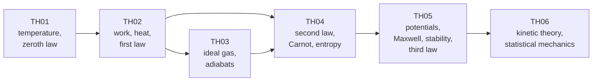

# Thermodynamics: Course Map

<span class="scope-taught">taught · in syllabus</span> <span class="scope-extra-book">extra · book</span>

Six chapters: temperature and the zeroth law; work, heat and the first law; the ideal gas and adiabats; the second law, Carnot engines and entropy; thermodynamic potentials, Maxwell relations, stability and the third law; and an optional bridge from kinetic theory to statistical mechanics. The main line follows the **MIT 8.333 lectures 1–4** (Kardar's Chapter I), with Zemansky's *Heat and Thermodynamics* Ch. 1–5 for the more elementary ground (thermometers, simple systems, work, ideal-gas experiments).

> [!warning] What is and is not in the sources
> The folder **does not say which course this is** or what its syllabus contains. The only lecture-type material is four MIT OpenCourseWare lecture notes (7 pp. each, with a text layer); they are treated as the syllabus (🟢). Zemansky (a scan; I OCR'd Ch. 1–5) and the AI-written notes are treated as book-level (🟡); my own derivations and numbers are 🔵. **Ask the instructor** whether the intended course is "thermodynamics" (TH01–TH05) or "thermodynamics and statistical mechanics" (adds TH06 and more), and whether kinetic theory and ensembles are examinable. Not in the folder: MIT Lectures 5+ (probability, kinetic theory, classical statistical mechanics, quantum statistics).

## The storyline

Central thread: **temperature exists (0th) $\to$ energy is conserved (1st) $\to$ a state function, entropy, grows (2nd) $\to$ the right potential for each constraint and the stability of equilibrium $\to$ unique ground state at $T=0$ (3rd) $\to$ all of it from counting microstates.**

## Chapters
| # | Chapter | Main sources | Status |
|---|---|---|---|
| 01 | [[TH01 Temperature and the Zeroth Law]] | MIT L1 §I.A–B; Zemansky Ch. 1–2 | draft |
| 02 | [[TH02 Work Heat and the First Law]] | MIT L1 §I.C; Zemansky Ch. 3–4 | draft |
| 03 | [[TH03 The Ideal Gas and Adiabatic Processes]] | MIT L1–L2; Zemansky Ch. 5 | draft |
| 04 | [[TH04 The Second Law Carnot Engines and Entropy]] | MIT L2 | draft |
| 05 | [[TH05 Potentials Maxwell Relations Stability and the Third Law]] | MIT L3–L4 | draft |
| 06 | [[TH06 From Kinetic Theory to Statistical Mechanics]] | AI notes (`KTG_Chapter`, `Thermo_StatMech_Notes`); MIT L4 pointer | draft (optional) |

```dataview
TABLE chapter AS "#", scope AS "Scope", status AS "Status"
FROM #subject/thermo AND #type/chapter
SORT chapter ASC
```

## Sources and what they are
| ID | File | What it is | Role |
|---|---|---|---|
| L1 | [[0d0ec730e8e02ed0399d39ff05054a72_MIT8_333F13_Lec1.pdf]] | MIT 8.333 Lecture 1, Kardar §I.A–I.C (definitions, zeroth law, first law, response functions), 7 pp. | taught: TH01–TH03 |
| L2 | [[1a131e225246d9749a298f49675c5fe5_MIT8_333F13_Lec2.pdf]] | Lecture 2, §I.D–I.F (second law, Carnot, entropy), 7 pp. | taught: TH03–TH04 |
| L3 | [[df0c4e121858c0be246b496dd8c39d2c_MIT8_333F13_Lec3.pdf]] | Lecture 3, §I.G–I.H (potentials, Maxwell relations), 7 pp. | taught: TH05 |
| L4 | [[97dcd8dee3d3301cd7c27745b17b10b5_MIT8_333F13_Lec4.pdf]] | Lecture 4, §I.I–I.J (stability, third law), 7 pp. | taught: TH05 |
| Z | [[Heat and thermodynamics an intermediate textbook (Mark Waldo Zemansky Richard Dittman) (z-library.sk, 1lib.sk, z-lib.sk).pdf]] | Zemansky and Dittman, 508 pp., a scan (OCR'd PDF pp.14–150; book page = PDF − 20; chapters start at PDF 23, 49, 69, 92, 126) | extra/book |
| AI | `Thermodynamics_Ch1-5_Notes.pdf`, `Zemansky_Thermodynamics_Overview.pdf`, `Thermo_ConceptSummary_FormulaSheet.pdf`, `StatMech_Thermodynamics_Kardar_Ch1.pdf`, `KTG_Chapter.pdf`(+`.tex`), `Thermo_StatMech_Notes.pdf` | AI-written notes on Zemansky Ch. 1–5, on Kardar Ch. I and on kinetic theory and ensembles (83 pp.) | secondary; used for cross-checks and TH06 |

## Gaps (to ask the instructor / supply later)
- **Which course and which syllabus** (see the warning above).
- MIT Lectures **5 onward** (probability, central limit theorem, kinetic theory, Liouville, ensembles) are not present; TH06 stands in with the AI notes.
- Statistical mechanics of **quantum** systems (Bose and Fermi gases, photon gas derivation of Planck, Debye model) is only touched (TH06 §7).
- The MIT notes cite **"test 1 review problems"** (proofs that $E=E(T)$ for the ideal gas, the Carnot construction for any $E(T)$, a test of the third law for glasses); not in the folder. TH05 supplies the first.

## Why this subject is tightly linked to the others
- **Climate:** the equation of state of air, $c_p$, the first law of a parcel, adiabats and the lapse rate (TH01–TH03; [[CL05 Thermodynamic State of the Atmosphere]], [[CL09 Radiative-Convective Equilibrium]]); entropy and the atmosphere as a heat engine (TH04); Clausius-Clapeyron and the saturation vapour pressure (TH05; [[Clausius-Clapeyron Relation]]); equipartition, vibrational modes and the Planck factor (TH06; [[CL07 Optical Properties of the Atmosphere]], [[Planck Law]], [[Blackbody Radiation]], [[Stefan-Boltzmann Law]], [[Wien Displacement Law]]).
- **Quantum mechanics:** the oscillator and two-level energies in the partition function ([[Quantum Mechanics - Course Map]]; [[QM05 The Harmonic Oscillator]]), the unique ground state of the third law.
- **Eco-evo and foundations:** stability and the unstable branch of a bistable curve ([[Bistability and Tipping Points]], [[Fixed Points and Linear Stability]], [[EE06 Eutrophication and Alternative Stable States]]); fluctuations scale as $1/\sqrt N$.
- **Probability:** Boltzmann factor, multinomial counting, Gaussian fluctuations ([[Probability - Course Map]]).
- Earlier concept notes in this folder ([[First Law of Thermodynamics]], [[Ideal Gas Law]], [[Adiabatic Process and Potential Temperature]]) are the climate-oriented versions; they use the **Zemansky sign convention** for work (see [[TH02 Work Heat and the First Law]] §2).

## Revision
- A printable formula sheet: [[th-formula-sheet.pdf]] (2 pages).
- Practice with solutions lives at the end of each chapter (6 × 10 problems).

## Concept index
```dataview
LIST FROM #type/concept AND #subject/thermo SORT file.name ASC
```

See [[Subject Map]] for how this subject relates to the others and [[Roadmap]] for its place in the plan.

<!-- graph-spine:start (generated by scripts/graph_spine.py; do not edit between the markers) -->
## Atlas: every note in this subject
The graph view draws only real links, so this block links **every** note of the subject (the map is the hub of its cluster; [[Home]] is the hub of all maps).

> [!abstract]- Atlas (generated): 6 chapters · 58 concept notes
> **Chapters (6):** [[TH01 Temperature and the Zeroth Law]] · [[TH02 Work Heat and the First Law]] · [[TH03 The Ideal Gas and Adiabatic Processes]] · [[TH04 The Second Law Carnot Engines and Entropy]] · [[TH05 Potentials Maxwell Relations Stability and the Third Law]] · [[TH06 From Kinetic Theory to Statistical Mechanics]]
>
> **Concept notes (58):** [[Adiabatic Process and Potential Temperature]] · [[Blackbody Radiation]] · [[Canonical Ensemble]] · [[Carnot Engine]] · [[Carnot Theorem]] · [[Chemical Potential]] · [[Clausius Theorem]] · [[Clausius-Clapeyron Relation]] · [[Empirical Temperature]] · [[Enthalpy]] · [[Entropy]] · [[Equation of State]] · [[Equipartition of Energy]] · [[Exact Differential]] · [[First Law of Thermodynamics]] · [[Fundamental Thermodynamic Relation]] · [[Generalised Force and Displacement]] · [[Gibbs Free Energy]] · [[Gibbs-Duhem Relation]] · [[Grand Potential]] · [[Heat and Work]] · [[Heat Capacity]] · [[Heat Engine]] · [[Helmholtz Free Energy]] · [[Ideal Gas Law]] · [[Ideal Gas Temperature Scale]] · [[Internal Energy]] · [[Irreversibility]] · [[Joule Expansion]] · [[Kelvin and Clausius Statements]] · [[Kinetic Theory of Gases]] · [[Legendre Transform]] · [[Maxwell Relations]] · [[Maxwell-Boltzmann Distribution]] · [[Mayer Relation]] · [[Mean Free Path]] · [[Partition Function]] · [[Planck Law]] · [[Planck Mean Energy]] · [[Quasi-Static Process]] · [[Ratio of Specific Heats]] · [[Refrigerator and Heat Pump]] · [[Response Functions]] · [[Reversible Adiabatic Process]] · [[Ruchhardt Method]] · [[Sackur-Tetrode Equation]] · [[Schottky Anomaly]] · [[Second Law of Thermodynamics]] · [[Speed of Sound]] · [[State Function]] · [[Statistical Entropy]] · [[Stefan-Boltzmann Law]] · [[Thermodynamic Equilibrium]] · [[Thermodynamic Stability]] · [[Thermodynamic Temperature]] · [[Third Law of Thermodynamics]] · [[Wien Displacement Law]] · [[Zeroth Law]]
<!-- graph-spine:end -->
