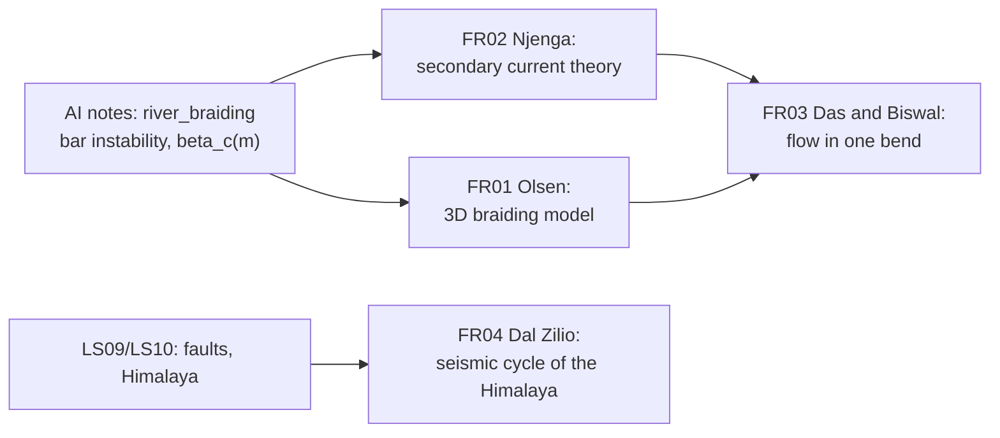

# Further Research: Landscapes Papers

> [!summary] What this folder is
> Research papers in the Landscapes source folder (`earth-and-climate/landscapes-geomorphology/books/`), each explained as a **beginner-style chapter in terms of the vault's own content** so that it connects to what you already know. In the source priority of this subject (slides and AI notes, primary books, other books, **papers**) these are the last layer: *not examinable*, read for understanding and as a window on current research. Papers cited on the lecture slides but not in the repository (Banerjee and Scherler 2025, 2026; Dielforder et al. 2020; Kale et al.; Sheth 2020; Turcotte and Schubert references) are discussed in [[LS19 Glacial and Aeolian Landforms]] and [[LS18 Deccan Traps Terrain]] from the slides only.

## Chapters
| # | Paper | Theme | Read how deeply |
|---|---|---|---|
| [[FR01 Braided Rivers in 3D (Olsen 2021)]] | Olsen, *Geomorphology* 375 (2021) | 3D numerical model of a braiding flume experiment; sediment formula and secondary currents | abstract, introduction, methods, conclusions |
| [[FR02 Secondary Currents and River Channel Patterns (Njenga 2013)]] | Njenga et al., *Applied Mathematics* 4 (2013) | analytic stability theory: secondary current phase shift separates straight, meandering, braided | abstract, introduction, conclusions |
| [[FR03 Flow at a River Bend with CCHE2D (Das and Biswal 2023)]] | Das and Biswal, *Sci. Res. Commun.* 3 (2023) | 2D flow model of a bend of the Gomati River, Tripura; Manning calibration | abstract, introduction, methods, conclusions |
| [[FR04 Building the Himalaya (Dal Zilio et al 2021)]] | Dal Zilio et al., *Nat. Rev. Earth Environ.* 2 (2021) | Himalayan seismic cycle and mountain building | abstract, introduction, key points, glossary |
| [[FR05 Did Erosion Accelerate in the Late Cenozoic (Schildgen et al 2018)]] | Schildgen et al., *Nature* 559 (2018) 89–93 (against Herman et al. 2013; Ganti et al. 2016) | spatial correlation bias in thermochronology erosion rates | abstract only (+ reading-list post); the other two papers not read |

## How the papers connect

> **Rivers (FR01–FR03)** share one physical idea (a bend or a bar creates a secondary flow that moves sediment) at three levels: a research code (FR01), an analytic theory (FR02) and an engineering application (FR03). They extend [[LS16 Fluvial Landscapes]]. **The Himalaya paper (FR04)** extends [[LS09 Faults and Earthquakes]] and [[LS10 Folds Flexure and Mountain Building]].

## Related sources
- AI-written notes on braiding: [[river_braiding-1.pdf]] (`ai-gen-notes/river_braiding.tex`, ~7,700 words, 7 chapters: fluid-mechanics recap, governing equations, linear stability of bed patterns, physical controls, braiding indices, synthesis).
- The SSIIM–Landlab vault (`~/Documents/Landlab-SSIIM-Vault`) for the numerical-modelling side (FR01's model is SSIIM).
- Mathematical toolkit: [[Fourier and Laplace Transforms]] (growth rates, dispersion relations).

## Gaps
- [ ] Read the bodies of FR02–FR04 and the results figures of FR01/FR03 in full and upgrade the chapters from guides to summaries.
- [ ] Papers cited in the lectures but absent from the repository (Banerjee & Scherler; Dielforder et al.): add to `books/` and write chapters if wanted.
