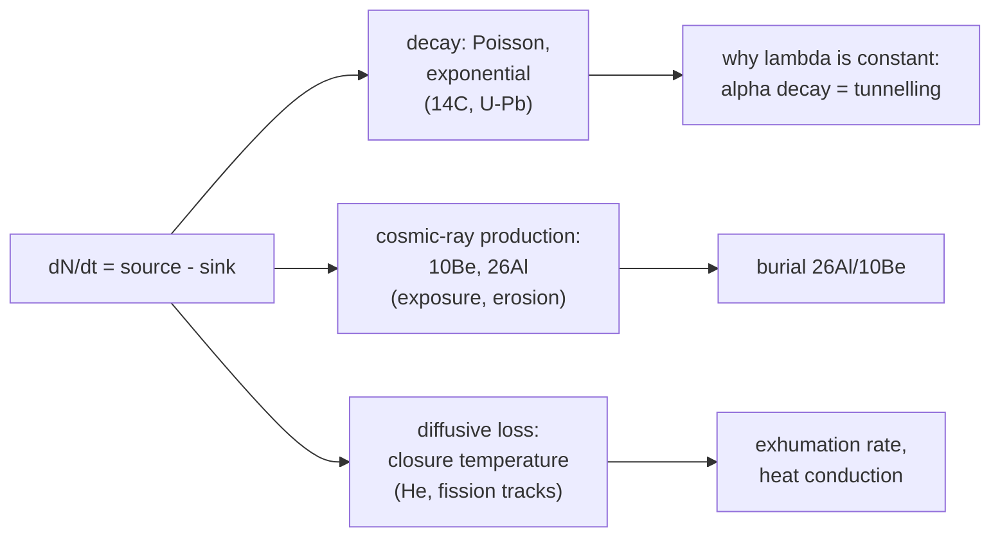

# LSX1 · Clocks in Rocks: Decay, Tunnelling, Cosmic Rays and Diffusion

◀ [[LS23 Bedrock Channels and River Incision]] · [[Landscapes and Geomorphology - Course Map|Course Map]] · sibling: [[THX1 Diffusion Random Walks and the Heat Equation]]

extra · book extra · beyond

> [!syllabus] Why this chapter is interdisciplinary, and where it lives
> It lives in **Landscapes** (`05-Landscapes-Geomorphology/Interdisciplinary/`) because it follows **Anderson and Anderson Chapter 6**, "Dating methods, and establishing timing in the landscape" (printed pp.120–159, PDF = printed + 18), the chapter that turns a landscape's *shape* into *rates*. But every clock in it is a piece of another subject: **Probability** (each atom decays at random; the waiting time is exponential and counting is Poisson), **Quantum mechanics** (alpha decay is tunnelling through the Coulomb barrier, [[QM08 Quantum Tunnelling]]), **Thermodynamics** (a mineral's closure temperature is set by diffusion with an Arrhenius rate, [[THX1 Diffusion Random Walks and the Heat Equation]]), **Chemistry** (isotopes, quartz, the $^{14}$C system) and **Climate** (the ice-age timescale the clocks calibrate). Reading order: LS23 §2 (the field problem) → this chapter.
> 🟡 **Extra · book** (A&A Ch. 6): the decay law and half-life, radiocarbon, cosmogenic radionuclides and their production profile, steady-state erosion rates, burial dating, thermochronometers and the effect of topography on isotherms ([[geomorphology-the-mechanics-and-chemistry-of-landscapes-9780521519786-0521519780_compress.pdf#page=138|printed pp.120–159]]; thermochronology [[geomorphology-the-mechanics-and-chemistry-of-landscapes-9780521519786-0521519780_compress.pdf#page=164|printed pp.146–157]]).
> 🔵 **Extra · beyond** (all numbers in `scripts/interdisc_numbers.py`, section LSX1): the Poisson/exponential view of decay with a Monte-Carlo check, counting-statistics numbers, the **Gamow-model calculation of alpha-decay half-lives across 24 orders of magnitude**, the closed-form cosmogenic erosion-rate inversion with its ODE check, the **Dodson closure-temperature** derivation and iteration, the exhumation-rate and Péclet-number estimates.

> [!key] After this chapter you can
> - derive the **decay law**, the half-life $t_{1/2}=\tau\ln2=0.693\,\tau$ and the age equation, and say why the age error is independent of age ($\delta t=\tau\,\delta N/N$),
> - explain why a decay clock is a **Poisson process** (exponential waiting times, $1/\sqrt n$ counting error) and why AMS beat decay counting,
> - explain why the **decay constant is a property of the nucleus** (alpha decay is tunnelling; a 10 % change of $Q$ moves the half-life by a factor $\sim10^{3}$),
> - write the **cosmogenic balance equation** $\dot N=P-\lambda N-(\rho\varepsilon/\Lambda)N$ and invert it for an exposure age or a steady **erosion rate**,
> - use the $^{26}$Al/$^{10}$Be pair to date **burial**,
> - derive a mineral's **closure temperature** from diffusion kinetics, and convert a thermochronometer age into an **exhumation rate**.

> [!intuition] The one-sentence story
> A clock is a conservation law for numbers of atoms: some process *adds* them (cosmic rays, uranium decay), some *removes* them (decay, erosion, diffusive loss), and the equation $\dot N=\text{source}-\text{sink}$, solved for $N(t)$, is the dating formula; four physical processes (radioactive decay, nuclear reactions by cosmic rays, diffusion, and radiation damage) give four families of clock covering from a century to a billion years.

## 1. Every clock is a balance equation
A&A (printed p.121, summary p.157) say it twice: "once again we find the utility of writing out a balance equation." The quantity is the number of atoms (or tracks, or trapped electrons) in a sample. Three examples set the vocabulary.

| clock | what accumulates or decays | the equation | range |
|---|---|---|---|
| radiocarbon | $^{14}$C decays after the organism dies | $N=N_0e^{-\lambda t}$ | $\lesssim50$ kyr |
| cosmogenic $^{10}$Be, $^{26}$Al | made in quartz by cosmic rays, lost by decay and erosion | $\dot N=P-\lambda N-\frac{\rho\varepsilon}\Lambda N$ | 1 kyr–5 Myr |
| (U–Th)/He, fission tracks | daughter atoms (or damage trails) accumulate while the mineral is cold, and leak or anneal when it is hot | diffusion with Arrhenius rate | 1–100 Myr, 70–110 °C |

(A&A also cover luminescence dating, trapped electrons released by light, amino-acid racemisation, an Arrhenius process, tree rings, varves, magnetic reversals (the last, Brunhes–Matuyama, at $\sim700$ ka), and $^{137}$Cs from weapons tests; I follow only the three above because they connect to other subjects.)

## 2. The decay law
### 2.1 Derivation
> [!derivation] 🟡 Extra · book: the law and its half-life (A&A pp.131–133)
> Each unstable atom has the same probability per unit time $\lambda$ of decaying, independent of its history. In $dt$ the expected number of decays is $\lambda N\,dt$, so
>
> $$\frac{dN}{dt}=-\lambda N\ \Rightarrow\ N(t)=N_0e^{-\lambda t}.$$
>
> The **half-life** is the time for $N=N_0/2$: $e^{-\lambda t_{1/2}}=\tfrac12$, so $t_{1/2}=\ln2/\lambda$. The **mean life** is $\tau=1/\lambda$, so $t_{1/2}=\tau\ln2=0.693\,\tau$ (A&A: "the half-life is 69 % of the mean life"). The **age** from a measurement of the remaining fraction is $t=\tau\ln(N_0/N)$.

> [!example] 🧮 Radiocarbon in numbers
> $t_{1/2}(^{14}\text{C})=5730$ yr, so $\lambda=1.21\times10^{-4}$ yr$^{-1}$, $\tau=8267$ yr. After 1, 2, 5, 9 half-lives: $\tfrac12,\ \tfrac14,\ 3\%,\ 0.2\%$ remain, at ages 5.7, 11.5, 28.7 and 51.6 kyr: the **practical limit of $\sim50$ kyr** is nine half-lives. A 1 % error in $N$ gives $\delta t=\tau\,\delta N/N=83$ yr whatever the age (413 yr for 5 %): relative errors in $N$ turn into *absolute* errors in $t$, independent of how old the sample is, until $N$ is so small that counting dominates.

### 2.2 Why decay is a probability problem
The derivation above is the *expected* behaviour of a huge population. For one atom, "the probability of decaying in $dt$ is $\lambda dt$ whatever its age" is exactly the **memoryless property** ([[Memoryless Property]]) of the **exponential distribution** ([[Exponential Distribution]]): the lifetime $T$ is exponential, $P(T>t)=e^{-\lambda t}$, with mean $\tau=1/\lambda$ and $P(T>t_{1/2})=\tfrac12$. The *count* of decays in an interval, for a large sample, is **Poisson** ([[Poisson Distribution]]) with mean and variance both equal to $\lambda N\Delta t$, so counting $n$ events gives a relative error $1/\sqrt n$. I checked both by simulation: $2\times10^{5}$ atoms with exponential lifetimes, mean life 8231 yr (theory 8267) and surviving fraction 0.4982 after one half-life.

> [!example] 🧮 Counting statistics: why accelerator mass spectrometry won
> 1 g of modern carbon contains $5.0\times10^{22}$ atoms, of which a fraction $1.2\times10^{-12}$ are $^{14}$C: $N=6.0\times10^{10}$ atoms, with activity $\lambda N=0.23$ Bq $=13.8$ decays/min (the textbook value is about 13.6). Counting decays to **1 %** needs $10^{4}$ counts, $\mathbf{12}$ **hours** on a gram of carbon; to 5 %, 0.5 h; and old, low-activity samples take days or need grams. **AMS counts the atoms**, not their decays: 1 mg holds $6\times10^{7}$ atoms of $^{14}$C and the counting error is $1/\sqrt N\sim10^{-4}$, so milligram samples and 0.1 % statistics become possible (A&A p.134; the limit is then the machine and the blank).

## 3. Why the decay constant is constant: tunnelling
Chemists and geologists use $\lambda$ as a fixed number: no known temperature, pressure or chemical environment changes the decay constant of an alpha or beta emitter by more than $\sim10^{-4}$ (electron-capture rates change slightly with the electron density at the nucleus). The reason is that $\lambda$ is set inside the nucleus. For **alpha decay** it is a **quantum tunnelling** rate ([[QM08 Quantum Tunnelling]], [[Gamow Factor]]): the alpha particle, of energy $Q$, rattles about inside the nucleus, hitting its edge at a rate $f\sim v/2R\sim10^{21}\ \text{s}^{-1}$, and each hit has the Gamow probability $e^{-2G}$ of tunnelling through the Coulomb barrier:

$$\lambda\approx f\,e^{-2G},\qquad G=\frac1\hbar\int_R^b\sqrt{2\mu\Big(\frac{2Z_de^2}{4\pi\varepsilon_0r}-Q\Big)}\,dr,\qquad b=\frac{2Z_de^2}{4\pi\varepsilon_0Q}.$$

> [!derivation] 🔵 Extra · beyond (computed): half-lives across 24 orders of magnitude
> I evaluated $G$ by quadrature for five emitters with a square-well nuclear radius $R=1.2(A_d^{1/3}+4^{1/3})$ fm and $f=v/2R$ with an inside kinetic energy $Q+35$ MeV, with *no adjustable parameter*:
>
> | nucleus | $Q$ (MeV) | $2G$ | model $t_{1/2}$ | observed $t_{1/2}$ | model/observed |
> |---|---|---|---|---|---|
> | $^{238}$U | 4.270 | 88.0 | $1.5\times10^{9}$ yr | $4.47\times10^{9}$ yr | 0.34 |
> | $^{232}$Th | 4.081 | 89.1 | $4.8\times10^{9}$ yr | $1.41\times10^{10}$ yr | 0.34 |
> | $^{226}$Ra | 4.871 | 72.8 | 370 yr | 1600 yr | 0.23 |
> | $^{222}$Rn | 5.590 | 60.8 | $7.5\times10^{4}$ s | 3.82 d | 0.23 |
> | $^{212}$Po | 8.954 | 32.3 | $2.8\times10^{-8}$ s | $2.99\times10^{-7}$ s | 0.095 |
>
> **The model is within a factor of 3 to 10 of the observation for half-lives that span $\log_{10}(4.7\times10^{23})\approx24$ decades** (model span $1.7\times10^{24}$): the exponential in $G$ does all the work. A **10 % increase in $Q$ shortens the $^{238}$U half-life by a factor 2300** ($3\times10^{3}$): this is the **Geiger–Nuttall law**, and it explains why nuclear decay is a clock (the barrier is a property of the nucleus and the few-MeV energy of the alpha is insensitive to anything chemical) and why the same few elements give half-lives from nanoseconds ($^{212}$Po) to the age of the Earth ($^{238}$U). U–Pb dating of zircons ($^{238}$U, $^{235}$U) rests on this.

## 4. Cosmogenic nuclides: clocks that start when rock meets sky
High-energy cosmic rays (mostly protons) strike the atmosphere and the top metre or so of rock; their secondary neutrons break nuclei apart (*spallation*) and make rare isotopes inside minerals. In **quartz** (SiO$_2$) the products $^{10}$Be (half-life 1.387 Myr) and $^{26}$Al (0.705 Myr) are not otherwise present, so a measured concentration is a clock for how long the rock has been near the surface (A&A pp.136–145; see also [[LS23 Bedrock Channels and River Incision]] §2).

### 4.1 Production profile
Each reaction uses up energy, so the production rate falls off exponentially with the mass overburden $\rho z$ (A&A: the sum of three exponentials for neutrons and two classes of muons; the neutron term dominates in the top few metres):

$$P(z)=P_0\,e^{-\rho z/\Lambda},\qquad\Lambda\approx160\ \text{g cm}^{-2}\ \Rightarrow\ z_*=\Lambda/\rho=59\ \text{cm in rock}\ (\rho=2.7).$$

The rate also depends on altitude and latitude and on shielding by snow, water or topography. Each attenuation length of air removed multiplies the production by $e$: at 5 km altitude the air column is about 540 g/cm² instead of 1033 g/cm² at sea level, so production is higher by $e^{(1033-540)/160}\approx22$ (my arithmetic with a standard-atmosphere column mass, ignoring the geomagnetic latitude effect; `[verify]`); the surface rate for $^{10}$Be at sea level and high latitude is of order $5$ atoms g$^{-1}$yr$^{-1}$ (recalled, `[verify]`; calibrated in practice on surfaces of known age). At a depth of 0.6 m the production is 36 % of the surface value, at 1.2 m 13 %, at 3 m 0.6 %.

### 4.2 The balance equation
> [!derivation] 🟡 Extra · book + 🔵 checked: exposure age and erosion rate
> For a rock being lowered by erosion at a speed $\varepsilon$ (cm/yr), a sample at the surface was at depth $\varepsilon t$ a time $t$ ago. The concentration obeys production minus decay minus the loss of the layer carrying the atoms (A&A pp.137–140):
>
> $$\frac{dN}{dt}=P_0-\lambda N-\frac{\rho\varepsilon}\Lambda N\ \Rightarrow\ N(t)=\frac{P_0}{\lambda+\rho\varepsilon/\Lambda}\Big[1-e^{-(\lambda+\rho\varepsilon/\Lambda)t}\Big].$$
>
> Three limits:
> - **no erosion, short exposure** ($\lambda t\ll1$): $N=P_0t$, so the **exposure age is $t=N/P_0$** (of a moraine boulder, a fault scarp, a glacially polished surface);
> - **steady erosion for long enough** ($t\gg(\lambda+\rho\varepsilon/\Lambda)^{-1}$): $N=P_0/(\lambda+\rho\varepsilon/\Lambda)$, which inverts to the **erosion rate**
>
> $$\boxed{\varepsilon=\frac\Lambda\rho\Big(\frac{P_0}N-\lambda\Big)};$$
> - **no erosion, very long exposure**: secular equilibrium $N=P_0/\lambda$ ($1.0\times10^{7}$ atoms/g for $^{10}$Be), reached to 95 % after 6 Myr.
>
> The **averaging time** is the time to erode one attenuation length, $z_*/\varepsilon$ (600 yr at 1 mm/yr; LS23 §2.2).

| measured $N$ (atoms/g) | $\varepsilon$ (m/Myr = µm/yr) | averaging time $\Lambda/\rho\varepsilon$ |
|---|---|---|
| $10^{4}$ | 296 | 2 kyr |
| $10^{5}$ | 29.3 | 20 kyr |
| $10^{6}$ | 2.7 | 220 kyr |

($P_0=5$, $\lambda=5.0\times10^{-7}$ yr$^{-1}$.) For $N=10^{5}$: the **exposure age with no erosion** would be $N/P_0=20$ kyr, whereas the same concentration under steady erosion means a surface lowered by **29 m per Myr**: *the same measurement means an age or a rate depending on the assumption*. I verified the closed form against numerical integration of the ODE to $10^{-6}$ (script).

The geomorphic point (A&A pp.139–142): the **concentration in river sand** is the *catchment-average* of the concentrations on its hillslopes (sediment is a mixture), so a stream-sediment sample gives a basin-wide erosion rate averaged over $z_*/\varepsilon$, an extraordinarily useful number that no field measurement gave before ($10$–$10^{3}$ m/Myr is the usual range). Problems: *inheritance* (a surface exposed before the event being dated carries extra nuclides; A&A discuss LGM surfaces in the San Juan Mountains with twice the expected $^{10}$Be, interpreted as having lost less than 3 m in 30 kyr, $<0.1$ mm/yr: glaciers erode slowly in cold-based, hard-rock settings), shielding, and the uncertainty of the production rate.

### 4.3 Burial dating
Quartz buried deeply enough to be shielded from cosmic rays stops producing nuclides, and both decay, but $^{26}$Al faster. The ratio falls as $R=R_0e^{-t/\tau}$ with $1/\tau=1/\tau_{26}-1/\tau_{10}$, $\tau=2.07$ Myr ([[LS23 Bedrock Channels and River Incision]] §2.1), $R_0\approx6.75$ (the production ratio). From a measured $R$: $t=\tau\ln(R_0/R)$; for $R=3,\ 1.5,\ 0.6$ the burial ages are $1.7,\ 3.1,\ 5.0$ Myr; the method dates cave sediments and glacial tills over $\sim0.5$–5 Myr, the gap between $^{14}$C and thermochronology.

## 5. Thermochronology: clocks that start when rock cools
Uranium and thorium in minerals such as apatite and zircon decay by chains of alpha emissions; each alpha particle becomes a **helium** atom, which **diffuses out** of the grain when it is warm. Fission of $^{238}$U leaves a **trail of lattice damage** (a *fission track*) which **anneals** when warm. In both, the clock "starts" when the mineral has cooled enough to keep its product, so the age is the *time since the rock cooled through a characteristic temperature*, the **closure temperature**. A&A quote about **110 °C for apatite fission tracks** and **75 °C for apatite (U–Th)/He**; $^{40}$Ar/$^{39}$Ar in micas and feldspar close at higher temperatures (A&A pp.146–152).

### 5.1 Dodson's closure temperature
> [!derivation] 🔵 Extra · beyond (iterated numerically): why a mineral "closes" at a temperature
> A spherical grain of radius $a$ loses its daughter product by diffusion, with $D=D_0e^{-E/RT}$ (an **Arrhenius** law, the same form as racemisation, A&A Fig. 6.4) and a characteristic loss time $\sim a^2/D$. When the rock cools at a rate $\dot T=dT/dt<0$, the temperature falls and $D$ falls *exponentially*, so there is a fairly sharp temperature at which the diffusion time exceeds the time over which the temperature changes appreciably. Dodson (1973) made this exact: the apparent age is the time since the temperature was $T_c$, where
>
> $$\boxed{T_c=\frac{E/R}{\ln\!\big(A\,\tau_c\,D_0/a^2\big)},\qquad\tau_c=\frac{RT_c^2}{E\,|\dot T|}}$$
>
> with $A=55$ for a sphere (8.7 for a plane sheet). It is an implicit equation, solved by iteration (it converges in a few steps). **$T_c$ depends on the cooling rate, only logarithmically**: faster cooling gives a higher closure temperature. With the apatite-He activation energy $E=138$ kJ/mol (recalled, `[verify]`) and a frequency factor $D_0/a^2=8.3\times10^{5}\ \text{s}^{-1}$ *chosen* so that $T_c=70\,^\circ$C at $10$ K/Myr (the real Durango-apatite value is in Farley 2000 and was not checked), I find

| cooling rate | 1 K/Myr | 10 K/Myr | 100 K/Myr |
|---|---|---|---|
| $T_c$ (apatite He) | 55 °C | 70 °C | 86 °C |

so a factor of 10 in cooling rate shifts $T_c$ by $\sim16$ K. The agreement of the chosen 70 °C with A&A's 75 °C is therefore a *calibration*, not a test; what *is* tested is the structure, a weak logarithmic dependence.

### 5.2 From age to exhumation
Rock cools because it is brought towards the cold surface by erosion. A closure temperature $T_c$ lies at depth $z_c=(T_c-T_s)/G$ for a geothermal gradient $G$ and surface temperature $T_s$, so an age $t$ means a mean exhumation rate $\varepsilon\approx z_c/t$. *Numbers:* an apatite He age of 4 Ma with $T_c=70\,^\circ$C, $T_s=10\,^\circ$C and $G=25\ ^\circ$C/km gives $z_c=2.4$ km and $\varepsilon=0.6$ mm/yr. This is the rate of exhumation of the *mountain range* ([[LS10 Folds Flexure and Mountain Building]], [[FR04 Building the Himalaya (Dal Zilio et al 2021)]]). A&A show it for the eastern margin of Tibet: slow cooling through the Mesozoic and early Cenozoic, with **rapid cooling in the Mio-Pliocene**, from several chronometers at once.

### 5.3 Heat conduction complicates it
The assumption "horizontal isotherms" is fine for high-temperature systems, but at 70–110 °C **the Earth's surface bends the isotherms**: they are **compressed beneath valleys and expanded beneath ridges**, to depths of order twice the relief (A&A Fig. 6.45, Safran 2003). In A&A's example a valley-floor sample crosses the fission-track closure temperature at 4.5 Ma but the He closure at 2 Ma. The heat equation with erosion has a **Péclet number** $Pe=\varepsilon L/\kappa_T$ ($\kappa_T=10^{-6}$ m²/s $=31.6$ m²/yr): for $\varepsilon=1$ mm/yr and $L=10$ km, $Pe=0.32$; at 5 mm/yr, $1.6$, the regime in which rapid exhumation *advects* heat upward and compresses the isotherms ([[THX1 Diffusion Random Walks and the Heat Equation]] §6). The thermal diffusion time $L^2/\kappa_T$ is 32 kyr for 1 km, 3.2 Myr for 10 km and 317 Myr for 100 km (lithosphere). Modern codes solve heat and topography together (Braun 2005; Ehlers 2005).

## 6. Choosing a clock
| question | clock | principle | needs |
|---|---|---|---|
| how old is this log, peat or shell ($\lesssim50$ kyr)? | $^{14}$C | decay | organic carbon; calibration curve (production varies) |
| how long has this surface been exposed? | $^{10}$Be, $^{26}$Al, $^{36}$Cl | production − decay − erosion | quartz; known $P_0$ |
| how fast is this basin eroding (kyr to 10$^5$ yr)? | $^{10}$Be in river sand | steady-state balance | quartz sand |
| when was this cave sediment buried? | $^{26}$Al/$^{10}$Be | differential decay | $>5$ m shielding |
| how fast has this range been exhumed (Myr)? | apatite FT and He, zircon, Ar/Ar | closure temperature + geotherm | known $G$, thermal model |
| when did a river last occupy this terrace (OSL)? | luminescence | trapped charge, last exposure to light | quartz or feldspar |

## 7. Worked examples
> [!example] 🧮 Example 1: an erosion rate from river sand
> A catchment's sand has $N=3\times10^{5}$ atoms $^{10}$Be/g quartz. With $P_0=5$, $\lambda=5.0\times10^{-7}$: $\varepsilon=59.3\ \text{cm}\times(5/3\times10^{5}-5\times10^{-7})=59.3\times1.617\times10^{-5}=9.6\times10^{-4}$ cm/yr $=\mathbf{9.6}$ m/Myr; the averaging time is $z_*/\varepsilon=62$ kyr, long enough to integrate over several glacial cycles but short compared with the lifetime of a mountain range.

> [!example] 🧮 Example 2: closure and a cooling rate
> An apatite He age of 12 Ma and a zircon (higher-temperature) age of 20 Ma give the cooling between the two closure temperatures (say 180 °C and 70 °C): $110\ \text{K}/8\ \text{Myr}=13.8$ K/Myr; at $G=25$ K/km that is an exhumation rate of $0.55$ mm/yr between the two ages. (Dodson's $T_c$ itself depends weakly on this rate: at 13.8 K/Myr the apatite-He closure is 72 °C, not the nominal 70 °C.)

## 8. Check yourself
> [!question] Problems (answers folded)
> 1. A sample retains 12.5 % of its $^{14}$C. How old, and with what error if $N$ is known to 2 %?
> 2. Show that $t_{1/2}=\tau\ln2$ and that the mean of the exponential lifetime distribution is $\tau$.
> 3. A beam-counting measurement of an old sample gives 25 decays in an hour. What is the relative error? How long would you have to count to reach 1 %?
> 4. Why does a 10 % change of the alpha energy change the half-life by $\sim10^{3}$?
> 5. $N=2\times10^{5}$ atoms/g of $^{10}$Be, $P_0=5$, $\lambda=5\times10^{-7}$. (a) The exposure age assuming no erosion; (b) the erosion rate assuming steady state.
> 6. A boulder on a moraine has $N=1.5\times10^{5}$ atoms/g; if the moraine was deposited 25 kyr ago and the boulder has since eroded by $\varepsilon$, what is the minimal $\varepsilon$?
> 7. Quartz buried in a cave has $R=N_{26}/N_{10}=1.0$ ($R_0=6.75$): the burial age?
> 8. Compute $T_c$ for $E=138$ kJ/mol, $D_0/a^2=8.3\times10^{5}$ s$^{-1}$, $|\dot T|=30$ K/Myr (use $A=55$).
> 9. A zircon age of 30 Ma and a closure temperature 180 °C; the surface is at 10 °C and $G=30$ °C/km. The mean exhumation rate?
> 10. Why is the age uncertainty $\delta t=\tau\,\delta N/N$ independent of $t$?

> [!example]- Answers
> 1. 3 half-lives: $3\times5730=17.2$ kyr; $\delta t=\tau\,\delta N/N=8267\times0.02=165$ yr.
> 2. $e^{-\lambda t_{1/2}}=\tfrac12\Rightarrow t_{1/2}=\ln2/\lambda$; the mean of $\lambda e^{-\lambda t}$ is $1/\lambda$.
> 3. $1/\sqrt{25}=20\%$; for 1 % one needs $10^{4}$ counts, i.e. $10^{4}/25\ \text{h}=400$ h $=16.7$ days.
> 4. $\lambda\propto e^{-2G}$. The dominant part of $2G$ is $2\pi\eta=2\pi\cdot2Z_de^2/(4\pi\varepsilon_0\hbar v)\propto Q^{-1/2}$, which is $\approx171$ for $^{238}$U (the finite nuclear radius subtracts a nearly $Q$-independent $\approx83$, leaving $2G=88$). A 10 % rise in $Q$ cuts $2\pi\eta$ by $4.7\%\approx8$, so $2G$ falls from 88 to about 80 and $\lambda$ rises by $e^{7.7}\approx2300$, as the full integral confirms.
> 5. (a) $N/P_0=40$ kyr; (b) $\varepsilon=59.3\times(2.5\times10^{-5}-5\times10^{-7})=1.45\times10^{-3}$ cm/yr $=14.5$ m/Myr.
> 6. Without erosion the concentration after 25 kyr would be $P_0t=1.25\times10^{5}$; the measured $1.5\times10^{5}$ exceeds it, so the boulder has *inherited* nuclides (it was exposed before deposition): the moraine age cannot be tested without a second measurement.
> 7. $t=2.07\ln6.75=3.95$ Myr.
> 8. Iterating Dodson's equation gives $T_c=77.6\,^\circ$C (the 16 K/decade slope from 70 °C at 10 K/Myr predicts $70+16.4\log_{10}3=77.8$).
> 9. $z_c=(180-10)/30=5.7$ km, $\varepsilon=5.7/30=0.19$ mm/yr.
> 10. $t=\tau\ln(N_0/N)$, so $\delta t=\tau\,\delta N/N$: a fractional error in $N$ gives a fixed time error, because $d\ln N/dt=-1/\tau$ is constant for an exponential.

## 9. Summary
- Clocks are balance equations. Decay: $N=N_0e^{-\lambda t}$, $t_{1/2}=0.693\tau$; age error $\delta t=\tau\,\delta N/N$.
- Decay is memoryless (exponential lifetimes) and counting is Poisson ($1/\sqrt n$); AMS counts atoms, not decays.
- $\lambda$ is set by the nucleus; for alpha decay it is the Gamow tunnelling rate, so half-lives span 24 decades with an exponential sensitivity to $Q$.
- Cosmogenic: $\dot N=P-\lambda N-(\rho\varepsilon/\Lambda)N$; exposure age $N/P$; steady erosion $\varepsilon=(\Lambda/\rho)(P/N-\lambda)$; burial $\tau=2.07$ Myr.
- Thermochronology: closure temperature $T_c=(E/R)/\ln(A\tau_cD_0/a^2)$, logarithmic in the cooling rate; exhumation $\varepsilon=z_c/t$; topography bends isotherms.

## Map of this chapter
> [!connection] How LSX1 connects
> **Landscapes:** [[LS23 Bedrock Channels and River Incision]] (incision rates from straths, caves), [[LS14 Glaciers Mass Balance and Ice Flow]] and [[LS15 Glacial Deposits Rebound and Sea Level]] (moraine exposure ages), [[LS09 Faults and Earthquakes]] (scarps), [[LS10 Folds Flexure and Mountain Building]] (exhumation), [[LS12 Hillslope Transport and the Diffusion Equation]] (soil production rates).
> **Across subjects:** [[Probability - Course Map]] ([[Poisson Distribution]], [[Exponential Distribution]], [[Memoryless Property]]); [[Quantum Mechanics - Course Map]] ([[QM08 Quantum Tunnelling]], [[Gamow Factor]], [[Alpha Decay]]); [[Thermodynamics - Course Map]] ([[Kinetic Theory of Gases]], diffusion, [[Entropy]]); [[Climate - Course Map]] (ice-age chronology, $^{14}$C calibration, [[Ice-Albedo Feedback]]); [[Inorganic Chemistry - Course Map]] (isotopes and the Arrhenius rate law); [[Evolution of Earth and Life - Course Map]] (deep time).
> **Concept notes:** [[Radioactive Decay Law]] · [[Cosmogenic Nuclides]] · [[Cosmogenic Erosion Rate]] · [[Burial Dating]] · [[Closure Temperature]] · [[Thermochronology]] · [[Alpha Decay]].

## Provenance
> [!provenance]- Source map for this chapter
> | Topic | Source | Scope |
> |---|---|---|
> | decay law, half-life, radiocarbon, cosmogenic production profile, balance equation, erosion rates, burial dating, thermochronometers, topography and isotherms | A&A Ch. 6, printed pp.120–159 (PDF = printed + 18; the text layer was searched and the thermochronology and cosmogenic sections read; equations re-derived) | extra · book |
> | exponential/Poisson view, counting numbers, Gamow-model half-lives, closed-form erosion-rate inversion, Dodson iteration, exhumation and Péclet numbers, problems | my derivations, `scripts/interdisc_numbers.py` (LSX1) | extra · beyond |
>
> **Flagged:** $P_0=5$ atoms g$^{-1}$yr$^{-1}$ (illustrative), the half-lives of $^{10}$Be and $^{26}$Al (recalled), $E=138$ kJ/mol for apatite He (recalled) and $D_0/a^2$ (**back-calculated** to make $T_c=70\,^\circ$C at 10 K/Myr), Dodson's $A=55$ (recalled), the recalled Gamow nuclear radius and $V_0=35$ MeV (the model is a calculation, not a fit), the closure temperatures 110 °C and 75 °C (A&A), the $^{14}$C activity 13.6 dpm/g (recalled textbook value).
