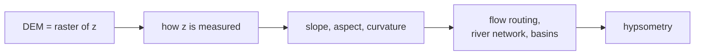

# LS03 · Digital Elevation Models and Terrain Analysis

◀ [[LS02 Mechanics and Mathematics Toolkit]] · [[Landscapes and Geomorphology - Course Map|Course Map]] · next: [[LS04 Map Projections and Reference Surfaces]]

taught · in syllabus extra · book extra · beyond

> [!syllabus] Syllabus map: what is in the syllabus and what is extra in this chapter
> 🟢 **Taught**: slides 25, 28, 56–57 of [[pre_ms_landscape_26.pdf|the EC2123 pre-midsem deck]] (Argha Banerjee, IISER Pune; 153 slides). Boxes marked 🟢 **In the slides** derive what the slides derive; boxes marked 🖼 **Reading the diagram** explain each slide figure panel by panel and sit directly under the slide image.
> 🔵 **Extra · beyond**: boxes marked 🔵 **Extra** complete derivations the slides only quote (from Anderson and Anderson, *Geomorphology: the Mechanics and Chemistry of Landscapes*, and Turcotte and Schubert, *Geodynamics*); 🛠 **Tool** boxes derive a mathematical tool from 12th-grade material; 🧮 **Worked example** boxes calibrate orders of magnitude.
> This chapter has 5 sections, 3 derivation boxes, 3 redrawn figures and 8 slide images.

> [!key] After this chapter you can
> - describe a DEM as a raster and say how elevation is measured (SRTM, LiDAR, photogrammetry),
> - compute slope, aspect and curvature on a grid,
> - extract a river network and a drainage basin,
> - read and compute a hypsometric curve.

> [!intuition] The one-sentence story
> A digital elevation model is a matrix of heights; slopes, curvature, flow directions, drainage basins and the hypsometric curve are just arithmetic on that matrix.

*Concept map: every box is a section of this chapter.*

*[Slides 25–34, 56–57]*

## The DEM as a raster (slide 28)

A **digital elevation model** (DEM) samples the surface $z(x,y)$ on a regular grid. Formally it is a matrix $z_{ij}$ (row $i$, column $j$) with cell size $\Delta$ (the *resolution*, or “horizontal posting”):

$$
x_j=x_0+j\Delta,\qquad y_i=y_0-i\Delta,\qquad z_{ij}=z(x_j,y_i)  (\text{or the mean over the cell}).
$$

![[pre_028.jpg|460]]

> [!example] 🖼 Reading the diagram: Slide 28: the table of numbers and the 3-D surface
> The slide shows a $15\times10$ block of numbers (rows $0$–$14$, columns $0$–$9$, values $\approx25$–$100$) next to the surface they describe: each number *is* the elevation of one cell, and drawing a mesh through them gives the 3-D relief. Below it, a 2-D satellite image is combined with the 3-D DEM (“draping”) to give a bird's-eye view: colour comes from the image, geometry from the DEM.

**Raster versus vector** (slide 28): a raster stores one value per cell of a regular grid (DEMs, imagery, slope maps); a vector stores geometric objects (points, lines, polygons) with coordinates and attributes (river lines, contours, faults). A GIS such as QGIS or Google Earth handles both; operations on rasters are matrix operations on $z_{ij}$, which is why all terrain analysis below is finite-difference calculus.

| Product | Method | Posting | Remark (approximate) |
|---|---|---|---|
| ASTER GDEM (slide 26, 29) | optical stereo pairs from satellite Terra, forward and backward looking bands; merged from all scenes | $1”\approx30$ m | vertical error of order 10 m; artefacts over clouds, water and steep terrain |
| SRTM | radar interferometry from the Space Shuttle (Feb. 2000) | $1”$ or $3”$ ($30$/$90$ m) | error of order 5–15 m; radar penetrates little vegetation |
| Structure-from-motion (slides 29–30) | many overlapping phone/drone photos or video frames | cm to m | local scale; needs ground control for absolute height |

*DEM sources named on the slides. The numbers are indicative; always read the accuracy statement of the dataset used.*

## How elevation is measured

### Stereo-photogrammetry (slide 29, ASTER)

![[ls_fig08.png]]
*Figure LS03.1. Geometry of stereo mapping. Rays from two viewpoints through the same point $P$ meet the datum plane at different places; the separation $p$ (parallax) measures the height $h$.*

> [!derivation] 🔵 Extra (not derived in the slides): Height from parallax
> Place camera $k$ at horizontal position $x_k$ and height $H$, and the ground point $P$ at horizontal position $X$, height $h$. The ray from the camera through $P$ hits the datum ($z=0$) where the straight line has descended by $H$; similar triangles give a horizontal displacement $H/(H-h)$ times the offset of $P$ from the camera:
>
>
> $$
> x_k^{ \prime}=x_k+(X-x_k)\frac{H}{H-h}=\frac{XH-x_kh}{H-h}.
> $$
>
>
> For the two cameras $x_1=-B/2$, $x_2=+B/2$: the two datum points are separated by
>
>
> $$
> p=x_1^{\,\prime}-x_2^{\,\prime}=\frac{Bh}{H-h}\quad\Longleftrightarrow\quad h=\frac{H\,p}{B+p}\ \approx\ H\frac{p}{B}\ \ (h\ll H). \tag{12}
> $$
>
>
> A point on the datum ($h=0$) has $p=0$; a taller point has a larger parallax. **Matching** the same feature in the two images (the “corresponding points” of slide 29) gives $p$, hence $h$ for every pixel; ASTER's forward- and backward-looking telescopes supply the two views ($B/H\approx0.6$), and the DEM is the resulting field $h(x,y)$. The accuracy of $h$ is $\sigma_h\approx(H/B)\sigma_p$: a larger baseline-to-height ratio gives better vertical accuracy.

![[pre_029.jpg|460]]

> [!example] 🖼 Reading the diagram: Slide 29: the ASTER pictures
> Left: forward image and backward image of a stereo pair with lines joining “corresponding points” (A, B, C, D, E) to their positions on the terrain and sea level – the geometry of Fig. (stereo). Centre: the ASTER data are 60 km $\times$ 60 km scenes; software combines *all* scenes ever acquired over an area into a seamless DEM. The red coverage map shows where many observations exist (deeper red = more observations = better accuracy). Right of it: pipeline “automated processing $\to$ seamless wide-coverage DEM $\to$ ASTER GDEM applied to all land area, easy to use with selective cropping”.

### Structure from motion (slides 29–30)

> [!figure]- 🖼 Slides 29–30: open to see the slides this section explains
> ![[pre_029.jpg|300]] ![[pre_030.jpg|300]]

Photographs taken from many positions (a phone or drone video around a stream, e.g. the Andharvan stream, slide 30) are treated as many stereo pairs. The unknowns are the 3-D positions of matched features *and* the camera positions; solving them simultaneously by least squares (“bundle adjustment”) reconstructs a point cloud, which is gridded into a DEM (slide 30: 3DF Zephyr result, colour = elevation). The ground geometry is the same as (12), with unknown $B$ and $H$, so absolute scale requires at least one known distance.

## Terrain derivatives on a grid

> [!derivation] 🟢 In the slides: Slide 25 (Tutorial 1): slope, aspect, hillshade and contour maps
> **Finite differences from the Taylor series.** With $z_E=z(x+\Delta,y)$ and $z_W=z(x-\Delta,y)$, Taylor's series (2) gives $z_{E,W}=z\pm\Delta \partial_xz+\tfrac12\Delta^2\partial_x^2z\pm\dots$ Subtracting, the even terms cancel:
>
>
> $$
> p\equiv\partial_xz\approx\frac{z_E-z_W}{2\Delta},\qquad q\equiv\partial_yz\approx\frac{z_N-z_S}{2\Delta},\qquad\text{error}\sim\Delta^2\partial_x^3z. \tag{13}
> $$
>
>
> Adding instead, the odd terms cancel and $\partial_x^2z\approx(z_E+z_W-2z)/\Delta^2$, so the *curvature* (Laplacian) is
>
>
> $$
> \nabla^2z=\partial_x^2z+\partial_y^2z\approx\frac{z_N+z_S+z_E+z_W-4z}{\Delta^2}, \tag{14}
> $$
>
>
> which is the quantity that drives hillslope diffusion (Chapter 12). GIS programs (e.g. Horn's method) use a weighted $3\times3$ average of (13) to suppress noise.
>
>
> - **Slope**: the surface $z(x,y)$ has upward normal $\hat{\vect n}=(-p,-q,1)/\sqrt{1+p^2+q^2}$; its angle from the vertical is the slope angle $s$, so $\tan s=\sqrt{p^2+q^2}=|\nabla z|$ (the *gradient* $S$ of Chapter 12).
> - **Aspect**: compass bearing $a$ of the down-slope direction. Down-slope is along $-\nabla z=(-p,-q)$ (east, north components), hence $a=\mathrm{atan2}(-p,-q)$ measured clockwise from north.
> - **Hillshade**: light from azimuth $A_z$ and zenith angle $Z$ has unit vector $\hat{\vect s}=(\sin Z\sin A_z, \sin Z\cos A_z, \cos Z)$ (east, north, up). The brightness of a Lambertian surface is $I=\hat{\vect n}\cdot\hat{\vect s}$ (clipped at zero):
>
>
>   $$
>   I=\frac{\cos Z-p\sin Z\sin A_z-q\sin Z\cos A_z}{\sqrt{1+p^2+q^2}}=\cos Z\cos s+\sin Z\sin s\cos(A_z-a),
>   $$
>
>
>   where the second form uses $(p,q)=-\tan s (\sin a,\cos a)$ and $\cos s=1/\sqrt{1+\tan^2s}$. Slopes facing the sun ($a=A_z$) are brightest; flat ground has $I=\cos Z$. This explains why hillshades of the Sahyadri (slide 24) look “three-dimensional”.
> - **Contours**: curves $z(x,y)=\text{const}$; the gradient is perpendicular to them and closely spaced contours mean large $|\nabla z|$ (spacing $\approx\Delta z/|\nabla z|$).

![[ls_fig09.png]]
*Figure LS03.2. The $3\times3$ stencil of a DEM cell (north up). Slope, aspect, hillshade and curvature all follow from these nine numbers.*

> [!derivation] 🔵 Extra (not derived in the slides): Effect of DEM resolution and vertical error on slope
> Slide 25 warns: “mind the horizontal resolution and vertical accuracy of the DEM”. If each elevation has an independent random error $\sigma_z$, then by (13) the error variance of $p$ is $(\sigma_z^2+\sigma_z^2)/(2\Delta)^2$, i.e.
>
>
> $$
> \sigma_p=\frac{\sigma_z}{\sqrt2 \Delta}.
> $$
>
>
> For $\sigma_z=10$ m, $\Delta=30$ m: $\sigma_p\approx0.24$ (about $13^\circ$) – an upper bound because errors of adjacent cells are correlated, but it shows why slopes computed from coarse DEMs of gentle terrain are unreliable, and why the Sahyadri escarpment (slope $>30^\circ$) is well resolved while the Deccan plateau is not. Conversely a horizontal resolution coarser than the landform smooths it: slopes are underestimated and channels vanish (Nyquist: a feature needs $\gtrsim2$ cells to be seen).

![[pre_025.jpg|300]] ![[pre_026.jpg|300]] ![[pre_027.jpg|300]]

> [!example] 🖼 Reading the diagram: Slides 25–27, 34: the Western Ghats DEM, slope map and neighbourhood
> Slide 26 shows one ASTER GDEM tile of the Konkan–Sahyadri region as a grey-scale raster (left) and as a colour ramp (right, legend 0, 300, 600, 900, 1200 m: blue = sea level, red = high). The Arabian Sea is the flat blue; the Ghat escarpment is the sharp transition from blue to red running north–south; to its east the elevation decreases gently (yellow-orange) toward the plateau, and the rivers of the eastern slope form the pale drainage network. Slide 27 shows the derived *slope map*: steep slopes (red) concentrate along the escarpment and river gorges; the purple circle marks Pune, on a gently sloping (blue) surface. Slide 34 shows the local DEM as a colour ramp (its layer list also carries a global elevation layer with legend $-7000$ to $7000$ m), contour lines (orange), a road map used as base map, and an extracted river network with a lake, illustrating that a GIS can overlay vector data (contours, rivers) on raster data.

## River networks and basins from a DEM (slide 25)

> [!figure]- 🖼 Slide 25: open to see the slides this section explains
> ![[pre_025.jpg|300]]

The tutorial asks to “generate river network (basin analysis)”. The standard algorithm (D8) treats water as flowing from each cell to its steepest-descent neighbour.

1. **Fill pits**: raise isolated local minima to the level of their lowest rim (or carve outlets) so that every cell drains.
2. **Flow direction**: for cell $c$ and each of 8 neighbours $n$ compute the drop per distance $(z_c-z_n)/(d_n\Delta)$ with $d_n=1$ (cardinal) or $\sqrt2$ (diagonal); water goes to the neighbour with the largest positive value.
3. **Flow accumulation**: $\mathcal{A}_c=1+\sum_{\text{upstream cells}}1$, so that the *drainage area* is $A_c=\mathcal{A}_c\Delta^2$.
4. **Channels**: cells with $A_c$ above a threshold $A_{\min}$ form the network; a **basin** is the set of cells draining to a chosen outlet.

Drainage area is the variable through which rivers connect to discharge and stream power (Chapter 16). The QGIS/TopoToolbox tools named on slide 25 automate these steps.

| Tutorial 1 step (slide 25) | What is being computed |
|---|---|
| Get an ASTER GDEM tile (OpenTopography plug-in) | $z_{ij}$ on a $1”$ grid |
| Hillshade, slope, aspect, contours | $I$, $\arctan\|\nabla z\|$, $\mathrm{atan2}(-p,-q)$, $z=$const from (13) |
| Colour scheme, histograms | $z_{ij}$ or slope distribution (hypsometry, §3.5) |
| River network / basin analysis | D8 flow direction, accumulation, thresholding |
| Add Google-map base layer | overlay of a raster/vector basemap in the same coordinate system (Ch. 4) |

*Tutorial 1 mapped to mathematics.*

## Hypsometry: how much area at each elevation (slides 56–57)

> [!key] Definition: Hypsometric curve and hypsometric integral
> Let $A(>h)$ be the area of the surface above elevation $h$ and $A_\mathrm{tot}$ the total area. The *hypsometric curve* is $a(h)=A(>h)/A_\mathrm{tot}$ (a cumulative distribution); its negative derivative $f(h)=-\mathrm{d} a/\mathrm{d} h$ is the *elevation histogram* (probability density of elevation). The *hypsometric integral* is $(\bar h-h_{\min})/(h_{\max}-h_{\min})$, the fraction of the height range below the mean elevation $\bar h$.

![[ls_fig10.png]]
*Figure LS03.3. Schematic global elevation histogram (slide 57): two peaks. The shape is drawn from two Gaussians with modes near $-4.4$ km and $+0.4$ km and area weights $0.71$ and $0.29$ (the ocean covers about 71 % of the surface); it reproduces the bimodality, not the exact numbers.*

![[pre_056.jpg|460]] ![[pre_057.jpg|460]]

> [!example] 🖼 Reading the diagram: Slides 56–57
> Slide 56 is a global ETOPO DEM (land in grey, ocean floors in cyan shades). Slide 57 repeats it with the elevation histogram: there are *two* preferred levels, not one. A single population (e.g. Gaussian) of topography would be unimodal; the bimodal shape means the surface falls into two classes of crust at two different levels. Isostasy (Chapter 7) explains it: continental crust is thicker and less dense than oceanic crust plus mantle, so it floats higher; the sparse area between the modes is the continental shelf and slope.

## Map of this chapter
> [!connection] How LS03 connects
> **Previous:** [[LS02 Mechanics and Mathematics Toolkit]] · **Next:** [[LS04 Map Projections and Reference Surfaces]].
> **Other subjects:** [[Climate - Course Map]] (weathering and the carbon cycle, glaciation, orographic rainfall), [[Thermodynamics - Course Map]] (heat conduction and diffusion), [[Evolution of Earth and Life - Course Map]] (plate tectonics and landscapes through geological time), [[Waves - Course Map]] (diffusion and wave equations).

## Provenance
> [!provenance]- Source map for this chapter
> | Topic | Source | Scope |
> |---|---|---|
> | slide content, figures read panel by panel | [[pre_ms_landscape_26.pdf]] slides 25, 28, 56–57 (images embedded from the PDF, auto-cropped, `scripts/render_slides.py`) | taught |
> | derivations, worked examples, tool boxes, TikZ figures | the AI-written derivation-level notes [[Landscapes_and_Their_Evolution_notes.pdf]] (EC2123 notes; LaTeX source in `landscape-notes-tex-source.tar.gz`), converted with `scripts/tex2vault_ls.py`; cross-checked against Anderson and Anderson and Turcotte and Schubert as cited there | secondary + extra/book |
>
> **Notes.** (1) The text of this chapter is the AI-written reference notes' text, converted to the vault's callout style and equation numbering (chapter-local, so some cross-references read as "(label)"). (2) The slide images were checked against the notes' slide numbers for a sample of slides (e.g. 1–12, 109–120 match). Figure descriptions are the notes', and should be compared with the images beside them. (3) The `[!verify]` items of the notes' last front-matter section ("Two places where the slides need care") are in [[Landscapes Notation and Glossary]].
