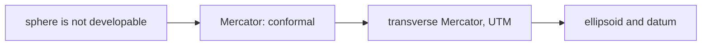

# LS04 · Map Projections and Reference Surfaces

◀ [[LS03 Digital Elevation Models and Terrain Analysis]] · [[Landscapes and Geomorphology - Course Map|Course Map]] · next: [[LS05 Shape of Planets]]

taught · in syllabus extra · book extra · beyond

> [!syllabus] Syllabus map: what is in the syllabus and what is extra in this chapter
> 🟢 **Taught**: slides 31–32, 42 of [[pre_ms_landscape_26.pdf|the EC2123 pre-midsem deck]] (Argha Banerjee, IISER Pune; 153 slides). Boxes marked 🟢 **In the slides** derive what the slides derive; boxes marked 🖼 **Reading the diagram** explain each slide figure panel by panel and sit directly under the slide image.
> 🔵 **Extra · beyond**: boxes marked 🔵 **Extra** complete derivations the slides only quote (from Anderson and Anderson, *Geomorphology: the Mechanics and Chemistry of Landscapes*, and Turcotte and Schubert, *Geodynamics*); 🛠 **Tool** boxes derive a mathematical tool from 12th-grade material; 🧮 **Worked example** boxes calibrate orders of magnitude.
> This chapter has 4 sections, 3 derivation boxes, 1 redrawn figures and 3 slide images.

> [!key] After this chapter you can
> - explain why every map projection distorts,
> - derive the Mercator projection from conformality,
> - describe transverse Mercator and UTM,
> - distinguish geoid, ellipsoid and datum.

> [!intuition] The one-sentence story
> A sphere cannot be flattened without distortion; the Mercator projection preserves angles at the price of area, and the heights on every map are relative to a reference ellipsoid and a datum.

*Concept map: every box is a section of this chapter.*

*[Slides 31–33, 42]*

## Why every map is distorted

A sphere (or ellipsoid) cannot be flattened without stretching: no isometry (distance-preserving map) exists (Gauss's *Theorema Egregium*; result quoted). A *map projection* is a smooth map $(\lambda,\varphi)\mapsto(x,y)$ from longitude $\lambda$ and latitude $\varphi$ to plane coordinates. Its *local scale factor* in a direction is the ratio of a small map distance to the true distance. On a sphere of radius $R$, an infinitesimal displacement along a parallel has length $R\cos\varphi \mathrm{d}\lambda$ and along a meridian $R \mathrm{d}\varphi$. Three properties one may try to preserve: angles (conformal), areas (equal-area), distances (only along selected lines); no projection has all three.

## The Mercator projection (slides 31–32)

> [!derivation] 🔵 Extra (not derived in the slides): Deriving Mercator and its scale factor
> Take a cylinder tangent to the sphere at the equator and require (i) meridians to map to equally spaced vertical lines, $x=R\lambda$, and (ii) the map to be *conformal*: at every point the scale in the east–west direction equals the scale in the north–south direction. East–west scale: $k_\lambda=\mathrm{d} x/(R\cos\varphi \mathrm{d}\lambda)=\sec\varphi$. North–south scale: $k_\varphi=\mathrm{d} y/(R \mathrm{d}\varphi)$. Equating,
>
>
> $$
> \dfrac{\mathrm{d} y}{\mathrm{d} \varphi}=\frac{R}{\cos\varphi} \Longrightarrow y=R\int_0^\varphi\sec\varphi' \mathrm{d}\varphi'=R\ln\tan\!\Big(\frac\pi4+\frac\varphi2\Big),\qquad k=\sec\varphi .
> $$
>
>
> (The integral $\int\sec\varphi \mathrm{d}\varphi=\ln|\sec\varphi+\tan\varphi|$ is verified by differentiating; $\sec\varphi+\tan\varphi=\tan(\pi/4+\varphi/2)$.) Consequences: (i) angles are preserved, so a course of constant compass bearing (a *rhumb line*) crosses all meridians at the same angle and is a straight line on the map — the reason for its use in navigation; (ii) *areas* are inflated by $k^2=\sec^2\varphi$; (iii) the poles are at $y=\infty$.

| Latitude $\varphi$ | $0^\circ$ | $30^\circ$ | $45^\circ$ | $60^\circ$ | $72^\circ$ | $80^\circ$ |
|---|---|---|---|---|---|---|
| Linear scale $k=\sec\varphi$ | 1.00 | 1.15 | 1.41 | 2.00 | 3.24 | 5.76 |
| Area inflation $k^2$ | 1.00 | 1.33 | 2.00 | 4.00 | 10.5 | 33.2 |
| $y/R$ | 0 | 0.55 | 0.88 | 1.32 | 1.89 | 2.44 |

*Mercator distortion. Greenland ($\varphi\approx72^\circ$) is drawn about ten times too large in area.*

![[ls_fig11.png]]
*Figure LS04.1. Mercator: ordinate $y/R$ (left) and scale factor $\sec\varphi$ (right) against latitude.*

![[pre_032.jpg|460]]

> [!example] 🖼 Reading the diagram: Slide 32: distortion pictures
> The map with red circles is a *Tissot indicatrix* display: on the sphere all circles have the same size; on the Mercator map they remain circles (conformality) but their size grows with latitude ($k$ and $k^2$ above). The bottom picture (Wikipedia) is the Mercator world map with Greenland and Antarctica hugely exaggerated.

## Transverse Mercator and UTM (slide 31)

**Transverse Mercator**: the same construction with the cylinder turned by $90^\circ$, so it touches the sphere along a chosen *central meridian* instead of the equator (slide 31, lower diagram: “central meridian selected by mapmaker touches cylinder if the cylinder is tangent”). Conformal, so shapes are locally right; scale is true along the central meridian.

> [!derivation] 🔵 Extra (not derived in the slides): Scale away from the central meridian
> The transverse case on the sphere is the Mercator with the pole moved to the equator, so in the equator-plane the scale is $k=\sec(\text{angular distance from the central meridian})$: with $x$ the distance from the central meridian, $k=k_0\sec(x/R)\approx k_0\bigl(1+x^2/2R^2\bigr)$, where $k_0$ is the scale on the central meridian. At $15^\circ$ from the meridian $k=\sec15^\circ=1.035$: a $3.5 %$ error – this is the meaning of the slide's statement that directions, distances and areas are “reasonably accurate only within 15$^\circ$ of the central meridian”. The Universal Transverse Mercator (UTM) system uses 60 zones each $6^\circ$ wide with $k_0=0.9996$, so that $k=1$ at $x=R\sqrt{2\times4\times10^{-4}}=180$ km on each side and $k\le1.0004$ at the zone edge. Zone number $=\lfloor(\lambda+180^\circ)/6^\circ\rfloor+1$; the central meridian is $6N-183^\circ$.

> [!example] 🧮 Worked example: EPSG:32643 (slide 31) — the CRS of Pune data
> Pune is at $\lambda=73.9^\circ$E, so $N=\lfloor253.9/6\rfloor+1=43$; the zone spans $72^\circ$–$78^\circ$E with central meridian $75^\circ$E. EPSG:32643 is thus “WGS 84 / UTM zone 43N”: coordinates in metres east and north (the northern hemisphere), on the WGS 84 ellipsoid. A *geographic* coordinate system (GCS) uses angles $(\lambda,\varphi)$; a *projected* coordinate system (PCS) adds a projection and gives $(x,y)$ in metres (the ESRI article on slide 31). Slope and area calculations must be done in a PCS (metres), never in degrees.

![[pre_033.jpg|460]]

> [!example] 🖼 Reading the diagram: Slide 33: geoid and the Dymaxion-type map
> Slide 33 shows (top) a polyhedral (Fuller-style) projection of the cryosphere (snow, sea ice, glaciers, permafrost), which unfolds the globe onto triangles so that the continents in the polar region are cut as little as possible; and (left) the EGM96 geoid heights from $-100$ to $+80$ m on an Eckert-type equal-area world map. The geoid is discussed in Chapter 5.

## Reference ellipsoid and datum (slide 42)

> [!figure]- 🖼 Slide 42: open to see the slides this section explains
> ![[pre_042.jpg|300]]

A projection needs a reference surface. The Earth is closely an oblate ellipsoid of semi-major axis $a$ and flattening $f=(a-c)/a$ ($c$ semi-minor axis). Slide 42 shows the well-known text (WKT) of the WGS 84 datum:

$$
\text{SPHEROID}[\text{“WGS 84”}, 6378137, 298.257223563],
$$

meaning $a=6 378 137$ m and inverse flattening $1/f=298.257223563$. Thus $f=0.00335281$ and the difference of radii is $a-c=af=21.3847$ km — the two numbers printed at the bottom of slide 42. The polar semi-axis is $c=a(1-f)=6 356 752.3$ m. (Why $f\approx1/300$: Chapter 5.) **Datum** means the ellipsoid together with its position and orientation relative to the Earth (WGS 84 is geocentric).

> [!derivation] 🔵 Extra (not derived in the slides): Radii of curvature on the ellipsoid
> With eccentricity $e^2=2f-f^2$, the meridional and prime-vertical radii of curvature at geodetic latitude $\varphi$ are $M=a(1-e^2)/(1-e^2\sin^2\varphi)^{3/2}$ and $N=a/\sqrt{1-e^2\sin^2\varphi}$ (quoted). One degree of latitude spans $M \pi/180=110.57$ km at the equator and $111.69$ km at the pole; one degree of longitude spans $(\pi/180)N\cos\varphi$, i.e. $111.32$ km at the equator and $96.4$ km at $30^\circ$ and $105.6$ km at Pune's latitude ($18.5^\circ$). These are the numbers needed to convert a DEM given in degrees to metres before differentiating.

## Further slides explained one by one
taught *the slides of this chapter's range that carry no derivation of their own; each image is followed by what it shows*

![[pre_031.jpg|520]]

> [!example] 🖼 Reading the diagram: Slide 31: Mercator and transverse Mercator
> Google-Earth options (left) and the two cylindrical projections. *Top:* a cylinder wrapped around the globe, tangent along the equator: the Mercator map (right) has straight parallel meridians and parallels, preserving angles (conformal) but exaggerating area at high latitudes; the note says the change in spacing of parallels is less than the true Mercator spacing for the version shown, and the equator always touches the cylinder. *Bottom:* the transverse Mercator, the cylinder turned 90° so that it touches a chosen central meridian: a map accurate in direction, distance and area only within about 15° of the central meridian ('no straight rhumb lines'), the basis of UTM zones.

## Map of this chapter
> [!connection] How LS04 connects
> **Previous:** [[LS03 Digital Elevation Models and Terrain Analysis]] · **Next:** [[LS05 Shape of Planets]].
> **Other subjects:** [[Climate - Course Map]] (weathering and the carbon cycle, glaciation, orographic rainfall), [[Thermodynamics - Course Map]] (heat conduction and diffusion), [[Evolution of Earth and Life - Course Map]] (plate tectonics and landscapes through geological time), [[Waves - Course Map]] (diffusion and wave equations).

## Provenance
> [!provenance]- Source map for this chapter
> | Topic | Source | Scope |
> |---|---|---|
> | slide content, figures read panel by panel | [[pre_ms_landscape_26.pdf]] slides 31–32, 42 (images embedded from the PDF, auto-cropped, `scripts/render_slides.py`) | taught |
> | derivations, worked examples, tool boxes, TikZ figures | the AI-written derivation-level notes [[Landscapes_and_Their_Evolution_notes.pdf]] (EC2123 notes; LaTeX source in `landscape-notes-tex-source.tar.gz`), converted with `scripts/tex2vault_ls.py`; cross-checked against Anderson and Anderson and Turcotte and Schubert as cited there | secondary + extra/book |
>
> **Notes.** (1) The text of this chapter is the AI-written reference notes' text, converted to the vault's callout style and equation numbering (chapter-local, so some cross-references read as "(label)"). (2) The slide images were checked against the notes' slide numbers for a sample of slides (e.g. 1–12, 109–120 match). Figure descriptions are the notes', and should be compared with the images beside them. (3) The `[!verify]` items of the notes' last front-matter section ("Two places where the slides need care") are in [[Landscapes Notation and Glossary]].
