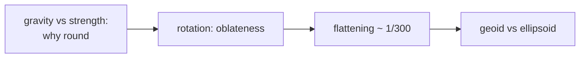

# LS05 · Shape of Planets

◀ [[LS04 Map Projections and Reference Surfaces]] · [[Landscapes and Geomorphology - Course Map|Course Map]] · next: [[LS06 Maximum Topography]]

taught · in syllabus extra · book extra · beyond

> [!syllabus] Syllabus map: what is in the syllabus and what is extra in this chapter
> 🟢 **Taught**: slides 33, 41–42, 51 of [[pre_ms_landscape_26.pdf|the EC2123 pre-midsem deck]] (Argha Banerjee, IISER Pune; 153 slides). Boxes marked 🟢 **In the slides** derive what the slides derive; boxes marked 🖼 **Reading the diagram** explain each slide figure panel by panel and sit directly under the slide image.
> 🔵 **Extra · beyond**: boxes marked 🔵 **Extra** complete derivations the slides only quote (from Anderson and Anderson, *Geomorphology: the Mechanics and Chemistry of Landscapes*, and Turcotte and Schubert, *Geodynamics*); 🛠 **Tool** boxes derive a mathematical tool from 12th-grade material; 🧮 **Worked example** boxes calibrate orders of magnitude.
> This chapter has 3 sections, 3 derivation boxes, 1 redrawn figures and 2 slide images.

> [!key] After this chapter you can
> - show that large bodies are spherical (gravity vs strength),
> - derive the flattening of a rotating planet,
> - define the geoid and its relation to the ellipsoid.

> [!intuition] The one-sentence story
> Planets are round because gravity beats rock strength, slightly flattened because they rotate, and the geoid is the equipotential surface sea level would follow.

*Concept map: every box is a section of this chapter.*

*[Slides 40–44, 51]*

> [!example] ❓ Question on the slides: Slides 40–41: why are planets spherical? why are they oblate spheroids? how oblate should any planet be?
> Chapters 5 and 6 answer all three: *spherical* because self-gravity overwhelms rock strength when $R\gtrsim300$ km (§5.1); *oblate* because rotation lowers effective gravity at the equator, so hydrostatic equilibrium needs a longer equatorial column (§5.2); and the amount, $\Delta R/R\sim(\bar\rho/2\rho_s) \omega^2R/g$ (§5.2), fixed by the ratio of centrifugal to gravitational acceleration.

## Why round: gravity against strength

> [!derivation] 🔵 Extra (not derived in the slides): Central pressure of a uniform sphere and the critical radius
> For a uniform sphere of density $\rho$ the gravitational field inside is $g(r)=GM(r)/r^2=\tfrac43\pi G\rho r$ (the mass inside radius $r$ is $\tfrac43\pi\rho r^3$; the shell outside exerts no net force – Newton's shell theorem, quoted). The hydrostatic equation (7) in radius, $\mathrm{d} P/\mathrm{d} r=-\rho g(r)$, integrates from the surface ($P=0$ at $r=R$) to
>
>
> $$
> P(r)=\tfrac23\pi G\rho^2(R^2-r^2),\qquad P_c=\tfrac23\pi G\rho^2R^2 .
> $$
>
>
> A body deforms plastically (and so relaxes toward a sphere, the shape of minimum potential energy at rest) when the deviatoric stress produced by non-spherical relief is comparable to rock strength $\sigma_y$, roughly when $P_c\gtrsim\sigma_y$. Solving $P_c=\sigma_y$:
>
>
> $$
> R_\mathrm{crit}=\sqrt{\frac{3\sigma_y}{2\pi G\rho^2}} .
> $$
>
>
> With $\sigma_y=10^8$ Pa and $\rho=3000  \mathrm{kg m^{-3}}$: $R_\mathrm{crit}\approx280$ km. Bodies larger than a few hundred km (Moon, Mars, Earth) are round; smaller rocky bodies (asteroids, Phobos) keep irregular shapes; icy bodies are weaker and round at smaller sizes. The central pressures are $173$ GPa for a uniform Earth ($364$ GPa in reality, since the core is denser), $4.7$ GPa for the Moon — both far above $\sigma_y$. This is the same balance that sets maximum topography in Chapter 6.

## Why oblate, and by how much (slides 41–42)

A rotating planet is nearly in hydrostatic equilibrium. The argument of slide 42 compares the pressure at the centre computed along two different radial columns.

![[ls_fig12.png]]
*Figure LS05.1. Oblateness (exaggerated; real $\Delta R/R\approx0.003$). The equatorial column is longer by $\Delta R$ so that its pressure at the centre matches that of the polar column, despite centrifugal relief.*

> [!derivation] 🟢 In the slides: Slides 41–42: equatorial bulge from pressure balance
> In hydrostatic equilibrium the pressure at the centre must be the same computed along any radius (otherwise the fluid would flow). *Polar column*: no centrifugal effect, $P_\mathrm{pole}=\int_0^{R}\rho g \mathrm{d} r$. *Equatorial column* (length $R+\Delta R$): the radial force per unit volume is reduced by the centrifugal term $\rho\omega^2r$ (a mass element at distance $r$ from the axis, moving in a circle at angular speed $\omega$, needs the centripetal force $\rho\omega^2r$; equivalently, in the rotating frame an outward force $\rho\omega^2r$ acts). Hence
>
>
> $$
> P_\mathrm{eq}=\int_0^{R+\Delta R}\rho g \mathrm{d} r-\int_0^{R+\Delta R}\rho \omega^2r \mathrm{d} r .
> $$
>
>
> Splitting the first integral at $R$: $\int_0^{R+\Delta R}\rho g \mathrm{d} r=\int_0^R\rho g \mathrm{d} r+\rho_sg \Delta R$ (the extra layer has crust density $\rho_s$ and surface gravity $g$). Setting $P_\mathrm{eq}=P_\mathrm{pole}$:
>
>
> $$
> \rho_sg \Delta R=\int_0^{R+\Delta R}\rho\omega^2r \mathrm{d} r\approx\int_0^{R}\rho\omega^2r \mathrm{d} r=\frac{\bar\rho \omega^2R^2}{2},
> $$
>
>
> (slide 42; $\Delta R\ll R$, and $\rho$ is replaced by the mean density $\bar\rho$). Therefore
>
>
> $$
> \boxed{\ \frac{\Delta R}{R}=\frac{\bar\rho\,\omega^2R}{2g\rho_s}\ } \tag{15}
> $$
>
>
> **Numbers** (slide 42): $\bar\rho=5.5\times10^3$, $\omega=2\pi/86400$ s$^{-1}$, $R=6.4\times10^6$ m, $g=9.8$, $\rho_s=3\times10^3$:
>
>
> $$
> \frac{\Delta R}{R}=\frac{5.5\times10^3\times(2\pi/86400)^2\times6.4\times10^6}{2\times9.8\times3\times10^3}\approx0.003 ,\qquad\Delta R\approx20 \mathrm{km}.
> $$
>
>
> Observed (slide 42, WGS 84): $f=0.00335$, $a-c=21.38$ km — agreement to $\sim6 %$. (The approximations $\rho\to\bar\rho$ and constant $g$ each err by tens of per cent; the near-perfect agreement partly reflects compensating errors, so (15) should be trusted as a scaling result.)

> [!derivation] 🔵 Extra (not derived in the slides): An independent check with the effective potential; where the factor $\bar\rho/\rho_s$ comes from
> Define $q=\omega^2R/g$ (ratio of centrifugal to gravitational acceleration at the equator; Earth: $q=3.45\times10^{-3}$). On a fluid surface, the *potential energy per unit mass* $\Phi=-GM/r-\tfrac12\omega^2r^2\cos^2\varphi$ (gravity of a spherical body + centrifugal potential, $\varphi$ latitude) is constant. Put $r=R+\delta(\varphi)$ and expand to first order: $GM \delta/R^2-\tfrac12\omega^2R^2\cos^2\varphi=\text{const}$, so $\delta=\frac{\omega^2R^4}{2GM}\cos^2\varphi+\text{const}=\frac{\omega^2R^2}{2g}\cos^2\varphi+\text{const}$. Equator minus pole:
>
>
> $$
> \Delta R=\frac{\omega^2R^2}{2g}=\frac{qR}{2},\qquad f=\frac q2=1.7\times10^{-3} (\text{Earth}).
> $$
>
>
> This is only half the observed value because it ignores the gravitational attraction of the bulge itself; the slide's result equals this times $\bar\rho/\rho_s\approx1.8$, a crude account of that effect. The exact result for a *homogeneous* fluid body (Maclaurin spheroid, to first order in $q$; quoted) is $f=\tfrac54q=4.3\times10^{-3}$; a real planet lies between $q/2$ and $5q/4$ according to how centrally condensed it is (Clairaut's theory, T&S Ch. 5; the Earth's $f/q=0.97$, so it is very centrally condensed: dense core).

| Planet | $R$ (km) | $P_\mathrm{rot}$ (h) | $g$ (m s$^{-2}$) | $q=\omega^2R/g$ | $\dfrac{\omega^2R^2}{2g}$ (km) | $R_\mathrm{eq}-R_\mathrm{pol}$ (km) | ratio |
|---|---|---|---|---|---|---|---|
| Earth | 6371 | 23.93 | 9.81 | 0.0035 | 11.0 | 21.4 | 1.9 |
| Mars | 3390 | 24.62 | 3.71 | 0.0046 | 7.8 | 20.0 | 2.6 |
| Jupiter | 69911 | 9.93 | 24.79 | 0.087 | 3048 | 4638 | 1.5 |
| Saturn | 58232 | 10.66 | 10.44 | 0.150 | 4357 | 5904 | 1.4 |
| Uranus | 25362 | 17.24 | 8.87 | 0.029 | 372 | 586 | 1.6 |
| Neptune | 24622 | 16.11 | 11.15 | 0.026 | 319 | 423 | 1.3 |

*Predicted versus observed bulge (data from the NASA planetary fact sheet as recalled; the slide computes the same with Mathematica `PlanetData`). Gas-giant “surfaces” are the 1-bar level. The monopole prediction is systematically smaller by a factor 1.3–2.6, but the *scaling* $\propto\omega^2R^2/g$ holds over three decades.*

![[pre_044.jpg|460]]

> [!example] 🖼 Reading the diagram: Slide 44: predicted versus observed bulge
> Each point is a planet: the horizontal axis is the predicted bulge $\delta_\mathrm{pred}=0.001R^2\omega^2/(2g)$ km, the vertical axis the observed $R_\mathrm{eq}-R_\mathrm{pol}$ (log–log, from about $10$ km to $10^4$ km). Mars and Earth lie near $10$–$20$ km, Uranus and Neptune near a few hundred km, Jupiter and Saturn at a few thousand km. The points fall on a straight line parallel to (and above) the equality line: the physics is right (a $\propto$ scaling) and only a constant $\mathcal{O}\!\left(1\right)$ factor is missing.

<!-- ls-depth:LS05:1 -->
> [!derivation] 🟡 Extra · book / 🔵 beyond: the bulge reveals the interior (Darwin–Radau, central condensation)
> **The puzzle.** The pressure-balance argument of the slides, applied to a *uniform-density* Earth, gives a flattening $f_h=\tfrac54q$ with $q=\omega^2a^3/GM=3.4616\times10^{-3}$ (the ratio of centrifugal to gravitational acceleration at the equator), i.e. $f_h=4.33\times10^{-3}=1/231$ and an equatorial bulge $f_ha=27.6$ km. The observed flattening is $f=1/298.257=3.353\times10^{-3}$ (bulge $21.4$ km, computed from the WGS84 axes in [[LS04 Map Projections and Reference Surfaces]]): **the real bulge is 22 % smaller.**
> **Resolution.** The Earth is *not* uniform: its dense core makes it **centrally condensed**, so there is less mass at large radius to be pushed outwards by rotation. The measure is the **moment-of-inertia factor** $C/MR^2$ ($C$ = moment about the spin axis): $0.4$ for a uniform sphere, smaller if the mass is concentrated towards the centre. T&S tabulate it (PDF p.389): **Earth $0.3307$** (Moon $\approx0.393$, Mars $\approx0.366$, Venus $\approx0.33$ as extracted). The **Darwin–Radau relation** links the flattening of a slowly rotating *fluid* planet in hydrostatic equilibrium to this factor:
> $$\frac{C}{MR^2}=\frac23\Big[1-\frac25\sqrt{\frac{5q}{2f}-1}\Big]\quad\Longleftrightarrow\quad f=\frac{\tfrac52q}{1+\tfrac{25}{4}\big(1-\tfrac32\tfrac{C}{MR^2}\big)^2}.$$
> *Checks:* uniform sphere $C/MR^2=0.4$: $1-0.6=0.4$, $\tfrac{25}4\cdot0.16=1$, $f=\tfrac52q/2=\tfrac54q$ ✓. Earth, $C/MR^2=0.3307$: $f=3.345\times10^{-3}=1/299.0$ (observed $1/298.26$), i.e. **within 0.25 %**; inverting the observed $f$ gives $C/MR^2=0.3313$ (computed; `scripts/ls_depth_numbers.py`). So a measurement of *shape* tells you the *radial density profile*: the Earth behaves as a fluid in hydrostatic balance on long time scales (this is the same mantle viscosity statement as in [[LS02 Mechanics and Mathematics Toolkit]]: $\tau_M\sim450$ yr) and its mass is concentrated at the centre. (T&S derive the relation via Clairaut's equation; I quote the result, `[verify]` the exact form against T&S §5, PDF pp.384–389.)

> [!key] The gravitational quadrupole $J_2$ and the same flattening
> To first order in the small quantities, the oblateness couples to the **quadrupole coefficient** $J_2=(C-A)/Ma^2$ (difference of the polar and equatorial moments of inertia): $f\simeq\tfrac32J_2+\tfrac12q$. With the satellite value $J_2=1.08263\times10^{-3}$ (T&S PDF p.389) this gives $f=3.355\times10^{-3}$, matching $1/298.26=3.353\times10^{-3}$ to 0.06 %. So the shape of the Earth can be obtained either from *geometry* (surveying the radius) or from *satellite orbits*, which precess at a rate set by $J_2$: the two agree because the Earth is in hydrostatic equilibrium.

## Beyond the ellipsoid: the geoid (slides 33, 51)

> [!key] Definition: Geoid
> The *geopotential* $W(\vect r)=V_\mathrm{grav}+\Phi_\mathrm{cf}$ combines the gravitational potential of the Earth's mass and the centrifugal potential. Its level surfaces (equipotentials) are everywhere perpendicular to the plumb line, and water at rest sits on one. The *geoid* is the equipotential surface that best fits mean sea level. The *geoid height* $N=h-H$ is the height of the geoid above the reference ellipsoid ($h$: ellipsoidal height, what GPS gives; $H$: orthometric height, height above the geoid, what maps and DEMs give).

The ellipsoid follows from §5.2 for a body in hydrostatic equilibrium. The real Earth contains density anomalies (subducting slabs, mantle plumes, continents, ice-age loads), so the geoid departs from the ellipsoid by $-106$ m (south of India) to $+85$ m (New Guinea) — $\sim10^{-2}$ of the ellipsoid–sphere difference of $21$ km.

![[pre_051.jpg|460]]

> [!example] 🖼 Reading the diagram: Slide 51: EGM96 and its spherical harmonics
> Left: the global geoid-height map EGM96, colours from $-100$ m (blue) to $+80$ m (red). The blue minimum lies over the Indian Ocean south of India (a broad mass deficit), the reds over the North Atlantic, New Guinea and the Andes. Middle: the same shown as an exaggerated 3-D globe. Right: the six real spherical harmonics of degree $n=5$, $m=0,\dots,5$. A spherical harmonic of degree $n$ and order $m$ is $P_n^m(\cos\theta)\cos m\lambda$ (or $\sin m\lambda$): it has $n-m$ nodal circles of latitude and $2m$ nodal meridians. $m=0$ (*zonal*) depends on latitude only; $m=n$ (*sectoral*) has only meridian nodes; the rest are *tesseral* (a chequerboard). Any smooth function on the sphere is a sum of these, as a function on a line is a sum of sines.

> [!example] ❓ Question on the slides: Slide 51: how many spherical-harmonic terms are involved in the EGMs?
> Degree $n$ has $2n+1$ real harmonics ($\cos m\lambda$ for $m=0,\dots,n$; $\sin m\lambda$ for $m=1,\dots,n$). Summing degrees $0$ to $N$: $\sum_{n=0}^{N}(2n+1)=(N+1)^2$ coefficients. EGM96 is complete to degree/order $N=360$: $361^2=130 321$ ($\approx1.3\times10^5$) coefficients; its smallest half-wavelength is $\pi R/N\approx55$ km. EGM2008 is complete to $N=2159$: $2160^2\approx4.7\times10^6$ coefficients ($\approx9$ km half-wavelength). (Figures quoted from the models' documentation; check for the current model.)

<!-- ls-depth:LS05:2 -->
> [!derivation] 🔵 Extra (my derivation): how small is the geoid compared with the bulge? Bruns' formula
> The geoid is the equipotential $W=W_0$ of gravity plus rotation. Write the real potential as the ellipsoid's "normal" potential $U$ plus a small *disturbing potential* $T=W-U$. At a point where the geoid is a height $N$ above the ellipsoid, $W_0=U(\text{ellipsoid})+\gamma N+T$, and the ellipsoid is itself the surface $U=W_0$, so
> $$N=\frac{T}{\gamma}\qquad(\text{Bruns' formula}),\quad\gamma\approx9.8\ \mathrm{m\,s^{-2}}.$$
> A geoid high of $N=100$ m (the scale of the EGM96 range, $\approx\pm100$ m on slide 51) therefore needs $T=\gamma N\approx980\ \mathrm{m^2s^{-2}}$ (about 1 kJ per kg), and its relation to the 21 km bulge is $100\ \mathrm m/21\,385\ \mathrm m=0.47\,\%$: *the ellipsoid already captures 99.5 % of the departure from a sphere*. **Meaning of a geoid high:** excess mass beneath (or the density structure of the deep mantle); the sea surface bulges up to follow it (an ocean sitting on a geoid high is a few tens of metres higher) without any currents.
> **Spherical harmonics.** The disturbing potential is expanded in spherical harmonics $Y_\ell^m(\theta,\varphi)$; degree $\ell$ has $2\ell+1$ functions, so a model complete to degree $\ell_{max}$ has $\sum_{\ell=0}^{\ell_{max}}(2\ell+1)=(\ell_{max}+1)^2$ coefficients (slide 51's question: EGM96 has $\ell_{max}=360$, so $361^2=130\,321$ coefficients; the ellipsoid is only $\ell=0$ and $\ell=2,m=0$). The same harmonics label the angular part of hydrogen orbitals in [[Quantum Mechanics - Course Map]] (angular momentum), and each degree $\ell$ is one irreducible representation of the rotation group of dimension $2\ell+1$ ([[GT10 Symmetry Representations and Characters]], §6).

## Further slides explained one by one
taught *the slides of this chapter's range that carry no derivation of their own; each image is followed by what it shows*

![[pre_040.jpg|520]]

> [!example] 🖼 Reading the diagram: Slide 40: Why are planets spherical?
> Title-style text slide: 'Why are planets spherical? Why are they oblate spheroids?'. The two questions are answered in §1 (gravity against strength) and §2 (rotation) of this chapter.

![[pre_041.jpg|520]]

> [!example] 🖼 Reading the diagram: Slide 41: Why are planets spherical? How oblate?
> The same slide with a third question: how oblate any given planet should be, answered by the balance of centrifugal and gravitational force at the equator ($f\approx\omega^2R^3/(GM)\cdot\tfrac52$ for a uniform fluid body).

![[pre_043.jpg|520]]

> [!example] 🖼 Reading the diagram: Slide 43: Earth's oblateness to scale
> A quarter-outline of the Earth (Wikipedia 'Figure of the Earth': *Earth oblateness to scale*). The yellow circle is a perfect sphere, the pink line the true ellipsoid: at this scale (flattening ≈ 1/298) the two are practically indistinguishable, which is why the oblateness is a small perturbation. The slide also gives references on the history of measuring the Earth's shape and the recommended book (Chandrasekhar's *Newton's Principia for the Common Reader*).

<!-- ls-depth:LS05:3 -->
> [!question] Check yourself (answers below)
> 1. Compute $q$ for the Moon-sized fiction "Earth rotating every 3 hours" (keep $a$, $GM$) and say whether the bulge scaling still holds.
> 2. Why does a more centrally condensed planet have a smaller flattening for the same spin?
> 3. If Mars has $C/MR^2=0.366$ and $q=4.57\times10^{-3}$ use Darwin–Radau to estimate $f$.
> 4. What is the maximum height of the geoid above the ellipsoid if $T$ is at most $1500\ \mathrm{m^2s^{-2}}$?
> *Answers.* (1) $q\propto\omega^2$: for $T=3$ h, $\omega=5.82\times10^{-4}$, $q=(\omega/\omega_E)^2\,q_E=(7.98)^2\times3.46\times10^{-3}=0.22$: not small, so the small-$q$ formulae fail (the shape would be a strongly flattened Maclaurin spheroid, near break-up). (2) Mass near the axis feels less centrifugal force and contributes less to the equatorial bulge; in the formula a smaller $C/MR^2$ makes the denominator larger. (3) $1-1.5\times0.366=0.451$, $\tfrac{25}{4}0.451^2=1.271$, $f=2.5\times4.57\times10^{-3}/2.271=5.03\times10^{-3}$ (the observed Mars flattening is larger, $\approx5.9\times10^{-3}$ recalled, `[verify]`: Mars is not in hydrostatic equilibrium, a classic result). (4) $N=1500/9.8=153$ m.

> [!connection] Where this connects
> - **Planetary shape from force balance** uses the same hydrostatic and rotating-frame ideas as [[Thermodynamics and Statistical Mechanics - Course Map]] (pressure balance) and the Coriolis/centrifugal terms in [[Climate - Course Map]] (rotating Earth, [[Waves - Course Map]]).
> - **Spherical harmonics and $SO(3)$ irreps:** [[GT10 Symmetry Representations and Characters]].
> - **Isostasy** treats the lithosphere as floating on the same fluid mantle: [[LS07 Isostasy]].

## Map of this chapter
> [!connection] How LS05 connects
> **Previous:** [[LS04 Map Projections and Reference Surfaces]] · **Next:** [[LS06 Maximum Topography]].
> **Other subjects:** [[Climate - Course Map]] (weathering and the carbon cycle, glaciation, orographic rainfall), [[Thermodynamics and Statistical Mechanics - Course Map]] (heat conduction and diffusion), [[Evolution of Earth and Life - Course Map]] (plate tectonics and landscapes through geological time), [[Waves - Course Map]] (diffusion and wave equations).

> [!connection] Group theory used here
> Spherical harmonics and $SO(3)$ irreps: [[GT10 Symmetry Representations and Characters]] §6; see [[Where Groups Appear in the Vault]].

## Provenance
> [!provenance]- Source map for this chapter
> | Topic | Source | Scope |
> |---|---|---|
> | slide content, figures read panel by panel | [[pre_ms_landscape_26.pdf]] slides 33, 41–42, 51 (images embedded from the PDF, auto-cropped, `scripts/render_slides.py`) | taught |
> | derivations, worked examples, tool boxes, TikZ figures | the AI-written derivation-level notes [[Landscapes_and_Their_Evolution_notes.pdf]] (EC2123 notes; LaTeX source in `landscape-notes-tex-source.tar.gz`), converted with `scripts/tex2vault_ls.py`; cross-checked against Anderson and Anderson and Turcotte and Schubert as cited there | secondary + extra/book |
>
> **Notes.** (1) The text of this chapter is the AI-written reference notes' text, converted to the vault's callout style and equation numbering (chapter-local, so some cross-references read as "(label)"). (2) The slide images were checked against the notes' slide numbers for a sample of slides (e.g. 1–12, 109–120 match). Figure descriptions are the notes', and should be compared with the images beside them. (3) The `[!verify]` items of the notes' last front-matter section ("Two places where the slides need care") are in [[Landscapes Notation and Glossary]].

<!-- ls-depth:LS05:4 -->
> [!provenance]- Depth-layer sources (added 2026-10-28)
> | Topic | Source | Priority |
> |---|---|---|
> | $C/MR^2$ values (Earth 0.3307, Moon, Mars, Venus), $J_2=1.0826265\times10^{-3}$ | T&S (Bookos copy) PDF p.389 (found by search in an extracted table; planets' values read from a garbled line, `[verify]` which entry is which) | b · primary book |
> | first-order relation of $J_2$, rotation and mass terms | T&S PDF p.384 (found by search) | b · primary book |
> | Darwin–Radau relation, Bruns' formula, $f\simeq\frac32J_2+\frac12q$, numbers | standard results; arithmetic in `scripts/ls_depth_numbers.py` (`LS05`) | extra · beyond |

## Across subjects
- [[Centrifugal Force and Effective Gravity]] (Climate): the equatorial bulge of a rotating planet is the centrifugal term in the effective gravity: the surface is an equipotential of gravity plus $-\tfrac12\Omega^2r^2\cos^2\varphi$.
- [[CL12 Rotating Frames and the Coriolis Force]] (Climate): the same rotating-frame mechanics that gives the Coriolis force in the atmosphere gives the flattening of the planet (centrifugal term) and the tilt of the geoid.
