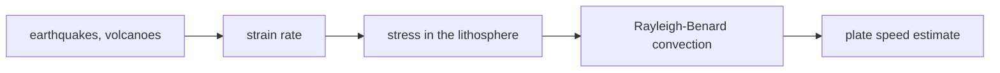

# LS08 · Plate Tectonics Strain Stress and Convection

◀ [[LS07 Isostasy]] · [[Landscapes and Geomorphology - Course Map|Course Map]] · next: [[LS09 Faults and Earthquakes]]

taught · in syllabus extra · book extra · beyond

> [!syllabus] Syllabus map: what is in the syllabus and what is extra in this chapter
> 🟢 **Taught**: slides 65–75 of [[pre_ms_landscape_26.pdf|the EC2123 pre-midsem deck]] (Argha Banerjee, IISER Pune; 153 slides). Boxes marked 🟢 **In the slides** derive what the slides derive; boxes marked 🖼 **Reading the diagram** explain each slide figure panel by panel and sit directly under the slide image.
> 🔵 **Extra · beyond**: boxes marked 🔵 **Extra** complete derivations the slides only quote (from Anderson and Anderson, *Geomorphology: the Mechanics and Chemistry of Landscapes*, and Turcotte and Schubert, *Geodynamics*); 🛠 **Tool** boxes derive a mathematical tool from 12th-grade material; 🧮 **Worked example** boxes calibrate orders of magnitude.
> This chapter has 5 sections, 3 derivation boxes, 1 redrawn figures and 10 slide images.

> [!key] After this chapter you can
> - map earthquakes and volcanoes onto plate boundaries,
> - define strain, strain rate and stress,
> - state the Rayleigh–Bénard criterion,
> - estimate a plate speed.

> [!intuition] The one-sentence story
> Plates move because the mantle convects; stress and strain rate in the lithosphere tell where earthquakes and volcanoes occur and how fast the plates go.

*Concept map: every box is a section of this chapter.*

*[Slides 65–75]*

Isostasy describes a mantle-supported *equilibrium*. Plate tectonics is the small *departure* from hydrostatic equilibrium (slide 65) that drives motion: the mantle convects, the cold lithosphere moves as rigid plates and nearly all deformation is concentrated at the plate boundaries.

## Where things happen: earthquakes and volcanoes (slides 65–68)

![[pre_065.jpg|300]] ![[pre_066.jpg|300]] ![[pre_067.jpg|300]] ![[pre_068.jpg|300]]

> [!example] 🖼 Reading the diagram: Slides 65–68
> **Slide 65**: epicentres of recent earthquakes (yellow dots) plotted on a world DEM (colour: elevation $-6$ to $+6$ km). The dots do not scatter randomly; they trace narrow lines: the circum-Pacific belt (trenches), the Alpine–Himalayan belt, the mid-ocean ridges. **Slide 66**: live catalogues (USGS; the National Centre for Seismology, India, with entries for the previous 24 h; symbol size colour-coded by magnitude and age). **Slides 67–68**: volcanoes (red triangles) coincide with the same belts. The legend of slide 68 classifies the settings: I island arc, C continental arc, R rift, H hot spot, M mid-ocean ridge, with the blue “Ring of Fire” and red mid-ocean ridge lines; the five schematic cross-sections on top show each.

| Setting | Boundary type | Mechanism | Earthquakes / faulting | Example (slide 68) |
|---|---|---|---|---|
| Mid-ocean ridge (M) | divergent | upwelling mantle melts by decompression; new crust | shallow, normal | Mid-Atlantic Ridge, Iceland |
| Rift (R) | divergent, continental | lithosphere stretched and thinned | normal faults | East African Rift |
| Island arc (I) | convergent, ocean–ocean | subducting slab dehydrates and melts the wedge above | thrust to $\sim$700 km depth | Aleutians, Marianas, Japan |
| Continental arc (C) | convergent, ocean–continent | as above beneath a continent | thrust, deep | Andes, Cascades |
| Collision | convergent, continent–continent | buoyant crust cannot subduct; thickening | thrust, shallow | Himalaya |
| Hot spot (H) | intraplate | plume from deep mantle melts | few | Hawaii, Yellowstone, Réunion |
| Transform | conservative | plates slide past | strike-slip | San Andreas |

*Tectonic settings and their signature.*

## Strain and strain rate (slide 69)

> [!key] 🛠 Tool: Strain rate as a velocity gradient
> Take a bar along $x$ with two marked points at $x$ and $x+\mathrm{d} x$. At time $t$ let the displacement of a point be $u_x(x,t)$. The length is $\mathrm{d} x+u_x(x+\mathrm{d} x)-u_x(x)=\mathrm{d} x+\partial_xu_x\mathrm{d} x$. The *strain* (fractional elongation) is $\epsilon_{xx}=\partial_xu_x$. Differentiating in time (points move with velocities $v$): the *strain rate* is $\dot\epsilon_{xx}=\partial_xv_x$ (slide 69 writes $\epsilon_{xx}=\partial_xu_x$ with $u$ the displacement or velocity as context needs). Hence **strain changes only when velocity varies in space**: a uniform velocity (rigid translation) has $\partial_xv_x=0$ and no deformation. In two dimensions the velocity-gradient matrix $\partial_iv_j$ splits into a symmetric part $\dot\epsilon_{ij}=\tfrac12(\partial_iv_j+\partial_jv_i)$ (deformation) and an antisymmetric part $\tfrac12(\partial_iv_j-\partial_jv_i)$ (rigid rotation, $=\tfrac12$ the spin): “minus effects of rotation” on the slide. For a rigid body $v=\vect\Omega\times\vect r$ the symmetric part is zero.

> [!example] 🧮 Worked example: Plate interiors versus boundaries
> Two plates converging at $V=5$ cm yr$^{-1}$ across a boundary zone of width $\ell=100$ km deform at $\dot\epsilon\sim V/\ell=5\times10^{-2}/10^{5} \mathrm{yr^{-1}}=5\times10^{-7} \mathrm{yr^{-1}} (1.6\times10^{-14} \mathrm{s^{-1}})$. In a plate interior $\dot\epsilon\lesssim10^{-9} \mathrm{yr^{-1}}$ or much less: plates are rigid to good approximation; earthquakes, volcanoes and mountains are boundary phenomena (slide 70: “concentrated action near the plate boundaries”).

![[pre_069.jpg|460]]

> [!example] 🖼 Reading the diagram: Slide 69: predicted plate motion
> The map (Fig. 12.37) has arrows on each plate showing predicted motion; the reference arrow is $5$ cm yr$^{-1}$. Arrows are parallel over large regions (rigid plates), change abruptly at the white boundary lines, are longest on the Pacific ($\sim$8–10 cm yr$^{-1}$) and shortest in the Atlantic–Africa–Antarctic area ($\lesssim2$–3 cm yr$^{-1}$). On the right the blue block is stretched by the double arrows: $\epsilon_{xx}=\partial_xu_x$.

## Stress in the lithosphere (slide 70)

![[pre_070.jpg|460]]

> [!example] 🖼 Reading the diagram: Slide 70: the World Stress Map
> Each short bar is the orientation of the maximum horizontal compressive stress $S_{H}$ measured at that location; bar colour = tectonic regime (red normal faulting NF, green strike-slip SS, blue thrust faulting TF, black unknown U); bar length = quality (A best). Methods (legend, left): focal mechanisms of earthquakes, borehole breakouts, drilling-induced fractures, overcoring, hydraulic fracturing and geological indicators. The three small block diagrams (bottom right) show the regimes: **normal faulting**: vertical stress $S_V$ is the largest principal stress; **strike-slip**: $S_V$ intermediate; **thrust**: $S_V$ smallest. The pattern is coherent over thousands of kilometres (stress is transmitted through rigid plates) and is set by plate-boundary forces; the stress orientations *rotate* where the boundary conditions change. The regimes are derived in Chapter 9 (Anderson's theory).

## Why plates move: Rayleigh–B\'enard convection (slides 71–72)

![[pre_071.jpg|460]]

> [!example] 🖼 Reading the diagram: Slide 71: convection in a pan
> The photograph shows a shallow layer of oil heated from below: polygonal convection cells. In each cell hot fluid rises (typically at the centre), spreads at the top, cools and sinks at the cell edges. The cell width is comparable to the layer thickness. The lower picture repeats the plate-motion map: the same physics, at scale $10^{6}$ m, is what moves plates.

> [!derivation] 🟢 In the slides: Slide 71–72: the Rayleigh number as (buoyant force/viscous force)$\times$(advection/diffusion)
> A fluid layer of depth $b$ has temperature difference $\Delta T$ across it, density $\rho=\rho_0[1-\alpha_v(T-T_0)]$, viscosity $\mu$ and thermal diffusivity $\kappa$. A parcel hotter by $\Delta T$ is lighter by $\Delta\rho=\rho_0\alpha_v\Delta T$ and feels a buoyant force per volume $\Delta\rho g$. If it rises at speed $u$ through the layer, the viscous force per volume is $\sim\mu u/b^2$. The ratio
>
>
> $$
> \frac{F_\mathrm{buoy}}{F_\mathrm{visc}}\sim\frac{\Delta\rho g}{\mu u/b^2}
> $$
>
>
> is one in a balanced flow, giving $u\sim\Delta\rho gb^2/\mu$. Second, heat carried by the rising parcel over the time $b/u$ is lost by diffusion over a distance $\ell_d=\sqrt{\kappa b/u}$. Rising is efficient only if $b\gg\ell_d$; the dimensionless measure is $(b/\ell_d)^2=b^2/(\kappa b/u)=ub/\kappa$ (the P\'eclet number). The product is the slide's expression, in which the unknown speed $u$ cancels:
>
>
> $$
> \mathrm{Ra}=\frac{\Delta\rho\,g}{\mu u/b^2}\times\frac{b^2}{\kappa b/u}=\frac{\rho_0g\alpha_v\Delta T\,b^3}{\mu\kappa}. \tag{19}
> $$
>
>
> A cleaner reading of the same number: a hot blob rises at the buoyancy-driven speed $u_b=\Delta\rho gb^2/\mu$, so it crosses the layer in a time $b/u_b$. Meanwhile diffusion erases its temperature excess in a time $b^2/\kappa$. So $\mathrm{Ra}=u_bb/\kappa=\dfrac{b^2/\kappa}{b/u_b}$, the ratio of the time to *forget* the heat to the time to *carry* it across. Large $\mathrm{Ra}$ means blobs arrive still hot and still buoyant, so convection sustains itself. Small $\mathrm{Ra}$ means blobs lose their buoyancy before they get anywhere, and the layer simply conducts. **Slide 72's estimate**: $\rho_0=10^3$, $g=10$, $\alpha_v=10^{-5}$, $\Delta T=10^3$, $b=10^6$ m, $\mu=10^{20}$, $\kappa=10^{-6}$:
>
>
> $$
> \mathrm{Ra}_\mathrm{mantle}\sim\frac{10^3\cdot10\cdot10^{-5}\cdot10^3\cdot10^{18}}{10^{20}\cdot10^{-6}}=10^{6}.
> $$
>
>
> (With mantle values $\rho_0=3300$, $\alpha_v=3\times10^{-5}$, $\Delta T=3000$ K, $b=2900$ km, $\mu=10^{21}$: $\mathrm{Ra}\approx7\times10^7$.) The mantle is far above the threshold $\mathrm{Ra}_c\sim10^3$ derived next.

> [!derivation] 🔵 Extra (not derived in the slides): The critical Rayleigh number: linear stability of a layer heated from below
> Consider 2-D motion $(u,w)$ in $x,z$ in a layer $0<z<b$ heated from below (hot bottom, temperature drop $\Delta T$), Boussinesq fluid: density varies only in the buoyancy term. The background state is conductive: $T_0=\Delta T(1-z/b)$. Let $T'$, $w$ be small perturbations. *Momentum* (Stokes, no inertia; $P'$ perturbation pressure; buoyancy $+\rho_0g\alpha_vT'$ upward): $0=-\partial_zP'+\mu\nabla^2w+\rho_0g\alpha_vT'$ and $0=-\partial_xP'+\mu\nabla^2u$, with $\partial_xu+\partial_zw=0$. Eliminating $P'$ (differentiate the first by $\partial_x^2$, the second by $\partial_x\partial_z$, subtract; use $\partial_x\partial_zu=-\partial_z^2w$):
>
>
> $$
> \mu\nabla^4w=-\rho_0g\alpha_v \partial_x^2T'.
> $$
>
>
> *Heat* at marginal stability ($\partial_t=0$): $w \partial_zT_0=\kappa\nabla^2T'$, i.e. $-\dfrac{\Delta T}{b}w=\kappa\nabla^2T'$. Free-slip, isothermal boundaries: $T'=w=\partial_z^2w=0$ at $z=0,b$. Try $w=W\sin(\pi z/b)\cos kx$, $T'=\Theta\sin(\pi z/b)\cos kx$, so $\nabla^2\to-K^2$, $K^2=k^2+\pi^2/b^2$. The two equations become $\mu K^4W=\rho_0g\alpha_vk^2\Theta$ and $\kappa K^2\Theta=(\Delta T/b)W$. Eliminate $\Theta/W$:
>
>
> $$
> \mathrm{Ra}=\frac{\rho_0g\alpha_v\Delta Tb^3}{\mu\kappa}=\frac{K^6b^4}{k^2}=\frac{(\pi^2+a^2)^3}{a^2},\qquad a=kb .
> $$
>
>
> For each wavelength there is a threshold Ra; convection starts at the smallest one. Put $s=a^2$: $\mathrm{d}/\mathrm{d} s[(\pi^2+s)^3/s]=0\Rightarrow3s=\pi^2+s\Rightarrow s=\pi^2/2$, so
>
>
> $$
> a_c=\frac{\pi}{\sqrt2},\quad\lambda_c=\frac{2\pi}{k_c}=2\sqrt2\,b\approx2.83\,b,\qquad\mathrm{Ra}_c=\frac{27\pi^4}{4}\approx657.5 . \tag{20}
> $$
>
>
> (For rigid boundaries the value is 1708, quoted.) Cell width $\approx2.8\times$ depth — the polygon size seen on slide 71. For $\mathrm{Ra}\gg\mathrm{Ra}_c$ (mantle $\sim10^{6}$–$10^{8}$) convection is vigorous and time-dependent, with thin thermal boundary layers.

![[ls_fig17.png]]
*Figure LS08.1. Marginal-stability curve of eq. (20). Points above the curve are unstable to convection with that wavenumber; the minimum sets the onset.*

<!-- ls-depth:LS08:1 -->
> [!intuition] Context: Arthur Holmes and the Rayleigh number of the mantle
> Convection as the engine of continental drift was proposed by Arthur Holmes in **1931**, on the strength of exactly this estimate: a mantle with $\mu\sim10^{21}$ Pa s (from postglacial rebound, [[LS07 Isostasy]]) still has a Rayleigh number thousands of times the critical value. T&S's version of the calculation (T&S §6.19, Bookos copy, PDF pp.511–514) uses **internal heat generation** ($H=9\times10^{-12}$ W/kg) and finds $\mathrm{Ra}_H=2\times10^6$ for the upper mantle ($b=700$ km) and $2\times10^9$ for the whole mantle ($b=2880$ km), against minimum critical values of **867.8** (free-slip) and **2772** (no-slip) for an *internally heated* layer.
> **A cross-check of the numbers.** The critical values in this chapter's derivation ($\mathrm{Ra}_c=657.5$ for free-slip, and 1708 for two no-slip boundaries) are for a layer heated **from below** with fixed temperature at the base; T&S's 867.8 and 2772 are for **internal heating** (a different definition, $\mathrm{Ra}_H=\alpha_v\rho_0^2gHb^5/k\mu\kappa$). They are not in conflict: the two Rayleigh numbers answer slightly different physical set-ups. In both, the mantle is supercritical by factors of $10^3$–$10^6$.

> [!derivation] 🔵 Extra (computed): what a supercritical Rayleigh number implies: lithosphere thickness and plate speed
> For $\mathrm{Ra}\gg\mathrm{Ra}_c$ convection is confined to thin **thermal boundary layers** of thickness $\delta\sim b\,(\mathrm{Ra}_c/\mathrm{Ra})^{1/3}$ (the layer just stays marginally stable), with an overturn velocity scale $u\sim(\kappa/b)(\mathrm{Ra}/\mathrm{Ra}_c)^{2/3}$ (all coefficients are $O(1)$ in scaling arguments; see [[LS02 Mechanics and Mathematics Toolkit]]). With the slide's mantle values ($\rho_0=3300$, $\alpha_v=3\times10^{-5}$, $\Delta T=3000$ K, $b=2900$ km, $\mu=10^{21}$, $\kappa=10^{-6}$): $\mathrm{Ra}=7.1\times10^7$ and, for $\mathrm{Ra}_c=657$–$1708$,
> $$\delta\approx61\text{–}84\ \mathrm{km},\qquad u\approx1.3\text{–}2.5\ \mathrm{cm\,yr^{-1}}.$$
> *Both land on the right scales:* the thickness of the oceanic **lithosphere** (the cold upper boundary layer) is $\sim100$ km ([[LS07 Isostasy]], half-space cooling) and plate speeds are $\sim$ a few cm/yr. The Péclet number $uL/\kappa\approx4600$ (for $5$ cm/yr over $2900$ km) says advection beats diffusion everywhere except inside the boundary layers: the plate is a **cold lid that moves with the flow and loses heat by conduction across it**. (This is a scaling consistency check; real plate speeds also depend on slab pull and ridge push, see the force balance of slides 73–75.)

> [!question] Check yourself (answers below)
> 1. Why does doubling the layer depth $b$ raise $\mathrm{Ra}$ by a factor 8?
> 2. If the viscosity fell by 10, what happens to $\mathrm{Ra}$, to $\delta$ and to $u$?
> 3. What does it mean physically for $\mathrm{Ra}$ to be below $\mathrm{Ra}_c$?
> 4. Which part of the strain-rate tensor is a pure rotation? In which group does that rotation live?
> *Answers.* (1) $\mathrm{Ra}\propto b^3$. (2) $\mathrm{Ra}\propto1/\mu$ rises 10×; $\delta\propto\mathrm{Ra}^{-1/3}$ falls by $10^{1/3}=2.15$; $u\propto\mathrm{Ra}^{2/3}$ rises by $10^{2/3}=4.6$. (3) Heat is carried by conduction alone: perturbations decay and the layer is stable. (4) The antisymmetric part of $\nabla\mathbf u$, $\tfrac12(\partial_iu_j-\partial_ju_i)$, an infinitesimal rotation (an element of the Lie algebra $\mathfrak{so}(3)$); the symmetric part is the strain rate. See [[GT10 Symmetry Representations and Characters]] §6.

> [!connection] Where else this appears
> - **The linear stability analysis** uses the Fourier modes $w\propto\sin(\pi z/b)\,e^{ikx}$: [[Fourier and Laplace Transforms]]; the *growth rate* of a mode is a pole crossing the imaginary axis, the same picture as [[Bistability and Tipping Points]] (critical Ra $=$ a bifurcation) and [[Fixed Points and Linear Stability]].
> - **Atmospheric analogue:** [[Climate - Course Map]] (Hadley cells, buoyancy-driven overturning) and [[CL12 Rotating Frames and the Coriolis Force]].
> - **Dimensionless groups:** [[LS02 Mechanics and Mathematics Toolkit]] (Buckingham Π; Reynolds, Péclet, Rayleigh).

## How fast? A plate-speed estimate (slides 73–75)

![[pre_073.jpg|300]] ![[pre_074.jpg|300]] ![[pre_075.jpg|300]]

> [!example] 🖼 Reading the diagram: Slides 73–75
> Slide 73 (left): global heat flow (mW m$^{-2}$, $4$ to $919$): highest (red, $>130$) along mid-ocean ridges where new hot lithosphere forms, lowest ($<60$) over old continents and old ocean; (bottom) a cartoon section from a ridge to a trench: hot rock rises at the ridge, cold lithosphere sinks at the trench and mantle flows in a convection cell, cold outside, hot inside, above the core. Slide 75: the PB2002 plate-boundary model (Bird) on a colour elevation map: all plates and the diffuse boundary zones.

> [!derivation] 🟢 In the slides: Slide 74: plate speed from buoyancy against viscous resistance
> The cold sinking lithosphere (slab) is denser than the mantle by $\Delta\rho\sim100$ kg m$^{-3}$ and extends $W\sim10^5$ m; its excess weight produces a driving stress $\sim\Delta\rho g W=100\times10\times10^5=10^8$ Pa (the LHS on the slide, $10^5\times100\times10$). It is resisted by viscous stress in the flowing mantle: for a plate at speed $V$ dragging fluid over a length scale $R$, the strain rate is $\sim V/R$ and the stress $\sim2\mu V/R$:
>
>
> $$
> W\Delta\rho g\sim R\times\frac{2\mu V}{R^2} \Longrightarrow 10^5\times100\times10\sim\frac{2\times10^{21\text{–}23}V}{6\times10^6} \Longrightarrow V\sim\frac{3\times10^{14}}{10^{21\text{–}23}} \mathrm{m s^{-1}} .
> $$
>
>
> Using $1 \mathrm{yr}\approx3\times10^7$ s, $V\sim10^{22}/10^{21\text{–}23} \mathrm{m yr^{-1}}\sim10^{1}\text{–}10^{-1} \mathrm{m yr^{-1}}$. Why the answer needs more than the rebound value: post-glacial rebound gave $\mu\approx10^{21}$ Pa s ([[LS07 Isostasy]]), which here would give an absurd 10 m/yr. The two numbers measure different parts of the mantle. Rebound loads of ~$10^3$ km mostly probe the **upper** mantle. A sinking slab and the plate-scale flow it drives ($R\sim6000$ km) reach into the **lower** mantle, which is 10–100 times more viscous. In addition, much of the resistance comes from bending the stiff plate at the trench and from friction on the plate boundary, neither of which this estimate includes. *Interpretation*: for the high end of the mantle-viscosity range the estimate falls at $0.1$ m yr$^{-1}$ ($10$ cm yr$^{-1}$), the fastest observed plate speed; the observed range is $1$–$10$ cm yr$^{-1}$, so the scaling identifies the correct physics (slab buoyancy vs viscous drag) and puts the plausible mantle viscosity at $\gtrsim10^{22}$ Pa s, but is only an order-of-magnitude estimate (the resistance also includes bending of the plate and friction at the boundaries, and $R$ is not well defined).

## Further slides explained one by one
taught *the slides of this chapter's range that carry no derivation of their own; each image is followed by what it shows*

![[pre_072.jpg|520]]

> [!example] 🖼 Reading the diagram: Slide 72: Rayleigh–Bénard convection and the mantle Rayleigh number
> *Left:* the Rayleigh number as the ratio of buoyancy to viscous resistance: $Ra=\rho g\alpha\Delta T h^3/(\mu\kappa)=(\Delta\rho\,g/\mu)\times h^2/(\kappa/h)$ (buoyant force × time to diffuse across the cell, over viscous force), with the mantle numbers $\rho\sim10^3$, $g\sim10$, $\alpha\sim10^{-5}$, $\Delta T\sim10^3$, $h\sim10^6$ m, $\mu\sim10^{20}$ Pa s, $\kappa\sim10^{-6}$ m² s$^{-1}$ giving $Ra_{\rm mantle}\sim10^6\gg Ra_{\rm crit}\sim10^3$: **the mantle convects vigorously**. *Top right:* a laboratory convection pattern (hexagonal cells in a heated fluid layer). *Bottom right:* the world map of plate motions (arrows) as the surface expression.

<!-- interactive:start (generated by scripts/embed_interactive.py; edit the tool in scripts/interactive/tools/, not this block) -->
> [!interactive]+ Interactive: Finite strain: how a circle becomes an ellipse
> A homogeneous deformation maps every point x to F x.
>
> ![[ls_strain.png|720]]
>
> **Try:** Simple shear γ = 1: λ₁ = 1.618, λ₂ = 0.618, long axis at 31.7° from the shear direction; as γ → ∞ the axis aligns with the shear plane. Pure shear a = 1.5: stretch 1.5 and 0.667 along the axes, area unchanged. Add dilation to see det F ≠ 1.
>
> [▶ Open the tool in your browser](../Assets/interactive/ls_strain.html) · [absolute link](file:///home/swastik/Documents/notes/Assets/interactive/ls_strain.html) · all tools and coverage: [[Interactive Tools]]

<!-- interactive:end -->

## Map of this chapter
> [!connection] How LS08 connects
> **Previous:** [[LS07 Isostasy]] · **Next:** [[LS09 Faults and Earthquakes]].
> **Other subjects:** [[Climate - Course Map]] (weathering and the carbon cycle, glaciation, orographic rainfall), [[Thermodynamics and Statistical Mechanics - Course Map]] (heat conduction and diffusion), [[Evolution of Earth and Life - Course Map]] (plate tectonics and landscapes through geological time), [[Waves - Course Map]] (diffusion and wave equations).

## Provenance
> [!provenance]- Source map for this chapter
> | Topic | Source | Scope |
> |---|---|---|
> | slide content, figures read panel by panel | [[pre_ms_landscape_26.pdf]] slides 65–75 (images embedded from the PDF, auto-cropped, `scripts/render_slides.py`) | taught |
> | derivations, worked examples, tool boxes, TikZ figures | the AI-written derivation-level notes [[Landscapes_and_Their_Evolution_notes.pdf]] (EC2123 notes; LaTeX source in `landscape-notes-tex-source.tar.gz`), converted with `scripts/tex2vault_ls.py`; cross-checked against Anderson and Anderson and Turcotte and Schubert as cited there | secondary + extra/book |
>
> **Notes.** (1) The text of this chapter is the AI-written reference notes' text, converted to the vault's callout style and equation numbering (chapter-local, so some cross-references read as "(label)"). (2) The slide images were checked against the notes' slide numbers for a sample of slides (e.g. 1–12, 109–120 match). Figure descriptions are the notes', and should be compared with the images beside them. (3) The `[!verify]` items of the notes' last front-matter section ("Two places where the slides need care") are in [[Landscapes Notation and Glossary]].

<!-- ls-depth:LS08:2 -->
> [!provenance]- Depth-layer sources (added 2026-10-28)
> | Topic | Source | Priority |
> |---|---|---|
> | Rayleigh number definition (eq. 6.316), minimum critical values 2772 and 867.8 for internal heating, mantle $\mathrm{Ra}_H=2\times10^6$ and $2\times10^9$, Holmes 1931 | T&S (Bookos copy) PDF pp.511–514 (read p.514; p.511–513 found by search) | b · primary book |
> | boundary-layer thickness and velocity scalings $\delta\sim b(\mathrm{Ra}_c/\mathrm{Ra})^{1/3}$, $u\sim(\kappa/b)(\mathrm{Ra}/\mathrm{Ra}_c)^{2/3}$, numbers | standard scaling arguments (my statement, coefficients $O(1)$); `scripts/ls_depth_numbers.py` (`LS08`) | extra · beyond |
