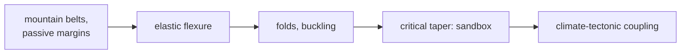

# LS10 · Folds Flexure and Mountain Building

◀ [[LS09 Faults and Earthquakes]] · [[Landscapes and Geomorphology - Course Map|Course Map]] · next: [[LS11 Weathering and Regolith]]

taught · in syllabus extra · book extra · beyond

> [!syllabus] Syllabus map: what is in the syllabus and what is extra in this chapter
> 🟢 **Taught**: slides 76–84, 90, 95 of [[pre_ms_landscape_26.pdf|the EC2123 pre-midsem deck]] (Argha Banerjee, IISER Pune; 153 slides). Boxes marked 🟢 **In the slides** derive what the slides derive; boxes marked 🖼 **Reading the diagram** explain each slide figure panel by panel and sit directly under the slide image.
> 🔵 **Extra · beyond**: boxes marked 🔵 **Extra** complete derivations the slides only quote (from Anderson and Anderson, *Geomorphology: the Mechanics and Chemistry of Landscapes*, and Turcotte and Schubert, *Geodynamics*); 🛠 **Tool** boxes derive a mathematical tool from 12th-grade material; 🧮 **Worked example** boxes calibrate orders of magnitude.
> This chapter has 5 sections, 4 derivation boxes, 2 redrawn figures and 9 slide images.

> [!key] After this chapter you can
> - derive the elastic flexure of a plate under a line load,
> - describe fold geometry and buckling,
> - explain critical taper (sandbox and Himalaya),
> - state the climate–tectonics coupling.

> [!intuition] The one-sentence story
> A plate bends elastically under a load (flexure), layers buckle into folds, a mountain belt is a critical wedge, and climate feeds back on tectonics.

*Concept map: every box is a section of this chapter.*

*[Slides 76–84, 90, 95]*

## Where the mountains are; passive margins (slides 76–78)

![[pre_076.jpg|460]] ![[pre_077.jpg|460]]

> [!example] 🖼 Reading the diagram: Slides 76–77: mountain belts and the journey of India
> Slide 76 (Park, 2012): young mountain ranges (red) follow the ocean trenches and arcs of the Pacific (Aleutian, western Pacific arc–trench system, Western American Cordillera, Andes) and the Alpine–Himalayan collision belt; ocean ridges (grey) and trenches (blue-green) are marked. On the right (Summerfield, 1991), *great escarpments* of *passive margins*: Serra do Mar (Brazil), Drakensberg and the Great Escarpment (southern Africa), the Western Ghats (India), eastern Australia and others; and a cross-section (Gunnell and Fleitout) of the Western Ghats margin with sediment load offshore, denudation onshore and shoulder uplift by flexural rebound. Slide 77 (Chatterjee et al. 2013): a series of Gondwana reconstructions (Late Jurassic $\to$ Cretaceous $\to$ Early Eocene $\to$ today) with India drifting from East Gondwana and colliding with Asia; the flow chart at the right lists the rifting and collision events on a time axis.

| Approximate time | Event (standard chronology; compare with the flow chart on slide 77) |
|---|---|
| $\sim$170–130 Ma | Break-up of Gondwana; East Gondwana (India–Antarctica–Australia) separates from Africa |
| $\sim$130–120 Ma | India separates from Antarctica–Australia |
| $\sim$88 Ma | India–Madagascar separate; the Western Ghat margin forms |
| $\sim$66 Ma | Deccan Trap eruptions (Réunion plume) |
| $\sim$55–50 Ma | Collision of India with Asia begins; Himalaya starts to rise |

*Time line of the Indian plate. India covered $\sim6000$ km in $\sim100$ Myr, i.e. $\sim6$ cm yr$^{-1}$ on average (faster, $\sim15$–$20$ cm yr$^{-1}$, before collision).*

**Slide 78, passive-margin escarpments.** Rifting and crustal thinning by stretching (McKenzie and Sclater) produce normal faulting and an escarpment at the edge of the continent. The slide's conclusion (Summerfield 1991): *present-day topography is a manifestation of past tectonics and of continuous sub-aerial processes, primarily driven by rivers and hillslopes*. The right-hand image is the DEM/slope map of the Western Ghats (violet–blue), showing the escarpment as a narrow steep line parallel to the coast. If an escarpment has retreated inland by $\Delta x$ in time $t$ its mean retreat rate is $\Delta x/t$ (e.g. 50 km in 65 Myr, $0.8$ km Myr$^{-1}$, an illustration rather than a measured value).

## Elastic flexure (slide 79)

The lithosphere is not a fluid: on time scales of millions of years it behaves elastically and *bends* under loads. Flexure explains why isostasy of narrow features is not local.

> [!derivation] 🔵 Extra (not derived in the slides): Thin elastic plate on a fluid mantle
> *Bending.* Take a plate of thickness $T_e$ deflected downward by $w(x)$. To first order in the slope the plate is curved with curvature $w”$; a horizontal fibre at height $z$ above the mid-plane is stretched/compressed by the strain $\epsilon=-z w”$ (top fibres shorten when the plate curves downward at the ends). With Hooke's law $\sigma=E'\epsilon$ ($E'=E/(1-\nu^2)$ for plane strain), the bending moment per unit width is $M=\int\sigma z \mathrm{d} z=-E'w”\int_{-T_e/2}^{T_e/2}z^2 \mathrm{d} z=-D w”$ with the *flexural rigidity* $D=E'T_e^3/12=\dfrac{ET_e^3}{12(1-\nu^2)}$ (sign convention aside). *Force balance* on a slice $\mathrm{d} x$: shear force $V=\mathrm{d} M/\mathrm{d} x$ and $\mathrm{d} V/\mathrm{d} x=q-\Delta\rho g w$ ($q$ = applied downward load per area; the restoring buoyancy of displaced mantle is $\Delta\rho g w$ with $\Delta\rho=\rho_m-\rho_\mathrm{fill}$). Hence
>
>
> $$
> D\frac{\mathrm{d}^4w}{\mathrm{d} x^4}+\Delta\rho g w=q(x).
> $$
>
>
> *Solution for a line load $V_0$ at $x=0$*: for $x\ne0$, $q=0$. Put $u=x/\alpha$ and $f(u)=\mathrm{e}^{-u}(\cos u+\sin u)$: $f'=-2\mathrm{e}^{-u}\sin u$, $f”=2\mathrm{e}^{-u}(\sin u-\cos u)$, $f”'=4\mathrm{e}^{-u}\cos u$, $f””=-4f$. Then $Dw””=-\Delta\rho g w$ requires $4D/\alpha^4=\Delta\rho g$:
>
>
> $$
> \alpha=\Big(\frac{4D}{\Delta\rho g}\Big)^{1/4},\qquad w(x)=w_0\,\mathrm{e}^{-|x|/\alpha}\Big(\cos\frac{x}\alpha+\sin\frac{|x|}\alpha\Big),\qquad w_0=\frac{V_0}{2\alpha\Delta\rho g}. \tag{21}
> $$
>
>
> ($w'(0)=0$ by symmetry; $w_0$ follows because the total buoyancy support must equal the load, $\Delta\rho g\int w \mathrm{d} x=2w_0\alpha\Delta\rho g=V_0$.) The deflection changes sign at $x=3\pi\alpha/4$ and has a *peripheral bulge* of height $-0.043 w_0$ at $x=\pi\alpha$. Numbers: $T_e=30$ km, $E=70$ GPa, $\nu=0.25$: $D=1.7\times10^{23}$ N m; $\Delta\rho=2300$: $\alpha=74$ km, bulge $\sim230$ km from the load (or $174$ km to the zero crossing). Thick lithosphere ($T_e\to\infty$) spreads a load over a long $\alpha$; $T_e\to0$ gives local (Airy) isostasy.

![[ls_fig22.png]]
*Figure LS10.1. Flexural profile (21) of a broken elastic plate loaded at $x=0$ (only the right half meaningful; drawn symmetric).*

![[pre_079.jpg|460]]

> [!example] 🖼 Reading the diagram: Slide 79: flexure and the Western Ghats
> Right: the modelled flexural response to onshore erosion and offshore deposition (Campanile et al., 2008): deflection (km, up positive) against distance from the coast, curves for effective elastic thickness $T_e=10,30,50,70$ km. Offshore ($x<0$) the deposited sediment load pushes the crust *down*; onshore ($x>0$) erosion removes load and the crust flexes *up*, most strongly near the coast: the coastal escarpment is raised as a *shoulder* (probable flexural origin of the uplift, Gunnell and Fleitout 2000). Thicker plates (larger $T_e$) spread the response over a wider zone, so the maximum shoulder uplift is not simply proportional to $T_e$. Simple estimate: the magnitude of the response scales with the load transfer, $\sim\rho g \overline{h_\mathrm{eroded}} \alpha/\Delta\rho g$ (from $w_0$ above).

<!-- ls-depth:LS10:1 -->
> [!derivation] 🔵 Extra (computed): what the flexural rigidity means in kilometres of rock
> The rigidity $D=ET_e^3/12(1-\nu^2)$ of a plate of elastic thickness $T_e$ ($E=70$ GPa, $\nu=0.25$) is very sensitive to $T_e$: $T_e=10$ km: $D=6.2\times10^{21}$ N m; **25 km: $9.7\times10^{22}$**; 50 km: $7.8\times10^{23}$; 100 km: $6.2\times10^{24}$ (a factor 8 for each doubling). The value $D=10^{23}$ N m used as an illustration in [[Fourier and Laplace Transforms]] is therefore a plate of **$T_e\approx25$ km**. Its flexural parameter $\alpha=(4D/\Delta\rho g)^{1/4}$ depends on what fills the bending space: empty ($\Delta\rho=3300$): $\alpha=59$ km (wavelength $2\pi\alpha=373$ km); water-filled ($2300$): $65$ km; **sediment-filled foreland basin ($900$): $82$ km ($515$ km)**. Infilling with sediment widens the basin because the restoring buoyancy is weaker.
> **The Fourier view.** The plate acts as a *low-pass filter* on topography: $1/(1+(k/k_c)^4)$ with half-compensation at $\lambda=2\pi(D/\Delta\rho g)^{1/4}=263$ km ([[Fourier and Laplace Transforms]] §6.3). Short loads (a single volcano, a small thrust sheet) are carried by the plate's strength and produce a local, shallow, narrow flexure; broad loads (an orogen) are compensated as if the plate were not there (Airy, [[LS07 Isostasy]]). This is the content of T&S's Figure 3–27 on the degree of compensation as a function of wavelength.

## Folds (slides 80–84)

![[pre_081.jpg|300]] ![[pre_082.jpg|300]] ![[pre_083.jpg|300]] ![[pre_084.jpg|300]]

> [!example] 🖼 Reading the diagram: Slides 81–84: folds at all scales
> Slide 81: satellite view of the Aravalli fold belt near Chittorgarh (scale 4.9 km) and A&A/T&S photographs of angular (chevron) folds in limestone/siltstone (Atacama, Chile) and rounded folds in amphibolite (Idaho): thin resistant layers between weak ones. Slide 82: a huge plunging fold nose (with pale layers exposed by erosion) and, at right, parallel ridges of the Tripura–Chittagong fold belt (scale 83 km; Agartala, Comilla, Silchar), each ridge an anticline. Slide 83: folded strata in a mountain face (person for scale). Slide 84: block diagrams (Huggett Fig. 5.13) of fold types and a geologic block with anticline/syncline.

| Fold (slide 84) | Geometry | Rocks exposed after erosion |
|---|---|---|
| Anticline | arch; limbs dip away from the axis | oldest rock in the core |
| Syncline | trough; limbs dip toward the axis | youngest rock in the core |
| Asymmetric fold | limbs of unequal dip; axial plane inclined | – |
| Monocline | single step in otherwise flat strata | – |
| Isocline (isoclinal fold) | limbs parallel, dip the same way or opposite | repeated beds |
| Recumbent fold | axial plane near horizontal (over-turned limb) | inverted sequence on lower limb |
| Dome | layers dip away from a point | oldest rock at the centre (circular outcrop) |
| Basin | layers dip toward a point | youngest rock at the centre |

*Fold types. The rules of age refer to normal stratigraphy. Slide 84 notes: folds can only be classified from cross-sections, and “the axis need not be horizontal”: a *plunging* fold has its hinge line inclined, giving V-shaped outcrops (the fold nose).*

> [!example] ❓ Question on the slides: Slide 80: why do folds have wavelength proportional to layer thickness?
> The data (slide 80, log–log, Currie et al. 1962) show that the dominant wavelength $\lambda$ of folds in a strong layer of thickness $h$ obeys $\lambda/h\approx31.4$ over six orders of magnitude (from mm-thick veneers to km-thick strata). The following derivation shows why, and what $31.4$ means.

> [!derivation] 🔵 Extra (not derived in the slides): Dominant fold wavelength (Biot–Ramberg)
> Model: a competent layer of viscosity $\mu_l$ and thickness $h$ in an infinite medium of viscosity $\mu_m\ll\mu_l$, compressed by a horizontal force per unit width $P$ (compressive). Treat the layer as a thin viscous plate deflected by $w=w_0\mathrm{e}^{qt}\cos kx$.
> *Plate*: the elastic bending law $M=-Dw”$ with $D=E'h^3/12$ becomes viscous if strain $\to$ strain rate and $E'\to4\mu_l$ ($E=3\mu$ for an incompressible material, $\nu=\tfrac12$, $E'=E/(1-\nu^2)=4\mu$): $M=-D_v \partial_tw”$, $D_v=\mu_lh^3/3$.
> *Medium*: each side of the layer resists its motion with the normal stress $2\mu_mk \dot w$ derived in Chapter 7, so the two sides give a total $4\mu_mk\dot w$.
> Force balance (beam-column): $D_v\partial_tw””+Pw”=-4\mu_mk\dot w$; with $w\propto\mathrm{e}^{qt}\cos kx$:
>
>
> $$
> q=\frac{Pk^2}{D_vk^4+4\mu_mk}=\frac{Pk}{\tfrac13\mu_lh^3k^3+4\mu_m}.
> $$
>
>
> For small $k$ (long wavelengths) the medium resists ($q\propto k$); for large $k$ the plate's bending stiffness resists ($q\propto k^{-3}$): a maximum in between (figure). $\mathrm{d} q/\mathrm{d} k=0$: $\tfrac13\mu_lh^3k^3+4\mu_m=k\cdot\mu_lh^3k^2$, i.e. $k_*^3=6\mu_m/(\mu_lh^3)$ and
>
>
> $$
> \boxed{\lambda_d=\frac{2\pi}{k_*}=2\pi h\Big(\frac{\mu_l}{6\mu_m}\Big)^{1/3}} \tag{22}
> $$
>
>
> The wavelength is set by the *thickness* of the strong layer and only weakly (cube root) by the viscosity contrast — explaining the universal proportionality of slide 80. Reading the slide: $\lambda_d/h=31.4=10\pi$ gives $(\mu_l/6\mu_m)^{1/3}=5$, i.e. $\mu_l/\mu_m=6\times5^3=750$. Sandstone in shale, evaporite in clastics: contrasts of $10^2$–$10^3$. Since the growth rate is maximal at $k_*$, the fastest-growing wavelength dominates once the folds have grown ($\mathrm{e}^{qt}$ with large $qt$ magnifies small differences in $q$).

![[ls_fig23.png]]
*Figure LS10.2. Growth rate $q(k)/q_\mathrm{max}=1.5(k/k_*)/[1+\tfrac12(k/k_*)^3]$ of a single competent layer: the maximum selects the fold wavelength.*

## Critical taper: the sandbox and the Himalaya (slide 90)

![[pre_090.jpg|460]]

> [!example] 🖼 Reading the diagram: Slide 90: the sandbox experiment
> A side view of layered coloured sand shortened from one side by a moving wall (a “push” from the left in the picture): the sand piles into a wedge whose surface slope is $\sim10^\circ$ (pink line) and whose thrust-bounded slices stack up in sequence; the three marked heights ($5.7$, $8$, $8$ cm) show that, as the wedge is shortened, its height increases while the slope of its surface stays the same: the wedge grows *self-similarly*, keeping a constant *taper*.

> [!derivation] 🔵 Extra (not derived in the slides): A depth-integrated force balance for a wedge (scaling)
> Let a wedge with surface slope $\alpha$ and base dipping $\beta$ (small angles) have thickness $H=(\alpha+\beta)s$ at distance $s$ from its toe. Consider the slice between $s$ and $s+\mathrm{d} s$. Assume the rock is everywhere on the point of Coulomb failure under horizontal compression, so that the horizontal stress is a constant multiple $K$ of the vertical (lithostatic) one, $\sigma_h=K\rho gz$, with $K=(1+\sin\phi)/(1-\sin\phi)$ from the Mohr-circle result above. The horizontal force per width on a vertical section is $\Sigma=\int_0^H\sigma_h\mathrm{d} z=K\rho gH^2/2$. Balance of horizontal forces on the slice: $\mathrm{d}\Sigma/\mathrm{d} s$ equals the horizontal components of the basal traction: friction $f_b\sigma_b$ and the tilt of the normal stress $\sigma_b\beta$, with basal normal stress $\sigma_b\approx\rho gH$:
>
>
> $$
> K\rho gH\frac{\mathrm{d} H}{\mathrm{d} s}=(f_b+\beta)\rho gH\quad\Longrightarrow\quad\boxed{\alpha+\beta\approx\frac{f_b+\beta}{K}}
> $$
>
>
> The taper is constant along the wedge (independent of $s$ and of size), as observed. It *increases* with basal friction $f_b$ and decreases with internal friction ($K$ grows with $\phi$); pore-fluid pressure reduces both $f_b\sigma_b$ and strength. *Sandbox numbers*: $\phi=30^\circ$ ($K=3$), $f_b\approx0.4$, $\beta=0$: $\alpha\approx0.13$ rad $=7.6^\circ$ — the order of the $10^\circ$ measured. (Exact critical-taper theory of Davis, Suppe and Dahlen 1983 replaces $K$ by a function of $\phi,f_b,\alpha,\beta$; the structure is the same, the coefficient changes by $\mathcal{O}\!\left(1\right)$.)

> [!example] ❓ Question on the slides: Slide 90: similarities and differences between the experiment and the real Himalaya
> |  | Sandbox | Himalaya |
> |---|---|---|
> | Rheology | dry cohesionless sand, friction angle $\sim30^\circ$–$35^\circ$ (Coulomb wedge) | upper crust Coulomb-like ($f\approx0.6$–$0.85$), but lower crust and mantle flow viscously, with strongly $T$-dependent viscosity |
> | Base | uniform rigid basal decollement of fixed friction | Main Himalayan Thrust, shallowly dipping, with weak layers, ramps, changing friction and fluid pressure |
> | Surface processes | none (or only slope failure of the sand) | intense monsoon and glacial erosion and deposition, which change the wedge mass and its taper |
> | Isostasy / flexure | rigid base; no flexure | the plate bends under the load; the foreland basin deepens |
> | Time | continuous convergence, no earthquake cycle | stick–slip earthquakes and interseismic locking |
> | Similarity | scaling of stress with depth ($\rho gz$), thrust sequence propagating toward the foreland, self-similar growth at a critical taper $\sim$ few degrees | the same stacking of thrusts MCT $\to$ MBT $\to$ MFT (slide 91) and constant mean taper |

## Climate and tectonics are coupled (slide 95)

![[pre_095.jpg|460]]

> [!example] 🖼 Reading the diagram: Slide 95
> Left (Beaumont-type channel-flow model): early *tunnelling* stage (Eocene–Oligocene): hot weak mid-crust (pink, HHCS, channel) flows south beneath the Himalayan front (THS = Tethys, LHS = Lesser Himalaya; STD, MCT = normal and thrust shear zones) while surface erosion is diffuse; later (Miocene) heavy monsoon rain *focuses* erosion on the southern front, which pulls the channel to the surface (localised exhumation). Precipitation shapes the structure. Right (Raymo and Ruddiman 1992, review): benthic $\delta^{18}$O (rising = colder and more ice) and atmospheric CO$_2$ (ppm) for the last 40 Myr: as CO$_2$ falls, ice sheets appear (Antarctica $\sim34$ Ma, Northern Hemisphere $\sim3$ Ma). The proposal: uplift of the Himalaya–Tibet raised chemical weathering rates and lowered CO$_2$. “Tectonics controls climate; climate influences erosion”.

> [!derivation] 🔵 Extra (not derived in the slides): Silicate weathering as a thermostat: a two-line model
> Weathering of Ca-silicate rock by carbonic acid, followed by carbonate precipitation in the ocean (slide 104), gives the net reaction $\mathrm{CaSiO_3+CO_2\to CaCO_3+SiO_2}$: each mole of Ca-silicate weathered removes one mole of CO$_2$. The reverse, in metamorphism at subduction zones and volcanoes, returns CO$_2$ at a rate $V$. Let $C$ be atmosphere–ocean CO$_2$ and suppose the weathering flux is $W=\epsilon C^{\beta}$, where $\epsilon$ rises with the supply of fresh rock (uplift and erosion) and with temperature ($T$ rises with $C$ through the greenhouse effect, a negative feedback that stabilises the system). Steady state: $V=\epsilon C^\beta$, so $C=(V/\epsilon)^{1/\beta}$. If uplift raises $\epsilon$ by a factor $2$, the new steady CO$_2$ is lower by the factor $2^{-1/\beta}$ ($1/2$ for $\beta=1$, $1/4$ for $\beta=\tfrac12$): a geologically slow ($\sim10^5$–$10^6$ yr) cooling forced by tectonics. The deck's chain: uplift $\to$ weathering/erosion $\uparrow$ $\to$ CO$_2$ $\downarrow$ $\to$ cooling $\to$ glaciers, which in turn erode (Chapter 14), while monsoon changes feed back on the Himalayan structure.

<!-- ls-depth:LS10:2 -->
> [!intuition] Context: "chicken or egg", the 1990 argument (A&A ch. 3)
> A&A pose the question as it was posed by Molnar and England (1990): the **late-Cenozoic pulse of sediment** in basins around the Himalaya, the Alps and other ranges can be explained *either* by a pulse of tectonic uplift *or* by a climate change that increased erosion (glaciation, a stronger monsoon). Both produce the same sedimentary signal, so basin sediments alone are ambiguous ([[geomorphology-the-mechanics-and-chemistry-of-landscapes-9780521519786-0521519780_compress.pdf#page=61|A&A PDF p.61]]). A second consequence they discuss is the **aridification of central Asia**: today the monsoon rain is trapped at the Himalayan front, the interior (Gobi, Taklamakan) is dry, and downwind lies the **Loess Plateau** with loess hundreds of metres thick, whose base dates to $\sim8$ Ma, matching the inception of the monsoon deduced from Arabian Sea records. *Perhaps the growth of the Tibetan Plateau triggered the monsoon pattern, which aridified the region downwind.* The slide-95 feedback loop of this chapter (uplift $\to$ orography $\to$ rain and glaciers $\to$ erosion $\to$ isostatic rebound; and uplift $\to$ silicate weathering $\to$ lower CO$_2$ $\to$ cooling, [[LS11 Weathering and Regolith]]) is the formal version of that debate: a *feedback* has no single cause.

> [!question] Check yourself (answers below)
> 1. By what factor does the flexural rigidity change if the elastic thickness is halved?
> 2. A sediment-filled foreland basin versus an empty one: which has the larger $\alpha$ and why?
> 3. A volcano of 20 km diameter and a mountain belt 1000 km wide load the plate. Which is isostatically compensated and which is flexurally supported, using the 263 km half-compensation wavelength?
> 4. Why does a pulse of basin sediment not prove a pulse of uplift?
> *Answers.* (1) $D\propto T_e^3$: $1/8$. (2) Sediment-filled: $\alpha\propto(\Delta\rho)^{-1/4}$ and $\Delta\rho$ is smaller, so $\alpha$ is larger (82 versus 59 km). (3) The 20 km volcano is $\ll263$ km: carried by plate strength (little compensation); the 1000 km belt is $\gg263$ km: compensated ($\approx99.5$ %). (4) Increased erosion by climate change delivers the same sediment pulse.

> [!connection] Where else this appears
> - Flexure and the low-pass filter: [[Fourier and Laplace Transforms]] (flexure as transfer function; the same Fourier modes $e^{ikx}$ as everywhere).
> - Orogeny and climate: [[Climate - Course Map]] (monsoon, long-term CO$_2$), [[LS11 Weathering and Regolith]] (silicate weathering thermostat), [[LS16 Fluvial Landscapes]] (erosion response).
> - Stress state of the plate: Mohr–Coulomb and the force balance of [[LS02 Mechanics and Mathematics Toolkit]], [[LS06 Maximum Topography]].

## Further slides explained one by one
taught *the slides of this chapter's range that carry no derivation of their own; each image is followed by what it shows*

![[pre_078.jpg|520]]

> [!example] 🖼 Reading the diagram: Slide 78: Passive-margin escarpments
> *Left:* a world map with passive-margin escarpments (stretching) marked; *right:* a relief map of the Indian west coast (the Western Ghats escarpment above a narrow coastal strip). The text: rifting thins the continental crust and gives normal faulting (McKenzie and Sclater 1971); present-day topography is the sum of past tectonics and continuing sub-aerial processes driven mainly by rivers and hillslopes (Summerfield 1991).

![[pre_080.jpg|520]]

> [!example] 🖼 Reading the diagram: Slide 80: Compression and folding (Turcotte & Schubert)
> *Left:* (a) compression of a uniform medium shortens it without folding; (b) a layered medium with a strong (competent) layer in a weak matrix buckles into folds whose wavelength is set by the strong layer. *Right:* log–log plot of fold wavelength $\lambda$ against the thickness $h$ of the dominant member (Currie et al. 1962): data over six orders of magnitude lie on a line of slope 1, $\lambda\propto h$ (the fitted constant is about 30). Folds are sinusoidal at small amplitude and scale with the strong layer's thickness.

## Map of this chapter
> [!connection] How LS10 connects
> **Previous:** [[LS09 Faults and Earthquakes]] · **Next:** [[LS11 Weathering and Regolith]].
> **Other subjects:** [[Climate - Course Map]] (weathering and the carbon cycle, glaciation, orographic rainfall), [[Thermodynamics - Course Map]] (heat conduction and diffusion), [[Evolution of Earth and Life - Course Map]] (plate tectonics and landscapes through geological time), [[Waves - Course Map]] (diffusion and wave equations).

> [!connection] Fourier view
> Flexure as a wavelength filter, $1/(1+(k/k_c)^4)$ (degree of compensation): [[Fourier and Laplace Transforms]] §6.3.

## Provenance
> [!provenance]- Source map for this chapter
> | Topic | Source | Scope |
> |---|---|---|
> | slide content, figures read panel by panel | [[pre_ms_landscape_26.pdf]] slides 76–84, 90, 95 (images embedded from the PDF, auto-cropped, `scripts/render_slides.py`) | taught |
> | derivations, worked examples, tool boxes, TikZ figures | the AI-written derivation-level notes [[Landscapes_and_Their_Evolution_notes.pdf]] (EC2123 notes; LaTeX source in `landscape-notes-tex-source.tar.gz`), converted with `scripts/tex2vault_ls.py`; cross-checked against Anderson and Anderson and Turcotte and Schubert as cited there | secondary + extra/book |
>
> **Notes.** (1) The text of this chapter is the AI-written reference notes' text, converted to the vault's callout style and equation numbering (chapter-local, so some cross-references read as "(label)"). (2) The slide images were checked against the notes' slide numbers for a sample of slides (e.g. 1–12, 109–120 match). Figure descriptions are the notes', and should be compared with the images beside them. (3) The `[!verify]` items of the notes' last front-matter section ("Two places where the slides need care") are in [[Landscapes Notation and Glossary]].

<!-- ls-depth:LS10:3 -->
> [!provenance]- Depth-layer sources (added 2026-10-28)
> | Topic | Source | Priority |
> |---|---|---|
> | Molnar and England chicken-or-egg, Tibet, monsoon and Loess Plateau (8 Ma) | A&A PDF p.61 (read) | b · primary book |
> | degree of compensation versus wavelength | T&S (Bookos copy) Fig. 3–27, PDF p.235 (found by search; caption read) | b · primary book |
> | $T_e\leftrightarrow D$, $\alpha$ for three infills, half-compensation wavelength | my computation (`scripts/ls_depth_numbers.py`, `LS10`); $E=70$ GPa, $\nu=0.25$ assumed | extra · beyond |

## Across subjects
- [[CL15 Monsoons]] (Climate): the Himalaya and the Tibetan Plateau are both a tectonic product and a boundary condition of the monsoon circulation; rainfall focused on the range feeds back on erosion and isostatic uplift.
