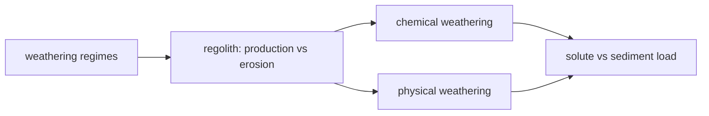

# LS11 · Weathering and Regolith

◀ [[LS10 Folds Flexure and Mountain Building]] · [[Landscapes and Geomorphology - Course Map|Course Map]] · next: [[LS12 Hillslope Transport and the Diffusion Equation]]

taught · in syllabus extra · book extra · beyond

> [!syllabus] Syllabus map: what is in the syllabus and what is extra in this chapter
> 🟢 **Taught**: slides 96–116 of [[pre_ms_landscape_26.pdf|the EC2123 pre-midsem deck]] (Argha Banerjee, IISER Pune; 153 slides). Boxes marked 🟢 **In the slides** derive what the slides derive; boxes marked 🖼 **Reading the diagram** explain each slide figure panel by panel and sit directly under the slide image.
> 🔵 **Extra · beyond**: boxes marked 🔵 **Extra** complete derivations the slides only quote (from Anderson and Anderson, *Geomorphology: the Mechanics and Chemistry of Landscapes*, and Turcotte and Schubert, *Geodynamics*); 🛠 **Tool** boxes derive a mathematical tool from 12th-grade material; 🧮 **Worked example** boxes calibrate orders of magnitude.
> This chapter has 4 sections, 6 derivation boxes, 2 redrawn figures and 20 slide images.

> [!key] After this chapter you can
> - define weathering and the two limiting regimes (supply- and transport-limited),
> - derive regolith thickness from production against erosion,
> - describe chemical weathering (Arrhenius, Goldich series, rates),
> - describe physical weathering (frost cracking, thermal stress, salts).

> [!intuition] The one-sentence story
> Weathering turns rock into mobile regolith, chemically by dissolution and physically by cracking; regolith thickness is production balanced against removal.

*Concept map: every box is a section of this chapter.*

*[Slides 96–116]*

## Definitions and the two limiting regimes (slides 96–97)

> [!key] Definition: Weathering, erosion, regolith
> **Weathering**: physical (mechanical) disintegration and chemical alteration of rock *in place*. **Erosion** (Gilbert 1877, slide 96): the process that combines weathering, transportation and corrosion (chemical removal). **Regolith**: all weathered, unconsolidated material above unweathered bedrock, subdivided (slide 99) into *mobile regolith* (soil, moved by transport processes), *saprolite* (chemically weathered rock retaining its fabric) and *weathered rock* (fractured but little altered), above *unweathered rock*. The “critical zone” (slide 97) is this reactor, in which water, air, ice, heat and organisms crush and dissolve rock.

The rate at which a landscape lowers can be limited in two ways (slide 96): **weathering-limited** (supply of mobile material limits: bare rock slopes; whatever is made is carried away at once) or **transport-limited** (weathering is fast enough, transport is slow, so a regolith cover accumulates). The question “which regime?” is decided by the balance below.

![[pre_096.jpg|460]] ![[pre_097.jpg|460]]

> [!example] 🖼 Reading the diagram: Slides 96–97
> Slide 96: a large rounded granite boulder with curved fracture sheets in its upper surface – an exfoliation/spheroidal-weathering form (weathering front following a curved surface). Slide 97: a road cut in granodiorite with rock still nearly in place (fresh, blocky) contrasted with a cut in gneiss with $\sim2$ m of red weathered regolith on top, and folded gneiss (banded rock) whose structure is preserved in saprolite. The captions: “a fight between regolith production and erosion determines its thickness”.

## Regolith thickness: production against erosion (slides 97–99)

> [!derivation] 🔵 Extra (not derived in the slides): Regolith mass balance, steady thickness and stability
> Let $H$ be the regolith thickness above a bedrock surface. Bedrock is converted to regolith at the *production rate* $P(H)$ (thickness of bedrock per time), and regolith is removed at the erosion rate $E$ (thickness per time, in a steady landscape equal to the surface lowering). With densities ignored (or $P,E$ expressed as rock-equivalent thickness):
>
>
> $$
> \dv Ht=P(H)-E .
> $$
>
>
> *Exponential production function* (slide 98a,b: soil production rate against soil depth on semi-log axes falls on a straight line): $P=P_0\mathrm{e}^{-H/h_0}$. For panel (a), $P\approx90$ m Myr$^{-1}$ at zero depth falling to $\approx25$ at $60$ cm gives $h_0\approx0.5$ m; panel (b) gives $h_0\approx0.4$ m ($P_0\approx70$ m Myr$^{-1}$; values read off the plots). Steady state $\mathrm{d} H/\mathrm{d} t=0$: $P(H_s)=E$:
>
>
> $$
> H_s=h_0\ln\frac{P_0}{E}\qquad(E<P_0).
> $$
>
>
> If $E>P_0$ no steady regolith exists: the surface is bare rock (weathering-limited). *Stability*: perturb $H=H_s+\delta$, then $\dot\delta=P'(H_s)\delta=-(E/h_0)\delta$, so $\delta$ decays with time scale $\tau_H=h_0/E$: stable. Example: $E=30$ m Myr$^{-1}$: $H_s=0.45\ln3=0.5$ m and $\tau_H=0.45/(3\times10^{-5})=1.5\times10^4$ yr. The physical reason for the negative feedback: thick regolith shields bedrock from the water, roots and temperature swings that make new regolith, so $P$ decreases with $H$.
>
> *Humped production function* (slide 98c, black): with little or no regolith the rock sheds water and is dry so production is low; a moderate cover keeps the bedrock wet and maximises weathering; deep cover reduces it again. Now $P(H)$ rises then falls. If $E$ lies between the bare-rock rate and $P_\mathrm{max}$ there are *two* steady thicknesses; the thin one has $P'>0$ so $\dot\delta=P'\delta$ grows: unstable; the thick one has $P'<0$: stable. Thin regolith either is stripped to bare rock or thickens to the stable branch: the landscape is *bistable*, explaining sharp boundaries between soil-mantled and bare-rock slopes. The open circle and star on the slide mark the value the exponential law would give at $H=0$ and the (lower) actual bare-rock rate.

![[ls_fig24.png]]
*Figure LS11.1. Regolith production functions (schematic). Where $E$ (red) crosses the exponential curve there is one stable thickness; the humped curve can cross $E$ twice (unstable thin, stable thick).*

> [!derivation] 🔵 Extra (not derived in the slides): Weathering strain from an immobile element (slide 99)
> Zircon does not dissolve, so its mass in a piece of rock is conserved during weathering. Let a parent volume $V_p$ with density $\rho_p$ and zircon concentration $C_p$ become weathered volume $V_w$ (density $\rho_w$, concentration $C_w$): $\rho_pC_pV_p=\rho_wC_wV_w$. The volumetric strain is
>
>
> $$
> \epsilon_{Zr,w}=\frac{V_w}{V_p}-1=\frac{\rho_pC_p}{\rho_wC_w}-1 .
> $$
>
>
> $\epsilon>0$: expansion (mass leaves and pores open, or material is added); $\epsilon<0$: collapse. Any mobile element $j$ has the fractional mass gain/loss $\tau_j=\dfrac{\rho_wC_{j,w}}{\rho_pC_{j,p}}(1+\epsilon_{Zr,w})-1$ ($\tau_j=-1$ is total loss). The *chemical depletion fraction* of a regolith is $\mathrm{CDF}=1-C_{Zr,p}/C_{Zr,w}$ (with $\rho$ effects neglected), the fraction of the original mass lost as solutes, from which the split of denudation into chemical and physical parts is derived.

![[pre_099.jpg|460]]

> [!example] 🖼 Reading the diagram: Slide 99: the regolith diagram and the strain profile
> Left: schematic section: soil (mobile regolith) over saprolite over weathered rock with fractures over unweathered rock; a bracket shows “regolith” as the top two or three layers. Right: strain $\epsilon_{Zr,w}$ in a drilled sandstone profile against depth ($0$ to $36$ m). In the top $\sim1.2$ m (mobile regolith) the strain is large and positive (up to $\sim9$ at the surface: strong dilation, both mass loss and biological loosening); in the thin saprolite it falls to $\sim1$–$2$; below $\sim4$–$8$ m (weathered rock) it is near $0$, and in unweathered rock it is exactly $0$ by definition. The right-hand column shows veins and fractures that decrease with depth: the fractures are the pathways of the water that drives the weathering.

![[pre_100.jpg|460]]

> [!example] 🖼 Reading the diagram: Slide 100: spheroidal weathering of granite porphyry (Hirata et al. 2016)
> Photographs: excavated wall with weathered corestones; columnar joints; a core sample of a corestone with its shells. The table-like diagram from unweathered *gray core* $\to$ *brown band* $\to$ *rindlets* $\to$ *saprolite* follows five rock zones and shows (top) mineral changes: plagioclase and chlorite $\to$ smectite/vermiculite $\to$ kaolin; pyrite oxidises (sulfate lost, Fe-oxyhydroxides form); K, Na, Ca, Mg lost; and (below) physical properties: bulk density falls from $\sim2.5$ g cm$^{-3}$, porosity rises from $5$–$7 %$, P-wave speed falls from $3$–$4$ km s$^{-1}$, tensile strength drops from $\sim10$ MPa, volumetric strain reaches $+50 %$ (expansion). The expansion stresses the outer shell and fractures it into concentric rindlets — the mechanism of spheroidal weathering. Slides 105–107 show the same in Deccan basalt.

> [!derivation] 🔵 Extra (not derived in the slides): Why weathering fronts are curved shells: diffusion-limited reaction
> Reactant (e.g. oxygen or acid) diffuses from the surface of a corestone into the rock and is consumed where it meets unweathered rock. Let the front be at depth $\ell$ below the surface; the reactant concentration at the surface is $C_s$ and zero at the front. For slow front motion the profile is linear (steady diffusion), so the flux at the front is $DC_s/\ell$ (Fick's law with (4)). If each unit volume of rock consumes $N$ of reactant, the front advances as $N \mathrm{d}\ell/\mathrm{d} t=DC_s/\ell$, i.e.
>
>
> $$
> \ell \mathrm{d}\ell=\frac{DC_s}N\mathrm{d} t \Longrightarrow \ell(t)=\sqrt{\frac{2DC_st}{N}}\qquad(\text{diffusion-limited}).
> $$
>
>
> If instead the reaction itself is slow compared with diffusion (reaction-limited), the front advances at a constant speed, $\ell\propto t$. So thickness of the altered rind grows as $\sqrt t$ at first and, as the rind thickens and diffusion becomes the bottleneck, penetration slows; the reaction volume expansion then stresses the rind. The weathering front follows the surface of the block, hence the concentric, spherical geometry.

## Chemical weathering (slides 101–107)

| Element | O | Si | Al | Fe | Ca | Na | K | Mg |
|---|---|---|---|---|---|---|---|---|
| Weight % of crust | 47 | 28 | 8 | 5 | 3.5 | 3 | 2.5 | 2 |

*Slide 101: eight elements make up $\sim99$ % of the crust; the rest ($1$ %) includes Cu, U, Au.*

![[pre_101.jpg|460]]

> [!example] 🖼 Reading the diagram: Slide 101: composition of rocks
> The stacked-area diagram (top middle) gives, for the rock series granite/rhyolite $\to$ diorite/andesite $\to$ gabbro/basalt $\to$ peridotite, the percentage by volume of the minerals: granite is rich in quartz, orthoclase and Na-plagioclase and micas; gabbro/basalt in Ca-plagioclase and pyroxene; peridotite in olivine (and pyroxene); amphibole and mica are minor in between. The pie chart lists the abundance of minerals in the crust: feldspars (plagioclase and alkali feldspar together the largest part), quartz, pyroxene, amphibole, micas, clays, other silicates and non-silicates. The minerals thus mostly consist of the eight elements above.

| Reaction class | Example (balanced) | Effect |
|---|---|---|
| Hydrolysis by carbonic acid (K-feldspar $\to$ kaolinite) | $2\mathrm{KAlSi_3O_8}+2\mathrm{H_2CO_3}+9\mathrm{H_2O}\to\mathrm{Al_2Si_2O_5(OH)_4}+4\mathrm{H_4SiO_4}+2\mathrm{K^+}+2\mathrm{HCO_3^-}$ | K$^+$, Si leached; clay formed; consumes CO$_2$ |
| Ca-plagioclase | $\mathrm{CaAl_2Si_2O_8}+2\mathrm{H_2CO_3}+\mathrm{H_2O}\to\mathrm{Al_2Si_2O_5(OH)_4}+\mathrm{Ca^{2+}}+2\mathrm{HCO_3^-}$ | Ca$^{2+}$ to rivers; CO$_2$ sink |
| Olivine (forsterite) | $\mathrm{Mg_2SiO_4}+4\mathrm{CO_2}+4\mathrm{H_2O}\to2\mathrm{Mg^{2+}}+4\mathrm{HCO_3^-}+\mathrm{H_4SiO_4}$ | fast; strong CO$_2$ sink |
| Silicate (slide 104) | $\mathrm{CaSiO_3}+2\mathrm{CO_2}+\mathrm{H_2O}\to\mathrm{Ca^{2+}}+2\mathrm{HCO_3^-}+\mathrm{SiO_2}$ | long-term CO$_2$ sink after carbonate precipitation |
| Pyrite oxidation | $4\mathrm{FeS_2}+15\mathrm{O_2}+14\mathrm{H_2O}\to4\mathrm{Fe(OH)_3}+8\mathrm{SO_4^{2-}}+16\mathrm{H^+}$ | makes sulfuric acid; expansion; rusting |
| Carbonate dissolution | $\mathrm{CaCO_3}+\mathrm{CO_2}+\mathrm{H_2O}\rightleftharpoons\mathrm{Ca^{2+}}+2\mathrm{HCO_3^-}$ | no net long-term CO$_2$ change (reverses on precipitation) |

*Chemical weathering reactions (all atom-balanced). Carbonic acid $\mathrm{H_2CO_3}$ forms from CO$_2$ and rain water.*

![[pre_102.jpg|460]]

> [!example] 🖼 Reading the diagram: Slide 102: weathering pathways (A&A Fig. 7.24)
> Minerals across the top (plagioclase, K-feldspar, muscovite, biotite, amphibole, pyroxene, olivine); arrows show the products and the ions lost (Ca, Na, K, Mg, Si). Feldspars and micas pass through amorphous phases and *Al-smectite* to *kaolinite or halloysite* and finally *gibbsite* (Al hydroxide): the **aluminium sequence**, progressive loss of Si and cations, enrichment of Al. Mafic minerals (biotite, amphibole, pyroxene, olivine) pass through Mg,Fe-smectite to *goethite and hematite*: the **iron sequence**, enrichment of Fe. Deep tropical weathering ends in gibbsite/hematite: bauxite and laterite. In terms of stability (Goldich): olivine, Ca-plagioclase, pyroxene, amphibole, biotite, Na-plagioclase, K-feldspar, muscovite, quartz, from weakest to most resistant; minerals crystallised at high temperature are least stable at the surface.

![[pre_103.jpg|460]] ![[pre_104.jpg|460]]

> [!example] 🖼 Reading the diagram: Slides 103–104: the river record and the deep carbon cycle
> Slide 103 (A&A Figs. 7.22, 7.23): left, cumulative distribution (percent of rivers) of ion concentrations in ppm ($=\mathrm{mg L^{-1}}$): TDS (total dissolved solids, thick red) has a median of order $10^2$ ppm; HCO$_3^-$, Ca$^{2+}$, SO$_4^{2-}$ dominate; K$^+$, Si and NO$_3^-$ are minor. Bottom: for each of a large set of world rivers, the percentage of the dissolved cations traced to rain, atmosphere, evaporites, carbonates and silicates: carbonates and evaporites supply most, silicates a minor share (a few % to $\sim40 %$). Slide 104: the deep carbon cycle: silicate weathering on the mountain (reaction as in the table) delivers Ca$^{2+}$ and HCO$_3^-$ to the sea, where CaCO$_3$ precipitates (releasing one CO$_2$ per two HCO$_3^-$); the carbonate is subducted or buried and, in metamorphism, $\mathrm{CaCO_3+SiO_2\to CaSiO_3+CO_2}$ returns CO$_2$ to the atmosphere through volcanoes. Net across the cycle: $\mathrm{CO_2}$ removed by weathering $=$ CO$_2$ supplied by volcanism, in the steady state of §10.5.

![[pre_105.jpg|300]] ![[pre_106.jpg|300]] ![[pre_107.jpg|300]]

> [!example] 🖼 Reading the diagram: Slides 105–107: weathering in the Deccan (our neighbourhood)
> Slide 105: a road cut near Mulshi (Pune) with relatively fresh basalt: dark grey blocks with fractures, a small fragment. Slide 106 (Babechuk et al. 2014, *Chem. Geol.*): two weathering profiles. **(a) Bidar laterite**, $\sim50$ m deep: from unweathered basalt at the base through incipient weathering, saprolite with corestones, a pallid zone, up to an indurated ferruginous laterite cap (Fe-rich, with vermiform texture); high Fe/Al enrichment, kaolinite, gibbsite. **(b) Chhindwara profile**, only $\sim6$ m: soil cover, a spheroidally weathered upper flow with corestones and rinds, chilled base of the upper flow, then a less altered lower flow: shows weathering controlled by flow structure (joints, vesicles, flow tops). Photographs (right) show the corestone profile; sub-samples A–D are taken across a rind. Slide 107: spheroidal weathering in basalt (top) and granite (bottom); the “red bole horizon” (photo, red seam between basalt flows) is a fossil soil (palaeosol) or altered flow-top formed in the pause between eruptions.

## Physical weathering (slides 108–116)

Physical weathering fractures rock: it (i) weakens it mechanically, (ii) makes smaller pieces that are easier to transport, (iii) opens pathways for air and water (and reactants), and (iv) increases the reactive surface area (slide 108, A&A Figs. 7.5, 7.8). Fractures form when stress exceeds the tensile strength, and stress builds up where the material is prevented from changing volume freely (temperature, pressure, chemistry).

### Thermal stress and the heat wave (slides 108–112)

> [!figure]- 🖼 Slides 108–112: open to see the slides this section explains
> ![[pre_108.jpg|300]] ![[pre_109.jpg|300]] ![[pre_110.jpg|300]] ![[pre_111.jpg|300]] ![[pre_112.jpg|300]]

> [!derivation] 🔵 Extra (not derived in the slides): Thermal stress
> A free bar heated by $\Delta T$ expands by the strain $\alpha_\ell\Delta T$ ($\alpha_\ell$ = linear expansion coefficient, $\sim8\times10^{-6} \mathrm{K^{-1}}$ for rock). If its ends are held so that the total strain is zero, elastic strain $-\alpha_\ell\Delta T$ must cancel the thermal strain, giving the stress $\sigma=E\alpha_\ell\Delta T$ (compression on heating; tension on cooling). For a thin surface layer heated relative to the interior and constrained equally in both horizontal directions, the equibiaxial value is $\sigma=E\alpha_\ell\Delta T/(1-\nu)$. Numbers: $E=50$ GPa, $\alpha_\ell=8\times10^{-6}$, $\Delta T=30$ K, $\nu=0.25$: $E\alpha_\ell\Delta T=12$ MPa, biaxial $16$ MPa, of the order of the tensile strength of rock ($\sim10$ MPa, slide 100): full constraint is never achieved (the gradient is gradual) but stresses can approach the strength, and cyclic loading fatigues the rock. Slide 108 (Mojave desert): as the sun moves from morning (east) to afternoon (west), the hot and cold surfaces of a boulder switch, and cracks develop preferentially in one orientation set by the sun's path.

![[pre_110.jpg|460]]

> [!example] 🖼 Reading the diagram: Slide 110: diurnal temperature waves in rock (A&A Fig. 7.7a)
> Temperature ($10$–$50 ^\circ$C) against day of year ($220$–$232$, August) for depths $0,1,2,4,8,16,32,42$ cm. At the surface each day is a peak up to $\sim48 ^\circ$C at midday and a minimum near $12 ^\circ$C at night; deeper curves have smaller peaks that occur *later*; at $42$ cm the curve is nearly flat at $\sim20 ^\circ$C. Conduction with a periodic surface temperature: a damped, delayed wave.

> [!derivation] 🟢 In the slides: Slide 111: $T=T_0+T_\mathrm{amp} \mathrm{e}^{-z/z^*}\sin\!\big(2\pi t/P-z/z^*\big)$
> This is the periodic solution (6) of the diffusion equation with $D=\kappa$, applied to a surface temperature $T_0+T_\mathrm{amp}\sin(2\pi t/P)$: the wave decays by $\mathrm{e}^{-1}$ per $z^*=\sqrt{\kappa P/\pi}$ and lags in phase by $z/z^*$ radians. **Numbers**: $\kappa=1.5\times10^{-6}$ m$^2$s$^{-1}$, $P=1$ day $=86400$ s: $z^*=\sqrt{1.5\times10^{-6}\times86400/\pi}=0.20$ m; the annual wave ($P=365$ d) penetrates $\sqrt{365}=19$ times deeper, $z^*=3.9$ m. The lag time at depth $z$ is $t_\mathrm{lag}=(z/z^*)P/2\pi$: $z=16$ cm gives $0.8$ rad, $3$ h. Panel (b) plots the daily temperature range against depth: from $\sim32 ^\circ$C at the surface to $\sim5 ^\circ$C at $42$ cm; since range $\propto\mathrm{e}^{-z/z^*}$, $z^*=42 \mathrm{cm}/\ln(32/5)=22.6$ cm, so $\kappa=\pi z^{*2}/P=1.9\times10^{-6} \mathrm{m^2s^{-1}}$ — a value typical of rock and soil ($10^{-6}$–$2\times10^{-6}$). *Consequence*: thermal cycling only stresses the outer $\sim$ tens of cm of a rock, a shell of $\sim z^*$ thickness, consistent with exfoliation sheets.

![[ls_fig25.png]]
*Figure LS11.2. Eq. (slide 111) for $T_0=20 ^\circ$C, $T_\mathrm{amp}=15$ K, $z^*=0.2$ m: amplitude falls and the wave arrives later with depth.*

![[pre_112.jpg|460]]

> [!example] 🖼 Reading the diagram: Slide 112: differential heating (A&A Fig. 7.6)
> Left: a granite face-on photo: dark biotite grains and light quartz/feldspar. Dark minerals have low albedo (absorb more sunlight) and warm faster, so adjacent grains have different temperatures: a temperature difference $\Delta T\approx\Delta a S/h_\mathrm{tot}$ ($S\sim10^3$ W m$^{-2}$ insolation, $\Delta a$ albedo difference, $h_\mathrm{tot}\sim20$ W m$^{-2}$K$^{-1}$ heat-loss coefficient), tens of K in bright sun for $\Delta a\sim0.3$. Right: local temperature ($13$–$20 ^\circ$C) against local time ($12{:}40$–$13{:}05$) at two spots (thick and dashed lines): rapid rises and falls of a couple of degrees over minutes presumably as the sun goes in and out (the marks labelled S) — thermal shock. Slide 112 also lists minerals with *anisotropic* thermal expansion (quartz, calcite, Ca-feldspar): expansion differs with crystal direction (calcite expands along its $c$ axis and contracts across it), so even uniform heating mismatches neighbouring grains: stress $\sim E \Delta\alpha_\ell \Delta T\sim50 \mathrm{GPa}\times10^{-5}\times20 \mathrm{K}=10$ MPa.

### Frost cracking (slides 113–116)

> [!figure]- 🖼 Slides 113–116: open to see the slides this section explains
> ![[pre_113.jpg|300]] ![[pre_114.jpg|300]] ![[pre_115.jpg|300]] ![[pre_116.jpg|300]]

> [!derivation] 🔵 Extra (not derived in the slides): Ice pressure from Clausius–Clapeyron
> When water freezes to ice its volume grows by $\sim9 %$ (density $1000\to917$). If confined it would push on the walls; the maximum pressure ice can sustain in equilibrium with water at temperature $T<0^\circ$C follows from thermodynamics. At coexistence the specific Gibbs energies are equal, $g_i=g_w$, along the coexistence curve, so $\mathrm{d} g_i=\mathrm{d} g_w$. With $\mathrm{d} g=v \mathrm{d} P-s \mathrm{d} T$ ($v$ specific volume, $s$ specific entropy): $v_i\mathrm{d} P-s_i\mathrm{d} T=v_w\mathrm{d} P-s_w\mathrm{d} T$, so
>
>
> $$
> \dv PT=\frac{s_w-s_i}{v_w-v_i}=\frac{L}{T (v_w-v_i)}\qquad(L=T(s_w-s_i) \text{latent heat}).
> $$
>
>
> With $L=3.34\times10^5$ J kg$^{-1}$, $T=273$ K, $v_w-v_i=-9\times10^{-5}\approx-10^{-4}$ m$^3$kg$^{-1}$ (slide 114): $\mathrm{d} P/\mathrm{d} T=-13$ MPa K$^{-1}$: the melting point drops by $1$ K for $13$ MPa of extra pressure. Conversely, ice in a pore held at $-5 ^\circ$C can push with up to $\sim65$ MPa — much more than the tensile strength ($\sim10$ MPa). But the volume-expansion mechanism would crack rock at $0^\circ$C, when freezing begins, if it worked in a closed pore; the experiment below shows it does not.

![[pre_113.jpg|460]] ![[pre_114.jpg|460]]

> [!example] 🖼 Reading the diagram: Slides 113–114: frost cracking laboratory experiment and the frozen fringe
> Slide 113 (left): shattered angular slabs of frost-weathered rock. Middle: a cold external surface: a rock cooled from above has frozen rock at $T_c$, a *frozen fringe* (partially frozen, $T\to T_f$) and unfrozen rock; water moves *towards* the freezing front (cryosuction) and feeds growing ice lenses in cracks. Right: the experimental column (30 cm of Berea sandstone, foam-insulated): a top cooling plate at $-4$ to $-15 ^\circ$C, a bottom plate above $0^\circ$C, and a water supply at the base; heat flows up and water flows up; acoustic-emission (AE) detectors record cracking. Slide 114 histogram: number of acoustic-emission events against rock temperature: $90 %$ of events occur between $-3$ and $-6 ^\circ$C (maximum near $-5^\circ$C), *not* at $0^\circ$C. Conclusion: cracking is driven by **ice segregation** (growth of ice lenses fed by migrating water) at a few degrees below freezing, with pressures of order $\mathrm{d} P/\mathrm{d} T\times\Delta T$ from Clausius–Clapeyron, the “frost-cracking window” of $-3$ to $-8 ^\circ$C.

![[pre_115.jpg|460]]

> [!example] 🖼 Reading the diagram: Slide 115: landscape-scale effect (A&A Fig. 7.16)
> Photograph: the Spiti monastery on a slope above frost-shattered cliffs. (a) map of the Southern Alps (New Zealand) with a shaded relief and red patches of *active scree* (debris produced by frost cracking); (b) the elevation of the active scree along the Alpine Fault is nearly constant at $\sim1500$ m ($\pm$ a few hundred metres); (c) annual temperature cycles at $762$, $1554$ and $2300$ m: at $762$ m it is rarely cold enough (never in the window), at $2300$ m the temperature falls well below the window and stays there through winter, whereas at $1554$ m the temperature lingers in the window (grey band, $-3$ to $-8^\circ$C) for the longest time. Frost cracking is most effective at an intermediate elevation where the time spent in the window is maximal, which is why the scree is concentrated in a band.

> [!example] 🧮 Worked example: Weathering products carried by rivers (slide 116, A&A Fig. 7.4)
> The bars show, for major rivers, sediment load (tonnes km$^{-2}$yr$^{-1}$, left, from $0$ to $2000$) and solute load ($0$ to $100$, right), the two ways weathered rock leaves the landscape. The Brahmaputra, Huang He and Ganga lie at the extreme for sediment load (physical erosion dominates: steep, tectonically active basins with strong rain and glaciers), rivers of low-relief or cold basins at the top of the chart (Chari, Kolyma, Dnieper, Zaire, Ob) carry small loads of both kinds. The box on the slide lists basin area $A$ (km$^2$) and discharge $Q$ (m$^3$ s$^{-1}$): Ganga $10^6$, $1.9\times10^4$; Brahmaputra $0.6\times10^6$, $1.9\times10^4$; Indus $10^6$, $5.5\times10^3$. *Runoff* $q=Q/A$: Ganga $1.9\times10^4/10^{12}=1.9\times10^{-8}$ m s$^{-1}$ $=0.6$ m yr$^{-1}$; Brahmaputra $1.0$ m yr$^{-1}$; Indus $0.17$ m yr$^{-1}$: the Indus is much drier. *Erosion rate* from a sediment load $\Lambda$ (t km$^{-2}$yr$^{-1}$) and rock density $\rho_r=2650$: $\mathcal{E}=\Lambda\times10^3 \mathrm{kg}/(10^6 \mathrm{m^2}\rho_r)$, e.g. $\Lambda=1000$: $3.8\times10^{-4}$ m yr$^{-1}=0.4$ mm yr$^{-1}$.

## Further slides explained one by one
taught *the slides of this chapter's range that carry no derivation of their own; each image is followed by what it shows*

![[pre_098.jpg|520]]

> [!example] 🖼 Reading the diagram: Slide 98: Soil production rate depends on soil thickness
> (a, b) Measured soil production rate (mm per thousand years) against soil depth (cm): production falls as the soil thickens, because a thick soil shields the rock from water and roots (A&A Figs 7.33–34). *Right:* the conceptual humped function: mobile regolith production rate against thickness $H$: zero for bare rock, rising to a maximum at a thin soil (water is retained at the bedrock interface) and falling at large thickness. The decay, $\dot W=\dot W_0e^{-H/H_0}$ is used in the regolith-thickness derivation of this chapter.

## Map of this chapter
> [!connection] How LS11 connects
> **Previous:** [[LS10 Folds Flexure and Mountain Building]] · **Next:** [[LS12 Hillslope Transport and the Diffusion Equation]].
> **Other subjects:** [[Climate - Course Map]] (weathering and the carbon cycle, glaciation, orographic rainfall), [[Thermodynamics - Course Map]] (heat conduction and diffusion), [[Evolution of Earth and Life - Course Map]] (plate tectonics and landscapes through geological time), [[Waves - Course Map]] (diffusion and wave equations).

## Provenance
> [!provenance]- Source map for this chapter
> | Topic | Source | Scope |
> |---|---|---|
> | slide content, figures read panel by panel | [[pre_ms_landscape_26.pdf]] slides 96–116 (images embedded from the PDF, auto-cropped, `scripts/render_slides.py`) | taught |
> | derivations, worked examples, tool boxes, TikZ figures | the AI-written derivation-level notes [[Landscapes_and_Their_Evolution_notes.pdf]] (EC2123 notes; LaTeX source in `landscape-notes-tex-source.tar.gz`), converted with `scripts/tex2vault_ls.py`; cross-checked against Anderson and Anderson and Turcotte and Schubert as cited there | secondary + extra/book |
>
> **Notes.** (1) The text of this chapter is the AI-written reference notes' text, converted to the vault's callout style and equation numbering (chapter-local, so some cross-references read as "(label)"). (2) The slide images were checked against the notes' slide numbers for a sample of slides (e.g. 1–12, 109–120 match). Figure descriptions are the notes', and should be compared with the images beside them. (3) The `[!verify]` items of the notes' last front-matter section ("Two places where the slides need care") are in [[Landscapes Notation and Glossary]].
