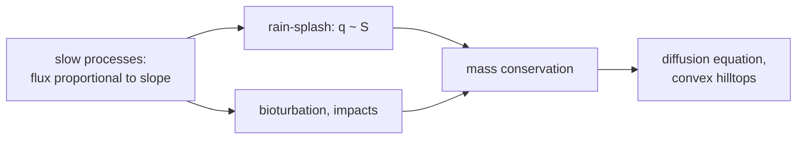

# LS12 · Hillslope Transport and the Diffusion Equation

◀ [[LS11 Weathering and Regolith]] · [[Landscapes and Geomorphology - Course Map|Course Map]] · next: [[LS13 Landslides]]

taught · in syllabus extra · book extra · beyond

> [!syllabus] Syllabus map: what is in the syllabus and what is extra in this chapter
> 🟢 **Taught**: slides 117–122 of [[pre_ms_landscape_26.pdf|the EC2123 pre-midsem deck]] (Argha Banerjee, IISER Pune; 153 slides). Boxes marked 🟢 **In the slides** derive what the slides derive; boxes marked 🖼 **Reading the diagram** explain each slide figure panel by panel and sit directly under the slide image.
> 🔵 **Extra · beyond**: boxes marked 🔵 **Extra** complete derivations the slides only quote (from Anderson and Anderson, *Geomorphology: the Mechanics and Chemistry of Landscapes*, and Turcotte and Schubert, *Geodynamics*); 🛠 **Tool** boxes derive a mathematical tool from 12th-grade material; 🧮 **Worked example** boxes calibrate orders of magnitude.
> This chapter has 4 sections, 4 derivation boxes, 1 redrawn figures and 6 slide images.

> [!key] After this chapter you can
> - list slope-dependent transport processes (rain-splash, tree-throw, impacts),
> - derive linear flux $q=-\kappa_h\partial_xz$,
> - write and solve the hillslope diffusion equation,
> - state the nonlinear flux near the angle of repose.

> [!intuition] The one-sentence story
> Soil creeps downhill at a rate proportional to the slope, so the hillslope obeys the diffusion equation and hilltops are convex.

*Concept map: every box is a section of this chapter.*

*[Slides 117–122]*

## Slow, slope-dependent processes (slide 117)

> [!figure]- 🖼 Slide 117: open to see the slides this section explains
> ![[pre_117.jpg|300]]

Weathered particles move down hillslopes by many processes (slide 117): rain-splash, micrometeorite impacts, tree-throw, burrowing animals, freeze–thaw, creep and, intermittently, landslides. The slide shows the Martian surface (craters with rounded rims), the Moon (Apollo rover on a smooth rolling surface) and Munnar (Kerala): grass-covered convex rounded hills. The common result is a *convex* hilltop.

| Process | Agent / energy source | Slope dependence of flux | Where important |
|---|---|---|---|
| Rain-splash (S118) | drop kinetic energy | $\propto S$ (derived below) | bare or thinly vegetated soil |
| Tree-throw, burrowing (S119) | organisms | $\propto S$ at low $S$, diverging toward the angle of repose | forested/soil-mantled slopes |
| Micrometeorite impacts (S120) | impactor kinetic energy | $\propto S$ | Moon, Mars, dry bodies |
| Freeze–thaw, creep | frost heave and settling | $\propto S$ | cold or seasonally wet regions |
| Landslides (Ch. 13) | gravity, threshold | strongly nonlinear, threshold at $S_c\approx\tan\phi$ | steep terrain |

*Hillslope transport mechanisms. All the slow processes give a flux that is proportional to slope at low $S$; this is what makes the diffusion equation applicable.*

<!-- ls-depth:LS12:1 -->
> [!intuition] Context: why the flux is proportional to slope (A&A on frost creep)
> The linear law $q=-D\,\partial_xz$ looks like an empirical fit, but A&A derive it from a *process* (PDF p.343, Eq. 10.42 and the frost-heave experiments of Font et al. 2006 on a $1$ m slab at $25^\circ$ and $40^\circ$ slopes): each freeze–thaw cycle moves a regolith column downslope by an amount proportional to the slope; summing over the $f$ frost events per year and over the frost-penetration depth distribution gives a flux **linear in slope and proportional to the square of the mean frost depth** ($D\propto f\,\bar z^2$). They contrast this with "the simpler but process-blind formula $Q=-kS$". The lesson: $D$ is not a universal constant but encodes the *climate* (how many frost cycles, how deep) and the *material*; doubling the mean frost depth multiplies $D$ by four. Same structure for rain-splash and bioturbation.

## Rain-splash (slide 118)

![[pre_118.jpg|460]]

> [!example] 🖼 Reading the diagram: Slide 118: reading the rain-splash figure (A&A Figs. 10.8–10.10)
> *Left column*: (a,b) detached mass (mg) against the kinetic energy of the impacting drop (mJ) for dry and moist soils: detachment grows with kinetic energy, and is far larger for loamy sand than for clay (cohesion resists splash), and different for dry and wet soils. (c) percent of total rain volume against drop diameter (mm) for rainfall intensities $2$, $12.7$ and $101.8$ mm h$^{-1}$: heavier rain has larger drops. (d) kinetic energy flux of rainfall against rain intensity for several climates (India, USA, Rhodesia, Trinidad, Japan): higher for monsoon thunderstorms. *Middle*: high-speed photographs of a single drop impact (time $0$ to $24$ ms) showing the splash crown; (b,c) probability density of the radial angle of ejected grains for slopes $0$, $0.2$, $0.4$, $0.6$: on a flat surface the distribution is symmetric, on a slope it is skewed downslope; polar plots of splash directions. *Right*: the geometry used for transport: a drop falls (red), grains fly with speed $V_0$ and land at $L_\mathrm{up}$ upslope or $L_\mathrm{down}$ downslope of the impact; the net displacement is $L_\mathrm{net}=(L_\mathrm{down}-L_\mathrm{up})/2$.

> [!derivation] 🔵 Extra (not derived in the slides): Net rain-splash transport is proportional to slope
> Consider a grain ejected with speed $v$ at angle $\beta$ above the horizontal, half the grains going down-slope and half up-slope, from a plane sloping down at angle $\theta$. Horizontal coordinate $x$ measured toward the down-slope side; the trajectory is $y=x\tan\beta-gx^2/(2v^2\cos^2\beta)$ and the ground is $y=-x\tan\theta$. Down-slope launch: landing where $x\tan\beta-gx^2/(2v^2\cos^2\beta)=-x\tan\theta$, i.e.
>
>
> $$
> x_\mathrm{down}=\frac{2v^2\cos^2\beta}{g}(\tan\beta+\tan\theta)=\frac{2v^2\cos\beta \sin(\beta+\theta)}{g\cos\theta}.
> $$
>
>
> Up-slope launch at the same $\beta$ (ground rising): $x_\mathrm{up}=\dfrac{2v^2\cos\beta \sin(\beta-\theta)}{g\cos\theta}$. Net:
>
>
> $$
> L_\mathrm{net}=\frac{x_\mathrm{down}-x_\mathrm{up}}2=\frac{v^2\cos\beta}{g\cos\theta}\big[\sin(\beta+\theta)-\sin(\beta-\theta)\big]=\frac{2v^2\cos^2\beta}{g} \tan\theta .
> $$
>
>
> (using $\sin(a+b)-\sin(a-b)=2\cos a\sin b$.) For a splash flux of $\dot n$ grains per unit area per time the volumetric flux is $q\propto\dot n L_\mathrm{net}\propto\tan\theta=S$, *linear in slope*: $q=-\kappa_hS$ with $\kappa_h\propto\dot n v^2/g$: it depends on rainfall energy and soil, as noted on the slide (“depends on the probability distribution of rainfall intensity, drop-size distribution, soil property”).

## Bioturbation and impacts (slides 119–120)

![[pre_119.jpg|460]] ![[pre_120.jpg|460]]

> [!example] 🖼 Reading the diagram: Slides 119–120
> Slide 119 (left, A&A Fig. 10.22): a tree falls, pulling a root plate (soil clinging to roots) up; as the trunk rots the soil falls back: a pit and a mound, with a net downslope displacement because the root plate rotates about its uphill edge (a,b,c). Right (Figs. 10.20, 10.21): burrowing animals push fresh debris to the surface ($V_i$, $L_i$: volume and travel length) and it slumps downslope; plan view of burrow holes and debris piles between contours. Bottom: measured flux $Q$ ($\mathrm{m^2 kyr^{-1}}$, $0$ to $10$) against slope tangent ($0$ to $1$): nearly linear for small slopes ($\sim3$ m$^2$ kyr$^{-1}$ at $S\sim0.2$, i.e. $\kappa_h\approx0.015$ m$^2$yr$^{-1}$) and rising steeply toward the angle of repose (dashed line at $S\approx0.7$). Slide 120: Mars (Mars Express image of craters of many sizes) and the cumulative number of micrometeorite impacts above diameter $D$ per year per km$^2$ (left axis; $10^8$ for $1 \mu$m down to $10^{-12}$ for $1$ km) and over the whole Earth (right axis): small impacts are common, large ones rare, following a power law; each impact throws material downhill.

> [!derivation] 🔵 Extra (not derived in the slides): Nonlinear diffusion near the angle of repose; crater degradation
> The measured $Q(S)$ curve is fitted by $q=-\dfrac{\kappa_h S}{1-(S/S_c)^2}$ (quoted, after Roering et al. 1999): linear for $S\ll S_c$, divergent as $S\to S_c$ (the flux becomes unlimited: a slope cannot exceed the angle of repose without failing). *Crater rims* and *scarps* degrade by the linear part: an initially sharp topography of relief $h$ and horizontal size $\ell$ relaxes with the diffusion time $t\sim\ell^2/(4\kappa_h)$. With the lunar value $\kappa_h\sim5\times10^{-6}$ m$^2$yr$^{-1}$ (5 m$^2$Myr$^{-1}$, order of magnitude), a crater of radius $50$ m is smoothed in $\sim10^8$ yr, a $500$ m crater in $10^{10}$ yr — which is why small lunar craters are subdued and big ones are fresh, and why crater degradation can be used as a clock (Mars: slide 117 and 120).

## Conservation of mass and the diffusion equation (slides 121–122)

> [!figure]- 🖼 Slides 121–122: open to see the slides this section explains
> ![[pre_121.jpg|300]] ![[pre_122.jpg|300]]

> [!derivation] 🟢 In the slides: Slide 121: hillslope diffusion (A&A Eq. 10.8, 10.9)
> Take a vertical slice of hillslope of width $\mathrm{d} x$ (unit width in $y$): surface elevation $z(x,t)$, regolith thickness $R$. Regolith has bulk density $\rho_b$; rock has density $\rho_r$. Per unit map area, the regolith mass is $\rho_bR$. Mass enters from below by weathering of bedrock at the rate $\rho_r\dot W$ ($\dot W$: rate of downward migration of the bedrock–regolith interface, slide 121's $W$), and is carried laterally with mass flux $Q_x$ (kg m$^{-1}$yr$^{-1}$, flux through a vertical section over the full depth). Conservation, exactly like (3):
>
>
> $$
> \rho_b \partial_tR=\rho_r\dot W-\partial_xQ_x .
> $$
>
>
> The slow processes above give $Q_x=-k \partial_xz$ ($k$ the “hillslope efficiency constant” in kg m$^{-1}$yr$^{-1}$, the slide's $-k(\partial z/\partial x)$). Then
>
>
> $$
> \partial_tR=\frac{\rho_r}{\rho_b}\dot W+\frac k{\rho_b}\,\partial_x^2z=\frac{\rho_r}{\rho_b}\dot W+\kappa_h\,\partial_x^2z,\qquad\kappa_h=\frac k{\rho_b}\ \ (\text{landscape diffusivity, m}^2\text{yr}^{-1}), \tag{23}
> $$
>
>
> which is A&A Eq. 10.9 (for spatially uniform $k$). Mass conservation of the whole surface, including rock uplift $U$, gives the general *hillslope diffusion equation*
>
>
> $$
> \partial_tz=U+\kappa_h\,\partial_x^2z, \tag{24}
> $$
>
>
> identical in form to (4) with a uniform source (uplift). **Steady state** ($\partial_tz=0$ with $U=$ erosion rate $\mathcal{E}$, or with steady regolith thickness in (23)):
>
>
> $$
> \kappa_h\,z''=-\mathcal{E}\ \Longrightarrow\ z(x)=z_c-\frac{\mathcal{E}}{2\kappa_h}x^2,\qquad S(x)=\Big|\dv zx\Big|=\frac{\mathcal{E}}{\kappa_h}x,\qquad q(x)=\mathcal{E}\,x . \tag{25}
> $$

> [!example] ❓ Question on the slides: Slide 122: what is the steady-state shape?
> A **parabola, convex-up** ((25)): the slope increases linearly with distance from the crest, and the curvature $z”=-\mathcal{E}/\kappa_h$ is uniform, negative everywhere. Gilbert's argument (slide 121, A&A Fig. 10.1): at distance $x$ from the summit *all* the rock weathered between the summit and $x$ must pass $x$: $q(x)=\mathcal{E}x$; since $q\propto S$, the slope must grow linearly with $x$: point B at twice the distance carries twice the flux, so needs twice the slope, hence the convexity. Slide 122 data (Blue Hills badlands, Utah; Fig. 10.4): two hilltop profiles ($43$ m and $35$ m above the channel, $\sim450$–$600$ m half-widths) are well fitted by parabolas; the curvature gives $\mathcal{E}/\kappa_h$: e.g. $z”=-2h/L^2=-4.2\times10^{-4}$ m$^{-1}$ for $h=43$ m, $L=450$ m; if the erosion rate is $\mathcal{E}=0.1$ mm yr$^{-1}$ (assumed for illustration) then $\kappa_h=\mathcal{E}/|z”|=0.24$ m$^2$yr$^{-1}$, a fast badland value. The photograph shows the sharp convex crest with high curvature.

![[ls_fig26.png]]
*Figure LS12.1. Steady-state soil-mantled hillslope (25): parabolic profile (left) and linear growth of slope and flux with distance from the crest (right; $S$ and $q$ are proportional).*

> [!example] 🧮 Worked example: Numbers for a Sahyadri-type hillslope
> $\kappa_h=0.005$ m$^2$yr$^{-1}$, $\mathcal{E}=3\times10^{-5}$ m yr$^{-1}$ ($30$ m Myr$^{-1}$), hillslope half-length $L=100$ m. Relief above the base $=\mathcal{E}L^2/(2\kappa_h)=3\times10^{-5}\times10^4/0.01=30$ m; slope at the base $S=\mathcal{E}L/\kappa_h=0.6$ ($31^\circ$); the response time $L^2/\kappa_h=2\times10^{6}$ yr. Such hillslopes need millions of years to adjust to a change in baselevel.

> [!derivation] 🔵 Extra (not derived in the slides): Time-dependent solution: degradation of a scarp (erf profile)
> An initially vertical step of height $h$ (fault scarp, terrace riser or the edge of a lava flow), $z=+h/2$ for $x<0$ and $-h/2$ for $x>0$, obeys $\partial_tz=\kappa_h\partial_x^2z$ ($U=0$). By the similarity solution (5): $z=-\tfrac h2 \mathrm{erf}\!\big(x/2\sqrt{\kappa_ht}\big)$. The steepest slope at $x=0$ is $|S_\mathrm{max}|=h/(2\sqrt{\pi\kappa_ht})$, decaying as $t^{-1/2}$. A measured maximum slope thus gives the scarp's age in units of $\kappa_ht$:
>
>
> $$
> \kappa_ht=\frac{h^2}{4\pi S_\mathrm{max}^2}.
> $$
>
>
> Example: $h=4$ m, $S_\mathrm{max}=0.2$: $\kappa_ht=16/(4\pi\times0.04)=32$ m$^2$; with $\kappa_h=0.005$, $t=6400$ yr.

<!-- ls-depth:LS12:2 -->
> [!derivation] 🔵 Extra (computed): reading the age of a fault scarp from its shape
> A fault or terrace riser that offsets the ground by a vertical step of height $h$ at $t=0$ is smoothed by $\partial_tz=D\,\partial_x^2z$. By the Fourier solution ([[Fourier and Laplace Transforms]] §6.1) the **slope** of the profile is the step's derivative (a delta function) convolved with the heat kernel, i.e. a **Gaussian of variance $2Dt$ and area $h$**:
> $$\frac{\partial z}{\partial x}=-\frac{h}{\sqrt{4\pi Dt}}\,e^{-x^2/4Dt},\qquad S_{max}=\frac{h}{\sqrt{4\pi Dt}},\qquad\text{width}\sim4\sqrt{Dt}.$$
> *So the maximum slope falls as $t^{-1/2}$ and the scarp widens as $t^{1/2}$.* For $h=10$ m and $D=0.01\ \mathrm{m^2yr^{-1}}$ (`scripts/ls_depth_numbers.py`):
> | age | $Dt$ | max slope | width |
> |---|---|---|---|
> | 1 kyr | 10 m² | 0.89 ($42^\circ$) | 13 m |
> | **10 kyr** | 100 m² | **0.28 ($16^\circ$)** | 40 m |
> | 100 kyr | 1000 m² | 0.089 ($5^\circ$) | 126 m |
> | 1 Myr | 10⁴ m² | 0.028 ($1.6^\circ$) | 400 m |
> Inverting: *measure the maximum slope of a scarp of known offset and you know $Dt$*; with $D$ calibrated on scarps of known age (shorelines, dated terraces) this gives a **diffusion-age** (the approach of Hanks and others, recalled, `[verify]`). The same Gaussian argument gives the time for a sinusoidal ridge–valley pattern to decay: $\tau=\lambda^2/4\pi^2D$, $25$ kyr for $\lambda=100$ m.

> [!question] Check yourself (answers below)
> 1. A 5 m scarp has maximum slope 0.10 today. With $D=0.005\ \mathrm{m^2yr^{-1}}$ what is its age?
> 2. By what factor does the width of a scarp grow when its age quadruples?
> 3. How does the frost-creep $D$ change if frost penetrates 3 times deeper?
> 4. Which wavelengths of topography survive longest on a diffusing hillslope?
> *Answers.* (1) $S_{max}=h/\sqrt{4\pi Dt}\Rightarrow Dt=h^2/(4\pi S_{max}^2)=25/(4\pi\times0.01)=199$ m², $t=199/0.005=3.98\times10^4$ yr. (2) Width $\propto\sqrt t$: factor 2. (3) $D\propto\bar z^2$: nine times larger. (4) The longest: decay time $\lambda^2/4\pi^2D$ grows as $\lambda^2$, so diffusion smooths short wavelengths first and leaves broad convex ridges.

> [!connection] Where else this appears
> - **Same equation, other subjects:** heat conduction ([[Thermodynamics - Course Map]]), the Gaussian kernel and Fourier modes ([[Fourier and Laplace Transforms]]), random walks and the normal distribution ([[Normal Distribution]], [[Probability - Course Map]]; $\sigma^2=2Dt$ is the variance of a random walk); the half-space cooling solution of [[LS07 Isostasy]].
> - **Event size and rates:** [[LS01 Landscapes as Physical Systems]] (response time $L^2/D$).

## Map of this chapter
> [!connection] How LS12 connects
> **Previous:** [[LS11 Weathering and Regolith]] · **Next:** [[LS13 Landslides]].
> **Other subjects:** [[Climate - Course Map]] (weathering and the carbon cycle, glaciation, orographic rainfall), [[Thermodynamics - Course Map]] (heat conduction and diffusion), [[Evolution of Earth and Life - Course Map]] (plate tectonics and landscapes through geological time), [[Waves - Course Map]] (diffusion and wave equations).

> [!connection] Fourier view
> Modes of the diffusion equation decay as $e^{-Dk^2t}$; the Gaussian kernel; decay time $\lambda^2/4\pi^2D$: [[Fourier and Laplace Transforms]] §6.1.

## Provenance
> [!provenance]- Source map for this chapter
> | Topic | Source | Scope |
> |---|---|---|
> | slide content, figures read panel by panel | [[pre_ms_landscape_26.pdf]] slides 117–122 (images embedded from the PDF, auto-cropped, `scripts/render_slides.py`) | taught |
> | derivations, worked examples, tool boxes, TikZ figures | the AI-written derivation-level notes [[Landscapes_and_Their_Evolution_notes.pdf]] (EC2123 notes; LaTeX source in `landscape-notes-tex-source.tar.gz`), converted with `scripts/tex2vault_ls.py`; cross-checked against Anderson and Anderson and Turcotte and Schubert as cited there | secondary + extra/book |
>
> **Notes.** (1) The text of this chapter is the AI-written reference notes' text, converted to the vault's callout style and equation numbering (chapter-local, so some cross-references read as "(label)"). (2) The slide images were checked against the notes' slide numbers for a sample of slides (e.g. 1–12, 109–120 match). Figure descriptions are the notes', and should be compared with the images beside them. (3) The `[!verify]` items of the notes' last front-matter section ("Two places where the slides need care") are in [[Landscapes Notation and Glossary]].

<!-- ls-depth:LS12:3 -->
> [!provenance]- Depth-layer sources (added 2026-10-28)
> | Topic | Source | Priority |
> |---|---|---|
> | frost-creep derivation of the linear flux law, $D\propto f\bar z^2$, Font et al. 2006 experiment | A&A PDF p.343 (read; Eq. 10.42) | b · primary book |
> | scarp-diffusion solution and numbers | my derivation via the Fourier chapter (`scripts/ls_depth_numbers.py`, `LS12`); the diffusion-age method is recalled (Hanks et al.), `[verify]` | extra · beyond |
