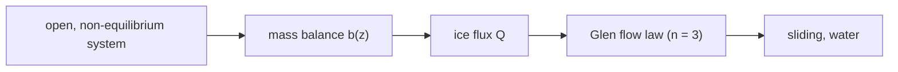

# LS14 · Glaciers Mass Balance and Ice Flow

◀ [[LS13 Landslides]] · [[Landscapes and Geomorphology - Course Map|Course Map]] · next: [[LS15 Glacial Deposits Rebound and Sea Level]]

taught · in syllabus extra · book extra · beyond

> [!syllabus] Syllabus map: what is in the syllabus and what is extra in this chapter
> 🟢 **Taught**: slides 138–144 of [[pre_ms_landscape_26.pdf|the EC2123 pre-midsem deck]] (Argha Banerjee, IISER Pune; 153 slides). Boxes marked 🟢 **In the slides** derive what the slides derive; boxes marked 🖼 **Reading the diagram** explain each slide figure panel by panel and sit directly under the slide image.
> 🔵 **Extra · beyond**: boxes marked 🔵 **Extra** complete derivations the slides only quote (from Anderson and Anderson, *Geomorphology: the Mechanics and Chemistry of Landscapes*, and Turcotte and Schubert, *Geodynamics*); 🛠 **Tool** boxes derive a mathematical tool from 12th-grade material; 🧮 **Worked example** boxes calibrate orders of magnitude.
> This chapter has 3 sections, 3 derivation boxes, 3 redrawn figures and 6 slide images.

> [!key] After this chapter you can
> - write the glacier mass balance and ice flux equation,
> - derive deformation velocity from Glen's flow law,
> - describe sliding and the role of water,
> - read the slide figures on glacier geometry.

> [!intuition] The one-sentence story
> A glacier is a river of ice whose size is set by accumulation against ablation and whose speed comes from viscous deformation (Glen's law) plus sliding.

*Concept map: every box is a section of this chapter.*

*[Slides 138–144]*

## A glacier as an open, non-equilibrium system (slides 138–141)

> [!key] Definition: Glacier terms
> A *glacier* is a perennial body of ice that flows under its own weight. *Accumulation*: mass gain (snowfall, avalanching, refreezing). *Ablation*: mass loss (melt, sublimation, calving into water). The *specific mass balance* $b(x,t)$ is the net mass gain per unit area per year, expressed as thickness of ice or water equivalent (positive in the *accumulation zone*, negative in the *ablation zone*). The *equilibrium line* (ELA, equilibrium-line altitude) is the contour where $b=0$ averaged over a year.

Slide 141: a glacier is a *non-equilibrium open system* with accumulation, flow and ablation. Its **steady state** (slide 141): *total accumulation $=$ total ablation $=$ the flux across the ELA*. The size of a glacier tracks the ELA, which varies with precipitation $P$, temperature $T$, radiation.

![[pre_138.jpg|300]] ![[pre_139.jpg|300]] ![[pre_140.jpg|300]]

> [!example] 🖼 Reading the diagram: Slides 138–140: what the images show
> Slide 138: false-colour satellite image of the Baltoro glacier (Karakoram, F. Paul): a long trunk glacier fed by many tributaries; parallel dark stripes are *medial moraines* where the debris of two tributaries meets; snow is cyan, exposed ice grey-blue, debris-covered ice brown; the tongue is lower and debris-covered. Slides 139–140: frames from time-lapse videos of glacier flow, retreat and surging (a valley glacier with crevasses in Alaska; a large outlet glacier from space with blue melt-water lakes and a 4-mile scale), examples of the different responses of a glacier to changing forcing.

![[pre_141.jpg|460]]

> [!example] 🖼 Reading the diagram: Slide 141: global distribution, ELA and LGM
> (A) glacier section: a *zone of accumulation* above and a *zone of ablation* below the red equilibrium line. (B) ELA (km) against latitude: the ELA is lowest near the poles and rises to $\sim5$ km in the dry subtropics, with a lower curve (Last Glacial Maximum) offset downward by $\sim1$ km relative to the present (green shading between). (C) polar view of the same: the ELA at glacial maximum and minimum drawn on the globe. Centre and right: the present global glacier distribution (blue dots) and a map of the LGM ice ($\sim21$ ka): the Laurentide and Cordilleran (North America), Greenland, Scandinavian (Fennoscandian), Patagonian and Antarctic ice sheets, with lowered sea level exposing land bridges (Bering, Sunda, Persian Gulf, Sahul). Right: Cuffey and Paterson Fig. 1.6: an Icelandic glacier (Vatnajökull) with the accumulation and ablation zones separated by the equilibrium line (dashed), flow lines (blue arrows, length $\propto$ speed), the cross-section and calving at the terminus.

> [!example] 🧮 Worked example: Sea-level equivalent of the ice-age ice
> Ocean area $A_o=3.6\times10^{14}$ m$^2$. The LGM sea level was $\sim120$ m lower, so water volume $V_w=120\times3.6\times10^{14}=4.3\times10^{16}$ m$^3$ was stored on land as ice of volume $V_i=V_w\rho_w/\rho_i=4.7\times10^{16}$ m$^3$ ($\approx47$ million km$^3$). Conversely, 
>
> $$
> \Delta h_\mathrm{sea}=\rho_iV_i/(\rho_wA_o).
> $$

## Mass balance and ice flux (slide 142)

![[ls_fig29.png]]
*Figure LS14.1. Longitudinal section of a glacier (slide 142, A&A Fig. 8.2, and slide 145): flow lines dive into the ice in the accumulation zone and rise to the surface in the ablation zone.*

> [!derivation] 🟢 In the slides: Slide 142: ice discharge $Q(x)=\int_0^xW(x') b(x') \mathrm{d} x'$
> Let the glacier have width $W(x)$ and thickness $H(x,t)$, so the cross-sectional area is $S=WH$; let $Q=S\bar u$ be the volume of ice crossing a section per unit time ($\bar u$: depth-averaged speed). Conservation of ice volume in the slice $[x,x+\mathrm{d} x]$ (exactly (3) with $n=S$, source $s=Wb$):
>
>
> $$
> \partial_tS=W\,b-\partial_xQ . \tag{27}
> $$
>
>
> Steady state, $\partial_tS=0$: $\partial_xQ=Wb$, and with $Q(0)=0$ at the head,
>
>
> $$
> Q(x)=\int_0^xW(x')b(x')\,\mathrm{d} x' . \tag{28}
> $$
>
>
> $Q$ increases as long as $b>0$, is maximum $Q_\mathrm{max}$ where $b=0$ (the ELA; slide 142: “$Q_\mathrm{max}$”), and decreases again in the ablation zone; the terminus is where $Q=0$, so $\int_0^LWb \mathrm{d} x=0$: total accumulation equals total ablation (slide 141), and $Q_\mathrm{max}$ equals the total accumulation above the ELA = flux across the ELA.

> [!example] 🧮 Worked example: A worked glacier
> Uniform width $W=1$ km and $b(x)=\gamma(x_E-x)$ with $x_E=3$ km and balance gradient $\gamma=2 \mathrm{m yr^{-1} km^{-1}}$ ($=2\times10^{-3}$ yr$^{-1}$). Then $Q(x)=W\gamma (x_Ex-x^2/2)$, zero again at $x=2x_E=6$ km (terminus). $Q_\mathrm{max}=W\gamma x_E^2/2=10^3\times2\times10^{-3}\times(3\times10^3)^2/2=9\times10^6 \mathrm{m^3 yr^{-1}}$. With thickness $H=100$ m: $\bar u=Q/(WH)=90$ m yr$^{-1}$ at the ELA: the flux and the flow speed are linked (see §14.3).

![[ls_fig30.png]]
*Figure LS14.2. The worked example: mass-balance profile (left) and the resulting discharge (right), slide 142's lower panels.*

![[pre_142.jpg|460]]

> [!example] 🖼 Reading the diagram: Slide 142: left figure (mass fluxes) and A&A Fig. 8.2
> Left: a glacier plan/section with the pathways of mass: avalanches, snowfall and sublimation on the surface (each with a small seasonal curve of the mass balance against time) and melt at the terminus. Right: (i) elevation profile with the *local mass balance* $b(z)$ curve (blue, from negative at low $z$ to positive above the ELA, increasing with elevation because of both temperature and precipitation), (ii) the surface profile with accumulation and ablation areas separated by the snowline (ELA), (iii) $b(x)$ against distance and (iv) $Q(x)=\int Wb \mathrm{d} x$ increasing to $Q_\mathrm{max}$ at the ELA and falling to zero at the terminus.

## Ice flow: viscous deformation and sliding (slides 143–144)

Slide 144: ice flows by *viscous deformation plus sliding at the bed*. It differs from a Newtonian liquid because the strain rate is a **power law** of stress, with $n\approx3$ (Glen's law).

![[pre_143.jpg|460]]

> [!example] 🖼 Reading the diagram: Slide 143: the control element (A&A Fig. 8.7)
> A block of ice of width $w$, thickness $H$, length $\mathrm{d} x$, with a surface layer $b$ (mass balance), volume flux $Q_x$ entering and $Q_{x+\mathrm{d} x}$ leaving. On the right, the velocity profile $u(z)$ has two parts: the deformation velocity (increasing from zero at the bed to $U_\mathrm{def}$ at the surface) and the sliding velocity $U_s$ at the bed (uniform over depth); $u=U_s+U_\mathrm{def}(z)$.

> [!derivation] 🟢 In the slides: Slide 144 (upper): Newtonian flow of ice on an inclined plane
> With $\dot\epsilon_{xz}=\tfrac12 \mathrm{d} U/\mathrm{d} z$ replaced by the slide's convention $\dot\epsilon_{xz}\equiv\mathrm{d} U/\mathrm{d} z=\tau_{xz}/\mu$ (Eq. 8.8), the slab solution (11) of Chapter 2 (with $y\to z$, $\rho\to\rho_i$) gives
>
>
> $$
> U(z)=\frac{\rho_ig\sin\theta}{\mu}\Big(Hz-\frac{z^2}2\Big),\qquad\tau_{xz}=\rho_ig\sin\theta (H-z).
> $$
>
>
> This is exactly the slide's $U(z)=\dfrac{\rho_ig\sin(\theta)}{\mu}\big(Hz-\dfrac{z^2}2\big)$. Surface speed $U_s=\rho_ig\sin\theta H^2/2\mu$, discharge per width $q=\rho_ig\sin\theta H^3/3\mu$.

> [!derivation] 🔵 Extra (not derived in the slides): Glen's flow law: $\mathrm{d} U/\mathrm{d} z=A\tau^n$ (slide 144, lower)
> Ice deforms as $\dot\epsilon=A\tau^n$ ($A$ depends on temperature: $\sim2.4\times10^{-24} \mathrm{Pa^{-3}s^{-1}}$ for temperate ice, $n=3$; quoted from laboratory and field data). The stress balance is unchanged (it does not depend on the rheology): $\tau_{xz}(z)=\rho_ig\sin\theta (H-z)=\tau_b(1-z/H)$ with basal shear stress $\tau_b=\rho_igH\sin\theta$. Then
>
>
> $$
> \dv Uz=A\tau_b^n\Big(1-\frac zH\Big)^n \Longrightarrow U(z)=U_s^{\rm(def)}\Big[1-\Big(1-\frac zH\Big)^{n+1}\Big],\qquad U_s^{\rm(def)}=\frac{A\tau_b^nH}{n+1}.
> $$
>
>
> For $n=3$ expanding $\big[1-(1-\zeta)^4\big]$ with $\zeta=z/H$ gives the polynomial on the slide,
>
>
> $$
> U(z)=A(\rho_ig\sin\theta)^3\Big[H^3z-\tfrac32H^2z^2+Hz^3-\tfrac14z^4\Big],\qquad U(H)=\tfrac14A(\rho_ig\sin\theta)^3H^4 .
> $$
>
>
> Discharge per unit width: $q=\int_0^HU \mathrm{d} z=\dfrac{A\tau_b^nH^2}{n+2}=\dfrac{A}{5}(\rho_ig\sin\theta)^3H^5$ for $n=3$. For $n=1$, $A=1/\mu$ this reduces to the Newtonian result. **Consequences**: (i) the effective viscosity $\mu_\mathrm{eff}=1/(A\tau^{n-1})$ *decreases* as stress increases: near the surface, where $\tau\to0$, the ice is a stiff plug; the deformation is concentrated near the bed (figure); (ii) $U_s\propto H^{n+1}\sin^n\theta$: doubling the thickness raises the speed $16\times$ for $n=3$ (against $4\times$ for Newtonian). *Numbers*: $H=200$ m, $\theta=3^\circ$: $\tau_b=917\times9.8\times0.0523\times200=94$ kPa; $U_s=\tfrac14(2.4\times10^{-24})(470)^3(200)^4=1.0\times10^{-7}$ m s$^{-1}=3$ m yr$^{-1}$; the effective viscosity at $\tau_b=10^5$ Pa is $1/(2.4\times10^{-24}\times10^{10})=4\times10^{13}$ Pa s. Since ice cannot support a shear stress $\gtrsim0.1$ MPa (flow rate becomes huge), $\tau_b\approx50$–$150$ kPa: glaciers adjust their thickness so that $H\approx\tau_b/(\rho_ig\sin\theta)$: $H\approx222$ m for $\theta=3^\circ$, $\tau_b=100$ kPa. For the worked glacier above ($q=9\times10^3$ m$^2$yr$^{-1}=2.9\times10^{-4}$ m$^2$s$^{-1}$, $\theta=5^\circ$): $H=(5q/[A(\rho_ig\sin\theta)^3])^{1/5}\approx260$ m, i.e. the ice discharge fixes the thickness.

![[ls_fig31.png]]
*Figure LS14.3. Normalised deformation-velocity profiles. With $n=3$ the profile is much more concentrated near the bed: the upper ice moves almost as a block.*

|  | Newtonian fluid (slides 47–49) | Glacier ice (Glen) | Mantle (long time scales) |
|---|---|---|---|
| Flow law | $\dot\epsilon=\tau/\mu$ | $\dot\epsilon=A\tau^n$, $n\approx3$ | diffusion creep $n=1$; dislocation creep $n\approx3$–$5$ |
| Surface speed $\propto$ | $H^2\sin\theta$ | $H^4\sin^3\theta$ (deformation) | – |
| Effective viscosity | constant | falls as stress rises, $\sim10^{13}$–$10^{14}$ Pa s | $10^{20}$–$10^{22}$ Pa s |
| Velocity profile | parabolic | plug-like, shear at bed | – |
| Bed condition | no slip | often sliding: $U=U_\mathrm{def}+U_s$ | – |
| Example | lava, mud | valley glaciers, ice sheets | plate tectonics, isostasy (Ch. 7) |

*Newtonian versus power-law flow.*

<!-- ls-depth:LS14:1 -->
> [!derivation] 🔵 Extra (computed): how steeply the speed depends on thickness, and the plastic limit $n\to\infty$ of slide 7 (LS19)
> **Glen speeds.** For $n=3$ and $A=2.4\times10^{-24}\ \mathrm{Pa^{-3}s^{-1}}$ the *surface* speed from deformation alone is $U_s=\tfrac A2(\rho_ig\sin\alpha)^3H^4$ (from $u(z)=\tfrac{2A}{n+1}(\rho g\sin\alpha)^n[H^{n+1}-(H-z)^{n+1}]$ at $z=H$). At a $5^\circ$ surface slope (`scripts/ls_depth_numbers.py`):
> | $H$ | basal shear stress $\rho gH\sin\alpha$ | $U_s$ |
> |---|---|---|
> | 50 m | 39 kPa | 0.11 m/yr |
> | 100 m | 78 kPa | **1.8 m/yr** |
> | 200 m | 157 kPa | 29 m/yr |
> | 400 m | 314 kPa | 467 m/yr (unphysical: such stresses are never reached; see below) |
> **Doubling the thickness multiplies the deformation speed by $2^4=16$** at fixed slope: *thick ice flows very much faster than thin ice*, which is why the speed of a retreating glacier collapses (thinning feeds back on speed) and why basal shear stress is self-limiting: for $\tau_b\gtrsim100$ kPa ice flows so fast that the glacier thins until the stress falls back.
> **The perfectly plastic limit (the question of slide 7 in the deck of [[LS19 Glacial and Aeolian Landforms]]).** As $n\to\infty$, $\dot\epsilon=A\tau^n$ becomes a switch: no deformation below the yield stress $\tau_0$ and unlimited flow above it, so the basal shear stress is *pinned* at $\tau_0$ everywhere along the ice sheet. The force balance $\tau_0=\rho_igH\,\mathrm dH/\mathrm dx$ then integrates to **Nye's parabola**
> $$H^2=\frac{2\tau_0}{\rho_ig}\,x\quad\Longrightarrow\quad H=\sqrt{\frac{2\tau_0x}{\rho_ig}}.$$
> With $\tau_0=50$ kPa: $x=100$ km $\to H=1.05$ km; $500$ km $\to2.4$ km; **800 km $\to3.0$ km** (Greenland's half-width and central thickness are both about this); with $\tau_0=100$ kPa and 500 km: 3.3 km (Antarctic scale). The $\sqrt x$ profile (steep margin, flat top) is observed for real ice sheets, and the nearly constant $\tau_0\sim50$–$100$ kPa is the reason ice sheets of different size have roughly the same *aspect ratio*.
> **A volume time scale.** The response time of a glacier to a mass-balance change is of order $H/\lvert b_t\rvert$ (thickness over the balance at the terminus): $100\ \mathrm m/3\ \mathrm{m\,yr^{-1}}\approx33$ yr, so a glacier "forgets" a climate change on a $10$–$10^2$ yr time scale; an ice sheet ($H=3$ km, $b\sim0.3$ m/yr) on $10^4$ yr (the low-pass filter of [[LS01 Landscapes as Physical Systems]]: glaciers follow decadal climate, ice sheets only millennial).

> [!question] Check yourself (answers below)
> 1. A glacier thins from 200 m to 100 m at the same slope. By what factor does its deformation speed drop?
> 2. Why is the shape of an ice sheet a parabola rather than a straight wedge?
> 3. What happens physically if the basal shear stress exceeds the yield stress of the bed?
> 4. A glacier has terminus balance $-5$ m/yr and thickness 150 m: estimate its response time.
> *Answers.* (1) $2^4=16$ (from 29 to 1.8 m/yr in the table). (2) A constant basal stress $\tau_0$ gives $H\,\mathrm dH/\mathrm dx=\tau_0/\rho g$, so $H^2\propto x$. (3) The bed fails (deforming till or sliding), the ice thins and spreads until the stress drops back to $\tau_0$: this is why the stress is "pinned". (4) $\tau\approx150/5=30$ yr.

> [!connection] Where else this appears
> - **Rheology and non-Newtonian fluids:** [[LS02 Mechanics and Mathematics Toolkit]] (Maxwell time of ice, 48 min), [[LS01 Landscapes as Physical Systems]] (rheology table).
> - **Power laws and limits** ($n\to\infty$ as a plastic limit) also appear in the Mohr–Coulomb picture of [[LS06 Maximum Topography]].
> - **Climate:** ice-sheet size and CO$_2$/temperature, Milankovitch forcing at 41 and 100 kyr is the input to this low-pass filter: [[Climate - Course Map]], [[Fourier and Laplace Transforms]] §1, §7.5.

## Further slides explained one by one
taught *the slides of this chapter's range that carry no derivation of their own; each image is followed by what it shows*

![[pre_144.jpg|520]]

> [!example] 🖼 Reading the diagram: Slide 144: Ice flow: viscous deformation plus sliding
> *Top left:* Newtonian viscous flow over an inclined plane: $dU/dz=\rho g\sin\theta\,(H-z)/\mu$ with parabolic profile $U(z)=(\rho g\sin\theta/\mu)(Hz-z^2/2)$ (A&A Eq. 8.8). *Below:* ice differs because it follows a power law with $n\approx3$ (Glen): $dU/dz=A\tau^n$, giving $U(z)=A[\rho g\sin\theta]^3[H^3z-\tfrac32z^2H^2+z^3H-\tfrac14z^4]$ (Eq. 8.16). *Right:* the sketch of an ice slab of thickness $H$ and width $w$ over planar bedrock with the velocity profile $u(z)$ made of a sliding part $U_s$ at the bed plus the deformation part $U_{\rm def}$, and the flux $Q_x$ into and out of the element (A&A Fig. 8.7).

## Rigour layer: ice-sheet profiles and glacial abrasion (A&A Ch. 8; added 2026-10-29)
> [!syllabus] Scope
> 🟡 **Extra · book** (A&A, PDF = printed + 18): the plastic ice-sheet profile ([[geomorphology-the-mechanics-and-chemistry-of-landscapes-9780521519786-0521519780_compress.pdf#page=252|printed pp.234–235]]) and Hallet's abrasion law ([[geomorphology-the-mechanics-and-chemistry-of-landscapes-9780521519786-0521519780_compress.pdf#page=264|printed pp.246–248]]). 🔵 **Extra · beyond:** the Vialov (Glen-law) profile and its plastic limit, with every number in `scripts/ls_rigour_numbers.py`.

> [!derivation] 🟡 Extra · book: why ice sheets are steepest at the edge (the plastic profile)
> (The plastic profile is also derived in the depth layer above; it is repeated here with A&A's numbers because the Glen-law generalisation below needs the same notation.) To first order ice behaves as a **perfectly plastic** body: no deformation below a yield stress $Cpprox1$ bar $=10^{5}$ Pa, free flow above it. The basal shear stress of a slab of thickness $H$ and surface slope $dH/dx$ is $	au_b=\rho_igH\,dH/dx$, and the ice sheet thins itself wherever $\tau_b>C$, so it keeps $\tau_b=C$ everywhere (A&A eq. 8.25):
>
> $$\rho_igH\frac{dH}{dx}=C\ \Longrightarrow\ H\,dH=\frac C{\rho_ig}\,dx\ \Longrightarrow\ \boxed{H=\sqrt{\frac{2C}{\rho_ig}\,x}}\qquad(x\text{ from the margin}),$$
>
> a **parabola**. With $\rho_i=917$ kg/m³: $2C/\rho_ig=22.2$ m, so $H=\sqrt{22.2\ \text{m}\times x}$: **1.5 km at 100 km, 3.0 km at 400 km (Greenland's half-width and thickness), 4.1 km at 750 km**. The surface slope $dH/dx=C/\rho_igH$ is $0.11$ ($6.3^\circ$) where the ice is 100 m thick, $0.011$ ($0.6^\circ$) at 1 km and $0.004$ at 3 km: **steep margins, nearly flat centres**. Fitting the profile to a measured ice sheet gives the yield strength; with it, the *thickness of a vanished ice sheet* follows from the outline of its terminal moraines (reconstruction). The simple model overestimates large ice sheets (it gives 5.8 km at 1500 km; modelled Laurentide thicknesses are lower, `[verify]`) because it ignores accumulation, temperature and sliding over a deformable bed (A&A p.235).

> [!derivation] 🔵 Extra · beyond (flux balance checked numerically): the same profile from Glen's law
> Replace the plastic law by Glen's: for a flat bed the ice flux per unit width is $q=\Gamma H^{n+2}|H'|^{n}$ with $\Gamma=2A(\rho_ig)^n/(n+2)$ (integrate the deformation velocity of LS14 §"Glen speeds" over the depth). With uniform accumulation $a$, steady state requires $q=ax$ ($x$ from the divide). Separate variables: $-H^{(n+2)/n}H'=(ax/\Gamma)^{1/n}$; integrate from $x$ to the margin $L$ (where $H=0$):
>
> $$\boxed{H^{\frac{2n+2}{n}}=H_0^{\frac{2n+2}{n}}\Big[1-\Big(\frac xL\Big)^{\frac{n+1}n}\Big]},\qquad H_0=\Big[2\Big(\frac a\Gamma\Big)^{1/n}L^{\frac{n+1}n}\Big]^{\frac n{2n+2}}\propto L^{1/2}.$$
>
> (Vialov 1958.) Three results. **(i)** $H_0\propto\sqrt L$ for *every* $n$: the thickness of an ice sheet scales as the square root of its half-width, the same law as the plastic parabola. **(ii)** The plastic profile is the $n\to\infty$ limit: $(2n+2)/n\to2$ and $(n+1)/n\to1$ give $H=H_0\sqrt{1-x/L}$; at $x/L=0.5$ the thickness ratio is $0.827,\ 0.788,\ 0.752,\ 0.717$ for $n=3,\ 5,\ 10,\ 50$ against $0.707$ for the plastic limit (numerical check: the profile's flux residual is $10^{-5}$). **(iii)** *Numbers* ($n=3$, $A=10^{-24}$ Pa$^{-3}$s$^{-1}$, $a=0.3$ m/yr, $L=800$ km): $H_0=4.25$ km; halving the half-width to 400 km gives $3.0$ km and to 200 km $2.1$ km. The constant parameters are illustrative; the *shape* and the $\sqrt L$ scaling are not.

> [!example] 🧮 Effective viscosity of ice
> Glen's law $\dot\varepsilon=A\tau^3$ is a *shear-thinning* fluid with effective viscosity $\eta=\tau/2\dot\varepsilon=1/(2A\tau^{n-1})$: for $A=2.4\times10^{-24}$ Pa$^{-3}$s$^{-1}$, $\eta=8.3\times10^{13}$, $2.1\times10^{13}$ and $5.2\times10^{12}$ Pa s at $\tau=50,\ 100,\ 200$ kPa, about $10^{16}$ times water: a glacier is a fluid, but a very viscous one, and the viscosity drops fourfold when the stress doubles.

> [!derivation] 🟡 Extra · book: Hallet's law, abrasion $\propto U_{slide}^2$
> Rock fragments frozen into the sole of the glacier gouge striations in the bed. The abrasion rate is the number of indenters per unit area $\mathcal C$ times the cross-section $A_s$ of the groove each carves times the speed $U_c$ at which it lengthens (A&A eq. 8.29): $\dot\varepsilon=\mathcal C\,A_s\,U_c$, with $U_c\propto U_{slide}$. The groove depth increases with the contact force, and Hallet argued that this force is the **viscous drag of ice flowing past the clast** (not the weight of the overlying ice, which the ice, a fluid, does not transmit as a point load): in slow viscous flow $F_d\propto\eta D\,U_{rel}$ (Stokes, $3\pi\eta DU_{rel}$) with $U_{rel}$ a fraction of $U_{slide}$ (the ice that disappears by melting on the stoss side of a bump has to flow around the rock). Then $A_s\propto F_d\propto U_{slide}$ and
>
> $$\boxed{\dot\varepsilon\propto U_{slide}^{2}}.$$
>
> A glacier that slides **four times faster** abrades **sixteen times faster**: rates of 0.04, 1 and 16 (relative) at sliding speeds of 10, 50 and 200 m/yr. Together with the observation that sliding speed rises steeply with basal stress and water pressure, this makes valley glaciers highly nonlinear erosion machines concentrated where the ice is fast, i.e. near the equilibrium line, where ice flux peaks ([[LS14 Glaciers Mass Balance and Ice Flow]] mass-balance section), which is consistent with the position of cirques, over-deepenings and the U-shape of the long profile. A&A's Harbor model (Fig. 8.47) closes the loop: ice flow $\to$ sliding $\to$ erosion $\to$ valley shape $\to$ ice flow, and shows how a V-shaped valley evolves into a U in a time of order $10^{5}$ yr of glacial occupation (a statement of A&A's modelling result, `[verify]`).

<!-- interactive:start (generated by scripts/embed_interactive.py; edit the tool in scripts/interactive/tools/, not this block) -->
> [!interactive]+ Interactive: Ice sheets and valley glaciers: profiles from flow and mass balance
> Left: the steady ice-sheet profile from Glen's law (Vialov): H^((2n+2)/n) = H₀^((2n+2)/n)[1 − (x/L)^((n+1)/n)], compared with the perfectly plastic parabola H = √(2Cx/ρ_i g) (the n → ∞ limit); the thickness scales as √L either way.
>
> ![[ls_glacier.png|720]]
>
> **Try:** Plastic panel: x = 400 km gives H = √(22.2 m × 400 km) = 3.0 km (Greenland). Raise n: the Vialov curve approaches the plastic one. Right: γ = 2 m/yr per km, x_E = 3 km, W = 1 km → Q_max = 9×10⁶ m³/yr, terminus 6 km, 90 m/yr at the ELA if H = 100 m.
>
> [▶ Open the tool in your browser](../Assets/interactive/ls_glacier.html) · [absolute link](file:///home/swastik/Documents/notes/Assets/interactive/ls_glacier.html) · all tools and coverage: [[Interactive Tools]]

<!-- interactive:end -->

## Map of this chapter
> [!connection] How LS14 connects
> **Previous:** [[LS13 Landslides]] · **Next:** [[LS15 Glacial Deposits Rebound and Sea Level]].
> **Other subjects:** [[Climate - Course Map]] (weathering and the carbon cycle, glaciation, orographic rainfall), [[Thermodynamics and Statistical Mechanics - Course Map]] (heat conduction and diffusion), [[Evolution of Earth and Life - Course Map]] (plate tectonics and landscapes through geological time), [[Waves - Course Map]] (diffusion and wave equations).

## Provenance
> [!provenance]- Source map for this chapter
> | Topic | Source | Scope |
> |---|---|---|
> | slide content, figures read panel by panel | [[pre_ms_landscape_26.pdf]] slides 138–144 (images embedded from the PDF, auto-cropped, `scripts/render_slides.py`) | taught |
> | derivations, worked examples, tool boxes, TikZ figures | the AI-written derivation-level notes [[Landscapes_and_Their_Evolution_notes.pdf]] (EC2123 notes; LaTeX source in `landscape-notes-tex-source.tar.gz`), converted with `scripts/tex2vault_ls.py`; cross-checked against Anderson and Anderson and Turcotte and Schubert as cited there | secondary + extra/book |
>
> **Notes.** (1) The text of this chapter is the AI-written reference notes' text, converted to the vault's callout style and equation numbering (chapter-local, so some cross-references read as "(label)"). (2) The slide images were checked against the notes' slide numbers for a sample of slides (e.g. 1–12, 109–120 match). Figure descriptions are the notes', and should be compared with the images beside them. (3) The `[!verify]` items of the notes' last front-matter section ("Two places where the slides need care") are in [[Landscapes Notation and Glossary]].

<!-- ls-depth:LS14:2 -->
> [!provenance]- Depth-layer sources (added 2026-10-28)
> | Topic | Source | Priority |
> |---|---|---|
> | Glen's flow law, cubic dependence on flow depth | A&A PDF pp.241 and 601 (found by search) | b · primary book |
> | $A=2.4\times10^{-24}$, speeds, Nye parabola, $\tau_0$ values, volume time scale | the chapter's own value of $A$; computations in `scripts/ls_depth_numbers.py` (`LS14`); Nye profile derived here; $\tau_0\sim50$–$100$ kPa and the $H/\lvert b_t\rvert$ scale recalled (Cuffey and Paterson; Jóhannesson et al.), `[verify]` | extra · beyond |

## Continued in the vault (added 2026-10-29)
- Exposure dating of moraines and erosion rates under glaciers: [[LSX1 Clocks in Rocks]]; hanging valleys versus Playfair's accordant river junctions: [[LS23 Bedrock Channels and River Incision]] §1.
