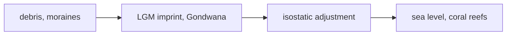

# LS15 · Glacial Deposits Rebound and Sea Level

◀ [[LS14 Glaciers Mass Balance and Ice Flow]] · [[Landscapes and Geomorphology - Course Map|Course Map]] · next: [[LS16 Fluvial Landscapes]]

taught · in syllabus extra · book extra · beyond

> [!syllabus] Syllabus map: what is in the syllabus and what is extra in this chapter
> 🟢 **Taught**: slides 145–153 of [[pre_ms_landscape_26.pdf|the EC2123 pre-midsem deck]] (Argha Banerjee, IISER Pune; 153 slides). Boxes marked 🟢 **In the slides** derive what the slides derive; boxes marked 🖼 **Reading the diagram** explain each slide figure panel by panel and sit directly under the slide image.
> 🔵 **Extra · beyond**: boxes marked 🔵 **Extra** complete derivations the slides only quote (from Anderson and Anderson, *Geomorphology: the Mechanics and Chemistry of Landscapes*, and Turcotte and Schubert, *Geodynamics*); 🛠 **Tool** boxes derive a mathematical tool from 12th-grade material; 🧮 **Worked example** boxes calibrate orders of magnitude.
> This chapter has 4 sections, 3 derivation boxes, 0 redrawn figures and 8 slide images.

> [!key] After this chapter you can
> - describe debris on a glacier and moraines,
> - explain the Last Glacial Maximum imprint and Gondwana glaciations,
> - derive glacial isostatic adjustment,
> - relate ice volume to sea level and coral terraces.

> [!intuition] The one-sentence story
> Glaciers carry debris and leave moraines; their weight depresses the crust and removal makes it rebound, and ice volume sets sea level and coral reefs record it.

*Concept map: every box is a section of this chapter.*

*[Slides 145–153]*

## Debris on a glacier (slides 145–147)

> [!example] ❓ Question on the slides: Slide 145: what happens to a rock (or a glaciologist) that falls onto the glacier in the accumulation zone?
> It is buried by later snowfall and carried *down and forward* along a flow line, crossing the ELA at depth; in the ablation zone the flow line rises and the ice above it melts away, so the object emerges at the surface (or at the margin) and is then carried to the terminus and dropped. *Kinematics*: in steady state the ice surface $z_s(x)$ does not change; a surface point moves with the ice velocity $(u_s,w_s)$ and the surface is lifted by accumulation at rate $b$ (or lowered by ablation), so $\partial_tz_s=b+w_s-u_s\partial_xz_s=0$. Hence the velocity of the ice *relative to the surface* is
>
>
> $$
> w_s-u_s \partial_xz_s=-b .
> $$
>
>
> For $b>0$ (accumulation zone) ice moves *down through the surface* at speed $b$ (submergence, burial); for $b<0$ (ablation zone) it moves *up through the surface* at speed $|b|$ (emergence). The rock crosses from burial to emergence near the ELA. Travel time from the head to the terminus is $\sim L/\bar u$: for $L=6$ km, $\bar u=50$ m yr$^{-1}$, about $120$ yr; so a glaciologist lost on the upper glacier is found (Fig. 14.2, flow lines) in the lower half of the glacier, decades later.

![[pre_146.jpg|300]] ![[pre_147.jpg|300]] ![[pre_148.jpg|300]]

> [!example] 🖼 Reading the diagram: Slides 146–148: glacial landforms in the pictures
> Slide 146: (left) an alpine lateral moraine (Tschierva glacier) – a ridge of debris along the glacier margin, in the ablation zone; (right) Google-Earth view of the ridge system left by an ice tongue. Slide 147: *erratics*: giant boulders foreign to the underlying bedrock (the split “Big Rock” in a prairie, and boulders resting on smooth polished granite in Yosemite), together with a glacier-surface image of scattered boulders. Slide 148: *subglacial deposits*: flutes, drumlins, crag-and-tail, eskers and lineations: a DEM view of streamlined hills and a photograph of a glaciated plain with lakes between ridges.

| Landform | Description | Formation |
|---|---|---|
| Lateral moraine | ridge along the glacier margin | rockfall and debris from valley walls falls on the ablation zone margin, emerges, stays at the side; remains as a ridge after retreat |
| Medial moraine | dark stripe down the glacier centre | two tributaries merge: their adjacent lateral moraines meet in the middle (slide 138) |
| Terminal / end moraine | arc-shaped ridge across the valley at the ice limit | debris carried to the stationary terminus is dumped as the ice melts (“conveyor belt”); sizes with the duration of the stillstand |
| Recessional moraines | series of ridges up-valley of the terminal moraine | pauses in retreat |
| Erratic | isolated boulder | ice-rafted or carried far, dropped when the ice melts |
| Flutes, drumlins, crag-and-tail, lineations | ridges aligned with ice flow, lengths m–km | subglacial shaping of till and bedrock by ice moving over the bed; the long axis marks flow direction |
| Eskers | sinuous ridges of sand and gravel | deposited by subglacial or englacial meltwater streams, following the hydraulic gradient (up or down hill, direction of ice flow) |

*Glacial depositional landforms (slides 146–148).*

> [!derivation] 🔵 Extra (not derived in the slides): Glacial erosion in brief (syllabus item 7; quoted results)
> Beyond the slides, the syllabus lists erosion, U-shaped valleys, hanging valleys and lakes. Glaciers erode by *abrasion* (debris in basal ice scratches and polishes the bed; rate roughly $\propto$ sliding speed $u_b$ to a power $1$–$2$) and *plucking* (freezing to the bed and ripping out joint-bounded blocks). Because ice flux is largest in the trunk valley, the trunk incises more than tributaries: tributaries are left *hanging* above the trunk; the trunk's cross-section adjusts so that basal shear stress is nearly constant, which gives a broad parabolic “U” (a river cuts a narrow “V”). Overdeepened basins scoured by the glacier fill with water when it retreats: cirque tarns, fjord and lake basins.

## The LGM imprint and Gondwana (slides 149–150)

![[pre_149.jpg|460]] ![[pre_150.jpg|460]]

> [!example] 🖼 Reading the diagram: Slide 149–150
> Slide 149: the imprint of the last (Weichselian) ice sheet on Fennoscandia: red lines are eskers, radiating outward from the ice-sheet centre near the Gulf of Bothnia, showing the direction of former ice flow; the grey lines are ice-marginal positions with ages in calendar kyr BP (from $\sim22$ ka at the outer limit to $\sim10$ ka inside), showing the stages of the retreat. Slide 150 (left): a *dropstone* (a lone pebble, scale in cm) in fine sediment near Talcher (Odisha, India): a stone dropped from floating ice into muddy sediment deforms the laminations beneath it: evidence of glaciation $\sim300$ Myr ago (Late Palaeozoic ice age, Chakraborty and Ghosh 2006). Middle: map of Gondwana mountain belts and coalfields (Peninsular India). Right: reconstruction of Gondwana at $\sim300$ Ma: an ice cap centred near South Africa/Antarctica with outlines of India, Australia, Africa, South America and the distribution of the fossil plants *Glossopteris* and *Gangamopteris* (green symbols) across all these continents: the same plants and glacial deposits on separate continents are evidence that the continents were joined — Wegener's argument for continental drift, now plate tectonics.

## Glacial isostatic adjustment (slide 152)

![[pre_151.jpg|460]] ![[pre_152.jpg|460]]

> [!example] 🖼 Reading the diagram: Slide 151–152: ice sheets then and now; the model of rebound
> Slide 151: two globes, Pleistocene ($18 000$ yr ago) and today: white = glacial ice, lighter = sea ice; the northern ice sheets have vanished except Greenland. Below: a model map (Milne and Shennan) of present-day radial crustal deformation in mm yr$^{-1}$ (scale $-7$ to $+10$): uplift centred on Hudson Bay, Scandinavia, and the Antarctic; a blue rim of subsidence around the old ice sheets (the collapsing peripheral bulge). Slide 152: Google-Earth view and terrace photograph (T&S Fig. 6-15): elevated beach terraces on Östergransholm, eastern Gotland, Sweden: the contemporary uplift is about $2$ mm yr$^{-1}$ — old shorelines now high above the sea.

> [!example] ❓ Question on the slides: Slide 152: how was the viscosity of the mantle estimated from the uplift of raised beaches on an island near $60^\circ$N?
> **Idea**: after the ice load is removed the mantle flows back and the land rises exponentially. *Data*: each raised beach dated by $^{14}$C has an elevation above present sea level: the uplift that has occurred since its age. The plotted points (slide 152: uplift $w$ in metres against age; left axis $0$–$400$ m, bottom axis age in years before present) fall on a decaying curve: $\sim310$ m at $9000$ yr ago, $\sim115$ m at $6700$, $\sim50$ m at $4100$, $\sim26$ m at $2300$, $\sim4$ m at $500$ yr. *Model*: the remaining displacement from equilibrium decays as $w(t)=w_0\mathrm{e}^{-t/\tau_r}$ (top axis of the plot: time $t$ since deglaciation), with the relaxation time (relax). *Extraction of $\tau_r$*: take logarithms; the slope of $\ln w$ against $t$ is $-1/\tau_r$; e.g. from $115$ to $50$ m over $2600$ yr, $\tau_r=2600/\ln(115/50)=3100$ yr; from $50$ to $26$ m over $1800$ yr, $\tau_r=2750$ yr; the drawn curve corresponds to $\tau_r\approx3$–$3.5$ kyr. *Viscosity*: with $\tau_r=4\pi\mu/(\rho g\lambda)$ (Chapter 7), $\mu=\rho g\lambda\tau_r/4\pi$; for a load of horizontal scale $\lambda\approx3000$ km ($\sim$ the Fennoscandian ice sheet, wavelength assumed here) and $\tau_r=3.3$ kyr $=1.04\times10^{11}$ s: $\mu=3300\times9.8\times3\times10^6\times1.04\times10^{11}/(4\pi)=8\times10^{20}$ Pa s $\sim10^{21}$ Pa s: the value of the mantle viscosity used in Chapters 7 and 8. The present rate: with $w_\mathrm{now}$ remaining uplift, $\dot w=-w_\mathrm{now}/\tau_r$; $2$ mm yr$^{-1}$ at Gotland corresponds to $w_\mathrm{now}\approx2\times10^{-3}\times3300\approx7$ m still to come. (The exact wavelength dependence of $\tau_r$ and the elastic lithosphere make real GIA models use a spectrum of relaxation times.)

> [!derivation] 🔵 Extra (not derived in the slides): Relaxation time recalled
> $$
> \tau_r=\frac{4\pi\mu}{\rho g\lambda} \tag{29}
> $$
>
>
> was derived in Chapter 7 for a sinusoidal load of wavelength $\lambda$ on a viscous half-space. The peripheral bulge: the elastic lithosphere transfers the load into a flexural depression under the ice and an up-bulge at $x=\pi\alpha$ (Chapter 10, $\alpha\sim10^2$ km), which collapses as the ice retreats: subsidence around the old ice sheets (blue rim on slide 151).

## Sea level and coral reefs (slide 153)

![[pre_153.jpg|460]]

> [!example] 🖼 Reading the diagram: Slide 153: coral-reef records of sea-level change
> Left: relative sea level (depth in m, $-140$ to $+40$) against age (ka, $0$ to $500$) from the Waelbroeck et al. (2002) compilation (dark curve) and Rohling et al. (2009) (grey band) with individual reef ages (red dots). The curve oscillates with a period of $\sim100$ kyr between the present level ($0$) at interglacial highstands and about $-120$ to $-130$ m at glacial lowstands; the numbers on top mark marine isotope stages: MIS $11$ ($\sim400$ ka), $9$, $7$, $5e$ ($\sim125$ ka, the last interglacial, when sea level was a few metres above present), $5c$ and $5a$ ($\sim100$ and $\sim80$ ka, sea level $\sim-20$ m). Right: a coral reef grows at sea level (SL) at each highstand; if the coast has been *uplifting*, older reef terraces are lifted progressively higher (uplifting $0$–$5$ mm yr$^{-1}$: terraces $5a$, $5c$, $5e$, $7$ step up the slope), if *stable* they cluster near SL, and if *subsiding* ($0$–$1$ and $0$–$5$ mm yr$^{-1}$) they are progressively submerged; the scale bars are $20$ m.

> [!derivation] 🔵 Extra (not derived in the slides): Uplift rate from a dated reef terrace
> A coral that grew at time $t$ before present when the sea level was $\zeta(t)$ (relative to today; from the curve: $\approx+5$ m for MIS 5e) now sits at elevation $z$. If the coast has been rising at a constant rate $U$, then
>
>
> $$
> z=\zeta(t)+U t \Longrightarrow U=\frac{z-\zeta(t)}{t}.
> $$
>
>
> Example: a $125$-ka (MIS 5e) terrace at $z=68$ m: $U=(68-5)/125 000=0.5$ mm yr$^{-1}$: the top panel of the slide; a terrace at $z=5$ m has $U=0$ (stable coast); a terrace at $-20$ m has $U=(-20-5)/125 000=-0.2$ mm yr$^{-1}$: subsiding. Because several terraces of known ages exist ($5a$, $5c$, $5e$, $7$), each gives an independent estimate: agreement tests the assumption of constant $U$. GIA (previous section) also changes local sea level by tens of metres, and is the main source of the “uncertainty” in $\zeta(t)$ for the MIS 5e highstand.

## Further slides explained one by one
taught *the slides of this chapter's range that carry no derivation of their own; each image is followed by what it shows*

![[pre_145.jpg|520]]

> [!example] 🖼 Reading the diagram: Slide 145: Deposition by glaciers: where does a fallen rock go?
> Question slide: *what happens to a piece of rock (or a glaciologist) that falls onto the glacier in the accumulation zone?* The sketch is a glacier outline with the equilibrium-line altitude (ELA) drawn across it. Answer: in the accumulation zone snow buries the rock; ice flows down and, because the flow lines dive in the accumulation zone and rise towards the surface in the ablation zone, the rock is carried englacially and re-emerges below the ELA, where it melts out and joins the surface debris (moraines).

## Map of this chapter
> [!connection] How LS15 connects
> **Previous:** [[LS14 Glaciers Mass Balance and Ice Flow]] · **Next:** [[LS16 Fluvial Landscapes]].
> **Other subjects:** [[Climate - Course Map]] (weathering and the carbon cycle, glaciation, orographic rainfall), [[Thermodynamics - Course Map]] (heat conduction and diffusion), [[Evolution of Earth and Life - Course Map]] (plate tectonics and landscapes through geological time), [[Waves - Course Map]] (diffusion and wave equations).

## Provenance
> [!provenance]- Source map for this chapter
> | Topic | Source | Scope |
> |---|---|---|
> | slide content, figures read panel by panel | [[pre_ms_landscape_26.pdf]] slides 145–153 (images embedded from the PDF, auto-cropped, `scripts/render_slides.py`) | taught |
> | derivations, worked examples, tool boxes, TikZ figures | the AI-written derivation-level notes [[Landscapes_and_Their_Evolution_notes.pdf]] (EC2123 notes; LaTeX source in `landscape-notes-tex-source.tar.gz`), converted with `scripts/tex2vault_ls.py`; cross-checked against Anderson and Anderson and Turcotte and Schubert as cited there | secondary + extra/book |
>
> **Notes.** (1) The text of this chapter is the AI-written reference notes' text, converted to the vault's callout style and equation numbering (chapter-local, so some cross-references read as "(label)"). (2) The slide images were checked against the notes' slide numbers for a sample of slides (e.g. 1–12, 109–120 match). Figure descriptions are the notes', and should be compared with the images beside them. (3) The `[!verify]` items of the notes' last front-matter section ("Two places where the slides need care") are in [[Landscapes Notation and Glossary]].
