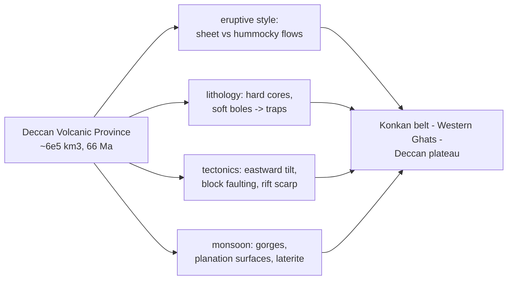

# LS18 · Deccan Traps Terrain

◀ [[LS17 Aeolian Landscapes]] · [[Landscapes and Geomorphology - Course Map|Course Map]] · next: [[LS19 Glacial and Aeolian Landforms]]

taught · in syllabus extra · beyond

> [!syllabus] Syllabus map: what is in the syllabus and what is extra in this chapter
> 🟢 **Taught**: the 37-slide deck [[Geomorphic Features of the Deccan Traps Terrain.pdf]] (Dr. Shilpa Patil, Dept. of Earth and Climate Science, IISER Pune; slide figures after Kale et al. 2017, 2021, 2026, Sheth 2020, Kapur et al. 2018, Wilson Mantilla et al. 2022, Ollier and Sheth 2008). Every slide is shown and explained below, in the order of the deck.
> 🔵 **Extra · beyond** (my numbers, `scripts/ls_numbers.py`): the average thickness of the province (1.2–1.6 km), the thermal-stress and cooling-time estimates behind columnar jointing and flow thickness, the slope of the eastward tilt, and scarp-retreat rates.

> [!key] After this chapter you can
> - say what the Deccan Volcanic Province is, how big it is and why its basalt piles weather into *traps* (stairs),
> - name the three major geomorphic units (Konkan coastal belt, Western Ghats escarpment, Deccan plateau) and the **four controls** on the terrain: eruptive style, lithology, tectonic tilt and faulting, monsoonal weathering,
> - read a lava-flow lobe (crust, core, base) and explain how flow type, columnar jointing and interflow horizons set the scale of cliffs and steps,
> - explain the eastward tilt, the block faulting and the entrenched bedrock gorges, and why the planation surfaces and laterite cappings occur at fixed levels.

> [!intuition] The one-sentence story
> A pile of thousands of nearly flat lava flows is a layer-cake of hard cores and soft tops; monsoon rain and rivers cut it into steps, a post-eruption eastward tilt and a retreating rift scarp make the Western Ghats a continental divide, and long tropical weathering levels the remnants into plateaus capped by laterite.

![[LS18 Deccan Map.svg]]
*Diagram LS18.0. The chapter in one page: four controls produce four sets of landforms. Editable source: [[LS18 Deccan Map.excalidraw]].*

*Concept map.*

## 1. The province and its name
taught *slides 1–5*

![[dec_001.jpg|420]] ![[dec_002.jpg|420]]

> [!example] 🖼 Slides 1–2: title and the Deccan Volcanic Province
> **Slide 1** (title): a Western Ghats landscape of basalt cliffs and a free-standing pinnacle; the course unit is *Geomorphic Features of the Deccan Traps Terrain*. **Slide 2**: a map of western and central India with the **Deccan Volcanic Province** shaded in green (the Arabian Sea at left, the Bay of Bengal at right, craton outlines and rift trends in grey/black). Two area labels: **≈380,000 km²** (the area of the present main province) and **≈500,000 km²** (the larger area enclosing the outliers and the Kachchh/Saurashtra and Malwa extensions); red stars mark early-magmatic sites (≈68–1 Ma) and green dots offshore basalt samples. *Text:* one of the largest **Large Igneous Provinces** in the world; considered the primary cause of the **Cretaceous–Paleogene mass extinction**; the **highest exposed continuous stack is 1642 m at Mt. Kalsubai**, the **onland composite stratigraphic thickness is ≈3000 m**; **total erupted volume onland ≈617,700 km³**.

> [!derivation] 🔵 Extra: how thick is the average pile? (computed)
> $617{,}700\ \mathrm{km^3}/500{,}000\ \mathrm{km^2}=\mathbf{1.2\ km}$ (or $1.6$ km if spread over $380{,}000$ km²): so the **maximum stack (≈3 km)** is two to three times the province average, and the highest *continuous* section in one place (1642 m) is about the average thickness: the pile is thickest at the Western Ghats and thins eastward. (For scale: 617,700 km³ is a cube **85 km on a side**, about **16 %** of the volume of the Mediterranean Sea.)

![[dec_003.jpg|420]] ![[dec_004.jpg|420]]

> [!example] 🖼 Slides 3–4: "What are Deccan Traps?" and "What caused Deccan volcanism, and when?"
> **Slide 3**: a panorama of stepped basalt hills in Maharashtra with red dashed lines tracing the flat tops and white arrows at the edges of successive steps; beside it, the word *Deccan* from Sanskrit *Dakṣiṇa* ("south"; → Prakrit *Dakkhiṇa* → *Deccan*), so *Deccan plateau* means the plateau of southern/peninsular India. The geological term **trap** comes from the Swedish *trapp*/*trappa*, "stair" or "staircase": **successive lava flows → horizontal basalt layers → differential weathering and erosion → step-like slopes → "traps"**. **Slide 4**: *left*, a map of the Indian plate moving across the Réunion hotspot (Arabia, Africa, India) and a sketch of a mantle plume rising from the core–mantle boundary under the lithosphere ("hot spots"); *right*, a timeline from the Jurassic (≈200 Ma) to the Cenozoic (0 Ma) of events: separation of East Gondwana (170 Ma), Madagascar from India (≈90 Ma), the Deccan basalts (Réunion plume, circled in red, ≈65 Ma), India–Asia collision (≈52 Ma) and Himalayan events to ≈3 Ma. The cause shown is the **Réunion mantle plume**.

![[dec_005.jpg|520]]

> [!example] 🖼 Slide 5: Deccan volcanism and the K–Pg boundary (Kale et al. 2026, Fig. 4)
> A stratigraphic column against age (≈64.6–67.0 Ma; the geomagnetic polarity chrons C29r–C30n down the left). The thick green bars mark the main pulses: **439,000 km³** (the *later, post-K–Pg* massive tholeiitic flood basalts, ≈90 % of the province volume) and **193,000 km³** (the earlier phase around and below the boundary); the **Cretaceous–Palaeogene Boundary Mass Extinction Event** at ≈66.0 Ma (red band, *KPgB*) sits between them; the red curve on the right is a global temperature excursion (late-Maastrichtian warming). Text boxes: *tholeiitic to silicic volcanics (rhyolites, trachytes, pyroclastic tuffs) and subaqueous marine pillow basalts*; *massive overwhelmingly tholeiitic continental flood basalts (~90 % of volume)*; *alkaline igneous complexes, mafic dyke swarms and minor localised continental flood basalts*. `[verify]` the two volumes (193,000 + 439,000 = 632,000 km³) against the 617,700 km³ of slide 2: the difference (2 %) is probably the offshore or silicic fraction counted differently.

## 2. The three geomorphic units
taught *slides 6–9* · see [[trap-topography]] and [[regional-eastward-tilt]]

![[dec_006.jpg|420]] ![[dec_007.jpg|420]]

> [!example] 🖼 Slides 6–7: units, and the Konkan Coastal Belt
> **Slide 6** (after Kale et al. 2017): a map of the province with the **Western Ghats Escarpment (WGE)**, the **Konkan Coastal Belt (KCB)** between it and the Arabian Sea, the **Western Uplands**, the **Deccan Plateau** and the **Malwa Plateau**; a schematic cross-section (right) shows short, swift west-flowing rivers (to an estuary) below the high escarpment and long east-flowing rivers across the Deccan Plateau to the Bay of Bengal. **Slide 7**: the KCB is a **narrow low-lying coastal strip (<100 km wide, <100 m above sea level)**, **drained by short high-gradient westerly rivers experiencing rapid headward incision into basalt**, underlain by the **Panvel Flexure** and north–south fault zones of the early Cenozoic rifting. The photograph (Fig. 1) shows the strip with a mangrove estuary under the towering escarpment (WGE).

![[dec_008.jpg|420]] ![[dec_009.jpg|420]]

> [!example] 🖼 Slides 8–9: the Western Ghats Escarpment (a 1,200 km continental divide)
> **Slide 8**: a Google-Earth oblique view of the escarpment with the KCB below. **WGE**: a continuous ridge crest **rising 500–1700 m**, separating the coastal lowlands from the interior Deccan Upland; it **exposes stacked sub-horizontal basalt flows in dramatic, vertical, multi-tiered cliff faces**; it **forms the major drainage divide**; highest peak Mt. Kalsubai **1646–1660 m**; formed by **post-Cretaceous rifting and scarp retreat**, acting as the primary continental divide of peninsular India (length **1,200 km**, peak elevation 1,646 m, origin *rift-scarp retreat*). **Slide 9**: a west–east **elevation profile** (Google Earth) through Pune: the KCB at sea level, the escarpment (WGE) rising sharply to ≈1,000 m+, then the Deccan Plateau descending gently eastward with the Balaghat Range as a secondary high.
>
> *Note the two numbers for Kalsubai: slide 2 gives the highest continuous stack as 1642 m; slide 8 says 1646–1660 m (summit elevation above sea level vs stack thickness). They refer to different things, not an inconsistency.*

> [!derivation] 🔵 Extra: the slope of the eastward tilt (computed)
> A crest at about 1,000 m and a sea-level outlet 700 km to the east give a mean gradient of $1000\ \mathrm m/700\ \mathrm{km}=1.4\ \mathrm{m/km}\approx0.08^\circ$: the tilt is tiny, which is why flows that were horizontal when erupted still look horizontal, and why the east-flowing rivers (Godavari, Krishna, Bhima) have such gentle gradients compared with the west-flowing coastal rivers that fall ≈1,000 m in 50–100 km (≈10–20 m/km, ten times steeper): they cut headward faster, which is the mechanism of *scarp retreat*.

<!-- ls-depth:LS18:1 -->
> [!intuition] Context from the book layer: the same escarpment, three descriptions
> - **Huggett** (*Fundamentals of Geomorphology*, [[Fundamentals of Geomorphology (Fundamentals of Physical Geography) - Second Edition (Richar Huggett) (z-library.sk, 1lib.sk, z-lib.sk).pdf#page=124|PDF pp.124–127]]): the Deccan Traps **once covered about 1.5 million km² and erosion has left about 500 000 km²** (compare slide 2's $\approx500\,000$ km²: the deck gives the *present* area); the Western Ghats are "a great escarpment bordering the Deccan Plateau", **ridge crests 500–1 900 m high with remarkable continuity for 1 500 km** despite structural variations, suggesting "a single, post-Cretaceous process of **scarp recession and shoulder uplift**" (Gunnell and Fleitout 2000): denudation and backwearing of the margin promotes **flexural upwarp** (shoulder uplift; [[LS10 Folds Flexure and Mountain Building]]), though deep-Earth forces could also uplift the shoulder.
> - **Migoń** (ed., *Geomorphological Landscapes of the World*, ch. 26 by **V. S. Kale**, [[Geomorphological landscapes of the world (Migoń, Piotr) (z-library.sk, 1lib.sk, z-lib.sk).pdf#page=273|PDF pp.273–275]]): "the Western Ghat Escarpment is one of the classic examples of passive-margin great escarpments"; the $\sim1$ km high wall is "an assemblage of valley heads and spurs", with plateau outliers, deep gorges, **beheaded plateau valleys**, laterite plateaux and many cases of **stream piracy**; *ghat* means "a broad flight of steps leading to a river" (like the *trappa* of slide 3) and **Sahyadri** is Sanskrit for "benevolent mountain". "Most workers believe the escarpment was initiated as a **rifted margin** at the time of the Deccan eruptions in the late Cretaceous"; all agree it has **receded inland**, but there are **differences of opinion about the mode and rate of recession**. (Kale is also the first author of the Kale et al. 2017/2021 papers cited on the slides.)
> - **Bierman and Montgomery** (*Key Concepts in Geomorphology*, PDF pp.375, 470) mention the Deccan Traps as the standard flood-basalt province and as a possible driver of end-Cretaceous environmental change.
> **Flags (numbers differ between sources).** Slide 8: escarpment length **1 200 km**, crest elevation **500–1 700 m**, Kalsubai $\approx1\,646$ m; Huggett: **1 500 km** and **500–1 900 m**. The difference is one of *definition* (which segments of the Ghats, where the escarpment ends, and which summits count; the southern Ghats reach $\sim2\,700$ m at Anai Mudi per Migoń's map caption, a recalled reading of a garbled figure label, `[verify]`), not a contradiction. *Use the slide's numbers for the exam and quote the source for any other.*

> [!question] Check yourself (answers below)
> 1. By what factor has the present Deccan area shrunk relative to its original extent (Huggett)?
> 2. What two end-member processes can explain the continuity of the Ghat escarpment over 1 200–1 500 km?
> 3. Why would a rifted passive margin produce a high escarpment close to the coast?
> 4. What does "beheaded valley" mean, and what process creates it?
> *Answers.* (1) $1.5\times10^6\to0.5\times10^6$ km²: a factor of 3 (two thirds removed). (2) Scarp **recession** (parallel retreat from the rift line) and **downwearing** of the plateau with flexural **shoulder uplift** (isostatic/flexural response to margin denudation); Kale notes the mode and rate are debated. (3) The rift margin was thinned and flexed upward at its shoulder (flexure of the lithosphere, [[LS10 Folds Flexure and Mountain Building]]), and the steep drop to the coast is the eroded, retreating rift scarp. (4) A plateau valley whose upper part has been cut off (captured) by the headward growth of a steep coastal stream: stream piracy, driven by the steeper west-flowing rivers ([[LS16 Fluvial Landscapes]], knickpoint retreat).

## 3. What controls the terrain?
taught *slide 10*

![[dec_010.jpg|520]]

> [!example] 🖼 Slide 10: four controlling factors over 66 Myr
> | Controlling factor | Primary resulting geomorphic feature |
> |---|---|
> | 1. Effusion rate and flow type | sheet flows → flat plateaus and mesas; hummocky flows → undulating tumuli fields |
> | 2. Lithology and differential resistance | alternating hard and soft layers → step-like "trap" terraces and escarpments |
> | 3. Structural/tectonic uplift | regional eastward tilt → asymmetric continental drainage divide |
> | 4. Monsoonal climate and erosion | deep river gorges, laterite duricrusts and rapid scarp retreat along the Ghats |
>
> The rest of the deck follows this order: §4 (slides 11–17), §5 (18–28), §6 (29–33), §7 (34–36).

## 4. Eruptive style (primary control)
taught *slides 11–17* · concept notes: [[compound-hummocky-pahoehoe]] · [[massive-sheet-flow]] · [[columnar-jointing]]

![[dec_011.jpg|520]] ![[dec_012.jpg|520]]

> [!example] 🖼 Slides 11–12: flow fields and the effusion-rate table
> **Slide 11** (after Kale et al. 2021): map-view drawings of two compound lava flow fields, (a) Flow 1 and (b) Flow 2 spreading from a vent through *lobes* (red = pathways; green lobes around them; scale bar 50 m) and (c) a cross-section where **Flow 2 lobes** override **Flow 1 lobes** over a 50-m section. **Slide 12** (summary table):
>
> | Effusion rate | Typical volumetric rate (m³/s) | Resulting Deccan flow type and landform |
> |---|---|---|
> | Low | < 10 | compound, hummocky pāhoehoe (tumuli, toes, inflation clefts) |
> | Moderate | 10–1,000 | channelised flows, transitional pāhoehoe-to-'a'ā fields |
> | Extreme (flood level) | 1,000–100,000+ | massive sheet flows (flat plateaus, sheer escarpments) |
>
> Low rates → inflated hummocky *pāhoehoe* with tumuli, lava lobes and knobby micro-relief; high rates → extensive flat **sheet flows** that form broad high plateaus and steep cliffs.

> [!derivation] 🔵 Extra: how long does a flow stay molten? (order of magnitude, computed in `ls_numbers.py`)
> A lava flow of thickness $h$ loses its heat by conduction through the crust with diffusivity $\kappa\approx10^{-6}$ m²/s (the diffusion toolkit of [[LS02 Mechanics and Mathematics Toolkit]]): the time to cool through the thickness is $t\sim h^2/\kappa$: $h=1$ m: $10^6$ s ≈ 12 days; $h=10$ m: $10^8$ s ≈ **3 yr**; $h=50$ m: $2.5\times10^9$ s ≈ **80 yr**; $h=100$ m: ≈ **300 yr** (latent heat and insulation by the crust lengthen these by a factor of a few). A thin compound pāhoehoe lobe (a few m to 10s of m long, <10 m thick) freezes in days to years, so it stays small; a 50–100 m thick *simple* flow stays hot, and mobile, for decades and can run hundreds of kilometres: the Deccan sheet flows are traced over **>1000 km** (the Rajahmundry flows), requiring **rates of $10^3$–$10^5$ m³/s** as in the slide.

![[dec_013.jpg|420]] ![[dec_014.jpg|420]]

> [!example] 🖼 Slides 13–14: flow types in action
> **Slide 13**: a photograph of an active fountain on a cinder cone ejecting spatter, with a link to a video on flow types. **Slide 14**: left, an incandescent *inflated* pāhoehoe lobe with a glowing crack (link to a video on inflated flows); right, a drawn cross-section (Kale et al. 2021) of a **tumulus**: the **crust**, **core** and **base** of a lobe with the **axial cleft** and a possible **break-out toe**, scale 2 m; below it a photograph of the cracked surface of a tumulus in the field. The picture explains how a pāhoehoe lobe *inflates* by injection of lava under a rigid crust, lifting it into a dome with a split along its axis.

![[dec_015.jpg|520]] ![[dec_016.jpg|520]]

> [!example] 🖼 Slides 15–16: compound pāhoehoe in the field, and sheet flows
> **Slide 15**: the tumulus drawing again (lobe length a few m to 100s of m, thickness <10s of m) next to a photograph of the **Bhuleshwar Ghat section SE of Pune**: a low cliff showing undulating flow tops (red dashed line) and hummocky lobes. **Slide 16**: *left*, the Tamhini Ghat section (west of Pune): a tall, flat-topped hill with vertical cliffs formed by sheet flows; *right*, the Gadaghat section (NH-3, Madhya Pradesh) showing many stacked sheet flows (labelled Cr1–Cr4, Co1–Co3: crust and core of successive flows). Key parameters: **areal extent 10–100+ km²** per flow, **inflated vesicular crust**, **endogenous transfer** of lava inside the flow. Sheet flows form broad high plateaus and sheer cliffs; the vertical faces are held up by the cores.

![[dec_017.jpg|520]]

> [!example] 🖼 Slide 17: columnar jointing
> *Left*, **entablature columnar joints** at Singhania, Madhya Pradesh (curved, irregular columns above a field geologist); *right*, a **multitiered colonnade** in basalt (tall regular columns in the lower tier) and, between them, a sketch of a cooling flow with a cold surface at the top and hotter interior, with the **fracture propagation** direction (cracks advance perpendicular to the isotherms into the hotter interior), producing prismatic (mostly hexagonal) columns. Text: *thermal contraction during cooling produced columnar jointing, which controls how cliffs collapse, how scarp retreat occurs, and how vertical rock faces are maintained*. See [[columnar-jointing]].

> [!derivation] 🔵 Extra: why basalt breaks into columns (computed)
> Cooling by $\Delta T\approx900$ K contracts a constrained basalt by $\alpha\Delta T$ with $\alpha\approx8\times10^{-6}$ K⁻¹: a thermal stress $\sigma=E\alpha\Delta T/(1-\nu)\approx70\ \mathrm{GPa}\times8\times10^{-6}\times900/0.75\approx\mathbf{670\ MPa}$ if fully constrained, about **50 times** the tensile strength of basalt (≈10–15 MPa): the rock cracks long before it can build this stress. The cracks open as polygons (the lowest-energy network), whose size is controlled by how fast the cooling front advances: **slow cooling → wide, regular columns** (the colonnade, ~1–3 m), **fast or water-affected cooling → narrow, curved columns** (the entablature).

## 5. Lithology and differential resistance
taught *slides 18–28* · concept notes: [[lava-flow-internal-structure]] · [[interflow-horizons]] · [[intertrappean-beds]] · [[trap-topography]]

![[dec_018.jpg|520]]

> [!example] 🖼 Slide 18: internal structures and nomenclature of a lava lobe (Sheth 2020 / Kale et al. 2020)
> A reference diagram. *Left column* (five lobe types): (1) **'a'ā lobe**, (2) **pāhoehoe lobe**, (3) **hummocky pāhoehoe lobe**, (4) **sheet pāhoehoe lobe**, (5) **rubbly pāhoehoe lobe**, each with a vertical column showing the *crust*, *core* and *base* (scale 2–5 m). *Right:* the internal structure of a typical lobe from top to bottom: the **tachylite/glassy (red) rind**, **flow-top breccia (FTB)** (fragmented upper vesicular zone, UVZ), the **vesicle sheet (VS)**, the **vesicle banding**, **vesicle cylinders/streaky vesicle trails**, **pipe vesicles** and the **glassy base**; the **crust** (UVZ), the **core** (compact, dense, jointed) and the **base** (LVZ, lower vesicular zone). The note: *progressive lateral spreading of the lava is achieved through endogenous emplacement of the molten lava encased within a chilled crust; the morphology and internal structure is a reflection of the volumetric rate of emplacement and of the cooling and degassing history of the extruded lava.*

![[dec_019.jpg|420]] ![[dec_020.jpg|420]]

> [!example] 🖼 Slides 19–20: lobes in the outcrop
> **Slide 19**: a field photograph with a geologist's hand on a **flow boundary**; labels: **dense core of upper flow**, **horizontal vesicle sheet**, **vug**, **pipe vesicle horizon**, **upper crust of lower flow with vesicle banding**. **Slide 20**: an outcrop with a *two-lobe* section: **Lobe #1** (crust LVZ, core) and **Lobe #2** (base, LVZ, core, crust UVZ) with hand specimens of the core (dense, dark), vesicular crust and amygdaloidal rock (inset boxes). The dense core is the *hard* layer, the vesicular crust and base the *soft* layers: the differential-resistance pair of the next slides.

![[dec_021.jpg|420]] ![[dec_022.jpg|420]] ![[dec_023.jpg|420]]

> [!example] 🖼 Slides 21–23: interflow horizons (boles)
> Text: *interflow horizons, e.g. intertrappeans, red boles, green boles, flow-top breccia (FTB); various origins of boles: (a) palaeosol profiles formed by in-situ physical and chemical weathering of the flow tops of lower flows; (b) ash-fall deposits.* **Slide 21**: a red bole (iron-rich weathered horizon) between two flows (Flow 1 below, Flow 2 above) in a roadcut and a close-up. **Slides 22–23** (Sheth 2020): the section **Upper flow (Ambenalli Fm)** above, a **silty clayey horizon (IFLH) with vertical pencil joints**, a **baked red clayey horizon** and the **weathered FTB of the lower flow (Poladpur Fm)**; slide 23 (Varandha Ghat): a thin greyish-black IFLH and the weathered FTB between the lower (Poladpur) and upper (Ambenali) flows. The weak horizon localises weathering and seepage: the *bench* of each step.

![[dec_024.jpg|520]]

> [!example] 🖼 Slide 24: intertrappean beds
> *Text:* **intertrappean beds in India are thin sedimentary layers (1 m to >20 m thick) sandwiched between successive basalt flows**. *Panels:* an outcrop (Kapur et al. 2018, Fig. 2) with the **Deccan basalt** above and below a pale **intertrappean deposit**, a location map (inset), and Wilson Mantilla et al. (2022, Fig. 1): a **map of the Deccan Traps (orange) with intertrappean localities** marked by symbols (Malwa Group, Mandla Lobe, Saurashtra Group, Main Deccan Traps (Sahyadri Group), Rajahmundry). Intertrappeans record quiet intervals between eruptions (lakes and soils) and preserve fossils (dinosaur eggshells, plants, frogs), tying the volcanics to the K–Pg boundary.

![[dec_025.jpg|420]] ![[dec_026.jpg|420]] ![[dec_027.jpg|420]] ![[dec_028.jpg|420]]

> [!example] 🖼 Slides 25–28: the step-like (trappa) topography
> **Slide 25**: *flat-topped hills, steeply inclined slopes and gently undulating valley floors*: a panorama with yellow dashed lines tracing the stepped skyline and green arrows at each break in slope. **Slide 26**: the *step-like topographic profile (trappa = Swedish "steps")*: extensive **flat plateaus/table-lands interspersed with flat-bottomed valleys** in the Mula River valley, SE of Sangamner (green arrow = plateau edge, yellow arrow = bench). **Slide 27**: *occasionally, steep pinnacled hills*: **Mangi Tungi**, near Satana, on the Mumbai–Indore highway, where a resistant column stands on a stepped hill. **Slide 28**: a close-up of a pinnacle with its **crust, core, crust** labelled: a lobe preserved as a tower because its dense core resists erosion. *The steps are the outcrops of dense cores; the benches are the weathered soft horizons between them.*

## 6. Tectonic uplift and structure
taught *slides 29–33* · [[regional-eastward-tilt]] · [[segmented-quaternary-block-faulting]] · [[bedrock-gorges-and-entrenched-meanders]] · [[fracture-bound-rock-trench]] · [[pothole-networks]]

![[dec_029.jpg|420]] ![[dec_030.jpg|420]]

> [!example] 🖼 Slides 29–30: the eastward tilt and Quaternary block faulting
> **Slide 29** (after Kale et al. 2017): a drainage map of the peninsula: the **KCB** and the **WGE** at the west, rivers (Godavari, Krishna, Bhima) rising near the Ghat crest and flowing **east over 700 km into the Bay of Bengal**. *Regional eastward tilt:* post-eruptive crustal warping tilted peninsular India eastward, establishing an **asymmetric trans-peninsular continental divide**. **Slide 30**: *segmented Quaternary block faulting* (Kale et al. 2021): *left*, a map of the Pune–Sahyadri region with fault zones, the escarpment and the **Western Ghats Escarpment** and the basalt (yellow: planation surfaces and uplifted blocks); *right*, three block diagrams (a–c) showing how faults offset the surfaces into **segments** (horsts and grabens) and divert the rivers: the planation surfaces are **vertically displaced**, so equal-elevation surfaces occur at different heights in different blocks.

![[dec_031.jpg|420]] ![[dec_032.jpg|420]]

> [!example] 🖼 Slides 31–32: bedrock gorges, entrenched meanders and a knickpoint arch
> **Slide 31**: *River Mula, SE of Bota, N of Pune*: a narrow bedrock channel with vertical walls cut through horizontal flows, and *a tributary of the River Mula, Sakur Plateau*: a **bedrock channel of an entrenched meander**, the river meandering in a trench far below the plateau, evidence of strong vertical incision (uplift) rather than lateral migration. **Slide 32**: a **natural arch ≈4 m high and 12 m wide** created **at the head of a knickpoint** on a tributary of the Kukdi river at Ane Ghat: a waterfall retreats upstream by undercutting the soft layer beneath a hard core, leaving the core as a bridge.

![[dec_033.jpg|520]]

> [!example] 🖼 Slide 33: the fracture-bound rock trench and the potholes of Nighoj
> *Left:* "Who made these holes?": circular potholes of all sizes drilled into the basalt bed of a river; *middle:* a satellite view of the **River Kukadi near Nighoj (N of Pune)** with a yellow dashed line along the straight, **fracture-controlled channel (Fr1)**; *right:* text: a **large network of potholes in a linear fracture-controlled channel**. The caption of the slide: the **sudden transition of the river from a wide valley into a constricted, fracture-bound rock trench squeezed the water volume, vastly increasing the stream's hydraulic head, kinetic energy and flow velocity during monsoonal floods**. Potholes are drilled by pebbles whirled by turbulent eddies in the narrow channel (abrasion by the saltating bedload of [[LS16 Fluvial Landscapes]]).

> [!derivation] 🔵 Extra: why narrowing speeds the flood (computed, assumed numbers)
> Continuity: the discharge $Q=wdU$ is conserved. Take a river 200 m wide and 2 m deep with $U_1=1$ m/s ($Q=400$ m³/s) squeezed into a trench $w_2=20$ m wide at the same slope and roughness. With a Manning-type law $U\propto d^{2/3}$ the new depth solves $w_2\,d\,(d/2)^{2/3}=400$: $d_2=\mathbf{8.0}$ m and $U_2=\mathbf{2.5}$ m/s. The bed shear stress ($\tau=\rho g d S$) rises by $d_2/d_1=4$ and the stream power per unit bed area ($\tau U$) by **10 times**: narrowing a flood into a rock trench multiplies its erosive power, which is why potholes and plunge pools develop there (the slide states this qualitatively; the numbers are mine, `scripts/ls_numbers.py`).

## 7. Monsoonal climate and erosion
taught *slides 34–36* · [[planation-surfaces]] · [[laterite-cappings]]

![[dec_034.jpg|520]] ![[dec_035.jpg|420]]

> [!example] 🖼 Slides 34–35: planation surfaces
> **Slide 34 (text and sketch).** In the Deccan Traps *planation surfaces* (palaeoplains, erosion surfaces) occur as **multi-tiered, elevated flat tablelands and accordant surfaces at distinct levels across the terrain, most notably at ≈1,330, ≈1,225, ≈1,000, ≈920, ≈700 and ≈600 m** above mean sea level. Their development is governed by: (1) **long-term tropical weathering (etchplanation)**, (2) **passive-margin scarp retreat (pediplanation)**, (3) **lithological differential erosion** and (4) **subsequent Quaternary neotectonic block displacement**. The sketch (a): successive surfaces, *oldest planation surface* (at top, 100–600 km wide) and *younger* and *youngest* surfaces stepping down into the valley, separated by erosional slopes, with arrows marking **periodic uplift** raising a surface that is then re-incised. **Slide 35**: the Mula valley view again, repeating that the flat surfaces (green arrow) are tablelands interspersed with flat-bottomed valleys (yellow arrow).

![[dec_036.jpg|520]]

> [!example] 🖼 Slide 36: laterite cappings (Ollier and Sheth 2008, Fig. 7)
> Two field photographs: (E) a flat-topped hill where a dark **duricrust** (laterite capping, hard iron-rich crust) lies on top of orange-red weathered **saprolite** and a person for scale; (F) a road-cut through laterite: the lumpy, vesicular, iron-oxide cemented crust over mottled red saprolite. Laterite is the residue of intense tropical weathering: silica and bases are leached from basalt and Fe/Al oxides stay behind (the chemical-weathering mechanisms of [[LS11 Weathering and Regolith]]); once hardened it armours the plateau against erosion, so *the flat top of a mesa is often a laterite cap on a planation surface*.

> [!derivation] 🔵 Extra: how fast does the escarpment retreat? (order of magnitude, `ls_numbers.py`)
> If the Western Ghats escarpment started at the rift margin and now lies ≈50–100 km inland, the mean retreat rate over 66 Myr is $50\text{–}100\ \mathrm{km}/66\ \mathrm{Myr}=\mathbf{0.8\text{–}1.5\ mm/yr}$, i.e. 0.8–1.5 m per thousand years, the same order as cosmogenic erosion rates measured on the Ghats (≈ 5–30 m/Myr = 0.005–0.03 mm/yr for the plateau top, `[verify]`; an escarpment *face* retreats much faster than the plateau lowers). The *plateau tops* therefore lower far more slowly than the escarpment face retreats, so surfaces at different levels (1,330 m, 600 m) can differ in age by tens of millions of years.

## 8. Summary table
> [!summary] Cheat-sheet
> | Question | Answer | Slides |
> |---|---|---|
> | size and age | ≈500,000 km², ≈617,700 km³, ≈66 Ma, K–Pg; max stack ≈3 km | 2, 5 |
> | cause | Réunion plume, Indian plate moving north | 4 |
> | units | Konkan belt (<100 m), Ghats (500–1700 m), Deccan plateau | 6–9 |
> | flow types | low rate (<10 m³/s) compound pāhoehoe; high rate (10³–10⁵ m³/s) sheet flows | 11–16 |
> | internal structure | crust (UVZ) / core / base (LVZ); vesicle sheets, pipe vesicles, FTB | 18–20 |
> | steps | hard cores, soft boles and intertrappeans → trappa | 21–28 |
> | tectonics | eastward tilt, segmented block faulting | 29–30 |
> | rivers | bedrock gorges, knickpoint arches, potholes | 31–33 |
> | planation | 1330, 1225, 1000, 920, 700, 600 m surfaces; laterite caps | 34–36 |

## Map of this chapter
> [!connection] How LS18 connects
> **Builds on:** [[LS11 Weathering and Regolith]] (laterite, chemical weathering), [[LS02 Mechanics and Mathematics Toolkit]] (diffusion and cooling time), [[LS10 Folds Flexure and Mountain Building]] (passive margins, flexure of the escarpment), [[LS16 Fluvial Landscapes]] (incision, knickpoints, potholes).
> **Concept notes:** [[deccan-volcanic-province]] · [[trap-topography]] · [[massive-sheet-flow]] · [[compound-hummocky-pahoehoe]] · [[columnar-jointing]] · [[lava-flow-internal-structure]] · [[interflow-horizons]] · [[intertrappean-beds]] · [[regional-eastward-tilt]] · [[segmented-quaternary-block-faulting]] · [[bedrock-gorges-and-entrenched-meanders]] · [[fracture-bound-rock-trench]] · [[pothole-networks]] · [[planation-surfaces]] · [[laterite-cappings]]
> **Other subjects:** [[Climate - Course Map]] (the monsoon, the K–Pg climate and extinction), [[Evolution of Earth and Life - Course Map]] (mass extinction, intertrappean fossils), [[Eco-Evo Exam Prep]] (extinction and biodiversity).

## Provenance
> [!provenance]- Source map for this chapter
> | Topic | Source | Scope |
> |---|---|---|
> | all slides 1–37, text, tables and figures | [[Geomorphic Features of the Deccan Traps Terrain.pdf]] (37 slides; text layer plus images; images embedded from the PDF) | taught |
> | concept stubs | the 15 notes in `05-Landscapes-Geomorphology/Concepts/` first created by another tool (Kurooto) from the same deck, now expanded | secondary |
> | thickness, cooling time, thermal stress, tilt, retreat-rate numbers | `scripts/ls_numbers.py` | extra/beyond |
>
> **Notes.** (1) The figure descriptions were written from the slide images; some small map labels (slide 30) and the exact numbers in the slide-18 diagram could not be read and are described in outline. (2) The volumes on slide 5 (193,000 + 439,000 km³) differ by ≈2 % from the 617,700 km³ of slide 2 (flagged). (3) The cooling-time, stress, retreat and gorge numbers are order-of-magnitude estimates of mine, not from the deck. (4) One extra sentence in §1's derivation box about volume comparison is a rough illustration; ignore it if it conflicts with a source.

<!-- ls-depth:LS18:2 -->
> [!provenance]- Depth-layer sources (added 2026-10-28)
> | Topic | Source | Priority |
> |---|---|---|
> | Deccan area (1.5 → 0.5 million km²), Western Ghats length, crest heights, shoulder uplift (Gunnell and Fleitout 2000) | Huggett PDF pp.124–127 (read p.126, p.124 sentence) | b · primary book |
> | Western Ghat escarpment, features, rifted-margin origin, debated recession, *ghat*, Sahyadri | Migoń ed., ch. 26 (Kale), PDF pp.273–274 (read) | c · other book |
> | Deccan as flood-basalt standard | Bierman and Montgomery PDF pp.375, 470 (found by search); Thornbury PDF p.521 | c · other books |
> | slide-versus-book number comparison | my comparison; Anai Mudi height read from a garbled figure caption | `[verify]` |

## Continued in the vault (added 2026-10-29)
- Process rules for the bedrock gorges, potholes and fracture-bound trenches (abrasion, quarrying, knickpoint retreat): [[LS23 Bedrock Channels and River Incision]] §4.
