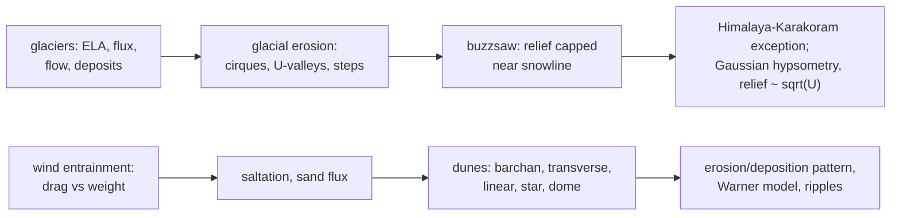

# LS19 · Glacial and Aeolian Landforms

◀ [[LS18 Deccan Traps Terrain]] · [[Landscapes and Geomorphology - Course Map|Course Map]] · next: [[LS20 GIS and TopoToolbox Practicals]]

taught · in syllabus extra · book extra · beyond

> [!syllabus] Syllabus map: what is in the syllabus and what is extra in this chapter
> 🟢 **Taught**: the 48-slide deck [[l_glacial_aolian.pdf]] (EC2123 post-midsem material: glaciers and landscape, slides 1–38; aeolian landforms, 39–48; Anderson and Anderson chs 8, 14, 15). The first 24 slides **revise and extend** the glacier slides 138–153 of the pre-midsem deck ([[LS14 Glaciers Mass Balance and Ice Flow]], [[LS15 Glacial Deposits Rebound and Sea Level]]) with new field photographs; slides 25–38 are new (glacial erosion and the *buzzsaw*, the Banerjee and Scherler hypsometry model, Dielforder et al.); slides 39–48 are the aeolian chapter that the earlier derivation notes only sketch ([[LS17 Aeolian Landscapes]]). Every slide is shown and explained below.
> 🟡 **Extra · book:** A&A figures cited on the slides (8.2, 8.7, 8.12, 8.41–8.51, 14.2, 14.9, 14.10, 14.15, 14.22, 15.1, 15.2, 15.7, 15.10).
> 🔵 **Extra · beyond** (`scripts/ls_numbers.py`): entrainment thresholds, Bagnold sand flux and dune speeds computed from the slide's parameters.

> [!key] After this chapter you can
> - read a glacier by its zones (accumulation, ELA, ablation), flux and flow profile, and name the landforms of glacial erosion and deposition (cirque, arête, horn, U-valley, hanging valley, drumlin, esker, moraine, erratic, striations and chattermarks),
> - explain the **glacial buzzsaw hypothesis** (glaciers cap mountain height near the snowline) and the Himalayan–Karakoram exception (debris cover, cold headwalls),
> - use the **Gaussian/half-normal hypsometry** of accumulation areas to relate relief above the snowline to uplift (relief $\sim\sqrt U$),
> - derive the **entrainment threshold** (drag torque against restoring torque) and describe **saltation**, the wind and sand-flux profiles, **dune types** and the **erosion–deposition pattern** that makes a dune migrate,
> - describe **Warner's cellular model** of dune fields and the **ripple** scale (≈10 cm).

> [!intuition] The one-sentence story
> Ice and wind are both fluids that pick up debris and drop it, but ice erodes by grinding and plucking and caps the height of mountains near the snowline, while wind moves grains in short hops and organises them into dunes whose shape depends on how much sand there is and how steady the wind is.

![[LS19 Glacial Aeolian Map.svg]]
*Diagram LS19.0. The chapter in one page. Editable source: [[LS19 Glacial Aeolian Map.excalidraw]].*

*Concept map.*

## 1. Glaciers and landscape: the extended tour (slides 1–12)
taught *slides 1–12; compare [[LS14 Glaciers Mass Balance and Ice Flow]]*

![[gla_001.jpg|420]] ![[gla_002.jpg|420]] ![[gla_003.jpg|420]]

> [!example] 🖼 Slides 1–3: what a glacier looks like
> **Slide 1** (title, "…rs & landscape"): a false-colour satellite image (snow cyan, debris-covered ice grey-brown) of a Karakoram glacier system, a long trunk glacier with tributaries, a medial moraine band and the valley walls; the side note says to *check out time-lapse videos of glacier flow, retreat and surging*. **Slide 2**: a ground photograph of a valley glacier tongue with a crevassed surface, a lateral moraine at the right and bedrock walls: the ice surface is the *glacier surface*, the rock at right the valley wall. **Slide 3**: an aerial view of a very large glacier (scale bar 4 miles) with converging tributary ice streams, medial moraines and meltwater lakes (blue dots) on the surface: the picture of ice as a river.

![[gla_004.jpg|520]]

> [!example] 🖼 Slide 4: glacier distribution, present and at the Last Glacial Maximum (LGM)
> *Top right:* a world map of present glaciers (blue). *Bottom right:* the LGM world map: ice sheets over North America (Laurentide, Cordilleran), Greenland, Fennoscandia, Patagonia and Antarctica (white). *Left:* (A) a profile of a glacier with the zones of accumulation and ablation separated by the **equilibrium line (ELA)**; (B) a latitude–elevation plot with the ELA, the present and glacial-minimum/maximum ELA lines; (C) a polar view with the ELA glacial minimum and maximum. The ELA drops by ≈ 1 km at the LGM relative to today, which is the cause of the larger ice cover.

![[gla_005.jpg|420]] ![[gla_006.jpg|420]] ![[gla_007.jpg|420]] ![[gla_008.jpg|420]]

> [!example] 🖼 Slides 5–8: balance, flux and flow (the same physics as [[LS14 Glaciers Mass Balance and Ice Flow]])
> **Slide 5:** a glacier is a *non-equilibrium open system* with accumulation, flow and ablation; at **steady state** total accumulation = total ablation = flux at the ELA; **the size of a glacier tracks ELA variation**, caused by changes in precipitation and temperature. Sketch: an accumulation zone, ELA and ablation zone with flow lines (their length represents velocity) and the glacier cross-section; below it a photo of a real glacier showing a calving front (Cuffey and Paterson 2010). **Slide 6:** the mass-balance and flux plots (A&A Fig. 8.2): (left) the glacier with avalanche, sublimation, snowfall and melt; (right) elevation $z$ against local mass balance $b(z)$ (zero at the ELA), $b(x)$ down-valley and the ice discharge $Q(x)=\int_0^xW\,b\,dx'$ which rises to a maximum $Q_{\max}$ at the ELA and falls to zero at the terminus. **Slide 7:** ice flow is viscous deformation plus sliding; it differs from a Newtonian liquid by a power law with $n\approx3$: Newtonian: $U(z)=(\rho g\sin\theta/\mu)(Hz-z^2/2)$; ice: $U(z)=A[\rho g\sin\theta]^3[H^3z-\tfrac32H^2z^2+Hz^3-\tfrac14z^4]$ (Eqs 8.8, 8.16); the slide invites *"try taking the limit $n\to\infty$"* (perfectly plastic: a parabola becomes a plug-flow with a yield stress). **Slide 8:** the question *what happens to a rock that falls on the accumulation zone?* (answered in [[LS15 Glacial Deposits Rebound and Sea Level]]).

![[gla_009.jpg|420]] ![[gla_010.jpg|420]] ![[gla_011.jpg|420]] ![[gla_012.jpg|420]]

> [!example] 🖼 Slides 9–12: moraines, erratics, bedforms of deposition, the LGM ice sheet
> **Slide 9:** aerial and Google-Earth views of a *lateral moraine* (a ridge of debris along the glacier margin) next to the glacier. **Slide 10:** *erratics*: huge boulders of foreign rock left stranded on the plain (a giant sandstone boulder with people for scale, and boulders on a polished granite surface in the Sierra Nevada). **Slide 11:** *glacial deposits*: flutes, drumlins, crag-and-tail, eskers, lineation: left, a LiDAR hillshade of fluted ground with parallel ridges in the ice-flow direction, right an aerial view of a drumlin field with lakes. **Slide 12:** the extent of the Fennoscandian ice sheet at the LGM with eskers (red lines), ice-marginal positions at different times (grey), the black box marks a detail map: eskers and moraines trace the retreat of the ice front.

## 2. Ice flow, rebound, and field evidence (slides 13–24)
taught *slides 13–24; compare [[LS15 Glacial Deposits Rebound and Sea Level]]*

![[gla_013.jpg|420]] ![[gla_014.jpg|420]] ![[gla_015.jpg|420]]

> [!example] 🖼 Slides 13–15: deep time, rebound, and the mantle's viscosity
> **Slide 13:** an ice-rafted *dropstone* within fine sediments at **Talcher** (Odisha), a reminder of the glaciated past (~300 Myr): a boulder sunk in laminated mud (Chakraborty and Ghosh 2008); the map shows the Gondwana basins and the Gondwana reconstruction with the extent of the Late Palaeozoic ice cap (India, Antarctica, Australia, Africa, South America joined). **Slide 14:** *glacial isostatic rebound (present-day global estimates from model simulation, Milne and Shennan 2013)*: globes of present-day glacial lows and sea level, a global map of present-day vertical land motion (positive = rising: Hudson Bay, Fennoscandia), and the sea-level curve over 800 kyr. **Slide 15:** *raised beaches*: an island at ≈60° N whose uplift is recorded by elevated beach terraces; a plot of uplift against time before present shows an exponential decay, from which **the viscosity of the mantle was estimated** (Turcotte and Schubert ch. 6): $\mu\sim10^{21}$ Pa s.

![[gla_016.jpg|420]] ![[gla_017.jpg|420]]

> [!example] 🖼 Slides 16–17: measuring flow, and the two mechanisms of subglacial erosion
> **Slide 16:** *deformation and slip observed at boreholes* (A&A Fig. 8.12): the horizontal velocity profile of the Athabasca Glacier against depth (0–200 m): most of the velocity (≈30 m/yr at the surface) is *internal deformation*, with a small step at the base (*basal motion*); and *surface velocity from feature tracking using satellite images*: a velocity map (km/yr colour scale) with a fast central flow. **Slide 17:** *mechanisms of subglacial erosion: abrasion and quarrying/plucking* (A&A Figs 8.41–42): a polished, grooved bedrock surface (abrasion) next to a broken, stepped surface (plucking); the diagrams show ice flowing over a bedrock step with a water-filled cavity and the entrainment of blocks.

![[gla_018.jpg|420]] ![[gla_019.jpg|420]] ![[gla_020.jpg|420]]

> [!example] 🖼 Slides 18–20: Machoi glacier field photographs
> **Slide 18** (surface of Machoi glacier, Himalaya): students walking across the debris-strewn, rough ice surface; **slide 19** (striations and chattermarks on Machoi valley bedrock): polished rock slabs scored by parallel scratches (**striations**, cut by debris-armed ice dragged over bedrock) and crescentic fractures (**chattermarks**, from boulders skipping under pressure); **slide 20:** close-ups: a ruler laid along striations (parallel grooves, tens of cm long) and a line of chattermarks on a glacier-polished rock. Striation direction gives the ice-flow direction.

![[gla_021.jpg|420]] ![[gla_022.jpg|420]] ![[gla_023.jpg|420]] ![[gla_024.jpg|420]]

> [!example] 🖼 Slides 21–24: debris-covered glaciers and glacial valleys of Uttarakhand
> **Slide 21:** the debris-covered **Satopanth glacier** draining Chaukhamba peak, seen from the right lateral moraine: a thick blanket of rubble hides the ice. **Slide 22:** *glacial valleys at the head of the Alaknanda river*: broad U-shaped valleys with steep walls and gently sloping floors. **Slide 23:** more views of the same valleys: trough, truncated spurs and lateral moraines. **Slide 24:** a smooth, polished bedrock whaleback (roche moutonnée-like) with a person for scale: ice-polished rock with quartz veins.

## 3. Glacial erosion and landscape evolution (slides 25–28)
taught *slides 25–28; A&A figs 8.48–8.51*

![[gla_025.jpg|520]]

> [!example] 🖼 Slide 25: erosional landforms in a deglaciated landscape
> A block diagram of a glaciated mountain: **cirques** (armchair hollows at the glacier heads) with **tarns** (lakes in them), **arêtes** (sharp ridges between cirques), **horns** (pyramid peaks where several cirques meet), **hanging valleys** (tributary valleys left above the trunk valley), the **U-shaped glacial trough** (versus V-shaped river valleys) with **paternoster lakes** (a string of lakes in rock basins). All are products of erosion by ice where it is thickest and fastest.

![[gla_026.jpg|420]] ![[gla_027.jpg|420]] ![[gla_028.jpg|420]]

> [!example] 🖼 Slides 26–28: models of glacial erosion
> **Slide 26** (A&A Fig. 8.48): a valley cross-section evolving from V to U in a model experiment: numbers are times in kyr (0, 40, 80, 120, 300); grey lines are velocity contours; the **basal velocity is highest at the centre**, so erosion is fastest there and the V deepens into a parabolic then U shape, with side walls steepened. **Slide 27:** *modelling the long profile assuming erosion proportional to the ice flux* (Fig. 8.51): panels (a)–(e) show the initial and intermediate profiles of a trunk valley and tributaries of different sizes joining it, the ice discharge and total erosion below: the model reproduces **overdeepenings, bedrock steps and hanging valleys** (a tributary joining makes a step in the trunk profile). **Slide 28** (Fig. 8.49): *erosion and lowering of bedrock would cause the glacier extent to diminish, unless there is uplift and/or cooling over hundreds of kyr*: glacier profiles at 3, 6, 9, 15, 30 kyr (steady climate) and with the ELA lowering 4 m/ka: with a steady climate the glacier retreats upvalley as the bed deepens; a falling ELA offsets it.

## 4. Frost cracking, the buzzsaw and the Himalayan exception (slides 29–33)
taught *slides 29–33; A&A ch. 7; Brozovic et al. 1997; Montgomery et al. 2001; Banerjee and Wani 2018*

![[gla_029.jpg|520]]

> [!example] 🖼 Slide 29: periglacial erosion (frost cracking) (A&A ch. 7, Figs 7.9, 7.10, 7.12, 7.13)
> *Left:* a photograph of ice needles (segregation ice) growing in soil. *Middle:* the laboratory set-up: a block of Berea sandstone (30 cm) between a top cooling plate (−4 to −15 °C) and a bottom plate (0 °C), with water supply at the bottom and acoustic-emission (AE) detectors; the inset shows the segregation ice lenses growing in frozen fringe (T between $T_C$ and $T_f$), where water migrates to the ice lens and cracks the rock. *Right:* histogram of the number of acoustic-emission events against temperature: **90 % of the events occur between about −3 and −8 °C, with a peak near −5 °C** (the *frost-cracking window*). The pressure change on freezing follows $dP/dT=L/(T\,dv)$ with $dv\approx-10^{-4}$ m³/kg (Clausius–Clapeyron, slide 114 of the earlier deck).

![[gla_030.jpg|420]] ![[gla_031.jpg|420]]

> [!example] 🖼 Slides 30–31: the glacial buzzsaw hypothesis
> **Slide 30** ("Glacial effects limiting mountain height"; Egholm et al. 2009; Brozovic et al. 1997; Montgomery et al. 2001): *on a global scale, "peak heights" (topographic maxima) and the local snowline show similar variation*, a consequence of glacial erosion: panels (a) hypsometry of fluvial and glacial landscapes, (b) elevation against latitude with the maxima following the snowline (EP and LGM transects), (c) the elevation-frequency colour map. **Slide 31:** the key figure: *strong peri-glacial and glacial erosion flattens areas below the snowline and prevents significant topography beyond ~1500 m above the snowline*: maximum elevation (black) and hypsometric maxima (red) against the modern and LGM snowline, with the 1:1 line and the +1500 m line above which no mountains extend. The question at the bottom: *is the Himalaya–Karakoram an exception? If so, why?* (the highest peaks, 8000 m, lie 3000 m above the snowline).

![[gla_032.jpg|420]] ![[gla_033.jpg|420]]

> [!example] 🖼 Slides 32–33: why the Himalaya escape, and Gaussian hypsometry
> **Slide 32** (Banerjee and Wani 2018, EPSL): a map of High Mountain Asia glaciers and a schematic of **debris input from headwalls, supraglacial debris transport** and the resulting bedrock profile; bottom: erosion rate against the temperature at the glacier's headwall ($T_{ELA}$?), showing that **headwall temperature is too low for frost cracking** (the correlation 0.81, p = 0.015), and *the decline in erosion rate at the high crest of the Himalaya*; the photograph is the typical debris-covered Satopanth glacier: debris insulates and the headwalls are too cold and too dry: no buzzsaw. **Slide 33** (Banerjee and Scherler, GRL 2025): *Gaussian glacier hypsometry is ubiquitous in the present-day world*: a map of glacier basins with hypsometric histograms, a histogram of glacier area against elevation with a bell shape (blue) over the fluvial area (red), a log-log scatter collapsing the data on one curve ($R^2=0.95$) and a plot of normalised distance against hypsometry: all glaciers show the same *Gaussian* area–elevation distribution.

## 5. Steady glaciers, hypsometry and mountain height (slides 34–38)
taught *slides 34–38; Banerjee and Scherler GRL 2025, JoG 2026; Dielforder et al. 2020*

![[gla_034.jpg|520]]

> [!example] 🖼 Slide 34: does erosion–uplift balance lead to a long-term steady glacier cover?
> The **assumptions**: steady climate and uplift; uplift–erosion balance (~1 Myr); subglacial erosion ∝ stream power, defined here as *slope × ice flux*; a **linear mass-balance profile**. The result: **half-normal steady-state hypsometry of accumulation areas**
> $$a(z)=a_0\exp\!\Big(-\frac{(z-z_{ELA})^2}{2\sigma^2}\Big),\qquad\sigma=\sqrt{\frac{u}{\alpha\beta}},$$
> with $u$ the uplift rate, $z_{ELA}$ the equilibrium line altitude, and $\alpha,\beta$ constants of the model (the erosion efficiency and the mass-balance gradient; the slide does not define them, `[verify]` in the papers). **The spread of heights above the ELA grows as $\sqrt u$**: faster uplift allows relief to extend higher above the snowline. This is consistent with the buzzsaw (relief is capped at a fixed multiple of $\sigma$ above the ELA) and gives a *cap that depends on tectonics*, not a universal 1500 m.

![[gla_035.jpg|420]] ![[gla_036.jpg|420]]

> [!example] 🖼 Slides 35–36: model profiles and implications
> **Slide 35:** left, a family of modelled glacier profiles (elevation 2–8 km against distance 0–12 km, coloured by time, blue line = ELA) relaxing to a steady, flat-bottomed profile; right, the matching hypsometry curves (Banerjee and Scherler, GRL 2025; JoG 2026): data points and the half-normal fit with surface and bed profiles. **Slide 36:** *implications*: **explain the variability of mountain height and relief above the snowline**, and **obtain uplift patterns** (elevation range $\sim\sqrt U$): a map of Tibetan-plateau-edge glaciers (unpublished) and a scatter plot of the glacier hypsometric variance $\sigma^2$ (m²) against exhumation rate (mm/yr), roughly linear (the fit printed on the plot reads $y=145x$, `[verify]`): $\sigma^2\propto u$ as predicted.

![[gla_037.jpg|420]] ![[gla_038.jpg|420]]

> [!example] 🖼 Slides 37–38: tectonic control on maximum height (Dielforder et al., *Nature* 2020)
> **Slide 37, the claim:** *the shear force of the subducting plate controls mountain height, and not climate or glaciers*: left, a schematic of a convergent margin: the plate interface from the trench through the *megathrust* with a frictional–viscous transition, the upper-plate stress and the *maximum margin relief*; right, topographic profiles of the Andes (35–40° S) with the Andean *maximum mean elevation* (≈2–3 km). **Slide 38** (*plate configurations "explain" observed maximum height*): the maximum mean elevation of ten orogens against the *tectonically supported elevation* (km a.s.l.): the points lie close to the 1:1 line with grey lines for ±10 and ±20 MPa of deviatoric stress. The *open problem* of the slide: **reconcile the two approaches/answers (buzzsaw vs tectonic stress) to the same problem of global mountain height.**

## 6. Aeolian landforms: entrainment and saltation (slides 39–42)
taught *slides 39–42; A&A chs 14, 15* · compare [[LS17 Aeolian Landscapes]]

![[gla_039.jpg|420]] ![[gla_040.jpg|420]]

> [!example] 🖼 Slides 39–40: entrainment of sediment into blowing wind
> **Slide 39:** section title *Aeolian landforms (A&A ch 14, 15)*. **Slide 40** (A&A Fig. 14.2): a grain of diameter $D$ resting on two others in a wind with velocity profile $U(z)$ (blue); the **drag force $F_d$** acts at the grain's top and the **weight $F_g$** at its centre; the grain pivots about the contact point $P$ with lever arms $R_1,R_2$. *Torque due to drag $\sim\rho u_*^2d^2\cdot d$; restoring torque $\sim\Delta\rho\,g\,d^3$.* Balancing: $u_{*t}\sim\sqrt{\Delta\rho\,g\,d/\rho}$: **bigger grains are harder to entrain**; but *the smaller ones, as they are hiding in the laminar sublayer, are harder too: the easiest to move are $d\sim0.1$ mm.*

> [!derivation] 🔵 Extra: the threshold in numbers (computed)
> With the empirical constant $A\approx0.1$ in $u_{*t}=A\sqrt{[(\rho_s-\rho)/\rho]\,g\,d}$ and $\rho_s=2650$, $\rho=1.2$ kg/m³: $d=0.1$ mm: $u_{*t}=\mathbf{0.15}$ m/s; $d=0.25$ mm: $0.23$ m/s; $d=1$ mm: $\mathbf{0.47}$ m/s. A shear velocity of 0.2–0.3 m/s corresponds to a wind of about 6–8 m/s at 2 m height: the wind speed above which dunes move.

![[gla_041.jpg|420]] ![[gla_042.jpg|420]]

> [!example] 🖼 Slides 41–42: saltation and vertical profiles
> **Slide 41** (A&A Figs 14.9, 14.10): *saltating bedload and suspended sediments.* The trajectory of a grain: lifted with vertical speed $w_0$, accelerated by the wind $U(z)$, landing at an angle; the **grain dragged along by the flow** and **rebounds and ejects more** (the splash that sustains transport); a golf-ball/ping-pong comparison and the *ballistic case* (grey) versus the actual trajectory with drag. A ball dropped into a bed of grains (panel a) ejects several. **Slide 42** (A&A Figs 14.15, 14.22): left, the **sediment transport rate $Q$ (kg m⁻¹ s⁻¹) against shear velocity $u_*$** for two grain sizes: *thresholded* (no flux below $u_{*t}$) and then rising nonlinearly ($\propto u_*^3$); right, the vertical profiles of mean wind $U(z)$, concentration $c(z)$ and their product (flux density): the wind is *slowed as it entrains* grains (the profile is retarded in the saltation layer), the concentration falls rapidly with height and most of the flux is within a few cm of the bed.

> [!derivation] 🔵 Extra: Bagnold's flux and how fast a dune moves (computed)
> Bagnold's relation $q=C(\rho/g)\sqrt{d/D}\,u_*^3$ with $C\approx1.8$, $D=0.25$ mm and $d=D$: $u_*=0.3$ m/s: $q=0.006$ kg m⁻¹ s⁻¹ (≈ 500 kg m⁻¹ day⁻¹); $u_*=0.5$: $\mathbf{0.028}$ (≈ 2,400 kg m⁻¹ day⁻¹); $u_*=0.7$: 0.076. **A dune of height $H$ migrates at $c=q/(\rho_bH)$** (sand arrives at the crest and avalanches down the slip face): with $q=0.0275$ and $\rho_b=1600$ kg/m³, $H=5$ m: **109 m/yr**; $H=10$ m: 54 m/yr; $H=20$ m: 27 m/yr: *small dunes move faster, as the slide's "movement ~100 m/yr" says.* The $u_*^3$ dependence means most sand moves in the strongest few percent of winds.

## 7. Dune morphology, the pattern of erosion and deposition, ripples (slides 43–48)
taught *slides 43–48; McKee 1979; Warner's model; A&A figs 15.1, 15.2, 15.7, 15.10*

![[gla_043.jpg|420]] ![[gla_044.jpg|420]]

> [!example] 🖼 Slides 43–44: sand dune morphology and classification (McKee 1979)
> **Slide 43:** examples from Earth and Mars: a field of isolated crescentic dunes seen from space (top left), a field of barchans in a desert (top middle), a glowing sunset dune with a sharp crest and ripples (top right), lunar-like dune forms and linear streaks in radar/satellite images (bottom); caption: *movement ~100 m/yr*. **Slide 44:** the six basic types (scale bars 0.5–2 km): **Barchan (B)**: crescent in plan, one slip face, horns pointing downwind; **Barchanoid (Bd)**: row of connected crescents, one slip face; **Transverse (T)**: asymmetric ridge perpendicular to the wind, one slip face; **Linear (L)**: symmetric ridge, two slip faces, parallel to the resultant wind (≈2 km spacing); **Star (S)**: central peak with 3 or more arms, 3 or more slip faces; **Dome (D)**: circular/elliptical mound without a slip face.

![[gla_045.jpg|420]] ![[gla_046.jpg|420]]

> [!example] 🖼 Slides 45–46: what controls the type, and how a dune moves
> **Slide 45:** a Martian dune field inside Molesworth crater, with A&A Fig. 15.7: *dune morphology can be different for the same unidirectional wind, based on sand supply and vegetation*: with **limited sand** barchans (horns, slip face); with **abundant sand** transverse ridges; with **vegetation** parabolic dunes whose arms point *upwind* and the nose downwind; linear dunes and star dunes from multidirectional winds. **Slide 46** (A&A Figs 15.1, 15.2): the **pattern of erosion/deposition**: wind blows over the *stoss* side (saltation, erosion), the **brink**, the **lee** (the sheltered side), the **slip face** at the angle of repose (31–34°: $\tan34^\circ=0.67$) where **grainfall** (grains drop from the crest) and **grainflow** (avalanches) deposit; a *depositional bump* nucleates grainflow; the profiles show the wind speed $U(z)$, the *converging flow* that accelerates over the crest (and a *separated flow/wake* behind it), the boundary shear stress $\tau_b$ (maximum near the crest), the sediment transport rate $Q$ and the rate of change of bed elevation $dz/dt\propto-\partial Q/\partial x$: **erosion upwind of the crest, deposition downwind**: the dune's shape drifts downwind while keeping its form.

![[gla_047.jpg|420]] ![[gla_048.jpg|420]]

> [!example] 🖼 Slides 47–48: Warner's model and ripples
> **Slide 47:** *Warner's model* (A&A Fig. 15.10; Fig. 7.4 shows the schematic): a cellular model of dune fields. (1) choose a random site and pick up a grain there; (2) move it $l$ steps downwind; (3) put it down with probability $P_{s/ns}$ (depending on whether the site is sand or non-sand); (4) otherwise move it further with probability $1-P_{s/ns}$; (5) if the site is in the *shadow zone* (cast at 15° behind a dune) put it down with probability 1. Results on the right: **barchans** when sand is little (top left), **transverse** ridges, **longitudinal** dunes (with a change of wind direction), and **star-like/reticulate** forms in other conditions: *little sand at top left, abundant sand in the others.* **Slide 48:** *ripples ~10 cm*: an aerial photograph of ripples in sand (regular parallel ridges, wavelength ≈ 10 cm) and (c) a diagram of **hierarchical bedforms**: wavelengths $\lambda_1,\lambda_2$ and amplitude $a$ of ripples superimposed on larger dunes; ripples are set by the saltation length (≈ 10 cm), dunes by the boundary-layer depth and the sand supply.

## Map of this chapter
> [!connection] How LS19 connects
> **Builds on:** [[LS14 Glaciers Mass Balance and Ice Flow]], [[LS15 Glacial Deposits Rebound and Sea Level]], [[LS11 Weathering and Regolith]] (frost cracking), [[LS07 Isostasy]] (rebound), [[LS17 Aeolian Landscapes]].
> **Other subjects:** [[Climate - Course Map]] (ice ages, ELA and temperature, Milankovitch), [[Thermodynamics - Course Map]] (Clausius–Clapeyron for frost heave), [[Waves - Course Map]].

## Provenance
> [!provenance]- Source map for this chapter
> | Topic | Source | Scope |
> |---|---|---|
> | slides 1–48 (images embedded from the PDF) | [[l_glacial_aolian.pdf]] (48 slides, image-only; read from the slide images) | taught |
> | glacier flux and flow derivations | [[LS14 Glaciers Mass Balance and Ice Flow]] (converted from the AI-written EC2123 notes) | secondary |
> | entrainment threshold, Bagnold flux, dune speed numbers | `scripts/ls_numbers.py` | extra/beyond |
>
> **Notes.** (1) The deck has no text layer: all explanations are from the images; small labels (axis values in slides 27–28, 30–31, 36) were read at reduced resolution and are described in outline. (2) The constants $\alpha,\beta$ of slide 34 and the fitted slope of slide 36 are not defined/legible on the slides: `[verify]` in Banerjee and Scherler (2025, 2026). (3) The constant $A\approx0.1$ and Bagnold's $C\approx1.8$ are standard values, not from the slides.
