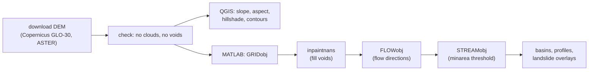

# LS20 · GIS and TopoToolbox Practicals

◀ [[LS19 Glacial and Aeolian Landforms]] · [[Landscapes and Geomorphology - Course Map|Course Map]]

<span class="scope-taught">taught · in syllabus</span> <span class="scope-extra-beyond">extra · beyond</span>

> [!syllabus] Syllabus map
> 🟢 **Taught** (practical sessions): *Introduction to QGIS and Basic Basin Analysis using DEM* (`Introduction_to_QGIS_aju.pptx`, 14 slides) and *Working with TopoToolbox on Matlab: a (very) brief introduction* ([[Topotoolbox_tut_shubhra.pdf]], 15 slides, by Shubhra). These put the theory of [[LS03 Digital Elevation Models and Terrain Analysis]] (slope, aspect, flow routing, drainage area) and [[LS04 Map Projections and Reference Surfaces]] into practice.
> 🔵 **Extra · beyond:** grid-size, area and stream-fraction numbers worked out from the object printouts on the slides (`scripts/ls_numbers.py`).

> [!key] After this chapter you can
> - name the main GIS packages and what a layered GIS model is, install QGIS plus the SAGA provider, and recognise the QGIS window parts,
> - derive slope, aspect, hillshade and contours from a DEM in QGIS (Raster terrain analysis / Raster extraction),
> - explain why map projection (distance, shape, area, direction) matters before measuring anything,
> - run the TopoToolbox chain `GRIDobj → inpaintnans → FLOWobj → STREAMobj`, choose `minarea`, and avoid the lat/lon-versus-UTM trap.

> [!intuition] The one-sentence story
> A DEM is just a matrix of heights with georeferencing; every terrain product (slope, flow direction, streams, basins) is a cheap computation on that matrix, so the practical skill is feeding it a *clean* DEM in the *right projection*.


*Concept map: from raw DEM to stream network.*

## 1. Introduction to QGIS (slides 1–6)
<span class="scope-taught">taught</span> *QGIS deck slides 1–6*

> [!example] 🖼 Slides 1–2: what GIS is, and the software landscape
> **Slide 1** is the title (*Introduction to QGIS and Basic Basin Analysis using DEM*). **Slide 2** defines **GIS (Geographic Information System)** as *a computer system used to collect, manage, analyse and visualise geographic data*, and shows the packages side by side: **GRASS GIS**, **QGIS**, **SAGA GIS** (the looping globe/arrow logo), **ERDAS Imagine** and **ArcGIS Desktop** (proprietary), plus a logo of a further package; and an exploded layer-cake picture of a GIS: separate thematic layers (*customers, streets, parcels, elevation, land usage*) stacked above the **real world**. The point: a GIS stores each theme as its own georeferenced layer, so that layers can be combined by position (overlay). QGIS, GRASS and SAGA are free and open source.

![[qgis_02_4.jpg|360]] ![[qgis_02_2.jpg|120]] ![[qgis_02_3.jpg|120]] ![[qgis_02_1.jpg|120]]

> [!example] 🖼 Slides 3–5: download, window layout, plugins
> **Slide 3**: download from qgis.org (the page offers a *Long Term Release* and an *Early Adopter Release*; choose the long-term one for stability). **Slide 4** labels the interface: **Browser Panel** (files and databases), **Layer Panel** (the stack of loaded layers, order = drawing order), **Menu Bar**, **Map View** (here a satellite basemap), **Tool Bar** and the **Processing Toolbox** (searchable list of algorithms: Raster analysis, Raster terrain analysis, Raster tools, Vector tools…). **Slide 5**: the *Plugins* manager (Manage and Install Plugins) with the **Processing** core plugin highlighted (*Spatial data processing framework for QGIS*).
> **Slide 6** ("We need SAGA") gives the GitHub address of the *qgis-processing-saga-nextgen* plugin: SAGA algorithms (e.g. channel network, watershed basins) are not bundled with current QGIS and must be added as a processing provider.

![[qgis_03_1.jpg|320]] ![[qgis_04_1.jpg|320]] ![[qgis_05_1.jpg|320]]

## 2. DEM and its derivatives in QGIS (slides 7–12)
<span class="scope-taught">taught</span> *QGIS deck slides 7–12; theory in [[LS03 Digital Elevation Models and Terrain Analysis]]*

![[qgis_07_1.jpg|420]]

> [!example] 🖼 Slide 7: what a DEM looks like
> A colour-ramped DEM of a rugged mountain area (Wikimedia Commons): elevation in metres (WGS 84 datum) from **≈4000 m (purple)** through blue, green, yellow to **≈7200 m (red)** at the high peak, with hillshading and a 4.0 km scale bar. Valleys appear as continuous blue-green branching corridors; the colour ramp is the simplest *visual* terrain product.

![[qgis_08_1.jpg|360]] ![[qgis_09_1.jpg|360]]

> [!example] 🖼 Slides 8–9: Raster → Analysis → Slope
> **Slide 8** shows the menu path **Raster → Analysis** (slope, aspect, hillshade, roughness, terrain ruggedness…) on a Western Ghats satellite basemap. **Slide 9** is the **Raster Analysis – Slope** dialog: *input layer* (the DEM, here `WG.tif` / `WG_rp`, the reprojected copy), *band number* (1), *ratio of vertical units to horizontal* (1.0, correct only when both are in metres: a DEM in degrees needs reprojection first), options *express slope as percent instead of degrees*, *compute edges*, and *use Zevenbergen–Thorne formula instead of Horn's* (the two finite-difference stencils: Horn uses all 8 neighbours with weights 1-2-1, Zevenbergen–Thorne the 4 nearest), then **Run**. The Layers panel shows the results already produced: **Contours, Aspect, Hillshade, Slope, WG_rp, WG.tif**.

> [!derivation] Horn's slope (the algorithm behind the dialog)
> With a 3×3 window $z_1\ldots z_9$ (rows from the top) and cell size $\Delta$: $\partial z/\partial x=[(z_3+2z_6+z_9)-(z_1+2z_4+z_7)]/(8\Delta)$, $\partial z/\partial y$ likewise; **slope** $=\arctan\sqrt{(\partial_xz)^2+(\partial_yz)^2}$, **aspect** $=\operatorname{atan2}(\partial_yz,-\partial_xz)$ (direction of steepest descent). This is the discrete version of the gradient in [[LS02 Mechanics and Mathematics Toolkit]].

![[qgis_10_1.jpg|320]] ![[qgis_11_1.jpg|320]] ![[qgis_12_1.jpg|320]]

> [!example] 🖼 Slides 10–12: Aspect, Hillshade, Contour
> **Slide 10** (Raster Analysis – **Aspect**, with the same band/edges options) and the hillshade dialog (illumination azimuth, altitude, vertical exaggeration; the shaded relief you see on slide 7). **Slide 11**: the **Raster → Extraction** menu, which holds *Clipper* and *Contour*. **Slide 12**: **Raster Extraction – Contour**: *interval between contour lines* (here **10 m**), *attribute name* (**ELEV**, so that each line carries its height), *offset from zero*, optional *produce 3D vector*, output *Contours* (saved to a temporary file unless a path is given). Choose the interval to the relief: 10 m for a hilly 30 m DEM, 100 m for a mountain range.

## 3. Map projections (slide 13)
<span class="scope-taught">taught</span> *QGIS deck slide 13; theory in [[LS04 Map Projections and Reference Surfaces]]*

![[qgis_13_1.jpg|320]] ![[qgis_13_2.jpg|320]] ![[qgis_13_3.jpg|320]]

> [!example] 🖼 Slide 13: why projection matters
> Four properties that a flat map can preserve: **distance, shape, area, direction**: *no projection preserves all four*. Pictures: a globe next to a **football** (a sphere cannot be flattened without tearing: the football's flat panels, then the *flattened strip of pentagons and hexagons* show the distortions unavoidable in the strip) and the **map-projection gallery**: *Mercator* (conformal: preserves shape and direction locally, hugely inflates area at high latitude), *Gall–Peters* (equal-area), *Goode–Homolosine* (interrupted, equal-area), *Waterman butterfly*, *Albers* (equal-area conic) and *Robinson* (compromise). **Rule for the practical:** measure slope, areas and distances in a **projected CRS in metres (e.g. UTM)**, not in degrees (see §5).
> **Slide 14** (last) carries no text or image content (blank).

## 4. TopoToolbox in MATLAB (slides 1–11)
<span class="scope-taught">taught</span> *TopoToolbox deck slides 1–11*

![[tt_002.jpg|320]] ![[tt_003.jpg|320]] ![[tt_004.jpg|320]] ![[tt_005.jpg|320]]

> [!example] 🖼 Slides 1–5: requirements and getting a DEM
> **Slide 1** title (Shubhra). **Slide 2**, *everything you need*: a DEM in **`.tif`** (not `.tiff`: the extension matters to the reader), **MATLAB 2023b or newer**, and time. Required toolboxes: **Image Processing** and **Mapping** (very important, in red), **Optimization**, **Parallel Computing**, Statistics and Machine Learning (maybe not necessary). **Slide 3**: the author's DEM source: **Copernicus GLO-30 (OpenTopography)**, a 30 m global DEM from ESA/Airbus (the screenshot is the OpenTopography dataset page). **Slide 4**: alternative: **ASTER DEM V003/V004** from NASA EarthData, with selectable temporal and spatial range. **Slide 5**, *beware of shoddy DEMs*: always check the preview: the example (a false-colour ASTER scene with white cloud blobs on a magenta land surface) should not be used: **no cloud cover, no obvious gaps/voids** (voids and clouds give NaN or false heights and break flow routing).

![[tt_006.jpg|240]] ![[tt_007.jpg|320]] ![[tt_008.jpg|240]]

> [!example] 🖼 Slides 6–8: first steps with a grid
> **Slide 6**: reading list: the *topotoolbox.wordpress.com* blog (the author's main teacher) and MATLAB's own `help <function>`. **Slide 7**: put the DEM in the same folder as the script, then
> ```matlab
> DEM = GRIDobj("region 2 f.tif");   % Step 1: rasterise (read) the DEM into a GRIDobj
> DEM = inpaintnans(DEM);            % Step 2: fill missing values from surrounding cells
> ```
> **Slide 8**: what the variable is: a **GRIDobj** with properties `Z` (matrix of elevations, here **3038×1459 single**), `cellsize` **2.7778×10⁻⁴** (degrees, i.e. 1 arc-second), `wf` (world file), `size`, `name`, `zunit`, `xyunit`, `georef` (a *GeographicCellsReference*: lat/lon). **`DEM.Z` stores the value of each grid cell (elevation)**; the picture is a hillshade of the region (axes in degrees, 73–74° E, 18–19° N).

> [!derivation] 🔵 Extra: what is that grid in metres? (computed)
> $2.7778\times10^{-4\circ}=1''$. One degree of latitude is 111.2 km, so $\Delta y=\mathbf{30.9}$ m; one degree of longitude is $111.3\cos\phi$ km, so at $\phi=18.5^\circ$ N, $\Delta x=\mathbf{29.3}$ m: **the cells are not square on the ground** in a lat/lon grid. The grid 3038 rows × 1459 columns spans $0.844^\circ\times0.405^\circ\approx\mathbf{94\times43}$ km. TopoToolbox handles this by computing distances from the georeference, but area and slope are cleaner in UTM (§5).

![[tt_009.jpg|320]] ![[tt_010.jpg|320]] ![[tt_011.jpg|320]]

> [!example] 🖼 Slides 9–11: FLOWobj and STREAMobj
> **Slide 9**: **FLOWobj** *derives and stores the flow direction of each cell*. For stream networks only a **single-direction** (D8) routing is needed. The call is `FD = FLOWobj(DEM,'preprocess','carve');` (`'carve'` cuts through pits/sinks rather than filling them, preserving the topography). The printout shows `ix` and `ixc` of **4,431,886** entries each: *for every cell, the linear index of the donor (`ix`) and of its receiver (`ixc`)*; values are stored as **indices**, accessible as `FD.ix`. **Slide 10**: **STREAMobj** *connects flow directions to form and store stream networks*: `S = STREAMobj(FD,'minarea',50);` the printout shows **408,148** stream cells with coordinates `x`, `y` and the along-stream `distance`. **Slide 11**: **`minarea`** *defines the upslope threshold area (in cells) that initiates a stream: smaller `minarea` ⇒ more, smaller streams, and vice versa.* The code shown:
> ```matlab
> FD = FLOWobj(DEM);
> ix = ceil(prod(DEM.size)/2);                 % a single cell in the middle
> S  = STREAMobj(FD,channelheads = ix);        % streams from that channel head only
> imageschs(DEM); hold on; plot(S,'w'); hold off
> ```
> The picture is a DEM (Koyna region, colour = height 200–1400 m, Sahyadri escarpment on the west side) with the white stream line starting at the middle cell. *"How is a channel stored in MATLAB?"* as a list of cell indices ordered downstream plus coordinates and distances, not as a polyline.

> [!derivation] 🔵 Extra: how much of the grid is stream? (computed)
> From the printouts: stream cells/all cells $=408{,}148/4{,}431{,}886=\mathbf{9.2\,\%}$ for `minarea` = 50 cells. A cell's drainage area is $\approx 30.9\times29.3\approx900$ m²; 50 cells ≈ **0.045 km²**: *any cell draining at least 4.5 ha becomes a stream*, a very dense network. Raising `minarea` to 1000 cells (as in the code of slide 14: **0.9 km²**) removes the small hillslope-scale channels. The threshold is a modelling choice tied to the area at which channels begin (the slope–area break of [[LS16 Fluvial Landscapes]]), not a physical constant.

## 5. Cell referencing and the worked example (slides 12–15)
<span class="scope-taught">taught</span> *TopoToolbox deck slides 12–15*

![[tt_012.jpg|320]] ![[tt_013.jpg|320]] ![[tt_014.jpg|320]]

> [!example] 🖼 Slides 12–14: lat/lon versus UTM, and example code
> **Slide 12**, *cell referencing*: depending on the source, a DEM is in **lat/lon** (the 3038×1459 grid above: `cellsize` 2.7778×10⁻⁴, `GeographicCellsReference`) or **UTM** (the Koyna DEM: **2376×2496 single, `cellsize` 30**, `MapCellsReference`), the latter in metres: a **71 × 75 km** area at 30 m. **Slide 13**: the same region plotted in both: *lat/lon projection*: a straight rectangle with latitude 18.2–18.9° N, longitude 73.3–73.6° E; *UTM projection*: the same DEM as a **tilted square** in a metric frame (easting ×10⁵ m, northing ×10⁶ m), with no-data (blue) corners, because the UTM grid axes are not aligned to meridians (grid convergence) and the reprojected raster is padded. **Slide 14** gives the worked example (Koyna, landslide overlay):
> ```matlab
> DEM_koyna = GRIDobj("Koyna19_DEM.tif");
> DEM_koyna = inpaintnans(DEM_koyna);
> FD_koyna  = FLOWobj(DEM_koyna,"preprocess","carve");
> S_koyna   = STREAMobj(FD_koyna,"minarea",1000);
> landslides = shaperead("koyna_landslides1.shp");
>
> demCRS = projcrs(32643);                     % the DEM's projected CRS (UTM zone 43N)
> figure; imageschs(DEM_koyna); hold on; plot(S_koyna,'w');
> for i = 1:numel(landslides)
>     lon = landslides(i).X;  lat = landslides(i).Y;
>     [mapX,mapY] = projfwd(demCRS,lat,lon);   % lat/lon -> DEM map coordinates
>     fill(mapX,mapY,'r','FaceAlpha',0.4,'EdgeColor','k','LineWidth',1.5);
> end
> hold off
> ```
> The recipe: load, fill voids, route flow (carve), extract streams (`minarea` 1000), read a landslide shapefile, **project its lat/lon polygons into the DEM's UTM zone with `projfwd`** (EPSG:32643 = WGS 84 / UTM 43 N, correct for 72–78° E), and overlay them as semi-transparent red polygons on the hillshade with the streams. **Slide 15**: "Thanks".

> [!pitfall] The classic mistakes (all on the slides)
> 1. `.tiff` instead of `.tif`: the reader will not find the file.
> 2. A DEM with clouds or voids (ASTER previews): `inpaintnans` fixes small gaps, not big ones.
> 3. Mixing coordinate systems: plotting lat/lon landslide polygons on a UTM map puts them at the wrong place (x ≈ 73, y ≈ 18 in a 10⁵–10⁶ m frame); always `projfwd` first.
> 4. Taking slope with ratio 1 when the DEM is in degrees: reproject to metres first.

## Map of this chapter
> [!connection] How LS20 connects
> **Builds on:** [[LS03 Digital Elevation Models and Terrain Analysis]] (D8 routing, slope, drainage area), [[LS04 Map Projections and Reference Surfaces]] (UTM, conformal/equal-area). **Used by:** [[LS16 Fluvial Landscapes]] (channel profiles, slope–area), [[LS13 Landslides]] (the Koyna landslide overlay), [[LS18 Deccan Traps Terrain]] (the Koyna/Western Ghats DEMs are on the Deccan basalt).

<!-- zettel:start (generated by scripts/sort_zettel.py; do not edit between the markers) -->
## Zettel notes

> [!abstract]- Zettel notes filed under this chapter (4): the other tool's concept notes from the lectures, unreviewed
> [[zettel/flowobj|FLOWobj]] · [[zettel/gridobj|GRIDobj]] · [[zettel/inpaintnans|inpaintnans]] · [[zettel/streamobj|STREAMobj]]
<!-- zettel:end -->

## Provenance
> [!provenance]- Source map for this chapter
> | Topic | Source | Scope |
> |---|---|---|
> | QGIS slides 1–14 (images extracted from the .pptx: `Assets/crops/ls/qgis_*.jpg`) | `Introduction_to_QGIS_aju.pptx` | taught |
> | TopoToolbox slides 1–15 | [[Topotoolbox_tut_shubhra.pdf]] (text layer + images `tt_*.jpg`) | taught |
> | Horn's slope formula; grid-size, area and stream-fraction numbers | my derivation from the slide printouts, `scripts/ls_numbers.py` | extra/beyond |
>
> **Notes.** (1) The QGIS deck's dialog screenshots are low resolution; only slides 9 and 12 were read at full size, the others (aspect, hillshade, SAGA) are described from their menu structure. (2) The description of Horn vs Zevenbergen–Thorne and the hillshade options come from QGIS's standard behaviour, not from the slides. (3) The cell-area figures assume WGS 84 at 18.5° N.
