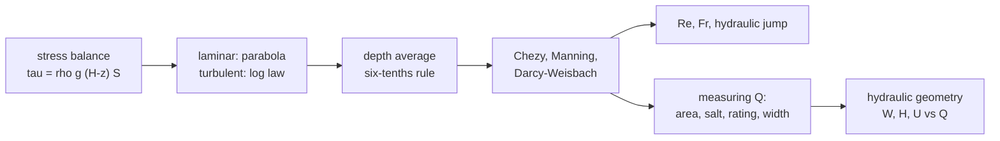

# LS21 · River Hydraulics and Hydraulic Geometry

◀ [[LS16 Fluvial Landscapes]] (reading order; LS17–LS20 are the aeolian, Deccan, glacial–aeolian and GIS chapters) · [[Landscapes and Geomorphology - Course Map|Course Map]] · next: [[LS22 Floods Planform and River Profiles]]

extra · book extra · beyond

> [!syllabus] Syllabus map: what is in the syllabus and what is extra in this chapter
> **No lecture source yet.** The fluvial lectures have not been taught, so there are no slides to label against; LS16 holds what the pre-midsem deck and the AI-written notes say about rivers (stream power, knickpoints, Shields). This chapter and LS22–LS24 follow **Anderson and Anderson, *Geomorphology: the Mechanics and Chemistry of Landscapes*, Chapters 12–14** in order. When the post-midsem fluvial slides arrive, the matching boxes should be re-labelled 🟢.
> 🟡 **Extra · book** (A&A; **PDF page = printed page + 18**): §1–§5 the mechanics of turbulent open-channel flow, the law of the wall, the six-tenths rule and the Chézy–Manning–Darcy–Weisbach equations ([[geomorphology-the-mechanics-and-chemistry-of-landscapes-9780521519786-0521519780_compress.pdf#page=400|printed pp.382–391]]); §6 the Reynolds and Froude numbers from the Navier–Stokes equation (appendix, [[geomorphology-the-mechanics-and-chemistry-of-landscapes-9780521519786-0521519780_compress.pdf#page=432|printed pp.414–419]]); §7 discharge measurement, rating curves and the satellite-width method ([[geomorphology-the-mechanics-and-chemistry-of-landscapes-9780521519786-0521519780_compress.pdf#page=409|printed pp.391–394]]); §8 hydraulic geometry ([[geomorphology-the-mechanics-and-chemistry-of-landscapes-9780521519786-0521519780_compress.pdf#page=413|printed pp.395–396]]).
> 🔵 **Extra · beyond** (my additions; all numbers in `scripts/ls_rivers_numbers.py`, section LS21, each checked by a second route): the numerical check of the six-tenths rule, the log-law reproduction of Manning's $H^{1/6}$ (§5.3), the Strickler comparison, the momentum derivation of the hydraulic jump and the numbers of §6, the salt-dilution derivation, the threshold-depth width–discharge argument for braided rivers (§7.3), and the three worked examples and ten problems.

> [!key] After this chapter you can
> - say why river flow is turbulent ($Re\sim10^{6}$) and derive the **laminar** parabola and the **turbulent log profile** from the same stress balance,
> - state what $u_*$ and $z_0$ are, and use $U(z)=\frac{u_*}{\kappa}\ln(z/z_0)$ and $u_*=\sqrt{gHS}$,
> - prove the **six-tenths rule** ($z_m=H/e$) and the surface-to-mean velocity ratio,
> - move between **Chézy, Manning and Darcy–Weisbach**, show that the log law reproduces Manning's $H^{2/3}$ at $H/z_0=e^{7}$, and say why $f$ falls with depth,
> - classify a flow by $Re$ and $Fr$, and compute the **hydraulic jump** conjugate depth and energy loss,
> - measure discharge by velocity–area, salt dilution, rating curve, or (braided rivers) **satellite width**,
> - write the **hydraulic geometry** laws, apply the sum rule $b+f+m=1$, and explain why rivers adjust width and depth far more than speed.

> [!intuition] The one-sentence story
> A river is a thin turbulent layer of water driven by gravity down a slope and resisted by its bed; the same two numbers, the **shear velocity** $u_*=\sqrt{gHS}$ and the **roughness length** $z_0$, give its velocity profile, its mean speed, its friction coefficients and its discharge, and the channel adjusts its width and depth, but hardly its speed, to carry more water.

*Concept map: each box is a section.*

## 1. Why the physics of a river is worth deriving
Hillslopes deliver water and sediment to channels, and the channels, the "gutters of the continents" (Leopold et al. 1964), carry it to the sea. A&A (printed p.381) stress that the thin threads of the rivers *set the base level of the hillslopes*, so a landscape model needs the river's physics: how fast the water moves, how much stress it exerts on the bed (the input to every incision and transport law of [[LS23 Bedrock Channels and River Incision]] and [[LS24 Sediment Transport Mechanics]]), and how the channel's shape responds to discharge.

Two kinds of channel exist (A&A p.382). **Alluvial** channels are cut in sediment that the river itself deposited and so are *self-formed*: the river sets its own width, depth, slope and floodplain. **Bedrock** channels are cut in rock (LS23). This chapter is about the flow in either; LS22 is about the alluvial forms that result.

The strategy is the one A&A use throughout the book (printed p.383): **start from the stress profile, relate stress to strain rate through a rheology, integrate the strain rate to get velocity.** For water the rheology is the only difficult step, because in a river the effective viscosity is made by the flow itself.

> [!key] Definition: open-channel flow, steady and uniform
> Flow in a channel with a free surface, **steady** ($\partial_t=0$) and **uniform** ($\partial_x=\partial_y=0$), driven only by the downslope component of gravity $g_x=g\sin\theta\approx gS$ with no pressure-gradient term (the depth $H$ is constant along the reach), and with no flow through the bed. These are A&A's assumptions (Box 12.1, printed p.383); the $x$-momentum equation then reduces to a balance between gravity and the vertical divergence of shear stress.

## 2. Laminar flow: the parabola
With the assumptions above, the $x$-component of the Navier–Stokes equation (§6.1) becomes $0=g\sin\theta+\nu\,\partial_z^2U$.

> [!derivation] 🟡 Extra · book: the laminar profile and the stress profile (A&A Box 12.1)
> Integrate once and apply **zero stress at the free surface**, $\partial_zU(H)=0$:
>
> $$\partial_zU=\frac{g\sin\theta}{\nu}(H-z).$$
>
> Integrate again with the **no-slip** condition $U(0)=0$:
>
> $$U(z)=\frac{g\sin\theta}{\nu}\Big(Hz-\frac{z^2}{2}\Big),\qquad \langle U\rangle=\frac1H\int_0^HU\,dz=\frac{g\sin\theta\,H^2}{3\nu}.$$
>
> The stress, from the same balance with the rheology left unspecified, is $\partial_z\tau_{zx}=-\rho g\sin\theta$, so with $\tau(H)=0$
>
> $$\boxed{\tau_{zx}(z)=\rho g\sin\theta\,(H-z)},\qquad \boxed{\tau_b=\rho gH\sin\theta\approx\rho gHS}.$$
>
> **The stress profile does not depend on the rheology**: it is a statement of force balance (the weight of the water above height $z$, resolved down the slope, is carried by the stress at $z$). Only the relation between $\tau$ and $\partial_zU$ differs between laminar and turbulent flow.

> [!example] 🧮 Worked example: when is a sheet of water laminar?
> A sheet $H=1$ mm deep on a slope $S=0.01$ with $\nu=10^{-6}$ m²/s: $\langle U\rangle=gSH^2/3\nu=3.3$ cm/s and $Re=H\langle U\rangle/\nu=33$: laminar (the critical value for open channels is $Re\approx2000$, A&A p.382). Apply the same formula to a river, $H=2$ m, $S=10^{-3}$: it predicts $\langle U\rangle=1.3\times10^{4}$ m/s. That is absurd, and it is the point: the *real* flow is $\sim2$ m/s because turbulence mixes momentum $\sim10^{4}$ times faster than molecular viscosity (§3).

## 3. Turbulent flow: eddy viscosity and the law of the wall
At $Re\gtrsim2000$ momentum is carried by macroscopic eddies, not molecular collisions (A&A p.382). Time-averaging the equations leaves the same form, with the molecular stress $\rho\nu\,\partial_zU$ replaced by a **Reynolds stress** that is modelled as an **eddy viscosity** $\nu_t$ times the mean strain rate:

$$\tau=\rho\,\nu_t\,\frac{dU}{dz}.$$

> [!derivation] 🟡 Extra · book: the law of the wall
> **Near the bed** the stress is close to its bed value $\tau_b$ (the stress falls linearly with height, but over the lowest few per cent of the depth it has barely changed). Define the **shear velocity** $u_*=\sqrt{\tau_b/\rho}=\sqrt{gHS}$. Eddies near a wall cannot be larger than their distance from it, so the eddy viscosity must grow linearly with height (Prandtl's mixing-length argument):
>
> $$\nu_t=\kappa u_*z,\qquad \kappa\approx0.4\ \ (\text{von Kármán's constant}).$$
>
> Then $\tau_b=\rho\,\kappa u_*z\,dU/dz$ gives $\rho u_*^2=\rho\kappa u_*z\,dU/dz$, i.e.
>
> $$\frac{dU}{dz}=\frac{u_*}{\kappa z}\quad\Longrightarrow\quad\boxed{U(z)=\frac{u_*}{\kappa}\ln\frac{z}{z_0}}\qquad(z\gtrsim z_0).$$
>
> The constant of integration is written as $z_0$, the height at which the *extrapolated* profile reaches zero ("$z$-nought", Nikuradse's roughness). Two facts follow at once. The strain rate falls as $1/z$, **hyperbolically** rather than linearly as in the laminar case, because the eddies get more efficient with height; and the profile is **straight on a plot of $U$ against $\ln z$** with slope $u_*/\kappa$ and intercept $z_0$ (figure A, B).

> [!pitfall] Why not $U=0$ at $z=0$?
> $\ln0$ is undefined, and physically the turbulent closure fails within a viscous sublayer of a fraction of a millimetre to a few millimetres at the bed (A&A p.385). $z_0$ is a **fitting length**, not the height of anything; it is set by the roughness of the bed, below.

**What sets $z_0$?** Nikuradse glued sand to the walls of pipes and found $z_0=D/30$ for sand-grain diameter $D$. Natural beds behave similarly with the grain size replaced by a high percentile ($D_{84}$, Whiting and Dietrich 1990; the numerical factor printed in A&A p.387 is lost in the text layer, `[!verify]`). Bedforms and vegetation add roughness. **Higher $u_*$** (deeper or steeper) raises the speed at all heights; **higher $z_0$** lowers it (figure B).

> [!key] Numbers for a gravel-bed river
> $H=2$ m, $S=10^{-3}$: $u_*=\sqrt{gHS}=0.14$ m/s. A bed of 30 mm gravel has $z_0=D/30=1$ mm, $H/z_0=2000$, so the depth-mean speed (§4) is $\langle U\rangle=\frac{u_*}{\kappa}[\ln(H/z_0)-1]=2.31$ m/s. The depth-mean eddy viscosity is $\kappa u_*H/6=0.019$ m²/s, $1.9\times10^{4}$ times the molecular value, and $Re=H\langle U\rangle/\nu=4.6\times10^{6}$.

![[fig_ls21_flow.png]]
*Figure LS21.1. A: laminar parabola and turbulent log profiles, normalised to the same mean velocity; the turbulent profile is much fuller (steeper near the bed, nearly flat above) and the mean is found at $z_m=H/e$ in both. B: the law of the wall, straight on a log axis; slope $u_*/\kappa$, intercept $z_0$. C: Darcy–Weisbach $f$ and Manning $n$ from the log law ($z_0=D/30$, $H=1$ m).*

## 4. The depth-averaged velocity and the six-tenths rule
> [!derivation] 🟡 Extra · book (numerically checked 🔵): mean velocity and the six-tenths rule
> Average the log law from $z_0$ to $H$ ($H\gg z_0$) using $\int\ln z\,dz=z\ln z-z$:
>
> $$\langle U\rangle=\frac1H\int_{z_0}^HU\,dz=\frac{u_*}{\kappa}\Big[\ln\frac H{z_0}-1+\frac{z_0}H\Big]\approx\frac{u_*}{\kappa}\Big[\ln\frac H{z_0}-1\Big].$$
>
> At what height $z_m$ does the *local* velocity equal the mean? Set $\frac{u_*}{\kappa}\ln\frac{z_m}{z_0}=\frac{u_*}{\kappa}\big[\ln\frac H{z_0}-1\big]$; $u_*/\kappa$ and $z_0$ cancel:
>
> $$\boxed{z_m=\frac He\approx0.37H}\qquad\text{(six-tenths of the way down from the surface).}$$
>
> This is why a single current-meter reading is taken at $0.4H$ above the bed (A&A p.393, the USGS protocol), and why the answer **does not depend on the bed roughness or the slope**. The surface velocity exceeds the mean by $U_s/\langle U\rangle=\ln(H/z_0)/[\ln(H/z_0)-1]$.

| $H/z_0$ | $z_m/H$ (numerical) | $U_{surface}/\langle U\rangle$ |
|---|---|---|
| $10^{2}$ | 0.385 | 1.26 |
| $10^{3}$ | 0.370 | 1.17 |
| $10^{4}$ | 0.368 | 1.12 |

The table is computed by quadrature in `scripts/ls_rivers_numbers.py`, which also confirms the limit $1/e=0.3679$. *Reading it:* a float on the surface of a gravel river ($H/z_0\sim10^{3}$) moves $\sim17\%$ faster than the depth-mean flow, so the mean is $\sim0.85$ of the float speed. For the laminar parabola the mean is found slightly *above* $0.4H$ (it is $0.42H$), for the turbulent log law slightly *below*; this is the comparison of A&A figure 12.5.

> [!derivation] 🔵 Extra · beyond: a parabolic eddy viscosity gives *exactly* the log law over the whole depth
> The log law was derived for the near-bed region only. Suppose instead $\nu_t=\kappa u_*z(1-z/H)$, vanishing at the bed *and* the surface (the standard open-channel closure). The stress is $\tau=\tau_b(1-z/H)$, so $\tau_b(1-z/H)=\rho\kappa u_*z(1-z/H)\,dU/dz$: the factor $(1-z/H)$ **cancels** and $dU/dz=u_*/(\kappa z)$ again. The log law is therefore exact for this closure at *all* heights, which is why extending it to the surface (as A&A do for the integral above) is a good approximation. A&A's Box 12.2 (printed p.388) instead patches a constant interior eddy viscosity $\nu_t=(\kappa/6.27)u_*H$ (which gives a parabolic *velocity-defect* profile) onto the near-bed log law; the two differ only slightly in the mean and the discharge.

## 5. Mean-velocity formulas: Chézy, Manning, Darcy–Weisbach
Hydrologists want $\langle U\rangle$ over the whole cross-section from quantities that can be surveyed. Three formulas dominate (A&A pp.389–391). Let $R_h=A/P$ be the **hydraulic radius** (flow area over wetted perimeter; for $W\gg H$, $R_h\approx H$; for $W/H=10$, $R_h=0.83H$).

$$\text{Chézy:}\ \langle U\rangle=C\sqrt{R_hS},\qquad\text{Manning:}\ \langle U\rangle=\frac1nR_h^{2/3}S^{1/2},\qquad\text{Darcy–Weisbach:}\ \langle U\rangle=\sqrt{\frac{8gR_hS}f}.$$

($n$ in SI units; the factor $a=1.486$ replaces $1$ if feet are used.) Manning's $n$ runs from $0.01$ (smooth flumes) through $0.02$–$0.08$ for natural channels to $>0.1$ in steep mountain streams.

### 5.1 They are the same law with different bookkeeping
> [!derivation] 🟡 Extra · book: relating $C$, $n$ and $f$
> Dimensional analysis alone says $\langle U\rangle\propto\sqrt{gR_hS}=u_*$ (for uniform flow, $u_*=\sqrt{gR_hS}$ exactly). Darcy–Weisbach is this with a dimensionless coefficient, $\langle U\rangle/u_*=\sqrt{8/f}$, so
>
> $$f=8\Big(\frac{u_*}{\langle U\rangle}\Big)^2,\qquad C=\sqrt{\frac{8g}{f}},\qquad n=\frac{R_h^{1/6}}{C}.$$
>
> The last follows by equating Chézy and Manning. **Chézy and Manning are dimensionally inhomogeneous** ($C$ has units m$^{1/2}$ s$^{-1}$ and $n$ has units s m$^{-1/3}$) because they hide $g$ inside the coefficient: a calibration made on Earth does not transfer to Mars or Titan, whereas $f$ is dimensionless and does.

### 5.2 The log law fixes how $f$ must depend on depth
> [!derivation] 🟡 Extra · book: friction factor from the law of the wall
> For a wide channel, equate the depth average of §4 with Darcy–Weisbach:
>
> $$\sqrt{\frac8f}=\frac1\kappa\Big[\ln\frac H{z_0}-1\Big]\quad\Longrightarrow\quad f=\frac{8\kappa^2}{[\ln(H/z_0)-1]^2}.$$
>
> So $f$ is **not a constant**: it falls as the flow deepens over a given roughness (figure C), and what matters is the *relative* roughness $H/z_0$. Rough shallow flow ($H/z_0=100$) has $f=0.099$; deep flow over the same bed ($H/z_0=10^{4}$) has $f=0.019$.

### 5.3 Manning's $H^{1/6}$ is the log law, locally
Manning's equation implies $\langle U\rangle/u_*=H^{1/6}/(n\sqrt g)$, an *extra* dependence $H^{1/6}$ on depth on top of $u_*\propto H^{1/2}$ (so $\langle U\rangle\propto H^{2/3}$ at fixed slope). A&A (p.390) observe that the logarithm in the log law "looks very much like $H^{1/6}$" over a range of depths. The comparison can be made exact:

> [!derivation] 🔵 Extra · beyond (checked numerically): where the log law equals $H^{2/3}$
> At fixed slope $u_*\propto H^{1/2}$, so from $\langle U\rangle=\frac{u_*}{\kappa}[\ln(H/z_0)-1]$
>
> $$\frac{d\ln\langle U\rangle}{d\ln H}=\frac12+\frac1{\ln(H/z_0)-1}.$$
>
> This equals Manning's $\frac23$ exactly when $\ln(H/z_0)-1=6$, i.e. $H/z_0=e^{7}=1097$. For a gravel bed of 27 mm ($z_0=0.9$ mm) that is $H=1$ m, which is typical. The exponent is $0.78$ at $H/z_0=100$ and $0.62$ at $10^{4}$. **So Manning's law is the law of the wall linearised about "$H/z_0\approx1000$"**, which is why a single $n$ works for natural rivers within $\sim20\%$ over the range they span.

| $H$ (m) | $D$ (mm) | $H/z_0$ | $f$ | $C$ | $n$ (log law) | $n$ (Strickler $D^{1/6}/21.1$) | $\langle U\rangle$ (m/s) |
|---|---|---|---|---|---|---|---|
| 1.0 | 27 | 1111 | 0.035 | 47 | 0.021 | 0.026 | 1.49 |
| 1.0 | 100 | 300 | 0.058 | 37 | 0.027 | 0.032 | 1.16 |
| 3.0 | 100 | 900 | 0.038 | 45 | 0.026 | 0.032 | 2.49 |
| 0.3 | 100 | 90 | 0.105 | 27 | 0.030 | 0.032 | 0.47 |

($S=10^{-3}$, $z_0=D/30$. The empirical **Strickler** relation $n\approx D^{1/6}/21.1$ with $D$ in metres is recalled, not from A&A: `[verify]`.) The two columns of $n$ agree to 25 % or better, and *both* show the same thing the log law predicts: $n$ is nearly independent of depth and grows weakly with grain size.

## 6. Dimensionless numbers and the hydraulic jump
### 6.1 Where Re and Fr come from
> [!derivation] 🟡 Extra · book: non-dimensionalising Navier–Stokes (A&A appendix, printed pp.414–419)
> Take $\rho(\partial_t\mathbf u+\mathbf u\cdot\nabla\mathbf u)=-\nabla p+\mu\nabla^2\mathbf u+\rho\mathbf g$ and scale lengths by the depth $H$, velocities by $\langle U\rangle$, pressure by $\rho\langle U\rangle^2$. The inertial term is $O(1)$; the viscous term becomes $\frac{1}{Re}\nabla^2\mathbf u$ with $Re=H\langle U\rangle/\nu$; the gravity term becomes $\frac1{Fr^2}\hat{\mathbf g}$ with $Fr=\langle U\rangle/\sqrt{gH}$. Flows with equal $Re$ and $Fr$ are dynamically similar (the basis of flume modelling).

$Re$ = inertia/viscosity: rivers are almost always turbulent ($Re>2000$; typically $10^{5}$–$10^{7}$). $Fr$ = flow speed over the speed $\sqrt{gH}$ of a small surface gravity wave in water of depth $H$ (shallow-water waves, [[Dispersion Relation]]): **subcritical** $Fr<1$ (disturbances can travel upstream: the backwater effect), **supercritical** $Fr>1$ (they cannot).

| flow | $H$ | $S$ | bed | $\langle U\rangle$ | $Fr$ | regime |
|---|---|---|---|---|---|---|
| lowland gravel river | 2 m | $10^{-3}$ | 30 mm | 2.31 m/s | 0.52 | subcritical |
| mountain step–pool | 0.5 m | $0.05$ | 300 mm | 3.61 m/s | 1.63 | supercritical |
| braided gravel river (§7.3) | 0.45 m | $0.005$ | 30 mm | 1.88 m/s | 0.90 | nearly critical |

*Backwater length.* A downstream control (a lake or the sea) is felt upstream over a distance of order $H/S$: 0.2 km for the gravel stream, **160 km** for the lower Mississippi ($H=15$ m, $S=9.5\times10^{-5}$) and $\sim2000$ km for the Amazon ($H=40$ m, $S=2\times10^{-5}$) by this crude estimate. The slope of the huge rivers is so small that they feel the sea, and sea-level change, over hundreds of kilometres (LS22).

### 6.2 The hydraulic jump
> [!derivation] 🔵 Extra · beyond (conservation checked numerically): conjugate depths
> Where supercritical flow of depth $H_1$ meets a subcritical downstream state it **jumps**, becoming deeper and slower in a short turbulent roller. Mass: $U_1H_1=U_2H_2$. Momentum per unit width (hydrostatic pressure force plus momentum flux is conserved across the jump; the energy is *not*, it is dissipated):
>
> $$\tfrac12gH_1^2+U_1^2H_1=\tfrac12gH_2^2+U_2^2H_2.$$
>
> Eliminating $U_2$ and writing $Fr_1=U_1/\sqrt{gH_1}$ gives a quadratic in $H_2/H_1$ with the physical root
>
> $$\boxed{\frac{H_2}{H_1}=\frac12\Big(\sqrt{1+8Fr_1^2}-1\Big)},\qquad \Delta E=\frac{(H_2-H_1)^3}{4H_1H_2}.$$

| $Fr_1$ | $H_2/H_1$ | head lost |
|---|---|---|
| 1.63 (the step–pool above) | 1.86 | 4 % |
| 2 | 2.37 | 9 % |
| 3 | 3.77 | 26 % |
| 5 | 6.59 | 49 % |

*Reading it:* a mountain stream that goes supercritical over a step and returns to subcritical in the pool dissipates $\sim4$–$10\%$ of its head each time; a dam spillway ($Fr_1\gtrsim5$) loses about half, which is why stilling basins exist. Energy dissipation in step–pool sequences is part of why mountain streams keep their speed low despite steep slopes.

![[fig_ls21_hydgeo.png]]
*Figure LS21.2. A: downstream (solid) and at-a-station (dashed) hydraulic geometry for $a=3,\ c=0.25,\ k=1$ (SI) at $Q=1$ m³/s. B: where extra discharge goes, as barycentric coordinates in $(b,f,m)$: a river on the downstream trend sits near the "width and depth" edge, a braided river near the width vertex, a laminar sheet on the depth–velocity edge. C: sequent-depth ratio and energy loss against the upstream Froude number.*

## 7. Measuring discharge
Discharge $Q=\int u\,dA$ is hard and sometimes dangerous to measure; **stage** (water-surface elevation) is easy. The routine is to measure $Q$ directly at a range of stages and build a **rating curve** $Q(H)$ (A&A pp.391–394).

### 7.1 Velocity–area method (USGS)
Divide the cross-section into $\geq20$ verticals so that no strip carries more than $\sim5\%$ of $Q$; at each, measure depth $H_i$ and a current-meter speed at $0.4H_i$ above the bed (the six-tenths rule makes that the mean) averaged over $\geq40$ s to smooth the eddies; then $Q=\sum_iW_iH_i\langle U_i\rangle$. Instruments: propeller meters, laser or acoustic Doppler.

### 7.2 Salt dilution
> [!derivation] 🟡 Extra · book: conservation of tracer in a reach
> Inject a known mass $M$ of NaCl upstream in a reach with no tributary inflow (and far enough, $\gtrsim20$ stream widths, for it to mix across the section). All the salt must leave: $M=\int_0^T Q\,[C_1(t)-C_0]\,dt$ with $C_1$ the concentration measured downstream and $C_0$ the background. For constant $Q$,
>
> $$\boxed{Q=\frac{M}{\int_0^T[C_1(t)-C_0]\,dt}}.$$
>
> One usually records *conductivity*, converted to concentration by a calibration factor $a$ ($C=a\,\sigma$). A&A print $a=2140$ (their units are lost in the text layer, `[!verify]`); a rule of thumb is $\sim0.5$ g/L of NaCl per mS/cm (recalled, calibrate on site).

> [!example] 🧮 Worked example: a salt gauging
> Inject $M=1$ kg into a stream with $Q=1.5$ m³/s; the pulse is roughly Gaussian with $\sigma_t=60$ s. The peak concentration rise is $M/(Q\sigma_t\sqrt{2\pi})=4.4$ mg/L, about $9\ \mu$S/cm at 0.5 g/L per mS/cm; integrating the whole record returns $Q=1.500$ m³/s (`ls_rivers_numbers.py`). The method suits small, turbulent streams where wading is unsafe, but a large river would need a huge mass of salt.

### 7.3 Satellite width for braided rivers
> [!derivation] 🔵 Extra · beyond: why width alone gives discharge in a braided river
> Smith et al. (1995, 1996; A&A p.394) measured braided Alaskan rivers from space. A braided river has non-cohesive banks and carries its load as bedload, so any depth in excess of the **threshold depth** erodes the banks and widens the channel (LS22 §3). The flow therefore sits at the threshold, $\tau_b=\rho gHS=\tau_c=\tau_{*c}(\rho_s-\rho)gD$, which fixes the depth from the *slope and grain size alone*:
>
> $$H=\tau_{*c}\,(s-1)\,D/S,\qquad s=\rho_s/\rho,$$
>
> and (via §3) the speed too. Then $Q=H\langle U\rangle\,W_{eff}(t)$ with only the summed width of all active threads varying: **$Q\propto W_{eff}$**. For $D_{50}=30$ mm, $S=0.005$, $\tau_{*c}=0.045$: $H=0.445$ m, $\langle U\rangle=1.88$ m/s, $q=0.84$ m²/s, so $Q=84$, $210$, $420$ m³/s for $W_{eff}=100$, $250$, $500$ m (and $Fr=0.90$, a mark of braided flow). A satellite pass that sees the water surface gives $Q$ without a gauge.

## 8. Hydraulic geometry
Discharge increases downstream, and at a point it rises and falls with the hydrograph. $Q=WHU$, so *which of the three factors takes up the change?* Leopold and Maddock (1953; A&A p.395) plotted USGS gauging data and found straight lines on log–log axes:

$$W=aQ^{b},\qquad H=cQ^{f},\qquad U=kQ^{m},\qquad b+f+m=1,\quad ack=1,$$

the sum rules following because $Q=WHU$ identically.

| | $b$ (width) | $f$ (depth) | $m$ (velocity) | $Q\times10$ gives $W,\,H,\,U$ times |
|---|---|---|---|---|
| **downstream** (a river as $Q$ grows along its length) | 0.5 | 0.4 | 0.1 | 3.16, 2.51, 1.26 |
| **at a station** (one site through floods) | 0.26 | 0.40 | 0.34 | 1.82, 2.51, 2.19 |

> [!intuition] What the numbers say
> Downstream, a river carries ten times the water by being $\sim3\times$ wider and $\sim2.5\times$ deeper and only $\sim25\%$ faster: **widening and deepening share the work, speed hardly changes**. That is why almost any river in the world runs at about 1 m/s. At a site through a flood, depth takes the largest share (exponent 0.40) and speed more than downstream, because the slope and roughness are fixed over a single event and a deeper flow is a faster one.

> [!derivation] 🟡 Extra · book (and 🔵 checked): why $m<f$ at a station
> At a station the slope is fixed on the time scale of a flood. Manning gives $U\propto R_h^{2/3}\approx H^{2/3}$, so with $H\propto Q^{0.4}$ the speed exponent should be $m=\frac23\times0.4=0.27$; from the law of the wall, $U\propto H^{1/2}\ln H$ (§5.3), $m=0.4(\frac12+\frac1{\ln(H/z_0)-1})=0.31$ at $H/z_0=100$ and $0.25$ at $10^{4}$. Observed: 0.34. In every case $m<f$, as observed: the speed exponent is below the depth exponent because the velocity depends on depth only through $H^{1/2}\times$(a slowly varying log), not linearly. A&A add that in some rivers (the Colorado in the Grand Canyon) scour of the bed during a flood makes the depth rise by as much as the stage (their figure 12.14: the San Juan River at Bluff, Utah, scoured 3 m below the low-flow bed during the 1941 flood), so $H$ is not a simple function of discharge.

> [!pitfall] Braided rivers break the at-a-station law
> A braided river (§7.3) keeps $H$ pinned at the threshold depth and takes up discharge by opening more threads: its width exponent $m_W\to1$, depth and speed exponents $\to0$. The same is why width is a good proxy for $Q$. In the triangle of figure LS21.2B it sits at the width vertex.

> [!example] 🧮 Worked example: reading a gauging record
> A reach has $W=25$ m, $H=1.2$ m, $U=1.0$ m/s ($Q=30$ m³/s) at median flow. A flood raises $Q$ tenfold ($300$ m³/s). Downstream-type adjustment (a different, larger river) would give $W=79$ m, $H=3.0$ m, $U=1.26$ m/s ($Q=300$ ✓). A flood at *this* station gives $W=45$ m, $H=3.0$ m, $U=2.19$ m/s ($Q=300$ ✓). Both satisfy $WHU=Q$ by construction. The two differ in *what is bigger*: the larger downstream river is wider and a little faster; the same station in flood gets deeper and much faster, with the same depth. Depth is common to both, which is why stage is a reliable proxy for $Q$ even where the width barely changes.

## 9. A full worked example
> [!example] 🧮 A cobble-bed reach, start to finish
> $D=100$ mm, $S=0.002$, $H=1.8$ m, $W=60$ m. (1) $u_*=\sqrt{gHS}=0.188$ m/s. (2) $z_0=D/30=3.3$ mm, $H/z_0=540$, $\ln-1=5.29$. (3) $\langle U\rangle=\frac{0.188}{0.4}\times5.29=2.49$ m/s. (4) $Q=WH\langle U\rangle=268$ m³/s. (5) $f=8(u_*/\langle U\rangle)^2=0.046$, $C=\sqrt{8g/f}=41.4$, Manning $n=H^{1/6}/C=0.027$ (a typical natural channel). (6) $Fr=\langle U\rangle/\sqrt{gH}=0.59$: subcritical. (7) Is the bed mobile? $\tau_b=\rho gHS=35$ Pa; $\tau_c=0.045(\rho_s-\rho)gD=73$ Pa, so $\tau_b/\tau_c=0.48$: the bed is **immobile** at this stage. It moves when $H\geq\tau_c/(\rho gS)=3.7$ m, twice the present depth: such a bed is moved only by a flood, which is why *large floods build the channel* ([[LS22 Floods Planform and River Profiles]], §1).

## 10. Check yourself
> [!question] Problems (answers in the folded box)
> 1. A river has $H=1.5$ m, $S=2\times10^{-3}$, $z_0=1$ mm. Find $u_*$, $\langle U\rangle$ and the discharge per unit width $q$.
> 2. At what height above the bed does the velocity equal the mean if $H=3$ m? And how much faster than the mean is a surface float if $H/z_0=10^{3}$?
> 3. Manning with $n=0.035$, $R_h=2$ m, $S=10^{-3}$: find $\langle U\rangle$ and $Q$ for a cross-section of area 100 m².
> 4. A flow has $U=3$ m/s, $H=0.4$ m. Is it sub- or supercritical? If a jump forms, find the downstream depth and the head lost.
> 5. Show that $f=8\kappa^2/[\ln(H/z_0)-1]^2$ and find $f$ for $H/z_0=300$. Is it larger or smaller than at $H/z_0=3000$?
> 6. A salt gauging: $M=0.5$ kg, $\int(C_1-C_0)dt=0.25$ kg s m⁻³. Find $Q$.
> 7. A braided river has $D_{50}=50$ mm, $S=0.01$, $\tau_{*c}=0.045$. Find $H$, $\langle U\rangle$, $Fr$, and $Q$ for 400 m of active width.
> 8. $Q$ at a downstream point on a river is 40 m³/s with $W=20$ m. What are $W$ and $H/H_{40}$ at 400 m³/s farther downstream? Use $b=0.5$, $f=0.4$.
> 9. Show that $\langle U\rangle/u_*=\sqrt{8/f}$ and hence that $n=R_h^{1/6}/C$.
> 10. Why does the stress profile $\tau=\rho g(H-z)S$ not depend on whether the flow is laminar or turbulent, and what *does* depend on it?

> [!example]- Answers
> 1. $u_*=\sqrt{9.81\times1.5\times0.002}=0.172$ m/s; $\langle U\rangle=\frac{0.172}{0.4}[\ln1500-1]=0.429\times6.31=2.71$ m/s; $q=H\langle U\rangle=4.06$ m²/s.
> 2. $z_m=H/e=1.10$ m above the bed. $U_s/\langle U\rangle=\ln1000/(\ln1000-1)=6.91/5.91=1.17$.
> 3. $\langle U\rangle=\frac1{0.035}2^{2/3}0.001^{1/2}=28.57\times1.587\times0.0316=1.43$ m/s; $Q=143$ m³/s.
> 4. $Fr=3/\sqrt{9.81\times0.4}=1.51$ (supercritical). $H_2/H_1=\frac12(\sqrt{1+8\times2.29}-1)=1.70$, $H_2=0.68$ m, $\Delta E=(0.28)^3/(4\times0.4\times0.68)=0.020$ m.
> 5. From §5.2. $H/z_0=300$: $f=8(0.16)/(5.70-1)^2=0.058$, larger than at $3000$ ($f=0.026$): deeper flow over the same roughness has lower friction.
> 6. $Q=0.5/0.25=2.0$ m³/s.
> 7. $H=0.045\times1.65\times0.05/0.01=0.371$ m; $u_*=0.191$ m/s; $z_0=1.67$ mm; $\langle U\rangle=\frac{0.191}{0.4}[\ln(222)-1]=2.10$ m/s; $Fr=2.10/\sqrt{9.81\times0.371}=1.10$; $q=0.78$ m²/s so $Q=312$ m³/s.
> 8. Factor 10: $W=20\times10^{0.5}=63$ m; $H$ is $10^{0.4}=2.51$ times larger.
> 9. $u_*=\sqrt{gR_hS}$ and Darcy–Weisbach $\langle U\rangle=\sqrt{8gR_hS/f}$ give $\langle U\rangle/u_*=\sqrt{8/f}$. Chézy $\langle U\rangle=C\sqrt{R_hS}$ then gives $C=\sqrt{8g/f}$, and Manning $=$ Chézy gives $\frac1nR_h^{2/3}S^{1/2}=CR_h^{1/2}S^{1/2}$, so $n=R_h^{1/6}/C$.
> 10. It is a force balance (weight of the water above $z$ resolved along the slope); no rheology enters. The *rheology* (molecular viscosity vs eddy viscosity $\kappa u_*z$) decides how that stress is converted into a velocity gradient, and so the profile shape.

## 11. Summary
- Steady uniform flow: $\tau(z)=\rho g S(H-z)$, $\tau_b=\rho gHS$, $u_*=\sqrt{gHS}$.
- Laminar: parabola, $\langle U\rangle=gSH^2/3\nu$. Turbulent: log law $U=(u_*/\kappa)\ln(z/z_0)$, $\kappa=0.4$, $z_0\approx D/30$.
- $\langle U\rangle=(u_*/\kappa)[\ln(H/z_0)-1]$, found at $z=H/e$ (six-tenths rule); the log law $\Leftrightarrow$ Manning at $H/z_0=e^{7}$.
- $f=8(u_*/\langle U\rangle)^2$, $C=\sqrt{8g/f}$, $n=R_h^{1/6}/C$; $f$ falls as $H/z_0$ rises.
- $Re>2000$ turbulent; $Fr<1$ subcritical; the jump has $H_2/H_1=\frac12(\sqrt{1+8Fr^2}-1)$.
- Discharge: velocity–area, salt dilution $Q=M/\int\Delta C\,dt$, rating curve, satellite width for braided rivers ($H$ pinned at the threshold).
- Hydraulic geometry $W,H,U\propto Q^{b,f,m}$, $b+f+m=1$: downstream $0.5,0.4,0.1$; at a station $0.26,0.40,0.34$.

## Map of this chapter
> [!connection] How LS21 connects
> **Previous:** [[LS16 Fluvial Landscapes]] · **Next:** [[LS22 Floods Planform and River Profiles]] (floods, braiding, meanders, long profiles) · [[LS23 Bedrock Channels and River Incision]] (where $u_*$ and $\omega=\rho gqS$ drive incision) · [[LS24 Sediment Transport Mechanics]] (the Shields threshold and the Rouse profile build on this log law).
> **Across subjects:** [[Rotating Reference Frames]] and [[CL13 Horizontal Motion - Geostrophic Balance and Friction]] (the same eddy-viscosity and Reynolds-number arguments, in the atmosphere), [[Dimensional Analysis]] (the $Re$, $Fr$ and $\langle U\rangle\propto\sqrt{gHS}$ arguments), [[Dispersion Relation]] (shallow-water wave speed $\sqrt{gH}$), [[Waves - Course Map]], [[THX1 Diffusion Random Walks and the Heat Equation]] (eddy diffusion is a turbulent random walk).

## Provenance
> [!provenance]- Source map for this chapter
> | Topic | Source | Scope |
> |---|---|---|
> | laminar and turbulent profiles, six-tenths rule, Chézy–Manning–Darcy–Weisbach, discharge measurement, satellite width, hydraulic geometry | A&A Ch. 12, printed pp.380–396, PDF = printed + 18 (read from the text layer; many equations are garbled there, so every derivation was redone and checked in `scripts/ls_rivers_numbers.py`) | extra · book |
> | Re and Fr from Navier–Stokes | A&A Ch. 12 appendix, printed pp.414–419 (read only for the scaling argument; the derivation here is my own summary) | extra · book |
> | jump conjugate depth and loss; log-law-to-Manning exponent; parabolic-$\nu_t$ result; threshold-depth numbers; worked examples; problems | my derivations, `scripts/ls_rivers_numbers.py` (LS21) | extra · beyond |
> | figures | `scripts/fig_ls_rivers.py` | |
>
> **Flagged:** the $z_0$ vs $D_{84}$ constant (A&A p.387), the salt-dilution calibration $a=2140$ (units lost), Strickler's $D^{1/6}/21.1$, the NaCl rule of thumb and the threshold $\tau_{*c}=0.045$ (the vault's earlier value; the Brownlie fit of LS24 gives 0.03–0.06) are `[verify]`. Typical $Re$, $Fr$, $S$ values for the three flows are illustrative.
