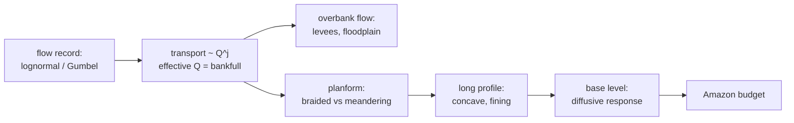

# LS22 · Floods, Floodplains, Channel Planform and River Profiles

◀ [[LS21 River Hydraulics and Hydraulic Geometry]] · [[Landscapes and Geomorphology - Course Map|Course Map]] · next: [[LS23 Bedrock Channels and River Incision]]

extra · book extra · beyond

> [!syllabus] Syllabus map: what is in the syllabus and what is extra in this chapter
> **No lecture source yet** (see [[LS21 River Hydraulics and Hydraulic Geometry]]). LS16 §"Alluvial rivers" lists the channel patterns and the graded profile in a table and a paragraph; this chapter derives them.
> 🟡 **Extra · book** (A&A Ch. 12; PDF = printed + 18): §1 magnitude–frequency, bankfull and effective discharge ([[geomorphology-the-mechanics-and-chemistry-of-landscapes-9780521519786-0521519780_compress.pdf#page=414|printed pp.396–399]]); §2 floodplain and levee deposition (p.399); §3–§4 braiding and meandering ([[geomorphology-the-mechanics-and-chemistry-of-landscapes-9780521519786-0521519780_compress.pdf#page=417|printed pp.399–405]]); §5 concave profiles, bed fining, slopes of big rivers ([[geomorphology-the-mechanics-and-chemistry-of-landscapes-9780521519786-0521519780_compress.pdf#page=423|printed pp.405–409]]); §6 base-level change ([[geomorphology-the-mechanics-and-chemistry-of-landscapes-9780521519786-0521519780_compress.pdf#page=427|printed p.409]]); §7 the Amazon ([[geomorphology-the-mechanics-and-chemistry-of-landscapes-9780521519786-0521519780_compress.pdf#page=429|printed pp.411–414]]).
> 🔵 **Extra · beyond** (all numbers in `scripts/ls_rivers_numbers.py`, section LS22): the lognormal-flow derivation of the effective discharge ($Q_e=Q_{med}e^{j\sigma^2}$), the Gumbel proof that the mean annual flood is the 2.33-yr event, the sine-generated meander and $S=1/J_0(\omega)$, the super-elevation estimate, the three profile arguments with numbers, the exact diffusive base-level solution (checked against a finite-difference run), the Amazon budget arithmetic, and the problems.

> [!key] After this chapter you can
> - derive why the **effective (channel-forming) discharge** lies near the bankfull flow, a flood of 1.5–2.5 years recurrence, and compute it for a lognormal flow record,
> - explain why the mean annual flood has a recurrence interval of **2.33 years** (Gumbel),
> - say how **levees and floodplains** are built (decanting, the Rouse number) and why the coarsest grains deposit nearest the channel,
> - explain **braiding** (non-cohesive banks, threshold depth, flow divergence) and **meandering** (super-elevation, helical flow, point bars, cutoffs), and compute **sinuosity** of a sine-generated meander,
> - derive three arguments for a **concave-up long profile** (Hack's gradient index, sediment capacity, grain fining/Sternberg) and the diffusive response of an alluvial river to a base-level fall,
> - read a **sediment budget** (the Amazon): inputs, floodplain storage and output.

> [!intuition] The one-sentence story
> A river is shaped not by its commonest flow nor by its biggest, but by the moderate flood that does the most work (because sediment transport is a high power of discharge); it builds its levees and floodplain from the water that spills over, takes a braided or meandering pattern according to whether its banks can hold together, and grades its long profile so that slope, grain size and discharge just balance.

## 1. Floods: which flow builds the channel?
### 1.1 Magnitude and frequency
Small flows are common and large flows rare; sediment transport is **thresholded and nonlinear** in the flow (LS24), so large flows do disproportionately more work. The work done by flows of size $Q$ is the product of *how often* they occur, $p(Q)$, and *how much they move*, $q_s(Q)$. This is the Wolman and Miller (1960) argument (A&A pp.396–397, their figure 12.15): the peak of the product is displaced from the commonest event toward the larger, rarer ones.

> [!derivation] 🔵 Extra · beyond (verified numerically): the effective discharge for a lognormal flow record
> Let daily discharge be lognormal, $x=\ln(Q/Q_{med})\sim\mathcal N(0,\sigma^2)$, and let the load rate be a power law $q_s\propto Q^{j}$ (the *sediment rating curve* of §1.3; $j\approx2$–3 for suspended load, higher for bedload). The long-term load carried by flows near $Q$ is
>
> $$w(x)\propto Q^{j}p(x)\propto e^{jx}e^{-x^2/2\sigma^2}\propto\exp\Big[-\frac{(x-j\sigma^2)^2}{2\sigma^2}\Big],$$
>
> by completing the square: **the load is itself a normal in $x$, centred at $x_e=j\sigma^2$**. Hence
>
> $$\boxed{Q_e=Q_{med}\,e^{\,j\sigma^2}},\qquad P(Q>Q_e)=1-\Phi(j\sigma).$$

| $j$ | $Q_e/Q_{med}$ | days per year it is exceeded |
|---|---|---|
| 1.5 | 4.5 | 24 |
| 2.0 | 7.4 | 8.3 |
| 2.5 | 12.2 | 2.3 |
| 3.0 | 20.1 | 0.5 |

($\sigma=1$.) *Reading it:* the effective discharge is exceeded for a few days per year, not for most of the year (the median) and not once a century. A hard threshold ($Q_c=3Q_{med}$, no transport below it) pushes $Q_e$ up to $19\,Q_{med}$ for $j=2.5$ and makes it rarer (0.6 d/yr). For $j=2.5$ the top 1 % of days carry **57 %** of the long-term load. A&A (pp.397–398, Box 12.3) report that observed effective discharges, from bedload sampling (Andrews 1980, the Yampa and Snake rivers), coincide with the **bankfull** flow, recurring every 2–3 years: "the flows that count most in the formation of a channel are those that fill the channel to its brim."

### 1.2 Recurrence interval and the 2.33-year flood
Flood frequency analysis fits the *annual maximum* discharge to an asymmetric distribution (Weibull, Pearson III, Gumbel). With the **Gumbel** law $F(Q)=\exp[-e^{-(Q-\mu)/\beta}]$ and recurrence interval $T=1/[1-F]$:

> [!derivation] 🔵 Extra · beyond: why the mean annual flood has $T=2.33$ yr
> The Gumbel mean is $\mu+\gamma\beta$ with Euler's constant $\gamma=0.5772$. At the mean the reduced variate is $y=\gamma$, so $F=\exp(-e^{-\gamma})=0.5704$ and $T=1/(1-0.5704)=\boxed{2.33\ \text{yr}}$. A&A (Box 12.3) state that the average annual flood "will plot at a recurrence interval of 2.3 years" on probability paper; this is *why*, and it holds for any Gumbel-distributed record, independent of $\mu$ and $\beta$. Bankfull flow, measured from channel cross-sections, indeed corresponds to $T\approx1.5$–2.5 yr in many rivers, close to the mean annual flood.

The upper tail of **daily** flows is well fitted by a power law (A&A p.397, Molnar et al. 2006): the exceedance count $N(Q)\propto Q^{-\alpha+1}$ for a pdf $\propto Q^{-\alpha}$, and the exponent $\alpha$ **decreases with aridity** (heavier tails: dry catchments are flashier). In a dry climate the extreme floods are relatively larger, which moves $Q_e$ to a rarer event.

### 1.3 The sediment rating curve
Suspended-sediment load against discharge is a power law $Q_s=aQ^{j}$ with $j$ typically 2–3 (A&A p.399, Leopold and Maddock's Powder River data, $j$ slightly below 2): **doubling the discharge multiplies the sediment load by $2^j=4$–8**. For bedload the exponent is higher still, because of the threshold (LS24). This is the $j$ of §1.1.

## 2. Floodplains and levees
When discharge exceeds the channel capacity the flow spills onto the **floodplain**, "a part of the river" used less often than the rest (A&A p.397). The water is *decanted* from the top of the channel (A&A figure 12.19), where suspended concentration is lowest and the grains are finest (Rouse profile, [[LS24 Sediment Transport Mechanics]] §4). On the floodplain the flow is shallow and rough, so $u_*$ falls, the **Rouse number** $P=w_s/\kappa u_*$ rises, and grains drop out of suspension in order of size:

- the **coarsest grains settle first, at the bank**, building a **natural levee** that raises the channel above its plain;
- finer silt and clay go farther and make the floodplain (the world's agricultural alluvium).

Quantitatively (Amazon, A&A p.413): sediment concentration in the overbank water was $0.33$ of the channel-mean (140–80 mg/L along 2000 km), because only the upper, fine-grained water leaves the channel. The large rivers also exchange water through floodplain channels that reverse flow during a flood (the Amazon section below).

## 3. Braided rivers
**When do rivers braid?** A&A (p.400) give three conditions: (1) **non-cohesive banks** (no clay, no vegetation roots); (2) **bedload** transport; (3) **strongly fluctuating flow**, perhaps daily (glacial outwash is the classic case, e.g. the Chitina River, Alaska). The flow occupies several threads separated by mid-channel bars, sometimes the whole valley floor.

> [!derivation] 🟡 Extra · book: depth is pinned, so width is free
> With cohesionless banks the channel can only deepen until the bed stress reaches the threshold for motion; any more and the banks erode and the channel widens:
>
> $$\tau_b=\rho gHS=\tau_c=\tau_{*c}(\rho_s-\rho)gD\quad\Longrightarrow\quad H=\frac{\tau_{*c}(s-1)D}{S}.$$
>
> The depth is fixed by the **slope and grain size alone**; extra discharge must go into **width** (more threads, wider braidplain). For $D=30$ mm, $S=0.005$: $H=0.45$ m. A **steeper** slope gives a **shallower** threshold flow, so for given discharge a wider, shallower, more braided channel ($H\propto1/S$). This is the quantitative content behind LS16's table ("steep, high sediment supply, erodible banks").

The **mechanism** (Murray and Paola 1992, 1994; A&A pp.400–401, figure 12.21): sediment continuity (the **Exner equation**)
$$(1-\lambda)\,\frac{\partial z}{\partial t}=-\frac{\partial q_s}{\partial x}$$
(with $\lambda$ the bed porosity) says the bed rises where the transport rate *diverges less than it converges*. Where the flow **diverges** (expands around a bar), speed and stress fall, transport falls downstream, so $\partial_xq_s<0$ and sediment is **deposited**: the bar grows and splits the flow; where flow **converges** the bed is scoured. The process is self-sustaining even for steady discharge; fluctuating discharge matters mainly by *removing vegetation* that would otherwise cohere the banks.

## 4. Meandering rivers
Rivers with **cohesive banks** (silt, clay, roots) keep a single thread that snakes. The **sinuosity** is the ratio of channel length to valley length. Meander wavelengths cluster tightly around **11 channel widths** (Leopold and Wolman 1960; A&A figure 12.23), with radius of curvature a few widths: the planform scales with the channel, so a map of a meander without a scale bar cannot tell you its size ($W$ from 1 m to 1 km).

### 4.1 Helical flow
> [!derivation] 🔵 Extra · beyond (numbers checked): super-elevation and secondary flow
> In a bend of radius $R$ water moving at speed $U$ must be accelerated inward by $U^2/R$. Radial momentum balance, with a hydrostatic pressure gradient set by the tilt of the water surface, gives the transverse surface slope
>
> $$\frac{\partial h}{\partial n}=\frac{U^2}{gR},\qquad \Delta h=\frac{U^2W}{gR}.$$
>
> For $U=1.5$ m/s, $W=100$ m, $R=300$ m, $\Delta h=7.6$ cm: the outer water surface stands several centimetres higher than the inner. This tilt gives a pressure gradient that is **uniform with depth**, but the centripetal demand $U^2/R$ **varies** with depth (fast surface water needs more). At the surface the demand exceeds the supply and the water moves outward; near the bed, where $U$ is small, the pressure gradient wins and the water moves inward. The result is a **helical secondary flow**: outward at the surface, inward at the bed (A&A figure 12.24).

The inward near-bed flow carries bedload to the **point bar** on the inside, and the outer bank, where the thalweg (deepest line) and highest bed stress lie, is undercut and fails. The bend therefore migrates outward and downvalley; the abandoned inner side is vegetated and left as **scroll bars**. The deposit is a point-bar sequence that fines upward (coarse grains travel at the thalweg; only fines reach high on the bar), capped by overbank silt: the classic fining-upward cycle of the rock record.

### 4.2 Sinuosity and cutoffs
Lengthening alone would make sinuosity grow without bound; it does not, because **cutoffs** shorten the river: a **neck cutoff** when migration pinches off a loop, or a **chute cutoff** when a flood carves a shortcut across it. The cut-off loops are **oxbow lakes**, ecologically important and filled slowly by overbank deposition (A&A p.404; Constantine and Dunne 2008 show that oxbow lengths are lognormal with a mean that rises with sinuosity).

> [!derivation] 🔵 Extra · beyond: the sine-generated curve and $S=1/J_0(\omega)$
> A simple model of a meandering centreline lets the direction angle oscillate along the channel's arc length $s$: $\theta(s)=\omega\sin(2\pi s/\lambda_{ch})$, with $\omega$ the maximum deflection from the valley axis. The valley-parallel length of one wavelength is $\int_0^{\lambda_{ch}}\cos\theta\,ds=\lambda_{ch}J_0(\omega)$ (the Bessel function $J_0$ appears because $\cos(\omega\sin\phi)$ averaged over $\phi$ is $J_0(\omega)$), so
>
> $$\boxed{\text{sinuosity}=\frac1{J_0(\omega)}}\quad\Rightarrow\quad\omega=30^\circ,60^\circ,90^\circ,110^\circ\ \to\ 1.07,\ 1.34,\ 2.12,\ 3.70.$$
>
> $J_0$ vanishes at $\omega=138^\circ$ (the curve doubles back and closes on itself): there is a **maximum** possible sinuosity set by geometry, and real meanders reach cutoff before approaching it. Verified by quadrature in the script.

![[fig_ls22_floods.png]]
*Figure LS22.1. A: the daily-flow pdf (blue) and the load carried by flows of each size for two rating exponents; the dotted lines are $Q_e=Q_{med}e^{j\sigma^2}$. B: Gumbel annual maxima against recurrence; the mean annual flood is the 2.33-yr event, within the bankfull band. C: sinuosity of the sine-generated meander ($1/J_0$); insets show $\omega=29^\circ$ and $66^\circ$.*

## 5. The long profile of an alluvial river
Alluvial rivers are **concave up**: steep near the source, nearly flat at the mouth (A&A figure 12.27). Hillslopes are the opposite (convex hilltops, [[LS12 Hillslope Transport and the Diffusion Equation]]). *Why?* Three independent arguments all give a profile that flattens downstream.

**(a) Hack's stream gradient index.** Define $SL=S\,L$ with $L$ the distance from the divide. If $SL$ is roughly constant along the river, $dz/dx=-SL/x$ and, with $z(L_{tot})=z_b$ at the base level,

$$z(x)=z_b+SL\,\ln\frac{L_{tot}}{x},\tag{5.1}$$

a **logarithmic** profile (A&A figure 12.28). The numerical content: for $SL=50$ m and $L_{tot}=100$ km, the river falls 230 m between $x=1$ km and the mouth. $SL$ is a proxy for stream power, so a constant $SL$ means constant power along the profile (the bedrock analogue is LS23's steady state).

**(b) Sediment capacity.** The load increases downstream roughly with drainage area, $Q_s\propto A^{n}$, while the capacity is $Q_s=\beta QS$ with $Q\propto A^{m}$; at grade $S\propto A^{\,n-m}$, which declines downstream if $n<m$ (the sediment load grows more slowly than the water discharge). Slope exponents: $0$ for $n=m=1$, $-0.2$ for $n=0.8$, $-0.5$ for $n=0.5$.

**(c) Competence and fining.** The bed grain size decreases downstream; the stress needed to move it falls, $\tau_c\propto D$; and $\tau_b=\rho gHS$ with $H$ *increasing* downstream (hydraulic geometry, LS21). Both force $S$ to decrease. A&A (p.408) identify two causes of the fining: **abrasion and breakage** and **selective deposition** of the coarse fraction; both occur.

> [!derivation] 🟡 Extra · book (Sternberg's law) and 🔵 numbers: exponential fining gives an exponential profile
> Sternberg (1875): the weight of a clast decays as $dW/dx=-aW$, so $W=W_0e^{-x/x_*}$; as $W\propto D^3$ the diameter falls as $D=D_0e^{-x/(3x_*)}$. Write the diameter's own e-folding length as $\ell=3x_*$. If a river's slope tracks the grain size (competence argument, $S\propto D$), $S=S_0e^{-x/\ell}$ and
>
> $$z(x)=z_0-S_0\ell\,(1-e^{-x/\ell}).$$
>
> *Numbers:* gravel falling from 100 mm to 1 mm over 300 km needs $\ell=300/\ln100=65$ km, and with $S_0=10^{-3}$ the profile has $S_0\ell(1-0.01)=64$ m of relief. The measured Mississippi bed (A&A figure 12.30) shows exactly this kind of decline, with step-ups where the Arkansas River dumps coarse sediment.

> [!key] The gravel–sand transition is sharp
> Median bed size falls smoothly by abrasion, yet the change from gravel to sand takes only $\sim100$ m in small rivers and $\sim30$ km in large ones: far too short for abrasion. Ferguson (2003; A&A p.408) explains it by **selective transport**: sand hidden among gravel is hard to move, but gravel sticking up from a sand bed rolls easily, so at the low excess stress of a gravel river sand is winnowed out, and the bed stays gravel until the sand fraction jumps. It is another example of self-organisation in a landscape.

### Very low slopes and avulsion
Big rivers have tiny slopes: the **lower Mississippi** drops 95 m over 1000 km ($9.5\times10^{-5}$, then half that over the next 500 km), the **Amazon** about 2 cm per km ($2\times10^{-5}$). Slopes this small make the river sensitive to any process that tilts the land, and they allow **avulsion**: if a levee breaches and a steeper route to the sea is available, the river can abandon its channel altogether. The Mississippi has done so repeatedly during the Holocene, and the engineers who keep it out of the steeper Atchafalaya route are holding up an avulsion; the Huang He ("Yellow River") has moved its mouth by hundreds of kilometres and its levees now stand about 7 m above the floodplain (A&A p.409). For the Mississippi at $H=15$ m, $S=9.5\times10^{-5}$ the bed stress is only $\tau_b=\rho gHS=14$ Pa, enough to move all sand but little gravel (compare $\tau_c=0.17$ Pa for 0.2 mm sand and $18$ Pa for 20 mm gravel, [[LS24 Sediment Transport Mechanics]]): the bed is sand because only sand can be moved by that stress.

## 6. Base-level change: an alluvial river diffuses
The mouth elevation, **base level**, is that of the lake or sea (relative to the land: sea level plus uplift or subsidence), and it also *moves horizontally* as shorelines migrate (A&A p.409). A fall of base level creates a steep corner at the mouth; how does the river respond?

> [!derivation] 🟡 Extra · book: the alluvial river as a diffusion equation
> Conservation of sediment (Exner) with bulk density $\rho_b$: $\partial_tz=-\rho_b^{-1}\partial_xQ_s$. Take a transport law proportional to water discharge times slope, $Q_s=\alpha Q\,S=-\alpha Q\,\partial_xz$. For a reach of uniform $Q$:
>
> $$\boxed{\frac{\partial z}{\partial t}=\kappa\,\frac{\partial^2z}{\partial x^2}},\qquad\kappa=\frac{\alpha Q}{\rho_b},$$
>
> the **diffusion equation**, the same as for hillslopes ([[LS12 Hillslope Transport and the Diffusion Equation]]) with $\kappa$ now set by the water discharge (a river diffuses its own corner faster the more water it carries). For a drop $h$ at the mouth ($x=0$) at $t=0$ on a semi-infinite reach, the solution is
>
> $$z(x,t)=-h\,\operatorname{erfc}\Big(\frac{x}{2\sqrt{\kappa t}}\Big).$$
>
> I solved the equation by an explicit finite-difference scheme and compared: the maximum difference to the erfc solution is $10^{-4}$ m for $h=20$ m (script). *Numbers* ($\kappa=10^{5}$ m²/yr, an illustrative value): the drop is felt to 10 % of its size out to $x=2\sqrt{\kappa t}\,\operatorname{erfc}^{-1}(0.1)=2.33\sqrt{\kappa t}$, i.e. **23 km** after 1 kyr, **74 km** after 10 kyr and **230 km** after 100 kyr.

> [!intuition] Diffusion versus a wave
> The signal of a base-level fall spreads *diffusively* in an alluvial river, $x\sim\sqrt{\kappa t}$, rounding the corner and slowing as it spreads. In a **bedrock** river (LS23) it is carried as a **kinematic wave**, $x=Ct$, at a speed set by the *discharge*, keeping its sharp shape as a knickpoint. The difference is the difference between transport-limited ($\partial_tz\propto\partial_x^2z$) and detachment-limited ($\partial_tz\propto\partial_xz$) systems, and it controls how rivers record tectonic history (LS23 §9).

![[fig_ls22_profiles.png]]
*Figure LS22.2. A: the three concave-up arguments, normalised (Hack's logarithmic profile, Sternberg fining with $\ell=65$ km, and the capacity argument with $S\propto A^{-0.5}$ and $A\propto x^{1.67}$). B: the diffusive response to a 20 m base-level fall, for $\kappa=10^{5}$ m²/yr. C: the Amazon's sediment budget.*

## 7. The Amazon: a sediment budget
A&A (pp.411–414) close the chapter with the largest river on Earth, studied for a decade by Dunne, Richey, Mertes, Aalto and others: the **sediment budget** is the application of conservation of mass with every term measured.

> [!key] The Amazon in numbers (A&A p.412, with my arithmetic)
> Drainage area $6.15\times10^{6}$ km²; water $6300$ km³/yr, so mean discharge $6300\times10^{9}\ \text{m}^3/3.156\times10^{7}\ \text{s}=\mathbf{2.0\times10^{5}\ m^3/s}$ and a runoff depth of $1.02$ m/yr; channel slope $2$ cm/km; width 2–4 km, depths of tens of metres; sediment $\sim1200$ Mt/yr delivered to the ocean, i.e. $1200\times10^{9}\ \text{kg}/1700\ \text{kg m}^{-3}=0.7$ km³/yr of bed-density sediment; the annual flood load depresses the crust of the basin by $\sim10$ cm.

> [!example] 🧮 The budget arithmetic
> The mass balance for a reach is: change of storage = (upstream bedload and suspended load in) + (tributary input) + (bank erosion) − (downstream load out) − (deposition on bars) − (deposition on the floodplain). Between São Paulo de Olivença and Óbidos, the measured inputs are 616 (the Amazon proper), 715 (the Madeira, from the Bolivian Andes) and 117 Mt/yr (small tributaries): **1448 Mt/yr**. The output at Óbidos is **1239 Mt/yr**. The difference, **209 Mt/yr** ($14.4\,\%$ of the input), is stored, mostly on the floodplain. The black-water Rio Negro contributes almost nothing because it drains low-relief shield. So the system is a **net sink**, and the river exchanges large amounts of mass with its banks and floodplain (bank erosion and floodplain deposition each large compared to the net). Over the 6.15 million km², the output of 1239 Mt/yr is a yield of $0.20$ kg m⁻² yr⁻¹, equal to a **denudation of 0.075 mm/yr** at rock density 2700 kg/m³ (my arithmetic; the budget is for a reach, not the whole basin, so this is indicative).

## 8. Worked examples
> [!example] 🧮 Example 1: which flood shapes a channel with $\sigma=1.2$, $j=2$?
> $Q_e/Q_{med}=e^{j\sigma^2}=e^{2.88}=17.8$, exceeded on a fraction $1-\Phi(j\sigma)=1-\Phi(2.4)=0.0082$ of days $=3.0$ days per year. In the annual-maximum series (Gumbel) it will be a flood of order the mean annual flood, so this river's bankfull stage is reached about once or twice a year, consistent with 1.5–2.5 yr bankfull recurrence.

> [!example] 🧮 Example 2: a meander from its map
> A reach has $W=80$ m. Expected wavelength $\lambda\approx11W=880$ m. If the maximum angle between the channel and the valley axis is $80^\circ$, then $J_0(1.396)=0.569$ and the sinuosity is $1/0.569=1.76$. At $U=2$ m/s and $R=240$ m the outer surface is $\Delta h=U^2W/gR=0.136$ m higher than the inner.

> [!example] 🧮 Example 3: how far has a base-level fall travelled?
> $\kappa=5\times10^{4}$ m²/yr; how long until 10 % of the drop is felt 20 km upstream? $20\ \text{km}=2.326\sqrt{\kappa t}$, so $\sqrt{\kappa t}=8.6$ km, $t=(8.6\times10^{3})^2/5\times10^{4}=1.5\times10^{3}$ yr.

## 9. Check yourself
> [!question] Problems (answers folded)
> 1. $\sigma=1.2$ and $j=2.5$: find $Q_e/Q_{med}$ and the days per year it is exceeded.
> 2. Prove that in a Gumbel record the mean annual flood has recurrence 2.33 yr, for any $\mu,\beta$.
> 3. Why does a steeper slope favour braiding at fixed grain size? Quantify with $H=\tau_{*c}(s-1)D/S$ for $S=0.002$ and $S=0.01$, $D=50$ mm.
> 4. A bend has $U=2.5$ m/s, $R=500$ m, $W=120$ m. Find the superelevation. Why does the near-bed water move inward?
> 5. Find the sinuosity of a sine-generated meander with $\omega=45^\circ$. Why does the sinuosity diverge as $\omega\to138^\circ$?
> 6. $SL=40$ m, river length 50 km: how much does the profile fall between $x=500$ m and the mouth?
> 7. Bed grain size halves every 50 km. Find $\ell$ and the size at 200 km as a fraction of the start.
> 8. A river with $\kappa=10^{5}$ m²/yr and a base-level fall of 10 m: what is the height of the fall's signal at $x=20$ km after $10^4$ yr?
> 9. If sediment load is $Q_s\propto Q^{2.5}$, how much more load is carried by a flood of $3\times$ the bankfull discharge in a day than by bankfull in a day?
> 10. Verify that the Amazon's inputs minus output equals the storage and compute its share of input.

> [!example]- Answers
> 1. $e^{2.5\times1.44}=e^{3.6}=36.6$; exceedance $1-\Phi(j\sigma)=1-\Phi(3.0)=0.00135$, i.e. 0.5 d/yr.
> 2. $F(\text{mean})=\exp(-e^{-\gamma})=0.5704$, $T=1/(1-F)=2.33$.
> 3. $S=0.002$: $H=0.045\times1.65\times0.05/0.002=1.86$ m; $S=0.01$: $0.37$ m. Five times shallower at five times the slope; the discharge is carried by width, hence more channels.
> 4. $\Delta h=2.5^2\times120/(9.81\times500)=0.153$ m. At the bed the water is slow, so the surface-tilt pressure gradient exceeds the centripetal need, and the net force on bed water points inward.
> 5. $J_0(0.7854)=0.8516$, sinuosity $1.174$. It diverges as $\omega\to138^\circ$, where $J_0\to0$ and the valley length per wavelength vanishes (the loop closes).
> 6. $40\ln(50000/500)=40\ln100=184$ m.
> 7. $\ell=50/\ln2=72$ km; $D(200)/D_0=2^{-4}=1/16$.
> 8. $z=-10\,\operatorname{erfc}(20000/(2\sqrt{10^5\times10^4}))=-10\operatorname{erfc}(0.316)=-10\times0.654=-6.5$ m.
> 9. $3^{2.5}=15.6$ times per day.
> 10. $616+715+117=1448$; $1448-1239=209$; $209/1448=14.4\%$.

## 10. Summary
- Effective discharge $Q_e=Q_{med}e^{j\sigma^2}$ for a lognormal record and $q_s\propto Q^j$: a rare-ish flood, near the bankfull flow of 1.5–2.5 yr recurrence; the Gumbel mean annual flood is the 2.33-yr event.
- Overbank water deposits levees (coarse, at the bank) and floodplains (fine, farther off) because $u_*$ and the Rouse number change.
- Braiding: cohesionless banks, bedload, flashy flow; depth pinned at $\tau_{*c}(s-1)D/S$, width carries the discharge; divergence of $q_s$ builds bars.
- Meanders: super-elevation $\Delta h=U^2W/gR$, helical flow, point bars, cutoffs; $\lambda\approx11W$; sine-generated sinuosity $1/J_0(\omega)$.
- Concave profiles from Hack's $SL$ (logarithmic), sediment capacity ($S\propto A^{n-m}$) and fining (Sternberg); big rivers have slopes of $10^{-5}$ and avulse.
- Alluvial response to base level is diffusive, $\kappa=\alpha Q/\rho_b$; bedrock response is a wave (LS23).
- Amazon: $2.0\times10^{5}$ m³/s, 1448 Mt/yr in, 1239 out, 209 (14 %) stored.

<!-- interactive:start (generated by scripts/embed_interactive.py; edit the tool in scripts/interactive/tools/, not this block) -->
> [!interactive]+ Interactive: Bedrock rivers: steady profile, slope–area scaling and the knickpoint wave
> Stream-power incision E = K Aᵐ Sⁿ balanced against rock uplift U gives the steady slope S = (U/K)^(1/n) A^(−m/n) = k_s A^(−θ), concavity θ = m/n.
>
> ![[ls_river_profile.png|720]]
>
> **Try:** m = 0.5, n = 1, K = 5×10⁻⁶ yr⁻¹ and U = 0.5 mm/yr give S = 100 A^(−1/2): S = 0.1 at 1 km² and 0.01 at 100 km². Step U by ×4: at n = 1 every slope quadruples (steady state), at n = 19/16 only 4^(16/19) = 3.2. Watch the knickpoint reach the divide.
>
> [▶ Open the tool in your browser](../Assets/interactive/ls_river_profile.html) · [absolute link](file:///home/swastik/Documents/notes/Assets/interactive/ls_river_profile.html) · all tools and coverage: [[Interactive Tools]]

<!-- interactive:end -->

## Map of this chapter
> [!connection] How LS22 connects
> **Previous:** [[LS21 River Hydraulics and Hydraulic Geometry]] · **Next:** [[LS23 Bedrock Channels and River Incision]], [[LS24 Sediment Transport Mechanics]] · **Earlier:** [[LS16 Fluvial Landscapes]] (the graded profile), [[LS12 Hillslope Transport and the Diffusion Equation]] (the same diffusion equation), [[LS15 Glacial Deposits Rebound and Sea Level]] (base level and sea level).
> **Across subjects:** [[Gumbel Distribution]] and [[Normal Distribution]] (flood statistics: lognormal flows, Gumbel annual maxima), [[THX1 Diffusion Random Walks and the Heat Equation]] (why alluvial rivers diffuse), [[Orographic Precipitation]] and [[CL15 Monsoons]] (the climate that sets $Q$), [[Nutrient Limitation]] and [[EE06 Eutrophication and Alternative Stable States]] (floodplain and oxbow ecology; the nutrient load a river delivers).

## Provenance
> [!provenance]- Source map for this chapter
> | Topic | Source | Scope |
> |---|---|---|
> | magnitude–frequency, Box 12.3, braiding, meandering, concave profiles, fining, avulsion, base level, Amazon | A&A Ch. 12, printed pp.396–414 (PDF = printed + 18; text-layer reading, equations re-derived) | extra · book |
> | lognormal effective discharge, Gumbel 2.33 yr, sine-generated curve, super-elevation, profile numbers, diffusive solution (checked by finite differences), Amazon arithmetic | my derivations, `scripts/ls_rivers_numbers.py` (LS22) | extra · beyond |
>
> **Flagged:** the oxbow-length formula and the radius-of-curvature ratio of A&A are not given here (the equation is lost in the text layer); $\kappa=10^{5}$ m²/yr and $\sigma=1$ are illustrative; the Gumbel scale ($\beta=0.35\mu$ in the figure) is illustrative.
