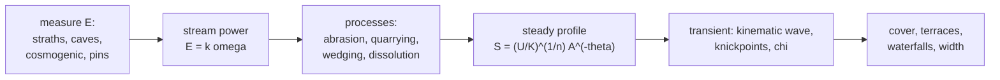

# LS23 · Bedrock Channels and River Incision

◀ [[LS22 Floods Planform and River Profiles]] · [[Landscapes and Geomorphology - Course Map|Course Map]] · next: [[LS24 Sediment Transport Mechanics]]

extra · book extra · beyond

> [!syllabus] Syllabus map: what is in the syllabus and what is extra in this chapter
> **No lecture source yet** (see [[LS21 River Hydraulics and Hydraulic Geometry]]). LS16 has the stream-power law, its steady profile and the knickpoint kinematic wave as 🟢 *in the slides*; this chapter is the full treatment of A&A Chapter 13, and re-derives those results with more rigour (the $\chi$ transform, the response-time integral, the width problem).
> 🟡 **Extra · book** (A&A Ch. 13; PDF = printed + 18): §2 measuring incision rates ([[geomorphology-the-mechanics-and-chemistry-of-landscapes-9780521519786-0521519780_compress.pdf#page=442|printed pp.424–428]]); §3 stream power and the bond-energy closure (printed p.428); §4 the processes: abrasion, quarrying, wedging, dissolution, knickpoints ([[geomorphology-the-mechanics-and-chemistry-of-landscapes-9780521519786-0521519780_compress.pdf#page=447|printed pp.429–435]]); §5–§6 steady and transient profiles ([[geomorphology-the-mechanics-and-chemistry-of-landscapes-9780521519786-0521519780_compress.pdf#page=453|printed pp.435–445]]); §7–§8 waterfalls, strath terraces, landslide dams; §9 the channel-width problem ([[geomorphology-the-mechanics-and-chemistry-of-landscapes-9780521519786-0521519780_compress.pdf#page=463|printed pp.445–449]]).
> 🔵 **Extra · beyond** (all numbers in `scripts/ls_rivers_numbers.py`, section LS23, each checked by a second route): the implied efficiency of the energy closure, the dissolution result that wall retreat is independent of discharge, the **$\chi$-coordinate** solution of the kinematic wave (checked against an upwind finite-difference run, 1 % agreement), the response-time integral for general $m$, the shock/rarefaction argument for $n\gtrless1$, the Niagara discharge exponent, the unit-stream-power exponents of Finnegan's width law, and the problems.

> [!taught] 🟢 Lecture source arrived (fluvial lectures, slides posted on Classroom 2026-11-18; added 2026-11-21) <!-- lecture-fluvial-2026-11-18 -->
> The post-midsem deck [[l_fluvial.pdf]] (Argha Banerjee, 43 slides; A&A Ch. 11–13 figures) now **teaches** this chapter's core, so read the matching sections as 🟢 *taught*:
> - §1 and §4 processes (abrasion, quarrying, hydraulic wedging, dissolution, knickpoint migration): [[l_fluvial.pdf#page=30|slide 30]]; abrasion rate vs rock strength and sediment concentration (A&A figs 13.9–13.10): [[l_fluvial.pdf#page=34|slide 34]]; abrasion and flow separation, $Re=\rho vL/\mu$ (fig 13.8): [[l_fluvial.pdf#page=35|slide 35]]; potholes "in our neighbourhood (50–100 km)": [[l_fluvial.pdf#page=36|slides 36]], [[l_fluvial.pdf#page=38|38]]; wedging (fig 13.12): [[l_fluvial.pdf#page=37|slide 37]].
> - §2 measuring incision (figs 13.2–13.4, 13.6, 13.21): [[l_fluvial.pdf#page=31|slides 31–33]].
> - §5–§6 steady state and the transient: the advection equation $\partial_tz=\frac{k\rho gQ}{W}\partial_xz=C\,\partial_xz$ (A&A eq. 13.21, $x$ from the divide), the general law $E\sim kA^m|\partial_xz|^n$, "how to include uplift?", "steady profile for steady $U$ and constant $k$?", Hack's rule, transient response (fig 13.18): [[l_fluvial.pdf#page=39|slide 39]]; concave-up long profile (fig 13.1): [[l_fluvial.pdf#page=40|slide 40]].
> - §7 waterfalls: Niagara (figs 13.14, 13.20): [[l_fluvial.pdf#page=41|slide 41]]; local scarps and waterfalls (Chandanpuri Ghat scarp and waterfall doublet, three-step fall near Kas Pathar, a one-step fall): [[l_fluvial.pdf#page=42|slide 42]].
> - The lecture's **exam-style question** ([[l_fluvial.pdf#page=43|slide 43]]) is solved in §11A below.
> Sections §3.2 (work-of-fracture $k$), §8 (strath terraces), §9 (width problem) and the $\chi$ machinery of §6.1–§6.4 stay 🟡/🔵: the slide only *asks* the questions they answer.

> [!key] After this chapter you can
> - list the field methods for incision rates (straths, lava flows, caves with $^{26}$Al/$^{10}$Be burial ages, cosmogenic nuclides on the channel floor, erosion pins) and say what time they average over,
> - derive **stream power** $\omega=\rho gqS$, close it with $E=k\omega$ (a work-of-fracture model) and generalise to $E=KA^mS^n$,
> - give the **process rules** for abrasion ($\propto U^3$, tools and cover, optimum sediment supply), quarrying (excess stress), dissolution and knickpoint retreat,
> - derive the **steady profile** $S=(U/K)^{1/n}A^{-m/n}$, concavity $\theta$ and steepness, and read erodibility contrasts from slope contrasts,
> - solve the **transient response** as a kinematic wave in $\chi$-space, find knickpoint positions and the response time, and explain why it is insensitive to basin size,
> - explain strath terraces (sediment cover blocks incision), waterfalls, and the **width problem** ($W\propto Q^{3/8}S^{-3/16}$).

> [!intuition] The one-sentence story
> A bedrock river lowers its bed at a rate set by the power it spends per unit bed area, so a landscape responds to uplift through the *slopes and drainage areas* of its rivers; because the response is a wave whose speed is proportional to discharge (a knickpoint travelling upstream), rivers carry the memory of a tectonic or base-level event for millions of years, longest in the small headwater channels.

## 1. Why bedrock rivers deserve a chapter
In 1802 Playfair noticed that tributaries join their trunk streams *at grade*, with no step: "none of them join the principal valley, either on too high or too low a level; a circumstance which would be infinitely improbable, if each of these valleys were not the work of the stream that flows in it" (quoted by A&A p.422). **Playfair's law** is the fingerprint of fluvial erosion; glacial tributaries, by contrast, *hang* (LS14, LS19). When rock is uplifted, the slopes of the draining rivers steepen, the rivers incise, and incision lowers the base level of the hillslopes, which respond (LS12). **The pace of a landscape's response to tectonics is therefore the pace of its bedrock rivers** (A&A p.423), which is why this process is studied separately from the alluvial rivers of LS22.

## 2. Measuring bedrock incision
Rivers leave markers of their former positions. A marker of age $T$ at height $\Delta z$ above the present bed gives a **long-term incision rate** $E=\Delta z/T$ (A&A pp.424–426):

| marker | what it is | note |
|---|---|---|
| **strath terrace** | abandoned bedrock bench, often potholed and fluted, with thin alluvial cover | do not confuse with a *fill* terrace, which is wholly sediment |
| **lava flow** in a channel | casts the old channel; later erosion favours the weaker rock beside it ("inverted topography") | Ar/Ar age gives a *minimum* rate (Sierra Nevada tablelands) |
| **cave passage** | phreatic passages form at the local base level (Palmer 1991) and are abandoned as the river incises; they preserve river sediment | needs carbonate rock; protected from landsliding, so records very long histories |
| **cosmogenic nuclides on the channel floor** | concentration of $^{10}$Be in bedrock reflects time spent within a production length of the surface | averages over $T=z_*/E$ |
| **erosion pins/holes** | drill a hole, measure its depth, remeasure | fractions of a mm; for high rates only |

### 2.1 Cave ages by burial dating
Quartz sediment buried deeply in a cave is shielded from cosmic rays, so its cosmogenic $^{26}$Al and $^{10}$Be decay, and **$^{26}$Al decays faster**: the ratio $N_{26}/N_{10}$ falls from its production value ($\approx6.75$) as $e^{-t/\tau}$ with

$$\frac1\tau=\frac1{\tau_{26}}-\frac1{\tau_{10}}\quad\Rightarrow\quad \tau=\frac{\tau_{26}}{1-\tau_{26}/\tau_{10}}.$$

With half-lives of 0.705 Myr ($^{26}$Al) and 1.387 Myr ($^{10}$Be): $\tau_{26}=1.017$ Myr, $\tau_{10}=2.001$ Myr and $\tau=\mathbf{2.07}$ Myr, the value A&A quote (p.425; the half-lives are my recall, `[verify]`). The method works to $\sim2.5\tau=5$ Myr (a ratio of $\sim0.55$ times the initial one): the Kings River canyon caves show a *tenfold* slowdown of incision after 1 Ma (A&A figure 13.3). Details of the decay and production physics are in [[LSX1 Clocks in Rocks]].

### 2.2 Channel-floor cosmogenic nuclides and the shielding by water
A rock on the channel floor accumulates $^{10}$Be at a rate that falls exponentially with depth with attenuation length $z_*\approx0.6$ m ($=\Lambda/\rho_{rock}=160\ \text{g cm}^{-2}/2.7\ \text{g cm}^{-3}$). With erosion $E$ the concentration is the production rate integrated over the last $z_*$ of lowering, i.e. it averages over $T=z_*/E$: **600 yr at 1 mm/yr**, filling the gap between monitored rates (1 to a few years) and terraces ($>10^{4}$ yr). **Water shields the bed**: with $z_{*w}=\Lambda/\rho_w=1.6$ m, production is reduced by $e^{-h/z_{*w}}$ when the stage is $h$:

| depth of water | 1 m | 3 m | 5 m | 10 m |
|---|---|---|---|---|
| production (fraction of dry) | 0.54 | 0.15 | 0.044 | 0.002 |

so the effective production rate must be averaged over the **flow-depth distribution** (Hancock et al. 1998). In the Indus middle gorge the stage swings by 10–15 m seasonally.

### 2.3 Pins and big events
Erosion holes in the Indus gorge (Hancock et al. 1998) recorded up to **12 mm of lowering in a year**, strongly dependent on rock type. Super-typhoon Bilis (2000, Taiwan; Hartshorn et al. 2002) lowered a schist channel floor by **up to 100 mm in a single event**, ten times a normal year, with the maximum **about 5 m above the low-flow stage**, falling to zero at the high-water mark (10 m): the erosion pattern reflects both *how often* each height is submerged and *how hard* the flow hits it. It is the magnitude–frequency problem of [[LS22 Floods Planform and River Profiles]] §1 again, now for rock.

## 3. Stream power
### 3.1 Energy argument
> [!derivation] 🟡 Extra · book: unit stream power
> A parcel of water of volume $V=H\,dx\,W$ at height $z$ has potential energy $\rho Vgz$. It moves downstream at speed $U$, so it drops at the rate $dz/dt=-U\sin\theta\approx-US$. The rate of potential-energy loss **per unit channel length** is
>
> $$\Omega=\rho g\,HWU\,S=\rho gQS\qquad[\mathrm{W\,m^{-1}}],$$
>
> since $HWU=Q$. Dividing by the width gives the **unit stream power** (power per unit bed area)
>
> $$\boxed{\omega=\frac{\Omega}{W}=\rho gqS=\tau_bU}\qquad[\mathrm{W\,m^{-2}}],\quad q=Q/W,\ \tau_b=\rho gHS,$$
>
> so the stream power is the product of bed stress and flow speed (the work done by the stress per unit time). This is the same $\omega$ as LS16. The basic closure is $E=k\,\omega$, with $k$ an erodibility containing efficiency, rock properties and (via $q=Q/W$) width.

The practical attraction (A&A p.429): $S$ comes from contours or a DEM; $Q$ crudely from drainage area; but channel **width** $W$ does not come from maps or 10–30 m DEMs, which is the chapter's main open problem (§9). Seidl and Dietrich (1992) found erosion proportional to the area–slope product $AS$ ($\propto QS$).

### 3.2 What sets $k$: a work-of-fracture model
> [!derivation] 🟡 Extra · book + 🔵 numbers: bonds, slabs and an efficiency
> The stream-power law does not say *how* the rock is removed; it is an energy argument. A&A (p.429) make it concrete. Let the rock lower in **slabs of thickness $d$**, each held to the one below by $B$ bonds per unit area of energy $E_b$ each, so detaching a slab costs the **work of fracture** $W_f=BE_b$ (J/m²). If a fraction $\alpha$ of the stream power goes into breaking bonds, the time to accumulate that energy is $T=W_f/(\alpha\omega)$ and the mean lowering rate is
>
> $$E=\frac dT=\underbrace{\frac{\alpha\,d}{BE_b}}_{k}\ \omega,\qquad [k]=\frac{\text{m}^3}{\text{J}}=\frac{\text{m s}^2}{\text{kg}}.$$
>
> **Efficiency is tiny.** Take $q=10$ m²/s, $S=0.01$, so $\omega=\rho gqS=981$ W/m²; $W_f=100$ J/m² and $d=0.1$ m (both illustrative). To produce the observed 1 mm/yr one needs $\alpha=EW_f/(d\omega)=3\times10^{-11}$: nearly all the power is dissipated as heat in the turbulence. The model is useful for the *structure* of $k$ (bigger slabs and weaker bonds erode faster, so $k$ is large for fissile, thinly bedded rock), not for predicting numbers. A **threshold** enters by noting energy arrives in packets (eddies, particle impacts) of varying size, some too small to break any bond: $E=k(\omega-\omega_c)$.

The general form used to model landscapes (A&A p.435) is

$$\boxed{E=K\,A^{m}S^{n}}\tag{3.1}$$

with $Q\propto A$, the width and $\rho g$ absorbed in $K$, and exponents $m,n$ that depend on the process (below). $m/n$ is the **concavity** $\theta$ (LS16).

## 4. Erosion processes
### 4.1 Abrasion
Particles hitting the bed knock off fragments, with mass removed proportional to the **kinetic energy** of the impact. The erosion rate is therefore proportional to the flux of kinetic energy to the surface:

$$E\propto q_{ke}\propto \underbrace{C\,U}_{\text{flux of particles}}\times\underbrace{m_pU^2}_{\text{KE each}}=C\,m_p\,U^{3},$$

with $C$ the near-bed volume concentration of particles (A&A p.430). The **cubic** dependence on speed, and a fifth power if $C\propto U^2$ (as for wind-blown grains), makes abrasion extremely sensitive to the largest flows (doubling $U$: $\times8$, or $\times32$). *Where* particles hit: water flow lines are tangent to the rock, so a particle must **decouple** from the flow, which it does where streamlines curve strongly: on the *lee* sides of bumps ("attack from the back", A&A figure 13.8), not the upstream sides. Wash load (fine) follows the flow; bedload re-encounters the bed at low speed; so the work is done mainly by the **coarse suspended load**.

> [!derivation] 🟡 Extra · book (experiment) and 🔵 simplest model: tools and cover
> Sklar and Dietrich's abrasion-mill experiments (A&A figures 13.9–13.10) found (i) the erosion rate falls as the **inverse square of the rock's tensile strength**, $E\propto\sigma_T^{-2}$ (collapsing all the data), and (ii) it depends **non-monotonically on sediment supply**: too little sediment and there are few tools to do the work; too much and the bed is shielded by cover. The simplest form with both limits is
>
> $$E=\mathcal A\,\frac{q_s}{\sigma_T^{2}}\Big(1-\frac{q_s}{q_c}\Big)$$
>
> (recalled form of Sklar and Dietrich 2004, `[verify]`; $q_c$ is the transport capacity). It peaks at $q_s=q_c/2$ with $E_{max}\propto q_c/4$, and a rock twice as strong erodes four times more slowly (figure LS23.1A). It explains why **steep, sediment-starved reaches** and **sediment-choked reaches** both erode slowly, and it makes $E$ depend on $q_s$ and so couples incision to the sediment supply from the hillslopes (the "tools and cover" debate: whether incision is controlled by how much sediment moves, or by whether the bed is covered; A&A p.431).

### 4.2 Quarrying and hydraulic wedging
**Quarrying** removes blocks (A&A p.431): a crack must first isolate a block (by impacts, frost, cavitation, or pre-existing joints from the rock's stress history), then the flow must overcome friction and weight, giving a *threshold* stress and a rate that scales with the **excess** $E\propto\tau_b-\tau_c$. Edges matter: a block enclosed on all sides is safe, one at the downstream edge is not, so a quarried bed unravels *headward* as a train of micro-knickpoints. **Hydraulic wedging** (p.433): pebbles are found wedged tightly into cracks; the pressure fluctuations of high flow flex the bed so a crack briefly opens, accepts a grain and cannot close again, and repeated flexing wedges cracks wider (bedload is required).

### 4.3 Dissolution
In soluble rock the channel retreats by dissolution (the origin of caves). Mass balance over a reach of length $dL$ and wetted perimeter $p$: the rock removed from the walls, $\rho_rp\,dL\,S_w$ (with $S_w$ the wall retreat rate), equals the solute carried off, $Q\,dC$:

$$S_w=\frac{Q}{\rho_rp}\frac{dC}{dL}.$$

> [!derivation] 🔵 Extra · beyond: the retreat rate does not depend on the discharge
> The solute concentration obeys a rate law $dC/dt=k(A_0/V)(1-C/C_s)^{\nu}$ with $A_0/V$ the rock surface area per volume of water, $C_s$ the saturation, and reaction order $\nu$. For a reach, $A_0=pL$ and $V=A_xL$ ($A_x$ the flow cross-section). Following the water, $dC/dL=(1/U)\,dC/dt$ with $U=Q/A_x$, so
>
> $$\frac Q p\frac{dC}{dL}=\frac{Q}{p}\frac{A_x}{Q}\,k\frac p{A_x}\Big(1-\frac C{C_s}\Big)^{\nu}=k\Big(1-\frac C{C_s}\Big)^{\nu}\ \Rightarrow\ \boxed{S_w=\frac k{\rho_r}\Big(1-\frac C{C_s}\Big)^{\nu}}.$$
>
> The channel size and the discharge **divide out** (A&A note that the surface area cancels): the wall retreat rate depends only on the **degree of undersaturation**. (Experiments show $\nu$ rises as $C\to C_s$, which sharply slows dissolution near saturation.) For $Q=0.01$ m³/s picking up 50 mg/L of CaCO$_3$ over a 1 km reach with $p=1$ m: $15.8$ t/yr removed over $10^{3}\ \text{m}^2$ of wall at $2700$ kg/m³ gives $\mathbf{5.8\ mm/yr}$.

### 4.4 Knickpoints
A **knickpoint** is a steep reach between gentler ones; lowering of the bed at a point is then punctuated: slow until the step passes, then fast. For steps of height $H_k$ spaced $\ell$ apart migrating at celerity $C_k$, the mean lowering rate is

$$E=\frac{C_k\,H_k}{\ell}.$$

In the Blue Hills badlands (Utah, soft Cretaceous shale), channels cut by 10–50 cm knickpoints that migrated about **1 m up-channel in one season** (flash floods of 15–30 minutes) with no erosion elsewhere. For $C_k=1$ m/yr, $H_k=0.2$ m, $\ell=20$ m: $E=10$ mm/yr. At the other extreme are the great **waterfalls** (§7). **Which process dominates depends on the rock** (A&A p.435): massive sandstone resists quarrying, so erodes by abrasion and potholing and stays *steep*; fissile shale quarries easily and the profile *lays back*. The tributaries of the Grand Canyon, crossing alternations of the two, show this: steep in sandstones, gentle in shales. The Deccan Traps give the same lesson in basalt ([[bedrock-gorges-and-entrenched-meanders]], [[pothole-networks]], [[fracture-bound-rock-trench]]).

![[fig_ls23_incision.png]]
*Figure LS23.1. A: the tools-and-cover curve; rock of twice the tensile strength erodes four times slower. B: steady slope–area for $n=1$, $m=\frac12$, $K=5\times10^{-6}$ yr$^{-1}$ ($A$ in m²), uplift 0.25, 1 and 4 mm/yr. C: the response time $T=\int dx/C$ for a Hack-law basin ($L=1.4A^{0.6}$, channel head at 0.5 km²): for $m=1$ it converges to $5.5$ Myr whatever the basin size; for $m=\frac12$ it keeps growing slowly, as $L^{1/6}$.*

## 5. The steady-state profile
Take uniform rock uplift $U$ and uniform $K$; steady state requires erosion to balance uplift, $E=U$:

$$KA^mS^n=U\quad\Longrightarrow\quad\boxed{S=\Big(\frac UK\Big)^{1/n}A^{-m/n}=k_sA^{-\theta}},\qquad\theta=\frac mn,\quad k_s=\Big(\frac UK\Big)^{1/n}.$$

$\theta$ is the **concavity index**, $k_s$ the **steepness index**; on a log–log slope–area plot the channel is a straight line of slope $-\theta$ (A&A figure 13.1), usually $0.4$–$0.6$. Consequences:

> [!key] Four predictions of the steady-state law
> 1. **Slope tracks uplift**: $S\propto U^{1/n}$ at fixed $A$: quadrupling $U$ quadruples $S$ for $n=1$ and doubles it for $n=2$ (figure LS23.1B).
> 2. **Erodibility contrasts show up as slope contrasts**: over a short reach with $U$ and $A$ unchanged, $k_1/k_2=S_2/S_1$ (A&A p.436, the Wind River crossing the granite-cored Owl Creek Mountains: steep in the granite, gentle in the weak Tertiary basins on either side). Such steep reaches are **not** transients: they stay steep and do not migrate.
> 3. **Orographic rainfall flattens rivers** (Roe et al. 2002, 2003): precipitation increases up the windward flank, so discharge is larger everywhere downstream than uniform rain would give; less slope is needed to do the same work, so steady-state **relief is lower** (A&A figure 13.17). Hence $A$ is a poor proxy for $Q$ in mountains: replace it by $Q(x)=\int P\,dA$.
> 4. **Rivers are the sensors**: reading $k_s$ along a river gives the uplift pattern, which is why DEM-based river profile analysis ([[LS20 GIS and TopoToolbox Practicals]], [[LS03 Digital Elevation Models and Terrain Analysis]]) is a tectonic tool.

## 6. The transient response: a kinematic wave
### 6.1 The wave equation and the $\chi$ transform
Tectonics and climate vary, so we ask how fast a profile responds. Let $s$ be the distance **upstream** of the outlet, so slope $S=\partial_sz$. For $n=1$,

$$\frac{\partial z}{\partial t}=U-K A(s)^{m}\frac{\partial z}{\partial s},$$

a **kinematic wave equation** (the same equation describes traffic on a highway, Lighthill 1978, as A&A note) with local celerity $C(s)=KA(s)^m$ directed upstream. The response to a base-level drop or an increase in $U$ starts **at the mouth**, not in the headwaters, and propagates upstream.

> [!derivation] 🔵 Extra · beyond (checked numerically): in $\chi$-space the wave has a constant speed
> Define the **$\chi$ coordinate** $\displaystyle\chi(s)=\int_0^s\Big(\frac{A_0}{A(s')}\Big)^{m}ds'$ with $A_0$ a reference area. Then $\partial_s=(A_0/A)^m\partial_\chi$ and
>
> $$\frac{\partial z}{\partial t}=U-v\,\frac{\partial z}{\partial\chi},\qquad v=KA_0^{m}\ \text{ (constant)}.$$
>
> Characteristics are straight lines $\chi=\chi_0+vt$ on which $dz/dt=U$. The steady state is the **straight line** $z=(U/v)\chi$. For a step in uplift from $U_0$ to $U_1$ at $t=0$ the exact solution is
>
> $$z(\chi,t)=\begin{cases}(U_1/v)\,\chi,&\chi<vt\ \ (\text{new steady state, the wave has passed}),\\[2pt](U_0/v)\,\chi+(U_1-U_0)\,t,&\chi>vt\ \ (\text{old profile, uplifted}),\end{cases}$$
>
> continuous at $\chi=vt$ and with a **kink there**: slope $U_0/v\to U_1/v$. So the knickpoint sits at $\chi_k=vt$ however complicated the network $A(s)$ is. The elevation–$\chi$ plot of a river at steady state is a straight line, and any departure from a line *is* the transient signal; **$\chi$ is the natural time coordinate of a river network** (travel time $=\chi/v$). I checked this by running an upwind finite-difference simulation of the equation on a Hack's-law channel ($m=\frac12$, $K=5\times10^{-6}$ yr$^{-1}$, 40 km long, $U$: 0.2→0.8 mm/yr): after $10^{6}$ yr the knickpoint is at $\chi=5047$ m against the prediction $vt=5000$ m (1 % error, the numerical diffusion of the scheme), at $s=36.8$ km, while the real-space speed $KA^m$ changes by a factor of 23 along the channel (figure LS23.2A, B).

### 6.2 Where are the knickpoints in a network?
In a tributary of area $A_t$ (roughly constant along it) the knickpoint has travelled $s_k=KA_t^m\,t$ since the trunk dropped. **Knickpoint distance should scale as $A^m$**: a clean natural experiment where all tributaries share the same base-level history and rock. Berlin and Anderson (2007) tested it on the tributaries of the Colorado River in the Piceance oil-shale (Parachute Creek, Roan Plateau): with $m=1$, $K=5\times10^{-10}\ \text{m}^{-1}\text{yr}^{-1}$ and a critical area $0.5$ km² for channel initiation, the model matches knickpoint locations best after **350 kyr**, which is about when the Colorado began incising (A&A p.441). With those numbers a 100 km² tributary has $C=0.05$ m/yr and its knickpoint has retreated $17.5$ km; a 1 km² tributary, $0.17$ km. (This $K,m$ pair gives the same $C$ at 100 km² as LS16's $K=5\times10^{-6}$, $m=\frac12$.)

### 6.3 The response time
> [!derivation] 🟡 Extra · book and 🔵 explicit calculation: $T=\int dx/C$ and why basin size hardly matters
> The time for the signal to reach a point a distance $L$ upstream is $T=\int_0^Ldx/C(x)=\int_0^L dx/(KA^m)$ (A&A p.441: "not very sensitive to drainage basin size", because big basins have large discharge). Because $C$ falls upstream the integral is dominated by the **small headwater reaches**. Use Hack's law, $A\propto x^{h}$ with $h=1/0.6$ ($L=1.4A^{0.6}$ with $L$ in km and $A$ in km²), and start at the channel head $x_h$ where $A=A_c=0.5$ km²:
>
> $$T(L)=\int_{x_h}^L\frac{dx}{K\,c^m x^{mh}}=\frac{L^{\,1-mh}-x_h^{\,1-mh}}{K\,c^{m}\,(1-mh)}\quad(A=c\,x^h),\qquad \text{for }m=1:\ T(\infty)=\frac{x_h}{K\,A_c\,(h-1)}.$$
>
> *Numbers* ($x_h=0.92$ km): for $m=1$ the response time of a basin of 26 km² is **4.4 Myr** and of 7700 km² is **5.4 Myr**, against the limit **5.5 Myr**: a 290-fold increase in area changes $T$ by 23 %. For $m=\frac12$ ($K=5\times10^{-6}$), $T$ goes as $L^{1/6}$ minus a constant: 0.76 Myr at 10 km, 1.2 at 30 km, 1.8 at 90 km, 2.5 Myr at 300 km (all verified to six figures against the closed form). The earlier LS16 estimate for 30 km at constant $C=0.05$ m/yr, 0.6 Myr, is a factor of two too short because $C$ falls upstream. **Response times of $10^{6}$ yr are why bedrock rivers filter out the 41 kyr and 100 kyr glacial cycles** ($\omega\tau\gg1$) and are archives of tectonics only.

### 6.4 Nonlinear slope dependence: $n\ne1$
> [!derivation] 🔵 Extra · beyond: shocks and rarefactions
> Let $u=\partial_sz$ and take (3.1) with general $n$: $\partial_tu=-\partial_s(KA^mu^n)+\dots$. The celerity is $c=d(KA^mu^n)/du=nKA^mu^{\,n-1}$, dependent on the slope itself. For $n>1$ steeper parts move upstream **faster** than gentler ones, so a steep downstream face catches up the gentler slope ahead of it and a knickpoint **stays sharp (a shock)**; for $n<1$ the steeper face is slower and the knickpoint **spreads (a rarefaction)**; $n=1$ translates it unchanged. Whether real knickpoints are crisp or rounded is therefore a probe of $n$. The *steady-state* profile depends only on $m/n$; the *transient* depends on both.

### 6.5 Other forcings
A **base-level fall** (sea level, a dammed lake) launches a wave from the mouth; rapid sea-level *rise* turns the mouth into an aggrading reach that stops bedrock erosion until the next fall (Snyder et al. 2002, 2003, Mendocino coast: the base-level boundary also *moves horizontally* as the shoreline migrates); the Mediterranean's desiccation in the Messinian salinity crisis launched huge waves in the circum-Mediterranean rivers. **Tilting** raises slope most, proportionally, at the mouth, so again the response starts downstream. Finnegan et al. (2008) found a **knickzone** on the Yarlung Tsangpo where it crosses the Namche Barwa syntaxis, with *both* the stream power and the long-term (thermochronometer) erosion rate peaking in it: a steep reach that is the *cause* and the *signature* of rapid rock uplift.

![[fig_ls23_transient.png]]
*Figure LS23.2. A: elevation profiles of a Hack's-law channel ($n=1$, $m=\frac12$) after uplift quadruples; the knickpoint climbs upstream. B: the same profiles in $\chi$: two straight lines whose break moves at constant $v=KA_0^m$ (dotted lines: $vt$ for 0.25, 0.5, 1 Myr). C: knickpoint distance from the trunk after 350 kyr as a function of the tributary's area, for the two $(K,m)$ pairs.*

## 7. Waterfalls
Rate of retreat scales with **discharge**, $C\approx kQ$ (A&A p.442). A shear-stress law cannot apply to a vertical fall (the shear stress goes to zero), but the potential energy released by the fall is still available to do work in the plunge pool. Gilbert (1907) argued that plunge-pool erosion undermines the headwall; other mechanisms are weathering, sapping and stress relief.

> [!example] 🧮 Niagara Falls
> The Niagara River (Lake Erie to Lake Ontario, 11 km) has retreated at about **1 m/yr** over the last 5–6 kyr and before 10.5 kyr BP, but between **10.5 and 5.5 kyr BP** at only **0.2 m/yr** (1 km in 5 kyr instead of 1 km in 1 kyr; Tinkler et al. 1994), the period when much of the flow of the upper Great Lakes was diverted to the Ottawa River during post-glacial rebound; estimates give a **sevenfold lower discharge**. Retreat rate $R\propto Q^{a}$ then needs $a=\ln5/\ln7=\mathbf{0.83}$: close to the linear dependence expected from $C\propto Q$ (and an indication that the energy-based picture is not far wrong). Historical retreat of Horseshoe Falls is about 0.3 m/yr (Philbrick 1970). The plunge pool of the present falls is overdeepened by more than 30 m, and the narrow Niagara Gorge segments record faster retreat where the river cut through weaker rock. Victoria Falls on the Zambezi retreats at a comparable fraction of a metre per year.

## 8. Sediment cover, climate and strath terraces
Bedrock beds are usually **mantled** with alluvium, which protects them (the "cover" in tools and cover). If the alluvial thickness exceeds the depth the dominant floods can scour, vertical incision stops; but a river that swings against the wall can still bevel *laterally*.

> [!derivation] 🟡 Extra · book: why climate cycles make strath terraces
> In a glaciated catchment the glacial maximum delivers a pulse of sediment that **aggrades** the valley by tens of metres (Annapurna, Nepal). With the floor buried, the river planes the valley sides laterally and **widens a strath**. When the sediment supply falls, the alluvium thins; the river regains the bedrock and **incises**, abandoning the wide bench as a **strath terrace**. Hancock and Anderson (2002; A&A figures 13.22–13.24) simulate this: terraces form at the transition from widening to narrowing and **lag** the maxima or minima of the forcing; each terrace level corresponds to tens of thousands of years of residence. The Wind River (Wyoming) carries three terraces dated at **20 kyr, 120 kyr and 600 kyr** (WR-1, WR-3, WR-7; Chadwick et al. 1997). They are especially broad where the river crosses easily eroded rock.

**Landslide dams** (A&A pp.444–445): incising rivers steepen their valley walls until they fail; landslide dams either armour and stall the profile behind the dam (sedimentation covers the bed) or, if they fail catastrophically, enhance erosion downstream. Ouimet et al. (2007) found knickpoints and convex segments associated with large landslide dams along the rivers draining the eastern margin of the Tibetan Plateau (see [[LS13 Landslides]]).

## 9. The channel-width problem
Every result above takes $W$ as given, but $W$ is free: a wider channel has a shallower flow, lower bed stress, and so slower vertical incision. A&A (p.445) call this one of the present frontiers.

**Empirics.** Where measured (Finnegan et al. 2005, the Yarlung Tsangpo; A&A figure 13.26), bedrock channel width scales as
$$W\propto Q^{3/8}S^{-3/16}\quad(\text{best fit}),\qquad\text{roughly }W\propto Q^{0.4}S^{-0.2},$$
that is, wider with discharge *and narrower on steeper slopes*; channels narrow where they cross active folds.

> [!derivation] 🔵 Extra · beyond (algebra checked): what Finnegan's width law does to the stream-power exponents
> Substitute into the unit stream power: $\omega\propto QS/W\propto Q^{1-3/8}S^{1+3/16}=Q^{5/8}S^{19/16}$. With $Q\propto A$ the incision law is then $E\propto A^{5/8}S^{19/16}$, i.e. $m=\frac58$, $n=\frac{19}{16}$ and
>
> $$\theta=\frac mn=\frac{10}{19}=0.526,$$
>
> inside the observed 0.4–0.6 and above the $\frac12$ of the simple $W\propto Q^{1/2}$ model. For the rounded law $W\propto Q^{0.4}S^{-0.2}$, $\omega\propto Q^{0.6}S^{1.2}$ and $\theta=0.5$ exactly. **The width law shifts $n$ above 1** (so knickpoints should be shocks, §6.4) without moving $\theta$.

**Theory.** Wobus et al. (2006, 2008): suppose the local erosion rate normal to the wall of a cross-section is proportional to the local bed stress, itself estimated from the velocity gradient $U_{max}/R$ to the core of the flow, and require force balance. A triangular channel then **self-organises** to a smooth concave section with a fixed width-to-depth ratio, $W/H=2.9$ (3.68 in the particular run of A&A figure 13.28, for a core within $1.5H$ of the wall), lowering uniformly; tripling the slope produces much faster incision and a narrower channel. Adding an **alluvial mantle** with erosion declining exponentially with thickness *widens* the channel (figure 13.29: more cover forces the erosion onto the walls), which helps explain very wide $W/H$ in sediment-rich reaches.

## 10. Worked examples
> [!example] 🧮 Example 1: steepness and uplift
> A river with $m=\frac12$, $n=1$ and $K=5\times10^{-6}\ \text{yr}^{-1}$ ($A$ in m²) in steady state at $U=0.5$ mm/yr has $S=(U/K)A^{-1/2}=100\,A^{-1/2}$: $S=0.1$ at 1 km², $0.01$ at 100 km² (the same numbers as LS16). If $U$ rises to 2 mm/yr the new steady slope is four times larger ($n=1$) at every $A$; with the width law ($n=19/16$) only $4^{16/19}=3.2$ times.

> [!example] 🧮 Example 2: a cave age
> $N_{26}/N_{10}=2.0$ in cave sediment (production ratio 6.75). $t=\tau\ln(6.75/2.0)=2.07\ \text{Myr}\times1.216=2.5$ Myr. If the cave lies 120 m above the river, the mean incision rate is $120\ \text{m}/2.5\ \text{Myr}=48$ m/Myr.

> [!example] 🧮 Example 3: how long for the signal to reach a divide?
> A basin with $x_h=0.92$ km, $A_c=0.5$ km², $m=1$ and $K=5\times10^{-10}\ \text{m}^{-1}\text{yr}^{-1}$: $T=x_h/[KA_c(h-1)]=920/[5\times10^{-10}\times5\times10^{5}\times0.667]=5.5$ Myr. In a landscape whose tectonics changes every 1–2 Myr, such a river is **never in steady state**.

## 11. Check yourself
> [!question] Problems (answers folded)
> 1. Compute $\omega=\rho gqS$ for $q=5$ m²/s, $S=0.02$.
> 2. A knickpoint moves at $C=0.05$ m/yr. How long to retreat 5 km, if $C$ were constant?
> 3. Two adjacent reaches have the same $U$ and $A$ but erodibilities in the ratio $k_1/k_2=3$. What is $S_2/S_1$?
> 4. Uplift quadruples. By what factor does the steady slope change for $n=1$, $n=2$, $n=19/16$?
> 5. $^{26}$Al/$^{10}$Be $=1.5$ (production 6.75), $\tau=2.07$ Myr. Age?
> 6. Retreat of a waterfall falls from 1.0 to 0.2 m/yr as the discharge falls sevenfold. Find $a$ in $R\propto Q^a$.
> 7. Abrasion: the near-bed speed doubles, $C\propto U^2$, and the rock is replaced by one with $\sigma_T$ 1.5 times higher. By what factor does $E$ change?
> 8. In $\chi$-space a knickpoint moves at $v=5$ mm/yr. How long does it take to reach $\chi=20$ km?
> 9. For $W\propto Q^{3/8}S^{-3/16}$ find the exponent of $\omega$ in $Q$ and $S$ and $\theta$.
> 10. Show that for dissolution the wall retreat is independent of $Q$ and $p$.

> [!example]- Answers
> 1. $9810\times5\times0.02=981$ W/m².
> 2. $5000/0.05=1\times10^{5}$ yr.
> 3. $S_2/S_1=k_1/k_2=3$: the less erodible reach (reach 2, smaller $k$) is three times steeper.
> 4. $4^{1/n}$: 4, 2, $4^{16/19}=3.2$.
> 5. $t=2.07\ln(6.75/1.5)=2.07\times1.504=3.1$ Myr.
> 6. $a=\ln(5)/\ln(7)=0.83$.
> 7. $U^3C\propto U^3\cdot U^2=U^5$: $\times32$; $\sigma_T^{-2}$: $\div2.25$; net $\times14.2$.
> 8. $20\ \text{km}/5\ \text{mm/yr}=4$ Myr. (In real space the same journey is $\int ds/C$ with $C$ varying along the way; $\chi$ absorbs that variation.)
> 9. $\omega\propto Q^{5/8}S^{19/16}$, $\theta=(5/8)/(19/16)=10/19$.
> 10. §4.3: $A_0=pL$, $V=A_xL$, $Q=A_xU$ cancel $p$, $A_x$ and $Q$; $S_w=(k/\rho_r)(1-C/C_s)^{\nu}$.

## 11A. The lecture's exam question (slide 43), solved
taught *[[l_fluvial.pdf#page=43|l_fluvial slide 43]] (question); solution mine, numbers in `scripts/ls_fluvial_lecture_numbers.py`*

> [!question] The question as posted (marks in brackets)
> 1. What is a bedrock river? Where in India can one find them? Argue that the evolution of a bedrock river long profile $z(x)$, in a region undergoing uplift $U$, is governed by $\partial_tz=-k\rho gQ\,\partial_xz+U$, where $x$ is distance along the river, $k$ the bedrock erodibility, $\rho$ the density of water and $Q$ the discharge; ignore the variation of width with $x$. (1+1+2)
> 2. What is the steady-state shape of this river when $Q\sim x^n$? Can one infer the uplift rate of a region from its bedrock-river profiles? What are the sources of error? (2+1+1)
> 3. Assuming $Q$ does not change much over a short stretch, show that a waterfall moves headward (upstream) with speed $C=k\rho gQ$. (2)

> [!warning] [!verify] Which way is $x$ measured?
> With $\partial_tz=-k\rho gQ\,\partial_xz+U$ the bed **erodes** only if $\partial_xz>0$, i.e. if $x$ is measured **upstream from the outlet** (the bed rises with $x$). In that convention Q3 works as stated (a disturbance moves to larger $x$, i.e. upstream). But Q2's $Q\sim x^n$ (discharge *growing* with $x$) needs $x$ measured **downstream from the divide**, the convention of A&A eq. 13.21 on [[l_fluvial.pdf#page=39|slide 39]], where the same physics reads $\partial_tz=+k\rho gQ\,\partial_xz+U$ with $\partial_xz<0$. The two halves of the question use different conventions; the physics below is written with the **slope** $S=|\partial_xz|>0$, and both readings are given.

> [!example]- Q1: bedrock river, Indian examples, the governing equation
> **Definition.** A bedrock river flows on (or within a thin, patchy cover over) rock: its bed lowers only as fast as the river can **detach** rock (abrasion by tools, quarrying of jointed blocks, wedging, dissolution: [[l_fluvial.pdf#page=30|slide 30]]), so it is *detachment-limited*; an alluvial river flows on its own sediment and is *transport-limited* ([[LS22 Floods Planform and River Profiles]]).
> **Where in India.** The lecture's own examples are Western Ghats rivers on Deccan basalt: Dabhosa falls (Nashik) with its plunge pools ([[l_fluvial.pdf#page=1|slide 1]]), a river following a joint in the Deccan Traps ([[l_fluvial.pdf#page=9|slide 9]]), the scarps and waterfalls near Chandanpuri Ghat and Kas Pathar and the potholes within 50–100 km of Pune ([[l_fluvial.pdf#page=36|slides 36]], [[l_fluvial.pdf#page=42|42]]; field context in [[LS18 Deccan Traps Terrain]], [[LS28 Deccan Field Guide Lava Architecture and Sahyadri Stratigraphy]]). Himalayan rivers in their mountain gorges are the other big class; *particular gorges (e.g. the Siang/Tsangpo, the Narmada at Bhedaghat) are named from general knowledge, not from the sources.*
> **The equation.** Water of mass flux $\rho Q$ dropping height $S$ per unit length releases $\rho gQS$ per unit channel length, i.e. **stream power per unit bed area** $\omega=\rho gQS/W$ (§3.1). Take erosion $\propto\omega$ (the energy closure of §3.2), $E=k'\omega$, absorb the constant width, $k=k'/W$: $E=k\rho gQS$. Conservation of bed elevation with rock uplifted at $U$:
> $$\partial_tz=U-E=U-k\rho gQ\,S.$$
> With $x$ upstream from the outlet, $S=+\partial_xz$: exactly the slide's $\partial_tz=-k\rho gQ\,\partial_xz+U$.

> [!example]- Q2: the steady profile, and reading uplift from it
> Steady state: $S=\dfrac{U}{k\rho gQ}$. With $x$ **from the divide** and $Q=cx^n$ (drainage area growing downstream, Hack's rule, $Q\propto A$):
> $$S(x)=\frac{U}{k\rho g c}\,x^{-n},\qquad z(x)=z_{\text{out}}+\frac{U\,(L^{1-n}-x^{1-n})}{k\rho gc\,(1-n)}\ \ (n\ne1),\qquad z(x)=z_{\text{out}}+\frac{U}{k\rho gc}\ln\frac Lx\ \ (n=1).$$
> **Shape**: slope falls as a power of distance, so the profile is **concave up** ([[l_fluvial.pdf#page=40|slide 40]], A&A fig 13.1); on log–log axes slope against $Q$ is a line of slope $-1$ (the $m=n=1$ case of §5's $S=k_sA^{-\theta}$). It fails near the divide, where $S\to\infty$: hillslopes take over above the channel head ([[LS25 Water in the Landscape]]).
> **Uplift from profiles: yes, in principle.** $U=k\rho gQS$: measure $S$ (DEM, [[LS20 GIS and TopoToolbox Practicals]]) and $Q$ (gauge, or $Q\propto A$) — but the profile only gives **$U/k$** (the steepness index of §5, the slope of a $\chi$-plot in §6.1). Numerical check: with an illustrative $k$, $U=1$ mm/yr and $Q=2\times10^{-4}x$ m³/s, the analytic profile and a time-stepped upwind run agree to 1.1 %, and $k\rho gQS$ at 25 km returns $U=0.998$ mm/yr.
> **Sources of error**: (i) $k$ unknown and lithology-dependent (a hard band steepens a river with no extra uplift: §5 prediction 2); (ii) the river may **not be in steady state** (knickpoints still travelling, §6; response times of Myr); (iii) the law itself: $n\neq1$, thresholds, sediment cover and tools (§4.1, §8); (iv) $Q$ is not $cA$: orographic rain, groundwater, variable floods (use the effective discharge, [[LS22 Floods Planform and River Profiles]]); (v) width varies (§9); (vi) DEM noise in slopes, captures and drainage reorganisation (Willett et al., named on slide 39).

> [!example]- Q3: the waterfall moves upstream at $C=k\rho gQ$
> Over a short stretch $Q$ is constant; set $U=0$ for now. With $x$ upstream, $\partial_tz+C\,\partial_xz=0$ with $C=k\rho gQ$: a linear advection (kinematic-wave) equation, general solution $z(x,t)=f(x-Ct)$. Any shape, including a **step** (a waterfall), translates **unchanged** to larger $x$ (upstream) at speed $C$, whatever its height. Uplift adds $Ut$ everywhere and does not change the speed. (In A&A's convention, $x$ from the divide, $\partial_tz-C\,\partial_xz=0$, solution $f(x+Ct)$: toward smaller $x$, again upstream.) Physically: the same discharge passes every point of the face, so every point retreats at the same horizontal rate. Check: an upwind run with $Q=10$ m³/s moves a 50 m step 1960 m in 20 kyr: 98.0 mm/yr against $C=98.1$ mm/yr. Real falls retreat roughly in proportion to $Q$ (Niagara, §7: $R\propto Q^{0.83}$).

> [!info] Further reading named on [[l_fluvial.pdf#page=39|slide 39]] (not yet read)
> Perron & Royden, *An integral approach to bedrock river profile analysis* (the $\chi$ method of §6.1); Willett, McCoy, Perron, Goren & Chen, *Dynamic reorganization of river basins*; a laboratory experiment (link on the slide). [[l_fluvial.pdf#page=33|Slide 33]] lists two "interesting papers": DOI 10.1029/GM107p0035 and DOI 10.1002/esp.4007.

## 12. Summary
- $\omega=\rho gqS=\tau_bU$; $E=k\omega$ with $k=\alpha d/(BE_b)$ (efficiency $\sim10^{-11}$); general law $E=KA^mS^n$.
- Abrasion $\propto C m_pU^3$ and $\sigma_T^{-2}$, with an optimum sediment supply $q_c/2$; quarrying $\propto\tau_b-\tau_c$; dissolution $S_w=(k/\rho_r)(1-C/C_s)^\nu$; knickpoint lowering $E=C_kH_k/\ell$.
- Steady state: $S=k_sA^{-\theta}$, $\theta=m/n$; slope tracks $U^{1/n}$ and rock strength; orography lowers relief.
- Transient ($n=1$): a kinematic wave of celerity $KA^m$; in $\chi$-space it moves at a constant speed $v=KA_0^m$ and the knickpoint is at $\chi=vt$; tributary knickpoint distance $\propto A^m$.
- Response time $T=\int dx/C$ is dominated by the headwaters, nearly independent of basin size for $m=1$ (5.5 Myr) and $\propto L^{1/6}$ for $m=\frac12$.
- Alluvial cover blocks incision; climate-driven sediment pulses build strath terraces; waterfalls retreat roughly in proportion to discharge.
- Width: $W\propto Q^{3/8}S^{-3/16}$; $\theta=10/19$; self-organised $W/H\approx2.9$.

<!-- interactive:start (generated by scripts/embed_interactive.py; edit the tool in scripts/interactive/tools/, not this block) -->
> [!interactive]+ Interactive: Bedrock rivers: steady profile, slope–area scaling and the knickpoint wave
> Stream-power incision E = K Aᵐ Sⁿ balanced against rock uplift U gives the steady slope S = (U/K)^(1/n) A^(−m/n) = k_s A^(−θ), concavity θ = m/n.
>
> ![[ls_river_profile.png|720]]
>
> **Try:** m = 0.5, n = 1, K = 5×10⁻⁶ yr⁻¹ and U = 0.5 mm/yr give S = 100 A^(−1/2): S = 0.1 at 1 km² and 0.01 at 100 km². Step U by ×4: at n = 1 every slope quadruples (steady state), at n = 19/16 only 4^(16/19) = 3.2. Watch the knickpoint reach the divide.
>
> [▶ Open the tool in your browser](../Assets/interactive/ls_river_profile.html) · [absolute link](file:///home/swastik/Documents/notes/Assets/interactive/ls_river_profile.html) · all tools and coverage: [[Interactive Tools]]

<!-- interactive:end -->

## Map of this chapter
> [!connection] How LS23 connects
> **Previous:** [[LS22 Floods Planform and River Profiles]], [[LS21 River Hydraulics and Hydraulic Geometry]], [[LS16 Fluvial Landscapes]] · **Next:** [[LS24 Sediment Transport Mechanics]] (the sediment flux that supplies tools and cover) · **Related:** [[LS09 Faults and Earthquakes]] and [[LS10 Folds Flexure and Mountain Building]] (the uplift $U$), [[LS07 Isostasy]] (isostatic response to incision), [[LS12 Hillslope Transport and the Diffusion Equation]] and [[LS13 Landslides]] (the hillslopes that respond), [[LS14 Glaciers Mass Balance and Ice Flow]] (hanging valleys), [[LS18 Deccan Traps Terrain]], [[FR04 Building the Himalaya (Dal Zilio et al 2021)]].
> **Across subjects:** [[LSX1 Clocks in Rocks]] (cosmogenic nuclides, burial dating, thermochronology), [[Fourier and Laplace Transforms]] (the kinematic wave is the non-dispersive $\omega=ck$), [[Dimensional Analysis]] (the units of $k$ and $K$), [[Orographic Precipitation]] (the precipitation that sets $Q$).

## Provenance
> [!provenance]- Source map for this chapter
> | Topic | Source | Scope |
> |---|---|---|
> | measurement techniques, stream power, abrasion/quarrying/wedging/dissolution/knickpoints, steady and transient profiles, Niagara, Namche Barwa, strath terraces, landslide dams, channel width | A&A Ch. 13, printed pp.422–449 (PDF = printed + 18; read from the text layer; the equations are largely lost in it and were re-derived) | extra · book |
> | $\chi$-space solution, response-time formula and numbers, shock/rarefaction argument, dissolution independence of $Q$, implied efficiency, Niagara exponent, width-law exponents, problems | my derivations, `scripts/ls_rivers_numbers.py` (LS23, upwind finite-difference check of the $\chi$ result) | extra · beyond |
> | lecture coverage map, exam question (Q1–Q3), local examples, further-reading list | [[l_fluvial.pdf]] slides 1, 9, 30–43 (EC2123 fluvial lectures, Classroom 2026-11-18; all 43 slides viewed, equations on slides 39 and 43 read at full resolution) | taught |
> | Q2/Q3 numerical checks (steady profile vs upwind run, step speed) | `scripts/ls_fluvial_lecture_numbers.py` | extra/beyond |
>
> **Notes (2026-11-21).** [!verify] Slide 43 mixes two $x$ conventions (see §11A); Indian gorges other than the lecture's Deccan examples are from general knowledge. The DOIs on slide 33 and the papers on slide 39 were not read.
>
> **Flagged:** the tools-and-cover formula is the recalled Sklar–Dietrich (2004) form; the half-lives of $^{26}$Al and $^{10}$Be are recalled; $W_f$, $d$, $q$ and $K$ in the numerical examples are illustrative; the width-to-depth ratio 2.9 (text) versus 3.68 (A&A figure 13.28, for a specific run) are both quoted.
