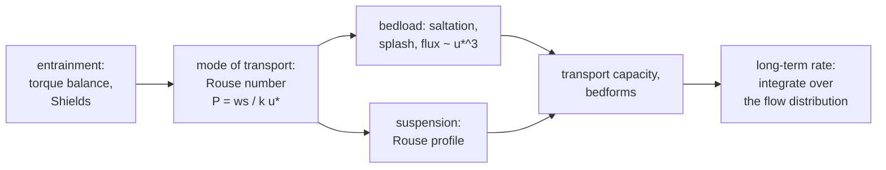

# LS24 · Sediment Transport Mechanics

◀ [[LS23 Bedrock Channels and River Incision]] · [[Landscapes and Geomorphology - Course Map|Course Map]] · next: (A&A continue with aeolian forms, coasts, big floods and whole landscapes; see the Course Map)

extra · book extra · beyond

> [!syllabus] Syllabus map: what is in the syllabus and what is extra in this chapter
> **No lecture source yet** (see [[LS21 River Hydraulics and Hydraulic Geometry]]). [[LS16 Fluvial Landscapes]] has the Shields criterion in outline (a scaling argument and a table of depths); [[LS17 Aeolian Landscapes]] has the wind-blown case. This chapter is the mechanics under both, following A&A Chapter 14 (the book writes it for wind and water together).
> 🟡 **Extra · book** (A&A Ch. 14; PDF = printed + 18): §2 entrainment by torque balance, the Shields diagram, the viscous sublayer, thresholds and hysteresis, recent progress on turbulence and lift ([[geomorphology-the-mechanics-and-chemistry-of-landscapes-9780521519786-0521519780_compress.pdf#page=473|printed pp.455–461]]); §3 modes of transport, saltation, the granular splash and the mass-flux law ([[geomorphology-the-mechanics-and-chemistry-of-landscapes-9780521519786-0521519780_compress.pdf#page=479|printed pp.461–468]]); §5 suspended sediment, the Rouse-type profile ([[geomorphology-the-mechanics-and-chemistry-of-landscapes-9780521519786-0521519780_compress.pdf#page=486|printed pp.468–473]]).
> 🔵 **Extra · beyond** (all numbers in `scripts/ls_rivers_numbers.py`, section LS24; the Rouse profile is verified to satisfy the settling–diffusion balance numerically): the explicit torque-balance formula and its sensitivity, the Brownlie evaluation of the Shields curve, the Ferguson–Church settling law and its Stokes limit, the derivation of the Rouse profile and of the mode map, Meyer-Peter–Müller bedload, the annual-transport integral over a wind distribution, the dune-migration estimate, and the problems.

> [!key] After this chapter you can
> - derive the **threshold of motion** from a torque balance, get $\tau_c\propto D$, and read the **Shields diagram** (why $\tau_{*c}\approx0.03$–$0.06$, why grains near 0.1 mm are the most easily moved, why thresholds in air are ten times higher in speed),
> - compute the **settling velocity** (Stokes at small $D$, a $\sqrt D$ law at large $D$) and classify transport modes by the **Rouse number** $P=w_s/\kappa u_*$,
> - derive the **Rouse concentration profile** and use it to say how high in the flow each grain size travels,
> - explain **saltation**: ballistic hops, the asymmetric drag-modified path, the granular splash, the wind feedback, and why the flux scales as $u_*^3$,
> - write the **bedload laws** (Meyer-Peter–Müller; Bagnold; Kawamura–Owen), and integrate a transport law over a distribution of flows to get a long-term rate,
> - estimate **dune migration** from the flux.

> [!intuition] The one-sentence story
> Grains sit still until the fluid's torque beats their weight (a *threshold*), then bounce along the bed or are carried up by turbulence depending on the ratio of their fall speed to the turbulent velocity; because the threshold sits in series with a high power of the fluid stress, a river or a wind moves most of its sediment in the rare strong events.

## 1. The pieces of the problem
A&A (p.454) take the problem apart into compartments: **(i) entrainment**, when does a grain start to move? **(ii) trajectories**, what path does it follow? **(iii) the splash** when a grain lands, **(iv) feedback** on the fluid, and **(v) conservation of sediment** to turn fluxes into bed change (the Exner equation of [[LS22 Floods Planform and River Profiles]] §3). The physics is the same for water and air except for one number, the density contrast $\rho_s/\rho_f$ ($\approx2.65$ in water, $\approx2200$ in air). That one number is why a saltating grain in air hits the bed with a lot of energy and splashes, and one in water lands softly (A&A p.463: water is only about a third as dense as the grain, so a grain approaching the bed must displace near-bed water and loses much of its momentum).

## 2. Entrainment: the threshold of motion
### 2.1 The torque balance
A grain of diameter $D$ sits in a pocket between grains below. It escapes by **rotating about its downstream contact point**, not by being lifted vertically (A&A p.455; lift is an order of magnitude smaller than drag in the classical treatment). Let the pocket angle be $\alpha$.

> [!derivation] 🟡 Extra · book: the critical shear stress
> *Resisting torque*: the submerged weight $F_g=\frac\pi6D^3(\rho_p-\rho_f)g$ times its lever arm $R_g=\frac D2\cos\alpha$. *Driving torque*: the drag $F_d=\tfrac12\rho_fC_d\,\bar U_b^2\,\big(\beta\tfrac\pi4D^2\big)$ on the exposed fraction $\beta$ of the grain's cross-section, times $R_d=\frac D2\sin\alpha$. Setting them equal at the point of escape,
>
> $$\bar U_b^2=\frac43\cot\alpha\,\frac{(\rho_p-\rho_f)}{\rho_f}\,\frac{gD}{C_d\beta}.$$
>
> The flow speed over the exposed part is, from the law of the wall (LS21), $\bar U_b=\frac{u_*}\kappa\ln(\bar z/z_0)$ with $z_0\approx0.1D$ (A&A's value for flow over natural sediment) and $\bar z$ the mean height of the exposed part; with $\tau_b=\rho_fu_*^2$ one obtains
>
> $$\boxed{\tau_c=\theta\,(\rho_p-\rho_f)\,g\,D},\qquad\theta=\frac43\cot\alpha\,\frac{\kappa^2}{C_d\,\beta\,\ln^2(\bar z/z_0)}.$$
>
> **The critical stress increases linearly with grain size; equivalently the critical shear velocity increases as $\sqrt D$.** The ratio $\theta=\tau_c/[(\rho_p-\rho_f)gD]$ is the dimensionless **Shields number** $\tau_{*c}$, now a *constant* set by geometry, drag and the log law.

*Numbers.* A&A (p.457) take $\kappa=0.4$, $\alpha=60^{\circ}$, $\beta=0.87$ (87 % of the grain exposed), $C_d=0.4$ and find $\theta\approx0.08$. With those values the formula reproduces **0.080 when the mean is taken at $\bar z=0.82D$**, my back-calculation of the unstated averaging height; averaging at $0.5D$ gives $0.14$ and at $D$ gives $0.067$. The result is sensitive to the pocket geometry: at $\bar z=0.83D$, $\alpha=45^{\circ},50^{\circ},60^{\circ},70^{\circ}$ give $\theta=0.139,\,0.116,\,0.080,\,0.050$ (because $\cot\alpha$ falls). Measured values are **$0.03$–$0.06$** (A&A), so the simplest theory overshoots by a factor of $\sim1.3$–$2.7$: real beds contain loose, exposed grains (pockets with small $\alpha$-effect, and varied sizes), and the instantaneous stress exceeds the mean.

> [!pitfall] Two roughness lengths, not a contradiction
> LS21 uses $z_0=D/30$ for the roughness of a bed seen *from above* by the whole depth of flow (Nikuradse). The entrainment problem looks at a single grain *inside* the roughness layer, where A&A use $z_0\approx0.1D$. They describe the same flow at different scales; a threshold calculation uses the second, a discharge calculation the first.

### 2.2 The Shields diagram and the trough at 0.1 mm
Plotting the threshold stress against grain size (A&A figure 14.3a) shows the expected linear rise for large grains but a **rise again for small grains**, so there is a *most easily entrained size*, about **0.1 mm in both air and water** (for quartz). Small grains resist because (A&A pp.457–458): (i) **cohesion**: electrostatic bonds of clays and micas, and surface-tension films of water between grains in damp sand; (ii) they sit **inside the viscous sublayer** of the near-bed flow and so hide from the turbulent sweeps and bursts.

The dimensionless version, $\tau_{*c}$ against the particle Reynolds number $Re_p=\sqrt{(s-1)gD^3}/\nu$, is the **Shields diagram**. The empirical fit of Brownlie (1981), $\tau_{*c}=0.22Re_p^{-0.6}+0.06\exp(-17.77Re_p^{-0.6})$ (recalled, `[verify]`; it contains no cohesion), has its **minimum $\tau_{*c}=0.032$ near $Re_p=57$, i.e. at a boundary Reynolds number $u_*D/\nu\approx10$** (a grain of $\sim0.6$ mm), and tends to **0.057** for large grains (figure LS24.1A). With the log-law shear velocity $u_*=\sqrt{\tau_b/\rho}$ this gives the thresholds below.

| $D$ | $Re_p$ | $\tau_{*c}$ | $\tau_c$ | $u_{*c}$ |
|---|---|---|---|---|
| 0.1 mm | 4.0 | 0.096 | 0.15 Pa | 1.2 cm/s |
| 0.2 mm | 11 | 0.052 | 0.17 Pa | 1.3 cm/s |
| 1 mm | 127 | 0.035 | 0.56 Pa | 2.4 cm/s |
| 2 mm | 360 | 0.042 | 1.4 Pa | 3.7 cm/s |
| 20 mm | $1.1\times10^{4}$ | 0.057 | 18 Pa | 14 cm/s |
| 200 mm | $3.6\times10^{5}$ | 0.060 | 193 Pa | 44 cm/s |

(Brownlie curve, quartz in water at 20 °C; the vault's earlier value $\tau_{*c}=0.045$ in LS16 sits mid-range.) *Reading it:* a stress of a few pascals moves sand; tens of pascals gravel; a couple of hundred pascals cobbles. **In air** the same grain needs a much higher shear *velocity*: with Bagnold's $u_{*t}=A\sqrt{[(\rho_p-\rho_f)/\rho_f]gD}$, $A\approx0.1$, a 0.2 mm sand grain on Earth needs $u_{*t}=0.21$ m/s (about 16 times the water value, 1.3 cm/s) and on Mars, where the air is $\sim60$ times thinner and $g=3.7$ m/s², **0.99 m/s** (with the same $A$; real values are larger because interparticle forces rise, `[verify]`). This is why wind-blown sand on Mars needs storm-force winds.

### 2.3 Thresholds are fuzzy, and have hysteresis
Entrainment of even well-sorted sand occurs over a *range* of flow speeds, because pockets differ; early measurements were by eye ("a significant number of grains moving"), and Nickling (1988) made it objective by counting interruptions of a laser beam bounced across a wind tunnel (A&A figure 14.5). Bagnold also noted **hysteresis in air**: the speed needed to *start* saltation (the *fluid threshold*) is tens of per cent higher than that needed to *stop* it (the lower **impact threshold**), because once grains are bouncing, their impacts keep entraining more.

### 2.4 Recent progress in the fluvial case
In water the fluid alone tells the whole story (no splash). High-speed filming (250 frames/s) and laser velocimetry (A&A pp.459–460) show:
- grains sit for long times, then **many move together in violent episodes**, even at mean stresses well below the Shields value (*marginal transport*);
- entrainment is tied to **sweeps** (fast fluid pushed toward the bed) and **bursts**; such events are rare, yet transport is **threefold** the mean-flow value during events occupying only $\sim10\%$ of the time;
- measuring forces on a single test sphere in a flume (Schmeeckle et al. 2007) shows the near-bed **drag coefficient is off by about a factor of two** from sphere-settling values, and the **lift** can be large at times (low Bernoulli pressure over the grain with deceleration below).

*Consequence for models* (A&A p.461): long-term transport needs both the transport law and the *distribution* of flow; where transport is spatially patterned (bedforms), the local turbulence structure matters, not just the mean stress.

![[fig_ls24_threshold.png]]
*Figure LS24.1. A: Shields curve (Brownlie fit) with markers at 0.1, 1, 20 and 200 mm; minimum 0.03 near $u_*D/\nu\approx10$. B: threshold shear velocity: water, and wind on Earth and Mars with $A=0.1$; the same grain needs 15–20 times the shear velocity in air. C: settling velocity: Stokes ($\propto D^2$) for small grains, $\propto D^{1/2}$ for large, the Ferguson–Church interpolation between.*

## 3. Modes of transport
Once a grain is up, its path depends on how fast it responds to the turbulent fluctuations compared with its flight time: **massive grains** average over the fluctuations and follow smooth ballistic arcs (**saltation**, deterministic); **light grains** follow them and wander (**suspension**, stochastic); the very finest (**wash load**) go wherever the water goes. Saltation plus rolling is **bedload**; suspension plus wash load is **suspended load** (A&A p.462).

### 3.1 Settling velocity
The terminal velocity balances weight against drag. At low particle Reynolds number the drag is viscous (Stokes) and at high Re it is quadratic:

$$w_s^{Stokes}=\frac{(s-1)gD^2}{18\nu},\qquad w_s^{high\,Re}\approx\sqrt{\frac{4(s-1)gD}{3C_d}}.$$

An interpolation that covers both (Ferguson and Church 2004, recalled `[verify]`) is $w_s=\dfrac{(s-1)gD^2}{C_1\nu+\sqrt{0.75\,C_2(s-1)gD^3}}$ with $C_1=18$, $C_2=1$ for natural grains; it reduces to Stokes as $D\to0$ (I verified: at 10 µm it is within 2 %).

| $D$ | $w_s$ (F–C) | $w_s$ (Stokes) | $Re_p$ |
|---|---|---|---|
| 0.01 mm | 0.09 mm/s | 0.09 mm/s | 0.00 |
| 0.1 mm | 7.5 mm/s | 9.0 mm/s | 0.75 |
| 0.5 mm | 71 mm/s | 225 mm/s | 36 |
| 1 mm | 126 mm/s | 899 mm/s | 126 |
| 5 mm | 0.32 m/s | 22 m/s | 1600 |
| 20 mm | 0.66 m/s | 360 m/s | 13 000 |

Stokes fails already at 0.1 mm (overestimates by 20 %) and is wrong by an order of magnitude at 1 mm.

### 3.2 The Rouse number
Compare the settling velocity with the turbulent velocity scale $u_*$ that keeps grains up:

$$\boxed{P=\frac{w_s}{\kappa u_*}}\quad(\text{the Rouse number}).$$

By the usual convention (Rouse 1937; Julien; not in A&A, `[verify]`): $P>2.5$ **bedload**; $1.2$–$2.5$ about half suspended; $0.8$–$1.2$ fully suspended; $P<0.8$ wash load. For a stream with $H=3$ m, $S=10^{-3}$ ($u_*=0.17$ m/s): sand of 0.25 mm has $P=0.46$ (carried high in the flow), 1 mm sand $P=1.8$ (partly suspended), and 5 mm gravel $P=4.7$ (bedload). **Higher shear velocity at the same grain moves it up the Rouse scale** (figure LS24.2B), which is how a flood converts bedload into suspended load. In the floodplain of [[LS22 Floods Planform and River Profiles]] §2, the drop of $u_*$ *raises* $P$ and deposits the coarser grains first.

## 4. Saltation (bedload in air, and in water)
### 4.1 The ballistic hop and the real, drag-skewed path
With no forces except weight (the cannon-ball problem, A&A pp.462–463) a grain launched with vertical speed $w_0$ at angle $\alpha$ rises to $h=w_0^2/2g$, flies for $T=2w_0/g$ and lands a distance $L=v_0^2\sin2\alpha/g$ away, longest at $45^{\circ}$; height and length scale with the *square* of the launch speed, the time with the speed itself. Numbers: $v_0=1$ m/s at $40^{\circ}$ gives $h=2.1$ cm and $L=10$ cm, the right order for sand in a moderate wind. On Mars, with $g=3.7$, hops are $\sim2.6$ times longer.

**Real saltation is skewed by drag.** Drag on the grain depends on $\mathbf U_{rel}=\mathbf U_{fluid}-\mathbf v_p$, so a grain launched into a moving fluid is *accelerated downwind* for most of its flight. A typical grain is launched at about $45^{\circ}$ but **lands at $10$–$15^{\circ}$** (the opposite asymmetry to a baseball, which is slowed), and it lands with **more speed and kinetic energy than it had at launch**: it has extracted momentum from the wind. The low angle of impact is what later makes ripples (LS17).

### 4.2 The splash and the feedback loop
In air the impact is violent: the grain **rebounds at about half its impact speed** and **ejects several grains at about a tenth of its impact speed** (the *granular splash*; Haff and Anderson 1993, A&A figure 14.10); most of the energy is lost to frictional rearrangement of grains. A chain reaction results: more grains aloft means more impacts and more grains splashed up. Why doesn't the whole world saltate? Because each grain **takes momentum out of the wind**, lowering the near-bed wind speed (wind-tunnel profiles, A&A figure 14.11), which reduces grain acceleration, impact speed and splash. This **negative feedback balances the positive splash feedback** and sets a steady flux. Full simulations of entrainment, trajectories, splash and wind feedback (Anderson and Haff 1988) reproduce the *threshold*, the *hysteresis*, the *nonlinear* flux law, the profiles of concentration and flux, and the **adjustment time of 1–2 s** (the saltation cloud needs several metres of fetch to reach its carrying capacity).

### 4.3 The mass-flux law: $q\propto u_*^{3}$
> [!derivation] 🟡 Extra · book: why the flux is cubic in the shear velocity
> The mass flux is $q=m\,N\,L$ with $m$ the grain mass, $N$ the number in motion per unit bed area and $L$ the hop length (A&A p.465). Launch speeds scale with $u_*$ (both components), so the hop time scales as $2w_0/g\propto u_*$ and the hop length $L=\text{(horizontal speed)}\times\text{(time)}\propto u_*^{2}$. The number launched per unit area, set by the splash balance, scales as $N\propto u_*$. Hence
>
> $$q\propto u_*\cdot u_*^{2}=u_*^{3}.$$
>
> Doubling the shear velocity multiplies the flux by 8. With the threshold, the standard laws are **Bagnold's** $q=C_B\sqrt{D/D_0}\,(\rho_a/g)\,u_*^{3}$ ($D_0=0.25$ mm; $C_B\approx1.8$ for naturally graded dune sand, recalled `[verify]`; A&A's printed constant is "0.18 in SI units" for their form, which is lost in the text layer) and the thresholded **Kawamura (Owen)** form $q\propto\frac{\rho_a}g(u_*-u_{*t})(u_*+u_{*t})^2$. *Numbers:* $u_*=0.4$ m/s and $D=0.25$ mm give $q=14$ g m$^{-1}$s$^{-1}$; with $u_{*t}=0.2$ m/s, doubling $u_*$ from 0.4 to 0.8 m/s multiplies the Kawamura flux by **8.3**.

### 4.4 Bedload in rivers
In water the grains do not splash and the saltation layer is thin; the empirical law that has lasted longest is **Meyer-Peter and Müller's**,

$$q_{b*}=\frac{q_b}{\sqrt{(s-1)gD^3}}=8\,(\tau_*-\tau_{*c})^{3/2},\qquad\tau_{*c}\approx0.047,$$

a $\tfrac32$ power of the **excess** Shields stress (recalled, `[verify]`). *Numbers:* $H=1$ m, $S=0.005$, $D=10$ mm: $\tau_*=HS/[(s-1)D]=0.30$, so $q_{b*}=8(0.256)^{1.5}=1.04$ and $q_b=4.2$ L m$^{-1}$s$^{-1}$, a mass flux of $\mathbf{11}$ kg m$^{-1}$s$^{-1}$: a river in flood. Doubling $\tau_*$ multiplies the excess by 2.2 and the flux by **3.2** (figure LS24.2C). The cubic eolian law and the $\frac32$-power fluvial law are the same idea in two fluids: *a threshold in series with a high power of the stress*.

## 5. Suspended sediment: the Rouse profile
### 5.1 The balance
In steady, uniform flow a sediment grain falls at $w_s$; turbulent mixing carries grains up. The downward settling flux $w_sC$ balances the upward turbulent flux $-\varepsilon\,\partial_zC$:

$$w_sC+\varepsilon\,\frac{dC}{dz}=0.$$

> [!derivation] 🟡 Extra · book (the continuum approach, A&A pp.469–473) and 🔵 checked: the Rouse profile
> Take the eddy diffusivity of sediment equal to the eddy viscosity of momentum, $\varepsilon=\kappa u_*z\,(1-z/H)$ (the parabolic closure of LS21 §4). Then
>
> $$\frac{dC}{C}=-\frac{w_s}{\kappa u_*}\frac{dz}{z(1-z/H)}=-P\,\Big(\frac1z+\frac1{H-z}\Big)dz\ \Longrightarrow\ \boxed{\frac{C(z)}{C_a}=\Big[\frac{H-z}{z}\cdot\frac a{H-a}\Big]^{P}},$$
>
> with $C_a$ the **reference concentration** at the reference height $a$ (say $a=0.05H$). Small $P$: nearly uniform concentration over the depth; $P\sim1$: concentration drops by an order of magnitude to the mid-depth; $P>2.5$: the grains are confined to the lowest few per cent. I confirmed numerically that this profile satisfies $w_sC+\varepsilon C'=0$ to $<0.5\%$ (script).

| $D$ | $w_s$ | $P$ | $C(0.5H)/C_a$ |
|---|---|---|---|
| 0.05 mm | 2.1 mm/s | 0.03 | 0.91 |
| 0.1 mm | 7.5 mm/s | 0.11 | 0.72 |
| 0.25 mm | 32 mm/s | 0.46 | 0.26 |
| 1 mm | 126 mm/s | 1.84 | 0.004 |
| 5 mm | 324 mm/s | 4.72 | $\sim10^{-6}$ |

($H=3$ m, $S=10^{-3}$, $u_*=0.172$ m/s, $a=0.05H$.) A stream that is brown with silt (0.05–0.1 mm) is nearly uniformly brown; the same stream carries 1 mm sand only in the lowest few decimetres. For the *flux*, multiply the concentration by the velocity (log law) and integrate: for $P=0.5$ the flux-weighted mean concentration is $24\%$ of the reference value.

### 5.2 What it says about rivers
Two results connect back to earlier chapters. **(1) Overbank deposition** ([[LS22 Floods Planform and River Profiles]] §2): water decanted from the *top* of the flow carries only the fine grains (low $C/C_a$ at height), and on the floodplain $u_*$ drops, $P$ rises and what is left falls out coarsest first. **(2) Sediment rating curves**: since $C_a$ itself rises steeply with $\tau_b$ (the near-bed entrainment), the suspended load grows with a high power of discharge ($Q_s\propto Q^{2}$–$Q^{3}$), the $j$ of the effective-discharge calculation.

![[fig_ls24_suspension.png]]
*Figure LS24.2. A: Rouse profiles for $P=0.1,\,0.5,\,1,\,2.5,\,5$ ($a=0.05H$). B: the mode map in the ($D$, $u_*$) plane for water: black line = threshold of motion, shaded regions bedload ($P>2.5$), mixed and full suspension ($P<0.8$). C: Meyer-Peter–Müller bedload against $\tau_*/\tau_{*c}$ compared with a linear law with the same start.*

## 6. From a transport law to a long-term rate
A transport law is useless without the *distribution* of flows; this is the magnitude–frequency argument of LS22 §1 in the eolian setting. A&A (pp.466–468) work it for sand dunes: the saltation system adjusts in $\sim2$ s, so ideally one needs wind data at 2 s resolution (about $3\times10^{7}$ time steps a year); more practically, take the *probability distribution of wind speeds* from a nearby station and **sum the transport law over the bins**.

> [!example] 🧮 Worked example: when does the wind move the sand?
> Let the shear velocity be lognormal with median $0.15$ m/s and $\sigma_{\ln}=0.5$ (a moderately windy site) and the threshold $u_{*t}=0.20$ m/s, with the Kawamura flux. The wind exceeds threshold only **28 %** of the time, but the *load* integrand peaks at $u_*=0.36$ m/s, **1.8 times the threshold**, a speed exceeded only **3.9 %** of the time; and **90 % of the annual transport happens at $u_*<0.67$ m/s**. Both the threshold (it removes the commonest winds) and the cubic law (it magnifies the strongest) push the effective wind to the upper tail: the same lesson as the flood of LS22 §1.1, and the reason the distribution of *gusts* and storms matters more than the mean wind.

## 7. A first look at bedforms: dune migration
Sediment continuity ($\partial_th=-\rho_b^{-1}\partial_xq$) with a flux that depends on the local flow makes flat beds unstable to **ripples and dunes** (LS17 and A&A Ch. 15). A dune of height $h$ that translates without changing shape at speed $c$ moves the mass $\rho_bh\,c$ per unit width per unit time past its crest, and this must equal the flux at the crest:

$$\boxed{c=\frac{q_{crest}}{\rho_b\,h}}.$$

*Numbers:* with the Bagnold flux of §4.3 ($14$ g m$^{-1}$s$^{-1}$, active 10 % of the time, $4.4\times10^{4}$ kg m$^{-1}$yr$^{-1}$) and bulk density 1600 kg/m³, a 2 m dune migrates at $\mathbf{14}$ m/yr, a 10 m dune at $\mathbf{2.8}$ m/yr and a 50 m dune at $0.56$ m/yr: **small dunes move fast, big ones slowly**, the inverse relation between height and speed.

## 8. Worked examples
> [!example] 🧮 Example 1: can this flow move the bed?
> A river with $S=0.003$ and depth $H=1.2$ m has $\tau_b=\rho gHS=35$ Pa. A Shields number $\tau_{*c}=0.045$ gives the largest grain moved: $D=\tau_b/[\tau_{*c}(\rho_s-\rho)g]=35/(0.045\times1650\times9.81)=0.048$ m, **48 mm gravel**. Cobbles of 150 mm stay put, so the bed in this reach, if it is armoured with cobbles, moves only in floods.

> [!example] 🧮 Example 2: which sand travels in suspension?
> $H=3$ m, $S=10^{-3}$: $u_*=0.172$ m/s, $\kappa u_*=0.069$ m/s. A grain with $w_s<0.8\times0.069=0.055$ m/s ($D\lesssim0.4$ mm) is fully suspended, one with $w_s>2.5\times0.069=0.17$ m/s ($D\gtrsim1.5$ mm) is bedload. In a flood with $u_*=0.34$ m/s the limits double: sand up to $\sim0.8$ mm is then fully suspended.

> [!example] 🧮 Example 3: a martian dune
> On Mars $g=3.7$ m/s² and $\rho_{air}=0.02$ kg/m³: a 0.2 mm grain needs $u_{*t}\approx1$ m/s (§2.2), about five times the terrestrial value; the same $u_*^3$ flux law in Bagnold form has $\rho_a/g=0.02/3.7=0.0054$ against $1.2/9.81=0.122$ on Earth, so at equal $u_*$ the flux is 23 times smaller. Only strong winds move sand on Mars, and when they do the hops are 2.6 times longer.

## 9. Check yourself
> [!question] Problems (answers folded)
> 1. A bed of 5 mm gravel ($\tau_{*c}=0.05$): find $\tau_c$, $u_{*c}$, and the flow depth needed on $S=0.004$.
> 2. Why does the torque-balance theory predict $\tau_c\propto D$ (and $u_{*c}\propto\sqrt D$)? What are two reasons real thresholds are *higher* for the smallest grains?
> 3. Compute $w_s$ (Stokes) for a 0.05 mm grain; compute $P$ for $u_*=0.1$ m/s. Mode?
> 4. In a 2 m deep flow with $u_*=0.12$ m/s, the reference concentration of 0.1 mm sand at $a=0.1$ m is 1 g/L. Estimate $C$ at $z=1$ m (use $w_s=7.5$ mm/s).
> 5. Show that the Kawamura flux $\propto(u_*-u_{*t})(u_*+u_{*t})^2$ tends to $u_*^3$ for $u_*\gg u_{*t}$, vanishes at threshold, and compute its ratio for $u_*=0.4$ vs $0.8$ at $u_{*t}=0.2$ m/s.
> 6. A saltating grain is launched at 1.5 m/s at 45°: hop height, length and flight time on Earth and Mars.
> 7. A 6 m dune migrates 4 m/yr. What yearly flux (bulk density 1600) does that imply?
> 8. Meyer-Peter–Müller: $D=20$ mm, $H=2$ m, $S=0.003$: $q_{b*}$ and $q_b$?
> 9. Explain why the flux of sand in air is $\propto u_*^3$ but the lower limit of transport is a *threshold*. How do the two features together bias the effective wind toward strong events?
> 10. Why does the eolian splash matter but the fluvial one hardly?

> [!example]- Answers
> 1. $\tau_c=0.05\times1650\times9.81\times0.005=4.05$ Pa; $u_{*c}=\sqrt{4.05/1000}=0.064$ m/s; $H=\tau_c/(\rho gS)=4.05/(9810\times0.004)=0.103$ m.
> 2. Torque of drag $\propto\rho U_b^2D^2\cdot D$, torque of weight $\propto(\rho_p-\rho)gD^3\cdot D$; with $U_b\propto u_*$ the ratio gives $\tau_c\propto D$ and $u_{*c}\propto\sqrt D$. Smallest grains: cohesion/surface tension, and hiding in the viscous sublayer.
> 3. $w_s=(s-1)gD^2/18\nu=1.65\times9.81\times2.5\times10^{-9}/(1.8\times10^{-5})=2.2$ mm/s. $P=0.0022/(0.4\times0.1)=0.056<0.8$: wash load / fully suspended.
> 4. $P=0.0075/(0.4\times0.12)=0.156$; $C(1)/C_a=[\frac{2-1}{1}\cdot\frac{0.1}{2-0.1}]^{0.156}=(0.0526)^{0.156}=0.63$, so $C\approx0.63$ g/L.
> 5. For $u_*\gg u_{*t}$, $(u_*-u_{*t})(u_*+u_{*t})^2\to u_*^3$; at $u_*=u_{*t}$ it is zero. Ratio: $(0.6\times1.0^2)/(0.2\times0.6^2)=0.6/0.072=8.3$.
> 6. Earth: $h=(1.5\sin45^\circ)^2/2g=0.057$ m, $L=v_0^2/g=0.229$ m, $T=2\times1.06/9.81=0.216$ s. Mars ($g=3.7$): $h=0.152$ m, $L=0.608$ m, $T=0.573$ s.
> 7. $q=\rho_bhc=1600\times6\times4=3.84\times10^{4}$ kg m$^{-1}$yr$^{-1}$ ($\approx24$ m³ m$^{-1}$yr$^{-1}$ of bulk sand).
> 8. $\tau_*=HS/[(s-1)D]=6\times10^{-3}/(1.65\times0.02)=0.182$; $q_{b*}=8(0.182-0.047)^{1.5}=8\times0.0496=0.397$; $q_b=0.397\times\sqrt{1.65\times9.81\times(0.02)^3}=0.397\times0.0114=4.5\times10^{-3}$ m²/s.
> 9. The cubic law amplifies strong winds; the threshold removes weak ones; the product peaks at $\sim1.8u_{*t}$ for a typical distribution (§6): rare strong events carry the transport.
> 10. In air the density contrast is $\sim10^3$ so grains hit hard and splash (a chain reaction that needs the feedback loop to be controlled); in water the grain must displace the fluid before landing and loses momentum, so the fluid, not the splash, sets the flux.

## 10. Summary
- Entrainment: torque balance on a grain in its pocket, $\tau_c=\theta(\rho_p-\rho_f)gD$, $\theta\approx0.08$ in the simple theory, $0.03$–$0.06$ measured; easiest size $\approx0.1$ mm.
- Shields diagram; thresholds are fuzzy; hysteresis in air; sweeps and bursts control marginal transport in water; lift and the drag coefficient are important near the bed.
- $w_s$: Stokes ($\propto D^2$) at small $Re_p$, $\propto\sqrt D$ at large; $P=w_s/\kappa u_*$ sets bedload vs suspension.
- Saltation: ballistic hop $h=w_0^2/2g$, $L=v_0^2\sin2\alpha/g$; drag-skewed; splash, wind feedback; $q\propto u_*^3$; Meyer-Peter–Müller $q_*=8(\tau_*-\tau_{*c})^{3/2}$.
- Suspension: Rouse profile $C/C_a=[\frac{H-z}{z}\frac a{H-a}]^P$.
- Long-term rates: integrate the flux law over the flow distribution; the load peaks at $\sim1.8$ times the threshold wind in the example; dune speed $c=q/\rho_bh$.

<!-- interactive:start (generated by scripts/embed_interactive.py; edit the tool in scripts/interactive/tools/, not this block) -->
> [!interactive]+ Interactive: Open-channel flow: Manning's equation and hydraulic geometry
> Left: a rectangular channel carrying discharge Q with bed slope S and roughness n.
>
> ![[ls_hydraulics.png|720]]
>
> **Try:** W = 20 m, S = 0.001, n = 0.03, Q = 50 m³/s gives depth 1.79 m, U = 1.39 m/s, bed shear τ_b = 17.6 Pa, Froude number 0.33 (subcritical). Steepen S (or lower n): Fr rises toward 1. In the right panel (b, f, m) = (0.5, 0.4, 0.1): doubling Q widens the channel by 41 %, deepens it by 32 % and speeds the flow up by only 7 %.
>
> [▶ Open the tool in your browser](../Assets/interactive/ls_hydraulics.html) · [absolute link](file:///home/swastik/Documents/notes/Assets/interactive/ls_hydraulics.html) · all tools and coverage: [[Interactive Tools]]

> [!interactive]+ Interactive: Moving sediment: Shields threshold and the Rouse suspension profile
> A flow moves a grain when the bed shear stress τ_b = ρ g H S exceeds the threshold τ_c = θ_c (ρ_s − ρ) g D (Shields).
>
> ![[ls_sediment.png|720]]
>
> **Try:** S = 0.003, H = 1.2 m: τ_b = 35 Pa and the largest mobile grain is 48 mm gravel (Shields number 0.045). Then set H = 3 m, S = 10⁻³ (u_* = 0.172 m/s) and move D from 0.05 to 5 mm: P goes 0.03 → 4.7, and C(0.5H)/C_a drops from 0.91 to 10⁻⁶.
>
> [▶ Open the tool in your browser](../Assets/interactive/ls_sediment.html) · [absolute link](file:///home/swastik/Documents/notes/Assets/interactive/ls_sediment.html) · all tools and coverage: [[Interactive Tools]]

<!-- interactive:end -->

## Map of this chapter
> [!connection] How LS24 connects
> **Previous:** [[LS21 River Hydraulics and Hydraulic Geometry]], [[LS22 Floods Planform and River Profiles]] (effective discharge, levees, braiding), [[LS23 Bedrock Channels and River Incision]] (tools and cover; abrasion $\propto U^3$) · **Earlier:** [[LS16 Fluvial Landscapes]] (Shields in outline), [[LS17 Aeolian Landscapes]] and [[LS19 Glacial and Aeolian Landforms]] (the wind case).
> **Across subjects:** [[Dimensional Analysis]] ($Re_p$, Shields, Rouse numbers), [[Gumbel Distribution]] and [[Normal Distribution]] (integrating a threshold law over a distribution of flows), [[Phase and Group Velocity]] and [[Dispersion Relation]] (saltation waves and the ripples that grow from them), [[Rotating Reference Frames]] (Coriolis in the atmosphere that sets the winds), [[CL13 Horizontal Motion - Geostrophic Balance and Friction]] (the boundary-layer friction that sets $u_*$ for wind), [[THX1 Diffusion Random Walks and the Heat Equation]] (suspension is turbulent diffusion against settling).

## Provenance
> [!provenance]- Source map for this chapter
> | Topic | Source | Scope |
> |---|---|---|
> | torque balance, Shields diagram, fluvial entrainment progress, modes, saltation, splash, feedback, flux law, long-term transport, suspension | A&A Ch. 14, printed pp.452–473 (PDF = printed + 18; text-layer reading of pp.454–468 in detail, the suspended-sediment section from its outline and the book's statement of the approach; the formulas were rederived) | extra · book |
> | $\theta(\bar z,\alpha)$ sensitivity, Brownlie evaluation, settling table, Rouse numerics, MPM example, annual-transport integral, dune speed, problems | my derivations, `scripts/ls_rivers_numbers.py` (LS24) | extra · beyond |
>
> **Flagged:** Brownlie's fit, Ferguson–Church's constants, the MPM coefficients (8 and 0.047), the Rouse-number class boundaries (2.5, 1.2, 0.8), Bagnold's $C_B=1.8$ (A&A print 0.18 for a form lost in the text layer), the Martian threshold constant and the averaging height $\bar z=0.82D$ in $\theta$ (back-calculated, not stated in the text I read) are `[verify]`.
