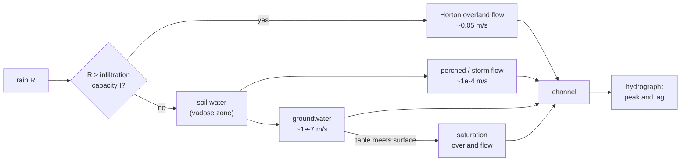

# LS25 · Water in the Landscape: Basins, Soil Water, Groundwater, Runoff and Channel Heads

◀ [[LS24 Sediment Transport Mechanics]] (A&A Ch. 11 is read here after Ch. 12–14 because the river chapters were written first) · [[Landscapes and Geomorphology - Course Map|Course Map]] · next: [[LS26 Sea Level and Ocean Waves]]

extra · book extra · beyond

> [!syllabus] Syllabus map: what is in the syllabus and what is extra in this chapter
> **No lecture source** (the fluvial and hydrological lectures have not been taught; see [[LS21 River Hydraulics and Hydraulic Geometry]]). The pre-midsem deck has drainage density and Hack's law only as scaling facts ([[LS03 Digital Elevation Models and Terrain Analysis]], [[LS16 Fluvial Landscapes]]); everything below is new.
> 🟡 **Extra · book** (Anderson and Anderson, *Geomorphology*, Ch. 11, printed pp.348–378; **PDF page = printed + 18**): §1 drainage basins and Horton's laws ([[geomorphology-the-mechanics-and-chemistry-of-landscapes-9780521519786-0521519780_compress.pdf#page=368|p.350]]); §2 water balance and soil moisture (pp.352–355); §3 infiltration, Green–Ampt (p.355); §4 groundwater, Darcy, Dupuit (pp.358–363); §5 runoff mechanisms (pp.363–366); §6 Horton overland flow and sheetwash ([[geomorphology-the-mechanics-and-chemistry-of-landscapes-9780521519786-0521519780_compress.pdf#page=385|p.367]]); §7 drainage density and channel heads (pp.370–374); §8 the Coos Bay hollow (pp.374–376).
> 🔵 **Extra · beyond** (all numbers in `scripts/ls_hydro_coast_numbers.py`, section LS25, each checked by a second route): the **random-topology simulation of Horton's bifurcation ratio** ($R_b=3.99$), the derivation of the hillslope length $1/(2D_d)$ and the mean flow distance $1/(4D_d)$, the closed-form pipe-lattice permeability $k=\phi d^2/96$ (checked against Poiseuille), the Green–Ampt implicit solution (checked against an ODE solver), the Dupuit ellipse (checked by finite differences) and its linearised-diffusion time scale, the closed form $X_c=\frac{\tau_c}{\rho gS(R-I)}\sqrt{8\tau_c/\rho f}$, the kinematic-wave equilibrium time $h(L)/(R-I)$, and the problems.

> [!key] After this chapter you can
> - state **Horton's laws** and explain why random branching gives $R_b\approx4$; relate **drainage density** to hillslope length and to the speed of a basin's response,
> - write the **water balance** and the three storage reservoirs (soil water, groundwater, surface),
> - describe soil moisture with **porosity, field capacity, wilting point** and capillary suction $2\gamma/\rho gr$, and derive **Darcy's law** and the permeability of a pipe-lattice,
> - solve **Green–Ampt infiltration**: ponding time, capacity $f(t)\to K_s$,
> - derive the **Dupuit water table** (an ellipse) and its steady discharge $IL/2$, and its relaxation time from the linearised diffusion equation,
> - distinguish **Horton overland flow, saturation overland flow and subsurface storm flow**, compute **Horton's belt of no erosion** $X_c$, and say why it fails in vegetated terrain,
> - explain how **channel heads** are set (overland flow, saturation, landslides, sapping) and what the **Coos Bay** experiment showed about flow through bedrock.

> [!intuition] The one-sentence story
> Water falls, and then it has a choice: run over the surface (fast, 10$^{-1}$ m/s, but only when rain outruns the soil's ability to drink), sink into the soil (slow, 10$^{-5}$ m/s), or go deeper still (slower, 10$^{-7}$ m/s); the mix of the three, set by soil, slope and the storm's recent history, decides how flashy a river is, where the channels begin, and therefore how long the hillslopes are.

*Concept map: each box is a section.*

## 1. Drainage basins
A **drainage basin** (catchment) is the area that contributes runoff to a point on a river. Because water integrates everything upstream, A&A (p.349) call it "the fundamental unit of landscapes": sediment, solute and water budgets are simplest to close for a basin. Areas without regularly branching rivers and clear divides are called "deranged".

### 1.1 Strahler order and Horton's law of stream numbers
Strahler (1952) numbered streams: a **first-order** stream has no tributaries; two streams of order $j$ meeting make one of order $j+1$; a stream meeting a lower-order one keeps its order. Horton (1945) found that the number $N_j$ of streams of order $j$ falls geometrically,

$$\frac{N_j}{N_{j+1}}=R_b\ (\text{the bifurcation ratio}),\qquad N_j=N_1R_b^{-(j-1)},$$

a straight line of $\log N_j$ against $j$; $R_b$ is "commonly about 3 or 4" (A&A p.350) and varies little between landscapes, unlike drainage density.

> [!derivation] 🔵 Extra · beyond (simulated): why $R_b\approx4$ without any physics
> The ratio need not be a property of rivers; it is largely a property of *branching trees*. Take **random topology**, in which every topologically distinct network with $n$ sources is equally likely (Shreve). I generated such networks by the cycle lemma (a random sequence of $n-1$ junctions and $n$ sources, rotated so that it encodes a plane binary tree), assigned Strahler orders, and counted streams. Averaged over 40 networks of 4096 sources:
>
> | order $j$ | 1 | 2 | 3 | 4 | 5 | 6 | 7 |
> |---|---|---|---|---|---|---|---|
> | $N_j$ | 4096 | 1026 | 257 | 63 | 15.8 | 4.1 | 1.2 |
>
> The ratios are $3.99,\ 4.00,\ 4.07,\ 4.00,\ 3.84$ and the least-squares slope of $\log_{10}N_j$ against $j$ is $-0.601$, i.e. $R_b=3.99$ (figure A). **Horton's "law" is what randomness gives**: real networks have $R_b$ between 3 and 5 because their branching is close to random. (The same accident of counting underlies many scaling laws; compare Hack's law, [[LS16 Fluvial Landscapes]]. See [[Random Walk]] and [[Counting Principles]] for the combinatorics.)

The regular branching has led some to call networks *fractal*, because they look the same at every magnification (A&A Fig. 11.2); but A&A stress that the self-similarity **stops at the channel heads**: above each first-order stream there is only a slightly concave bowl, a *zero-order basin* (§7).

### 1.2 Drainage density and the length of hillslopes
**Drainage density** is total channel length per unit basin area, $D_d=\sum L_i/A$ (units 1/length; A&A p.351). It sets the **hillslope length**, the distance from a divide to the nearest channel.

> [!derivation] 🔵 Extra · beyond (checked by Monte Carlo): hillslope length $=1/(2D_d)$
> Idealise a basin as parallel channels a distance $w$ apart. A strip of unit length contains one channel per width $w$, so $D_d=1/w$. A point between two channels lies a distance $x$ from the left one and $w-x$ from the right; the nearest channel is at $d=\min(x,w-x)$. If points are uniform, $d$ is uniform on $[0,w/2]$ with mean $w/4$. Hence
>
> $$\text{divide-to-channel (hillslope) length}=\frac w2=\frac1{2D_d},\qquad\text{mean distance to the nearest channel}=\frac w4=\frac1{4D_d}.$$
>
> A simulation of $2\times10^{5}$ points with $w=200$ m gives mean distance 50.0 m (figure B). *Numbers:* $D_d=1,\ 5,\ 20,\ 100$ km/km$^2$ give hillslope lengths $500,\ 100,\ 25,\ 5$ m. A&A's $D_d\propto1/X_c$ (§6) is the same statement with $X_c$ the distance to the channel head.

**Why it matters:** this is the *slope–channel dichotomy* (A&A p.351). Water in a channel moves orders of magnitude faster than water on or under the hillslope, so a landscape with short hillslopes (high $D_d$, badlands) delivers rainfall to the outlet quickly: **flashy** discharge. A 1 km² shale-badland basin in Utah sent a flood wave past three sonic gauges within 30 minutes of the start of rain (A&A Fig. 11.3).

## 2. The water balance
Conservation of water volume in a basin (A&A eq. 11.2):

$$\frac{dS}{dt}=A\,R-Q_s-Q_{gw}-A\,ET,$$

with $S$ the storage (soil water, groundwater, snow, ice, lakes), $R$ rainfall rate, $Q_s$ stream discharge (the *hydrograph*), $Q_{gw}$ groundwater export and $ET$ evapotranspiration (evaporation plus plant transpiration). Over a year or longer $dS/dt\approx0$ and $Q_{gw}$ is usually small, so

$$\boxed{R-ET=\frac{\overline{Q_s}}A}\qquad(\text{effective precipitation} = \text{runoff depth}).$$

This gives the mean annual $ET$ if runoff is gauged, or the runoff if $ET$ can be estimated. *Numbers:* the Oregon Coast Range receives $R=2$ m/yr; with $ET=0.6$ m/yr, $R-ET=1.4$ m/yr and a **runoff ratio** of 0.70. The 860 m² hollow of §8 then yields $860\times1.4=1200$ m³/yr, a mean discharge of **0.038 L/s**. On the time scale of a storm the storage term cannot be dropped: rain only adds to the balance while it falls, and afterwards stream, groundwater and $ET$ outflows are fed *from storage*.

## 3. Water in the soil
### 3.1 Porosity, field capacity and wilting point
**Porosity** $\phi=V_{voids}/V_{total}$ and **volumetric water content** $\theta=V_{water}/V_{total}$; $\theta=\phi$ at saturation. Gravels have $\phi\sim30$–$40\,\%$, silts and clays up to $50\,\%$ (A&A Fig. 11.4). Two limits matter to plants and to runoff:
- **field capacity** $\theta_{fc}$: the water content after free drainage; what remains is held against gravity by surface tension;
- **permanent wilting point** $\theta_{pwp}$: the lower content at which plants can no longer pull water out (the suction they can exert is $\sim1.5$ MPa); **available water** $=\theta_{fc}-\theta_{pwp}$.

Clay-rich soils have large $\theta_{fc}$ but also large $\theta_{pwp}$, so *loam* (an even mixture of sand, silt and clay) offers the largest available water.

### 3.2 Why small pores hold water: capillary suction
Water rises in a tube of radius $r$ until the weight of the column balances the surface-tension force $2\pi r\gamma\cos\vartheta$: $\rho g\pi r^2h=2\pi r\gamma\cos\vartheta$,

$$h=\frac{2\gamma\cos\vartheta}{\rho gr}\ \ (\gamma=0.072\ \text{N/m},\ \vartheta\approx0).$$

| pore radius | 100 µm | 10 µm | 4.3 µm | 1 µm | 0.1 µm |
|---|---|---|---|---|---|
| suction head | 0.15 m | 1.5 m | **3.4 m** | 14.7 m | 147 m |
| suction | 1.4 kPa | 14 kPa | **33 kPa** | 144 kPa | 1.4 MPa |

*Reading it:* field capacity ($-33$ kPa, 3.4 m) is the water content at which pores larger than $\sim4.3$ µm have drained and pores smaller than that still hold on; the wilting point ($-1.5$ MPa, 153 m) corresponds to pores of radius **0.1 µm**, the scale of clay interlayers. A soil has a *distribution* of pore sizes, so it has a **water-retention curve** $\psi(\theta)$ (suction against water content) and a **hydraulic-conductivity curve** $K(\theta)$ (the "characteristic curves", A&A Fig. 11.6). Both are strongly nonlinear: $K$ falls by orders of magnitude as the soil dries, because water retreats into small pores (flux through a pore $\propto d^4$, §3.4) and fewer pores conduct.

### 3.3 The profile above a water table
In equilibrium nothing moves, so the Darcy flux $q=-K\,\partial_z(\psi-z)$ vanishes: the pressure head $\psi$ equals the elevation head; **suction increases linearly with height above the water table**, $\psi=z$. The water content profile $\theta(z)$ is therefore the retention curve $\theta(\psi)$ plotted on its side, a sigmoid (A&A Fig. 11.5). Layers (from the water table up): the **saturated zone** (groundwater, below the table); the **capillary fringe** (still saturated, held in tension; thicker in fine soils); the **vadose** (unsaturated) zone, drawn down by evapotranspiration at the top. The fringe height is the suction head of the *largest* pores that stay filled, so $h\approx2\gamma/\rho g\,r_{max}$: 0.3 m in coarse sand ($r=50$ µm), 3 m in silt (5 µm), 30 m in clay (0.5 µm).

### 3.4 Darcy's law and permeability
**Darcy's law** (A&A Box 11.1): the discharge through porous medium of area $A$ along a head gradient $dh/dl$ is $Q=-KA\,dh/dl$, with $K$ the **hydraulic conductivity** (m/s), $K=k\rho g/\mu$, and $k$ (m²) the *intrinsic permeability*, a property of the medium alone. $K$ spans **13 orders of magnitude**: up to $\sim1$ m/s in gravel to $10^{-13}$ m/s in unfractured shale and granite (A&A Table 11.1).

> [!derivation] 🟡 Extra · book + 🔵 verified: $k=\phi d^2/96$ for a lattice of pipes (A&A Box 11.3)
> Model the medium as three orthogonal sets of straight tubes of diameter $d$ on a cubic lattice of spacing $D$ (the grain or block size). *One tube* in laminar flow (Poiseuille, radius $R=d/2$) carries $Q_1=\pi R^4\,\Delta p/(8\mu\ell)=\pi d^4\,\Delta p/(128\mu\ell)$ for a pressure gradient $\Delta p/\ell$: the **fourth-power law** (doubling $d$ gives 16 times the flow). The flow-aligned tube serves a cross-section $D^2$, so the Darcy velocity is $q=Q_1/D^2$ and by definition $q=(k/\mu)\Delta p/\ell$:
>
> $$k=\frac{\pi d^4}{128D^2},\qquad\text{and the porosity is }\phi=\frac{3\,(\pi d^2/4)\,D}{D^3}=\frac{3\pi d^2}{4D^2},\ \text{so}\quad\boxed{k=\frac{\phi\,d^2}{96}}.$$
>
> (The 1/96 is for this geometry; real media add a tortuosity factor, hence A&A's $k=C\phi d^2$.) I checked it numerically (Poiseuille flow in a 100 µm tube on a 300 µm grid: $k=2.727\times10^{-11}$ m² from both routes). **Hydraulic conductivity therefore combines the fluid ($\rho g/\mu$) and the medium ($\phi d^2$).** Taking $d=0.41D$ (so that $\phi=0.4$): coarse sand ($D=1$ mm) $K=6\times10^{-3}$ m/s, medium sand (0.3 mm) $6\times10^{-4}$ m/s, silt (20 µm) $3.5\times10^{-6}$ m/s, within the measured ranges (the silt at the upper end).

### 3.5 The Richards equation (stated)
Continuity of moisture, $\partial_t\theta=-\partial_zq_z$, with the unsaturated Darcy flux $q_z=-K(\theta)\,\partial_z[\psi(\theta)-z]$ (depth $z$ downward) gives **Richards' equation** (1931; A&A Box 11.2), a strongly nonlinear diffusion-type equation because $K$ and $\psi$ both depend on $\theta$. It is too costly for most landscape work and is replaced by the **Green–Ampt** model of the next section, which keeps the one essential feature: a sharp wetting front moving down.

## 4. Infiltration
**Infiltration** is the passage of water from the surface into the soil. Its *capacity* $I$ decides whether rain becomes soil water (and recharge, plant water, subsurface flow) or **overland flow**; overland flow is "much more efficient" than subsurface flow, so $I$ controls the flashiness of rivers and the locations of channel heads. Infiltration capacity **declines during a storm** (fine grains plug macropores, clays swell and close cracks, the soil saturates), reaching the saturated conductivity $K_s$ (A&A Fig. 11.7).

> [!derivation] 🟡 Extra · book + 🔵 solved: the Green–Ampt model
> Assume a sharp **wetting front** at depth $F/\Delta\theta$ ($F$ the cumulative infiltration per unit area, $\Delta\theta$ the moisture deficit it fills), with soil saturated above and dry below, and a suction head $\psi_f$ at the front. Darcy's law across the wetted layer, with a head drop $\psi_f+F/\Delta\theta$ over the thickness $F/\Delta\theta$, gives the infiltration rate
>
> $$f=\frac{dF}{dt}=K_s\Big(1+\frac{\psi_f\Delta\theta}{F}\Big).$$
>
> Early on $F$ is small and $f$ is large (steep suction gradient); as the front deepens $f\to K_s$. Separating variables: $F-\psi_f\Delta\theta\,\ln(1+F/\psi_f\Delta\theta)=K_st$. With rain at rate $R>K_s$ the surface ponds when $f$ falls to $R$, at
>
> $$F_p=\frac{\psi_f\Delta\theta\,K_s}{R-K_s},\qquad t_p=\frac{F_p}R,$$
>
> after which the capacity $f(t)$ governs and the excess $R-f$ runs off. *Numbers:* $K_s=1\times10^{-6}$ m/s (3.6 mm/h), $\psi_f=0.2$ m, $\Delta\theta=0.3$, $R=20$ mm/h: ponding after $F_p=13.2$ mm at $t_p=39.5$ min. The capacity then falls to 15.0, 10.5, 8.9 and 7.0 mm/h at 1, 2, 3 and 6 h (the implicit solution agrees with direct ODE integration to $10^{-6}$; figure B). **In a 3-hour, 20 mm/h storm 40.9 mm of 60 mm infiltrates: the runoff ratio is 0.32**, though only 3.6 mm/h would infiltrate in the long run.

**Spatial and temporal memory.** Infiltration capacity varies down a **catena** (a hillslope transect; clays accumulate at the base), and with vegetation (roots open conduits; arid shrubs sit on mounds of high conductivity). It also depends on **antecedent moisture**: "the landscape has a memory" (A&A p.357), a few days in shale badlands (low clay storage, rapid ET) up to a week or ten days in coastal California. At Wilder Creek (California, winter 1997–98) early storms produced a runoff coefficient of about 7 % and later storms of the same size far more (A&A Fig. 11.8): the same rain gives a different river depending on what fell before it.

## 5. Groundwater
Subsurface flow is slow, so groundwater **delays and smooths** inputs (it supports the *baseflow* of rivers long after rain) and has a long memory; it also triggers landslides by raising pore pressure (the lag between rain and slide, [[LS13 Landslides]]). Terms: the **vadose** (unsaturated) zone, the **phreatic** (saturated) zone, and the **water table** between them.

### 5.1 The evolution equation of the water table
Take a vertical column of cross-section $dx\,dy$ with the water table at height $H$ above an impermeable base. Conservation of water (A&A eq. 11.12; the term for reactions that make or consume water is dropped):

$$S_y\frac{\partial H}{\partial t}=-\frac{\partial q_x}{\partial x}-\frac{\partial q_y}{\partial y}+I,$$

where $I$ is the infiltration (recharge) rate from above, $q$ the discharge per unit width and $S_y$ the **storativity** (effective porosity: the fraction that can drain freely; smaller than $\phi$). For a flat table with no flow, $\partial_tH=I/S_y$: low storativity magnifies the rise, "simply because there aren't as many pores into which to stick the water". Steady, one-dimensional, uniform recharge $I_0$: $dq_x/dx=I_0$, so **the groundwater discharge grows linearly with distance from the divide**, $q_x=I_0x$, exactly like regolith on a hillslope and overland flow in §6.

### 5.2 The Dupuit solution
Close the equation with Darcy's law: for an unconfined aquifer the head gradient equals the table slope and the flux is $q_x=-KH\,dH/dx$ (the product $KH$ is the **transmissivity**). **Dupuit's approximation** (flow nearly horizontal because the interfluve is much longer than the water table is high) then gives, with $d(H^2)/dx=2H\,dH/dx$,

$$K\frac{d}{dx}\Big(H\frac{dH}{dx}\Big)=\frac K2\frac{d^2(H^2)}{dx^2}=-I_0.$$

> [!derivation] 🟡 Extra · book + 🔵 checked: the water table is an ellipse
> Integrate twice, $H^2=-\dfrac{I_0}Kx^2+c_1x+c_2$, with the water table meeting the streams at their stage, $H(0)=H_0$ and $H(L)=H_L$:
>
> $$\boxed{H^2=H_0^2+(H_L^2-H_0^2)\frac xL+\frac{I_0}K\,x(L-x)},$$
>
> an **ellipse** (the equation is quadratic in $H^2$; A&A Fig. 11.10). The crest height grows with $I_0/K$: for equal stages $H_0=H_L$ the crest is $H_{max}=\sqrt{H_0^2+\dfrac{I_0L^2}{4K}}$ at the midpoint. The discharge to *each* stream is $I_0L/2$ per unit length of channel (all the recharge from half the interfluve). *Numbers:* $K=10^{-5}$ m/s, recharge $I_0=2\times10^{-8}$ m/s (0.63 m/yr), channels $L=500$ m apart at stage $H_0=5$ m: $H_{max}=\sqrt{25+125}=12.2$ m, **7.2 m above the streams**, and discharge $5.0\times10^{-6}$ m²/s $=158$ m³/yr per metre of channel. I verified numerically that this $H(x)$ satisfies $d/dx(KH\,dH/dx)=-I_0$ (residual $<0.2\,\%$) and that $-KH\,dH/dx$ at the stream equals $I_0L/2$. With unequal stages (15 m and 5 m) the divide shifts toward the lower channel (crest at $x=150$ m of 500; figure C).

> [!connection] The water table obeys a diffusion equation (and so ties to THX1)
> For small changes about a mean thickness $\bar H$, $K H\,\partial_xH\approx K\bar H\,\partial_xH$ and the evolution equation becomes **linear**: $\partial_tH=D_H\,\partial_x^2H+I/S_y$, with the **hydraulic diffusivity** $D_H=K\bar H/S_y$. For $K=10^{-5}$ m/s, $\bar H=10$ m, $S_y=0.2$: $D_H=5\times10^{-4}$ m²/s, so the lowest mode of a 500 m interfluve relaxes in $L^2/(\pi^2D_H)=1.6$ yr: the water table forgets a recharge pulse in a couple of years. This is the same equation as heat conduction, hillslope creep and alluvial rivers ([[THX1 Diffusion Random Walks and the Heat Equation]], [[Diffusion Equation]]); a river-stage oscillation penetrates the bank with the *skin depth* $\sqrt{2D_H/\omega}$.

### 5.3 Rules of thumb for the geomorphologist
(A&A p.363.) The water-table mound is a smoothed copy of the topography with its boundaries fixed by the rivers and the sea, so **moving the boundary** (incision, base-level change) moves the whole groundwater field. Flow paths are nearly vertical near the surface and bend toward the bounding channel at depth; near-surface soil is more conductive than deeper material, so contrasts in $K$ steer flow sideways (a thin regolith on impermeable rock carries all its flow parallel to the surface). Groundwater **converges in hollows** and diverges from noses, which is why landslides and seeps are found in hollows (§7).

## 6. Runoff mechanisms
How does rain reach the channel? Freeze (1974) and Dunne's field work distinguish three routes (A&A pp.363–366, Figs. 11.12–11.14):

| mechanism | when | speed | hydrograph |
|---|---|---|---|
| **Horton overland flow** (HOF): $R>I$ | arid, bare, crusted or paved soil; intense rain | fastest ($\sim10^{-1}$ m/s) | flashy: high peak, short lag |
| **Saturation overland flow** (SOF): the water table reaches the surface | humid, hollows and valley bottoms, near channels | fast, over a *saturated* contributing area that grows during the storm | intermediate; peak grows as the catchment wets up |
| **Subsurface storm flow** (SSSF): flow through conductive soil layers, perched on a less conductive one | forests, permeable soils | $\sim10^{-4}$ m/s | sluggish: low peak, long lag |
| groundwater baseflow | always | $\sim10^{-7}$ m/s | the slow tail |

Dunne and Black (1970), on forested Vermont hillslopes where rain never exceeds infiltration capacity, found SOF, and with Hewlett and Hibbert the **variable source area**: the saturated, runoff-producing fraction of the basin *expands* as a storm proceeds and a season advances, hugging the channel network (A&A Fig. 11.13), so the **lag to peak** shortens as the basin wets up. This is the mechanism behind the "memory" of §4.

> [!example] 🧮 Why the mechanism sets the lag (numbers)
> Over a 100 m hillslope, travel time at **0.05 m/s** (overland flow) is $2000$ s $=0.6$ h; through a soil with $K=10^{-4}$ m/s, gradient 0.3 and $n=0.4$ (SSSF, speed $7.5\times10^{-5}$ m/s) it is $1.3\times10^{6}$ s $=15$ d; through groundwater ($K=10^{-5}$ m/s, gradient 0.05, $n=0.3$, $1.7\times10^{-6}$ m/s) $6\times10^{7}$ s $=694$ d, nearly two years. **The speed ratio overland : subsurface is $\sim700:1$.** A landscape that promotes overland flow (pavement, bare soil, short hillslopes) therefore has a hydrograph that is both higher and earlier (figure LS25.1C).

**What controls each term.** Rainfall intensity (climate); infiltration capacity (soil *texture*: pore size and connectedness, not total porosity; soil *structure*: aggregation promoted by organics, cation bridges, thin water films, which opens cracks; and vegetation); evapotranspiration (temperature, humidity, wind, plant architecture, leaf albedo, rooting depth); storage (§3).

## 7. Overland flow, sheetwash and Horton's belt of no erosion
### 7.1 The thickness of a sheet of water
Consider rain at rate $R$ on a plane slope $S=\sin\theta$ with infiltration capacity $I<R$ (uniform, steady). Conservation of water in a box $dx$ long gives $\partial_th=(R-I)-\partial_xq$ ($q$ the discharge per unit width); in steady state $dq/dx=R-I$ and

$$q(x)=(R-I)\,x,$$

linear in the distance from the divide (the third time this chapter's balance gives a linear flux). To turn $q=Uh$ into a thickness, use the Darcy–Weisbach law of LS21, $U=\sqrt{8ghS/f}$:

$$h(x)=\Big[(R-I)\,x\sqrt{\frac f{8gS}}\Big]^{2/3}\propto x^{2/3},\qquad\tau_b=\rho g\,h\,S.$$

The flow thickens as $x^{2/3}$, a little less than linearly, because the speed increases with depth (thicker flow is faster); a steeper slope needs less thickness to pass the discharge. *Numbers* ($S=0.004$, $f=0.5$, $R=5$ mm/h, $I=2$ mm/h): $h(100\text{ m})=2.2$ mm, $\tau_b=0.087$ Pa and $h(400)/h(100)=2.52=4^{2/3}$ (verified). The equilibrium time for a wave to reach distance $L$ (kinematic wave with celerity $\tfrac32U$) is simply $t_e=h(L)/(R-I)$: at $L=100$ m, **44.6 min** (quadrature agrees to $10^{-6}$).

### 7.2 Horton's belt of no erosion
Horton (1945) argued that on bare arid slopes sediment moves only where $\tau_b$ exceeds the threshold $\tau_c$ (LS24); the stress rises with $x$, so there is a **belt of no erosion** of width $X_c$ below each divide, and rills begin below it.

> [!derivation] 🔵 Extra · beyond (verified): a closed form for $X_c$
> Set $\tau_b=\tau_c$: $h_c=\tau_c/(\rho gS)$ and, from Darcy–Weisbach, $U_c=\sqrt{8gh_cS/f}=\sqrt{8\tau_c/(\rho f)}$, **independent of the slope**. Then $q_c=h_cU_c=(R-I)X_c$ gives
>
> $$\boxed{X_c=\frac{\tau_c}{\rho gS\,(R-I)}\sqrt{\frac{8\tau_c}{\rho f}}}\ \propto\ \frac{\tau_c^{3/2}}{S\,(R-I)\sqrt f}.$$
>
> $X_c$ is shorter for steeper slopes, heavier excess rain, rougher flow (large $f$ thickens it), and weaker soil. *Numbers* ($\tau_c=0.17$ Pa, 0.2 mm sand, $f=0.5$; $h_c=4.3$ mm, $U_c=0.052$ m/s): gentle rain $5/2$ mm/h: $X_c=271$ m at $S=0.004$ and 22 m at $S=0.05$; a 50/5 mm/h storm: 18 m and 1.4 m; a 100/5 mm/h cloudburst: 8.6 m and 0.7 m (a numerical march of $\tau_b(x)$ agrees: 272 m). **Drainage density follows**: $D_d\sim1/2X_c$ is large for wet or steep or bare terrain (figure B).

### 7.3 Why the theory is now thought incomplete
The runaway argument (a perturbation in thickness focuses flow and cuts a rill; Smith and Bretherton 1972) is formal, but A&A list (pp.371–372) objections that "now have so many holes in it": (i) as a rill forms, the nose between rills loses its sheetflow cover, is hit by raindrops and **diffuses sideways into the rill**, delaying rill heads *downslope* of $X_c$; (ii) arid vegetation grows on **mounds of high conductivity** that suck up the sheetflow; (iii) Dunne (1991) on 1 km smooth convex Kenyan hillslopes could not find Horton overland flow in the field, and rainsplash (millimetre scale) cannot smooth a slope hundreds of metres long unless it acts over millions of years. Sheetwash survives as the end-member for bare badlands (and parking lots).

## 8. Where channels begin
### 8.1 Saturation and the topographic index
Where subsurface flow is the rule, channel heads are placed by the **convergence of subsurface flow**. A cell of the landscape with contributing area $A$ and downslope contour length $c$ receives $q_rA$ (steady recharge $q_r$) and can pass $T\,S\,c$ through its base, with $T$ the transmissivity (conductivity times soil thickness) and $S$ the local surface slope. If the inflow exceeds the capacity the excess exits as SOF:

$$\boxed{\frac{A}{c}\ \ge\ \frac{T}{q_r}\,S\ \ \Longleftrightarrow\ \ \frac{a}{S}\ \ge\ \frac T{q_r}},\qquad a=A/c.$$

The left side, the **geomorphic (topographic) index**, can be computed at every grid cell of a DEM (A&A p.372; [[LS03 Digital Elevation Models and Terrain Analysis]]); the right side holds climate and soil. *Numbers* ($q_r=20$ mm/d): clayey till ($T=10^{-6}$ m²/s) saturates where $a/S>4$ m, loam ($K=10^{-4}$, 0.7 m: $T=7\times10^{-5}$) where $a/S>300$ m, and the Coos Bay soil ($K=10^{-3}$) only where $a/S>3000$ m (figure C). The same threshold framework, with extra threshold terms, gives where overland-flow entrainment and **landslides** are expected ([[LS13 Landslides]]).

### 8.2 Landslide-controlled heads, sapping and the summary
- **Landslides.** In a well-studied California basin that produces many shallow slides, channel heads are best predicted with the landsliding criterion. But landslides are rare events, so the head is not at one place: Dunne's (1991) model of a hollow that fills with colluvium by creep and is flushed by a slide shows the head migrating back and forth over **30 m** with a recurrence set by the recovery time of the scar.
- **Seepage erosion (sapping).** Groundwater converges on an incipient channel head, because an inserted channel steepens the water-table gradient (A&A Fig. 11.22); the focused seepage entrains sediment and makes **blunt, amphitheatre-headed** valleys (a beach face at low tide; the Apalachicola delta sands of Florida). Abrams et al. (2009) propose that a tip advances at $v=\alpha A$ with $A$ its groundwater area (declining as it advances) and that new tips bud at $dN/dt=\beta A$; the constants $\alpha,\beta$ together set $D_d$.
- **Caution** (Lamb et al. 2006): the *form* alone does not prove the process; amphitheatre heads also result from open-channel flow on hard-over-soft stratigraphy (basalt, Colorado Plateau), so blunt heads on Mars should not be assigned blindly to groundwater.

A&A's summary: overland flow is rarely observed and does not last long enough to be steady, so convergence of subsurface flow ($a/S$), landslides and sapping localise channel tips; **the channel head sets the drainage density, hence the hillslope length, hence the response time of the basin.**

## 9. The Coos Bay hollow: a hydrological case study
The CB-1 experiment (Anderson et al. 1997; Montgomery et al. 1997; Torres et al. 1998; Anderson and Dietrich 2001) studied an **860 m²** unchanneled hollow in the **Oregon Coast Range** (accretionary-prism greywacke; rock uplift $\sim1$ mm/yr; mean rainfall 2 m/yr), slopes of **43–45°**, soil 0.7 m thick, density $<1000$ kg/m³, porosity 60 %, saturated conductivity of order $10^{-3}$ m/s (A&A's exponent is lost in the text layer, `[!verify]`).

> [!key] What sprinkling experiments and piezometers showed
> 1. **Flow paths run through the bedrock**, not along a continuous perched water table on the soil–bedrock contact: saturation at the contact was patchy, tracers showed a fast flow path linking the disconnected patches, and head gradients pushed water *into* bedrock in some places and *out* in others, controlled by fractures.
> 2. **Unsaturated-zone dynamics set the response.** The retention curve has a threshold: over a wide range of tension, $K$ and $\theta$ barely change, but near it a tiny change in pressure head changes $\theta$ and $K$ enormously. A little extra rain above the threshold sends a **pressure wave** through the soil far faster than the water itself moves and releases water that was already stored (A&A: some solutes rose within hours of the sprinklers starting although discharge barely changed).
> 3. **Chemistry.** Solute concentration in runoff fell only 10–20 % while discharge varied tenfold, so water is stored and turned over slowly: a typical rainy day displaces "no more than a few percent" of the estimated water storage of this 40-m-long hillslope. About **half the solute load comes from bedrock**; because the same solute flux comes from the 0.7 m soil and from $\sim3$ m of active rock, weathering per metre is $3/0.7=4.3$ times more intense in the soil ([[LS11 Weathering and Regolith]]).
> 4. **Topography.** The hollow's contributing area is tiny because the slopes are steep (the channel head sits near the divide): by the saturation criterion $a/S=86\ \text{m}/0.97=89$ m $\ll3000$ m, so subsurface flow can *never* saturate the soil from above; storm runoff comes from the pressure-wave mechanism and bedrock flow instead.

## 10. Worked examples
> [!example] 🧮 Example 1: how flashy is a basin?
> Two basins of 100 km² receive the same storm. Basin P has $D_d=20$ km/km² (hillslope length 25 m, mostly overland flow at 0.05 m/s: 500 s to reach a channel); basin Q has $D_d=1$ km/km² (500 m hillslopes, SSSF at $7.5\times10^{-5}$ m/s: $6.7\times10^{6}$ s = 77 d). The two respond with lags of minutes and months: the ratio is $\sim10^4$, of which a factor 20 comes from the hillslope length and a factor 700 from the process.

> [!example] 🧮 Example 2: ponding in a thunderstorm
> $K_s=2\times10^{-6}$ m/s (7.2 mm/h), $\psi_f\Delta\theta=0.0375$ m, rain 30 mm/h: $F_p=0.0375\times2\times10^{-6}/(8.33\times10^{-6}-2\times10^{-6})=11.8$ mm at $t_p=11.8/30\ \text{h}=23.7$ min. Rain falling after that, at 30 mm/h against a capacity that falls toward 7.2 mm/h, produces runoff at a rate approaching 23 mm/h.

> [!example] 🧮 Example 3: capillary fringes
> The fringe height $2\gamma/\rho gr_{max}$ is 0.29 m for sand whose largest water-holding pores have $r=50$ µm, 2.9 m for silt (5 µm) and 29 m for clay (0.5 µm), so the *unsaturated* zone starts a few decimetres, a few metres or tens of metres above the water table, and the near-surface soil of a clay catchment can be wet even where the water table is deep.

## 11. Check yourself
> [!question] Problems (answers folded)
> 1. A basin has 625 first-order streams and $R_b=5$. How many streams of each higher order?
> 2. $D_d=8$ km/km². Find the hillslope length and the mean distance to the nearest channel.
> 3. $R=1.2$ m/yr, mean runoff depth 0.45 m/yr, no storage change: find $ET$ and the runoff ratio.
> 4. Suction head of a pore of radius 2 µm. Does the pore still hold its water at field capacity ($-33$ kPa)?
> 5. Pipe lattice with $d=0.2$ mm, $D=0.5$ mm: porosity, $k$ and $K$ for water.
> 6. Green–Ampt: $K_s=2\times10^{-6}$ m/s, $\psi_f=0.15$ m, $\Delta\theta=0.25$, rain 30 mm/h: ponding depth and time.
> 7. Dupuit: $K=2\times10^{-5}$ m/s, $I=10^{-8}$ m/s, $L=400$ m, both stages 4 m: crest height and discharge to each stream.
> 8. Overland flow with $S=0.01$, $f=0.3$, excess rain 30 mm/h, $\tau_c=0.2$ Pa: find $X_c$.
> 9. $K=5\times10^{-4}$ m/s, soil 0.5 m, recharge 10 mm/d: critical $a/S$. Does a hollow with $A=2000$ m², $c=20$ m on $S=0.3$ saturate?
> 10. For a 200 m hillslope compare overland flow at 0.1 m/s with subsurface flow ($K=10^{-4}$ m/s, gradient 0.2, $n=0.35$).

> [!example]- Answers
> 1. $625/5^{j-1}$: 625, 125, 25, 5, 1.
> 2. $1000/(2\times8)=62.5$ m; mean distance $1000/(4\times8)=31.25$ m.
> 3. $ET=1.2-0.45=0.75$ m/yr; runoff ratio $0.45/1.2=0.375$.
> 4. $h=2\times0.072/(1000\times9.81\times2\times10^{-6})=7.3$ m $=72$ kPa. A pore holds water against suctions up to its own head, so this pore is still full at field capacity (3.4 m) and drains only when the suction exceeds 7.3 m.
> 5. $\phi=3\pi d^2/4D^2=0.377$; $k=\phi d^2/96=1.57\times10^{-10}$ m²; $K=k\rho g/\mu=1.5\times10^{-3}$ m/s.
> 6. $F_p=11.8$ mm; $t_p=23.7$ min.
> 7. $H_{max}=\sqrt{16+(5\times10^{-4})(400^2)/4}=\sqrt{36}=6.0$ m; discharge $IL/2=2\times10^{-6}$ m²/s.
> 8. $h_c=\tau_c/\rho gS=2.04$ mm; $U_c=\sqrt{8\times0.2/(1000\times0.3)}=0.073$ m/s; $X_c=h_cU_c/(R-I)=1.49\times10^{-4}/8.33\times10^{-6}=17.9$ m.
> 9. $T=2.5\times10^{-4}$ m²/s, $q_r=1.16\times10^{-7}$ m/s: $T/q_r=2160$ m. The hollow has $a=100$ m, $a/S=333$ m $<2160$ m: it does **not** saturate.
> 10. Overland: 2000 s. Subsurface: speed $=10^{-4}\times0.2/0.35=5.7\times10^{-5}$ m/s, time $3.5\times10^{6}$ s $=40.5$ d; ratio 1750.

## 12. Summary
- Horton: $N_j=N_1R_b^{-(j-1)}$ with $R_b\approx4$ (random branching gives 3.99); hillslope length $=1/2D_d$; flashy basins have high $D_d$.
- Water balance $R-ET=Q/A$ (annual); soil water: porosity, field capacity ($-33$ kPa), wilting point ($-1.5$ MPa), suction $2\gamma/\rho gr$; Darcy $K=k\rho g/\mu$ with $k=\phi d^2/96$ for a pipe lattice.
- Green–Ampt $f=K_s(1+\psi_f\Delta\theta/F)$, ponding at $F_p=\psi_f\Delta\theta K_s/(R-K_s)$; antecedent moisture is the basin's memory.
- Dupuit: $H^2=H_0^2+\dots+\frac IKx(L-x)$, discharge $IL/2$; linearised, the water table diffuses with $D_H=K\bar H/S_y$.
- Runoff: HOF ($\sim10^{-1}$ m/s) $\gg$ SSSF ($10^{-4}$) $\gg$ groundwater ($10^{-7}$); variable source areas; sheet thickness $h\propto x^{2/3}$; $X_c=\frac{\tau_c}{\rho gS(R-I)}\sqrt{8\tau_c/\rho f}$.
- Channel heads: saturation $a/S\ge T/q_r$, landslides (head migrates $\sim30$ m), sapping (amphitheatre heads); Coos Bay: bedrock flow and pressure-wave release.

## Map of this chapter
> [!connection] How LS25 connects
> **Earlier:** [[LS12 Hillslope Transport and the Diffusion Equation]] (rainsplash, regolith flux $\propto x$), [[LS13 Landslides]] (pore pressure), [[LS11 Weathering and Regolith]] (solutes), [[LS03 Digital Elevation Models and Terrain Analysis]] (contributing area, $a/S$), [[LS16 Fluvial Landscapes]], [[LS21 River Hydraulics and Hydraulic Geometry]] (Darcy–Weisbach, $\tau_b$), [[LS22 Floods Planform and River Profiles]] (hydrographs, flood frequency), [[LS23 Bedrock Channels and River Incision]] (channel heads and knickpoints), [[LS24 Sediment Transport Mechanics]] (the threshold $\tau_c$). **Next:** [[LS26 Sea Level and Ocean Waves]].
> **Across subjects:** [[THX1 Diffusion Random Walks and the Heat Equation]] and [[Diffusion Equation]] (the water table diffuses), [[Random Walk]], [[Counting Principles]] and [[Binomial Distribution]] (random branching trees), [[Fick's and Fourier's Laws]] (Darcy's law is the same flux–gradient law), [[Dimensional Analysis]], [[Climate - Course Map]] (precipitation, evaporation, [[Orographic Precipitation]]), [[Ecology and Evolution - Course Map]] (soil moisture, plant water).
> **Concept notes:** [[Drainage Density and Horton's Laws]] · [[Water Balance]] · [[Soil Water Retention]] · [[Darcy's Law and Hydraulic Conductivity]] · [[Green-Ampt Infiltration]] · [[Dupuit Water Table]] · [[Overland Flow and Runoff Mechanisms]] · [[Channel Head]].

![[fig_ls25_basins.png]]
*Figure LS25.1. A: stream numbers of simulated random-topology networks (dots) against Horton's law with $R_b=4$. B: distance to the nearest channel for channels 200 m apart is uniform from 0 to $w/2$, mean $w/4$. C: travel time over 100 m by overland flow, subsurface storm flow and groundwater.*

![[fig_ls25_soil.png]]
*Figure LS25.2. A: capillary suction head against pore radius with the field-capacity and wilting-point levels. B: Green–Ampt infiltration capacity against time under 20 mm/h rain (ponding at 39 min; shaded = runoff). C: Dupuit water table between channels at 15 m and 5 m stage for four recharge-to-conductivity ratios.*

![[fig_ls25_runoff.png]]
*Figure LS25.3. A: sheetwash thickness $h\propto x^{2/3}$ (left axis) and bed shear stress (right axis); the stress reaches the threshold at $X_c=271$ m. B: $X_c$ against excess rainfall for three slopes. C: the critical topographic index $a/S$ against saturated conductivity for a 0.7 m soil with 20 mm/d recharge.*

## Provenance
> [!provenance]- Source map for this chapter
> | Topic | Source | Scope |
> |---|---|---|
> | basins, Horton's laws, drainage density, water balance, soil moisture, Darcy, pipe model, infiltration, groundwater, Dupuit, runoff mechanisms, Horton sheetwash, channel heads, Coos Bay | A&A Ch. 11, printed pp.348–378 (PDF = printed + 18; read from the text layer, equations rederived) | extra · book |
> | random-topology $R_b$ simulation, hillslope length $1/2D_d$, $k=\phi d^2/96$ check, Green–Ampt solution and ODE check, Dupuit finite-difference check, $X_c$ closed form, kinematic equilibrium time, saturation numbers, problems | my derivations, `scripts/ls_hydro_coast_numbers.py` (LS25) | extra · beyond |
>
> **Flagged:** the exponent of Coos Bay's $K_s$ is lost in the text layer; the van Genuchten and Richards details are only stated; the parameters ($K_s$, $\psi_f$, $\Delta\theta$, $T$, $q_r$, $f=0.5$, $\tau_c=0.17$ Pa) are illustrative; the equal-probability (Shreve) random-topology model is a reference, not a claim that rivers are random; the equation of the "dissection scale" that A&A attribute to Montgomery and Dietrich was not recovered from the text.
