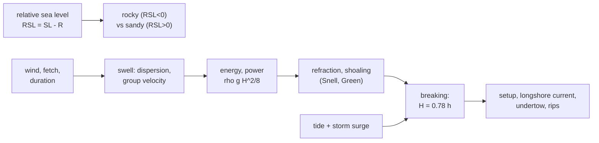

# LS26 · Sea Level and Ocean Waves

◀ [[LS25 Water in the Landscape]] · [[Landscapes and Geomorphology - Course Map|Course Map]] · next: [[LS27 Coasts Beaches Deltas and Rocky Shores]]

extra · book extra · beyond

> [!syllabus] Syllabus map: what is in the syllabus and what is extra in this chapter
> **No lecture source** for coasts (see [[LS21 River Hydraulics and Hydraulic Geometry]]). The pre-midsem deck touches sea level only through glacial rebound and isostasy ([[LS15 Glacial Deposits Rebound and Sea Level]], [[LS07 Isostasy]]); the physics of ocean waves is new to the vault's Landscapes block and is the natural meeting point with the **Waves** subject ([[Waves - Course Map]]).
> 🟡 **Extra · book** (Anderson and Anderson, *Geomorphology*, Ch. 16, printed pp.502–531; **PDF page = printed + 18**): §1 the relative movement of land and sea ([[geomorphology-the-mechanics-and-chemistry-of-landscapes-9780521519786-0521519780_compress.pdf#page=522|pp.504–508]]); §2 waves: origin, transformation, longshore currents, surge ([[geomorphology-the-mechanics-and-chemistry-of-landscapes-9780521519786-0521519780_compress.pdf#page=526|pp.508–512]]).
> 🔵 **Extra · beyond** (all numbers in `scripts/ls_hydro_coast_numbers.py`, section LS26, each checked by a second route): the volume-flux arithmetic of melt-water pulse 1A, the **group-velocity correction to A&A's swell travel time**, the integration of the wave potential energy ($\rho gH^2/16$), $E=\rho gH^2/8$ and $P=\rho g^2H^2T/32\pi$, shoaling and refraction with the *full* dispersion relation (solved numerically), the breaking depth, wind setup on a shelf, the Rayleigh wave-height statistics (simulated against the closed form) and the energy share of the biggest waves, and the problems.

> [!key] After this chapter you can
> - define **relative sea level** $RSL=SL-R$ and use it to say whether a coast is emerging (rocky, terraced) or drowning (sandy, barrier islands),
> - read the **sea-level record**: LGM at $-120$ m, deglaciation, melt-water pulse 1A ($5$ cm/yr, $0.6$ Sv), the present $2.9$ mm/yr; and compute **steric** rise and **marine-terrace** uplift,
> - state the **water-wave dispersion relation** and its two limits, and use **group velocity** (not phase speed) for how fast swell and energy travel,
> - compute **wave energy** $\rho gH^2/8$ and **power** $E\,C_g=\rho g^2H^2T/32\pi$ per metre of crest,
> - trace a wave inshore: **refraction** (Snell's law), **shoaling** (energy-flux conservation, Green's law), **breaking** ($H_b\approx0.78h_b$),
> - explain **setup, longshore current, undertow, rip currents**, and compute **storm-surge** components (inverse barometer, wind setup),
> - say why the **largest waves do most of the work**, with the Rayleigh numbers.

> [!intuition] The one-sentence story
> The coast is where the sea's energy is delivered to the land: wind makes waves at sea, dispersion sorts them by period as they run across the ocean, the sea floor bends and steepens them near the shore until they break, and because wave power goes as the square of height, the biggest few per cent of waves, riding on the highest water levels, do most of the geomorphic work; whether that work builds beaches or cuts cliffs depends on whether the land is rising or sinking relative to the sea.

## 1. Relative sea level
Coasts differ with the *relative motion* of land and sea. Where rock rises faster than the sea, coasts are **rocky**, crenulated cliff lines with pockets of sand; where the sea rises relative to the land, coasts are **sandy**, with sand smeared along them by littoral processes and organised into barrier islands, spits and deltas (A&A p.504). Both interfaces move, and both relative to the centre of the Earth (the geoid). With $SL$ the rate of sea-level change and $R$ the rate of change of land elevation ($R>0$ uplift, $R<0$ subsidence),

$$\boxed{RSL=SL-R},$$

and the ocean attacks rock only where $RSL<0$ (uplift beats sea-level rise). *Numbers:* $SL=+3$ mm/yr with $R=+5$ mm/yr gives $RSL=-2$ mm/yr (the coast emerges: terraces); $R=-5$ mm/yr gives $RSL=+8$ mm/yr (the coast drowns).

### 1.1 The Pleistocene record and the last deglaciation
The best continuous history is the oxygen-isotope record of benthic foraminifera in deep-sea cores ([[LS15 Glacial Deposits Rebound and Sea Level]], A&A Figs. 1.3–1.4). Calibrating it to sea level uses the **LGM** shorelines at $-120$ m on tectonically quiet coasts. The transformation from $\delta^{18}\mathrm{O}$ to sea level is **not linear**, because the ocean is not a vertical-walled bathtub: the water volume change is $dV=A(z)\,dz$ with $A$ the ocean area at level $z$ (A&A eq. 16.1). The correction is small for $-120$ m ($\lesssim5\,\%$: the shelves are only $\sim100$ km wide against ocean basins of radius $\sim3000$ km), but the ice also has a different isotopic composition from the ocean, so the isotope record is only the *best continuous* proxy, not the truth.

**Corals give the real deglacial curve.** *Acropora palmata* lives within 5 m of the surface and grows fast enough to keep pace with sea-level rise; cores through Caribbean reefs date it by U/Th and $^{14}$C ([[LSX1 Clocks in Rocks]]). Sea level began at $-120$ m at $\sim26$ ka (LGM), rose at an increasing rate from 18 to 10 ka, and flattened near $-6$ m at 10 ka. Punctuating it are abrupt rises, the largest **melt-water pulse 1A** ($\sim25$ m between 14.7 and 14.2 ka).

> [!derivation] 🔵 Extra · beyond (arithmetic checked): what a 5 cm/yr rise demands
> The ocean covers $0.75\times4\pi R_E^2=3.82\times10^{14}$ m² ($R_E=6370$ km). A rise of 25 m in 500 yr is $5$ cm/yr, so the volume of water added per unit time is
>
> $$\frac{dV}{dt}=A_{oc}\,\frac{dh}{dt}=3.82\times10^{14}\times0.05=1.9\times10^{13}\ \text{m}^3/\text{yr}=19\,000\ \text{km}^3/\text{yr}=6.1\times10^{5}\ \text{m}^3/\text{s}.$$
>
> That is 0.6 Sverdrup (1 Sv $=10^6$ m³/s) maintained for 500 years, **three Amazons** ($2.0\times10^{5}$ m³/s) turned on for five centuries and then off, "oceanic in scale" (A&A p.506) and attributable only to the rapid demise of one or more ice sheets. By contrast the present rise of 2.9 mm/yr is $1100$ km³/yr, or 29 cm per century. The LGM lowering of 120 m removed $4.6\times10^{7}$ km³ of water (about $5\times10^{7}$ km³ of ice): roughly the Antarctic ice sheet (64 m of sea-level equivalent) plus Greenland (7 m) plus another $\sim50$ m of now-vanished northern ice (the volumes of today's sheets are recalled, `[verify]`).

### 1.2 The last century and its causes
Tide gauges measure *relative* sea level (the gauge sits on rock that may move). New York City shows 2.9 mm/yr over a century, of which about **1 mm/yr (30 %) is glacial isostatic adjustment** of the collapsing forebulge (A&A Fig. 16.3); the global rate is about 2.9 mm/yr, which adds up to 30 cm in a century. Contributions (A&A pp.506–507):
- **thermal expansion (the steric effect):** $\Delta h=\alpha H\Delta T$ for a warmed layer of thickness $H$. For $\alpha=(1$–$2)\times10^{-4}\,\mathrm K^{-1}$, $H=3000$ m and $\Delta T=1$ K the whole column rises $0.3$–$0.6$ m; but the ocean warms first in a thin surface layer: $\alpha=1.5\times10^{-4}$, $H=700$ m, $\Delta T=0.5$ K gives only 5 cm, and the deep ocean needs millennia to equilibrate, so the steric rise continues for centuries after warming stops. The present steric rate is $\sim1.5$ mm/yr, about half of the total;
- **added water**, the other half, mostly from glaciers (Meier et al. 2007: shrinkage of small glaciers is about 60 % of the non-steric rise; Alaskan glaciers lose volume especially fast).

### 1.3 Rock uplift and marine terraces
Coastal landforms are the best uplift gauges because **marine terraces and beaches are scribed horizontal**, unlike river terraces whose initial slope is unknown. A sea cliff meets the **wave-cut platform** at the **wave-cut angle**, a proxy for mean sea level at the time. If a terrace of age $T$ formed when sea level was $z_{sl}$ and now stands at height $z$, the mean uplift rate is

$$\boxed{U=\frac{z-z_{sl}}T}.$$

*Numbers:* the last interglacial (MIS 5e, 125 ka) had sea level $+6$ m, so a terrace at 30 m has $U=(30-6)/125\ \text{kyr}=0.19$ mm/yr, and one at 95 m has 0.71 mm/yr. On the **Huon Peninsula** (Papua New Guinea), uplifting at 1–3 mm/yr, the 125 ka coral terrace stands $\sim130$ to $380$ m high (figure B). The age comes from fossils, from cosmogenic nuclides in the platform sediment ([[LSX1 Clocks in Rocks]]) or, in the tropics, from U/Th dating of the corals. Sandy coasts record sea level in old **strandlines** (rising coasts) and in the depths of peats in cores (subsiding coasts).

![[fig_ls26_sealevel.png]]
*Figure LS26.1. A: rates of sea-level rise on a log scale (present, Holocene mean, deglaciation mean, melt-water pulse 1A). B: elevation of a 125 ka and a 6 ka marine terrace against uplift rate; the green band is the Huon Peninsula range. C: the period of swell arriving from a storm at three distances (T = 4πD/gt, §2.2).*

## 2. Waves at sea
### 2.1 Origin
Except for **tsunamis** (generated by earthquakes and landslides), waves are generated by wind. A flat sea is *unstable* to wind: the air streamlines compress over an incipient crest (low pressure, by Bernoulli) and spread over a trough (high pressure), lifting the crest and pushing down the trough, a feedback that makes waves inevitable. Wave height grows with **wind speed** (roughly as its square in a fully developed sea), **duration** and **fetch** (the distance the wind blows unobstructed, A&A Fig. 16.6). A storm broadcasts a *spectrum* of waves, which then disperse.

### 2.2 The dispersion relation, phase speed and group speed
A small-amplitude surface gravity wave of wavelength $\lambda=2\pi/k$ and period $T=2\pi/\omega$ in water of depth $h$ obeys

$$\omega^2=gk\tanh(kh),\qquad C=\frac\omega k=\sqrt{\frac gk\tanh kh}.$$

(derived in the Waves subject from the boundary conditions at the surface and bed; the full derivation is not in A&A, which quotes the two limits). Two limits (figure A):

| limit | condition | phase speed | notes |
|---|---|---|---|
| **deep water** | $h\gtrsim\lambda/2$ ($kh\gg1$) | $C=\sqrt{g/k}=\dfrac{gT}{2\pi}$ | **dispersive**: long waves are faster |
| **shallow water** | $h\lesssim\lambda/20$ ($kh\ll1$) | $C=\sqrt{gh}$ | **non-dispersive**: depth sets the speed |

*Numbers:* deep-water waves of $T=6,\ 10,\ 14,\ 20$ s have $\lambda=56,\ 156,\ 306,\ 625$ m and $C=9.4,\ 15.6,\ 21.9,\ 31.2$ m/s. In shallow water a tsunami in 4000 m of ocean travels at $\sqrt{gh}=198$ m/s $=713$ km/h; for a period of 20 min its wavelength is 238 km, so $kh=0.11\ll1$, a shallow-water wave even in mid-ocean.

> [!derivation] 🔵 Extra · beyond (checked): group velocity, and a correction to the book's swell time
> A packet of waves of nearby $k$ moves at the **group velocity** $C_g=d\omega/dk$ ([[Phase and Group Velocity]], [[Dispersion Relation]]), and **energy travels at $C_g$, not at $C$**. Differentiating $\omega^2=gk\tanh kh$ gives
>
> $$C_g=nC,\qquad n=\frac12\Big(1+\frac{2kh}{\sinh2kh}\Big)\ \to\ \begin{cases}\tfrac12&\text{deep water}\\1&\text{shallow water.}\end{cases}$$
>
> A&A (p.509) say a 20 s wave moves at 30 m/s and "can travel about 2400 km in a day": that uses the *phase* speed ($31.2$ m/s $=2700$ km/day). The swell's **energy** moves at $C_g=gT/4\pi=15.6$ m/s $=1350$ km/day, half as fast, so a 20 s swell takes **6 days**, not 3, to cross 8000 km of ocean (`[!verify]` against the book's statement). The *sorting* A&A describe is right: long waves run ahead. From a storm a distance $D$ away the waves of period $T$ arrive at $t=D/C_g=4\pi D/(gT)$, i.e. the period of the waves arriving at time $t$ is
>
> $$T(t)=\frac{4\pi D}{g\,t}.$$
>
> For $D=4000$ km the arriving period is 29.7 s two days after the storm, 19.8 s at three days, 14.8 s at four and 9.9 s at six (figure C), the falling-tone "chirp" visible in buoy spectrograms. From a storm 3000 km away, 16 s swell arrives after 2.8 days.

Swell from a distant storm therefore has a **clean, narrow spectrum**, with long period, that surfers prize; locally generated *sea* is a broad, short-period mixture.

### 2.3 Wave energy and power
A wave carries kinetic energy in the orbital motion of its water and potential energy in the raised and lowered surface. For a sinusoidal surface $\eta=\tfrac H2\sin(2\pi x/\lambda-\omega t)$ the potential energy per unit area relative to still water, found by averaging the column's mass times the height of its centre of mass over a wavelength, is

$$\overline{E_p}=\frac{\rho g}{\lambda}\int_0^\lambda\frac{(h+\eta)^2-h^2}2\,dx=\rho g\,\overline{\Big(h\eta+\frac{\eta^2}2\Big)}=\frac{\rho g}2\overline{\eta^2}=\frac{\rho g}2\cdot\frac{H^2}8=\frac{\rho gH^2}{16}$$

(the mean of $\eta$ over a wavelength is zero and $\overline{\sin^2}=\tfrac12$; numerical integration reproduces $2452.5$ J/m² for $H=2$ m exactly). The kinetic energy is equal (equipartition for a linear wave), so

$$\boxed{E=\frac18\rho gH^2}\ \ [\mathrm{J/m^2}],\qquad\boxed{P=E\,C_g}\ \ [\mathrm{W/m\ of\ crest}],\qquad P_{deep}=\frac{\rho g^2H^2T}{32\pi}.$$

The wave power is the analogue of **stream power** (LS23), and like it depends on the *square* of the controlling variable, which is why "the big waves will do a lot of the work" (A&A p.510). *Numbers* (seawater, $\rho=1025$):

| $H$ (m) | $T$ (s) | $E$ (kJ/m²) | $P$ (kW/m of crest) |
|---|---|---|---|
| 1 | 8 | 1.26 | 7.8 |
| 2 | 10 | 5.0 | **39** |
| 4 | 12 | 20 | 188 |
| 8 | 14 | 80 | 879 |

A 2 m, 10 s swell carries 39 kW across every metre of crest, so 1 km of coast receives 39 MW of incident power, comparable to a small power station; power rises as $H^2T$ and the 8 m storm wave carries 22 times as much.

## 3. Waves approaching the coast
Away from the shore, a wave conserves energy flux. Over a sloping bottom three things happen in turn: the wave **refracts**, **shoals** (grows), and **breaks**.

### 3.1 Refraction: Snell's law
The shoreward end of an obliquely approaching wave front reaches shallow water first and slows, so the front rotates toward parallel with the shore; the rays bend like light entering glass:

$$\frac{\sin\alpha}{C}=\text{constant along a ray}\ \ \Longleftrightarrow\ \ \sin\alpha=\sin\alpha_0\frac C{C_0}.$$

Because $C$ falls monotonically with decreasing depth, $\alpha\to0$ near the shore, whatever the offshore angle (the **waves arrive nearly parallel to the beach**). On an irregular bottom the rays **focus on headlands** (where they converge) and **defocus over submarine canyons** (A&A Fig. 16.7): converging rays raise wave height and power on promontories, as in the numbers below: rays focused $2:1$ raise $H$ by $\sqrt2=1.41$ and power by 2. This is why headlands erode and bays accumulate sand.

### 3.2 Shoaling: energy flux conservation
In the absence of dissipation the energy flux through a strip between two rays is conserved: $b\,E\,C_g=\text{const}$ with $b$ the spacing of the rays. With $E=\rho gH^2/8$,

$$\boxed{\frac H{H_0}=\underbrace{\sqrt{\frac{C_{g0}}{C_g}}}_{K_s\ (\text{shoaling})}\ \underbrace{\sqrt{\frac{b_0}{b}}}_{K_r\ (\text{refraction})}},\qquad\frac{b_0}b=\sqrt{\frac{\cos\alpha_0}{\cos\alpha}}\ \text{(straight parallel contours)}.$$

In very shallow water $C_g=\sqrt{gh}$, so $K_s\propto h^{-1/4}$ (**Green's law**): a wave that gets 16 times shallower grows 2 times higher; and its wavelength falls ($\lambda=CT$ with $T$ conserved), so it **steepens**. Orbital motions change from circles to ellipses flattened against the bed.

> [!example] 🧮 Worked transformation (numbers from the script)
> A swell of $T=12$ s and $H_0=2$ m arriving at $30^\circ$ in deep water ($C_0=18.7$ m/s, $C_{g0}=9.4$ m/s):
>
> | $h$ (m) | $C$ (m/s) | $C_g$ (m/s) | $\alpha$ | $K_s$ | $K_r$ | $H$ (m) | $H/h$ |
> |---|---|---|---|---|---|---|---|
> | 100 | 18.6 | 9.7 | $29.8^\circ$ | 0.984 | 0.999 | 1.97 | 0.02 |
> | 50 | 17.1 | 11.0 | $27.1^\circ$ | 0.924 | 0.986 | 1.82 | 0.04 |
> | 20 | 12.7 | 10.5 | $19.8^\circ$ | 0.943 | 0.959 | 1.81 | 0.09 |
> | 10 | 9.4 | 8.6 | $14.6^\circ$ | 1.044 | 0.946 | 1.98 | 0.20 |
> | 5 | 6.8 | 6.5 | $10.5^\circ$ | 1.198 | 0.939 | 2.25 | 0.45 |
> | 3 | 5.4 | 5.2 | $8.2^\circ$ | 1.340 | 0.935 | 2.51 | 0.84 |
>
> **The height first *decreases* slightly** (at 50 m depth $C_g$ rises above its deep value, since $n$ goes from $\tfrac12$ toward 1 faster than $C$ falls) and then grows, reaching $K_s=1.34$ by 3 m; between 2 m and 3 m the ratio $K_s(2)/K_s(3)=1.089$ against Green's $(3/2)^{1/4}=1.107$ (within 2 %). The wave angle falls from $30^\circ$ to $8^\circ$.

### 3.3 Breaking
When the wave is steep enough it topples. A common criterion is $H_b\approx\gamma h_b$ with $\gamma\approx0.78$ (a solitary-wave result, `[verify]`). Solving $H(h)=0.78h$ along the table above gives **breaking at $h_b=3.2$ m with $H_b=2.5$ m and $C_b=5.5$ m/s, at $\alpha_b=8.5^\circ$** (the $30^\circ$ deep-water wave has turned to the shore through $C_0/C_b=3.4$: $\sin\alpha_b=\sin30^\circ/3.4$). The plunging wave thrusts water up the shoreface as **swash** and returns it as **backwash**; if the wave arrives at an angle, this drives sand along the beach (**longshore drift**, [[LS27 Coasts Beaches Deltas and Rocky Shores]]).

### 3.4 Setup, longshore current, undertow and rips
The water delivered to the shoreface raises the mean surface (**wave setup**). Obliquely breaking waves drive a **longshore current** confined to the surf zone, peaking about halfway between the breaker line and the top of the swash, with speeds of "large fractions of 1 m/s" (A&A Fig. 16.8). What runs up must run off (mass conservation): in the vertical, a slow seaward **undertow** at depth balances the shoreward surface flow, and along the shore, **rip currents** return the water in discrete fast jets that interrupt the breaker line (swimmers should swim *across* them, not against). The mean position of the breakers can be mapped by averaging video frames, since the foam of breaking is white against dark water.

![[fig_ls26_waves.png]]
*Figure LS26.2. A: phase speed against depth for four periods, with the shallow-water limit $\sqrt{gh}$. B: shoaling and refraction of a 12 s, 2 m wave arriving at $30^\circ$: height (blue), breaking limit (orange dashed) and wave angle (green); the wave breaks at 3.2 m depth. C: for a Rayleigh sea the largest 10% of waves carry 33% of the energy.*

## 4. Water level: tide, surge and which waves do the work
### 4.1 Tide and surge move the interface
Waves deposit their energy along the line where sea meets land, and that line is moved on short time scales by **tides** and **storm surges**. At high tide the wave breaks closer to the cliff base and less energy is dissipated crossing the shelf: a cliff base in 3 m of water at low tide can be hit by unbroken waves of height $0.78\times3=2.3$ m, and in 5 m (high tide) by waves of $3.9$ m, with an energy ratio $(5/3)^2=2.8$.

### 4.2 Storm surge
> [!derivation] 🟡 Extra · book and 🔵 numbers: two contributions to a hurricane surge
> (a) **Pressure (inverse barometer).** The atmosphere weighs $P_0=1.013\times10^{5}$ Pa, which is a column of fresh water $P_0/\rho g=10.3$ m ("pure coincidence", A&A p.511). Lowering the pressure under the eye by $\Delta P$ lets the sea surface dome up so that the pressure at depth is equalised: $\Delta z=\Delta P/\rho g$. A category-5 eye at 900 hPa has $\Delta P\approx113$ hPa, giving **$\Delta z\approx1.1$ m**: the pressure drop is one-tenth of an atmosphere, one-tenth of 10 m. (b) **Wind setup.** A wind stress $\tau_w=\rho_aC_dU^2$ acting over a shelf of width $L$ and depth $h$ piles water against the coast. Balancing it against the surface slope, $\rho gh\,\partial_x\eta=\tau_w$, gives
>
> $$\Delta\eta=\frac{\tau_wL}{\rho gh}.$$
>
> With $C_d=2.5\times10^{-3}$, $\rho_a=1.2$: $U=30$ m/s gives $\tau_w=2.7$ Pa; $U=50$ m/s gives 7.5 Pa and $\Delta\eta=3.7$ m on a shelf 100 km wide and 20 m deep, but only 1.9 m for a 50 km shelf and 1.5 m for a 50 m deep one. **The setup scales with the *width over depth* of the shelf and with $U^2$**: a broad, shallow shelf (Louisiana, the Bay of Bengal) is dangerous, a steep narrow one is not. The wind part, not the pressure part, makes the *majority* of a 10 m surge (A&A: "the remainder and indeed the majority"); it is also asymmetric about the track (stronger on the right of the eye in the northern hemisphere, where the wind and the forward motion add).

On a delta with slope $10^{-4}$ a 5 m surge penetrates $5/10^{-4}=50$ km inland ([[LS27 Coasts Beaches Deltas and Rocky Shores]], §3).

### 4.3 Wave climate and the nonlinearity of work
A swell of 10–20 s period means 4000–8000 waves a day and $\sim2$–$3$ million a year at every site (script: 3.2 million at 10 s), so wave height must be described **statistically**, by the wave climate from buoys (A&A Fig. 18.20): the distribution of heights by direction.

> [!derivation] 🔵 Extra · beyond (simulated and exact): the energy share of the biggest waves
> For a narrow-band sea the individual wave heights follow a **Rayleigh distribution** $p(H)=(H/\sigma^2)e^{-H^2/2\sigma^2}$, for which $H_{rms}=\sqrt2\sigma$ and the **significant height** (the mean of the highest third) is $H_{1/3}=2\sigma=1.416H_{rms}$ (a simulation of $4\times10^{5}$ waves gives 2.002 for $\sigma=1$ and $H_s=2$). The expected largest of $N$ waves is $\sigma\sqrt{2\ln N}$: $2.0\,H_s$ in 3000 waves (simulated $4.15$ against $4.00$ m for $H_s=2$ m). Since $H^2$ is exponentially distributed, the share of the energy carried by the largest fraction $q$ of waves is
>
> $$\boxed{\text{energy share}=q\,(1+\ln\tfrac1q)},$$
>
> so the **largest 10 % of waves carry 33 % of the energy**, the largest 1 % carry 5.6 % and the largest quarter more than half (figure C); simulation gives 33.0 %. Add the nonlinear dependence of sediment transport and rock erosion on wave height ([[LS27 Coasts Beaches Deltas and Rocky Shores]]: $Q\propto H_b^{5/2}$) and the work is concentrated in storms: the same magnitude–frequency argument as for floods ([[LS22 Floods Planform and River Profiles]]) and winds ([[LS24 Sediment Transport Mechanics]]).

## 5. Worked examples
> [!example] 🧮 Example 1: a drowning or an emerging coast?
> Global sea level rises 2.9 mm/yr. A coast with uplift $R=+1.5$ mm/yr has $RSL=+1.4$ mm/yr: it is still being slowly drowned; one that subsides at 4 mm/yr has $RSL=+6.9$ mm/yr and the barrier islands migrate landward. A terrace at 40 m dated at 125 ka means the land rose $40-6=34$ m in 125 kyr, $R=0.27$ mm/yr; against a modern $SL=2.9$ mm/yr that gives $RSL=2.6$ mm/yr, so this coast is *drowning today* even though a raised terrace stands behind it: the uplift that built the terrace is ten times too slow to outpace the present rise.

> [!example] 🧮 Example 2: when does a swell arrive?
> A storm 3000 km away generates 16 s waves. Their group speed is $gT/4\pi=12.5$ m/s ($1080$ km/day), so they arrive after $3\times10^{6}/12.5=2.4\times10^{5}$ s $=2.8$ days. The 12 s waves arrive after $3\times10^{6}/9.4=3.7$ days, the 8 s waves after 5.6 days: the sea off the coast rises with a long-period swell, then the period shortens day by day.

> [!example] 🧮 Example 3: breaking depth of a small swell
> $T=8$ s, $H_0=1$ m, normal incidence: solving $H(h)=0.78h$ with $H=H_0\sqrt{C_{g0}/C_g(h)}$ gives $h_b=1.64$ m and $H_b=1.28$ m. A 10 s swell with $H_0=1.5$ m has shoaling coefficients $K_s=0.98,\ 1.11,\ 1.24$ at 10, 5 and 3 m depth, so $H=1.48,\ 1.67,\ 1.85$ m.

## 6. Check yourself
> [!question] Problems (answers folded)
> 1. Sea level rises 2.9 mm/yr. Find $RSL$ for a coast uplifting at 1.5 mm/yr and one subsiding at 4 mm/yr.
> 2. A pulse raises sea level by 12 m in 600 yr. Compute the water-volume flux in m³/s and in Amazons ($2\times10^{5}$ m³/s).
> 3. Steric rise of a 700 m surface layer warming by 0.8 K, $\alpha=2\times10^{-4}$ K$^{-1}$.
> 4. A 125 ka terrace stands 95 m above present sea level (interglacial sea level $+6$ m). Find the uplift rate.
> 5. For $T=16$ s in deep water: wavelength, phase speed, group speed, and the time for the energy to cross 6000 km.
> 6. Power per metre of crest for $H=3$ m, $T=11$ s in deep water.
> 7. Swell of $T=16$ s from a storm 3000 km away: arrival time.
> 8. $T=10$ s, $H_0=1.5$ m, normal incidence: find $H$ at 10 m and 5 m depth with the shoaling coefficients (use $C(h)$ from the dispersion relation).
> 9. $T=9$ s deep-water angle $25^\circ$: breaker angle at $h=3$ m (use $C_0=14.05$ m/s and $C(3\text{ m})=5.29$ m/s).
> 10. A hurricane: eye 70 hPa below ambient, wind 40 m/s over a shelf 80 km wide and 15 m deep ($C_d=2.5\times10^{-3}$, $\rho_a=1.2$). Find the pressure and wind contributions to the surge.
> 11. Rayleigh sea with $\sigma=1.5$ m: find $H_{rms}$, $H_{1/3}$ and the expected largest wave of 1000.

> [!example]- Answers
> 1. $RSL=2.9-1.5=+1.4$ mm/yr (slow drowning); $2.9+4=+6.9$ mm/yr.
> 2. $dh/dt=2$ cm/yr, $dV/dt=3.82\times10^{14}\times0.02=7.6\times10^{12}$ m³/yr $=2.4\times10^{5}$ m³/s $=1.2$ Amazons.
> 3. $\alpha H\Delta T=2\times10^{-4}\times700\times0.8=0.112$ m $=11$ cm.
> 4. $U=(95-6)/125\ \text{kyr}=0.71$ mm/yr.
> 5. $\lambda=gT^2/2\pi=400$ m; $C=gT/2\pi=25.0$ m/s; $C_g=12.5$ m/s; $6\times10^{6}/12.5=4.8\times10^{5}$ s $=5.6$ days.
> 6. $P=\rho g^2H^2T/32\pi=1025\times96.2\times9\times11/100.5=97$ kW/m.
> 7. $D/C_g=3\times10^{6}/12.5=2.4\times10^{5}$ s $=2.8$ days.
> 8. Deep water: $C_{g0}=gT/4\pi=7.81$ m/s. At 10 m: $C=9.24$, $C_g=8.07$ m/s, $K_s=\sqrt{7.81/8.07}=0.984$, $H=1.48$ m. At 5 m: $C_g=6.33$, $K_s=1.111$, $H=1.67$ m. (At 3 m: $K_s=1.236$, $H=1.85$ m.)
> 9. $\sin\alpha=\sin25^\circ\times5.29/14.05=0.159$, $\alpha=9.2^\circ$.
> 10. Pressure: $7000/(1025\times9.81)=0.70$ m. Wind: $\tau=1.2\times2.5\times10^{-3}\times1600=4.8$ Pa; $\Delta\eta=4.8\times8\times10^{4}/(1025\times9.81\times15)=2.5$ m. The wind term is 3.7 times the pressure term.
> 11. $H_{rms}=\sqrt2\sigma=2.12$ m; $H_{1/3}=2\sigma=3.0$ m; largest of 1000: $\sigma\sqrt{2\ln1000}=1.5\times3.717=5.6$ m.

## 7. Summary
- $RSL=SL-R$: emerging (rocky, terraces) if negative, drowning (sandy) if positive; terrace uplift $U=(z-z_{sl})/T$.
- LGM $-120$ m; MWP-1A: 25 m in 500 yr $=5$ cm/yr $=6\times10^{5}$ m³/s $=3$ Amazons; present 2.9 mm/yr, about half steric; steric $\Delta h=\alpha H\Delta T$.
- Waves: $\omega^2=gk\tanh kh$; deep $C=gT/2\pi$, shallow $C=\sqrt{gh}$; energy travels at $C_g=nC$ ($\tfrac12C$ in deep water): swell arrives longest-period first, $T(t)=4\pi D/gt$.
- $E=\rho gH^2/8$ (potential $\rho gH^2/16$ + kinetic equal); $P=EC_g=\rho g^2H^2T/32\pi$ ($H=2$ m, $T=10$ s: 39 kW/m).
- Inshore: Snell $\sin\alpha/C$ constant; shoaling $K_s=\sqrt{C_{g0}/C_g}$, Green $h^{-1/4}$; breaking $H=0.78h$; setup, longshore current, undertow, rips.
- Surge: inverse barometer $\Delta P/\rho g$ ($\approx1.1$ m) plus wind setup $\tau L/\rho gh$ (dominant on wide shelves).
- Rayleigh sea: $H_{1/3}=2\sigma$, the largest 10 % of waves carry $q(1+\ln1/q)=33$ % of the energy.

<!-- interactive:start (generated by scripts/embed_interactive.py; edit the tool in scripts/interactive/tools/, not this block) -->
> [!interactive]+ Interactive: Waves coming ashore: dispersion, shoaling, refraction and breaking
> Linear water waves obey ω² = g k tanh(kh): in deep water the phase speed is gT/2π, in shallow water √(gh).
>
> ![[ls_ocean_waves.png|720]]
>
> **Try:** T = 12 s, H₀ = 2 m, α₀ = 30°: at 100 m depth C = 18.6 m/s, K_s = 0.984; at 10 m C = 9.4, K_s = 1.044, K_r = 0.946, α = 14.6°. T = 8 s, H₀ = 1 m, normal incidence breaks at 1.64 m depth with H_b = 1.28 m. Steeper beach: the same waves, nearer the shore.
>
> [▶ Open the tool in your browser](../Assets/interactive/ls_ocean_waves.html) · [absolute link](file:///home/swastik/Documents/notes/Assets/interactive/ls_ocean_waves.html) · all tools and coverage: [[Interactive Tools]]

> [!interactive]+ Interactive: Wave packets: phase velocity versus group velocity
> A packet is a superposition of plane waves ψ(x,t) = ∫ A(k) e^{i(kx − ω(k)t)} dk with a Gaussian A(k) centred on k₀.
>
> ![[wave_dispersion_packet.png|720]]
>
> **Try:** Deep water: v_g = v_p/2 (ripples run through the packet). Waveguide/plasma: v_p·v_g = c², ripples faster than c but the packet slower. Schrödinger: ω = k²/2, v_g = 2v_p. Non-dispersive: nothing spreads.
>
> [▶ Open the tool in your browser](../Assets/interactive/wave_dispersion_packet.html) · [absolute link](file:///home/swastik/Documents/notes/Assets/interactive/wave_dispersion_packet.html) · all tools and coverage: [[Interactive Tools]]

<!-- interactive:end -->

## Map of this chapter
> [!connection] How LS26 connects
> **Earlier:** [[LS15 Glacial Deposits Rebound and Sea Level]] and [[LS07 Isostasy]] (the land's response to ice and water loads), [[LS14 Glaciers Mass Balance and Ice Flow]] (the ice that made the sea-level record), [[LS22 Floods Planform and River Profiles]] (base level), [[LS23 Bedrock Channels and River Incision]] (stream power; the same square-of-the-driver logic), [[LS24 Sediment Transport Mechanics]], [[LSX1 Clocks in Rocks]] (U/Th and cosmogenic dating of terraces). **Next:** [[LS27 Coasts Beaches Deltas and Rocky Shores]].
> **Across subjects:** [[Waves - Course Map]] (the water-wave dispersion relation, group velocity, energy flux, Snell's law and shoaling are standard wave physics: [[Water Wave Dispersion]], [[Wave Energy and Power]], [[Wave Shoaling and Refraction]]); [[Dispersion Relation]] and [[Phase and Group Velocity]] (Foundations); [[Climate - Course Map]] (thermal expansion, glaciers and sea level, hurricanes, [[CL12 Rotating Frames and the Coriolis Force]]); [[Normal Distribution]], [[Gumbel Distribution]] and [[Exponential Distribution]] (wave-height statistics: a Rayleigh sea is the amplitude of a Gaussian narrow-band process); [[Thermodynamics and Statistical Mechanics - Course Map]] (thermal expansion, [[Heat Capacity]]); [[Fourier Transform]] (the wave spectrum).
> **Concept notes:** [[Relative Sea Level]] · [[Marine Terrace]] · [[Storm Surge]] · [[Water Wave Dispersion]] · [[Wave Energy and Power]] · [[Wave Shoaling and Refraction]].

## Provenance
> [!provenance]- Source map for this chapter
> | Topic | Source | Scope |
> |---|---|---|
> | relative sea level, Pleistocene and Holocene records, melt-water pulse, last century, steric effect, uplift and terraces, origin and transformation of waves, longshore currents, surge | A&A Ch. 16, printed pp.504–512 (PDF = printed + 18; text-layer reading, equations rederived) | extra · book |
> | MWP-1A flux arithmetic, group-velocity correction, potential-energy integral, shoaling table with the full dispersion relation, breaking depth, wind setup, Rayleigh statistics, problems | my derivations, `scripts/ls_hydro_coast_numbers.py` (LS26) | extra · beyond |
>
> **Flagged:** A&A's swell travel statement uses phase speed (§2.2); the breaker index $0.78$ and the drag coefficient $2.5\times10^{-3}$ are recalled; the present volumes of Antarctica and Greenland and the 60 % glacier share are recalled or quoted from A&A without checking; the full derivation of the linear dispersion relation is in Waves, not here.
